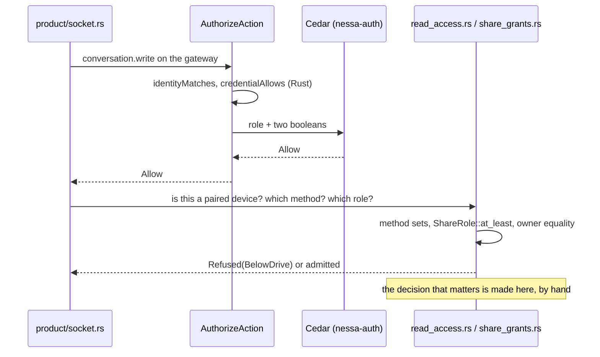
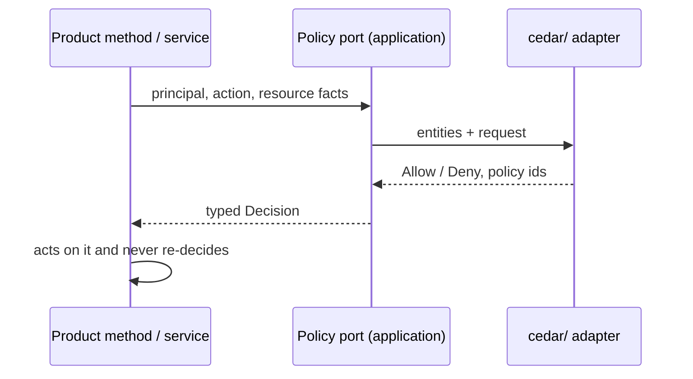

# 803. Every policy decision goes through Cedar

## Purpose

Nessa answers "may this principal do this to that?" in about thirty places, and
Cedar answers it in one. This record makes Cedar the one authority for every
such question, says what is not that question and stays in Rust, and lists the
order the hand-written decisions move in. The rule itself is
[gate 18](../../../CODING_STANDARDS.md#gates); this record is its audit and plan.

- **Date:** 2026-10-13
- **Status:** accepted (Saurav, 2026-10-13: "everything should be cedar for
  policies") and implemented: steps 1, 2 and 5 in #808 and #817, steps 3 and 4
  in the pull request that moved this record to `done/`; step 6 dropped

## Context

Cedar 4.12.0 is embedded in `nessa-auth` (`adapters/cedar/`). It answers five
actions on one resource, the gateway itself: `server.read`,
`credential.manage`, `conversation.read`, `conversation.write` and
`environment.serve`. Even there it decides little on its own:

- Two of its three `forbid` rules test yes/no values that Rust worked out first:
  `identityMatches` and `credentialAllows`. Cedar never sees a grant, so the
  main authorization fact is decided before Cedar runs.
- `evaluator.rs` denies any action outside a hard-coded list of five before
  Cedar runs. The same list is written again in the registry's
  `validate_grants` and in the schema.
- No conversation, share grant, receiver, tool, agent or lease is a Cedar
  entity, so every finer question is answered in Rust after Cedar has said yes
  to the coarse one.

That is two authorities over one decision, which
[gate 13](../../../CODING_STANDARDS.md#gates) forbids. It also hides real gaps:
the Drive tool policy is stored but nothing evaluates it, and a Drive-started
turn gets the owner's command hosts because the command policy never looks at
who started the turn.

## Decision

Every policy decision is a Cedar policy evaluated behind an application-owned
port, by an adapter in a module directory named `cedar`. Rust gathers facts,
asks the port, and acts on a typed decision that names the policy ids that
decided it. Cedar sees facts as entities and attributes (roles, grants held,
owners, principal kind, tool name), never a yes/no that Rust has already worked
out. Each port has its own checked-in schema and policies, strictly validated
when composition builds the adapter, and fails closed. The engine does not move
to one crate: a decision's port and adapter live with the context that owns the
decision, as `nessa-auth` does, and as slice J4's tool-policy adapter will.

### What is policy, and what is not

Policy is any answer to "may this principal take this action on this resource,
now?" The principal may be a person, a paired device, a peer gateway, an
environment peer, or the turn an agent runs for.

These are not policy and stay in Rust. Each is in the
[standard](../../../CODING_STANDARDS.md#policy-goes-through-cedar) too:

| Kind | Examples found in the audit |
| --- | --- |
| Proving who someone is | `ReadCurrentSession`, device-key verification, native connection admission, TLS pins, relay key proofs, MCP stand-in bearer tokens |
| Keeping stored records valid | registry `validate_principal_kind`, `validate_registry`, pairing commit re-validation, receiver binding lifecycle |
| Capacity | relay, owner-command and native-pool permits, `max_conversations`, lease budgets, `MAX_SHARE_GRANTS`, `MAX_DRIVE_GRANTS`, subagent depth |
| A person answering a prompt | approval cards, pairing approval, MCP App destructive-tool review |
| Terms attached to a yes | environment command timeout clamp, `maxLeaseMs` deadlines, revocation ending leases |
| Matching capabilities | `SandboxProfiles::admit`, `EffectiveCapabilities` |
| The operating system's trust | `nessa env grant` (whoever can write the data directory), offline owner bootstrap and recovery |
| Desktop host trust | Tauri window-label gates, the MCP App bridge and CSP; these belong to Tauri's capabilities |

A list narrowed in SQL for speed (`share_grants::granted()` for a paired
device's catalogue) is an index. Each item it returns is still admitted by
Cedar, and an item Cedar refuses is dropped.

### Audit: decisions not made by Cedar today

Found 2026-10-13 on `main` at `bba06c2`. Functions, not line numbers, so the
table survives edits.

| Area | Where | Decision made by hand |
| --- | --- | --- |
| **A. Gateway identity** | `nessa-auth` `adapters/cedar/evaluator.rs` `evaluate`, `credential_allows`, `identity_matches` | The five-action allowlist; whether a credential's grants cover the request; identity agreement, which stays in Rust as authentication. Step 2 moved the first two into Cedar |
| | `nessa-auth` `domain/models.rs` `PrincipalKind::may_hold`; `adapters/local/registry.rs` `validate_grants`, `validate_issue` | Which actions each principal kind may hold, checked only when a credential is issued; a manager may not mint an admin; a peer gateway is never issued a bearer credential. Step 2 moved these to Cedar `credential.hold` and `credential.issue` |
| | `nessa-server` `product/socket.rs` `credential.issue`, `credential.revoke`, `credential.list` | An admin issues only active members in its own org, with grants limited to three actions; revoke and list are scoped to the caller's org and audience. Step 2 moved the role and grant checks; the socket keeps only frame-shape checks |
| | `nessa-auth` `application/pairing/admission.rs`, `domain/pairing/value_objects/values.rs` `ConsentIntent::matches_owner` | The invitation's owner must be the session's principal (Cedar is asked the rest) |
| **B. Conversation access** | `nessa-server` `conversation/domain/entities/conversation.rs` `allows`, `check_access` (deleted in step 3) | A conversation is acted on only by its owner in its org; deleted ones are told only to the owner. Step 3 moved every owner command, `note_status`, the list filters, the delete fence and the store's share change to `ConversationAccessPolicyEvaluator`; `allows` stays as a record-integrity check |
| | `conversation/application/share_grants.rs` `admit_read`, `admit_role`, `binding_of`; `domain/value_objects/share_access.rs` `ShareRole::at_least` | A paired reader reads with any grant, comments with Comment or Drive, drives with Drive; role ordering. Step 3 moved them to `conversation.read`, `.comment`, `.drive` and `note.deliver` behind `PairedAccess`, and deleted `at_least` and the role ordering; `binding_of` stays as identity and binding lifecycle |
| | `product/read_access.rs` `admit_request`, `admit_list`, `admit_conversation`, `drives_only_text`, `dispatch_share` | Which methods a paired reader may call; a peer gateway never drives; Drive carries text only; paired readers may not list or share. Step 3 made the method sets one `paired_action` table and one evaluation, with the request's attachments, files and receipt operation as facts (`drive.text_only`), the peer rule `paired.peer_gateway`, every other owner command `conversation.write`, lists `conversation.list` and shares `conversation.share`, `.unshare`, `.shares`; which refusal is told is asked of the policy too |
| | `conversation/application/share_grants.rs` `ShareConversation::share`; `infrastructure/store/share_grants.rs` `change` | A share target must be the caller's receiver and hold `conversation.read` (grant list scanned by hand); grant and revoke need ownership, inside the transaction. Step 3 moved the target predicate to `conversation.share` with the target's binding and grants as facts, and `owner_of` to `conversation.shares`; binding lifecycle and credential identity agreement stay in Rust, and the store still asks ownership inside the transaction |
| | `conversation/application/passive_read.rs` `binding`; `product/change_watch/registration.rs` `admit_current` (removed in #257) | Owner and grant checks after Cedar; a catalogue watch is refused to a peer gateway. Step 3 moved the read and the watch to the access policy; `binding` stays as identity and binding lifecycle. The watch and its `catalogue.watch` action were later removed with the product watch (#257) |
| | `attachments/application/held_reads.rs` `HeldReads::read` | Artifact bytes only for the conversation's owner. Step 3 moved it to the access policy (`artifact.read`) |
| **C. Agent tools** | `conversation/domain/command_policy.rs` `CommandPolicy::admit`, `grants` | `run` only on configured hosts; programs by allow and deny sets; ignores who started the turn. Step 4 moved both into `commands.cedar` behind `CommandPolicyEvaluator`, keyed on who started the turn: `run` asks `admit_command` and `environments_list` the host question, and a Drive grant's turn uses only the hosts its policy names (`commandHosts`), none when it names none. `admit` and `grants` are deleted; `CommandPolicy` stays as the gateway's configuration, read as facts |
| | `mcp_servers/domain/app_call.rs` `admit_app`, `admit_tool_call` | An MCP App calls only its own server, and only tools visible to it. Step 4 moved both into `apps.cedar` behind `AppCallPolicyEvaluator`; whether it is an app at all, whether the tool was listed, argument size and a destructive tool's review stay in Rust (lookups, capacity, a prompt) |
| | `nessa-sdk` `infrastructure/mcp/stand_in.rs`, `infrastructure/mcp/wire.rs` `hidden_for_model` | The model may not call a tool hidden from it |
| | `conversation/domain/value_objects/share_access.rs` `ToolRules`, `ToolPreset` | The Drive tool policy: stored, never evaluated. Slice J4 part 2 built its Cedar evaluator |
| | `nessa-sdk` `infrastructure/claude_acp/tools/wire.rs` `DISALLOWED_TOOLS`; `infrastructure/opencode_acp/sessions/binding.rs` `SESSION_POLICY` | Fixed tool deny lists sent to the harness at launch |
| **D. Environment host** | `nessa-server` `env_serve/domain/grants.rs` `granted_to`, `admit_agent`, `admit_command`; `env_serve/application/serve.rs` lease grant | Which agents and commands a leasing peer may use; SSH gets all, a dialed gateway nothing; a revoked gateway is refused. Step 5 moved the first into Cedar; what a peer with no entry holds is data, stated once by `domain::unwritten` |
| **E. Artifacts in the SDK** | `nessa-sdk` `application/agent_execution/sessions/artifacts.rs` `admit`, `asked_by` | An artifact is recorded only by the lease issuer or the person who started the turn. Not policy on a closer look: see step 6 |

Not a migration: placing a conversation on an environment
(`conversation/application/placement.rs`) has no per-principal rule today.
Adding one would be new policy, decided on its own issue.

### Migration order

Step 1 is its own pull request. Steps 2 to 5 land together in one more pull
request, `Part of #803`, because each pull request costs a full CI run (Saurav,
2026-10-13). Each step deletes the Rust it replaces in the same change.

1. **This record, the gate, and the placement check.** No behaviour change.
2. **A: gateway identity.** Grants become entity facts: each `permit`
   requires `principal.grants` to contain the requested action on this
   resource, so `credentialAllows` and the five-action allowlist go, and an
   action no policy names is refused by Cedar. What a credential may be at all
   becomes two actions behind `GrantPolicyEvaluator`: `credential.hold` (which
   grants a principal kind may carry) and `credential.issue` (who a new
   credential may be issued to, by kind and membership role). Both read the
   issuing path (bootstrap, product issue, surface provisioning, owner
   recovery, stored on load) as the fact `context.path`, never a Rust yes or
   no. So "an issue over the product protocol hands out neither
   `credential.manage` nor an admin membership" and "a peer gateway is enrolled
   only by pairing" are policies. The registry asks on every issue and every
   load, and any answer but Allow is a conflict. `PrincipalKind::may_hold`, the
   registry's lists and role check, and `credential.issue`'s own checks in
   `product/socket.rs` go. Every policy carries an `@id`, a bundle without one
   is refused, and each refusal is logged with the ids that decided it; the
   ports still return a bare Allow or Deny. The identity agreement check stays
   in Rust, before Cedar runs: it is authentication, and a mismatch denies. A
   new membership being active, revoke and list scoping (the caller's org and
   audience), and the reserved `gateway:` id prefix stay as invariants of the
   registry's own records.
3. **B: conversation access.** A conversation becomes a Cedar resource (org,
   owner, deleted), a paired reader a principal with its kind and binding owner,
   and a share role a fact. `read_access.rs`'s method sets become actions.
   Ownership checks inside the store's transaction ask the same port. Likely two
   pull requests: ownership first, then share grants. It touches files the
   slice J3 thread is editing, so it starts only when that is clear.
   Done in three parts: ownership (S1 to S3), passive reads and watches (S4),
   and share grants and the socket's paired admission (S5). Rust now only reads
   facts (binding, conversation, held role, request shape) and maps the
   policy's answer to a wire code. Whether a paired party is told `forbidden`,
   `conversation_not_found` or `conversation_deleted` is itself asked of the
   policy (`conversation.read`, `catalogue.entry`, `conversation.locate`).
   A peer gateway's refused drive or note is told what its read would be, so
   a missing id and an ungranted one answer alike; any other owner command a
   paired reader sends is `conversation.write` on its binding's catalogue,
   refused `forbidden` before a conversation is read. A share asks ownership
   before it reads the target credential. Known edges: a role below the
   action's on a deleted conversation is told it was deleted; a peer gateway's
   malformed drive command is told what a device's is, because the peer rule
   needs the conversation to be asked about; and a share's target binding is
   compared with the caller only by `conversation.share`, after the registry
   read, so a registry outage shows for another owner's credential too.
4. **C: agent tools. Done.** `CommandPolicy` and MCP App call admission are
   policies beside slice J4's tool-policy bundle (`commands.cedar`,
   `apps.cedar`), keyed on who started the turn. The turn's initiation and its
   share grant's policy at the turn's revision are facts, so a grant is
   limited to its own command hosts: a Drive grant's policy names them
   (`commandHosts`, stored with its tools under one policy revision), a
   Drive-started turn no longer inherits the gateway-wide host list, and a
   grant with no host list, including every grant stored before the field
   existed, gets no hosts. Composition builds the command evaluator once over
   the configured `CommandPolicy`; `CommandPolicy::admit` and `grants` are
   deleted. Whether a grant's turn may call `run` at all stays its tool
   policy's, asked first.
   Three items in row C are not policy and stay as they are:
   - **`hidden_for_model`** is the audience an MCP server declares for its
     tool under the MCP Apps protocol. It is the same for every turn and names
     no principal.
   - **Claude's `DISALLOWED_TOOLS`** lists tools whose effects the runtime
     cannot supervise. It is a capability of the pinned harness, the same for
     everyone.
   - **OpenCode's `SESSION_POLICY`** is the harness's fixed approval mode, a
     protocol setting. Drive-started turns on OpenCode are refused by the
     tool policy already.

   Generating Cedar rules from these constants would add a second copy
   without a rule anyone could change.
5. **D: environment host.** Agent and command admission is a Cedar bundle on
   the host (`env_serve/infrastructure/cedar/`), asked through
   `LeasePolicyEvaluator`. Cedar sees the grant the peer holds: its entry, or
   `domain::unwritten`'s defaults when it has none, the way a file's missing
   fields have defaults. The bundle states no defaults of its own, so a lease
   and its terms always come from the same grant. A refusal says whether named
   policies forbade it, no policy allowed it, or the evaluator could not
   decide, which is logged and fails closed. The terms (timeout clamp, lease
   deadlines) stay in Rust.
6. **E: SDK artifacts. Dropped.** `admit` and `asked_by` check that the actor
   recording an artifact is the one the lease or turn was issued to. That is
   binding an action to the identity that holds it, the same kind of check as
   the identity agreement check, not a choice a policy could make differently. Moving it
   behind a port would add a second place to ask without a rule to write.

## Alternatives considered

- **Keep hand-written Rust and only document it.** Rejected: it is the two
  authorities gate 13 forbids, and the audit found the gaps that come with it.
- **One Cedar bundle for the whole gateway.** One schema would be easy to read
  in one place, but it would put conversation, tool and environment entities in
  `nessa-auth`, which owns identity, and make every context depend on it. One
  bundle per port keeps each decision with the context that owns its facts.
- **Pass the Rust verdicts in as context.** That is today's shape. Cedar then
  only repeats Rust's answer and cannot be audited for why.
- **Enforce the whole gate with a check.** A text check cannot tell a
  hand-written policy decision from other Rust; a list of known decision
  functions only records what is already wrong (gate 11). The check enforces
  where the engine lives; review enforces the rest.

## Consequences

- Every refusal can name the policy that made it, or say that no policy
  allowed it, which the audit trail and the person's error message both want.
- Policies are data a reviewer reads in one file per area, instead of logic
  spread over thirty functions.
- Cost: each migration step rebuilds entity mapping and tests for its area, and
  per-request evaluation costs more than an inline comparison. Measured for
  step 3 (`examples/catalogue_admission_bench.rs`, release build, 4 vCPUs): one
  evaluation takes about 34 µs at p50 and 93 µs at p99. Asked row by row, a
  500-row list would add about 16 ms, several times its SQL. So a list or a
  catalogue page asks once per kind of row (organization, owner, deleted, role
  held), which costs well under a millisecond: a 256-entry page reads in 1.4 ms
  against 1.1 ms with no check.
- Known limit, closed for a Drive grant's own turn by #839: moving a check
  into Cedar does not change when it runs. A Drive turn proceeds only while
  `hold_revision` still finds that grant at the revision Cedar was asked
  about. The permit is that one `(conversation, receiver)` pair, removed
  when the last permit drops, not one lock for every conversation. The
  grant table and the turn's records are two databases, so the check and
  the save share that permit rather than one SQL transaction. A queued
  turn keeps it until enqueue returns. A native steer drops the first
  permit after the save, compares the live revision again, and keeps the
  second until the provider operation starts. It releases that permit
  before the provider's response wait, and does not inject when the
  revision moved. A note taken by the owner's turn still has the window
  (row J23): a revoke
  that lands while that turn is being admitted stops the next turn, not
  that one.
- Watch for: a context value that is really a verdict, and a `cedar` directory
  used to hide hand-written matching. Both are review findings under gate 18.
