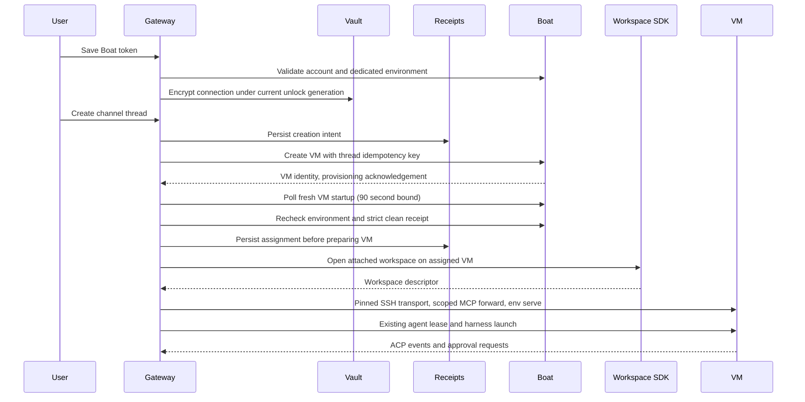
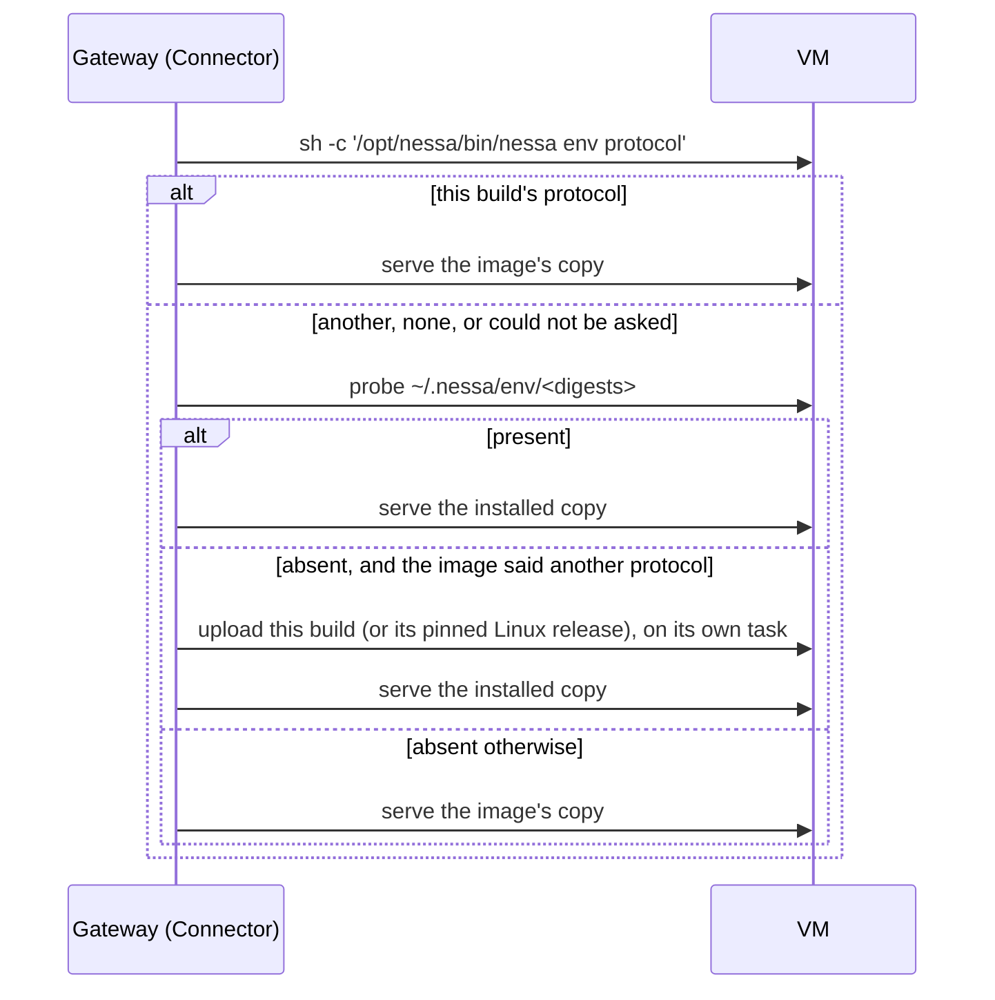

# 1160 — Local or Boat workspaces for channel threads

- Status: implemented alpha; in review
- Issue: https://github.com/nessalabs/nessa-agent/issues/1160

A channel independently selects Local or Boat for its main agent and its new
worker threads. Both default to Local. Each Boat thread receives a distinct VM;
reopening the thread uses its saved VM and workspace. The user supplies a Boat
infrastructure token and connects their ChatGPT/Claude subscriptions in Boat.
Nessa does not implement provider OAuth or copy local provider login files.

## Ownership

`workspaces` owns encrypted connection settings and durable allocation receipts.
Receipt rejection diagnostics distinguish creation decoding, info validation,
and info decoding using compiled field names and JSON kinds. Wipe refusals
also classify startup as starting, operable or other; raw state strings are not
logged. Provider values, arbitrary keys, decoder error messages and authentication
data are not logged. Cold POST and ready GET responses are separate fixtures; diagnostics
do not change admission, rollback ownership or cleanup confirmation.
Its application ports separate settings, assignment storage and provider effects.
Conversation placement owns which environment a thread uses. The conversation
adapter composes workspace streams with the existing remote lease implementation.
`workspace-sdk` prepares the attached workspace and its descriptor through the
preinstalled supervisor. Nessa owns VM creation; an attached SDK workspace cannot
delete its VM. The SDK is pinned to portability revision
`33b8382d72657d176baca19797d8d146803f3d89`.

Existing SSH lease frames own agent stdin/stdout, approvals, process accounting,
Stop and End. The initial HTTP managed-pipe bridge completed one turn but twice
returned `InputOutcome::Unknown` during sustained use. Retrying ambiguous stdin
could duplicate a command, so that bridge was removed. This is a recorded SDK
capability limit, not a proven SDK defect or a new replay mechanism in Nessa.

The release image contains native Nessa and workspace-supervisor binaries, Node,
pinned ACP harnesses and the model catalog. It contains no user credentials or
pairing identity. Token-only setup uses one shared snapshot pin and refuses a
source build whose lease protocol differs. Boat supplies the user's subscription
credentials after cloning. The remote environment server receives an explicit
`prod` stage and private data root matching its provisioned configuration.

## Ordering and failure table

| Row | Event | Durable fact / effect | Recovery |
| --- | --- | --- | --- |
| B1 | Save while vault locked | No validation request or credential write | Unlock Nessa |
| B2 | Save valid token | Validate account and dedicated `nessa` environment; persist encrypted entry under captured vault generation | Connected after persistence; status contains no token |
| B3 | Concurrent creates for one thread | Serialize allocation; persist intent before provider create | One create key and VM |
| B4 | Creation receipt arrives | Persist VM identity before workspace preparation | Retry prepares same VM |
| B5 | Creation outcome lost / crash before receipt | Retain unresolved intent | Refuse automatic replacement; operator reconciliation required |
| B6 | Preparation fails / saved VM missing | Retain assignment; refuse open | Retry existing VM or address missing resource; no Local fallback |
| B7 | Opening caller disappears | Accepted allocation task owns receipt persistence | Preserve its result independently of observer |
| B8 | Start / continue harness | Existing SSH lease framing and scoped launch variables | No HTTP input replay |
| B9 | SSH connection lost | Existing lease loss and accounting | Fail turn; reconnect only after loss is detected |
| B10 | Close / drop | Existing Stop/End cleanup evidence | Unconfirmed cleanup stays uncertain |
| B11 | Reopen / restart | Read saved VM, image and environment | Reuse VM and workspace |
| B12 | Archived VM | Resume that VM, then prepare attached workspace | Files survive the snapshot; provider session restoration still must succeed |
| B13 | Chat history erased | Existing conversation erasure and tombstone | Workspace files and VM retained, like Local project files; manage in Boat |
| B14 | Local thread | Existing local environment | No Boat allocation |
| B15 | Slow initial channel open | Client allows workspace preparation before agent exchange allowance | Await typed answer; never replay an uncertain mutation automatically |
| B16 | Receipt persistence fails after create | Attempt provider deletion; retain unresolved intent | Accepted deletion alone is not confirmed cleanup |
| B17 | Fresh creation acknowledgement names a starting VM | Poll that VM through startup for at most 90 seconds; no attached workspace, SSH, MCP or agent command yet | Preserve the named VM and rollback disposition on timeout or rejection |
| B18 | Fresh VM becomes ready | Re-read dedicated environment and complete strict info receipt, including exact `wipePendingUntilRestart: false`, before admission | Ready alone never authorizes attachment; a pending wipe still refuses |

Boat documents [asynchronous API readiness](https://docs.boat.dev/readiness) and
[credential removal before a snapshot deploy can be used](https://docs.boat.dev/snapshots/templates).
A cold creation response is not a final security receipt. Startup polling is
read-only and bounded; it does not clear flags, restart a replayed VM, or infer
cleanup from provider absence. No stop/resume is needed merely to wait for a new
snapshot deployment. A ready VM with a pending wipe remains refused.

The dedicated `nessa` Boat environment passes connected agent credentials, but
not arbitrary secrets, sandbox credentials or GitHub credentials when created.
An existing environment that blocks agents is refused; Nessa does not silently
widen its settings. Disconnect forgets the token here; it does not revoke copies
of credentials already supplied to VMs or delete workspace data.

## Main agent and history

The first main conversation identity derives from the immutable channel ID.
Channel navigation opens that main chat before newer worker chats. The main agent
runs on messages and worker reports; it has no idle model loop. Its instructions
use Nessa's `create_thread` and `send_message` tools for separately placed workers.

After confirmed erasure of the main conversation, the channel store atomically
records a replacement UUID and removes the retired channel link. The append-only
journal names the retired conversation (linking its actual deletion initiator),
new identity, generation and cause. Repeated erasure does not mint again.

| Row | Event | Required behavior |
| --- | --- | --- |
| C1 | Channel attributes change | Preserve current main identity |
| C2 | Erase worker | Remove its link; preserve main identity |
| C3 | Confirmed main erasure | Journal replacement and remove old link atomically |
| C4 | Retry / reopen | Read same replacement |
| C5 | Unfinished erasure | Preserve current identity |
| C6 | Open channel | Open current main, preserving unrelated worker drafts |

## Approved local access

Hosted ACP receives an explicit relay for Nessa's scoped MCP stand-ins. A
connection-scoped temporary SSH key is registered through Boat's typed key API;
the returned host key is pinned. The private key lives in a private temporary
directory and is removed when the connection owner drops. The SSH control
connection reverse-forwards one Unix socket in the VM's private Nessa directory
to this gateway's existing relay. Only relay commands naming that exact local
socket are rewritten; arbitrary local executable paths are omitted.

Existing MCP grants and Cedar checks remain the authority. A connected MCP
service can read explicitly shared local files, return logs or use local account
connections. Configuration removal applies to new openings; already-open MCP sessions keep their grants until the conversation closes. Closing and reopening revokes the old grant and uses the new set. No folder is mounted
or automatically copied into a VM. SFTP channels reuse existing artifact lease,
range and digest checks. Nessa's local GitHub sign-in is not copied to remote Git;
GitHub tools exposed through approved local MCP connections retain local auth.

| Row | Event | Required behavior |
| --- | --- | --- |
| M1 | Missing key API endpoint / host key | Refuse; no insecure host-key fallback |
| M2 | Forward setup fails / times out | Drop SSH child and temporary keys; no harness launch |
| M3 | Hosted configuration | Map only registered relay; retain scoped grants |
| M4 | Remote MCP call | Existing relay checks live grant and server digest |
| M5 | Connection owner drops | Kill control connection and remove private key files |
| M6 | Artifact transfer | Existing lease and SFTP bounds apply |

## Alpha limits

The prebuilt Boat image supports Claude and Codex; OpenCode remains Local in this alpha.
The local gateway must remain reachable and its vault unlocked to provision new
VMs. Provider subscriptions must be connected in Boat. VMs have a one-hour runtime
TTL; alpha does not renew long-running turns or provide a cloud wake endpoint.
A thread idle for 5 minutes, or one whose agent called `close_thread`, is
parked and its VM stopped (Boat archives it,
disk kept); the next message resumes the VM, and Nessa never deletes it
(`docs/design/agent-parking.md`). Boat controls stopped-data retention. Closing a
chat stops its harness, but preserves its workspace VM/files. Disconnecting Boat
also preserves them. Users manage those resources in the Boat dashboard.

An external stop can leave a brief interval before the SSH lease detects loss;
an immediate open can fail, and a later retry reconnects to the same VM. Alpha
does not move a live provider session between Local and Boat. Connected Macs,
mesh/tunnels, ordered fallback, capacity scheduling and Nessa-managed provider
OAuth remain future work.

## Verification

Actual subscription tests completed on both Codex and Claude. An SSH-hosted
coordinator used Nessa tools to allocate a distinct worker VM, dispatch work and
write a file there. A stopped worker resumed on its saved VM and read the file
back. A cloud Claude turn requested approval before reading a disposable Mac log
through MCP; a removal followed by session close/reopen is required to test revocation of its per-open grant.

`tests/workspaces` covers allocation races, lost observers, uncertain receipts,
private filesystem storage, encrypted vault generation fencing and sanitized
actual Boat response shapes. Channel store tests cover migrations and repeated
main erasure. `scripts/workspaces/boat-e2e.mjs` is the opt-in real-provider check;
its evidence must distinguish completed checks from cleanup still unconfirmed.
The desktop stress `channel` step covers independent placement controls and
persisted Local placement. See the PR for the final combined-tree check results.

Allocation receipts and environment audits join the existing EnvironmentAudit
backup inventory under distinct labels. The preexisting backup inventory does
not include `channels.sqlite3`; this limits restoring channel settings and main
replacement history and needs a separate backup change.

## Untouched native Claude context

The cold-main test observed ACP `-32002` (resource not found) after a gateway
restart before the coordinator's first message. Claude's `session/new` supplies
an ID but does not persist it until a prompt. Restoration now asks the provider
with the saved ID and the authoritative fact of whether the SDK has admitted any
invocations. Claude declines restoration only when the entire conversation has zero admitted invocations. The
existing attachment path records its replacement ID before publishing readiness;
VM identity and workspace files are unchanged. Contexts with any admitted work
still require successful native resume; a missing native history remains a typed
failure. No prompt or uncertain provider input is replayed.

| Row | History / provider | Effect |
| --- | --- | --- |
| R1 | Claude conversation with zero admitted invocations | Open fresh native context; record before/after through existing context transition |
| R2 | Claude history with admitted work | Resume exact saved native context |
| R3 | Used context missing at provider | Refuse; preserve saved history and context |
| R4 | Pool worker does not hold saved context | Existing host ownership check and provider persistence constraint both apply |
| R5 | Other provider / custom adapter | Existing restoration behavior by default |

The empty-history exception does not classify a fresh native context created by
switching agents or changing a workspace after earlier work. That existing cold
context case remains conservatively refused if native resume fails; tracking
admission per context is [issue 1164](https://github.com/nessalabs/nessa-agent/issues/1164).

## Review corrections and image provenance

Receipt publication enforces the same 8192-byte bound as reopening, including
JSON overhead. A rejected oversized receipt preserves the intent and enters the
existing failed-save cleanup path. Tests cover ASCII, multibyte and the exact
serialized boundary.

Coordinator retirement occurs only after confirmed history erasure. A failed
channel transaction is a retryable summary-cleanup failure; the deletion cannot
publish its finished tombstone until the replacement journal commits. Failed
history erasure preserves the current main ID.

The original worker (historical, superseded below) was built from source
`00efca5ef94d1a43635989f521daca91558353ea`,
lease protocol `b698f20053f8bb7c`, Workspace SDK
`33b8382d72657d176baca19797d8d146803f3d89`. Its Nessa binary SHA-256 is
`bd83ce27d670741d9b378762f68c928563c249b73a0103bc587ed8a4cc73e089`;
supervisor SHA-256 is
`afe8510ce3f9fce707a14b221d28ea68a0a8298c983443eee1dbe14a77cd90d6`.
`/opt/nessa/BUILD.json` and source licenses accompany the binaries. The image has
no provider auth files, Nessa pairing identity or SSH keys. Later local allocation
and channel-cleanup corrections do not change the worker's lease serving path.
This is a manually published alpha image, not a release automation pipeline.

Receipt-save failure retains the returned VM target in independent recovery
audit evidence before rollback, and records rollback observation afterward.
Failed or panicking audit ports do not skip cleanup; an unconfirmed cleanup or
audit failure remains visible in the typed recovery error with its target.
An accepted allocation task owns these steps after caller loss. Boat receives
`NESSA_THREAD_ID` as a non-secret per-VM correlation marker before creation, so
provider-side inspection still links the VM to the durable intent if both local
stores are unavailable. No automatic replacement is authorized. Recovery audit
files use the existing private, timestamped EnvironmentAudit store and backup
inventory; their thread ID links the original conversation creation/lease actor.

## Mainline worker refresh for the first landing

Integrating main changes the fingerprinted environment dial/pairing sources. The
original `b698f20053f8bb7c` worker correctly refuses the new gateway contract.
The first refreshed worker was rebuilt from integration source
`29af2efb974ddb90a95c8921c4192a3603684af8` and reports lease protocol
`066217f7701b98b9`. Its stripped Linux binary SHA-256 is
`e2c9d38b652ee798bca1de09e9b539233aa0c205b79c7880604e9553f885f825`. The
Workspace SDK and supervisor revision/digest above remain unchanged.

The named snapshot `nessa-worker-066217f7-29af2ef-linux-x64` contains only the
credential-free worker runtime, with updated BUILD.json and Cargo.lock. Source
and build caches stayed in a separate disposable builder. A fresh clone verified
the protocol and checksum, absence of build inputs and known personal credential
paths, and an empty user SSH-key directory before publication. All three owned
build/image/check VMs were deleted with provider-confirmed absence. The saved
artifact remains available; old published artifacts were preserved.

The existing `worker_image` boundary still refuses unmatched protocols.
`shipping_worker_covers_the_compiled_lease_protocol` now makes a stale shipping
release mapping fail the normal test selection. It fails against the old pin;
updating the verified artifact mapping must make it pass. This does not relax
protocol matching, invent a compatibility alias or replace a retained VM.

## Phone-input integration worker refresh

Main `41339b0ba52dbddb2441389c9ebce1e4f7426c9e` adds fingerprinted hosted
OpenCode/private-home sources. Integration source
`a79f324f39c9cd58c2082206b531b438d794d438` also forwards the selected host's
explicit MCP relay through the existing credential-free configuration projection.
The previous worker is correctly incompatible with this source.

The new runtime reports `b6e4f48aa694ce08`; release pin
`a162d7ef7cc7abbe5f714f74737b34421ec15e6b` selects
`bsh_1WtCS3oK4SWwNbdpOnBXzFPq_PwIT1aGCwnJSQHWakU`. Snapshot
`nessa-worker-b6e4f48a-a79f324-linux-x64` contains the stripped Linux binary
SHA-256 `4594f98d379ccdb129b31302e43f1d4e119d821c5b96a2f3787d6cfd37d49a50`
(138,010,664 bytes). Workspace SDK and supervisor provenance are unchanged.

A separate credential-free builder used the exact source archive. Only the
runtime binary, BUILD.json and Cargo.lock were copied into the clean runtime seed;
build inputs were excluded. Clean-image and fresh-clone checks verified protocol,
both runtime checksums and the named personal credential-path exclusions. The
three owned publication VMs are provider-confirmed absent, with completed deletion
operations. These checks are not an exhaustive secret scan or independent secure
erasure attestation. Prior saved images remain available. The original readiness
regression failed with the stale pin and passed with this mapping; exact protocol
refusal is unchanged. See the source-specific
[publication receipt](../../../verification/desktop/evidence/vault/phone-worker-release-receipt.json).

## A VM keeps working across an update

The image a new VM is made from is the one this build pins
(`release.rs`), never the image saved with the account when it was connected:
that one may be an earlier build's, whose `nessa` speaks a lease protocol this
build no longer does. Before #1219's follow-up, every thread created after an
update got a VM from the saved image and was refused
`environment_version_mismatch` on every send.

A VM made from an earlier image keeps its files and is not replaced. Each
opening first asks the image's own `nessa env protocol`. When that is not this
build's, the gateway installs this build in the VM over the VM's own SSH
connection, exactly as it installs on an SSH host (`HostInstaller`, kept under
`~/.nessa/env/<digest>`, records naming the VM `boat-<thread>`), and serves
that copy. Which copy serves is chosen before either starts, so when it ends
the connection ends with it. A VM that could not be asked gets nothing
installed on a guess: it is served this build's copy if one is there, else its
image's, and the next opening asks again. An account of a lease already held
never installs: it is served the copy that is there. A development build pins no release for Linux, so from a
Mac it cannot install and the opening is refused
`environment_platform_unsupported`.

The install runs on a task of its own, one per thread: an opening whose 120 s
connect wait runs out while the build is still being sent is refused
`environment_unreachable`, the install goes on, and the next send waits on that
same install rather than starting another.

Relayed MCP servers still start the image's own `nessa mcp-relay`, and the
managed shell is the image's `nessa-mcp`; neither speaks the lease protocol.

Each stop of a VM is recorded before Boat is asked (`workspace_stop_requested`)
and once it answers (`workspace_stop_answered`, `accepted` or the failure's
kind). Accepted means Boat took the stop: the VM archives after it, which an
opening waits out.

## Parent Stop integration worker refresh (#981)

The following Dad5 receipt is historical. Its task snapshot was retired after
fresh-clone qualification of the c516 replacement documented below.

The worker for application source `22a8218b0ff2c392e911e07c75994f33e4896048`
serves lease protocol `dad5afbc1bc5755f`. Its published image is
`bsh_-6mHzeuFu3FWNbJWOe0IbXLXxhBcJPNOjq76Bk_nMGI`, snapshot
`nessa-worker-dad5afbc-22a8218-linux-x64`. Both Linux x86_64 runtime binaries
are present: `nessa` SHA256
`9448ba2c2e6c01e6a7a41f23f32183ceae17918a279f4bfc9ddb8113873d019f`
(146,162,512 bytes), and `nessa-mcp` SHA256
`4684f72dd49d07c06ab76c168cb8165fab0d7ef6fde62414e00fe26c4c678e25`
(5,243,680 bytes). The publisher used Rust/Cargo 1.99.1 and the stripped
development profile with dependency opt-level=0, debug=0 and incremental=0.

This is not an unmodified `cargo vendor` bundle. Vendoring omitted shared
files used by pinned PTY revision
`c68837e2b7bf1c9009e1a4587a1a58107ec0425c` and removed its external
`build = "../../scripts/native/build.rs"` declaration from the normalized
infrastructure manifest. The publisher restored those pinned inputs and the
original declaration before building; application source, dependency revisions
and acceptance rules were unchanged. The only vendor checksum change updated
`files.Cargo.toml` to the restored manifest digest; checksum validation was not
disabled. Independent comparison matched all 29 reported restored-file hashes,
the original manifest, application source tree and Cargo.lock against the locked
commits. The vendoring restoration is part of the
build provenance, rather than an application or dependency-version patch.

A fresh image clone verified the protocol, both checksums and byte lengths,
executables and linked libraries, MCP initialization, supervisor provenance,
and named build-source/credential-path exclusions plus recursive Claude-config
auth-field checks. These are not an exhaustive secret scan or an independent
secure-erasure attestation. All three owned publication
VMs were confirmed absent after completed deletion. The publication used
US$0.03031 and three VM creations; four creations remain within the existing
seven-creation allowance. The one retained snapshot is within the account's
included allowance. Old published images remain available.

The [publication receipt](../../../verification/desktop/evidence/parent-stop/recovery/worker-release-receipt.json)
records the artifact and cleanup facts. The normal shipping guard remains
unchanged. This image publication does not claim the separate four-VM live
Boat acceptance or earlier native/performance gates passed; those remain
separate qualification records.

### Current integrated worker: c516

Source `66e064de4a6177454e22873314391d8956b5da79` integrates main `100d7aef`
and serves protocol `c516606214ce8bc2`. Its verified image is
`bsh_MF9Ppg9XWHyVD8qYw7Wv6mku_yJpX2lS-Dlj4-LZ27E`, snapshot
`nessa-worker-c5166062-66e064d-linux-x64`. Both Linux binaries were freshly
built using Rust/Cargo 1.99.1 and the same stripped development profile.
The locked PTY support restoration and Cargo.lock are unchanged. The new
[publication receipt](../../../verification/desktop/evidence/parent-stop/recovery/c516-worker-release-receipt.json)
records both binary identities, fresh-clone checks and completed deletion
operations for all three new publication VMs. Named credential/state exclusion
checks do not establish an exhaustive secret scan or secure erasure.

All six task publication VMs are absent. Cumulative usage is US$0.0624; six of
ten authorized creations are used and four remain for the unchanged live
verifier. The old Dad5 task snapshot was retired after replacement
qualification; one task snapshot remains within the included allowance.
The pin preserves the shipping guard. Live provider acceptance and the earlier
native/performance gates remain separate; publication is not a merge-ready
claim. No lifecycle transition changed, so no state diagram or unrelated state
checkpoint changes for this artifact pin.
