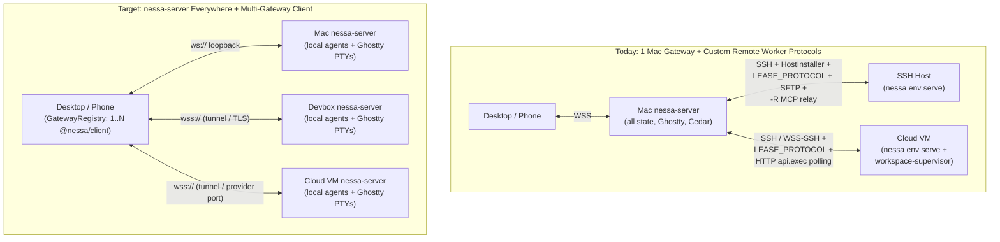
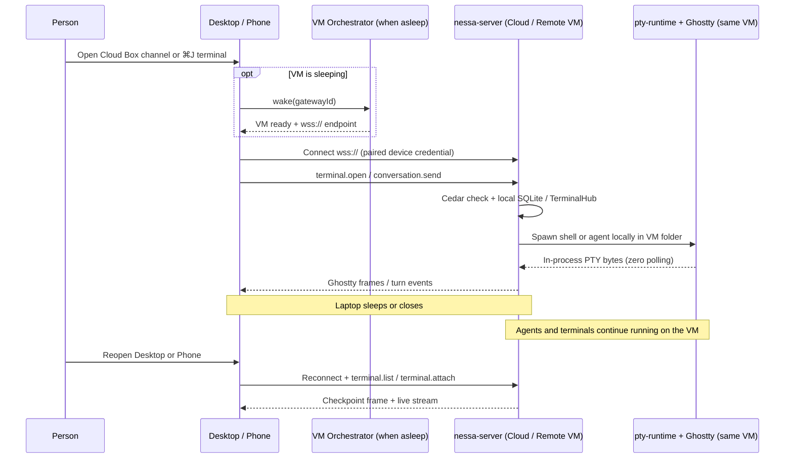
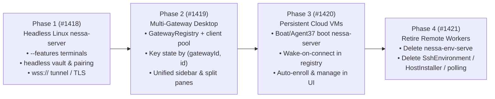

# 1417 — Gateways everywhere: headless `nessa-server` on remote/cloud VMs + multi-gateway Desktop

- Status: proposed
- Issue: https://github.com/nessalabs/nessa-agent/issues/1417
- Child issues:
  - Phase 1: [#1418](https://github.com/nessalabs/nessa-agent/issues/1418) — Headless Linux `nessa-server` with terminals, vault bootstrap, and `wss://` reachability
  - Phase 2: [#1419](https://github.com/nessalabs/nessa-agent/issues/1419) — Multi-gateway Desktop client (`GatewayRegistry`, composite routing, unified workspace)
  - Phase 3: [#1420](https://github.com/nessalabs/nessa-agent/issues/1420) — Persistent Cloud VM orchestration running `nessa-server` (create, wake, stop, auto-enroll)
  - Phase 4: [#1421](https://github.com/nessalabs/nessa-agent/issues/1421) — Retire legacy remote-worker stack (`nessa-env-serve`, `SshEnvironment`, `HostInstaller`, remote terminal polling)

## Summary

Run a full `nessa-server` gateway directly on every machine a person works on —
this Mac, Linux devboxes, SSH hosts, and persistent Cloud VMs — and let Desktop
and Phone connect directly to **1..N gateways** over `wss://` in one unified
workspace.

Each persistent machine or Cloud VM runs one `nessa-server` hosting many
channels, threads, and native Ghostty terminals. Because every machine owns its
own local execution (`Here`), we can retire the remote lease worker stack
(`nessa-env-serve`, `LEASE_PROTOCOL`, `HostInstaller`, SFTP artifact channels,
`-R` MCP relay sockets, and remote terminal polling).

## Context

Today Nessa runs a single `nessa-server` gateway on the person's Mac. Remote
machines (SSH hosts and Cloud VMs on Boat or Agent37) do not run a product
gateway; instead, the Mac gateway connects out to them using custom remote
worker machinery:

- `nessa env serve` over SSH stdin/stdout speaking a fingerprinted
  `LEASE_PROTOCOL`, requiring matching worker images or `HostInstaller`
  uploading binaries over SSH on version mismatch.
- Separate SFTP `ArtifactChannels` over SSH `ControlMaster` sockets for files
  and `-R` reverse-forwarded Unix sockets for MCP relay.
- A five-way `Place` model (`Here`, `Host`, `Peer`, `Pool`, `CloudVm`) inside
  `ConversationService`.
- Remote terminals bridged via `ssh -tt` or HTTP/API polling against
  `workspace-supervisor`.
- A single point of failure on the Mac: closing or sleeping the laptop takes
  down the gateway for Phone, kills SSH terminals, and drops live terminal
  projections.

## Decision

1. **Direct client-to-gateway (`wss://`).** Desktop and Phone connect directly
   to each gateway (`Mac`, `Work Devbox`, `Cloud Box`, etc.) using the existing
   `@nessa/client` WebSocket protocol and paired device credentials. Remote
   gateways remain reachable from Phone and keep running agents and terminals
   when the laptop sleeps or closes.
2. **One `nessa-server` per persistent Cloud VM / workspace.** Rather than
   provisioning an ephemeral VM per thread, we orchestrate persistent Cloud VMs
   (e.g., `"Cloud Box"`) that each run a full `nessa-server` with persistent
   `NESSA_DATA_DIR`, hosting many channels, threads, and native Ghostty
   terminals.
3. **Every gateway owns only local (`Here`) execution.** Agents, PTYs,
   workspace files, SQLite history, vault, and Cedar policy live together on
   the machine where work runs. "Where does this channel run?" is simply which
   gateway owns it.
4. **Multi-gateway client composition.** Desktop manages a `GatewayRegistry`
   holding 1..N `@nessa/client` connections and qualifies UI/store identities
   by `(gatewayId, id)` at the adapter boundary (Gate 12), routing every
   command directly to its owning gateway.

## Ownership and Boundaries

- **Each `nessa-server` instance** owns its own vault, Cedar policy, SQLite
  conversation store, `TerminalHub` + Ghostty engine, local MCP servers, and
  device-pairing registry. No gateway holds raw credentials for another
  gateway's agents or files.
- **Client `GatewayRegistry`** (in `src/desktop/` and mirrored in Phone) owns
  the list of registered gateways (`gatewayId`, display name, transport URL,
  paired device credential, connection status, and optional Cloud VM provider
  binding for `wake()`/`sleep()`).
- **Identity boundary (Gate 12):** Every channel, conversation, terminal, and
  approval in client state is keyed by `(gatewayId, entityId)` minted at the
  gateway adapter boundary — never by display name or URL, which can change.
- **Cloud VM orchestrator** owns only provider lifecycle (create, wake, sleep,
  delete, admission receipts, and recovery audit) and hands the VM's `wss://`
  endpoint and initial enrollment handle to `GatewayRegistry`. It does not
  carry agent stdin/stdout, terminal I/O, or SFTP channels.
- **Wire protocol:** `@nessa/client` and `protocol/product/v1.json` remain
  gateway-scoped and require no cross-gateway framing changes.

## Ordering and Failure Table (Gate 15)

| Row | State | Event | Next state | Durable fact / effect & recovery |
| --- | --- | --- | --- | --- |
| G1 | Gateway `A` Connected, `B` Disconnected | Person sends message or types in `A` | `A` Connected, `B` Disconnected | Routed directly to `A`; `B`'s outage never blocks or mutates `A`. |
| G2 | Gateway `B` Disconnected | Person opens or acts on a channel/terminal owned by `B` | `B` Reconnecting | Action is refused with typed offline/reconnecting state (no silent queue across gateways, no fallback to `A`). |
| G3 | Cloud VM Gateway `C` Sleeping | Person opens a channel on `C` or clicks Wake | `C` Waking → Connecting → Connected | Single-flight `wake()` per `gatewayId`; concurrent triggers join the same wake attempt. Only after VM readiness does `GatewayClient` dial `wss://`. |
| G4 | Cloud VM Gateway `C` Waking | Wake times out or provider refuses | `C` Refused (typed cause) | Surface typed refusal (`account_disconnected`, `vault_locked`, `provider_failed`, `vm_missing`) without deleting `C` or falling back to local Mac. |
| G5 | Cloud VM Gateway `C` Connected | Idle timer fires while a turn or terminal is active on `C` | `C` Connected | Idle rest checks `C`'s own active turns and open terminals; VM never sleeps while work is in flight. |
| G6 | Cloud VM Gateway `C` Connected | Laptop sleeps / Desktop disconnects | `C` Running (detached) | `C` keeps running agents and terminals. On Desktop wake, `GatewayRegistry` reconnects, re-lists conversations and terminals, and re-attaches open terminal views. |
| G7 | Pairing new remote gateway | Pairing code redeemed over `wss://` | Registered (persisted) | Persist `(gatewayId, credential, url)` only after server confirms device enrollment; `gatewayId` is the gateway's own stable identity, so re-pairing the same gateway updates its endpoint/credential instead of duplicating it. |
| G8 | Gateway `B` Connected | `B`'s tunnel URL rotates (quick tunnel restart) | `B` Reconnecting → Connected | Lookup updated tunnel address via paired relay secret (ADR 1150) using `gatewayId`; re-list and re-attach without losing client pane layout. |
| G8a | Gateway `B` Reconnecting | An authenticated replacement transport reports gateway `A` | `B` Refused | Close the replacement before moving subscriptions or making its transport available for RPCs. Keep the registered gateway identity and its credential. |
| G9 | Gateway `B` Connected | Device credential revoked on `B` | `B` AuthRefused | Stop automatic reconnect loop immediately; show typed re-pair prompt for `B` only. |
| G10 | Two gateways `A` and `B` Connected | Both have a channel or terminal with the same raw `id` (e.g. `"default"`) | Both Connected | Composite key `(gatewayId, id)` isolates store entries, pane targets, and command routing; neither overwrites the other. |
| G11 | Gateway `B` Removed by person | Person removes `B` from Settings | Removed | Close `B`'s socket, drop `B`'s views from store, close or mark `B`'s panes as removed; remote `nessa-server` and its files remain untouched unless Delete VM was explicitly requested. |

## Phased Implementation Plan

### Phase 1 — Headless Linux `nessa-server` ([#1418](https://github.com/nessalabs/nessa-agent/issues/1418))

- Build Linux x86_64/arm64 `nessa` binary with `--features nessa-server/terminals`
  (`libghostty-vt` via `scripts/terminal/ghostty.sh`) and publish a minimal
  container / VM image + systemd unit.
- Headless startup path without macOS Keychain or GUI: non-interactive vault
  unlock (keyfile / env / passphrase) and first-owner pairing code + reachability
  address output on first boot.
- Expose over `wss://` using the existing `nessa-device-pairing` web tunnel
  (`cloudflared`) or a direct TLS reverse proxy.
- Verify headless boot, device pairing over `wss://`, agent turns, and native
  in-process Ghostty terminals that survive client disconnect.

### Phase 2 — Multi-Gateway Desktop Client ([#1419](https://github.com/nessalabs/nessa-agent/issues/1419))

- Introduce `GatewayRegistry` managing 1..N `@nessa/client` instances with
  independent connection lifecycles, reconnect backoff, and typed status.
- Qualify channels, sessions, terminals, and approvals by `(gatewayId, id)` at
  the adapter boundary (`src/desktop/workspace/adapters/gateway/`).
- Update sidebar, Agents overview, quick switcher, New Channel, and split panes
  to display and route across all connected gateways seamlessly.
- Add Settings › Connections › Gateways to pair, rename, inspect, and remove
  remote gateways.
- Add unit tests for every row G1–G11 and extend conversation stress checks
  (Gate 19) with a two-gateway fixture.

### Phase 3 — Persistent Cloud VM Orchestration ([#1420](https://github.com/nessalabs/nessa-agent/issues/1420))

- Provision persistent named Cloud VMs (Boat, Agent37, or future providers) from
  the Phase 1 image running `nessa-server` with persistent `NESSA_DATA_DIR` and
  project storage.
- Reuse idempotent creation keys, admission checks, and recovery audit
  (ADR 1160) while enrolling the booted `nessa-server` directly into
  `GatewayRegistry`.
- Wire single-flight `wake()` into `GatewayRegistry` for sleeping Cloud VMs and
  add Cloud Box management (create, sleep, wake, delete) in Settings.

### Phase 4 — Retire Legacy Remote-Worker Stack ([#1421](https://github.com/nessalabs/nessa-agent/issues/1421))

- Remove `crates/nessa-env-serve`, `LEASE_PROTOCOL` fingerprinting,
  `HostInstaller`, `VmCopies`, `SshEnvironment` / `OpenSshConnector`, SFTP
  `ArtifactChannels`, `-R` MCP relay socket forwarding, and `RemotePtyTransport`
  / `TerminalPlace::Ssh` / `TerminalPlace::CloudVm`.
- Collapse `Place` in `nessa-conversation` to local execution (`Here`).
- Update `docs/ARCHITECTURE.md`, `docs/codebase-structure.md`, and
  `docs/design/terminals.md`.

## Tradeoffs and Follow-ups

- **Client state complexity moves from Rust SSH/lease plumbing to TypeScript
  multi-gateway routing.** Multi-gateway keying by `(gatewayId, id)` is pure
  data routing in one place, far simpler and easier to test than maintaining a
  second distributed RPC protocol (`LEASE_PROTOCOL`) plus binary installer and
  SFTP/MCP tunnels.
- **No cross-gateway conversation migration.** A channel and its history live
  on the gateway where it was created; moving work across machines is a fresh
  channel on the target gateway (or explicit backup/restore).
- **Follow-up (orthogonal):** Detaching PTY ownership into Shepherd so
  terminals survive `nessa-server` restarts/upgrades on any gateway.
- **Follow-up:** Mirror `GatewayRegistry` in the iOS app so Phone connects to
  all the same gateways directly.
