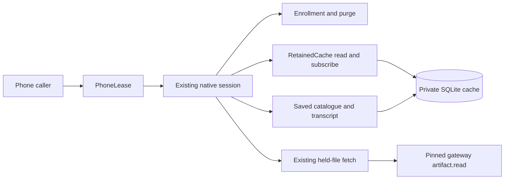

# 782. Native phone clients compose the shared retained receiver

## Purpose

Expose the existing device enrollment and retained record/cache owners to the native phone. The phone's derived view cache and command journal are useful but cannot stand in for physical retained checkpoints. This extends the client-core boundary from ADR 483.

- **Date:** 2026-10-12
- **Status:** proposed

## Context

`nessa-client-core` already owns pinned enrollment, bounded retained drivers, SDK folding, SQLite progress, retained tombstones and offline passive projection. The public retained reader currently selects granted-peer catalogue reads; owner-device composition and offline projection are reached through its CLI. iOS cannot run that CLI and must not copy its security/checkpoint decisions into Swift.

## Decision

Expose typed library operations over those owners, without CLI arguments/output or a second receiver. First, make catalogue reader selection explicit at the existing retained read boundary and expose bounded saved catalogue/transcript values with their actual progress and deletion state. Subsequent slices expose enrollment/status composition preserving purge-before-end ownership, a bounded C/Swift adapter and reproducible device/simulator builds, then native phone repository and artifact integration. Paths, clocks, sockets and private state remain composition dependencies; work runs off the UI thread. A live view or absent inbox row never advances a physical checkpoint or proves deletion.

| Ordering/input | Owner/result | Required evidence |
| --- | --- | --- |
| Owner versus granted read | Existing gateway source enforces each selector's scope | Actual paired owner read; existing peer tests |
| Changed epoch/incarnation or head behind checkpoint | Existing core returns reset/refusal; no fabricated progress | Saved checkpoint unchanged |
| Read interrupted after confirmed progress | Existing bounded driver keeps partial progress | Resume after process recreation |
| Offline saved list/view | Existing private cache and passive projection; no network | Real records/checkpoint plus fresh cache opener |
| Read/reset/deletion between saved page requests | Each page has its own SQLite snapshot and existing scope/progress/generation | Mixed-generation pages cannot be claimed as one snapshot |
| Deleted catalogue/record target | Existing retained fence; no synthetic resurrection | Deleted state across reopen and late record refusal |
| Saved corruption/quota | Existing cache's typed cause; no checkpoint advance | Source rule revert makes regression fail |
| Terminal pinned enrollment status (later slice) | Purge receiver with receipt before removing credential | Offline/refusal does not purge; failed purge retains enrollment |
| Old phone worker after scope replacement (later slice) | Native owner and phone lease fence publication | Delayed cancellation cannot publish another receiver |
| Swift/native buffer or task ends (later slice) | Owned adapter releases buffers/tasks; bounded resource use | Cancellation/overflow and device/simulator evidence |

## Enrollment lifecycle ordering (next implementation slice)

The design review requires a long-lived native owner to reuse the existing
physical enrollment worker and purge policy. The private-store substitution
contract retains one store/cache scope per admitted operation, an immutable
issued binding for an intent, and atomic compare-and-remove. Concurrent
out-of-band replacement is not promised; a stronger promise would require a
storage-owned pre-effect reservation. Scope replacement drains the old owner.

| Ordering/input | Owner/result | Required evidence |
| --- | --- | --- |
| Unpaired owner enrolls, later ends credential A, then enrolls B | Purge policy derives each receiver from its exact current issued credential | One wrapper, changing issued bindings, receiver assertions |
| Terminal operation expects A, saved credential is B | Existing purge policy checks intent before opening cache; typed Conflict | Zero cache opens, no credential removal, no B row deletion |
| Terminal credential has a valid pairing receiver beyond the sync identity byte bound | Purge and durable receipt retain the pairing ResourceId; sync read identity validation remains owned by sync | Full 256-byte ASCII and UTF-8 credential cleanup, durable receipt reopen and repeated purge |
| Pending-only Unclaimed | Existing pending removal, no receiver purge | Cache opener never called |
| Purge fails before commit | Preserve issued credential and ordinary Cache failure | Storage/open failure and retry |
| Purge commit acknowledgement is uncertain | Preserve issued credential and distinct CacheUncertain; recover original durable receipt before retry | Uncertain vs unavailable mapping, foreign translation and withdrawal-stop regression |
| Purge succeeds, removal fails or is uncertain | Keep original purge receipt separate from removal acknowledgement | Reopen each store; later NoPending does not erase durable purge evidence |
| Purge commits, then private-state worker panics before completion capture | Typed worker fault, no captured completion claim; durable receipt recoverable independently | Subsequent NoPending cannot inherit the abandoned transient purge effect |
| Refused/offline/Active after an earlier purge failure | Collect this operation's evidence inside its physical permit | Prior effect cannot leak into the next result |
| Caller cancels; physical worker continues | Keep existing admission until real completion; next caller remains Busy | Held worker, cancel, second caller, drain |
| Shutdown waiter cancels or last caller drops | Existing close/wake/drain lifecycle remains the physical owner | Actual closure drain, no new admission |
| Retry confirms original Unclaimed, then handshake or publication fails | Preserve recovery state; no purge authority from retry error | Both failure phases; current retry retains original receipt only on total success |

An operation's transient purge effect must be captured before its physical
permit is released, including begin/finish collection. A Busy call cannot reset
another worker's evidence. Durable historical receipts are read independently
of another successful status RPC. Public results remain immutable. These rows
are implementation requirements, not current phone guarantees.

## Alternatives considered

- Swift checkpoint/fold implementation: duplicates the shared core's authority, validation and semantic rules.
- Calling the CLI and parsing its output: unavailable on iOS and exposes presentation as a library contract.
- Treating saved product views as retained sync: cannot establish physical progress, tombstones or native paired authority.

## Consequences

The phone and existing clients share the actual fold/checkpoint rules. Public APIs, explicit reader selection and native binary distribution require tests and platform maintenance. First-slice library exposure is not phone integration or completion of the wider sync goal; native enrollment, retained projection, revocation, artifact recovery and weak-link/device experiments remain explicit gates.

## Native bridge design review

The next slice uses generated C/Swift declarations (UniFFI synchronous exports),
immutable foreign snapshot objects and a dedicated serial Swift queue with
admission before enqueueing. It retains one private state/cache scope and one
runtime; no process-global runtime, second fold or CLI parser. The existing
`PinnedStatus` classification is promoted from CLI composition into its original
application device owner for both consumers. Consent correlation remains in
Auth/protocol. Retained disclosure is per authenticated intent; reopening has no
invented disclosure.

| Additional native ordering | Required result / verification |
| --- | --- |
| Runtime Apple archives versus binding generator | Build host and iOS runtime libraries without the generator feature; select only the generator binary for its feature-enabled build, preserving the host archive used for packaging |
| Second Swift call before first queued dispatch | Reject Busy before enqueue; direct generated callers also receive Rust Busy |
| Stop before retained read registration | Retain stop state through registration; existing bounded read wakes |
| Close before dispatch or while physical read runs | Close admission first, stop/drain actual owner before scope replacement |
| Repeated close / final foreign handle drop | No reopened admission or premature private lock release |
| Swift waiter cancels before dispatch or while admitted | Stop latch is reserved before enqueue; admission remains occupied until the queued physical call settles |
| Swift close waiter cancels, another close joins | One retained drain task continues independently of waiters; new work is refused and replacement waits for actual drain |
| Last Swift worker reference drops without close | Signal native close and retain the native handle in a queued off-UI drain; no blocking native deallocation on the UI caller |
| Status, binding load, read, then refusal recheck | One driver admission; preserve separate original status/purge, read/withdrawals and recheck facts |
| Active status, confirmed record page, receiver epoch changes, read Refused, pinned recheck Refused | Keep confirmed partial saved progress; neither generic refusal authorizes purge. Native Rust and generated Swift epoch regressions assert both original and recheck payloads, then reopen saved history offline |
| Unknown status delivery after purge | Recover historical durable receipt separately; no claim of absent purge |
| Offline saved page versus later page | Compare actual full scope/progress/generation; do not combine another snapshot silently |
| Native buffer/handle lifetime and large progress | Generated ABI linked/executed under Swift 6; owned object/buffer release and UInt64 precision |
| View serialization exceeds published bound | Explicit serialization failure, no partial view or fabricated NotLoaded |
| Native fixtures run on Windows versus Unix | Construct private directories through the local-storage owner on both platforms; retain accepted drive-absolute Windows paths instead of producing rejected verbatim paths. CI must exercise the same lifecycle tests, without skipping Windows or weakening storage validation |
| Passive snapshot capture runs after the native call | Keep translation inside the same serial admission; another call receives Busy while capture is held |
| Capture waiter cancels, then close starts | Preserve admitted capture result and private lock until translation finishes; close waits for it, then scope can reopen |
| Passive capture throws | Return its failure without inventing native effects; release admission for a subsequent call |
| Public receipt correlation and restored catalogue cursor | Delegate exact public intent fields, Auth-owned wire class name and Id validation to their existing owners; receipt/status class comparison uses the published name without a Swift spelling policy; changed retry attempt makes sameIntent false; cursor restoration grants no read authority |
| Local private record empty, online or offline | Return None without connection/cache/entropy/write; locally saved correlation is not current authority |
| Local pending record versus issued record | Preserve exact public intent, Auth-derived DeviceKey and pinned gateway SPKI; only issued has its original credential/receiver together |
| Substituted private store reports pending and issued, or load fails | Original typed private failure or Conflict; no winner/fallback/false absence |
| Local read held, then second call or close | Existing admission returns Busy, close excludes future calls and waits for physical store read/capture before private scope reuse |
| Retry changes saved attempt, then issued replacement and offline reopen | New attempt, same saved key/pin, exact issued selectors; no new entropy or enrollment authority |
| Terminal removes private record | Subsequent local read None; prior snapshot stays immutable historical evidence |

Local enrollment correlation uses the existing admitted driver and single-record
ClientPendingStore contract. Sequential pending/credential reads do not establish
an atomic snapshot against out-of-band writers. Auth's pairing adapter owns
SPKI-to-DeviceKey conversion for local identity, TLS proof, OPAQUE confirmation
and gateway audit. The relay raw-key getter delegates to that same owner;
known-seed ring derivation checks both public representations. Known-seed ring derivation and actual authenticated gateway
claim bytes are the independent correlation expectations. The phone still needs
owner-status corroboration and persisted principal/membership binding.

The local-correlation slice passes 20 native tests and the exact seven-package
CI selection locally, strict Clippy and SDK/architecture checks. Linked Swift 6
checks cover locally saved correlation and held local capture through Busy,
cancellation and close/drain. The paired fixture publishes its device key from
authenticated owner status; Swift compares that independent key and issued
credential/receiver with the native publication across first/offline/resumed and
epoch stages, and checks absence after terminal removal. Revert probes detect
wrong Auth key derivation, contradictory-record fallback, transport contact,
closed admission bypass, truncated foreign key bytes and capture outside admission.
Apple package refresh and the app-owned port mapping must use the reviewed
published revision; production enrollment/account coordination remains open.

Astra medium reviewed the design and identified these ordering requirements before
implementation. Actual core linking, Swift queue admission/cancellation, paired
reads, device/simulator XCFramework execution and phone repository integration are
not yet established by that review.

## Bridge implementation evidence (phone wiring remains proposed)

The generated bridge now owns one native private scope/runtime and delegates
status, purge, read selection and physical cache progress to the existing owners.
The Swift dispatch adapter reserves admission before enqueue, keeps a stop per
operation and shares a physical drain task independently of canceled waiters.
Real paired-gateway execution through Swift covers records/progress, offline
reopen, unchanged restart and authenticated revocation/purge receipt recovery.
Release libraries link for arm64 device/simulator; the disposable simulator app
executes session open, typed refusal, off-UI dispatch and close/reopen. The macOS
static package executes the paired fixture. Physical phone execution, Nessa's
repository/authority wiring, remote artifacts and durable deletion are still open.

The phone adapter prerequisites expose immutable public intent correlation and
validated saved cursor restoration, preserving their original owners. Public
Swift capture overloads keep passive translation inside the existing admission.
Actual held captures, cancellation, private lock retention, close/reopen and
throwing captures are verified with the linked native library; moving capture
outside admission fails the regression. Rust tests preserve every public field
across phases/classes and changed retry attempts, and actual paired Swift walks
continue from a restored saved key. These are adapter prerequisites, not evidence
that the production phone repository already publishes native retained history.

CI includes the bridge package. Its multi-output library target exposed a test
runner omission; the runner now recognizes the actual native unit-test executable.
A reverted target-kind fix fails its regression. The shared gateway suite also
exposed an existing callback fixture race: channel closure preceded the owning
task's listener teardown. That test now consumes its existing task-completion
receipt instead of treating an OS port observation as listener identity. This
changes verification only, not callback production behavior.

### Saved metadata recovery classification

| Evidence | Caller outcome | Regression |
| --- | --- | --- |
| Persisted non-deleted catalogue entry has malformed metadata | CacheDamaged; saved progress is unchanged and recovery requires purge/resync | public_catalogue_refuses_corrupt_metadata_without_advancing_saved_progress |
| Cache unavailable before a write | Cache; no claim that a commit occurred | uncertain_cache_commit_is_distinct_from_a_pre_effect_failure |

## Phone publication, deletion reconciliation, and held-file freshness

Slices for owner reads (#783), enrollment purge (#785) and the C/Swift session (#789) are on main. This slice is the phone repository those slices left open: one publication lease over the existing enrollment, retained read and saved projection, plus held-file freshness and catalogue presence. It does not add a second fold, checkpoint, purge policy or fetch algorithm. The product iOS application is not in this repository; physical-device execution stays unverified.

### Invariants

- A stamp names one lease instance, one generation, and one receiver. `accept` also requires the identity the minting lease holds. That identity is not on the public stamp. Only `bind` and `stamp` mint a stamp. A published lease id, replayed through another lease, does not accept. Session composition mints the instance and the identity from one fill of the injected entropy. A source that refuses is an enrollment entropy failure and opens no session. A generation that starts again on a different instance does not accept the earlier stamp.
- Saved catalogue and transcript reads present that stamp. The session, its native handle, and the Swift worker have no unstamped entry point for those reads. A caller who does not hold the current stamp cannot select the issued receiver.
- The same issued receiver keeps the generation. A different receiver, a successful terminal purge, or session close advances it. The previous stamp then fails and no bytes are read.
- Close is permanent for that session. A successful purge only releases the receiver, so a later enrollment in the same session can bind the next one. That release happens when the purge succeeded, including when the status has no observation. No observation and no successful purge leaves the bound receiver in place.
- Catalogue presence is one stored identity, read from one snapshot of the fence, the row, and the purge receipt. A live row is Live. A deletion fence or receiver purge receipt is Tombstone. No row, no fence, and no receipt is Absent. A page that does not mention a chat does not write a tombstone.
- A saved credential whose receiver has a successful purge receipt is not bound again. Bind returns Purged and does not mint a stamp. Whether that cache file is present is an injected read: absence still binds, and a metadata failure is a cache failure that does not mint a stamp.
- A deletion whose commit did not land leaves the previous row. Presence after that failure is the previous state, not Tombstone.
- A withdrawn grant removes the local row and writes no fence. Presence is Absent, so the chat can return with a later grant.
- `LocalMatch` means the output file already had the named size and digest. No range was asked. It is not a new gateway hold.
- `GatewayConfirmed` means this run's ranges were answered and the part, read back from disk, matched the digest. A partial part, a wrong range, or a digest mismatch is a fault. `reached` on that fault is not freshness.
- The fetch reports the monotonic elapsed time of that fetch, including a local match that never dials and, when the file is not local, the status read that selects the gateway. That duration is the session clock, not model-generation latency. Busy-range retries wait on the injected pause; production composition uses `ThreadPause`. A stop during that wait returns within one stop slice and asks no later range. A spent fetch budget ends that same wait within one stop slice, asks no later range, and is unreachable.
- Publication of a fetched part is one state. Waiting is the busy pause, and it ends when the caller stops or the fetch budget is spent. Fetching is a range read or the part re-read; the next source read is cancelled. Linking is the part sync and then the hard link, and `stop` shares one gate with that link: the call that takes the gate first wins. Linked means the output exists; a later failure to remove the part or to sync the directory keeps that fact and names the step. Stopped means cancellation won before the link, so this keep created no output. A stop after the link does not unpublish and does not replace a cleanup failure. An integrity or file failure that settled before the link keeps its cause.
- `conversation.subscribe` remains the live view. It still does not advance the checkpoint. Command recovery stays in the outbox.

### State

| State | Event | Result | Evidence |
| --- | --- | --- | --- |
| Unbound | `bind` receiver A | Stamp generation 1 for A | `binding_the_same_receiver_keeps_the_stamp_and_replacement_refuses_it` |
| Bound A | `bind` A again | Same stamp | same |
| Bound A | `bind` B | New stamp; A's stamp is Replaced and reads nothing, including the catalogue page | same, and `a_replaced_receiver_stamp_reads_nothing_and_dials_nothing` |
| Bound A | successful terminal purge | Receiver released; A's stamp is Unbound/Replaced; a later `bind` B is admitted | `a_purge_releases_the_receiver_and_a_later_bind_is_admitted` |
| Bound A | successful purge and no observation | Unbound; the credential may remain, and a later bind advances the generation | `a_successful_purge_releases_the_publication_without_an_observation` |
| Output already the file | session fetch | LocalMatch, source not asked, elapsed is the session clock | `a_local_match_reports_the_session_clock` |
| Bound | session close | Closed; `bind` stays closed | `close_refuses_the_stamp_and_a_later_bind` |
| Closed session's stamp for A | a new lease binds A | Replaced, though both generations are 1 | `a_new_lease_refuses_the_same_generation_from_an_earlier_lease` |
| Bound B after A | another lease with the same published id binds A then B | Replaced; the identity does not match | `a_replayed_lease_id_does_not_mint_the_current_stamp` |
| Stamp or lease debug | print | The identity is absent | `a_stamp_debug_does_not_print_its_identity` |
| Artifact gateway refusal | fetch | The fault is kept and status is asked again | `a_refused_artifact_is_an_authority_failure_and_a_transport_failure_is_not` |
| Live row | page that omits that row | Stays Live | `catalogue_presence_names_a_fence_and_not_an_absent_row` |
| Live row | deletion commit aborts | Stays Live | `a_deletion_that_does_not_commit_is_not_a_tombstone` |
| Live row | deletion fence commits | Tombstone | `catalogue_presence_names_a_fence_and_not_an_absent_row` |
| Live row | withdraw, no fence | Absent | same |
| No catalogue row | presence | Absent | same |
| Receiver purge receipt | presence, rows gone | Tombstone | same |
| Saved credential, cache metadata unreadable | `bind` | Cache failure; lease stays unbound | `a_cache_file_that_cannot_be_stated_does_not_bind` |
| Output already the file | fetch | LocalMatch, source not asked | `a_file_already_on_disk_is_a_local_match_and_asks_nothing` |
| Gateway answers every range and the digest matches | fetch | GatewayConfirmed | `a_gateway_answer_is_fresh_only_when_the_digest_matches` |
| Short answer or wrong digest | fetch | Fault, not fresh | same |
| Stale stamp | fetch or saved read | Fenced, connector not called | `a_replaced_receiver_stamp_reads_nothing_and_dials_nothing` |
| Local file, stop already set or set while it is read | fetch | Stopped, not a local match | `a_stop_does_not_publish_a_local_match` |
| Local inspection already produced a typed fault, stop set afterwards | fetch | That fault remains | `a_settled_local_fault_survives_a_later_stop` |
| Gateway refusal already settled, stop set afterwards | fetch | Refused remains, so status is asked again | `a_settled_refusal_survives_a_later_stop` |
| Product handshake refuses the artifact fetch | fetch | The admission returns Refused with the recheck status; a terminal recheck releases the lease | `an_artifact_handshake_refusal_rechecks_and_releases_the_lease` |
| Stop during the product handshake | fetch | Session stop, not a cache failure | `a_stop_during_the_artifact_handshake_is_stopped` |
| Terminal status before the file is fetched | fetch | That status and its purge are returned; nothing is fetched; the lease is released | `a_terminal_artifact_status_keeps_its_purge` |
| Stop during the part re-read | fetch | Stopped, output not linked | `a_stop_during_the_part_reread_does_not_keep_the_file` |
| Waiting: stop during a busy pause | fetch | Stopped within one stop slice; no later range; output absent | `a_stop_during_a_busy_pause_returns_within_one_slice`, `a_busy_pause_that_has_ended_asks_no_further_range` |
| Waiting: budget spent during a busy pause | fetch | Unreachable within one stop slice; no later range; output absent | `a_budget_that_ends_during_a_busy_pause_is_unreachable` |
| Linking: stop during the part sync | fetch | Stopped; the hard link is not created | `a_stop_during_sync_does_not_link` |
| Budget expires after the last range, or during the part sync | fetch | Unreachable; the output is not published | `a_budget_that_expires_after_the_range_does_not_publish`, `a_budget_that_expires_during_sync_does_not_link` |
| Budget expires after the sync check and before the link starts | fetch | Unreachable; the link is not called | `a_budget_that_expires_before_the_link_starts_does_not_publish` |
| Budget expires while the hard link holds the gate | fetch | The link finishes; the output stays published | `a_budget_that_expires_during_the_link_stays_published` |
| Linking: stop while the hard link holds the gate | fetch | The link finishes; the output stays published | `a_stop_during_the_link_waits_until_the_link_is_published` |
| Linked: part removal or directory sync fails | fetch | Linked, naming that step; the output bytes remain; a later stop leaves it | `a_linked_output_keeps_its_cleanup_failure`, `a_part_that_cannot_be_removed_after_the_link_leaves_the_output` |
| Integrity already settled, stop set later | fetch | Integrity, including a part left in place | `a_settled_integrity_failure_survives_a_stop_keep_did_not_see` |
| Digest mismatch, part removal and emptying both fail | fetch | Integrity, and both failed steps | `an_integrity_fault_keeps_a_part_that_could_not_be_removed` |
| Bound, file not on disk | fetch | Ok admission whose initial status is the connector failure; nothing is fetched; one dial | `a_missing_file_reports_the_connector_failure` |

### Alternatives that lose

- A second Swift checkpoint or fold. The shared cache already owns progress, tombstones and projection. A copy will disagree.
- Treating a missing inbox row as deleted. Owner and granted catalogues omit rows for reasons other than deletion: a partial page, a grant filter, a withdraw. The deletion fence is the tombstone. Absence is not.
- Treating an unreadable cache path as absence. Absence has no purge receipt to consult. A metadata failure has not established that, so bind must fail closed.
- Minting a stamp from the published lease id and the next generation. That id is observable. The identity `accept` compares is not, and another lease that copies the id does not hold it.
- Keeping an unstamped `catalogue_page` or `transcript` next to the stamped reads. Those methods select the current issued credential, so a delayed caller reads the replacement receiver without presenting a stamp.
- Confirming a file because a part is already complete. The existing fetch asks the last range again so a part cannot stand in for the gateway. Reporting that part as fresh would undo that rule.
- Sleeping a busy retry in one block, and reporting a cleanup failure after the hard link as though the output was never published. A stop or a spent budget during the wait would miss its slice, and a caller would retry a file that is already there.
- Blocking the UI thread on the fetch. The session methods stay synchronous and the existing Swift worker admits them off the UI queue. This slice does not add a second queue.
- Rebuilding #783, #785 and #789. Those pulls are merged. This slice starts from current main.
