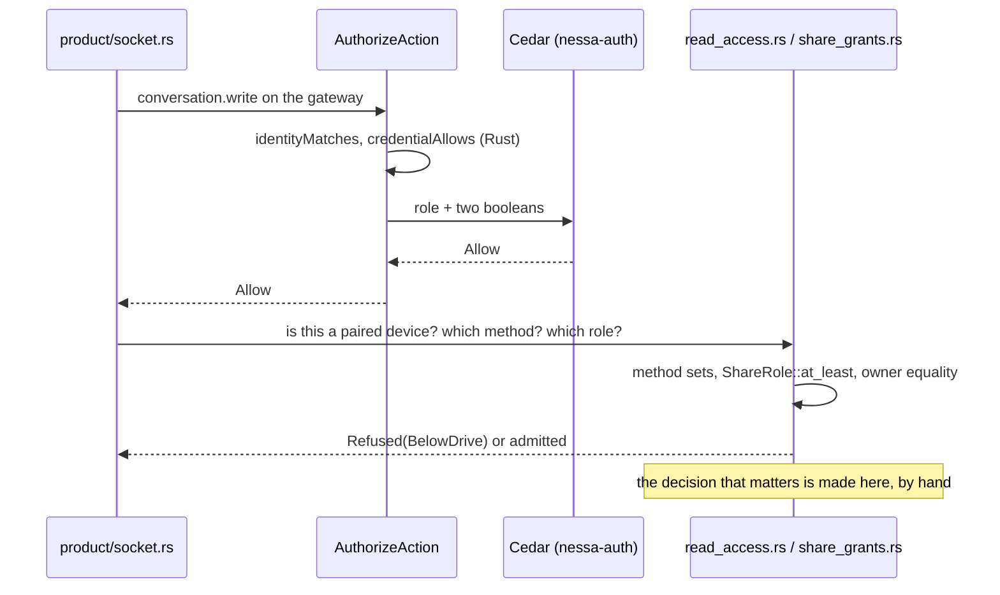

# 803. Every policy decision goes through Cedar

## Purpose

Nessa answers "may this principal do this to that?" in about thirty places, and
Cedar answers it in one. This record makes Cedar the one authority for every
such question, says what is not that question and stays in Rust, and lists the
order the hand-written decisions move in. The rule itself is
[gate 18](../../../CODING_STANDARDS.md#gates); this record is its audit and plan.

- **Date:** 2026-10-13
- **Status:** accepted (Saurav, 2026-10-13: "everything should be cedar for
  policies")

## Context

Cedar 4.12.0 is embedded in `nessa-auth` (`adapters/cedar/`). It answers five
actions on one resource, the gateway itself: `server.read`,
`credential.manage`, `conversation.read`, `conversation.write` and
`environment.serve`. Even there it decides little on its own:

- Two of its three `forbid` rules test yes/no values that Rust worked out first:
  `identityMatches` and `credentialAllows`. Cedar never sees a grant, so the
  main authorization fact is decided before Cedar runs.
- `evaluator.rs` denies any action outside a hard-coded list of five before
  Cedar runs. The same list is written again in the registry's
  `validate_grants` and in the schema.
- No conversation, share grant, receiver, tool, agent or lease is a Cedar
  entity, so every finer question is answered in Rust after Cedar has said yes
  to the coarse one.

That is two authorities over one decision, which
[gate 13](../../../CODING_STANDARDS.md#gates) forbids. It also hides real gaps:
the Drive tool policy is stored but nothing evaluates it, and a Drive-started
turn gets the owner's command hosts because the command policy never looks at
who started the turn.



## Decision

Every policy decision is a Cedar policy evaluated behind an application-owned
port, by an adapter in a module directory named `cedar`. Rust gathers facts,
asks the port, and acts on a typed decision that names the policy ids that
decided it. Cedar sees facts as entities and attributes (roles, grants held,
owners, principal kind, tool name), never a yes/no that Rust has already worked
out. Each port has its own checked-in schema and policies, strictly validated
when composition builds the adapter, and fails closed. The engine does not move
to one crate: a decision's port and adapter live with the context that owns the
decision, as `nessa-auth` and slice J4's tool-policy adapter already do.

```mermaid
sequenceDiagram
    participant Caller as Product method / service
    participant Port as Policy port (application)
    participant Cedar as cedar/ adapter
    Caller->>Port: principal, action, resource facts
    Port->>Cedar: entities + request
    Cedar-->>Port: Allow / Deny, policy ids
    Port-->>Caller: typed Decision
    Caller->>Caller: acts on it; never re-decides
```

### What is policy, and what is not

Policy is any answer to "may this principal take this action on this resource,
now?" The principal may be a person, a paired device, a peer gateway, an
environment peer, or the turn an agent runs for.

These are not policy and stay in Rust. Each is in the
[standard](../../../CODING_STANDARDS.md#policy-goes-through-cedar) too:

| Kind | Examples found in the audit |
| --- | --- |
| Proving who someone is | `ReadCurrentSession`, device-key verification, native connection admission, TLS pins, relay key proofs, MCP stand-in bearer tokens |
| Keeping stored records valid | registry `validate_principal_kind`, `validate_registry`, pairing commit re-validation, receiver binding lifecycle |
| Capacity | relay, owner-command and native-pool permits, `max_conversations`, lease budgets, `MAX_SHARE_GRANTS`, `MAX_DRIVE_GRANTS`, subagent depth |
| A person answering a prompt | approval cards, pairing approval, MCP App destructive-tool review |
| Terms attached to a yes | environment command timeout clamp, `maxLeaseMs` deadlines, revocation ending leases |
| Matching capabilities | `SandboxProfiles::admit`, `EffectiveCapabilities` |
| The operating system's trust | `nessa env grant` (whoever can write the data directory), offline owner bootstrap and recovery |
| Desktop host trust | Tauri window-label gates, the MCP App bridge and CSP; these belong to Tauri's capabilities |

A list narrowed in SQL for speed (`share_grants::granted()` for a paired
device's catalogue) is an index. Each item it returns is still admitted by
Cedar, and an item Cedar refuses is dropped.

### Audit: decisions not made by Cedar today

Found 2026-10-13 on `main` at `bba06c2`. Functions, not line numbers, so the
table survives edits.

| Area | Where | Decision made by hand |
| --- | --- | --- |
| **A. Gateway identity** | `nessa-auth` `adapters/cedar/evaluator.rs` `evaluate`, `credential_allows`, `identity_matches` | The five-action allowlist; whether a credential's grants cover the request; identity agreement (already enforced by `ReadCurrentSession`, so this copy goes) |
| | `nessa-auth` `domain/models.rs` `PrincipalKind::may_hold`; `adapters/local/registry.rs` `validate_grants`, `validate_issue` | Which actions each principal kind may hold, checked only when a credential is issued; a manager may not mint an admin |
| | `nessa-server` `product/socket.rs` `credential.issue`, `credential.revoke`, `credential.list` | An admin issues only active members in its own org, with grants limited to three actions; revoke and list are scoped to the caller's org and audience |
| | `nessa-auth` `application/pairing/admission.rs`, `domain/pairing/value_objects/values.rs` `ConsentIntent::matches_owner` | The invitation's owner must be the session's principal (Cedar is asked the rest) |
| **B. Conversation access** | `nessa-server` `conversation/domain/entities/conversation.rs` `allows`, `check_access` (about 30 callers) | A conversation is acted on only by its owner in its org; deleted ones are told only to the owner |
| | `conversation/application/share_grants.rs` `admit_read`, `admit_drive`, `binding_of`; `domain/value_objects/share_access.rs` `ShareRole::at_least` | A paired reader reads with any grant and drives with Drive; role ordering |
| | `product/read_access.rs` `admit_request`, `admit_list`, `admit_conversation`, `drives_only_text`, `dispatch_share` | Which methods a paired reader may call; a peer gateway never drives; Drive carries text only; paired readers may not list or share |
| | `conversation/application/share_grants.rs` `ShareConversation::share`; `infrastructure/store/share_grants.rs` `change` | A share target must be the caller's receiver and hold `conversation.read` (grant list scanned by hand); grant and revoke need ownership, inside the transaction |
| | `conversation/application/passive_read.rs` `binding`; `product/change_watch/registration.rs` `admit_current` | Owner and grant checks after Cedar; a catalogue watch is refused to a peer gateway |
| | `attachments/application/held_reads.rs` `HeldReads::read` | Artifact bytes only for the conversation's owner |
| **C. Agent tools** | `conversation/domain/command_policy.rs` `CommandPolicy::admit` | `run` only on configured hosts; programs by allow and deny sets; ignores who started the turn |
| | `mcp_servers/domain/app_call.rs` `admit_app`, `admit_tool_call` | An MCP App calls only its own server, and only tools visible to it |
| | `nessa-sdk` `infrastructure/mcp/stand_in.rs`, `infrastructure/mcp/wire.rs` `hidden_for_model` | The model may not call a tool hidden from it |
| | `conversation/domain/value_objects/share_access.rs` `ToolRules`, `ToolPreset` | The Drive tool policy: stored, never evaluated. Slice J4 builds its Cedar evaluator |
| | `nessa-sdk` `claude_acp/tools/wire.rs` `DISALLOWED_TOOLS`; `opencode_acp/sessions/binding.rs` `SESSION_POLICY` | Fixed tool deny lists sent to the harness at launch |
| **D. Environment host** | `nessa-server` `env_serve/domain/grants.rs` `granted_to`, `admit_agent`, `admit_command`; `env_serve/application/serve.rs` lease grant | Which agents and commands a leasing peer may use; SSH gets all, a dialed gateway nothing; a revoked gateway is refused |
| **E. Artifacts in the SDK** | `nessa-sdk` `application/agent_execution/sessions/artifacts.rs` `admit`, `asked_by` | An artifact is recorded only by the lease issuer or the person who started the turn |

Not a migration: placing a conversation on an environment
(`conversation/application/placement.rs`) has no per-principal rule today.
Adding one would be new policy, decided on its own issue.

### Migration order

Each step is its own pull request, `Part of #803`, and deletes the Rust it
replaces in the same change.

1. **This record, the gate, and the placement check.** No behaviour change.
2. **A: gateway identity.** Grants and principal kind become entity facts;
   `credentialAllows` and the action allowlist go; `may_hold` becomes a `forbid`
   checked on every request; the `credential.issue` and `revoke` rules become
   Cedar actions over the credential being issued or revoked.
3. **B: conversation access.** A conversation becomes a Cedar resource (org,
   owner, deleted), a paired reader a principal with its kind and binding owner,
   and a share role a fact. `read_access.rs`'s method sets become actions.
   Ownership checks inside the store's transaction ask the same port. Likely two
   pull requests: ownership first, then share grants. It touches files the
   slice J3 thread is editing, so it starts only when that is clear.
4. **C: agent tools,** after slice J4 lands its tool-policy adapter.
   `CommandPolicy`, MCP App call admission and model-hidden tools become
   policies in that bundle, keyed on who started the turn. The fixed harness
   deny lists are then generated from the same policies rather than written
   twice.
5. **D: environment host.** Agent and command grants become a Cedar bundle on
   the host; the terms (timeout clamp, lease deadlines) stay in Rust.
6. **E: SDK artifacts.** The SDK gains a port for "may this actor record an
   artifact under this lease"; the server answers it with Cedar.

## Alternatives considered

- **Keep hand-written Rust and only document it.** Rejected: it is the two
  authorities gate 13 forbids, and the audit found the gaps that come with it.
- **One Cedar bundle for the whole gateway.** One schema would be easy to read
  in one place, but it would put conversation, tool and environment entities in
  `nessa-auth`, which owns identity, and make every context depend on it. One
  bundle per port keeps each decision with the context that owns its facts.
- **Pass the Rust verdicts in as context.** That is today's shape. Cedar then
  only repeats Rust's answer and cannot be audited for why.
- **Enforce the whole gate with a check.** A text check cannot tell a
  hand-written policy decision from other Rust; a list of known decision
  functions only records what is already wrong (gate 11). The check enforces
  where the engine lives; review enforces the rest.

## Consequences

- Every refusal can name the policy that made it, which the audit trail and
  the person's error message both want.
- Policies are data a reviewer reads in one file per area, instead of logic
  spread over thirty functions.
- Cost: each migration step rebuilds entity mapping and tests for its area, and
  per-request evaluation costs more than an inline comparison. Not measured
  yet; step 3 measures the catalogue page, where each item is re-admitted.
- Watch for: a context value that is really a verdict, and a `cedar` directory
  used to hide hand-written matching. Both are review findings under gate 18.
