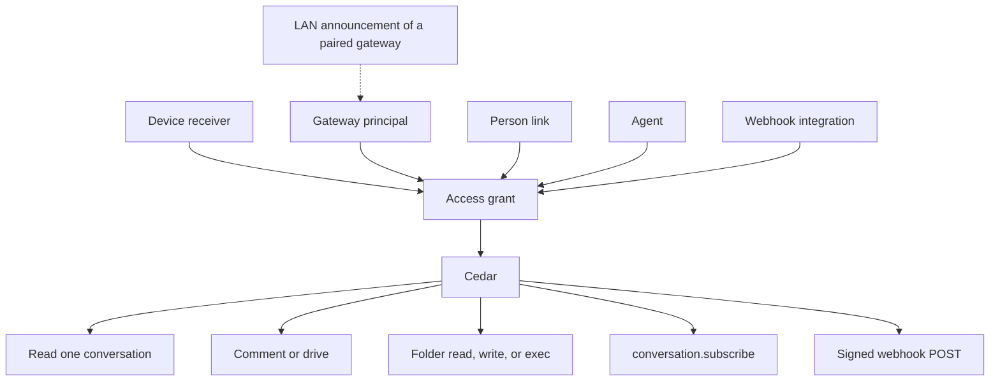

# Access grants

Status: proposal. Nothing in this document is built by the pull request that
adds it. The implemented contracts stay where they are:
[share grants](read-grants.md),
[peer gateways](auth/peer-gateways.md),
[record subscriptions](record-subscriptions.md), and
[the runtime map](runtime-architecture.md#sharing-a-conversation).

This is the plan for one access fact, reused by peer chats, a shared folder,
command rules, a live follow, and an outbound webhook. Cedar remains the only
decider. Alpha drops the previous share shape in the refactor; there is no
reader of the old row and no second name for the new one.

An ADR for the boundary is filed with the refactor issue, and takes that
issue's number, when the issue is opened. This pull request does not invent
a number.

## The primitive

One grant:

| Field | What it is |
| --- | --- |
| Principal | Who. A paired device (its receiver), a gateway (`gateway:<key>`), a person, an agent, or an integration (a webhook). |
| Resource | One conversation id, or one directory on the granting machine. |
| Capabilities | A set drawn from `read`, `comment`, `drive`, `write`, `exec`. `comment` and `drive` belong to a conversation. `write` and `exec` belong to a directory. |
| Constraints | The path boundary, the tool policy, and the command allow/deny rules that apply inside that resource. |
| Epoch | The grant epoch: the counter that advances when capabilities or constraints change. A turn, a lease, and a webhook delivery keep the epoch they were admitted under. |

The grant row is facts. Cedar permits or refuses. A use case may refuse to
write a fact Cedar would deny; it does not allow something Cedar denies.

Two counters already exist and stay separate. The **grant epoch** is today's
share `policy_revision`: the journal sequence of the change that last set
what the grant allows. The **binding epoch** is the receiver access epoch in
[session and stream contracts](session-and-stream-contracts.md#passive-receiver-read-admission-295):
it advances when the credential or the binding is revoked or regranted, and
a stale read scope is denied before the source. The refactor does not add a
third counter.



The person link and the LAN announcement carry no capability. The link names
who a gateway acts for. The announcement names where a paired gateway can be
dialed. Cedar still sees the grant.

```mermaid
sequenceDiagram
  participant Caller as Device, peer gateway, or webhook
  participant Admit as Admission
  participant Row as Grant row
  participant Cedar
  participant Effect as Turn, subscribe, or HTTP POST
  Caller->>Admit: act on one conversation or one directory
  Admit->>Row: principal, capabilities, constraints, grant epoch
  Admit->>Cedar: those facts and the action
  Cedar-->>Admit: permit or refuse, with the policy ids
  Admit->>Effect: on permit, stamped with the epoch just read
  Note over Admit,Effect: a later revoke advances the epoch; the next action reads it again
```

## What is already built

### Cedar, and the real caller

Policy bundles, each the decider for its question:

| Question | Bundle |
| --- | --- |
| Which grants a credential may hold, and who may be issued one | `crates/nessa-auth/src/adapters/cedar/policies.cedar` (`hold.peer` allows a gateway `conversation.read` and `environment.serve`) |
| What the owner may do with a conversation | `crates/nessa-server/src/conversation/infrastructure/access_policy/cedar/ownership.cedar` |
| What a paired reader may do | `crates/nessa-server/src/conversation/infrastructure/access_policy/cedar/readers.cedar` |
| Who may share | `crates/nessa-server/src/conversation/infrastructure/access_policy/cedar/shares.cedar` |
| Which tools a turn may call | `crates/nessa-server/src/conversation/infrastructure/tool_policy/cedar/tools.cedar` |
| Which host and program a command may use | `crates/nessa-server/src/conversation/infrastructure/tool_policy/cedar/commands.cedar` |
| Who may edit a remembered permission rule | `crates/nessa-server/src/conversation/infrastructure/permission_rules/cedar/rules.cedar` (the owner; a grant is refused) |
| Which agent or command a peer may lease on a host | `crates/nessa-server/src/env_serve/infrastructure/cedar/policies.cedar` |

The socket has one admission, `admit_request` in
`crates/nessa-server/src/product/read_access.rs`. A paired command is
returned as `Initiation::grant(receiver, policy_revision)`. The turn records
that grant and that epoch. An owner surface is `Initiation::owner()`. A
device signs in as the binding owner, so Drive works for the owner's phone.
A peer gateway signs in as `gateway:<key>`. The same function says
forwarding that peer's people is a later slice. [ADR 803](../adr/done/803-policy-goes-through-cedar.md)
records this admission as the place a paired method is decided.

`@id("paired.peer_gateway")` in `readers.cedar` forbids `conversation.comment`
and `conversation.drive` when `signedInAs != bindingOwner`. A Drive role can
be stored on a peer and still do nothing.

### Share grants (#704, merged in #720; roles in #787; Drive in #793)

[Share grants](read-grants.md) are `(receiver, conversation id, role, tool
policy)`, in `share_grants`, journaled in `share_grant_changes`. The role is
Read, Comment, or Drive. Drive carries a tool policy and `commandHosts`.
`policy_revision` is the journal sequence of the last role or policy change.
`conversation.share`, `.unshare`, and `.shares` are the owner's, admitted
through `shares.cedar`.

[#787](https://github.com/nessalabs/nessa-agent/issues/787) stored the role
and the policy and admitted nothing new. [#793](https://github.com/nessalabs/nessa-agent/issues/793)
lets a party signed in as its grantor drive the one conversation, text only,
through `admit_request`. Tool checking
(`crates/nessa-server/src/conversation/application/drive_tools.rs`) keeps the
policy of the admitted epoch and holds that revision across the save. A
change of policy applies to the next turn.

### Peer gateways and environment peers (#705, #706)

[Peer gateways](auth/peer-gateways.md) enroll a gateway principal with
`conversation.read` only. The owner then shares conversations one id at a
time. Catalogue watch is refused to a peer, because its notices cover the
owner's whole catalogue. The peer polls.

`PeerPoller` (`crates/nessa-server/src/peer_gateways/infrastructure/poller.rs`)
reads `catalogueHead` on `peer.poll_interval` (30 seconds,
[limits](../limits.md)) and walks records into the retained cache.

[#706](https://github.com/nessalabs/nessa-agent/issues/706) is the other
direction. A paired environment holds `environment.serve` and dials in. What
it will run is `<data>/environment/grants.json` on that machine (`nessa env
grant`): named agents or all agents, commands, `maxTimeoutMs`, `maxLeaseMs`.
Cedar decides `agent.lease` and `command.run` from those facts. The
environment may narrow a lease and the gateway records what was granted. A
published file is fetched by lease, artifact, and range
([Reading a published file](auth/peer-gateways.md#reading-a-published-file-over-the-connection-row-i9)),
never by a path the gateway invents.

`hold.peer` is what stops one credential from being both the conversation
authority and the environment. This plan leaves that rule in place.

### Owner-issued targets (#797)

[Permission targets](permission-targets.md),
[question targets](question-targets.md), and
[prepared submissions](prepared-submissions.md) are a caller contract. The
client freezes a target from a view it was given, and a fabricated id is
refused before the RPC. The gateway still decides access. Grants do not mint
these targets, and these targets do not grant access.

### Native hooks (#768)

[ADR 768](../adr/done/768-native-harness-hooks.md): Claude and Codex run
their own hooks only when the owner opts in, per harness, off by default.
OpenCode stays suppressed. A hook can approve, deny, or change a tool call
inside the harness. Nessa's Drive admission refuses a turn when those hooks
are allowed to answer first, because the grant's tool policy would not be
the check.

### Owner phone (#811)

[#811](https://github.com/nessalabs/nessa-agent/issues/811) wants the owner's
own phone to read and manage current and future owned conversations. The
issue's boundary is a separate consent class. It says to leave `PeerRead`,
`DeviceRead`, and per-chat roles as they are. This plan does not widen
`PeerRead` or `DeviceRead`, and it does not implement the owner phone.

### Identity, and the runtime map

[Identity, tenancy, and cloud](auth/identity-tenancy-and-cloud.md) keeps
Nessa principal and organization ids, with Cedar embedded in the gateway. An
email or a provider subject is not a principal. A cloud worker is an
execution principal inside an organization, with grants, and connecting an
account does not merge local conversations.

[The runtime map](runtime-architecture.md) already separates the grant
(owner's table, per conversation), the follow rule (follower's table), and
the environment policy (the machine's table). Records flow owner to
follower. Commands flow the other way and are admitted on the owner. The
mesh finds a peer by local discovery, then last-known address, then relay,
and trust comes from the pinned key. Local discovery is described there and
not built. The map also says a sandbox Nessa cannot enforce is said, not
claimed.

## What changes, and what goes away

Subtract first. The grant above is the share row with its fields named once.
Folders, webhooks, and cloud agents reuse that row. They do not bring a new
policy engine, a new crate, or a grant-by-list.

| Piece | What happens |
| --- | --- |
| Share role Read / Comment / Drive | Becomes the capability set: Read is `read`, Comment is `read` + `comment`, Drive is those plus `drive`. One wire field, `capabilities`. The role enum goes. |
| Tool policy and `commandHosts` | Stay as constraints on a grant that has `drive`. |
| `policy_revision` | Stays, under the name grant epoch. |
| `paired.peer_gateway` | Deleted. `grant.comment` and `grant.drive` require the capability and, until the peer-write slice, a principal signed in as the binding owner. One condition, on the permit. |
| A stored Drive role that a peer cannot use | The share use case refuses to write `comment` or `drive` for a gateway principal. Cedar denies a row that has them anyway. |
| Credential `conversation.read`, `conversation.write`, `environment.serve` | Stay. They say whether this credential may read, may be the conversation authority, or may serve. They do not name a conversation or a directory. `hold.peer` stays as written. |
| `grants.json` on the environment | Stays on that machine, so the gateway cannot widen it. The same capability and constraint words. `domain::unwritten` stays the default facts (an absent ssh entry is the host's own set; an absent dialed gateway is empty). |
| Gateway `denyPrograms` / `allowPrograms` | Stay the host's own program list in `commands.cedar`. A grant's command rules are a further constraint, deny wins. |
| Remembered permission rules | Stay the owner's. `rules.cedar` already refuses a grant. |
| `#797` targets | Stay a caller contract. |
| `#811` owner phone | Left to that issue. Pairing classes are unchanged here. |
| `PeerPoller` record walk | The live-follow slice stops walking records for a conversation that is subscribed. Status and the catalogue head stay until the follower knows the grant set. |
| `conversation.watchRecords` | Stays the retained phone path ([#851](https://github.com/nessalabs/nessa-agent/issues/851)). Peers use `conversation.subscribe`. |
| Grant by channel, folder-of-chats, or default sync | Already refused. Stays refused. |
| A webhook-only access list | Not added. The webhook's share grant is the list. |
| Nessa copies of Claude or Codex hooks | Not added. |

A cloud agent, when it exists, is an agent principal with a directory grant:
`read`, `write`, and `exec` inside that directory, command rules in the
constraints, admitted by the same Cedar policies. No slice below builds the
agent. The directory resource is shaped so that slice does not need a new
grant.

## Native harnesses

Claude and Codex hooks run in the harness when the owner has opted in
([ADR 768](../adr/done/768-native-harness-hooks.md)). Nessa's command rules
are Cedar checks at the boundaries Nessa owns: the permission request, the
gateway `run` tool, and `GrantCommand` on an environment. The owner edits
them as an ordered list of allow and deny matchers, the same kind of list
as a hook matcher, stored on the grant. The list is not written into
`.claude` settings or Codex config, and opting in does not turn Nessa's
rules off.

Where the harness runs a command without asking, Nessa's rule does not see
it. That limit is the one [ADR 0014](../adr/todo/0014-nessa-owned-policy-hooks.md)
already states, and the share says so. A grant whose constraints have to
hold for every call keeps today's refusal: a Drive turn is admitted when
the agent is Claude or Codex, the conversation is in Ask, and the harness
hooks are not allowed to answer first.

## Directory resource and command rules

The resource is one canonical absolute directory on the granting machine.
`read` lists and reads files under it. `write` creates and edits files
under it. `exec` runs commands whose working directory is inside it.

The path boundary is that directory. A path with `..`, or a symlink that
resolves outside it, is outside the grant. The environment starts the
lease with that directory as its workspace. On publish and on
`GrantCommand` the environment sees the path and refuses one outside it.
A file tool the harness runs without naming a path to Nessa is outside
that check; the share says the account and the harness sandbox are what
enclose it, as the runtime map's sandbox table already does.

Command matchers name a program by its file name, as
`command.denied_program` does, and may add a bounded argv pattern. Deny
wins over allow. The pattern bound is a row in
[limits](../limits.md), owned by the slice that adds it, beside the
existing tool-policy bounds. The program match reuses the file-name rule
already in `commands.cedar`.

## Same person

At gateway pairing the owner can say these two gateways are the same
person. The credential still names `gateway:<key>` and `hold.peer` is
unchanged. A link row says that gateway principal acts for the owner's
person principal. Admission reports the person as who it acts for and the
grant as what it may do. The link adds no capability, copies no
conversation, and does not turn the peer into the owner phone.

## Live follow

[#851](https://github.com/nessalabs/nessa-agent/issues/851) already follows
one conversation with `conversation.subscribe`. The frame's cursor is
`{incarnation, position}`. `after` resumes from the last view the client
applied. A new incarnation replaces the view. `cursor_ahead` is refused.
A lagging subscriber resumes from `lastDelivered`
([record subscriptions](record-subscriptions.md)). A paired session is
admitted on `conversation.read` by `admit_paired_follow`, and the
conversation is the share check.

The live-follow slice uses that call for each shared chat the follower has
opened. It opens a new pinned session after a disconnect and passes the
cursor it last applied, the same way the sync engine resumes a pass. The
poller keeps dialing status, and it keeps reading the catalogue head so a
new grant can be learned. It stops paging records for a conversation that
has a subscription. A subscribe refused as not found withdraws the local
replica, which is what `wrong_owner` does on the poll path today.

## Webhooks

A webhook is an integration principal the owner issues with
`credential.issue`. The registration stores an HTTPS URL and a 32-byte mac
key. The credential holds `conversation.read`. It has no product socket and
no receiver binding: a receiver binding is what pairing creates, and a
session that presented one would be admitted as a paired reader.

`conversation.share` is still the one share command. This slice teaches it a
second target, the integration credential, beside a paired receiver. The
grant row is the same fact, keyed by that credential. Delivery reads those
grants. The gateway POSTs events for those conversations only. The payload
is what a reader with that capability set may see.

The body is signed with HMAC-SHA256 over a canonical string of the
timestamp, the delivery id, and the body. That is the mac
[backup manifests](../../crates/nessa-server/src/backup/application/ports.rs)
already use; the webhook key is its own, stored with the registration, and
is not written into the body. Delivery retries with bounded backoff and
repeats the same delivery id. Revoke advances the grant epoch and stops
delivery. Each attempt is audited with the target, the delivery id, the
outcome before and after, the cause, and the owner as initiator.

## LAN announcement

Off until the peer table has a paired gateway. The announcement is signed
by the pairing key. It carries the key fingerprint, a dial address and
port, and a counter. It omits the owner name, the organization, every
conversation id, every directory, and every grant. A listener that has not
paired cannot enroll from it. A paired peer verifies the signature against
the pinned key and stores the address as a last-known address. The
connection is still the pinned TLS session and the issued credential.

## Order

The refactor lands before any feature slice. Later slices depend on the
real blocker, which is named on each issue. Cloud agents and the owner
phone are not in this list.

| Order | Slice | Depends on |
| --- | --- | --- |
| 1 | Refactor the conversation grant | Merged #704, #720, #707, #787, #793, ADR 803 |
| 2 | (a) Open a shared chat as a local conversation | The refactor |
| 3 | (b) Peer comment and drive | The refactor and (a) |
| 4 | (c) One folder, path boundary, command rules | The refactor |
| 5 | (d) Same-person link at pairing | The refactor |
| 6 | (e) Live follow on `conversation.subscribe` | (a), and #851 as already merged |
| 7 | (f) Follow rules | (a) and (e) |
| 8 | (h) Signed outbound webhooks | The refactor |
| 9 | (g) LAN announcement | Paired gateways as already shipped (#705) |

## Issues to file

File each of these on the Nessa Agents board. The bodies are the text to
paste. They are not open yet.

### 1. Unify conversation shares into one access grant

```markdown
Part of the access-grant proposal in `docs/design/access-grants.md`.

## Deliver

Make the conversation share row the access grant: the paired receiver, one
conversation id, a capability set (`read`, and for a device also `comment`
and `drive`), constraints (the tool policy and `commandHosts` a `drive`
grant already carries), and the grant epoch (today's `policy_revision`).

Cedar's `grant.read`, `grant.comment`, and `grant.drive` permits read those
capabilities. `grant.comment` and `grant.drive` also require a principal
signed in as the binding owner, which is the device case. Delete
`paired.peer_gateway`. `conversation.share` refuses `comment` and `drive`
for a gateway principal and writes nothing.

The wire field is `capabilities`. The role enum goes. Alpha: bump the
metadata database version once, from whatever it is on main, and refuse a
file this build cannot read. Update `docs/design/read-grants.md` to this
contract in the same change.

Device comment and drive stay as they are: text-only drive, tool checking
at the admitted epoch, `hold_revision` across the save, and the journal
recording role-equivalent capabilities and constraints before and after,
with the owner as initiator.

## Gate

A device with `drive` sends on that conversation and is refused on another.
A peer with `read` still reads, and comment and drive are refused. Sharing
`drive` with a peer is refused and the row is unchanged. A hand-built row
that gives a gateway `comment` is denied by Cedar. A retry journals before
equal to after. The previous metadata version is refused. A test fails if
the capability check is removed from the permit.

## Depends on

Nothing in this plan. The merged share, role, Drive admission, and Cedar
work (#704, #720, #707, #787, #793, ADR 803).
```

### 2. Open a peer's shared chat as a local conversation

```markdown
## Deliver

On the follower, a conversation a peer has granted opens as a local
conversation. It is a replica of the grantor's chat, shown through the
existing conversation view, from the records the peer cache already holds.
The follower's store is not the authority and is not merged with the
grantor's. The chat is read-only until the peer-write slice. An id with no
grant answers the same way a missing conversation does.

## Gate

Open a granted chat and read its transcript. An ungranted id is not found.
Unshare withdraws it from the local list. A message composed on the
follower is not written to the grantor. The two metadata databases stay
two databases.

## Depends on

The access-grant refactor.
```

### 3. Let a peer comment and drive under its grant

```markdown
## Deliver

The owner can put `comment` or `drive` on a gateway principal's grant for
one conversation. Remove the signed-in-as-owner requirement from
`grant.comment` and `grant.drive`, so the capability is the decision.
`admit_request` keeps returning `Initiation::grant(receiver, epoch)`: the
turn's caller is the grant, not the owner.

The peer credential still holds only what `hold.peer` allows
(`conversation.read`, and `environment.serve` when it is also an
environment). Delete, archive, export, re-share, and model changes stay
`owner.act`. Drive stays text-only. Tool policy, command hosts, and the
native-hooks refusal stay the checks they are for a device.

When a same-person link exists, the audit also names that person. The
capability still comes from the grant.

## Gate

A peer with `comment` leaves a note and cannot send. A peer with `drive`
sends text and is refused an image or a linked file. A peer cannot delete
or re-share. A command on a conversation with no grant is not found.
Revoke refuses the next command. A turn already admitted finishes under
its epoch. The audit names the gateway principal and the grant epoch.

## Depends on

The access-grant refactor, and the local shared conversation, so there is
a chat to act in.
```

### 4. Share one folder with a path boundary and command rules

```markdown
## Deliver

A grant resource may be one directory on the granting machine, with
capabilities `read`, `write`, and `exec`. The lease workspace is that
directory. A named path outside it, including `..` and a symlink that
resolves outside, is refused.

Command rules are an ordered allow/deny list on the grant. Cedar matches
the program by file name, as `command.denied_program` does, and may match
a bounded argv pattern. Deny wins. The owner edits the list as matchers.
The list is stored on the grant and is not written into Claude or Codex
settings. With native hooks opted in, those hooks run in the harness, and
Nessa's rules still run at the permission request, `run`, and
`GrantCommand`. A call the harness makes without asking is reported as
outside Nessa's gate.

`grants.json` on the sharing machine stays the authority for what it will
run and can narrow the grant. Add the argv pattern bound to `docs/limits.md`
with one owner. This slice does not add a cloud agent; an agent principal
will use this directory resource later.

## Gate

A peer granted the directory reads a file inside it and is refused a path
outside it. A denied program is refused and the audit names the matcher.
An opted-in Claude or Codex harness still runs its own hooks. The gateway
cannot write a wider `grants.json` than the machine's owner wrote. A
constraint that must cover every call is still refused when native hooks
would answer first.

## Depends on

The access-grant refactor.
```

### 5. Declare two gateways the same person at pairing

```markdown
## Deliver

`pairing.create` for a gateway takes a same-person choice. When set, a
link row says this `gateway:<key>` principal acts for the owner's person
principal. The credential, its class, and `hold.peer` stay as they are.
The link adds no capability. Admission reports the person beside the
grant. `PeerRead` and `DeviceRead` are unchanged. The owner-phone consent
class (#811) is not this link and is not issued here.

## Gate

Pairing with the choice records the person and the gateway principal. A
read still requires a share grant. A gateway paired without the choice has
no person on its admission. Revoking the credential drops the link. An
invitation cannot be relabelled from one choice to the other in transit,
as the enrollment class cannot today.

## Depends on

The access-grant refactor, so admission has one principal fact to attach
the link to.
```

### 6. Follow a shared chat on conversation.subscribe

```markdown
## Deliver

Move a linked gateway's live read of an opened shared chat from the peer
poller's record walk onto the existing `conversation.subscribe` (#851).
Resume with `after` set to the last `{incarnation, position}` the follower
applied. A new incarnation replaces the view. `lagging` resumes from
`lastDelivered`. A refused subscribe withdraws the local conversation.

The poller still dials pinned status and still reads the catalogue head,
so a new grant and a revocation are still learned. It does not page
records for a subscribed conversation. No new watch method.
`conversation.watchRecords` stays the retained phone path.

## Gate

A new message on the grantor shows on the follower without waiting for
`peer.poll_interval`. Reconnect resumes from the cursor and does not move
the view backwards in the same incarnation. Unshare ends the subscription
and withdraws the chat. The follower does not call `conversation.watchRecords`.

## Depends on

The local shared conversation, and the subscribe admission #851 already
merged.
```

### 7. Choose which granted chats to follow

```markdown
## Deliver

The follower stores a follow rule per peer: which granted conversations to
replicate, and how much to keep. Subscribe and the cache cover that
intersection. The default is none until the person chooses. Changing the
rule is an explicit reset of the local replica. The rule cannot widen a
grant, and the grantor is not sent the rule.

## Gate

Following one granted chat leaves the peer's other granted chats out of
the cache. A grant with no follow rule can be opened by an explicit choice
and is not replicated on its own. Shrinking the rule drops the local
replica. The grantor's catalogue is unchanged by the choice.

## Depends on

The local shared conversation and the subscribe follow.
```

### 8. Deliver granted events to a signed webhook

```markdown
## Deliver

The owner issues an integration principal with `credential.issue`, holding
`conversation.read`, and registers an HTTPS URL and a 32-byte mac key on
it. The credential has no product session and no receiver binding, so it
is not admitted as a paired reader.

`conversation.share` gains that credential as a target beside a paired
receiver. The grant row is the same fact. The gateway POSTs events for
the granted conversation only. The payload is what that capability set
may see.

Sign with HMAC-SHA256 over the timestamp, the delivery id, and the body,
the mac algorithm backup manifests use, with this registration's key. The
key stays out of the body. Retry with bounded backoff and the same
delivery id. Revoke advances the grant epoch and stops further delivery.
Audit each attempt with the target, the delivery id, before and after, the
cause, and the owner.

## Gate

A webhook granted one chat receives that chat's events and no other. After
unshare, nothing further is sent. A retry repeats the delivery id and the
signature. The webhook credential cannot call `conversation.send`. A
delivery admitted under an older epoch is not sent after revoke.

## Depends on

The access-grant refactor.
```

### 9. Announce a paired gateway on the local network

```markdown
## Deliver

With at least one paired gateway in the peer table, this gateway may
announce itself on the local network. The announcement is signed by the
pairing key and carries the key fingerprint, a dial address and port, and
a counter. It omits the owner name, the organization, conversation ids,
directories, and grants. Pairing still requires the one-use code. A paired
peer that verifies the signature stores the address as a last-known
address and connects with the existing pinned credential. With no paired
gateway, send nothing.

## Gate

An unpaired gateway sends no announcement. An announcement cannot enroll a
listener. A paired peer reaches the announced address and is refused if
the key or the credential is wrong. The announcement bytes contain the
fingerprint, the address, and the counter, and contain nothing from a
conversation or a grant.

## Depends on

Paired peer gateways as already shipped (#705). Sequenced after the grant
slices so discovery does not become a second enrollment.
```
