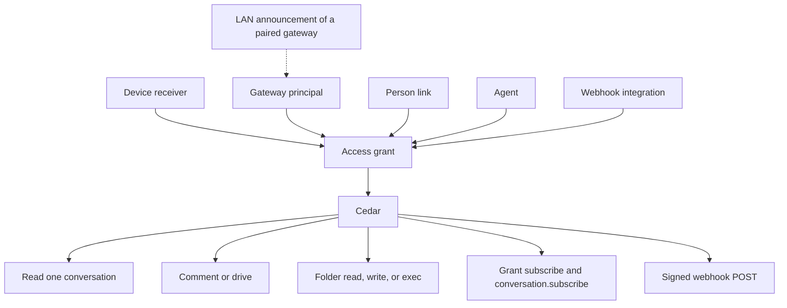
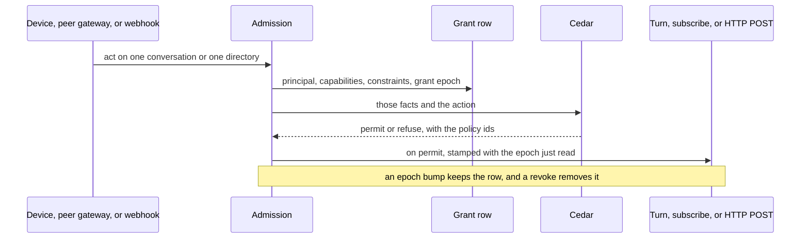
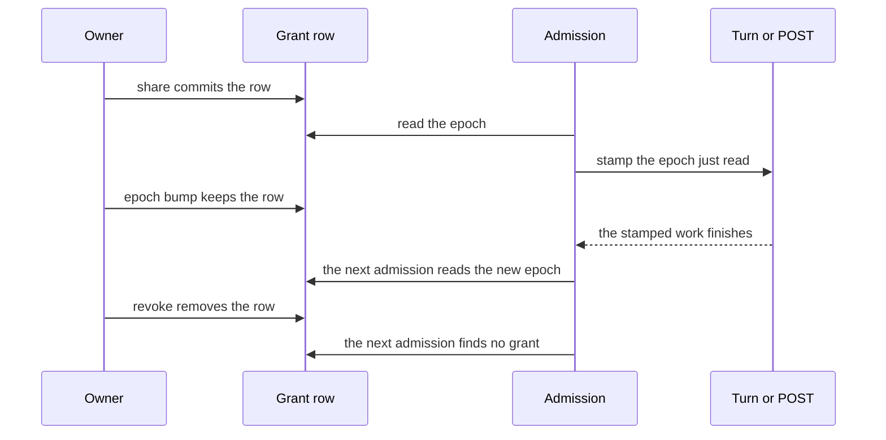
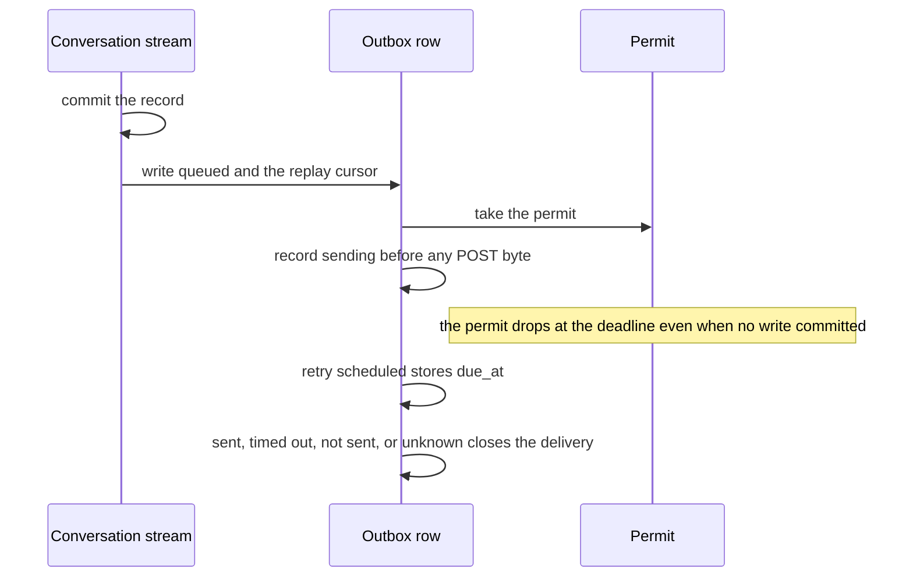
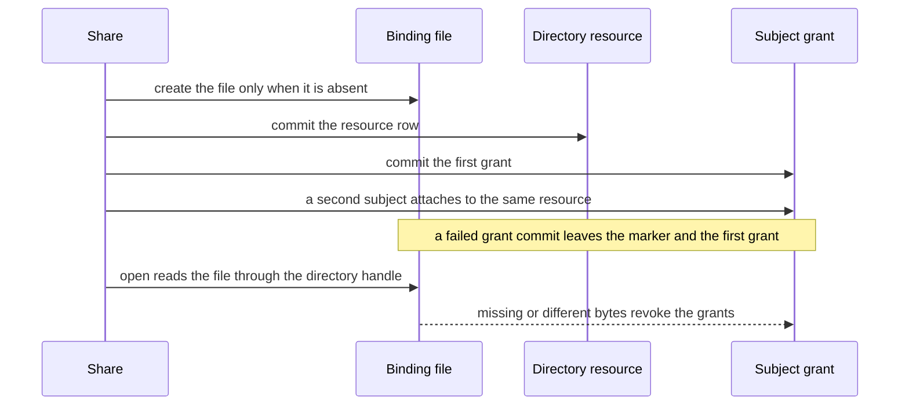
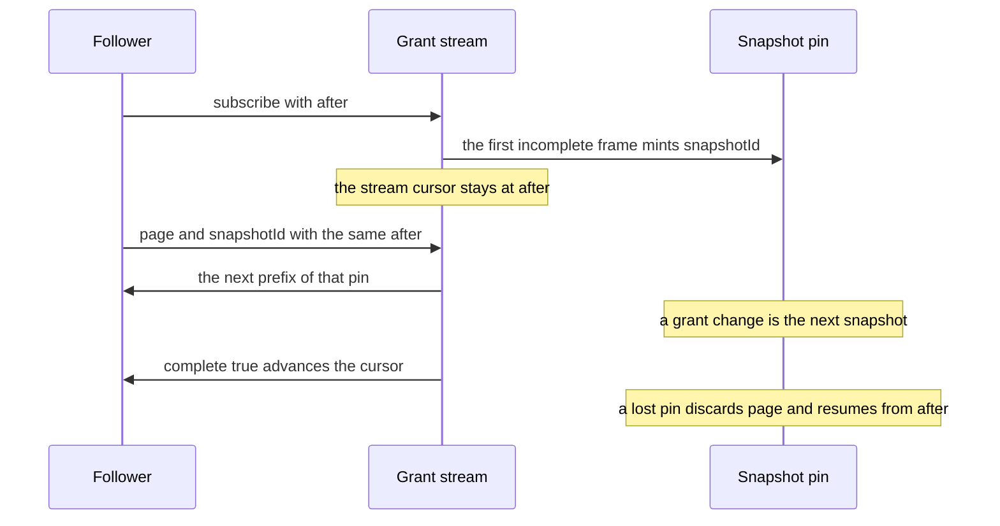
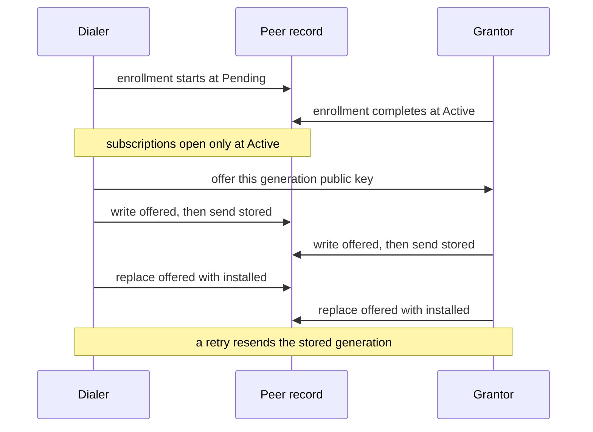

# Access grants

Status: proposal. Nothing in this document is built by the pull request that
adds it. The implemented contracts stay where they are:
[share grants](read-grants.md),
[peer gateways](auth/peer-gateways.md),
[record subscriptions](record-subscriptions.md), and
[the runtime map](runtime-architecture.md#sharing-a-conversation).

This is the plan for one access fact, reused by peer chats, a shared folder,
command rules, a live follow, and an outbound webhook. Cedar remains the only
decider. Alpha drops the previous share shape in the refactor; there is no
reader of the old row and no second name for the new one.

The ADR, when it is written, takes [#889](https://github.com/nessalabs/nessa-agent/issues/889).
This document is the design. It does not add a second record.

## The primitive

One grant:

| Field | What it is |
| --- | --- |
| Principal | Who. A paired device (its receiver), a gateway (`gateway:<key>`), a person, an agent, or an integration (a webhook). |
| Resource | One conversation id, or one directory in an environment the grantor enforces. That environment is this gateway's machine, a remote environment it already leases, or a cloud environment a later agent uses. |
| Capabilities | A set drawn from `read`, `comment`, `drive`, `write`, `exec`. `read` applies to a conversation and to a directory. `comment` and `drive` apply to a conversation. `write` and `exec` apply to a directory. |
| Constraints | The path boundary, the tool policy, and the command allow/deny rules that apply inside that resource. |
| Epoch | The grant epoch: the counter that advances when capabilities or constraints change. A turn, a lease, and a webhook attempt keep the epoch they were admitted under. The next admission reads the epoch again. |

The grant row is facts. Cedar permits or refuses. A use case may refuse to
write a fact Cedar would deny; it does not allow something Cedar denies.

Two counters already exist and stay separate. The **grant epoch** is today's
share `policy_revision`: the journal sequence of the change that last set
what the grant allows. The **binding epoch** is the receiver access epoch in
[session and stream contracts](session-and-stream-contracts.md#passive-receiver-read-admission-295):
it advances when the credential or the binding is revoked or regranted, and
a stale read scope is denied before the source. The refactor does not add a
third counter. Issue, epoch bump, and revoke are the grant table in
[Lifecycles](#lifecycles). This section does not add a grant state.



The person link and the LAN announcement carry no capability. The link names
who a gateway acts for. The announcement names where a paired gateway can be
dialed. Cedar still sees the grant.



## What is already built

### Cedar, and the real caller

Policy bundles, each the decider for its question:

| Question | Bundle |
| --- | --- |
| Which grants a credential may hold, and who may be issued one | `crates/nessa-auth/src/adapters/cedar/policies.cedar` (`hold.peer` allows a gateway `conversation.read` and `environment.serve`) |
| What the owner may do with a conversation | `crates/nessa-server/src/conversation/infrastructure/access_policy/cedar/ownership.cedar` |
| What a paired reader may do | `crates/nessa-server/src/conversation/infrastructure/access_policy/cedar/readers.cedar` |
| Who may share | `crates/nessa-server/src/conversation/infrastructure/access_policy/cedar/shares.cedar` |
| Which tools a turn may call | `crates/nessa-server/src/conversation/infrastructure/tool_policy/cedar/tools.cedar` |
| Which host and program a command may use | `crates/nessa-server/src/conversation/infrastructure/tool_policy/cedar/commands.cedar` |
| Who may edit a remembered permission rule | `crates/nessa-server/src/conversation/infrastructure/permission_rules/cedar/rules.cedar` (the owner; a grant is refused) |
| Which agent or command a peer may lease on a host | `crates/nessa-server/src/env_serve/infrastructure/cedar/policies.cedar` |

The socket has one admission, `admit_request` in
`crates/nessa-server/src/product/read_access.rs`. A paired command is
returned as `Initiation::grant(receiver, policy_revision)`. The turn records
that grant and that epoch. An owner surface is `Initiation::owner()`. A
device signs in as the binding owner, so Drive works for the owner's phone.
A peer gateway signs in as `gateway:<key>`. The same function says
forwarding that peer's people is a later slice. [ADR 803](../adr/done/803-policy-goes-through-cedar.md)
records this admission as the place a paired method is decided.

`@id("paired.peer_gateway")` in `readers.cedar` forbids `conversation.comment`
and `conversation.drive` when `signedInAs != bindingOwner`. A Drive role can
be stored on a peer and still do nothing.

### Share grants (#704, merged in #720; roles in #787; Drive in #793)

[Share grants](read-grants.md) are `(receiver, conversation id, role, tool
policy)`, in `share_grants`, journaled in `share_grant_changes`. The role is
Read, Comment, or Drive. Drive carries a tool policy and `commandHosts`.
`policy_revision` is the journal sequence of the last role or policy change.
`conversation.share`, `.unshare`, and `.shares` are the owner's, admitted
through `shares.cedar`.

[#787](https://github.com/nessalabs/nessa-agent/issues/787) stored the role
and the policy and admitted nothing new. [#793](https://github.com/nessalabs/nessa-agent/issues/793)
lets a party signed in as its grantor drive the one conversation, text only,
through `admit_request`. Tool checking
(`crates/nessa-server/src/conversation/application/drive_tools.rs`) keeps the
policy of the admitted epoch and holds that revision across the save. A
change of policy applies to the next turn.

### Peer gateways and environment peers (#705, #706)

[Peer gateways](auth/peer-gateways.md) enroll a gateway principal with
`conversation.read` only. The owner then shares conversations one id at a
time. Catalogue watch is refused to a peer, because its notices cover the
owner's whole catalogue. The peer polls.

`PeerPoller` (`crates/nessa-server/src/peer_gateways/infrastructure/poller.rs`)
reads `catalogueHead` on `peer.poll_interval` (30 seconds,
[limits](../limits.md)) and walks records into the retained cache.

[#706](https://github.com/nessalabs/nessa-agent/issues/706) is the other
direction. A paired environment holds `environment.serve` and dials in. What
it will run is `<data>/environment/grants.json` on that machine (`nessa env
grant`): named agents or all agents, commands, `maxTimeoutMs`, `maxLeaseMs`.
Cedar decides `agent.lease` and `command.run` from those facts. The
environment may narrow a lease and the gateway records what was granted. A
published file is fetched by lease, artifact, and range
([Reading a published file](auth/peer-gateways.md#reading-a-published-file-over-the-connection-row-i9)),
never by a path the gateway invents.

`hold.peer` is what stops one credential from being both the conversation
authority and the environment. This plan leaves that rule in place.

### Owner-issued targets (#797)

[Permission targets](permission-targets.md),
[question targets](question-targets.md), and
[prepared submissions](prepared-submissions.md) are a caller contract. The
client freezes a target from a view it was given, and a fabricated id is
refused before the RPC. The gateway still decides access. Grants do not mint
these targets, and these targets do not grant access.

### Native hooks (#768)

[ADR 768](../adr/done/768-native-harness-hooks.md): Claude and Codex run
their own hooks only when the owner opts in, per harness, off by default.
OpenCode stays suppressed. A hook can approve, deny, or change a tool call
inside the harness. Nessa's Drive admission refuses a turn when those hooks
are allowed to answer first, because the grant's tool policy would not be
the check.

### Owner phone (#811)

[#811](https://github.com/nessalabs/nessa-agent/issues/811) wants the owner's
own phone to read and manage current and future owned conversations. The
issue's boundary is a separate consent class. It says to leave `PeerRead`,
`DeviceRead`, and per-chat roles as they are. This plan does not widen
`PeerRead` or `DeviceRead`, and it does not implement the owner phone.

### Identity, and the runtime map

[Identity, tenancy, and cloud](auth/identity-tenancy-and-cloud.md) keeps
Nessa principal and organization ids, with Cedar embedded in the gateway. An
email or a provider subject is not a principal. A cloud worker is an
execution principal inside an organization, with grants, and connecting an
account does not merge local conversations.

[The runtime map](runtime-architecture.md) already separates the grant
(owner's table, per conversation), the follow rule (follower's table), and
the environment policy (the machine's table). Records flow owner to
follower. Commands flow the other way and are admitted on the owner. The
mesh finds a peer by local discovery, then last-known address, then relay,
and trust comes from the pinned key. Local discovery is described there and
not built. The map also says a sandbox Nessa cannot enforce is said, not
claimed.

## What changes, and what goes away

Subtract first. The grant above is the share row with its fields named once.
Folders, webhooks, and cloud agents reuse that row. They do not bring a new
policy engine, a new crate, or a grant-by-list.

| Piece | What happens |
| --- | --- |
| Share role Read / Comment / Drive | Becomes the capability set: Read is `read`, Comment is `read` + `comment`, Drive is those plus `drive`. One wire field, `capabilities`. The role enum goes. |
| Tool policy and `commandHosts` | Stay as constraints on a grant that has `drive`. |
| `policy_revision` | Stays, under the name grant epoch. |
| `paired.peer_gateway` | Deleted. `grant.comment` and `grant.drive` require the capability and, until the peer-write slice, a principal signed in as the binding owner. One condition, on the permit. |
| A stored Drive role that a peer cannot use | `conversation.share` asks those permits before it writes. A denial writes nothing and returns the policy ids. The use case does not match a gateway principal on its own. The same permits deny a hand-built row at admission. |
| `share_grants` key `(receiver_id, conversation_id)` | Becomes `(subject_kind, subject_id, resource_kind, resource_id)` in the refactor, one metadata version bump. A paired device or gateway uses subject kind `receiver` and its receiver id, so two devices of one owner stay two rows. An integration or a later agent uses subject kind `principal`. One integration principal has one active webhook registration. The same-person link is not the subject. The directory slice does not change the key. A directory resource and its marker are minted once, and later subject grants reuse that resource id. |
| Credential `conversation.read`, `conversation.write`, `environment.serve` | Stay. They say whether this credential may read, may be the conversation authority, or may serve. They do not name a conversation or a directory. `hold.peer` stays as written. |
| `grants.json` on the environment | Stays on that machine, so the gateway cannot widen it. The same capability and constraint words. `domain::unwritten` stays the default facts (an absent ssh entry is the host's own set; an absent dialed gateway is empty). |
| Gateway `denyPrograms` / `allowPrograms` | Stay the host's own program list in `commands.cedar`. A grant's command rules are a further constraint, deny wins. |
| Remembered permission rules | Stay the owner's. `rules.cedar` already refuses a grant. |
| `#797` targets | Stay a caller contract. |
| `#811` owner phone | Left to that issue. Pairing classes are unchanged here. |
| `PeerPoller` timer for an Active peer | Deleted. Grant add, revoke, and epoch changes arrive on a grant subscription, paged inside the 64 KiB frame bound. Chat views arrive on `conversation.subscribe`. The record copy stays `conversation.recordsHead` and `recordsPage`, woken by a record-hint frame on that subscription. |
| `conversation.watchRecords` | Stays the retained phone path ([#851](https://github.com/nessalabs/nessa-agent/issues/851)). A connection holds one record watch, and `conversation.changed` carries no cursor. Peers do not use it. |
| Grant by channel, folder-of-chats, or default sync | Already refused. Stays refused. |
| A webhook-only access list | Not added. The webhook's share grant is the list. |
| Nessa copies of Claude or Codex hooks | Not added. |

A cloud agent, when it exists, is an agent principal with the same
directory grant: `read`, `write`, and `exec` inside a directory in that
cloud environment, command rules in the constraints, admitted by the same
Cedar policies. No slice below builds the agent. The directory resource
names its environment, so the cloud slice does not need a new grant.

## Native harnesses

Claude and Codex hooks run in the harness when the owner has opted in
([ADR 768](../adr/done/768-native-harness-hooks.md)). Nessa's command rules
are Cedar checks at the boundaries Nessa owns: the permission request, the
gateway `run` tool, and `GrantCommand` on an environment. The owner edits
them as an ordered list of allow and deny matchers, the same kind of list
as a hook matcher, stored on the grant. The list is not written into
`.claude` settings or Codex config, and opting in does not turn Nessa's
rules off.

Where the harness runs a command without asking, Nessa's rule does not see
it. That limit is the one [ADR 0014](../adr/todo/0014-nessa-owned-policy-hooks.md)
already states, and the share says so. A grant whose constraints have to
hold for every call keeps today's refusal: a Drive turn is admitted when
the agent is Claude or Codex, the conversation is in Ask, and the harness
hooks are not allowed to answer first.

## Directory resource and command rules

The resource is one canonical directory in an environment the grantor
enforces. The environment is this gateway's own machine, a remote
environment it already leases over SSH or a paired connection, or a cloud
environment a later agent slice will run. Marker states are the directory
binding table in [Lifecycles](#lifecycles). This section does not add a
binding state. The decision is one directory
resource, minted once, with one marker. The resource id is not the path.
The resource row stores the environment, the canonical path, and a
directory binding. The binding is 32 random bytes. Share reads
`.nessa-binding` through a directory handle on the path. When the file
is present, those bytes are the binding. Share stores the resource if
none is stored for that binding, then attaches the subject grant to that
resource id. Share writes the file only when it is absent, with a create
that leaves an existing file unchanged, then commits the resource row,
then the grant. A later share of the same directory finds the file and
leaves it unchanged. If the resource commit fails, share removes the
marker only when this attempt created the file and no committed resource
stores that binding. A failed grant commit leaves the marker and every
grant already stored. A second subject on the same directory gets another
grant row for the same resource id. The first subject's grant stays, and
the marker bytes stay. The first open reads `.nessa-binding` through a
directory handle on the stored path. A missing root, a missing marker, or
different bytes refuse the use and revoke the grants for that resource.
A directory created later at the same path has no marker, so it does not
receive those grants. That holds when the filesystem reuses the device
and inode numbers of the deleted directory. Copying `.nessa-binding`
into another directory is a copy of the binding. The reuse test creates
a new directory at the same path, on a filesystem that reuses device and
inode numbers, and does not copy the marker. The open is refused and the
grants are revoked. The no-follow walk starts from the handle whose
marker matched. `read` lists and reads named paths under that directory.
`write` creates and edits named paths under it. The name `.nessa-binding`
is refused to `read`, `write`, and `exec`, including a sandboxed command.
The grantor's open is the reader of that file. `exec` is admitted only
when the process cannot open `.nessa-binding` at all. A profile that
exposes that name is refused `exec`. An allowed program cannot read,
unlink, or rewrite the marker.
The environment walks from a directory handle on the granted directory,
and opens each component no-follow against the parent handle: publish, a
file tool that names a path, and the working directory of a command. A
component that is `..`, a symlink, or otherwise leaves that directory is
refused. Resolving the path and then opening the resolved name is not the
boundary. The grantee can replace a symlink or an ancestor after that
resolve and before the open. A replacement during the walk still cannot
leave the directory, because the open holds the parent handle and does
not follow the new name.

`exec` is the process. A working directory inside the grant does not
confine it. The settled command lease runs with sandbox `none`: nothing
encloses the process, and a program allow or deny list is a policy, not a
sandbox
([the contract settled here](runtime-architecture.md#slice-c-environments_list-and-run-for-the-agent-700)).
A command started in the directory can still open a file outside it.
`exec` is admitted only when that environment enforces a filesystem
sandbox around the process and every root the sandbox exposes is inside
the granted directory. A sandbox that also exposes `/etc`, another
workspace, or another mount is refused `exec`, even when the granted
directory is one of its roots. The profiles that can do that are the
harness sandbox and a container, in the runtime map's
[sandbox table](runtime-architecture.md#sandboxes-honestly).
The environment says which it can enforce. A lease it can only run as
sandbox `none` is refused `exec`, and the share says the refusal. Command
matchers still choose which program may run inside a boundary the
environment can enforce. A file tool the harness runs without naming a
path to Nessa stays outside Nessa's check, and the share says that too.

Command matchers name a program by its file name, as
`command.denied_program` does, and may add a bounded argv pattern. Deny
wins over allow. The pattern bound, the rule-count bound, and the encoded
grant bound are rows in [limits](../limits.md), owned by the slice that
adds them, beside the existing tool-policy bounds. The encoded grant,
including its command rules, must fit in the 64 KiB product frame with
the frame overhead. `conversation.share` refuses a grant past that cap
and writes nothing. The program match reuses the file-name rule already
in `commands.cedar`.

## Same person

At gateway pairing the owner can say these two gateways are the same
person. The credential still names `gateway:<key>` and `hold.peer` is
unchanged. A link row says that gateway principal acts for the owner's
person principal. Admission reports the person as who it acts for and the
grant as what it may do. The link adds no capability, copies no
conversation, and does not turn the peer into the owner phone. The grant
subject stays that gateway's receiver. Two gateways linked as the same
person keep two rows.

## Live follow

[#851](https://github.com/nessalabs/nessa-agent/issues/851) already follows
one conversation with `conversation.subscribe`. The frame's cursor is
`{incarnation, position}`. `after` resumes from the last view the client
applied. A new incarnation replaces the view. `cursor_ahead` is refused.
A lagging subscriber resumes from `lastDelivered`
([record subscriptions](record-subscriptions.md)). A paired session is
admitted on `conversation.read` by `admit_paired_follow`, and the
conversation is the share check.

The live-follow slice opens two subscriptions on the grantor, both on the
subscription machinery #851 already uses. Resume with `after`, replacement
on a new incarnation, `cursor_ahead` refused, `lagging` resumed from
`lastDelivered`. A chat subscription keeps the view cursor
`{incarnation, position}` from #851. The grant subscription's position is
an opaque counter for this receiver only. It advances when that receiver's
grants change. It is not an owner catalogue revision, so a gap from the
owner's other work does not appear in it.

- **Grants.** A grant subscription for this receiver. Each frame is a
  prefix of that receiver's grants in cursor order: a grant added, a grant
  revoked, or a grant epoch changed. It is not `catalogue.watch`. That
  watch fires on the owner's whole catalogue, which is why a peer is
  refused it today. This stream names only the receiver's own grants, so
  the timing of ungranted work stays on the grantor. A frame that would
  pass the 64 KiB product-frame bound is cut on a grant boundary and
  marked `complete: false`. The decision is that an incomplete frame does
  not advance the stream cursor. `after` stays the last complete snapshot
  the follower applied. The frame names the last grant in its prefix as
  `page`. The first incomplete frame mints `snapshotId`. The follower
  sends that `page` and `snapshotId` with the same `after` to receive
  the next prefix of that pinned snapshot. A grant change during paging
  is the next snapshot. The stream cursor advances when a
  frame is `complete: true`. A grant left out of an incomplete prefix stays
  ahead of the stream cursor and is sent before that advance. The follower
  does not walk the owner's catalogue. The
subscription is not ended `too_large` because the set did not fit. Every
stored grant already fits in one frame with the frame overhead, so one
directory grant does not end this subscription either.
- **Chats.** `conversation.subscribe` for each shared chat the follower has
  opened and chosen to follow, up to the connection's conversation cap. A
  refused chat subscribe withdraws that local replica.

`socket.conversation_subscriptions` is 8
([limits](../limits.md)). A ninth `conversation.subscribe` on one socket
is refused `subscription_capacity`. The grant subscription is not a
conversation target, and it does not take a catalogue list slot
(`listTargets` stays the two catalogue lists, which a peer does not
subscribe to). The slice adds one grant target per connection beside the
eight and does not raise the conversation cap. A second grant subscription
on that socket is refused `subscription_capacity`.

The follow rule may name more than eight chats. The live set on that
connection is still eight. The least recently opened chat, by an explicit
open rather than by a frame, is let go, the same eviction the desktop uses
for `conversationTargets`
([record subscriptions](record-subscriptions.md)). The local replica stays.
It receives no frames until it is opened again, and then
`conversation.subscribe` resumes with `after` from the cursor last applied.
There is no second connection and no poller for the chat that was let go.
A grant change still arrives while eight chats are live.

`conversation.subscribe` is a bounded view, the same shape as
`conversation.read`. It is not a record stream.
[Record subscriptions](record-subscriptions.md) keep the checkpoint copy
on `conversation.recordsHead` and `recordsPage`, and say the view is not
that copy. The local replica is the retained peer cache, which slice 2
reads. Deleting the poller timer does not delete the copy.

The server-side record watch stays inside the grantor's subscription
task. Row S9 sends no view frame when the bounded view is unchanged,
including a commit that touches only history the view omits
([record subscriptions](record-subscriptions.md)). That watch is not a
signal on the follower's socket.

When the reread observes the record head moved, the task sends a
record-hint frame on that `conversation.subscribe`: the subscription id
and the head cursor `{incarnation, position}`. It sends the hint whether
or not a view frame is also sent. The hint is the wake. The follower calls
`recordsHead` and then `recordsPage` from the cursor the cache last
applied, and writes those records into the cache. A view frame is not the
wake, and neither is `conversation.watchRecords`. That method stays the
retained phone path. Its hint carries no cursor, and a connection holds
one record watch, so it cannot wake the chats this connection follows.

A grant frame that adds a chat the follower has chosen to follow starts
the first copy. The walk is not `catalogueHead` and not
`peer.poll_interval`. A chat let go past the eight-cap keeps its cursor
and is not walked until it is opened again. After a disconnect the
follower resumes the subscriptions and the record cursor from what it
last applied.

The `PeerPoller` timer goes away for an Active peer. `peer.poll_interval`
no longer wakes a `catalogueHead`. The record copy above is the walk, and
the record-hint frame wakes it. After a disconnect the follower opens a
new pinned session and resumes both subscriptions from the cursors it
last applied, the same way the sync engine resumes a pass.

Two waits are not that timer:

- **Before the peer is Active.** An enrollment that is still pending has
  no session and no grant stream. The status dial already used to finish
  pairing runs until the enrollment is Active or Revoked. It stops once the
  subscriptions can open.
- **A connect that fails.** The follower waits on the existing connect
  backoff, then resumes the subscriptions. The wait does not read the
  catalogue or the records.

The silence bound on an environment's serving connection stays. That
connection carries leases. It is not the peer poller.

## Webhooks

Delivery states are the webhook outbox table in [Lifecycles](#lifecycles).
This section does not add a delivery state.

A webhook is an integration principal the owner issues with
`credential.issue`. The registration stores an HTTPS URL and a 32-byte mac
key. The credential holds `conversation.read`. It has no product socket and
no receiver binding: a receiver binding is what pairing creates, and a
session that presented one would be admitted as a paired reader.

`conversation.share` is still the one share command. This slice teaches it a
second target, the integration credential, beside a paired receiver. The
grant row is the same fact, subject kind `principal` and the
conversation resource, with no receiver. The decision is one active
registration per integration principal. `credential.issue` only adds a
credential on that principal
([local registry](../../crates/nessa-auth/src/adapters/local/registry.rs)),
so a second registration would POST to a URL the owner did not register
for the first. While a registration is active, another `credential.issue`
for that principal is refused and writes no credential and no
registration. Revoking the credential stops that registration. A later
issue creates one new registration, with a new URL and mac key. Delivery
reads the grant and POSTs with that one registration. The gateway POSTs
events for those conversations only. The payload is what a reader with
that capability set may see.

The body is signed with HMAC-SHA256, the mac
[backup manifests](../../crates/nessa-server/src/backup/application/ports.rs)
already compute. That helper does not define this message. The signed
bytes are three length-prefixed fields, in order. Each field is a
big-endian unsigned 64-bit length, then that many bytes. The length
counts the field, not the prefix.

1. The timestamp: ASCII decimal of Unix time in milliseconds, no sign and
   no leading zeros except for the value `0`.
2. The delivery id: its UTF-8 bytes.
3. The body: the exact HTTP request body bytes.

The MAC is the 32-byte HMAC-SHA256 of those bytes under the
registration's key. The key is not written into the body. The POST
carries three headers: `Nessa-Webhook-Timestamp` is the timestamp string,
`Nessa-Webhook-Id` is the delivery id, and `Nessa-Webhook-Signature` is
`v1=` plus 64 lowercase hex characters of the MAC. The receiver rebuilds
the three fields from those headers and the raw body bytes. It does not
re-encode JSON. A retry repeats the same delivery id while the attempt's
epoch still allows delivery.

The sender does not follow redirects. A 3xx is `not sent`. It is not
`retry scheduled`. The next POST, when a later event is admitted, goes to
the registered URL only. The signature headers are written on that POST
and are not sent to another origin. A redirect to HTTPS is still not
followed.

The body is `Content-Type: application/json`. It is UTF-8 JSON with the
keys `conversationId`, `incarnation`, `position`, and `record`, in that
order, and no insignificant whitespace. `record` is the committed record
a read grant may see, the same bytes `recordsPage` returns for that
checkpoint, not a conversation view. The MAC covers those exact body
bytes. The record schema stays with `recordsPage`. Row W-post is this
body and the signature above. This section does not add a second encoding.

The conversation record stream is the source of truth. The decision is a
durable replay cursor, one per registration and conversation: the last
checkpoint of that conversation whose outbox row committed. The cursor
starts unset. An event for a granted conversation is written to that
registration's outbox before the attempt waits for the permit. The row
is a delivery id, the registration, and the source checkpoint
(conversation id, incarnation, position), in state `queued`. That write
also sets the cursor to the same checkpoint, and the two commit together.
The conversation commit stays in the conversation store. A crash after
that commit and before the outbox write leaves the cursor behind the
source. Restart, before it admits work, reads each granted conversation
from its cursor, or from the start when the cursor is unset, and inserts
a `queued` row for every checkpoint that does not have one. A checkpoint
that already has a row keeps that delivery id. A crash while the attempt
is waiting leaves the `queued` row. Restart admits each `queued` row, and
each `retry scheduled` row whose `due_at` has arrived, in checkpoint
order.

Revoke and a delivery attempt share one permit for that registration, the
same shape as `hold_revision` on a share grant. The attempt that holds the
permit finishes under the epoch it read. Grant revoke then removes the
grant row. The next admission finds no row and is not sent. An epoch bump
is the other event: the row stays, and the next admission reads the new
epoch. Admitted work finishes, and the next command is refused.

- An attempt takes the permit, reads the grant epoch, and reads whether
  the integration credential is still current. The credential check is the
  same fact a product session would refuse: revoked or expired. The grant
  epoch does not move when the credential is revoked or expires, so the
  epoch alone does not stop delivery. An epoch that no longer allows
  delivery, or a credential that is not current, writes the row `not sent`
  and writes no POST. The permit drops after that row commits.
- Before any POST byte is written, the attempt durably records `sending`:
  the target, the delivery id, the epoch it read, and that the credential
  was current. That write commits first. If it fails, the POST is not
  written. The row is written `not sent`, cause audit unavailable, and
  that write commits before the permit drops. If the `not sent` write does
  not commit, the row stays `queued`. The permit drops at
  `webhook.post_deadline`, measured from when the attempt took it, even
  when neither write has committed. Restart admits the queued row. Revoke
  can take the permit after that drop. After `sending` commits, the
  attempt writes the POST.
- The decision is that `retry scheduled` is a non-terminal outbox state
  with `due_at`. A retryable response writes that state and the due time
  on the same row, in one write, and keeps the delivery id. The due time
  is the row. Restart admits the row when `due_at` has arrived and
  repeats that delivery id. A row whose `due_at` is still ahead waits
  until then. A retryable response is HTTP 408, 429, or any 5xx, or a
  transport error the live attempt observed with no response byte.
  `sent`, `timed out`, `not sent`, and `unknown` are the terminal
  records. They do not replace `sending`. A later admission of those
  delivery ids is refused. If the outcome write fails after the response,
  or the process stops before it commits, the `sending` row stays.
  Restart finds `sending` with no later record and does not POST that
  delivery id again. It appends a reconciliation record: outcome unknown,
  cause audit unavailable after send, the same delivery id, target, and
  epoch. The effect is not relabeled `sent` and the `sending` row is not
  removed. A new event is a new delivery id.
- Revoke takes the same permit. When an attempt holds it, revoke waits
  until that attempt records its outcome and drops the permit, and no
  longer than `webhook.post_deadline`. Revoke does not cancel a write that
  finishes inside the deadline. It then removes the grant row and records
  the transition: delivering, then stopped, with the revoke as cause and
  the owner as initiator. The record names the delivery id it waited for,
  when there was one.
- A retry is a new admission. After the grant row is gone it finds no
  grant and is not sent. After an epoch bump it reads the new epoch and
  is not sent when that epoch no longer allows delivery.
- When revoke commits before an attempt takes the permit, that attempt is
  not sent. Grant revoke and credential revoke share this rule.
  `credential.revoke`, and credential expiry, take the same registration
  permit. They do not advance the grant epoch. After the permit is free
  they stop the registration: delivering, then stopped, with the cause
  credential revoked or expired, the owner or the expiry as initiator, and
  the delivery id waited for when there was one. Grants may still name
  that principal. No later attempt is sent. Unsharing each conversation
  is not required.
- The attempt holds the permit only until `webhook.post_deadline`, a row
  this slice adds to [limits](../limits.md). The clock starts when the
  attempt takes the permit. At the deadline, if `sending` has committed
  and no terminal record has, the sender closes its side of the POST,
  records `timed out`, and drops the permit. If neither the `sending`
  write nor the `not sent` write has committed, the deadline drops the
  permit and the row stays `queued`. Revoke waits for the attempt's
  outcome or for that deadline, whichever comes first, and
  does not wait longer. Revoke still does not cancel a write that finishes
  inside the deadline. Bytes already written may still reach the receiver
  after the deadline. That late arrival is not recorded as `sent` and does
  not schedule a retry. A retry is a new admission.

One POST that already holds the permit can still reach the receiver. No
later attempt is sent. Each attempt records the target, the delivery id,
the grant epoch it read, the outcome of that attempt (sent, retry
scheduled, timed out, or not sent), and the cause. `retry scheduled`
names the due time stored on the outbox row. An attempt is one observation of
a POST.

## LAN announcement

Pairing phases and discovery install are the peer table in
[Lifecycles](#lifecycles). This section does not add a pairing phase.

Off until the peer table has a paired gateway with a discovery key. The
announcement carries a dial address, a port, and one rotating token per
paired peer that has a discovery key. The pinned key, its fingerprint, and
any other stable gateway id stay out of the announcement. The owner name,
the organization, conversation ids, directories, and grants stay out too.

The token is HMAC-SHA256 over the canonical bytes of the current time
window, the dial address, and the port, in that order. The window and the
port are unsigned big-endian integers. The address is one numeric form,
the same bytes for the same endpoint. The slice owns that encoding. A
token copied onto a different address or port does not match. The key is a
32-byte discovery MAC key shared with that one peer. It is not in the
announcement.

Shipped pairing does not have that key. [`PeerRecord`](../../crates/nessa-server/src/peer_gateways/infrastructure/records.rs)
keeps the peer key, the pin, the address, the relay, the intent, and the
phase. An Active phase also keeps the credential id and the receiver. The
peer file stores those. [`DeviceCredential`](../../crates/nessa-auth/src/application/pairing/private_state.rs)
keeps the dialer's private key, the gateway pin, the intent, the
credential id, and the receiver. The enrollment PAKE proves the one-use
code and does not leave a MAC key on either record.
[#705](https://github.com/nessalabs/nessa-agent/issues/705) does not supply
the HMAC key.

This slice adds it. After the enrollment is Active, both sides already
have a pinned TLS session. Install is one generation, retried until both
sides have stored the same MAC key. A new generation does not start while
this one is unfinished.

1. Each side offers an ephemeral X25519 public key for that generation.
2. Each side durably writes `offered`: the generation, its ephemeral
   private key, and the peer's public key. It sends `stored` only after
   that write commits.
3. After both `stored` messages, each side derives the MAC key with
   HKDF-SHA256 and a fixed label used only for this announcement. It
   durably replaces `offered` with `installed`: the generation and the
   MAC key. The ephemeral private key leaves in that write. It then sends
   `installed`.
4. A dropped session retries the same generation. A side in `offered`
   resends the public key it stored and does not mint a new one. A side
   in `installed` resends `installed` and does not derive again. A side
   with nothing stored accepts the same generation.

Neither side derives before the other's `offered` write has been acked,
so a crash cannot leave one side installed and the other unable to
recompute. The dialing gateway stores the state on the peer file beside
the pin. The granting gateway stores it on the pairing record that
already keeps that peer's pin and `class: "peer"`. The key is not written
into the credential, the grant, or the announcement. The peer-file schema
version bumps once. A record this build cannot read stays unreadable for
that peer only, as the peer file already does.

A peer row from before this slice has no discovery key. Alpha does not
invent one. That peer is left out of the announcement and cannot match a
token until it is paired again under this slice.

A paired peer recomputes the HMAC for each pinned peer that has a
discovery key, for the current window and one window on either side, using
the address and port in the announcement, and matches. A match says which
peer announced and which address to try. The number of tokens is the
number of paired peers that have a discovery key. The dial address, the
port, the network source, and that count stay visible, so an observer can
correlate announcements by them. The token is not a stable id: its value
changes with the window, and an observer without the discovery key cannot
match it to a pinned key. The window length is a row the slice adds to
[limits](../limits.md). An unpaired listener cannot enroll from an
announcement. The connection is still the pinned TLS session and the
issued credential. Pairing still requires the one-use code.

## Lifecycles

These tables are the states for this proposal. A slice's tests are written
from the rows. A new state goes in the table before it goes into a slice.
Where a section above and a row disagree, the row is the contract. A
section above does not add a state.

Each numbered invariant names the rows that enforce it. A history reaches
a row only by folding that lifecycle's transition table. Crash rows say
what is on disk and what restart does. They do not add a transition.
Concurrency rows say which lease wins. Precedence rows say which source
wins when two of them disagree. The finding index points at these ids and
does not add a rule.

The durable write and the audit record commit together. If that commit
does not happen, the prior state is still on disk, except where a row
says the safety action proceeds when the audit sink is unavailable
(D-audit-down) or the permit drops while the outbox row stays `queued`
(W-deadline-queued).

### Grant

**Source of truth.** The grant row, keyed by `(subject_kind, subject_id,
resource_kind, resource_id)`. The epoch is a field of that row. Cedar
reads the row and decides. A use case does not keep a second copy of the
decision.

**Invariants.**

1. **G1.** One row for one subject and one resource. Rows: G-share, G-same.
2. **G2.** A paired subject kind is `receiver`. Two devices of one owner are two rows. An integration or a later agent uses subject kind `principal`. The same-person link is not the subject and adds no capability. Rows: G-share, G-link.
3. **G3.** Cedar is the only decider. A share Cedar denies writes nothing. Rows: G-deny, G-bump-deny.
4. **G4.** An epoch bump keeps the row and increments the epoch. Unshare or grant revoke removes the row. Rows: G-bump, G-revoke.
5. **G5.** An admission keeps the epoch it read. The next admission reads the row again. A missing row refuses that next admission. Rows: G-admit, G-next.
6. **G6.** In-flight work finishes under the epoch it read. Revoke does not cancel that work. Revoke beats the next admission. Rows: G-inflight, G-next, G-prec-inflight.
7. **G7.** Credential revoke or expiry does not change the grant epoch and does not remove the grant row. The webhook registration permit stops the next delivery. Rows: G-cred, W-cred.
8. **G8.** `read` applies to a conversation and to a directory. `comment` and `drive` apply to a conversation. `write` and `exec` apply to a directory. Any other pairing is refused and writes nothing. Rows: G-caps.
9. **G9.** A share of the same capabilities and constraints does not bump the epoch. Rows: G-same.
10. **G10.** The refactor deletes `paired.peer_gateway`, bumps the metadata `user_version` once, and refuses a file this build cannot read. Rows: G-migrate, G-migrate-refuse.

| Row | State | Event | Guard | Next state | Who may cause it | Durable write in the same commit | Audit record |
| --- | --- | --- | --- | --- | --- | --- | --- |
| G-share | absent | `conversation.share` | Cedar permits. A paired subject kind is `receiver`. An integration or a later agent uses subject kind `principal`. The capabilities match G8. The encoded grant fits in one 64 KiB frame with the frame overhead. | active | The owner | Insert the one row for that key, at the epoch of this commit | Target the grant key, before absent, after active, cause share, initiator the owner |
| G-deny | absent | `conversation.share` | Cedar denies | absent | The owner | Nothing | Refusal, cause Cedar denial, initiator the owner. No grant row |
| G-same | active | `conversation.share` of the same capabilities and constraints | Cedar permits. The key matches the stored row. | active, same epoch | The owner | Nothing. The epoch stays. | None. There is no transition |
| G-bump | active | Capabilities or constraints change | Cedar permits the new set. The set matches G8. The encoded grant still fits in one frame. | active, epoch incremented | The owner | The same row, epoch incremented by one | Target the grant key, before epoch N, after epoch N+1, cause the change, initiator the owner |
| G-bump-deny | active | Capabilities or constraints change | Cedar denies | active, same epoch | The owner | Nothing | Refusal, cause Cedar denial, initiator the owner. The row is unchanged |
| G-caps | absent or active | Share or bump names a capability | The capability does not apply to that resource kind | The state unchanged | The owner | Nothing | Refusal, cause capability does not apply to that resource, initiator the owner |
| G-revoke | active | Unshare or grant revoke | The registration permit is free when the subject is an integration. See W-revoke. | absent | The owner | The row is removed | Target the grant key, before active, after absent, cause unshare or revoke, initiator the owner. One commit with the removal |
| G-admit | active | A use reads the row | The row is present | active | The use: a turn, a lease, a subscribe, a webhook attempt, or a directory open | Nothing on the grant row. The use stores the epoch it read on its own record | None on the grant row |
| G-next | absent | The next admission after revoke | No row for that key | absent | The next use | Nothing | Refusal, cause no grant, initiator the use |
| G-inflight | active, or already absent | Work that already read an epoch finishes | The use stored that epoch at G-admit | The use's own terminal state. The grant row stays as the later grant commit left it. | The use that read the epoch | The use's own outcome. No second grant row | The use's own audit. The epoch on that record is the epoch it read |
| G-link | any grant state | The same-person link is recorded | The link names who the gateway acts for | Unchanged. The grant subject stays the receiver. | The owner, at pairing | The link row only. No grant row is inserted or copied. | Target the gateway principal, before no link, after the person link, cause the same-person choice, initiator the owner |
| G-cred | active | `credential.revoke` or credential expiry | The credential is the one that subject uses | active, same epoch | The owner, or expiry | Nothing on the grant row | None on the grant row. W-cred records the registration stop |
| G-marker | active | Directory open finds a missing root, a missing marker, or different bytes | The grant's resource is that directory resource | absent | The open | Every grant for that resource is removed. The cause and the audit-failure rule are D-open-bad and D-audit-down. | D12. This row does not add a second cause |
| G-migrate | old metadata file | The migration runs to completion | The file is the previous share shape | The new grant rows, one `user_version` bump | Startup | `paired.peer_gateway` is deleted. The bump is one. | Target the metadata file, before the old shape, after the new rows, cause migration, initiator startup |
| G-migrate-refuse | metadata file | Process open | This build cannot read the file | Refused. The process does not serve that file. | Startup | Nothing | Refusal, cause unreadable metadata, initiator startup |



**Crash.**

| Row | Crash point | On disk | Restart |
| --- | --- | --- | --- |
| C-G-share | After Cedar permits, before G-share commits | No row | Absent. Restart does not replay the share. The owner repeats it. |
| C-G-bump | During an epoch bump, before G-bump commits | The previous epoch | The previous epoch. In-flight work keeps the epoch it read. |
| C-G-revoke | Before G-revoke commits | The row still active | The row stays. The owner repeats the revoke. |
| C-G-migrate | Before G-migrate commits | The old file | G-migrate-refuse if this build cannot read it. Otherwise the migration runs again. |

**Concurrency.**

| Row | Pair | Winner |
| --- | --- | --- |
| G-race-share | Two shares of one key | One writer for that key. The waiter reloads. The same capabilities take G-same. A different set takes G-bump. A revoke that committed first leaves absent, and the waiter takes G-share. |
| G-race-revoke | Share or bump against revoke | The commit that lands owns the row. G-inflight still finishes under the epoch already read. |
| G-race-admit | Two admissions | Both keep the epoch each read. Neither writes the grant row. |

**Precedence.**

| Row | Higher | Lower | Result |
| --- | --- | --- | --- |
| G-prec-inflight | The epoch an in-flight use already read | A later revoke or epoch bump | That use finishes under the epoch it read. The next admission reads the row again. |
| G-prec-cedar | Cedar's denial | A use-case write | Nothing is stored. |
| G-prec-cred | A credential that is not current, for the next delivery | The grant epoch | The epoch stays. W-refuse sends nothing. |

**Rejected.** Keying a paired grant by principal alone, or by the same-person link, would collapse two receivers. Keying by path would follow a replaced directory. A Rust principal match would decide beside Cedar.

### Webhook delivery outbox

**Source of truth.** Which events exist is the conversation record stream.
What will be sent, and what was sent, is the outbox row: delivery id,
registration, checkpoint `(conversation id, incarnation, position)`,
state, and `due_at` when the state is `retry scheduled`. The replay
cursor is one field per registration and conversation: the last
checkpoint whose outbox row committed. The cursor advances only in the
same write as that row, and only to the next contiguous checkpoint. The
conversation commit is not in that write. One permit per registration
serializes revoke and delivery. The permit generation is in-process.

**Invariants.**

1. **W1.** One active registration per integration principal. A second `credential.issue` while one is active writes nothing. After that registration is stopped, a later issue creates one new registration. Rows: W-issue, W-issue-refuse, W-reissue.
2. **W2.** One delivery id per checkpoint per registration. A checkpoint that already has a row keeps that id. Rows: W-queue, W-queue-exists.
3. **W3.** One writer advances the replay cursor for a registration and conversation, in checkpoint order, only to the next contiguous checkpoint, in the same write as that row. Rows: W-queue, W-cursor-race.
4. **W4.** The conversation source beats a cursor that is behind it. Restart fills each missing checkpoint in order and does not skip a hole. Rows: W-queue, C-W-gap.
5. **W5.** The `queued` row commits before the attempt waits for the permit. Rows: W-queue.
6. **W6.** `sending` is recorded before any POST byte and is not replaced. A terminal record is appended beside it. Rows: W-send, W-sent, W-unknown.
7. **W7.** If the `sending` write fails, no POST byte is written. The row is written `not sent`, cause audit unavailable, conditional on the row still being `queued`, and that write commits before the permit drops. Rows: W-audit-fail.
8. **W8.** If that `not sent` write does not commit, the row stays `queued`. The permit drops at `webhook.post_deadline`, measured from when the attempt took it, even when neither write has committed. That attempt discards its uncommitted write before the drop. A late write commits only while the row is still the state it guarded. Restart admits `queued`. Revoke can take the permit after the drop. Rows: W-deadline-queued, W-audit-race.
9. **W9.** `retry scheduled` is non-terminal and stores `due_at` on the same row in that write. The delivery id stays. Restart admits the row when `due_at` has arrived and waits while `due_at` is ahead. There is no second scheduler store. Rows: W-retry, W-due, W-wait.
10. **W10.** `sent`, `timed out`, `not sent`, and `unknown` are terminal and are not admitted again. The first terminal record to commit wins. Restart that finds `sending` with no terminal record appends `unknown` and does not POST that delivery id again. Rows: W-sent, W-timeout, W-final, W-unknown, W-terminal-race.
11. **W11.** The sender does not follow redirects. A 3xx is `not sent`. The next admitted POST goes to the registered URL only. Rows: W-3xx.
12. **W12.** The signature is HMAC-SHA256 of three length-prefixed fields, each a big-endian unsigned 64-bit length then that many bytes: ASCII decimal Unix milliseconds with no sign and no leading zeros except `0`, the delivery id's UTF-8, and the exact body bytes. The headers are `Nessa-Webhook-Timestamp`, `Nessa-Webhook-Id`, and `Nessa-Webhook-Signature` as `v1=` plus 64 lowercase hex characters. The receiver rebuilds those fields from the headers and the raw body. Rows: W-post.
13. **W13.** The body is `Content-Type: application/json`. It is UTF-8 JSON with keys in order `conversationId`, `incarnation`, `position`, `record`, and no insignificant whitespace. `record` is the committed record a read grant may see, the same bytes `recordsPage` returns for that checkpoint. The MAC covers those exact bytes. This table does not define the record schema. Rows: W-post.
14. **W14.** Credential revoke or expiry takes the registration permit and does not bump the grant epoch. After the permit is free the registration stops. A credential that is not current beats an active registration. Rows: W-cred, W-refuse, C-W-cred, G-cred.
15. **W15.** Grant revoke and a delivery attempt share the registration permit. The attempt that holds it finishes under the epoch it read, and no longer than `webhook.post_deadline`. The next admission finds no grant row. Rows: W-revoke, W-revoke-wait, G-inflight, G-next.

| Row | State | Event | Guard | Next state | Who may cause it | Durable write in the same commit | Audit record |
| --- | --- | --- | --- | --- | --- | --- | --- |
| W-issue | registration none | `credential.issue` | No active registration for that integration principal | registration active | The owner | One registration, its URL, its mac key, and one credential | Target the principal, before none, after active, cause issue, initiator the owner |
| W-issue-refuse | registration active | `credential.issue` | A registration for that principal is already active | registration active | The owner | Nothing. No credential and no second registration. | Refusal, cause registration active, initiator the owner |
| W-reissue | registration stopped | `credential.issue` | The previous registration is stopped | registration active, a new URL and mac key | The owner | One new registration and one credential | Target the principal, before stopped, after active, cause issue, initiator the owner |
| W-queue | no outbox row | The conversation checkpoint has committed, and this registration has a grant | This writer holds the cursor. The cursor is unset and this is the first checkpoint, or the cursor is the previous checkpoint. No row exists for this checkpoint. | queued | The live reader, or restart | The queued row (delivery id, registration, checkpoint) and the cursor set to that same checkpoint. The conversation commit is not in this write. This commit finishes before the attempt waits for the permit. | Target the delivery id, before no row, after queued, cause source ahead of cursor, initiator the reader or restart |
| W-queue-exists | a row for this checkpoint | A second insert | A row already stores this checkpoint for this registration | That row's state, same delivery id | The live reader, or restart | Nothing | None |
| W-send | queued | The attempt takes the permit | The epoch allows delivery. The credential is current. The `sending` write commits. | sending | The delivery attempt | `sending`: target, delivery id, the epoch read, credential current. This commit finishes before any POST byte. | Target the delivery id, before queued, after sending, cause admitted, initiator the attempt, epoch the one read |
| W-audit-fail | queued | The `sending` write fails | No POST byte has been written. The `not sent` write commits, conditional on the row still being `queued`. | not sent | The delivery attempt | `not sent`, same delivery id, cause audit unavailable. This commit finishes before the permit drops. | Target the delivery id, before queued, after not sent, cause audit unavailable, initiator the attempt |
| W-deadline-queued | queued, permit held | `webhook.post_deadline`, measured from when this attempt took the permit | The `sending` write did not commit and the `not sent` write did not commit | queued. The permit drops. | The deadline, on that same attempt | None. The attempt discards its uncommitted write before the drop. | None. The delivery is not terminal. |
| W-refuse | queued or retry scheduled | The attempt takes the permit | The epoch no longer allows delivery, or the credential is not current | not sent | The delivery attempt | `not sent`, the epoch read. No POST. The permit drops after this commit. | Target the delivery id, before queued or retry scheduled, after not sent, cause epoch or credential, initiator the attempt |
| W-post | sending | The attempt writes the POST | `sending` has committed. The body is `Content-Type: application/json`, UTF-8 JSON, keys in order `conversationId`, `incarnation`, `position`, `record`, no insignificant whitespace. `record` is the committed record a read grant may see, the same bytes `recordsPage` returns for that checkpoint. The record schema stays with `recordsPage`. The signature is HMAC-SHA256 of three length-prefixed fields, each a big-endian unsigned 64-bit length then that many bytes: ASCII decimal Unix milliseconds with no sign and no leading zeros except `0`, the delivery id's UTF-8, and the exact body bytes. Headers `Nessa-Webhook-Timestamp`, `Nessa-Webhook-Id`, and `Nessa-Webhook-Signature` as `v1=` plus 64 lowercase hex characters. The key is not in the body. No redirect is followed. | sending | The delivery attempt | None. `sending` already committed. The POST is not a terminal write. | None until the outcome row |
| W-3xx | sending | The response is a 3xx | The response completed | not sent | The delivery attempt | `not sent`. The redirect is not followed. `sending` stays beside this record. The permit drops after this commit. | Target the delivery id, before sending, after not sent, cause redirect, initiator the attempt |
| W-retry | sending | A retryable response | HTTP 408, 429, or any 5xx, or a transport error the live attempt observed with no response byte | retry scheduled | The delivery attempt | The same row, `due_at` set, same delivery id. `sending` stays beside this record. The permit drops after this commit. | Target the delivery id, before sending, after retry scheduled, cause the response or the transport error, initiator the attempt, due time the stored `due_at` |
| W-sent | sending | The response is HTTP 2xx | The response completed | sent | The delivery attempt | `sent`. `sending` stays beside this record. The permit drops after this commit. | Target the delivery id, before sending, after sent, cause the response, initiator the attempt |
| W-timeout | sending | `webhook.post_deadline` | The deadline is measured from when the attempt took the permit. No terminal record has committed. | timed out | The sender, at the deadline | `timed out`. The sender closes its side. The permit drops. `sending` stays. A later arrival is not recorded as `sent`. | Target the delivery id, before sending, after timed out, cause deadline, initiator the sender |
| W-final | sending | Any other completed response | The response is not 2xx, 3xx, 408, 429, or 5xx | not sent | The delivery attempt | `not sent`. `sending` stays beside this record. The permit drops after this commit. | Target the delivery id, before sending, after not sent, cause the response, initiator the attempt |
| W-unknown | sending | Restart finds no terminal record | `sending` has committed. No `sent`, `timed out`, `not sent`, or `retry scheduled` record has committed. | unknown | Restart | Append `unknown`, same delivery id, target, and epoch. `sending` stays. No POST of that id. | Target the delivery id, before sending, after unknown, cause audit unavailable after send, initiator restart |
| W-due | retry scheduled | `due_at` has arrived | The wait reads `due_at` from this row | The admission in W-send or W-refuse, same delivery id | Restart, or the live wait | The admission's write | The admission's audit |
| W-wait | retry scheduled | The clock is before `due_at` | `due_at` is ahead | retry scheduled | The live wait | None | None |
| W-revoke-wait | permit held | Grant revoke | The attempt still holds the permit and `webhook.post_deadline` has not fired | Unchanged until the attempt's outcome or W-timeout or W-deadline-queued | The owner waits. The attempt causes the outcome. | None by revoke while it waits. Revoke does not cancel a write that finishes inside the deadline. | None until W-revoke |
| W-revoke | grant active | Grant revoke, permit free | The permit is free, or the deadline already dropped it | grant absent. Terminal outbox rows stay. | The owner | The grant row is removed, in one commit with this audit. A queued row's next admission is W-refuse. | Target the grant key, before active, after absent, cause revoke, initiator the owner, and the delivery id waited for when there was one |
| W-cred | registration active | `credential.revoke` or expiry, permit free | The grant epoch is not read and is not written | registration stopped. Grant rows stay at their epochs. | The owner, or expiry | The registration is stopped | Target the registration, before active, after stopped, cause credential revoked or expired, initiator the owner or the expiry, and the delivery id waited for when there was one |



**Crash.**

| Row | Crash point | On disk | Restart |
| --- | --- | --- | --- |
| C-W-gap | After the conversation commit, before W-queue commits | The checkpoint is in the conversation stream. The cursor is behind it. No row for that checkpoint. | W-queue, in order. A checkpoint that already has a row takes W-queue-exists. |
| C-W-queued | While `queued`, waiting for the permit, or after W-deadline-queued | `queued` | Admit the row. The permit died with the process. |
| C-W-sending | After `sending` commits and before a terminal record commits, whether or not a POST byte was written | `sending`, no terminal record | W-unknown. That delivery id is not posted again. |
| C-W-due | After W-retry commits | `retry scheduled` and `due_at` | W-wait until `due_at`, then W-due. Same delivery id. |
| C-W-terminal | After `sent`, `timed out`, `not sent`, or `unknown` commits | That terminal record, `sending` still beside it when the attempt had reached `sending` | Do not admit that delivery id. |
| C-W-cred | After the credential store marks revoked or expired, before W-cred commits | Credential not current. Registration still active. | Do not POST. W-refuse for a queued row. Then W-cred. |

**Concurrency.**

| Row | Pair | Winner |
| --- | --- | --- |
| W-cursor-race | Two writers of one registration and conversation cursor | One writer. The waiter reloads. The cursor moves only to the next contiguous checkpoint, in the same write as that row. |
| W-permit-race | Two admissions of one queued row, or revoke against an admission | One permit. The waiter reloads. The holder finishes under the epoch it read, bounded by `webhook.post_deadline`. |
| W-audit-race | A late `not sent` or `sending` write against the deadline drop, or against a newer admission | The write commits only while the row is still the state it guarded. The deadline writes no outbox state. The first conditional commit wins, and the other does not apply. |
| W-terminal-race | Two terminal records for one `sending` row, including restart's `unknown` and a late response | The first terminal commit wins. A later write does not replace it and does not POST that id. |

**Precedence.**

| Row | Higher | Lower | Result |
| --- | --- | --- | --- |
| W-prec-row | An outbox row already stored for that checkpoint | A second delivery id | The stored id stays. |
| W-prec-source | The conversation record stream | A replay cursor behind it | Restart fills the hole. The cursor does not jump past a checkpoint with no row. |
| W-prec-sending | The `sending` record | A terminal outcome | `sending` stays. The outcome is appended beside it. |
| W-prec-terminal | The first committed terminal record | A later outcome, including upgrading `unknown` to `sent` | The first record stays. |
| W-prec-url | The registered URL | A redirect target | W-3xx. Signature headers are not sent to the other origin. |
| W-prec-due | `due_at` on the row | An in-memory timer | The row is the due time. |
| W-prec-epoch | The epoch the attempt read | A later grant revoke, for that attempt only | The attempt finishes under that epoch. The next admission takes G-next. |
| W-prec-credential | A credential that is not current | An active registration and a grant epoch that still allows delivery | W-refuse. The epoch is not bumped. |

**Rejected.** An in-memory retry after a terminal `retry scheduled` loses the delivery on exit. One transaction across the conversation store and the outbox is not available. A second registration for one principal would POST to a URL the first issue did not register. Replaying `sending` can deliver twice. Two cursor writers can commit checkpoint N+1 ahead of N.

### Directory binding

**Source of truth.** The directory resource row: environment, minted
resource id, canonical path, and the 32-byte binding. Subject grants
point at that resource id. The binding checked at open is the bytes of
`.nessa-binding`, read through a directory handle. A grant row does not
store a second binding. Device and inode numbers are not a source.

**Invariants.**

1. **D1.** The resource id is not the path. Marker bytes beat the path, the device, and the inode. Rows: D-open-bad, D-prec-marker.
2. **D2.** One resource stores a binding. A second share does not mint another resource for that binding. Rows: D-second, D-adopt.
3. **D3.** The marker is created only when the file is absent. A create leaves an existing file unchanged. A later share does not rewrite the marker. Rows: D-create, D-second.
4. **D4.** A failed grant commit leaves the marker and every grant already stored. Rows: D-grant-fail.
5. **D5.** The marker is removed only when this attempt created the file and no committed resource stores that binding. Rows: D-cleanup, D-cleanup-keep.
6. **D6.** An orphan marker, file present and no resource row, is adopted. The file is not rewritten. Rows: D-adopt.
7. **D7.** One share of a directory runs at a time. The lease is the canonical path in that environment, taken after canonicalization. The next share reads the file only after the earlier attempt has committed its resource or removed a marker that attempt created and that no committed resource stores. Rows: D-lease.
8. **D8.** Open reads the marker through a directory handle. A missing root, a missing marker, or different bytes refuse the use and revoke every grant for that resource. A directory recreated at the same path, including when device and inode numbers are reused, does not receive the grants. Rows: D-open-ok, D-open-bad.
9. **D9.** The named-path walk is no-follow from the handle whose marker matched. A component that is `..`, a symlink, or otherwise leaves that directory is refused. Rows: D-walk.
10. **D10.** The name `.nessa-binding` is refused to `read`, `write`, and `exec`. The grantor's open is the reader of that file. Grants stay. Rows: D-name.
11. **D11.** `exec` is admitted only when the process cannot open `.nessa-binding` at all and every sandbox root is inside the granted directory. A profile that exposes that name is refused `exec`. Sandbox `none` is refused `exec`. A root outside the granted directory is refused `exec`. Rows: D-exec, D-exec-hide, D-exec-none, D-exec-root.
12. **D12.** A marker mismatch records the resource id, before active, after absent, cause marker missing or marker bytes differ, and the open as initiator. A repeated open keeps that first cause. If the audit sink is unavailable, the grants are still removed, the use is still refused, and the result says the audit was not recorded. Rows: D-open-bad, D-open-again, D-audit-down.
13. **D13.** Copying the marker into another directory is an explicit copy. The copied bytes match. This proposal adds no operating-system generation. Rows: D-copy.

| Row | State | Event | Guard | Next state | Who may cause it | Durable write in the same commit | Audit record |
| --- | --- | --- | --- | --- | --- | --- | --- |
| D-create | absent, file absent | First share | This attempt holds the directory lease. The create finds the file absent. | minted, after the resource commit. The grant follows in its own commit. | The owner's share | The file create is not the resource commit. The resource commit stores the row for those 32 bytes. The grant commit is the next commit, G-share. A crash between the create and the resource commit is C-D-create. | Target the resource id, before absent, after minted, cause first share, initiator the owner. Written with the resource commit. |
| D-adopt | absent, file present | Share finds an orphan marker | No resource row stores those bytes. This attempt holds the lease. | minted | The owner's share | Commit the resource row for the bytes already in the file. The file is not rewritten. Then G-share. | Target the resource id, before absent, after minted, cause adopt, initiator the owner |
| D-second | minted | Share to another subject | A resource already stores that binding | minted, same marker bytes | The owner's share | Another grant row for the same resource id. No marker write. | The new grant's G-share audit. The first grant is not rewritten. |
| D-grant-fail | minted | The grant commit fails | The resource commit has already happened | minted. Existing grants stay. | The owner's share | Nothing further. The marker stays. | None for the failed grant. The resource audit from D-create or D-adopt stays. |
| D-cleanup | absent | The resource commit fails | This attempt created the file. No committed resource stores that binding. | absent, file absent | The owner's share, before it releases the lease | Remove the marker this attempt created | Target the path, before file created, after file absent, cause resource commit failed, initiator the share |
| D-cleanup-keep | minted | Cleanup runs | A committed resource stores that binding | minted. The file stays. | The owner's share | Nothing | None |
| D-lease | any | A second share of that canonical directory | A share already holds the lease for that canonical path in that environment | The second share has not read the file yet | The second share waits | None until the lease holder commits its resource or finishes D-cleanup | None until the waiter proceeds |
| D-open-ok | minted | Open | The directory handle's `.nessa-binding` bytes equal the resource binding | minted | The grantee's use, checked by the grantor | Nothing. The no-follow walk starts from that handle. | None |
| D-open-bad | minted | Open | The root is missing, the marker is missing, or the bytes differ. Device and inode reuse without the same marker bytes is this guard. | revoked. Every grant for that resource is removed. | The open | Remove those grant rows even when the audit write fails. See D-audit-down. | Target the resource id, before active, after absent, cause marker missing or marker bytes differ, initiator the open |
| D-open-again | revoked | A later open finds the same mismatch | A mismatch audit for that resource has already committed | revoked. Grants stay absent. | The open | Nothing | None. The first cause stays. |
| D-audit-down | minted | Open, and the audit sink is unavailable | The same guard as D-open-bad | revoked. The use is refused. | The open | The grant rows are still removed | No audit record. The refusal says the audit was not recorded. |
| D-name | minted | `read`, `write`, or `exec` names `.nessa-binding` | The name is that file | minted. Grants stay. | The grantee's use | Nothing | Refusal, cause marker name, initiator the use. The grantor's open remains the reader. |
| D-walk | minted | A named-path walk | The walk starts from the handle whose marker matched, and opens each component no-follow against the parent handle | minted when every component stays inside. Refused when a component is `..`, a symlink, or otherwise leaves the directory. | The grantee's publish, file tool, or command working directory | Nothing on the resource row | Refusal when the walk leaves, cause path leaves the directory, initiator the use |
| D-exec | minted | `exec` | The process cannot open `.nessa-binding` at all. Every sandbox root is inside the granted directory. The name is also refused by D-name. | minted. The process may start. | The grantor, admitting the command | Nothing on the marker | Admission, the sandbox profile applied, initiator the command |
| D-exec-hide | minted | `exec` | The sandbox can expose `.nessa-binding` to the process, including read-only | minted. `exec` is refused. The process does not start. | The grantor | Nothing | Refusal, cause marker visible to the process, initiator the command |
| D-exec-none | minted | `exec` | The environment can only run sandbox `none` | minted. `exec` is refused. | The grantor | Nothing | Refusal, cause sandbox none, initiator the command |
| D-exec-root | minted | `exec` | A sandbox root is outside the granted directory | minted. `exec` is refused. | The grantor | Nothing | Refusal, cause root outside the grant, initiator the command |
| D-copy | minted | `.nessa-binding` is copied into another directory | The bytes match a stored binding | The copy compares equal at open. This proposal adds no generation to distinguish it. | An actor outside the grant, with its own write to that other directory | Nothing in this store. The copy is the other directory's file. | None. The known limit is the copied bytes. |



**Crash.**

| Row | Crash point | On disk | Restart |
| --- | --- | --- | --- |
| C-D-create | After the create, before the resource commit | An orphan marker. No resource row. | Restart does not delete the file, because it cannot tell this create from a copy. The next share takes D-adopt. |
| C-D-resource | After the resource commit, before the grant commit | Minted resource, marker, no new grant | The next share takes D-second. D-cleanup-keep. |
| C-D-cleanup | During D-cleanup, before the remove commits | The orphan marker may still be there | The next share takes D-adopt if the file remains. |
| C-D-revoke | During D-open-bad, before the grant removal commits | Grants still present. Marker still missing or different. | The next open takes D-open-bad again. |
| C-D-audit | After the grants are removed, before the mismatch audit commits | Grants absent. No audit record. | D-open-again does not apply, because no audit committed. The next open records the first cause. The use stays refused. |

**Concurrency.**

| Row | Pair | Winner |
| --- | --- | --- |
| D-lease | Two shares of one canonical directory | One lease on that canonical path, taken after canonicalization. The waiter reads the file only after the holder commits the resource or finishes D-cleanup. |
| D-share-open | Share against open, before the resource commit | Open sees no resource, so it sees no grants. An orphan marker is not a grant. Open does not mint. |
| D-name-race | A grantee names `.nessa-binding` against the grantor's open | D-name. The grantee does not become a reader. |
| D-exec-race | `exec` against a profile that can open the marker | D-exec-hide. The process does not start. |

**Precedence.**

| Row | Higher | Lower | Result |
| --- | --- | --- | --- |
| D-prec-marker | Marker bytes | The path, the device, and the inode | A recreated directory with no marker, or with different bytes, takes D-open-bad. |
| D-prec-resource | A resource row that stores the binding | A second mint, or D-cleanup | D-second or D-cleanup-keep. The file is not rewritten. |
| D-prec-orphan | Bytes already in an orphan file | A fresh 32-byte mint | D-adopt. |
| D-prec-cause | The first committed mismatch cause | A later open | D-open-again. |
| D-prec-exec | A sandbox that cannot hide `.nessa-binding`, sandbox `none`, or a root outside the grant | `exec` admission | D-exec-hide, D-exec-none, or D-exec-root. |

**Rejected.** The path as the resource id follows a later directory. Device and inode numbers are reused. An operating-system generation is not added. Rewriting the marker on every share drops the first subject's binding. A count of in-flight sharers is a second protocol beside the one lease.

### Grant subscription stream and cursor

**Source of truth.** The grant rows for this receiver are the grants. The
stream is a projection of those rows. The follower's durable cursor is
`after`, the last complete snapshot it applied: an opaque
`{incarnation, position}` for this receiver, not an owner catalogue
revision. The server's snapshot pin is process memory for that
connection. It is not a second catalogue.

**Invariants.**

1. **U1.** `socket.conversation_subscriptions` is 8. A ninth `conversation.subscribe` on that socket is not opened. The least recently opened chat, by an explicit open, is let go and stays a cold replica. The grant subscription is one target per connection and is not a conversation slot. A second grant subscription is refused `subscription_capacity`. Rows: U-cap, U-grant-cap.
2. **U2.** The grant cursor position is opaque and per receiver. It is not an owner catalogue revision. A gap from the owner's other work does not appear in it. Rows: U-cursor.
3. **U3.** A frame cut on a grant boundary at the 64 KiB product-frame bound is `complete: false`. It does not advance the stream cursor. `after` stays the last complete snapshot. The frame names the last grant in its prefix as `page`. Rows: U-page.
4. **U4.** The first incomplete frame mints `snapshotId`. The follower sends `page` and `snapshotId` with the same `after`. The server serves the next prefix of that pinned snapshot. Rows: U-page, U-continue.
5. **U5.** A grant change during paging is the next snapshot. It does not change the pinned snapshot. Rows: U-change.
6. **U6.** The pin lasts until the snapshot completes, the follower disconnects, or the server process stops. A lost pin discards `page`. The follower resumes from `after`. Rows: U-lost, U-drop.
7. **U7.** Every stored grant fits in one frame with the frame overhead. `conversation.share` refuses a grant past that cap and writes nothing. The subscription is not ended `too_large`. Rows: U-fit.
8. **U8.** A record-hint frame on `conversation.subscribe` is the wake. It carries the subscription id and the head cursor `{incarnation, position}`. It is sent when the record head moves, including when the bounded view is unchanged. The follower then calls `recordsHead` and `recordsPage`. A view frame is not the wake. `conversation.watchRecords` stays the retained phone path. Rows: U-hint.
9. **U9.** An Active peer has no `PeerPoller` timer. Two waits remain: the status dial until Active or Revoked, and the connect backoff. Neither reads the catalogue. Rows: U-dial, U-backoff.
10. **U10.** Reconnect resumes from the cursors last applied and does not move a cursor backwards in the same incarnation. `cursor_ahead` is refused. A follower with no `after` receives a full snapshot and replaces its local grant replica. A frame does not write a grant row. Rows: U-resume, U-ahead, U-full.
11. **U11.** The follower's durable `after` is written only when a frame is `complete: true`. `page` and `snapshotId` are not required to be durable. Rows: U-done, U-page.

| Row | State | Event | Guard | Next state | Who may cause it | Durable write in the same commit | Audit record |
| --- | --- | --- | --- | --- | --- | --- | --- |
| U-open | closed | Grant subscribe | The socket has no grant subscription. `after` is the last complete snapshot, or absent on the first subscribe. | open at that `after` | The follower | None on a grant row. The follower keeps `after`. | None |
| U-cursor | open | A frame is built | The position is this receiver's opaque counter | open. Owner catalogue revisions are not positions in this stream. | The grantor's subscription task | None | None |
| U-page | open | The next prefix would pass 64 KiB | The cut is on a grant boundary. This is the first incomplete frame of the snapshot. | paging. Stream cursor stays at `after`. | The grantor's subscription task | None. The follower's durable `after` stays. The server keeps `snapshotId` in process memory. The frame carries `complete: false`, `page`, and `snapshotId`. | None |
| U-continue | paging | The follower sends `page` and `snapshotId` with the same `after` | The server still holds that pin | paging, or open if this prefix finishes the snapshot | The follower | When the prefix finishes, U-done. Otherwise none. | None |
| U-change | paging | A grant row changes | A pin is held | paging. The pin is unchanged. The grant change is the next snapshot. | The owner's grant write, which is the grant table's commit | The grant table's write only. The pin is not rewritten. | The grant table's audit. None on the pin. |
| U-done | paging or open | A frame is `complete: true` | The frame names every grant of this snapshot through the new cursor | open. The stream cursor advances to this snapshot. The pin is dropped. | The grantor's subscription task | The follower stores the new `after` | None on the grant row. The frame did not write a grant. |
| U-lost | paging | The server no longer holds the pin | Restart, or the pin was dropped | open at `after`. `page` is discarded. | The follower | None. `after` stays. | None |
| U-drop | paging | The follower disconnects | A pin is held | closed. The pin is dropped. | The connection | None. The follower's `after` stays the last complete snapshot. | None |
| U-full | closed or open | Subscribe with no `after` | The follower has no durable cursor | open, after the full snapshot is applied. The local grant replica is replaced by that snapshot. | The follower | The follower stores `after` at U-done | None. No grant row is written. |
| U-resume | closed | Reconnect | The follower has `after` and the record cursor it last applied | open at those cursors. A cursor does not move backwards in the same incarnation. | The follower | None until U-done | None |
| U-ahead | open | The follower presents a cursor ahead of the stream | `cursor_ahead` | open. The presented cursor is refused. | The follower | Nothing | Refusal, cause cursor ahead, initiator the follower |
| U-cap | eight conversation subscriptions | A ninth `conversation.subscribe`, or a ninth chat the rule would follow | The cap is `socket.conversation_subscriptions` | The least recently opened chat, by an explicit open, is unsubscribed. Its replica and cursor stay. The grant subscription stays. | The follower | The follower records which chat is cold | None on a grant row |
| U-grant-cap | one grant subscription | A second grant subscribe on that socket | One grant target is already open | closed for the second target. The first stays. | The follower | Nothing | Refusal, cause subscription capacity, initiator the follower |
| U-fit | absent or active | `conversation.share` or an epoch bump | The encoded grant would not fit in one frame with the frame overhead | Unchanged | The owner | Nothing | Refusal, cause grant frame, initiator the owner. The subscription is not ended `too_large`. |
| U-hint | a chat subscription is open | The record head moves | The head cursor changed, whether or not the bounded view changed | The subscription stays. The follower calls `recordsHead`, then `recordsPage` from the cache cursor. | The grantor's subscription task | The follower writes the records it applies. The hint itself is not the cursor. | None |
| U-dial | peer phase Pending | Wait until the enrollment finishes | The phase is not Active | Pending, until Active or Revoked | The status dial | None. The dial does not read the catalogue. | None |
| U-backoff | connect failed | Wait, then resume | The connect backoff | The subscriptions resume from U-resume | The follower | None. The wait does not read the catalogue or the records. | None |



**Crash.**

| Row | Crash point | On disk | Restart |
| --- | --- | --- | --- |
| C-U-follower | The follower stops while paging | `after` at the last U-done, if that write committed. `page` and `snapshotId` may be absent. | U-continue if the follower still has `page` and `snapshotId` and the server still holds the pin. Otherwise U-lost. |
| C-U-server | The server stops while paging | Grant rows as their own commits left them. The pin is gone. | The follower takes U-lost. |
| C-U-hint | The follower stops after a hint and before `recordsPage` commits | The last committed record cursor | `recordsPage` resumes from that cursor. The hint did not advance it. |

**Concurrency.**

| Row | Pair | Winner |
| --- | --- | --- |
| U-pin-race | A grant change against a held pin | U-change. The pin stays. The change is the next snapshot. |
| U-cap-race | A ninth chat against the grant subscription | U-cap. The grant target stays. The least recently opened chat loses its conversation slot. |
| U-hint-race | An unchanged bounded view against a moved record head | U-hint. The hint is sent. The view frame is not the wake. |

**Precedence.**

| Row | Higher | Lower | Result |
| --- | --- | --- | --- |
| U-prec-pin | The pinned snapshot | A live grant change, until the snapshot completes | U-change, then the next snapshot |
| U-prec-after | `after` | A `page` whose pin is gone | U-lost. `page` is discarded. |
| U-prec-cursor | This receiver's opaque cursor | An owner catalogue revision | U-cursor. Catalogue gaps are not stream gaps. |
| U-prec-hint | The record-hint frame | "No frame when the view is unchanged" | U-hint |
| U-prec-open | An explicit open | Frame arrival, for eviction order | U-cap |
| U-prec-grant | The grant rows | A replayed frame | The frame writes nothing. U-full replaces the local replica from the rows. |

**Rejected.** Ending the subscription `too_large`, advancing `after` on `complete: false`, and keeping `PeerPoller` as the Active peer's grant path are each a second cursor. `conversation.watchRecords` stays the phone path because one record watch cannot wake every chat on this connection.

### Pairing and discovery

**Source of truth.** `PeerPhase` on the peer record is `Pending`, `Active`,
or `Revoked`. This proposal adds no phase. The discovery field on that
same record, written only after `Active`, is `none`, `offered`, or
`installed`. The dialer stores it on the peer file beside the pin. The
granting gateway stores it on the pairing record that already keeps that
peer's pin.

**Invariants.**

1. **P1.** This proposal adds no `PeerPhase`. Rows: P-active, P-revoke.
2. **P2.** Subscriptions open only when the phase is `Active`. The status dial runs until `Active` or `Revoked` and does not read the catalogue. Rows: P-active, U-dial.
3. **P3.** An announcement is sent only for an `Active` peer whose discovery field is `installed`. Rows: P-announce, P-quiet.
4. **P4.** One generation is in progress at a time. A retry resends the stored generation. A new generation does not start while one is unfinished. Rows: P-offer, P-retry-offered, P-retry-none.
5. **P5.** `offered` stores the generation, this side's ephemeral private key, and the peer's public key. `stored` is sent only after that write commits. Rows: P-offer.
6. **P6.** `installed` replaces `offered` in one write: the same generation and the MAC key. The ephemeral private key leaves in that write. `installed` is sent only after that write commits. Neither side derives before the other's `offered` write has been acked. Rows: P-install, P-peer-installed.
7. **P7.** The token is HMAC-SHA256 of the time window as an unsigned big-endian integer, the dial address in one numeric form, and the port as an unsigned big-endian integer, in that order. A token copied onto a different address or port does not match. The pinned key, its fingerprint, and any other stable gateway id stay out of the announcement. Rows: P-announce.
8. **P8.** Unlinkability is not a property of the announcement. The dial address, the port, the network source, and the token count stay visible. Rows: P-announce.
9. **P9.** Shipped pairing and `#705` do not supply the MAC key. A peer with no discovery key stays `none`. Alpha does not invent a key. That peer is left out of the announcement. Rows: P-old.
10. **P10.** The same-person link is not a phase and not a grant subject. Rows: P-link, G-link.
11. **P11.** `Revoked` beats announce. `Active` is required before `offered`. Rows: P-quiet, P-offer, P-prec-phase.

| Row | State | Event | Guard | Next state | Who may cause it | Durable write in the same commit | Audit record |
| --- | --- | --- | --- | --- | --- | --- | --- |
| P-pending | no enrollment | Enrollment starts | The one-use code | Pending. No session and no grant stream. | Pairing | The peer record at `Pending` | Target the peer, before none, after Pending, cause enrollment, initiator the owner |
| P-active | Pending | Enrollment completes | The credential id and the receiver are stored | Active. No phase is added. Subscriptions can open. Discovery field is `none` until P-offer. | Enrollment | The phase `Active`, the credential id, and the receiver. No phase besides `Pending`, `Active`, and `Revoked`. | Target the peer, before Pending, after Active, cause enrollment complete, initiator the owner |
| P-revoke | Pending or Active | Enrollment revoke | The owner's revoke | Revoked. No announcement. | The owner | The phase `Revoked` | Target the peer, before Pending or Active, after Revoked, cause revoke, initiator the owner |
| P-offer | none, phase Active | This side offers one generation | The phase is Active. No generation is unfinished. | offered | This gateway | The generation, this side's ephemeral private key, and the peer's public key. `stored` is sent only after this commit. | Target the peer, before none, after offered, cause discovery offer, initiator this gateway |
| P-install | offered | Both sides have acked `stored` | This side's `offered` write has committed. The peer's `stored` has been seen. | installed | This gateway | The same generation and the MAC key. The ephemeral private key leaves in this write. `installed` is sent only after this commit. | Target the peer, before offered, after installed, cause discovery install, initiator this gateway |
| P-peer-installed | offered | The peer sends `installed` for this generation | This side's `offered` write has committed, so the private key and the peer public are stored | installed | This gateway, on the peer's message | The same generation and the MAC key. The ephemeral private key leaves. | Target the peer, before offered, after installed, cause peer installed, initiator this gateway |
| P-retry-offered | offered | The session drops | The `offered` write has committed | offered | This gateway | Nothing. Resend the stored public key. Do not mint a new one. | None |
| P-retry-installed | installed | The session drops | The `installed` write has committed | installed | This gateway | Nothing. Resend `installed`. Do not derive again. | None |
| P-retry-none | none | A retry arrives for a generation this side has not stored | The peer's generation is unfinished. This side has no other generation. | offered, then installed, for that same generation | This gateway | P-offer, then P-install, for the peer's generation. A new generation does not start. | The P-offer and P-install audits |
| P-announce | installed, phase Active | Announce | The phase is Active and the field is `installed`. The token is HMAC-SHA256 of the time window as an unsigned big-endian integer, the dial address in one numeric form, and the port as an unsigned big-endian integer, in that order. | installed | This gateway | Nothing. The announcement is not a store. The pinned key, its fingerprint, and any other stable gateway id are absent from it. The address, the port, the network source, and the token count are visible. | None |
| P-quiet | none, offered, Pending, or Revoked | Announce | The phase is not Active, or the field is not `installed` | Unchanged. No announcement. | This gateway | Nothing | None |
| P-old | none, phase already Active from before this slice | Startup or announce | The record has no discovery field | none. No key is invented. | Startup | Nothing | None. The peer stays out of the announcement until it is paired again under this slice. |
| P-link | Active | The same-person choice | The owner makes the choice on `pairing.create` | Active. The phase is unchanged. | The owner | The link row only. G-link. No discovery write. | G-link's audit |



**Crash.**

| Row | Crash point | On disk | Restart |
| --- | --- | --- | --- |
| C-P-before | Before P-offer commits | `none` | Accept the peer's generation if one is unfinished. Do not mint a new one. |
| C-P-offered | After P-offer commits, before `stored` is sent or acked | `offered`, ephemeral private present | P-retry-offered |
| C-P-both | After both `offered` writes, before P-install commits | `offered` on this side | P-install once the peer's `stored` is known. Do not mint. |
| C-P-installed | After P-install commits, before `installed` is sent | `installed`, ephemeral private absent, MAC key present | P-retry-installed |
| C-P-split | This side is `offered` and the peer is `installed` | `offered`, so the private key is still present | P-peer-installed. The peer resends `installed` and does not derive again. |

**Concurrency.**

| Row | Pair | Winner |
| --- | --- | --- |
| P-gen-race | A new generation against an unfinished one | The stored generation. P-retry-offered, P-retry-installed, or P-retry-none. |
| P-announce-race | Announce against `none`, `offered`, or `Revoked` | P-quiet |

**Precedence.**

| Row | Higher | Lower | Result |
| --- | --- | --- | --- |
| P-prec-phase | `Revoked` | Announce, offer, or install | P-quiet. No announcement. |
| P-prec-active | `Active` | `offered` | P-offer requires Active. Pending does not install. |
| P-prec-installed | `installed` | A retry that would derive or mint again | P-retry-installed |
| P-prec-generation | The stored generation | A new generation | P4 |
| P-prec-none | A missing discovery key | An invented key | P-old |
| P-prec-token | The window, address, and port inside the HMAC | A token presented with a different address or port | No match |

**Rejected.** A stable fingerprint in the announcement, an unlinkability claim, a MAC key taken from the enrollment PAKE or from `#705`, a new generation on a half-written install, and `PeerPoller` as the Active follow path.

### Finding to row

The index names the row or the invariant that holds the finding. It does
not add a rule.

**Invariant.**

1. **X1.** Issues `#889` through `#897` are filed. A fence states the slice delta and the gate. A fence does not add a lifecycle state. Rows: X-filed.

| Row | State | Event | Guard | Next state | Who may cause it | Durable write in the same commit | Audit record |
| --- | --- | --- | --- | --- | --- | --- | --- |
| X-filed | issues `#889` through `#897` filed | A fence is written | The fence names that slice's delta and its gate. Every state it names already has a row above. | The fence. No new lifecycle state. | The proposal | None. These tables remain the contract. | None |

| Finding | Holds it |
| --- | --- |
| 4276674557 | D-exec, D-exec-none, D-exec-root, D11 |
| 4276674561 | W-revoke, W-revoke-wait, W-timeout, W15, G6 |
| 4276674569 | U-cap, U1 |
| 4276674576 | P-offer, P-install, P4, P5, P6 |
| 4276674583 | P-announce, P8 |
| 4276723999 | G-caps, G8 |
| 4276724007 | W-3xx, W-post, W11 |
| 4276724017 | P-announce, P7 |
| 4276724026 | X1 |
| 4276791529 | U-hint, U-dial, U-backoff, U8, U9 |
| 4276791539 | D-walk, D9 |
| 4276791547 | G-share, G2 |
| 4276791552 | G-deny, G3 |
| 4276813682 | W-timeout, W-deadline-queued, W8 |
| 4276883434 | U-hint, U8 |
| 4276883443 | G-share, G1 |
| 4276883449 | W-cred, W-refuse, W14 |
| 4277036045 | U-hint, U8 |
| 4277036049 | U-page, U-fit, U3, U7 |
| 4277036055 | W-audit-fail, W-unknown, W7, W10 |
| 4277051005 | U-hint, U8 |
| 4277238726 | G-share, G-link, G2 |
| 4277238738 | U-fit, U7 |
| 4277238746 | P-offer, P-install, C-P-offered, C-P-installed, P5, P6 |
| 4277251455 | U-cursor, U2 |
| 4277416501 | D-exec-root, D-exec-none, D11 |
| 4277416507 | W-queue, W5 |
| 4277416511 | D-create, D1 |
| 4277416515 | W-post, W12 |
| 4277637459 | W-issue, W-issue-refuse, W1 |
| 4277637464 | W-queue, C-W-gap, W3, W4 |
| 4277637469 | D-open-bad, D-prec-marker, D1, D8 |
| 4277942237 | W-retry, W-due, W-wait, W9 |
| 4277942245 | D-second, D-grant-fail, D3, D4 |
| 4278163251 | D-name, D10 |
| 4278163258 | D-lease, D-cleanup, D7 |
| 4278163262 | W-cursor-race, W3 |
| 4278163268 | D-open-bad, D-audit-down, D12 |
| 4278227077 | D-exec-hide, D-name, D11 |
| 4278227081 | U-page, U-done, U3, U11 |
| 4278227087 | W-audit-fail, W7 |
| 4278227090 | X1 |
| 4278447582 | U-page, U-continue, U-change, U-lost, U4, U5, U6 |
| 4278447592 | W-deadline-queued, W-audit-race, W8 |
| 4278447598 | D-exec-hide, D11 |
| 4278447611 | W-post, W13 |

## Open questions / known limits

These limits are accepted. The row is the contract. This list does not add
a procedure.

- A copied `.nessa-binding` matches the stored binding (D-copy). No
  generation is added on top of the marker.
- `unknown` means the POST may have left (W-unknown). There is no receiver
  acknowledgement.
- The due time is `due_at` on the outbox row (W-due). There is no second
  scheduler store.
- A peer with no discovery key stays `none` (P-old). Alpha does not invent
  one.
- The announcement does not claim unlinkability (P8). The address, the
  port, the network source, and the token count stay visible.
- A command a harness runs without asking Nessa is outside this gate.
- Cloud agents and the owner phone are later principals. No slice here
  builds them.
- The snapshot pin is server process memory (U-lost). A restart loses it,
  and the follower resumes from `after`.
- A sandbox that cannot hide `.nessa-binding` is refused `exec`
  (D-exec-hide). This proposal does not name a profile that hides one file.
- The record inside a webhook body is the `recordsPage` encoding (W13).
  This document does not restate that schema.
- The conversation store and the webhook outbox are not one transaction
  (C-W-gap).
- A case these tables do not settle is a test of the slice that owns it.
  It is not a new state added in review.

## Order

The refactor lands before any feature slice. Later slices depend on the
real blocker, which is named on each issue. Cloud agents and the owner
phone are not in this list.

| Order | Slice | Depends on |
| --- | --- | --- |
| 1 | Refactor the conversation grant | Merged #704, #720, #707, #787, #793, ADR 803 |
| 2 | (a) Open a shared chat as a local conversation | The refactor |
| 3 | (b) Peer comment and drive | The refactor and (a) |
| 4 | (c) One folder, path boundary, command rules | The refactor |
| 5 | (d) Same-person link at pairing | The refactor |
| 6 | (e) Grant and chat subscriptions; the peer poller timer goes away | (a), and #851 as already merged |
| 7 | (f) Follow rules | (a) and (e) |
| 8 | (h) Signed outbound webhooks | The refactor |
| 9 | (g) LAN announcement | Paired gateways (#705). That pairing does not store the discovery key; this slice adds the agreement and the stored field. |

## Issues to file

These issues are open, in this order: [#889](https://github.com/nessalabs/nessa-agent/issues/889),
[#890](https://github.com/nessalabs/nessa-agent/issues/890),
[#891](https://github.com/nessalabs/nessa-agent/issues/891),
[#892](https://github.com/nessalabs/nessa-agent/issues/892),
[#893](https://github.com/nessalabs/nessa-agent/issues/893),
[#894](https://github.com/nessalabs/nessa-agent/issues/894),
[#895](https://github.com/nessalabs/nessa-agent/issues/895),
[#896](https://github.com/nessalabs/nessa-agent/issues/896),
[#897](https://github.com/nessalabs/nessa-agent/issues/897).
The bodies below are the slice delta and the gate. The contract is the
sections above, including [Lifecycles](#lifecycles). A fence does not
restate a lifecycle.

### 1. Unify conversation shares into one access grant

```markdown
Part of the access-grant proposal in `docs/design/access-grants.md`.

## Deliver

The contract is the grant table in Lifecycles and the primitive above.
This slice writes resource kind `conversation`. It deletes
`paired.peer_gateway`, bumps the metadata version once, and refuses a
file this build cannot read. It updates `docs/design/read-grants.md` in
the same change. It does not add a grant state.

## Gate

A device with `drive` sends on that conversation and is refused on another.
A peer with `read` still reads, and comment and drive are refused. Sharing
`drive` with a peer is refused, the row is unchanged, and the refusal names
the Cedar policy ids. The share path has no principal-kind match of its
own. A hand-built row that gives a gateway `comment` is denied by the same
permits. A grant with a principal and no receiver can be stored, and a
paired grant is still found by its receiver. Two devices of one owner
can each hold a grant on the same conversation. Two rows for the same
subject and resource cannot both exist. A same-person link does not
collapse two receiver subjects. A retry journals before
equal to after. The previous metadata version is refused. A test fails if
the capability check is removed from the permit.

## Depends on

Nothing in this plan. The merged share, role, Drive admission, and Cedar
work (#704, #720, #707, #787, #793, ADR 803).
```

### 2. Open a peer's shared chat as a local conversation

```markdown
Part of docs/design/access-grants.md.

## Deliver

The contract is Live follow, above. The delta is the local replica: the
follower's store is not the grantor's, and the chat is read-only until
the peer-write slice.

## Gate

Open a granted chat and read its transcript. An ungranted id is not found.
Unshare withdraws it from the local list. A message composed on the
follower is not written to the grantor. The two metadata databases stay
two databases.

## Depends on

The access-grant refactor.
```

### 3. Let a peer comment and drive under its grant

```markdown
Part of docs/design/access-grants.md.

## Deliver

The contract is the grant table. The delta is removing the signed-in-as-owner
requirement from `grant.comment` and `grant.drive`. Drive stays text-only.
Delete, archive, export, re-share, and model changes stay `owner.act`.

## Gate

A peer with `comment` leaves a note and cannot send. A peer with `drive`
sends text and is refused an image or a linked file. A peer cannot delete
or re-share. A command on a conversation with no grant is not found.
Revoke refuses the next command. A turn already admitted finishes under
its epoch. The audit names the gateway principal and the grant epoch.

## Depends on

The access-grant refactor, and the local shared conversation, so there is
a chat to act in.
```

### 4. Share one folder with a path boundary and command rules

```markdown
Part of docs/design/access-grants.md.

## Deliver

The contract is Directory resource and command rules, and the directory
binding table. This slice adds the command-rule rows to `docs/limits.md`.
It does not build the cloud agent and does not add a binding state.

## Gate

A peer granted the directory reads a file inside it and is refused a path
outside it. Replacing a symlink or an ancestor while the open is in
progress still cannot leave the directory: the opened file is inside it,
or the open is refused. A resolve-then-open is not accepted as the check.
A command on a sandbox-`none` host is refused `exec` even
when its working directory is the granted directory. A sandbox whose
roots include a path outside the granted directory is refused `exec`.
Where the environment
enforces a filesystem sandbox, the audit names the profile it applied, and
a path outside that profile's roots is refused. A denied program is
refused and the audit names the matcher. A command-rule list whose
encoding would not fit in one grant frame is refused and the row is
unchanged. The grant subscription stays open. Deleting the directory
and creating another at the same path does not keep the grant. The reuse
test does that on a filesystem that reuses device and inode numbers and
does not copy `.nessa-binding`. The open is refused and the grants are
revoked. Sharing the same directory with a second subject leaves the
first grant in place and leaves the marker bytes unchanged. A second
share whose grant commit fails leaves the marker and the first grant. A
subject with `write` is refused `.nessa-binding`, and the grants stay.
An allowed program cannot read, unlink, or rewrite the marker. A profile
that exposes that name is refused `exec`. A
second share of a directory waits until the first attempt has committed
its resource or removed the marker it created. A failed first attempt
leaves no marker and no grant. An open that finds a missing or different
marker revokes the grants and records the resource, the before and after,
the marker cause, and the open as initiator. An unavailable audit sink
still revokes, and the refusal says the audit was not recorded.

An opted-in Claude or Codex harness still runs its own hooks. The gateway
cannot write a wider `grants.json` than the machine's owner wrote. A
constraint that must cover every call is still refused when native hooks
would answer first.

## Depends on

The access-grant refactor.
```

### 5. Declare two gateways the same person at pairing

```markdown
Part of docs/design/access-grants.md.

## Deliver

The contract is Same person, above. The delta is the choice on
`pairing.create`. The owner-phone consent class (#811) is not this link.

## Gate

Pairing with the choice records the person and the gateway principal. A
read still requires a share grant. Two linked gateways with grants on
the same conversation have two rows. A gateway paired without the choice has
no person on its admission. Revoking the credential drops the link. An
invitation cannot be relabelled from one choice to the other in transit,
as the enrollment class cannot today.

## Depends on

The access-grant refactor, so admission has one principal fact to attach
the link to.
```

### 6. Follow a peer's grants and chats by subscription

```markdown
Part of docs/design/access-grants.md.

## Deliver

The contract is Live follow, above. The delta is deleting the `PeerPoller`
timer for an Active peer and adding one grant-subscription target per
connection. An incomplete grant frame does not advance the stream cursor.

## Gate

A new share, a revoke, and an epoch change each arrive on the grant
subscription with no `catalogueHead` from `peer.poll_interval`. A grant
set larger than 64 KiB arrives as frames cut inside that bound. An
incomplete frame keeps the stream cursor and resumes with `page` and
`snapshotId`. The
subscription stays open. A new
message on an opened chat arrives on `conversation.subscribe` the same
way. A commit that leaves the bounded view unchanged still sends the
record-hint frame, and the copy that follows it puts the new records in
the cache, including a turn the view omitted. Reconnect resumes
the subscription cursors and the record cursor, and does not move any of
them backwards in the same incarnation. An Active peer has no poller
timer. A pending
enrollment still completes through the status dial, and that dial stops
at Active. The follower does not call `conversation.watchRecords`.
Following nine chats leaves the least recently opened one unsubscribed,
and opening it subscribes it and lets another go. The grant subscription
is still open while eight chats are live. A ninth `conversation.subscribe`
on that socket is not opened.

## Depends on

The local shared conversation, and the subscribe admission #851 already
merged.
```

### 7. Choose which granted chats to follow

```markdown
Part of docs/design/access-grants.md.

## Deliver

The contract is Live follow. The delta is the follower's follow rule. The
default is none until the person chooses. The rule cannot widen a grant,
and the grantor is not sent the rule.

## Gate

Following one granted chat leaves the peer's other granted chats out of
the cache. A grant with no follow rule can be opened by an explicit choice
and is not replicated on its own. Shrinking the rule drops the local
replica. The grantor's catalogue is unchanged by the choice. Following
nine granted chats leaves one unsubscribed. Opening that one subscribes
it and lets another go.

## Depends on

The local shared conversation and the subscribe follow.
```

### 8. Deliver granted events to a signed webhook

```markdown
Part of docs/design/access-grants.md.

## Deliver

The contract is Webhooks and the webhook outbox table. This slice adds
`webhook.post_deadline` to `docs/limits.md`. It does not add a delivery
state. The permit drops at `webhook.post_deadline` even when `not sent`
has not committed. The row then stays `queued`.

## Gate

A webhook granted one chat receives that chat's events and no other. A
retry of an attempt that is still at its admitted epoch repeats the
delivery id and the signature. The webhook credential cannot call
`conversation.send`. Revoke waits for the one attempt that holds the
permit; that attempt is recorded under the epoch it read, and the grant
row is then removed. A retry that takes the permit after that removal is
not sent. An attempt that has not taken the permit when revoke commits is not
sent. `credential.revoke`, or expiry, with the grants still present,
sends no further POST. An attempt that already holds the permit can
finish inside the deadline. One that has not taken the permit is not
sent. A POST that does not finish within `webhook.post_deadline` records
`timed out`, drops the permit, and revoke then removes the grant row
without waiting further. A 3xx is not followed and is not a delivery. The
signature is not sent to the redirect target. A POST whose response is
success and whose terminal audit write fails leaves `sending` in place,
sends no second POST of that delivery id, and records outcome unknown.
Restart from that row does the same. A failed `sending` write sends
nothing only after the row commits `not sent`. If that write does not
commit, the row stays `queued` and the permit drops at
`webhook.post_deadline`. A crash while an event waits for the permit leaves its `queued`
outbox row, and restart delivers that delivery id. A crash after the
conversation commit and before the outbox write is recovered from the
replay cursor: restart inserts the missing `queued` row, and a checkpoint
that already has a row keeps its delivery id. Two checkpoints of one
registration and conversation commit in order. A crash cannot leave the
cursor past a checkpoint that has no row. A crash after `retry
scheduled` and its `due_at` are written leaves that row. Restart admits
the same delivery id once `due_at` has arrived. A second `credential.issue`
while a registration is active is refused and writes nothing. After that
credential is revoked, a new issue creates one registration, and delivery
goes to the new URL only. A receiver recomputes
the MAC from `Nessa-Webhook-Timestamp`, `Nessa-Webhook-Id`, and the raw
body, and rejects a body that was re-encoded. The body is UTF-8 JSON
with keys `conversationId`, `incarnation`, `position`, and `record`, in
that order, and no insignificant whitespace. `record` is the
`recordsPage` record for that checkpoint.

## Depends on

The access-grant refactor.
```

### 9. Announce a paired gateway on the local network

```markdown
Part of docs/design/access-grants.md.

## Deliver

The contract is LAN announcement and the peer table. The delta is the
discovery field on the existing peer record, and the window-length row in
`docs/limits.md`. This slice does not add a pairing phase.

## Gate

An unpaired gateway sends no announcement. A paired peer with no discovery
key is left out, and is not given an invented key. A drop before either
`offered` write, after one `offered` write, after both `offered` writes,
after one `installed` write, and after `installed` before its ack, each
resumes the same generation and ends with one MAC key on both sides. An announcement cannot
enroll a listener. The announcement bytes contain no key fingerprint and
no stable gateway id. Two windows for the same peer produce two different
tokens. A token copied onto a different address or port does not match. A
paired peer matches a token to its pinned peer and is refused if the
credential is wrong. An observer without the discovery key cannot match
the token to a pinned key. The dial address, the port, and the token count
remain in the announcement.

## Depends on

Paired peer gateways (#705), which do not store the discovery key. This
slice adds the agreement and the stored field. Sequenced after the grant
slices so discovery does not become a second enrollment.
```
