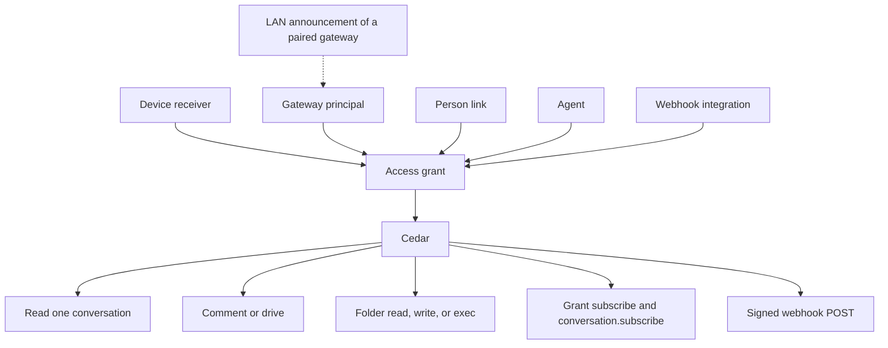
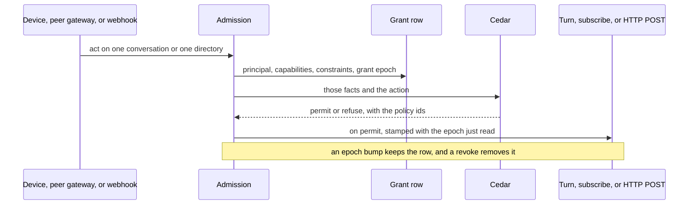
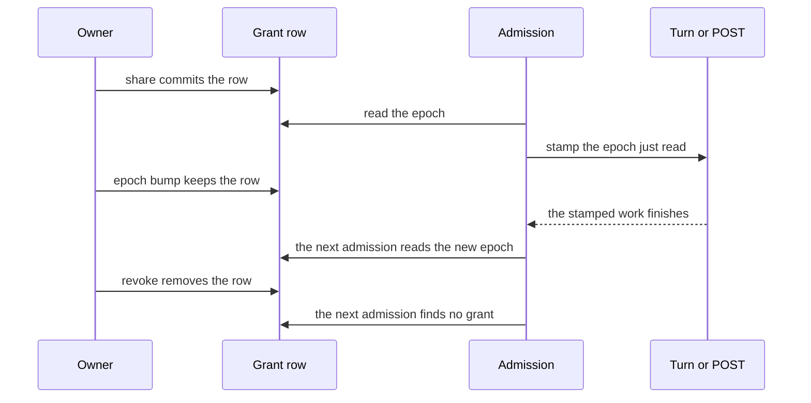
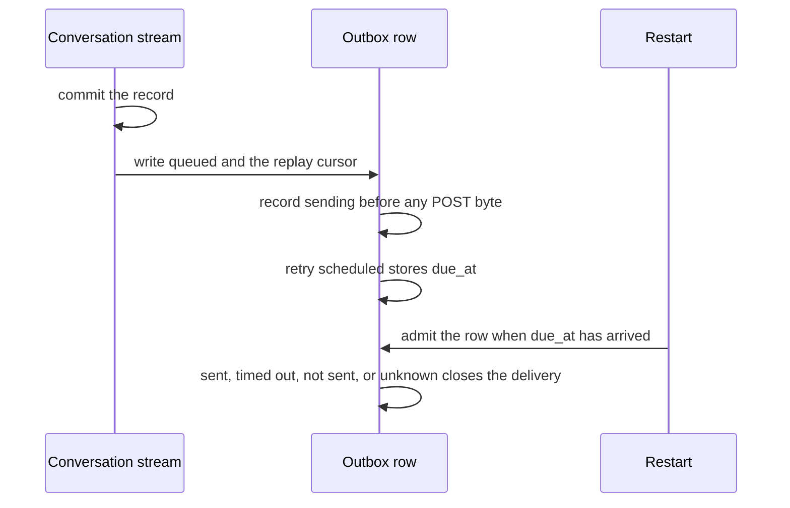
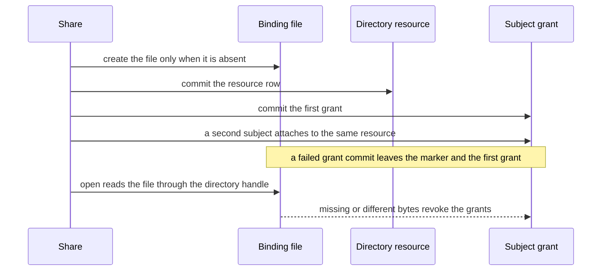
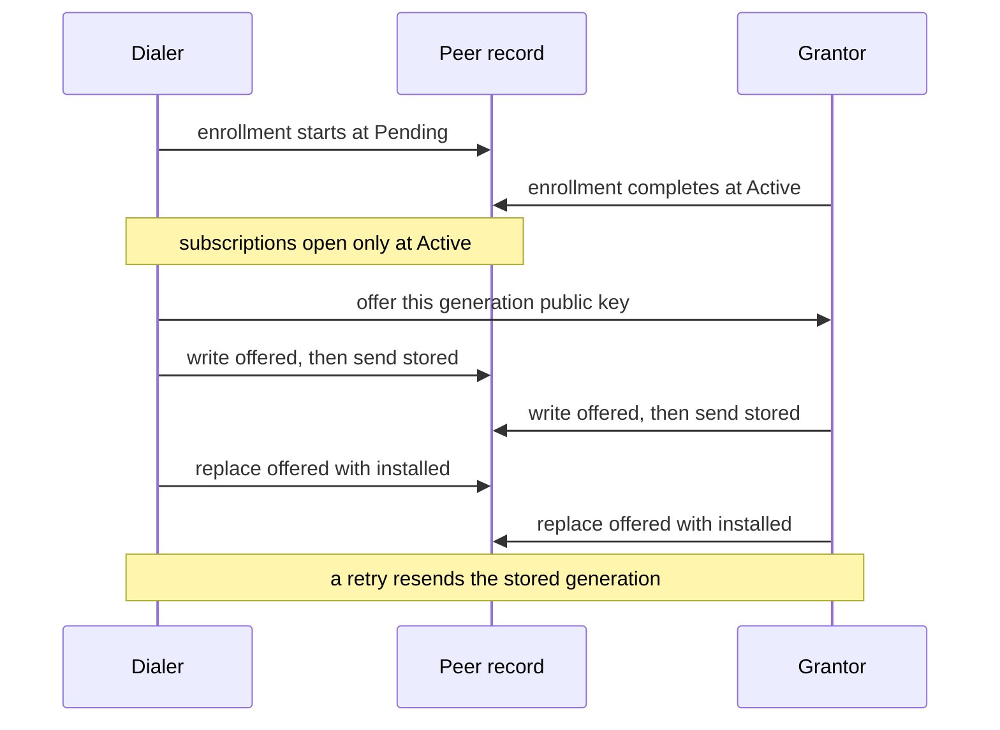

# Access grants

Status: proposal. Nothing in this document is built by the pull request that
adds it. The implemented contracts stay where they are:
[share grants](read-grants.md),
[peer gateways](auth/peer-gateways.md),
[record subscriptions](record-subscriptions.md), and
[the runtime map](runtime-architecture.md#sharing-a-conversation).

This is the plan for one access fact, reused by peer chats, a shared folder,
command rules, a live follow, and an outbound webhook. Cedar remains the only
decider. Alpha drops the previous share shape in the refactor; there is no
reader of the old row and no second name for the new one.

The ADR, when it is written, takes [#889](https://github.com/nessalabs/nessa-agent/issues/889).
This document is the design. It does not add a second record.

## The primitive

One grant:

| Field | What it is |
| --- | --- |
| Principal | Who. A paired device (its receiver), a gateway (`gateway:<key>`), a person, an agent, or an integration (a webhook). |
| Resource | One conversation id, or one directory in an environment the grantor enforces. That environment is this gateway's machine, a remote environment it already leases, or a cloud environment a later agent uses. |
| Capabilities | A set drawn from `read`, `comment`, `drive`, `write`, `exec`. `read` applies to a conversation and to a directory. `comment` and `drive` apply to a conversation. `write` and `exec` apply to a directory. |
| Constraints | The path boundary, the tool policy, and the command allow/deny rules that apply inside that resource. |
| Epoch | The grant epoch: the counter that advances when capabilities or constraints change. A turn, a lease, and a webhook attempt keep the epoch they were admitted under. The next admission reads the epoch again. |

The grant row is facts. Cedar permits or refuses. A use case may refuse to
write a fact Cedar would deny; it does not allow something Cedar denies.

Two counters already exist and stay separate. The **grant epoch** is today's
share `policy_revision`: the journal sequence of the change that last set
what the grant allows. The **binding epoch** is the receiver access epoch in
[session and stream contracts](session-and-stream-contracts.md#passive-receiver-read-admission-295):
it advances when the credential or the binding is revoked or regranted, and
a stale read scope is denied before the source. The refactor does not add a
third counter. Issue, epoch bump, and revoke are the grant table in
[Lifecycles](#lifecycles). This section does not add a grant state.



The person link and the LAN announcement carry no capability. The link names
who a gateway acts for. The announcement names where a paired gateway can be
dialed. Cedar still sees the grant.



## What is already built

### Cedar, and the real caller

Policy bundles, each the decider for its question:

| Question | Bundle |
| --- | --- |
| Which grants a credential may hold, and who may be issued one | `crates/nessa-auth/src/adapters/cedar/policies.cedar` (`hold.peer` allows a gateway `conversation.read` and `environment.serve`) |
| What the owner may do with a conversation | `crates/nessa-server/src/conversation/infrastructure/access_policy/cedar/ownership.cedar` |
| What a paired reader may do | `crates/nessa-server/src/conversation/infrastructure/access_policy/cedar/readers.cedar` |
| Who may share | `crates/nessa-server/src/conversation/infrastructure/access_policy/cedar/shares.cedar` |
| Which tools a turn may call | `crates/nessa-server/src/conversation/infrastructure/tool_policy/cedar/tools.cedar` |
| Which host and program a command may use | `crates/nessa-server/src/conversation/infrastructure/tool_policy/cedar/commands.cedar` |
| Who may edit a remembered permission rule | `crates/nessa-server/src/conversation/infrastructure/permission_rules/cedar/rules.cedar` (the owner; a grant is refused) |
| Which agent or command a peer may lease on a host | `crates/nessa-server/src/env_serve/infrastructure/cedar/policies.cedar` |

The socket has one admission, `admit_request` in
`crates/nessa-server/src/product/read_access.rs`. A paired command is
returned as `Initiation::grant(receiver, policy_revision)`. The turn records
that grant and that epoch. An owner surface is `Initiation::owner()`. A
device signs in as the binding owner, so Drive works for the owner's phone.
A peer gateway signs in as `gateway:<key>`. The same function says
forwarding that peer's people is a later slice. [ADR 803](../adr/done/803-policy-goes-through-cedar.md)
records this admission as the place a paired method is decided.

`@id("paired.peer_gateway")` in `readers.cedar` forbids `conversation.comment`
and `conversation.drive` when `signedInAs != bindingOwner`. A Drive role can
be stored on a peer and still do nothing.

### Share grants (#704, merged in #720; roles in #787; Drive in #793)

[Share grants](read-grants.md) are `(receiver, conversation id, role, tool
policy)`, in `share_grants`, journaled in `share_grant_changes`. The role is
Read, Comment, or Drive. Drive carries a tool policy and `commandHosts`.
`policy_revision` is the journal sequence of the last role or policy change.
`conversation.share`, `.unshare`, and `.shares` are the owner's, admitted
through `shares.cedar`.

[#787](https://github.com/nessalabs/nessa-agent/issues/787) stored the role
and the policy and admitted nothing new. [#793](https://github.com/nessalabs/nessa-agent/issues/793)
lets a party signed in as its grantor drive the one conversation, text only,
through `admit_request`. Tool checking
(`crates/nessa-server/src/conversation/application/drive_tools.rs`) keeps the
policy of the admitted epoch and holds that revision across the save. A
change of policy applies to the next turn.

### Peer gateways and environment peers (#705, #706)

[Peer gateways](auth/peer-gateways.md) enroll a gateway principal with
`conversation.read` only. The owner then shares conversations one id at a
time. Catalogue watch is refused to a peer, because its notices cover the
owner's whole catalogue. The peer polls.

`PeerPoller` (`crates/nessa-server/src/peer_gateways/infrastructure/poller.rs`)
reads `catalogueHead` on `peer.poll_interval` (30 seconds,
[limits](../limits.md)) and walks records into the retained cache.

[#706](https://github.com/nessalabs/nessa-agent/issues/706) is the other
direction. A paired environment holds `environment.serve` and dials in. What
it will run is `<data>/environment/grants.json` on that machine (`nessa env
grant`): named agents or all agents, commands, `maxTimeoutMs`, `maxLeaseMs`.
Cedar decides `agent.lease` and `command.run` from those facts. The
environment may narrow a lease and the gateway records what was granted. A
published file is fetched by lease, artifact, and range
([Reading a published file](auth/peer-gateways.md#reading-a-published-file-over-the-connection-row-i9)),
never by a path the gateway invents.

`hold.peer` is what stops one credential from being both the conversation
authority and the environment. This plan leaves that rule in place.

### Owner-issued targets (#797)

[Permission targets](permission-targets.md),
[question targets](question-targets.md), and
[prepared submissions](prepared-submissions.md) are a caller contract. The
client freezes a target from a view it was given, and a fabricated id is
refused before the RPC. The gateway still decides access. Grants do not mint
these targets, and these targets do not grant access.

### Native hooks (#768)

[ADR 768](../adr/done/768-native-harness-hooks.md): Claude and Codex run
their own hooks only when the owner opts in, per harness, off by default.
OpenCode stays suppressed. A hook can approve, deny, or change a tool call
inside the harness. Nessa's Drive admission refuses a turn when those hooks
are allowed to answer first, because the grant's tool policy would not be
the check.

### Owner phone (#811)

[#811](https://github.com/nessalabs/nessa-agent/issues/811) wants the owner's
own phone to read and manage current and future owned conversations. The
issue's boundary is a separate consent class. It says to leave `PeerRead`,
`DeviceRead`, and per-chat roles as they are. This plan does not widen
`PeerRead` or `DeviceRead`, and it does not implement the owner phone.

### Identity, and the runtime map

[Identity, tenancy, and cloud](auth/identity-tenancy-and-cloud.md) keeps
Nessa principal and organization ids, with Cedar embedded in the gateway. An
email or a provider subject is not a principal. A cloud worker is an
execution principal inside an organization, with grants, and connecting an
account does not merge local conversations.

[The runtime map](runtime-architecture.md) already separates the grant
(owner's table, per conversation), the follow rule (follower's table), and
the environment policy (the machine's table). Records flow owner to
follower. Commands flow the other way and are admitted on the owner. The
mesh finds a peer by local discovery, then last-known address, then relay,
and trust comes from the pinned key. Local discovery is described there and
not built. The map also says a sandbox Nessa cannot enforce is said, not
claimed.

## What changes, and what goes away

Subtract first. The grant above is the share row with its fields named once.
Folders, webhooks, and cloud agents reuse that row. They do not bring a new
policy engine, a new crate, or a grant-by-list.

| Piece | What happens |
| --- | --- |
| Share role Read / Comment / Drive | Becomes the capability set: Read is `read`, Comment is `read` + `comment`, Drive is those plus `drive`. One wire field, `capabilities`. The role enum goes. |
| Tool policy and `commandHosts` | Stay as constraints on a grant that has `drive`. |
| `policy_revision` | Stays, under the name grant epoch. |
| `paired.peer_gateway` | Deleted. `grant.comment` and `grant.drive` require the capability and, until the peer-write slice, a principal signed in as the binding owner. One condition, on the permit. |
| A stored Drive role that a peer cannot use | `conversation.share` asks those permits before it writes. A denial writes nothing and returns the policy ids. The use case does not match a gateway principal on its own. The same permits deny a hand-built row at admission. |
| `share_grants` key `(receiver_id, conversation_id)` | Becomes `(subject_kind, subject_id, resource_kind, resource_id)` in the refactor, one metadata version bump. A paired device or gateway uses subject kind `receiver` and its receiver id, so two devices of one owner stay two rows. An integration or a later agent uses subject kind `principal`. One integration principal has one active webhook registration. The same-person link is not the subject. The directory slice does not change the key. A directory resource and its marker are minted once, and later subject grants reuse that resource id. |
| Credential `conversation.read`, `conversation.write`, `environment.serve` | Stay. They say whether this credential may read, may be the conversation authority, or may serve. They do not name a conversation or a directory. `hold.peer` stays as written. |
| `grants.json` on the environment | Stays on that machine, so the gateway cannot widen it. The same capability and constraint words. `domain::unwritten` stays the default facts (an absent ssh entry is the host's own set; an absent dialed gateway is empty). |
| Gateway `denyPrograms` / `allowPrograms` | Stay the host's own program list in `commands.cedar`. A grant's command rules are a further constraint, deny wins. |
| Remembered permission rules | Stay the owner's. `rules.cedar` already refuses a grant. |
| `#797` targets | Stay a caller contract. |
| `#811` owner phone | Left to that issue. Pairing classes are unchanged here. |
| `PeerPoller` timer for an Active peer | Deleted. Grant add, revoke, and epoch changes arrive on a grant subscription, paged inside the 64 KiB frame bound. Chat views arrive on `conversation.subscribe`. The record copy stays `conversation.recordsHead` and `recordsPage`, woken by a record-hint frame on that subscription. |
| `conversation.watchRecords` | Stays the retained phone path ([#851](https://github.com/nessalabs/nessa-agent/issues/851)). A connection holds one record watch, and `conversation.changed` carries no cursor. Peers do not use it. |
| Grant by channel, folder-of-chats, or default sync | Already refused. Stays refused. |
| A webhook-only access list | Not added. The webhook's share grant is the list. |
| Nessa copies of Claude or Codex hooks | Not added. |

A cloud agent, when it exists, is an agent principal with the same
directory grant: `read`, `write`, and `exec` inside a directory in that
cloud environment, command rules in the constraints, admitted by the same
Cedar policies. No slice below builds the agent. The directory resource
names its environment, so the cloud slice does not need a new grant.

## Native harnesses

Claude and Codex hooks run in the harness when the owner has opted in
([ADR 768](../adr/done/768-native-harness-hooks.md)). Nessa's command rules
are Cedar checks at the boundaries Nessa owns: the permission request, the
gateway `run` tool, and `GrantCommand` on an environment. The owner edits
them as an ordered list of allow and deny matchers, the same kind of list
as a hook matcher, stored on the grant. The list is not written into
`.claude` settings or Codex config, and opting in does not turn Nessa's
rules off.

Where the harness runs a command without asking, Nessa's rule does not see
it. That limit is the one [ADR 0014](../adr/todo/0014-nessa-owned-policy-hooks.md)
already states, and the share says so. A grant whose constraints have to
hold for every call keeps today's refusal: a Drive turn is admitted when
the agent is Claude or Codex, the conversation is in Ask, and the harness
hooks are not allowed to answer first.

## Directory resource and command rules

The resource is one canonical directory in an environment the grantor
enforces. The environment is this gateway's own machine, a remote
environment it already leases over SSH or a paired connection, or a cloud
environment a later agent slice will run. Marker states are the directory
binding table in [Lifecycles](#lifecycles). This section does not add a
binding state. The decision is one directory
resource, minted once, with one marker. The resource id is not the path.
The resource row stores the environment, the canonical path, and a
directory binding. The binding is 32 random bytes. Share reads
`.nessa-binding` through a directory handle on the path. When the file
is present, those bytes are the binding. Share stores the resource if
none is stored for that binding, then attaches the subject grant to that
resource id. Share writes the file only when it is absent, with a create
that leaves an existing file unchanged, then commits the resource row,
then the grant. A later share of the same directory finds the file and
leaves it unchanged. If the resource commit fails, share removes the
marker only when this attempt created the file and no committed resource
stores that binding. A failed grant commit leaves the marker and every
grant already stored. A second subject on the same directory gets another
grant row for the same resource id. The first subject's grant stays, and
the marker bytes stay. The first open reads `.nessa-binding` through a
directory handle on the stored path. A missing root, a missing marker, or
different bytes refuse the use and revoke the grants for that resource.
A directory created later at the same path has no marker, so it does not
receive those grants. That holds when the filesystem reuses the device
and inode numbers of the deleted directory. Copying `.nessa-binding`
into another directory is a copy of the binding. The reuse test creates
a new directory at the same path, on a filesystem that reuses device and
inode numbers, and does not copy the marker. The open is refused and the
grants are revoked. The no-follow walk starts from the handle whose
marker matched. `read` lists and reads named paths under that directory.
`write` creates and edits named paths under it. The name `.nessa-binding`
is refused to `read`, `write`, and `exec`, including a sandboxed command.
The grantor's open is the reader of that file. `exec` is admitted only
when the sandbox keeps `.nessa-binding` unwritable by the process. A
profile that can only expose the directory as a writable tree is refused
`exec`. An allowed program cannot unlink or rewrite the marker. The open is the check.
The environment walks from a directory handle on the granted directory,
and opens each component no-follow against the parent handle: publish, a
file tool that names a path, and the working directory of a command. A
component that is `..`, a symlink, or otherwise leaves that directory is
refused. Resolving the path and then opening the resolved name is not the
boundary. The grantee can replace a symlink or an ancestor after that
resolve and before the open. A replacement during the walk still cannot
leave the directory, because the open holds the parent handle and does
not follow the new name.

`exec` is the process. A working directory inside the grant does not
confine it. The settled command lease runs with sandbox `none`: nothing
encloses the process, and a program allow or deny list is a policy, not a
sandbox
([the contract settled here](runtime-architecture.md#slice-c-environments_list-and-run-for-the-agent-700)).
A command started in the directory can still open a file outside it.
`exec` is admitted only when that environment enforces a filesystem
sandbox around the process and every root the sandbox exposes is inside
the granted directory. A sandbox that also exposes `/etc`, another
workspace, or another mount is refused `exec`, even when the granted
directory is one of its roots. The profiles that can do that are the
harness sandbox and a container, in the runtime map's
[sandbox table](runtime-architecture.md#sandboxes-honestly).
The environment says which it can enforce. A lease it can only run as
sandbox `none` is refused `exec`, and the share says the refusal. Command
matchers still choose which program may run inside a boundary the
environment can enforce. A file tool the harness runs without naming a
path to Nessa stays outside Nessa's check, and the share says that too.

Command matchers name a program by its file name, as
`command.denied_program` does, and may add a bounded argv pattern. Deny
wins over allow. The pattern bound, the rule-count bound, and the encoded
grant bound are rows in [limits](../limits.md), owned by the slice that
adds them, beside the existing tool-policy bounds. The encoded grant,
including its command rules, must fit in the 64 KiB product frame with
the frame overhead. `conversation.share` refuses a grant past that cap
and writes nothing. The program match reuses the file-name rule already
in `commands.cedar`.

## Same person

At gateway pairing the owner can say these two gateways are the same
person. The credential still names `gateway:<key>` and `hold.peer` is
unchanged. A link row says that gateway principal acts for the owner's
person principal. Admission reports the person as who it acts for and the
grant as what it may do. The link adds no capability, copies no
conversation, and does not turn the peer into the owner phone. The grant
subject stays that gateway's receiver. Two gateways linked as the same
person keep two rows.

## Live follow

[#851](https://github.com/nessalabs/nessa-agent/issues/851) already follows
one conversation with `conversation.subscribe`. The frame's cursor is
`{incarnation, position}`. `after` resumes from the last view the client
applied. A new incarnation replaces the view. `cursor_ahead` is refused.
A lagging subscriber resumes from `lastDelivered`
([record subscriptions](record-subscriptions.md)). A paired session is
admitted on `conversation.read` by `admit_paired_follow`, and the
conversation is the share check.

The live-follow slice opens two subscriptions on the grantor, both on the
subscription machinery #851 already uses. Resume with `after`, replacement
on a new incarnation, `cursor_ahead` refused, `lagging` resumed from
`lastDelivered`. A chat subscription keeps the view cursor
`{incarnation, position}` from #851. The grant subscription's position is
an opaque counter for this receiver only. It advances when that receiver's
grants change. It is not an owner catalogue revision, so a gap from the
owner's other work does not appear in it.

- **Grants.** A grant subscription for this receiver. Each frame is a
  prefix of that receiver's grants in cursor order: a grant added, a grant
  revoked, or a grant epoch changed. It is not `catalogue.watch`. That
  watch fires on the owner's whole catalogue, which is why a peer is
  refused it today. This stream names only the receiver's own grants, so
  the timing of ungranted work stays on the grantor. A frame that would
  pass the 64 KiB product-frame bound is cut on a grant boundary and
  marked `complete: false`. The decision is that an incomplete frame does
  not advance the stream cursor. `after` stays the last complete snapshot
  the follower applied. The frame names the last grant in its prefix as
  `page`. The follower sends that `page` with the same `after` to receive
  the next prefix of the same snapshot. The stream cursor advances when a
  frame is `complete: true`. A grant left out of an incomplete prefix stays
  ahead of the stream cursor and is sent before that advance. The follower
  does not walk the owner's catalogue. The
subscription is not ended `too_large` because the set did not fit. Every
stored grant already fits in one frame with the frame overhead, so one
directory grant does not end this subscription either.
- **Chats.** `conversation.subscribe` for each shared chat the follower has
  opened and chosen to follow, up to the connection's conversation cap. A
  refused chat subscribe withdraws that local replica.

`socket.conversation_subscriptions` is 8
([limits](../limits.md)). A ninth `conversation.subscribe` on one socket
is refused `subscription_capacity`. The grant subscription is not a
conversation target, and it does not take a catalogue list slot
(`listTargets` stays the two catalogue lists, which a peer does not
subscribe to). The slice adds one grant target per connection beside the
eight and does not raise the conversation cap. A second grant subscription
on that socket is refused `subscription_capacity`.

The follow rule may name more than eight chats. The live set on that
connection is still eight. The least recently opened chat, by an explicit
open rather than by a frame, is let go, the same eviction the desktop uses
for `conversationTargets`
([record subscriptions](record-subscriptions.md)). The local replica stays.
It receives no frames until it is opened again, and then
`conversation.subscribe` resumes with `after` from the cursor last applied.
There is no second connection and no poller for the chat that was let go.
A grant change still arrives while eight chats are live.

`conversation.subscribe` is a bounded view, the same shape as
`conversation.read`. It is not a record stream.
[Record subscriptions](record-subscriptions.md) keep the checkpoint copy
on `conversation.recordsHead` and `recordsPage`, and say the view is not
that copy. The local replica is the retained peer cache, which slice 2
reads. Deleting the poller timer does not delete the copy.

The server-side record watch stays inside the grantor's subscription
task. Row S9 sends no view frame when the bounded view is unchanged,
including a commit that touches only history the view omits
([record subscriptions](record-subscriptions.md)). That watch is not a
signal on the follower's socket.

When the reread observes the record head moved, the task sends a
record-hint frame on that `conversation.subscribe`: the subscription id
and the head cursor `{incarnation, position}`. It sends the hint whether
or not a view frame is also sent. The hint is the wake. The follower calls
`recordsHead` and then `recordsPage` from the cursor the cache last
applied, and writes those records into the cache. A view frame is not the
wake, and neither is `conversation.watchRecords`. That method stays the
retained phone path. Its hint carries no cursor, and a connection holds
one record watch, so it cannot wake the chats this connection follows.

A grant frame that adds a chat the follower has chosen to follow starts
the first copy. The walk is not `catalogueHead` and not
`peer.poll_interval`. A chat let go past the eight-cap keeps its cursor
and is not walked until it is opened again. After a disconnect the
follower resumes the subscriptions and the record cursor from what it
last applied.

The `PeerPoller` timer goes away for an Active peer. `peer.poll_interval`
no longer wakes a `catalogueHead`. The record copy above is the walk, and
the record-hint frame wakes it. After a disconnect the follower opens a
new pinned session and resumes both subscriptions from the cursors it
last applied, the same way the sync engine resumes a pass.

Two waits are not that timer:

- **Before the peer is Active.** An enrollment that is still pending has
  no session and no grant stream. The status dial already used to finish
  pairing runs until the enrollment is Active or Revoked. It stops once the
  subscriptions can open.
- **A connect that fails.** The follower waits on the existing connect
  backoff, then resumes the subscriptions. The wait does not read the
  catalogue or the records.

The silence bound on an environment's serving connection stays. That
connection carries leases. It is not the peer poller.

## Webhooks

Delivery states are the webhook outbox table in [Lifecycles](#lifecycles).
This section does not add a delivery state.

A webhook is an integration principal the owner issues with
`credential.issue`. The registration stores an HTTPS URL and a 32-byte mac
key. The credential holds `conversation.read`. It has no product socket and
no receiver binding: a receiver binding is what pairing creates, and a
session that presented one would be admitted as a paired reader.

`conversation.share` is still the one share command. This slice teaches it a
second target, the integration credential, beside a paired receiver. The
grant row is the same fact, subject kind `principal` and the
conversation resource, with no receiver. The decision is one active
registration per integration principal. `credential.issue` only adds a
credential on that principal
([local registry](../../crates/nessa-auth/src/adapters/local/registry.rs)),
so a second registration would POST to a URL the owner did not register
for the first. While a registration is active, another `credential.issue`
for that principal is refused and writes no credential and no
registration. Revoking the credential stops that registration. A later
issue creates one new registration, with a new URL and mac key. Delivery
reads the grant and POSTs with that one registration. The gateway POSTs
events for those conversations only. The payload is what a reader with
that capability set may see.

The body is signed with HMAC-SHA256, the mac
[backup manifests](../../crates/nessa-server/src/backup/application/ports.rs)
already compute. That helper does not define this message. The signed
bytes are three length-prefixed fields, in order. Each field is a
big-endian unsigned 64-bit length, then that many bytes. The length
counts the field, not the prefix.

1. The timestamp: ASCII decimal of Unix time in milliseconds, no sign and
   no leading zeros except for the value `0`.
2. The delivery id: its UTF-8 bytes.
3. The body: the exact HTTP request body bytes.

The MAC is the 32-byte HMAC-SHA256 of those bytes under the
registration's key. The key is not written into the body. The POST
carries three headers: `Nessa-Webhook-Timestamp` is the timestamp string,
`Nessa-Webhook-Id` is the delivery id, and `Nessa-Webhook-Signature` is
`v1=` plus 64 lowercase hex characters of the MAC. The receiver rebuilds
the three fields from those headers and the raw body bytes. It does not
re-encode JSON. A retry repeats the same delivery id while the attempt's
epoch still allows delivery.

The sender does not follow redirects. A 3xx is not a delivery. The attempt
records `not sent` or `retry scheduled` under the same permit rules, and
the next POST, when the epoch still allows it, goes to the registered URL
only. The signature headers are written on that POST and are not sent to
another origin. A redirect to HTTPS is still not followed.

The conversation record stream is the source of truth. The decision is a
durable replay cursor, one per registration and conversation: the last
checkpoint of that conversation whose outbox row committed. The cursor
starts unset. An event for a granted conversation is written to that
registration's outbox before the attempt waits for the permit. The row
is a delivery id, the registration, and the source checkpoint
(conversation id, incarnation, position), in state `queued`. That write
also sets the cursor to the same checkpoint, and the two commit together.
The conversation commit stays in the conversation store. A crash after
that commit and before the outbox write leaves the cursor behind the
source. Restart, before it admits work, reads each granted conversation
from its cursor, or from the start when the cursor is unset, and inserts
a `queued` row for every checkpoint that does not have one. A checkpoint
that already has a row keeps that delivery id. A crash while the attempt
is waiting leaves the `queued` row. Restart admits each `queued` row, and
each `retry scheduled` row whose `due_at` has arrived, in checkpoint
order.

Revoke and a delivery attempt share one permit for that registration, the
same shape as `hold_revision` on a share grant. The attempt that holds the
permit finishes under the epoch it read. Grant revoke then removes the
grant row. The next admission finds no row and is not sent. An epoch bump
is the other event: the row stays, and the next admission reads the new
epoch. Admitted work finishes, and the next command is refused.

- An attempt takes the permit, reads the grant epoch, and reads whether
  the integration credential is still current. The credential check is the
  same fact a product session would refuse: revoked or expired. The grant
  epoch does not move when the credential is revoked or expires, so the
  epoch alone does not stop delivery. An epoch that no longer allows
  delivery, or a credential that is not current, writes the row `not sent`
  and writes no POST. The permit drops after that row commits.
- Before any POST byte is written, the attempt durably records `sending`:
  the target, the delivery id, the epoch it read, and that the credential
  was current. That write commits first. If it fails, the POST is not
  written. The row is written `not sent`, cause audit unavailable, and
  that write commits before the permit drops. If the `not sent` write does
  not commit, the row stays `queued`, the permit is not dropped, and
  restart admits the row again. The delivery is not terminal until the
  row says `not sent`. After `sending` commits, the attempt writes the POST.
- The decision is that `retry scheduled` is a non-terminal outbox state
  with `due_at`. A retryable response writes that state and the due time
  on the same row, in one write, and keeps the delivery id. The due time
  is the row. Restart admits the row when `due_at` has arrived and
  repeats that delivery id. A row whose `due_at` is still ahead waits
  until then. `sent`, `timed out`, and `not sent` are the terminal
  records. They do not replace `sending`. A later admission of those
  delivery ids is refused. If the outcome write fails after the response,
  or the process stops before it commits, the `sending` row stays.
  Restart finds `sending` with no later record and does not POST that
  delivery id again. It appends a reconciliation record: outcome unknown,
  cause audit unavailable after send, the same delivery id, target, and
  epoch. The effect is not relabeled `sent` and the `sending` row is not
  removed. A new event is a new delivery id.
- Revoke takes the same permit. When an attempt holds it, revoke waits
  until that attempt records its outcome and drops the permit, and no
  longer than `webhook.post_deadline`. Revoke does not cancel a write that
  finishes inside the deadline. It then removes the grant row and records
  the transition: delivering, then stopped, with the revoke as cause and
  the owner as initiator. The record names the delivery id it waited for,
  when there was one.
- A retry is a new admission. After the grant row is gone it finds no
  grant and is not sent. After an epoch bump it reads the new epoch and
  is not sent when that epoch no longer allows delivery.
- When revoke commits before an attempt takes the permit, that attempt is
  not sent. Grant revoke and credential revoke share this rule.
  `credential.revoke`, and credential expiry, take the same registration
  permit. They do not advance the grant epoch. After the permit is free
  they stop the registration: delivering, then stopped, with the cause
  credential revoked or expired, the owner or the expiry as initiator, and
  the delivery id waited for when there was one. Grants may still name
  that principal. No later attempt is sent. Unsharing each conversation
  is not required.
- The attempt holds the permit only until `webhook.post_deadline`, a row
  this slice adds to [limits](../limits.md). The clock starts when the
  attempt takes the permit. At the deadline the sender closes its side of
  the POST, records `timed out`, and drops the permit. Revoke waits for
  the attempt's outcome or for that deadline, whichever comes first, and
  does not wait longer. Revoke still does not cancel a write that finishes
  inside the deadline. Bytes already written may still reach the receiver
  after the deadline. That late arrival is not recorded as `sent` and does
  not schedule a retry. A retry is a new admission.

One POST that already holds the permit can still reach the receiver. No
later attempt is sent. Each attempt records the target, the delivery id,
the grant epoch it read, the outcome of that attempt (sent, retry
scheduled, timed out, or not sent), and the cause. `retry scheduled`
names the due time stored on the outbox row. An attempt is one observation of
a POST.

## LAN announcement

Pairing phases and discovery install are the peer table in
[Lifecycles](#lifecycles). This section does not add a pairing phase.

Off until the peer table has a paired gateway with a discovery key. The
announcement carries a dial address, a port, and one rotating token per
paired peer that has a discovery key. The pinned key, its fingerprint, and
any other stable gateway id stay out of the announcement. The owner name,
the organization, conversation ids, directories, and grants stay out too.

The token is HMAC-SHA256 over the canonical bytes of the current time
window, the dial address, and the port, in that order. The window and the
port are unsigned big-endian integers. The address is one numeric form,
the same bytes for the same endpoint. The slice owns that encoding. A
token copied onto a different address or port does not match. The key is a
32-byte discovery MAC key shared with that one peer. It is not in the
announcement.

Shipped pairing does not have that key. [`PeerRecord`](../../crates/nessa-server/src/peer_gateways/infrastructure/records.rs)
keeps the peer key, the pin, the address, the relay, the intent, and the
phase. An Active phase also keeps the credential id and the receiver. The
peer file stores those. [`DeviceCredential`](../../crates/nessa-auth/src/application/pairing/private_state.rs)
keeps the dialer's private key, the gateway pin, the intent, the
credential id, and the receiver. The enrollment PAKE proves the one-use
code and does not leave a MAC key on either record.
[#705](https://github.com/nessalabs/nessa-agent/issues/705) does not supply
the HMAC key.

This slice adds it. After the enrollment is Active, both sides already
have a pinned TLS session. Install is one generation, retried until both
sides have stored the same MAC key. A new generation does not start while
this one is unfinished.

1. Each side offers an ephemeral X25519 public key for that generation.
2. Each side durably writes `offered`: the generation, its ephemeral
   private key, and the peer's public key. It sends `stored` only after
   that write commits.
3. After both `stored` messages, each side derives the MAC key with
   HKDF-SHA256 and a fixed label used only for this announcement. It
   durably replaces `offered` with `installed`: the generation and the
   MAC key. The ephemeral private key leaves in that write. It then sends
   `installed`.
4. A dropped session retries the same generation. A side in `offered`
   resends the public key it stored and does not mint a new one. A side
   in `installed` resends `installed` and does not derive again. A side
   with nothing stored accepts the same generation.

Neither side derives before the other's `offered` write has been acked,
so a crash cannot leave one side installed and the other unable to
recompute. The dialing gateway stores the state on the peer file beside
the pin. The granting gateway stores it on the pairing record that
already keeps that peer's pin and `class: "peer"`. The key is not written
into the credential, the grant, or the announcement. The peer-file schema
version bumps once. A record this build cannot read stays unreadable for
that peer only, as the peer file already does.

A peer row from before this slice has no discovery key. Alpha does not
invent one. That peer is left out of the announcement and cannot match a
token until it is paired again under this slice.

A paired peer recomputes the HMAC for each pinned peer that has a
discovery key, for the current window and one window on either side, using
the address and port in the announcement, and matches. A match says which
peer announced and which address to try. The number of tokens is the
number of paired peers that have a discovery key. The dial address, the
port, the network source, and that count stay visible, so an observer can
correlate announcements by them. The token is not a stable id: its value
changes with the window, and an observer without the discovery key cannot
match it to a pinned key. The window length is a row the slice adds to
[limits](../limits.md). An unpaired listener cannot enroll from an
announcement. The connection is still the pinned TLS session and the
issued credential. Pairing still requires the one-use code.

## Lifecycles

These tables are the states for this proposal. A slice's tests are written
from the rows. A new state goes in the table before it goes into a slice.
The sections above describe the same transitions and do not add a state.

### Grant

**Source of truth.** The grant row, keyed by `(subject_kind, subject_id,
resource_kind, resource_id)`. The epoch is a field of that row. Cedar reads
the row. A use case does not keep a second copy of the decision.

**Invariants.** One row for one subject and one resource. A paired subject
is the receiver, so two devices of one owner stay two rows. An integration
or a later agent uses subject kind `principal`. The same-person link is not
the subject. An admission keeps the epoch it read. The next admission reads
the row again.

| State | Meaning |
| --- | --- |
| absent | No row. |
| active | The row is stored at an epoch. |

| From | Event | To | What is stored |
| --- | --- | --- | --- |
| absent | `conversation.share` commits | active | The row, at the epoch of that commit. A Cedar denial writes nothing. |
| active | Capabilities or constraints change | active | The same row, epoch incremented. |
| active | Unshare or grant revoke commits | absent | The row is removed. An attempt that already holds the permit finishes under the epoch it read. The next admission finds no row. |
| active | Directory open finds a missing or different marker | absent | Every grant for that directory resource is revoked. The cause is the marker mismatch. |



**Alternatives rejected.**

- Key the grant by principal alone. Two devices of one owner authenticate
  as that owner, so one principal key would collapse two receivers into
  one row.
- Key a paired grant by `(principal, conversation)` only. A directory is
  not a conversation, and the path can be replaced. The key is subject,
  resource kind, and a minted resource id.
- Use the same-person link as the subject. The link would merge two
  receivers' grants. It stays a separate row and adds no capability.
- Decide comment and drive by matching a gateway principal in Rust.
  Cedar is the only decider. `conversation.share` asks the permits and
  writes nothing on denial.

### Webhook delivery outbox

**Source of truth.** Which events exist is the conversation record stream.
What will be sent, and what was sent, is the outbox row: delivery id,
registration, checkpoint `(conversation id, incarnation, position)`, state,
and `due_at` when the state is `retry scheduled`. The replay cursor is one
field per registration and conversation: the last checkpoint whose outbox
row committed. The cursor advances in the same write as that row. The
conversation commit stays in the conversation store.

**Invariants.** One active registration per integration principal. One
delivery id per checkpoint per registration. One writer advances the replay
cursor for a registration and conversation, in checkpoint order. The cursor
moves only to the next contiguous checkpoint, in the same write as that
checkpoint's row. A later checkpoint does not commit ahead of an earlier
one. Restart does not mint a second
delivery id for a checkpoint that already has a row. `queued` and
`retry scheduled` are admitted again. `sent`, `timed out`, `not sent`, and
`unknown` are terminal and are not admitted again. `sending` is recorded
before any POST byte and is not replaced by the later outcome.

| State | Terminal | Meaning |
| --- | --- | --- |
| queued | no | The row and the replay cursor have committed. The attempt has not recorded `sending`. |
| sending | no | The target, delivery id, epoch, and current credential are stored. No POST byte was written before this commit. |
| retry scheduled | no | A retryable response stored `due_at` on this row. The delivery id stays. |
| sent | yes | The response was success. The `sending` record stays beside this outcome. |
| timed out | yes | The sender closed its side at `webhook.post_deadline`. A late arrival is not recorded as `sent`. |
| not sent | yes | The epoch or the credential refused delivery, or the pre-send write failed. A 3xx is not a delivery and is recorded here or as `retry scheduled`. |
| unknown | yes | `sending` committed and no later outcome did. Restart appends this outcome and does not POST that delivery id again. |

| From | Event | To | Ordering |
| --- | --- | --- | --- |
| no row | The conversation checkpoint has committed, and this registration has no row for it | queued | Restart or the live reader inserts the row and advances the cursor in one write. A crash between the conversation commit and this write leaves the cursor behind, and the next restart inserts the row. |
| queued | The attempt takes the permit, the epoch allows delivery, the credential is current, and the `sending` write commits | sending | This write commits before any POST byte. If the `sending` write fails, the row is written `not sent` with cause audit unavailable, and that write commits before the permit drops. If the `not sent` write does not commit, the row stays `queued` and the permit stays held. |
| queued | The epoch or the credential refuses delivery | not sent | No POST is written. |
| sending | The response is a 3xx, or another retryable response | not sent, or retry scheduled | A 3xx is not a delivery. The next POST, when admitted, goes to the registered URL only. `retry scheduled` stores `due_at` in that write. |
| sending | The response is success | sent | The outcome record does not replace `sending`. |
| sending | The deadline fires | timed out | The sender closes its side and drops the permit. |
| sending | The response is a final failure | not sent | The outcome record does not replace `sending`. |
| sending | The process stops before an outcome write commits | unknown | Restart does not POST that delivery id again. |
| retry scheduled | `due_at` has arrived | sending, or not sent | Restart, or the live wait, admits the same delivery id. The admission reads the grant again. No row means `not sent`. An epoch that no longer allows delivery means `not sent`. A row whose `due_at` is still ahead waits. The wait reads `due_at` from the row. |



**Alternatives rejected.**

- Keep the retry in memory after recording `retry scheduled` as a terminal
  outcome. A process exit before the timer fires loses the delivery.
  `due_at` on the row is the due time.
- Put the conversation commit and the outbox insert in one transaction.
  They are not one store. The replay cursor closes that gap.
- Key the grant by registration or credential so two registrations of one
  principal stay apart. `credential.issue` only adds a credential. The
  decision is one active registration per integration principal, and the
  subject stays `principal`.
- Replay a `sending` row that has no outcome. The POST bytes may already
  have arrived. The outcome is `unknown`, and that delivery id is not sent
  again.
- Let two live insertions advance one cursor. Checkpoint N+1 could commit
  ahead of N, and a crash would restart past N. One writer commits
  checkpoints in order.

### Directory binding

**Source of truth.** The directory resource row: environment, resource id,
canonical path, and the 32-byte binding. Subject grants point at that
resource id. The binding checked at open is the file `.nessa-binding` in
the directory root. A grant row does not store a second binding.

**Invariants.** The resource id is not the path. The marker is written
once, when the file is absent. A later share of the same directory leaves
the file unchanged. `.nessa-binding` is not a granted path. `read`,
`write`, and `exec` refuse that name, including a sandboxed command. The
grantor's open is the only reader. `exec` is admitted only when the
sandbox keeps `.nessa-binding` unwritable by the process. A profile that
exposes the directory as a writable tree is refused `exec`. One share of a directory runs at a
time. The next share reads the file only after the earlier attempt has
committed its resource or removed a marker that attempt created and that
no committed resource stores. A failed grant commit leaves the marker and
every grant already stored. The marker is removed only when this attempt
created the file and no committed resource stores that binding. Device and
inode numbers are not the binding.

| State | Meaning |
| --- | --- |
| absent | No resource row. A marker file with no resource row is not a grant. |
| minted | The resource row and `.nessa-binding` hold the same binding. |
| revoked | An open found the root gone, the marker missing, or different bytes. The grants for that resource are removed. |

| From | Event | To | What is stored |
| --- | --- | --- | --- |
| absent, file absent | First share | minted | Create `.nessa-binding`, commit the resource row, then the grant. A create leaves an existing file unchanged. |
| absent, file present | Share finds an orphan marker | minted | Adopt the bytes already in the file, commit the resource, then the grant. The file is not rewritten. |
| minted | Share to another subject | minted | Another grant row for the same resource id. The marker bytes stay. A failed grant commit leaves the marker and the first grant. |
| minted | Open reads a matching marker | minted | The no-follow walk starts from the handle that matched. |
| minted | Open finds a missing root, a missing marker, or different bytes | revoked | The use is refused and the grants for that resource are revoked. The audit record names the resource id, before active, after absent, cause marker missing or marker bytes differ, and the open as initiator. A repeated open keeps that first cause. If the audit sink is unavailable, the grants are still removed and the use is still refused, and the result says the audit was not recorded. A directory recreated at the same path, including when device and inode numbers are reused, has no marker and does not receive the grants. |



**Alternatives rejected.**

- Use the path as the resource id. A directory created later at that path
  would inherit the grant.
- Bind the grant to the device and inode captured at mint. Those numbers
  are reused after deletion.
- Add an operating-system identity with a generation component. The minted
  marker is the binding. A copied marker is an explicit copy.
- Rewrite the marker on every share, and delete it if that share's commit
  fails. A second subject would revoke the first, and the cleanup would
  remove the marker the first grant still needs. The resource is minted
  once, and later grants attach to it.
- Count in-flight sharers in a reservation protocol. One share of a
  directory runs at a time, and cleanup of a failed create finishes before
  the next share reads the file.

### Peer discovery and pairing

**Source of truth.** Pairing phase is `PeerPhase` on the peer record:
`Pending`, `Active`, or `Revoked`
([`records.rs`](../../crates/nessa-server/src/peer_gateways/infrastructure/records.rs)).
This proposal does not add a phase. The discovery install is a field on
that same record, written after the phase is `Active`. The dialer stores
it on the peer file beside the pin. The granting gateway stores it on the
pairing record that already keeps that peer's pin.

**Invariants.** Subscriptions open when the phase is `Active`. The status
dial runs until then and does not read the catalogue. An announcement is
sent only for an `Active` peer whose discovery field is `installed`. One
install generation is in progress at a time. A retry resends the stored
generation. The same-person link is not a phase and not a grant subject.
The token is HMAC-SHA256 of the time window, the dial address, and the
port. The pinned key stays out of the announcement.

| Phase | Meaning | This proposal |
| --- | --- | --- |
| Pending | Enrollment is in progress. No session and no grant stream. | Unchanged. The status dial runs until Active or Revoked. |
| Active | The credential id and the receiver are stored. | Subscriptions can open. Discovery install may start. |
| Revoked | The enrollment is over. | No announcement. |

| Discovery field | Meaning |
| --- | --- |
| none | No discovery key. The peer is left out of the announcement. Alpha does not invent a key. |
| offered | One generation is stored: the generation, this side's ephemeral private key, and the peer's public key. `stored` is sent only after that write commits. |
| installed | The same generation and the MAC key are stored. The ephemeral private key left in that write. |

| From | Event | To | Ordering |
| --- | --- | --- | --- |
| none, phase Active | This side offers a public key for one generation | offered | The write commits before `stored` is sent. |
| offered | Both sides have acked `stored` | installed | Derive with HKDF-SHA256 and a fixed label, then replace `offered` with `installed` in one write. |
| offered | The session drops | offered | Resend the stored public key. Do not mint a new one. |
| installed | The session drops | installed | Resend `installed`. Do not derive again. |
| none | A retry arrives for a generation this side has not stored | offered or installed | Accept that same generation. A new generation does not start while one is unfinished. |
| installed | Announce | installed | One token per such peer, for the current window. |



**Alternatives rejected.**

- Put a stable fingerprint in the announcement. The token rotates with the
  window, the address, and the port.
- Claim the announcement is unlinkable. The address, the port, the network
  source, and the token count stay visible.
- Take the MAC key from the enrollment PAKE or from `#705`. Those records
  do not hold one. This slice installs one generation after Active.
- Start a new generation when a retry finds a half-written install. A crash
  would leave one side installed and the other unable to recompute. Retry
  uses the stored generation.
- Keep `PeerPoller` as the way an Active peer learns grants. Grant changes
  arrive on the grant subscription. Chat copies wake on a record-hint frame.
  The status dial and the connect backoff are waits, not a third poll of
  the catalogue.

## Open questions / known limits

- A copied `.nessa-binding` matches the stored binding. That copy is an
  explicit act. This proposal does not add a generation on top of the
  marker.
- A crash after POST bytes are written and before the outcome write commits
  becomes `unknown`. That delivery id is not sent again. The receiver may
  already have the event. This proposal does not add a receiver ack.
- The wait until `due_at` reads the outbox row. This proposal does not add
  a second scheduler store.
- A peer paired before this slice has no discovery key. Alpha does not
  invent one. That peer stays out of the announcement until it is paired
  again under this slice.
- The LAN address, port, network source, and token count can be correlated.
  Unlinkability is not a property of the announcement.
- A command a harness runs without asking Nessa is outside this gate.
- Cloud agents and the owner phone are named as later principals. No slice
  here builds them.
- The conversation store and the webhook outbox are not one transaction.
  The replay cursor is the recovery for a crash between them.
- A case these tables do not settle is a test of the slice that owns it.
  It is not a new state added in review.

## Order

The refactor lands before any feature slice. Later slices depend on the
real blocker, which is named on each issue. Cloud agents and the owner
phone are not in this list.

| Order | Slice | Depends on |
| --- | --- | --- |
| 1 | Refactor the conversation grant | Merged #704, #720, #707, #787, #793, ADR 803 |
| 2 | (a) Open a shared chat as a local conversation | The refactor |
| 3 | (b) Peer comment and drive | The refactor and (a) |
| 4 | (c) One folder, path boundary, command rules | The refactor |
| 5 | (d) Same-person link at pairing | The refactor |
| 6 | (e) Grant and chat subscriptions; the peer poller timer goes away | (a), and #851 as already merged |
| 7 | (f) Follow rules | (a) and (e) |
| 8 | (h) Signed outbound webhooks | The refactor |
| 9 | (g) LAN announcement | Paired gateways (#705). That pairing does not store the discovery key; this slice adds the agreement and the stored field. |

## Issues to file

These issues are open, in this order: [#889](https://github.com/nessalabs/nessa-agent/issues/889),
[#890](https://github.com/nessalabs/nessa-agent/issues/890),
[#891](https://github.com/nessalabs/nessa-agent/issues/891),
[#892](https://github.com/nessalabs/nessa-agent/issues/892),
[#893](https://github.com/nessalabs/nessa-agent/issues/893),
[#894](https://github.com/nessalabs/nessa-agent/issues/894),
[#895](https://github.com/nessalabs/nessa-agent/issues/895),
[#896](https://github.com/nessalabs/nessa-agent/issues/896),
[#897](https://github.com/nessalabs/nessa-agent/issues/897).
The bodies below are the slice delta and the gate. The contract is the
sections above, including [Lifecycles](#lifecycles). A fence does not
restate a lifecycle.

### 1. Unify conversation shares into one access grant

```markdown
Part of the access-grant proposal in `docs/design/access-grants.md`.

## Deliver

The contract is the grant table in Lifecycles and the primitive above.
This slice writes resource kind `conversation`. It deletes
`paired.peer_gateway`, bumps the metadata version once, and refuses a
file this build cannot read. It updates `docs/design/read-grants.md` in
the same change. It does not add a grant state.

## Gate

A device with `drive` sends on that conversation and is refused on another.
A peer with `read` still reads, and comment and drive are refused. Sharing
`drive` with a peer is refused, the row is unchanged, and the refusal names
the Cedar policy ids. The share path has no principal-kind match of its
own. A hand-built row that gives a gateway `comment` is denied by the same
permits. A grant with a principal and no receiver can be stored, and a
paired grant is still found by its receiver. Two devices of one owner
can each hold a grant on the same conversation. Two rows for the same
subject and resource cannot both exist. A same-person link does not
collapse two receiver subjects. A retry journals before
equal to after. The previous metadata version is refused. A test fails if
the capability check is removed from the permit.

## Depends on

Nothing in this plan. The merged share, role, Drive admission, and Cedar
work (#704, #720, #707, #787, #793, ADR 803).
```

### 2. Open a peer's shared chat as a local conversation

```markdown
Part of docs/design/access-grants.md.

## Deliver

The contract is Live follow, above. The delta is the local replica: the
follower's store is not the grantor's, and the chat is read-only until
the peer-write slice.

## Gate

Open a granted chat and read its transcript. An ungranted id is not found.
Unshare withdraws it from the local list. A message composed on the
follower is not written to the grantor. The two metadata databases stay
two databases.

## Depends on

The access-grant refactor.
```

### 3. Let a peer comment and drive under its grant

```markdown
Part of docs/design/access-grants.md.

## Deliver

The contract is the grant table. The delta is removing the signed-in-as-owner
requirement from `grant.comment` and `grant.drive`. Drive stays text-only.
Delete, archive, export, re-share, and model changes stay `owner.act`.

## Gate

A peer with `comment` leaves a note and cannot send. A peer with `drive`
sends text and is refused an image or a linked file. A peer cannot delete
or re-share. A command on a conversation with no grant is not found.
Revoke refuses the next command. A turn already admitted finishes under
its epoch. The audit names the gateway principal and the grant epoch.

## Depends on

The access-grant refactor, and the local shared conversation, so there is
a chat to act in.
```

### 4. Share one folder with a path boundary and command rules

```markdown
Part of docs/design/access-grants.md.

## Deliver

The contract is Directory resource and command rules, and the directory
binding table. This slice adds the command-rule rows to `docs/limits.md`.
It does not build the cloud agent and does not add a binding state.

## Gate

A peer granted the directory reads a file inside it and is refused a path
outside it. Replacing a symlink or an ancestor while the open is in
progress still cannot leave the directory: the opened file is inside it,
or the open is refused. A resolve-then-open is not accepted as the check.
A command on a sandbox-`none` host is refused `exec` even
when its working directory is the granted directory. A sandbox whose
roots include a path outside the granted directory is refused `exec`.
Where the environment
enforces a filesystem sandbox, the audit names the profile it applied, and
a path outside that profile's roots is refused. A denied program is
refused and the audit names the matcher. A command-rule list whose
encoding would not fit in one grant frame is refused and the row is
unchanged. The grant subscription stays open. Deleting the directory
and creating another at the same path does not keep the grant. The reuse
test does that on a filesystem that reuses device and inode numbers and
does not copy `.nessa-binding`. The open is refused and the grants are
revoked. Sharing the same directory with a second subject leaves the
first grant in place and leaves the marker bytes unchanged. A second
share whose grant commit fails leaves the marker and the first grant. A
subject with `write` is refused `.nessa-binding`, and the grants stay.
An allowed program cannot unlink or rewrite the marker. A profile that
exposes the directory as a writable tree is refused `exec`. A
second share of a directory waits until the first attempt has committed
its resource or removed the marker it created. A failed first attempt
leaves no marker and no grant. An open that finds a missing or different
marker revokes the grants and records the resource, the before and after,
the marker cause, and the open as initiator. An unavailable audit sink
still revokes, and the refusal says the audit was not recorded.

An opted-in Claude or Codex harness still runs its own hooks. The gateway
cannot write a wider `grants.json` than the machine's owner wrote. A
constraint that must cover every call is still refused when native hooks
would answer first.

## Depends on

The access-grant refactor.
```

### 5. Declare two gateways the same person at pairing

```markdown
Part of docs/design/access-grants.md.

## Deliver

The contract is Same person, above. The delta is the choice on
`pairing.create`. The owner-phone consent class (#811) is not this link.

## Gate

Pairing with the choice records the person and the gateway principal. A
read still requires a share grant. Two linked gateways with grants on
the same conversation have two rows. A gateway paired without the choice has
no person on its admission. Revoking the credential drops the link. An
invitation cannot be relabelled from one choice to the other in transit,
as the enrollment class cannot today.

## Depends on

The access-grant refactor, so admission has one principal fact to attach
the link to.
```

### 6. Follow a peer's grants and chats by subscription

```markdown
Part of docs/design/access-grants.md.

## Deliver

The contract is Live follow, above. The delta is deleting the `PeerPoller`
timer for an Active peer and adding one grant-subscription target per
connection. An incomplete grant frame does not advance the stream cursor.

## Gate

A new share, a revoke, and an epoch change each arrive on the grant
subscription with no `catalogueHead` from `peer.poll_interval`. A grant
set larger than 64 KiB arrives as frames cut inside that bound. An
incomplete frame keeps the stream cursor and resumes with `page`. The
subscription stays open. A new
message on an opened chat arrives on `conversation.subscribe` the same
way. A commit that leaves the bounded view unchanged still sends the
record-hint frame, and the copy that follows it puts the new records in
the cache, including a turn the view omitted. Reconnect resumes
the subscription cursors and the record cursor, and does not move any of
them backwards in the same incarnation. An Active peer has no poller
timer. A pending
enrollment still completes through the status dial, and that dial stops
at Active. The follower does not call `conversation.watchRecords`.
Following nine chats leaves the least recently opened one unsubscribed,
and opening it subscribes it and lets another go. The grant subscription
is still open while eight chats are live. A ninth `conversation.subscribe`
on that socket is not opened.

## Depends on

The local shared conversation, and the subscribe admission #851 already
merged.
```

### 7. Choose which granted chats to follow

```markdown
Part of docs/design/access-grants.md.

## Deliver

The contract is Live follow. The delta is the follower's follow rule. The
default is none until the person chooses. The rule cannot widen a grant,
and the grantor is not sent the rule.

## Gate

Following one granted chat leaves the peer's other granted chats out of
the cache. A grant with no follow rule can be opened by an explicit choice
and is not replicated on its own. Shrinking the rule drops the local
replica. The grantor's catalogue is unchanged by the choice. Following
nine granted chats leaves one unsubscribed. Opening that one subscribes
it and lets another go.

## Depends on

The local shared conversation and the subscribe follow.
```

### 8. Deliver granted events to a signed webhook

```markdown
Part of docs/design/access-grants.md.

## Deliver

The contract is Webhooks and the webhook outbox table. This slice adds
`webhook.post_deadline` to `docs/limits.md`. It does not add a delivery
state. A failed `sending` write is `not sent` only after that row commits.
Until then the row stays `queued` and the permit stays held.

## Gate

A webhook granted one chat receives that chat's events and no other. A
retry of an attempt that is still at its admitted epoch repeats the
delivery id and the signature. The webhook credential cannot call
`conversation.send`. Revoke waits for the one attempt that holds the
permit; that attempt is recorded under the epoch it read, and the grant
row is then removed. A retry that takes the permit after that removal is
not sent. An attempt that has not taken the permit when revoke commits is not
sent. `credential.revoke`, or expiry, with the grants still present,
sends no further POST. An attempt that already holds the permit can
finish inside the deadline. One that has not taken the permit is not
sent. A POST that does not finish within `webhook.post_deadline` records
`timed out`, drops the permit, and revoke then removes the grant row
without waiting further. A 3xx is not followed and is not a delivery. The
signature is not sent to the redirect target. A POST whose response is
success and whose terminal audit write fails leaves `sending` in place,
sends no second POST of that delivery id, and records outcome unknown.
Restart from that row does the same. A failed `sending` write sends
nothing only after the row commits `not sent`. If that write does not
commit, the row stays `queued` and the permit is not dropped. A crash while an event waits for the permit leaves its `queued`
outbox row, and restart delivers that delivery id. A crash after the
conversation commit and before the outbox write is recovered from the
replay cursor: restart inserts the missing `queued` row, and a checkpoint
that already has a row keeps its delivery id. Two checkpoints of one
registration and conversation commit in order. A crash cannot leave the
cursor past a checkpoint that has no row. A crash after `retry
scheduled` and its `due_at` are written leaves that row. Restart admits
the same delivery id once `due_at` has arrived. A second `credential.issue`
while a registration is active is refused and writes nothing. After that
credential is revoked, a new issue creates one registration, and delivery
goes to the new URL only. A receiver recomputes
the MAC from `Nessa-Webhook-Timestamp`, `Nessa-Webhook-Id`, and the raw
body, and rejects a body that was re-encoded.

## Depends on

The access-grant refactor.
```

### 9. Announce a paired gateway on the local network

```markdown
Part of docs/design/access-grants.md.

## Deliver

The contract is LAN announcement and the peer table. The delta is the
discovery field on the existing peer record, and the window-length row in
`docs/limits.md`. This slice does not add a pairing phase.

## Gate

An unpaired gateway sends no announcement. A paired peer with no discovery
key is left out, and is not given an invented key. A drop before either
`offered` write, after one `offered` write, after both `offered` writes,
after one `installed` write, and after `installed` before its ack, each
resumes the same generation and ends with one MAC key on both sides. An announcement cannot
enroll a listener. The announcement bytes contain no key fingerprint and
no stable gateway id. Two windows for the same peer produce two different
tokens. A token copied onto a different address or port does not match. A
paired peer matches a token to its pinned peer and is refused if the
credential is wrong. An observer without the discovery key cannot match
the token to a pinned key. The dial address, the port, and the token count
remain in the announcement.

## Depends on

Paired peer gateways (#705), which do not store the discovery key. This
slice adds the agreement and the stored field. Sequenced after the grant
slices so discovery does not become a second enrollment.
```
