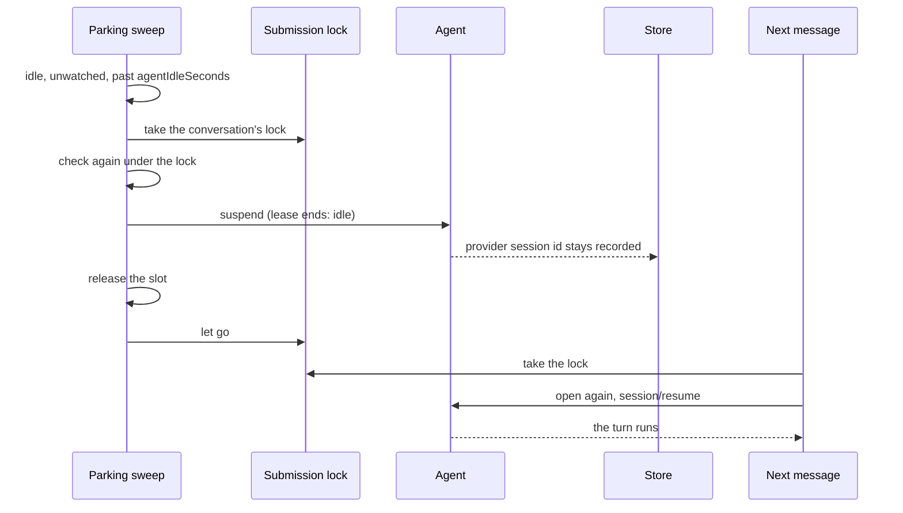

# Parking idle agents

An open conversation used to keep its agent process running until the gateway
stopped. One idle Claude agent holds about 260 MB and 0.75% of a core (measured
in [#994](https://github.com/nessalabs/nessa-agent/issues/994)), so a gateway
holding a swarm of conversations spent most of its machine on agents doing
nothing. Now an agent that has been idle, with nobody watching its
conversation, is stopped ("parked"). The conversation stays open and keeps
everything it owes. The next message starts the agent again and resumes its
provider session.

## When an agent is parked

The gateway looks at every live conversation every few seconds
(`service/parking.rs`). It parks one when all of these hold:

- `limits.agentIdleSeconds` is not 0, and that long has passed since the
  conversation was last touched: opened, read or sent a message, or seen busy, watched
  or with an app call waiting. Time is read from the service's clock port, so
  tests move it by hand.
- Its agent can resume a provider session (`session_resume`). One that cannot
  would lose its context on the next start, so it is never parked.
- Its agent is attached and idle (`Agent::is_idle`): nothing queued, nothing
  running. A permission review or a question belongs to a running turn, so a
  conversation waiting on one is never idle.
- Nobody follows its view (`LiveChanges::followed`). A window or phone showing
  the conversation keeps its agent up, so what a person looks at keeps its
  live capabilities and never pays a start.
- No MCP App call of it waits on a review.
- The gateway is not retiring, and nothing else is stopping the conversation.

An opening past `limits.liveConversations` parks too, rather than being
refused: of the conversations that could be parked now, the one touched
longest ago is parked at once, however recently, and the opening is refused
`conversation_capacity` only when none can be (`make_room`). It never waits for
another conversation's submission lock, since two openings at the bound would
each wait for the other's; a conversation whose lock is held is in use.

Parking is the stop that already exists for an agent that stopped itself
(`AgentEnd::Suspend`): the process stops, anything owed stays owed, and the
provider session id stays recorded, so the next opening sends `session/resume`.
Its lease ends with cause `idle`, which surfaces show as "Paused while idle".

## Orderings

The parking sweep takes the conversation's submission lock, the one a
submission, a read, a mode change and the resumption of owed turns take, and
keeps it until the slot is released. A failed turn's retry and the start-up
sweep open a conversation without that lock; one that lands as the slot is
released opens it again like any message. Anything that arrives meanwhile waits and then opens the
conversation again, instead of being refused as a desktop stop refuses it.

| When | Parking | What arrives | Test |
| --- | --- | --- | --- |
| Idle and unwatched for less than `agentIdleSeconds` | Nothing | | `an_agent_idle_for_less_than_the_limit_is_not_parked` |
| Idle and unwatched past it | Parked: suspended, slot released, lease ended `idle` | | `an_idle_unwatched_agent_is_parked_and_its_lease_ends_idle` |
| A turn is running | Not parked; the wait starts again | | `a_running_turn_is_not_parked` |
| A turn is queued, a permission review or question waits, or an MCP App call waits on a review | Not parked: each makes `parkable` false (a queued turn or a review is a busy agent) | | by `parkable`'s checks; only the running turn has its own test |
| A view follows the conversation | Not parked; the wait starts again when the last follower goes | | `a_followed_conversation_is_not_parked` |
| `agentIdleSeconds` is 0 | Never parked | | `a_zero_limit_parks_nothing` |
| A message arrives while parking holds the lock | Finishes the park | Waits, then opens the conversation again and resumes its provider session; the turn runs | `a_message_during_parking_waits_and_opens_the_conversation_again` |
| A message arrives after the park | | Opens again with `session/resume` of the recorded session | `a_message_after_parking_resumes_the_provider_session` |
| The agent cannot resume a provider session | Never parked | | `an_agent_that_cannot_resume_is_not_parked` |
| A message is sent just before the sweep checks | Not parked: the send touched the conversation | Runs | `a_message_just_sent_keeps_the_agent` |
| A window opens the parked conversation | | Its view says images may be sent when the gateway takes them, so a pasted image is not refused; a send to an agent that takes none is refused at submission | `a_parked_conversations_view_takes_images_when_the_gateway_does`, `a_parked_conversations_view_refuses_images_the_gateway_does_not_take` |
| A delete wrote its tombstone and let the lock go | Not parked: the record says deleted, and the delete stops the agent under its own cause | | the check in `park` (the window between the tombstone and the delete's stop is not reachable from a test) |
| The suspend's close fails or runs past its budget | The slot stays, marked stopping, as after any failed stop; parking goes through the same `stop_and_release` | Refused as closed until the close confirms | covered by `a_stop_that_runs_past_its_budget_carries_on_and_lets_the_agent_go` |
| An opening past `liveConversations` while an agent could be parked | The parkable one touched longest ago is parked now | The opening goes ahead | `past_the_bound_an_opening_parks_the_idle_agent_used_longest_ago` |
| An opening past `liveConversations` while every agent is at work | Nothing | Refused `conversation_capacity` | `past_the_bound_an_agent_at_work_is_not_parked` |
| The gateway starts retiring | The sweep ends; retirement suspends what is left | | `parking_stops_when_the_gateway_retires` |

## What parking does not change

- A follower's read (a view subscription, as a window or phone holds) of a
  conversation with no live agent folds its committed history, as it did
  after a restart, and opens nothing. Its view says nothing can be queued,
  steered or reviewed, since nothing runs. It says images may be sent when the
  gateway takes them (`offers_images`), because a send starts an agent again;
  an agent whose model takes none refuses them at submission
  (`image_input_unsupported`). This comes from the gateway, not from memory of
  the last agent, so it holds after a restart and keeps nothing per
  conversation. An opening agent's view does the same until it negotiates:
  unknown is not no, as submission already admits.
- `conversation.read` opens the conversation's agent, as it always did, so a
  client that polls with it slower than `agentIdleSeconds` starts the agent
  on each poll. Surfaces follow with a view subscription instead.
- Turn resumption, failure retries and the unfinished-turn marks are
  unchanged. An agent waiting out a failed turn's backoff is idle and may be
  parked; its retry opens the conversation again like any message.
- OpenCode keeps its sessions in one database for the gateway
  (`OPENCODE_DB`, at `<conversations>/opencode/sessions.sqlite3` in the
  instance's data), while each process still gets a fresh private home. Before, the sessions lived in that home and were
  deleted with it, so an OpenCode conversation could not resume after its
  agent stopped.

## Cost

Parking moves the agent's start onto the next message. Measured cold starts on
4 cores: Claude 0.85 to 1.2 s, Codex 0.3 s, OpenCode 2 to 4 s. The scale check
(`pnpm test:scale`) has a park and resume phase that reports how many agents
were parked, the resumed turns' latency, and CPU and memory for the gateway and
for its agent processes in every phase.
