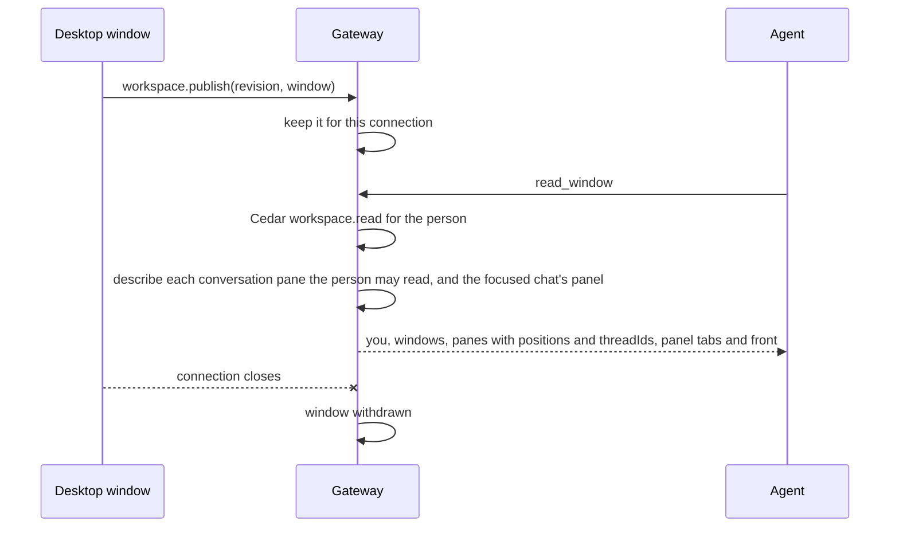
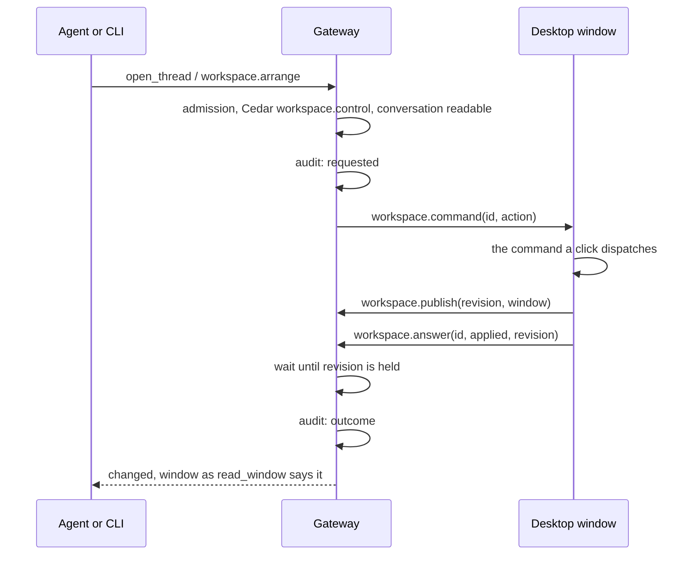

# The window an agent shares

A person and their agents look at the same desktop window. `read_window`, a
tool in the gateway's `nessa-agents` server, tells an agent what that window
shows now: whether the sidebar, session list and right panel are open,
what fills the content region, and every pane left to right, each with
where it sits in
words ("left", "top right", "full"), its share of the room, whether it has
focus, and what it shows. The pane that shows the asking conversation is
marked `you: true`, and `you` at the top says where that is: the focused
pane showing it, if one does, else the first. While the Agents overview or a
widget fills the window over its panes, the window and `you` are `covered`.
Windows are listed most recently published first; past what one tool result
holds (30 KiB) the rest are counted in `more`, the asking conversation's
windows kept first. A conversation in
a pane is named by its `threadId`, the id the other thread tools take, so an
agent can go on to read or message the conversation beside it.

The right panel is the focused chat's. `panel.open` is `"open"` or
`"closed"`, the same words as the sidebar. `panel.tabs` lists each widget
tab, plugin and id, in the order it was opened. `panel.front` is the tab in
front when there is one, and is absent when the chat has no tabs. A widget
there is on screen only while the panel is open. Another chat's tabs are
said when that chat is focused. Whether the panel is drawn is the layout's
(`panelShown`); the tabs are the chat's
([1120](../adr/done/1120-read-window-panel.md)).

## One authority for each fact

- **What is on screen** is the window's. The desktop says it with
  `workspace.publish` each time it changes (`src/desktop/workspace/adapters/store/effects.ts`
  → `adapters/gateway/window-publisher.ts`); the gateway keeps the latest one
  per connection and never guesses at it.
- **What a conversation is** (its title, agent and model) is the gateway's,
  read when the agent asks, and only for conversations the person may read now.
  A pane showing one they may not is `available: false` with its id alone.

The gateway keeps a window only while its connection is open
(`conversation/application/workspace_windows.rs`): a window that closed shows
nothing, so nothing it said can outlive it. A connection that comes back says
the window again, under the `windowId` the window made when it opened and
with its revisions still rising, so a connection it left behind (a socket the
gateway has not seen close yet, after a laptop sleeps) reads as the same
window, older, not as a second one. The higher `revision` wins, so a
publication that arrives late changes nothing.

The desktop sends the window again after a failed send or a refusal for now
(a full request lane, say). A refusal for good (`invalid_request`) is logged
and the window withdrawn, so the gateway never goes on holding an older
layout as if it were current.

## Who may read and write

Publishing is admitted like any other request, by the session's
`conversation.write` grant and the catalogue write check, which refuses a
paired session. Reading first passes the agent-tool admission every
`nessa-agents` tool takes (`owner.agent_tools`: a turn the owner started, on
their own conversation), which is what decides who the reader is. Then the
Cedar action `workspace.read` on that person's own `Workspace`
(`owner.workspace_read`) decides whether a person may read their windows at
all, so a later policy can narrow it without code.

## Changing the window

An agent, or the person's own CLI, can also ask the window to change. One
core in the gateway, `control_window`
(`conversation/application/service/workspace_windows.rs`), takes one
`WindowAction` (`domain/value_objects/window_action.rs`), and two shims
call it:

- **Agent tools** in `nessa-agents`: `arrange_window` (sidebar, session
  list and right panel open or closed, the panes or the Agents overview),
  `show_panel_tab`, `open_thread` (here, beside, right or below), `focus_pane`
  and `close_pane`. They act on the window showing the asking conversation.
- **Methods** `workspace.arrange` and `workspace.closePane`, which `nessa call`
  and `nessa mcp` offer like any other method. They act on the window named by
  `windowId`, else the most recently published one.

Each action has a severity. `close_pane` takes something off the screen the
person may have been using, so its tool and method are marked destructive
(MCP `destructiveHint`, and `surface-hints.json`); the rest only arrange, are
not read-only, and are undone the same way they were made. An agent's own
approval mode treats each the way it treats any tool of that kind.

The window is the authority for its layout, so the gateway decides nothing
about it. It sends the action as a `workspace.command` event to the
connection holding that window's newest publication, and the window carries
it out through the same commands a click or a shortcut dispatches
(`src/desktop/workspace/adapters/store/window-commands.ts`): opening a
conversation already on screen focuses it, opening one beside where the room
will not hold it shows it in the focused pane, and closing the last pane
leaves a new session. What the window shows before and after decides
`applied` or `unchanged`. The right panel's outcome waits for its layout to
say it is drawn (`panelShown`), or is `covered` past 1.5 s. The window answers
with `workspace.answer` once its publication of the change has been
accepted, and the gateway waits until it holds that revision, so a
`read_window` after the answer already sees the change. That is at once
unless the window's connection has closed since (the wait ends when no
connection holds the window) or for at most 1 s; an answered change is made
either way, and recorded as made.

Each action is checked before the window is asked: the agent-tool admission
for a tool, the session's `conversation.write` grant for a method, then the
Cedar action `workspace.control` on the person's own `Workspace`
(`owner.workspace_control`), and for an action that names a conversation,
that the person may read it. Every request is recorded in
`audit/window-control` before the window is asked, and what came of it after,
refusals included. A change sent to the window that it neither answered
in time nor stayed connected to answer is recorded as `unconfirmed`, not
refused: the window may still have made it. Each record holds the caller, the tool call or session, the action, its
severity and the policies that allowed it.

The window listens for changes on each connection it publishes on, so one
that reconnects goes on hearing them. A window that does not answer within
5 s is `window_not_answering`; one that
has 8 changes waiting is `window_busy`; no window is `window_unavailable`.
Resizing panes is not offered yet.

## Adding a kind of pane

A new kind of pane (a file, say) is a new `ShownItem` in
`src/desktop/workspace/model/shown-window.ts`, a new `WorkspacePaneKind` in
`protocol/product/v1.json`, and a new `PaneContent` in
`conversation/domain/value_objects/workspace_window.rs`, said by `read_window`
in `composition/conversation_tools.rs`.
