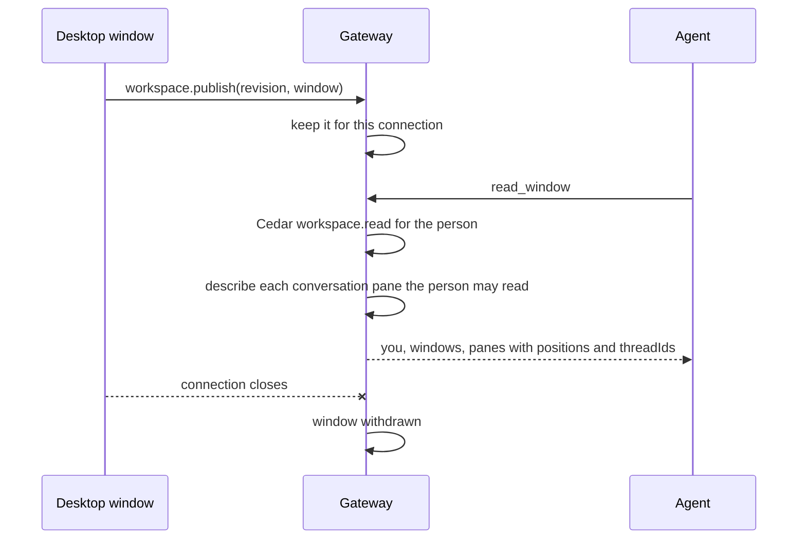

# The window an agent shares

A person and their agents look at the same desktop window. `read_window`, a
tool in the gateway's `nessa-agents` server, tells an agent what that window
shows now: whether the sidebar and session list are open, what fills the
content region, and every pane left to right, each with where it sits in
words ("left", "top right", "full"), its share of the room, whether it has
focus, and what it shows. The pane that shows the asking conversation is
marked `you: true`, and `you` at the top says where that is: the focused
pane showing it, if one does, else the first. While the Agents overview or a
widget fills the window over its panes, the window and `you` are `covered`.
Windows are listed most recently published first; past what one tool result
holds (30 KiB) the rest are counted in `more`, the asking conversation's
windows kept first. A conversation in
a pane is named by its `threadId`, the id the other thread tools take, so an
agent can go on to read or message the conversation beside it.

## One authority for each fact

- **What is on screen** is the window's. The desktop says it with
  `workspace.publish` each time it changes (`src/desktop/workspace/adapters/store/effects.ts`
  → `adapters/gateway/window-publisher.ts`); the gateway keeps the latest one
  per connection and never guesses at it.
- **What a conversation is** (its title, agent and model) is the gateway's,
  read when the agent asks, and only for conversations the person may read now.
  A pane showing one they may not is `available: false` with its id alone.

The gateway keeps a window only while its connection is open
(`conversation/application/workspace_windows.rs`): a window that closed shows
nothing, so nothing it said can outlive it. A connection that comes back says
the window again, under the `windowId` the window made when it opened and
with its revisions still rising, so a connection it left behind (a socket the
gateway has not seen close yet, after a laptop sleeps) reads as the same
window, older, not as a second one. The higher `revision` wins, so a
publication that arrives late changes nothing.

The desktop sends the window again after a failed send or a refusal for now
(a full request lane, say). A refusal for good (`invalid_request`) is logged
and the window withdrawn, so the gateway never goes on holding an older
layout as if it were current.

## Who may read and write

Publishing is admitted like any other request, by the session's
`conversation.write` grant and the catalogue write check, which refuses a
paired session. Reading first passes the agent-tool admission every
`nessa-agents` tool takes (`owner.agent_tools`: a turn the owner started, on
their own conversation), which is what decides who the reader is. Then the
Cedar action `workspace.read` on that person's own `Workspace`
(`owner.workspace_read`) decides whether a person may read their windows at
all, so a later policy can narrow it without code.

## Adding a kind of pane

A new kind of pane (a file, say) is a new `ShownItem` in
`src/desktop/workspace/model/shown-window.ts`, a new `WorkspacePaneKind` in
`protocol/product/v1.json`, and a new `PaneContent` in
`conversation/domain/value_objects/workspace_window.rs`, said by `read_window`
in `composition/conversation_tools.rs`.
