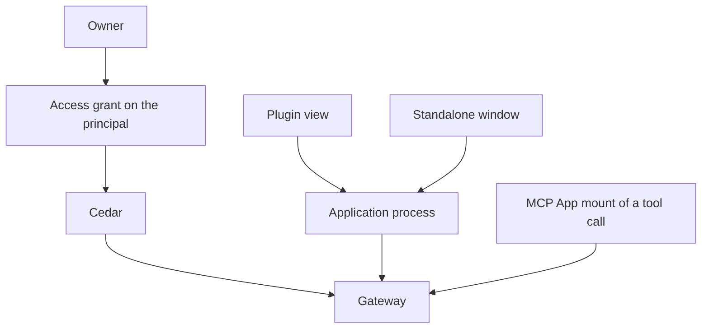
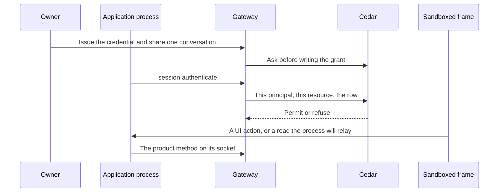

# Application framework

Status: proposal. The pull request that adds this document does not build it.
Public names in the examples are proposals. An ADR, when one is needed, takes
the number of the issue that settles that decision. This document does not
add one.

A developer has two ways to run one package. A **plugin** is a view the
desktop hosts. A **standalone app** is the same package in its own window.
One **application process** holds the gateway session. Cedar decides what
that principal may do with the [access grant](access-grants.md). The
package's own data stays the package's.

Harness scope stays Claude and Codex. Alpha has no migration.

## What is built

### Two clients already talk to one gateway

`@nessa/client` (`packages/nessa-client`) opens a WebSocket to `/session`,
answers `session.challenge`, and sends `session.authenticate`. The
credential decides the principal. The `surface` field is metadata.
[ADR 0010](../adr/done/0010-local-authentication.md) separates that
authentication from Cedar authorization on each later call. The package is
private and is not published. Its README says there is no separate plugin
SDK.

The desktop reads `auth/surfaces/nessa-panel.token` through the host
(`src-tauri/src/surface_credential.rs`) and connects with that owner
credential. Another process connects the same way with its own credential.
`crates/nessa-client-core/examples/read_only_sync.rs` is that second
process for a paired read credential: pair, sync, follow. It does not run
an agent.

`nessa-sdk` runs inside the gateway. A package does not embed it.

Credential kinds that exist (`crates/nessa-auth/src/domain/models.rs`):
`human`, `agent`, `integration`, `gateway`. Pairing is what creates a
`gateway` principal (`gateway:<key>`). `credential.issue` refuses one.
`hold.person` in `crates/nessa-auth/src/adapters/cedar/policies.cedar`
lets a human, agent, or integration hold `server.read`,
`credential.manage`, `conversation.read`, and `conversation.write`.
`hold.peer` lets a gateway principal hold `conversation.read` and
`environment.serve`. Those credential grants name no conversation and no
directory ([access grants](access-grants.md)). `issue.member` requires a
member role. `AuthenticateSession` refuses an inactive membership
(`crates/nessa-auth/src/application/session.rs`).

A second `credential.issue` with a new request id adds another credential
on that principal (`crates/nessa-auth/src/adapters/local/registry.rs`).
The webhook proposal's one-registration refusal is not this registry.

`nessa auth token` is already an integration. The CLI issues one with
`server.read` and `conversation.write`, a new member, and no receiver
(`crates/nessa-server/src/cli/infrastructure/gateway.rs`). It is admitted
by the no-binding owner path. An application cannot be "an integration"
with that path turned off, or those tokens stop being able to write.

### Admission when nothing is paired

`admit_conversation` returns success when the session has no receiver
binding (`crates/nessa-server/src/product/read_access.rs`). `reader` maps
that absence to `Reader::Owner`. `admit_request` then takes the owner
path: the credential's manifest grant, and `Initiation::owner()`. The
comment on that module records why: a gateway that pairs no device has no
binding, so every session reads as the owner.

A paired device is the other path. It has a receiver. Its credential holds
`conversation.read`. Comment and drive are the share row, and Cedar's
`grant.comment` and `grant.drive` also require `signedInAs == bindingOwner`
(`crates/nessa-server/src/conversation/infrastructure/access_policy/cedar/readers.cedar`).
A device meets that because it signs in as the owner. A peer gateway signs
in as itself, so those two permits do not match it. The grant lookup is
`receiver_id`. A row with no receiver is not that lookup
(`crates/nessa-server/src/conversation/infrastructure/store/share_grants.rs`).

`owner.read` and `owner.act` permit the principal whose id is the
conversation's owner
(`crates/nessa-server/src/conversation/infrastructure/access_policy/cedar/ownership.cedar`).
The no-binding success returns before that question is asked.

`mcp.callTool`, `mcp.readResource`, `mcp.sendMessage`, and
`mcp.updateModelContext` require the credential grant `conversation.write`
(`protocol/product/manifest.json`). They are not in
`ADMITTED_BY_ITS_OWN_CHECK`.

Revoking or expiring the credential closes a live socket with
`CredentialRevoked` or `CredentialExpired`
(`crates/nessa-server/src/product/socket.rs`).

### A plugin view is a widget, and an MCP App is a tool call

[ADR 326](../adr/done/326-widgets.md) hosts a view as a `WidgetRef`
(`plugin`, `id`) in a message, a pane, or over the panes. The window place
replaces whatever widget is there
(`openWidget` in `src/desktop/workspace/adapters/store/commands.ts`).
Two kinds share that host (`src/desktop/widgets/ui/plugin.ts`):

- `native` — React the window trusts, registered in composition.
  `widgetRegistry` in `src/desktop/dependencies.ts` registers the sample
  and subagents plugins only beside the sample workspace. A gateway
  window passes none.
- `app` — an MCP App, HTML in the sandbox, registered while the window
  runs.

An `app` plugin id is `mcp:` plus the server name
(`src/desktop/widgets/app/model/app-ref.ts`). Its widget id is the
conversation, the execution, and the tool call. The desktop registers the
plugin when a conversation view has a tool with UI
(`src/desktop/widgets/app/adapters/gateway/gateway-apps.ts`). The gateway
refuses `mcp.callTool` unless that call exists and declared a UI
(`crates/nessa-server/src/mcp_servers/domain/app_call.rs`,
`AppRefusal::AppUnknown`). `app_facts` selects the call by `executionId`
and `toolId`. Policy and audit name the app by those two.
`instanceId` is one mount
(`packages/nessa-client/src/generated/product.ts`, `McpAppReference`).

The mount speaks through the caller's credential. The frame does not
receive it. `ui/message` and `ui/update-model-context` are that mount's
conversation port ([MCP App calls](mcp-app-calls.md)). `requestMode` in
`src/desktop/widgets/app/model/places.ts` opens a pane when an inline view
asks for fullscreen. A ready app pane can still be opened in the window
place. The side rail (`src/desktop/workspace/ui/chrome/side-rail.tsx`) is
a prototype. It is not an install list.

`ui/open-link` and `ui/download-file` have ports. Production composition
does not supply them (`appPorts` in `dependencies.ts`).

### The grant row

[Issue 889](https://github.com/nessalabs/nessa-agent/issues/889) made a
conversation share a capability set: `read`, `read+comment`, or
`read+comment+drive`, plus constraints on a drive grant, plus the grant
epoch (`policy_revision`). Cedar's `grant.read`, `grant.comment`, and
`grant.drive` decide. `ShareGrant.receiver_id` is optional in the struct
for an integration
(`crates/nessa-server/src/conversation/application/share_grants.rs`).
`conversation.share` still refuses a target that is not an active paired
device or peer gateway (`share_target_not_paired`).

[The access-grant proposal](access-grants.md) (merged as
[#888](https://github.com/nessalabs/nessa-agent/issues/888)) is the rest
of that row: subject kind `principal` for an integration or a later
agent, one resource (one conversation, or one directory), capabilities
`read`, `comment`, `drive`, `write`, `exec`, constraints, epoch. Cedar
permits or refuses. `ResourceKind::Directory` is reserved and this build
does not write one. Webhook delivery is that proposal's outbox, not a
second grant. Its share target is an integration credential. This plan
uses that same target and does not give it a URL or a MAC.

```mermaid
flowchart TD
  panel[Desktop with the panel token]
  other[Another process with its own credential]
  gateway[Gateway]
  sdk[nessa-sdk Agent]
  call[Tool call that declared a UI]
  mount[MCP App mount]
  panel --> gateway
  other --> gateway
  gateway --> sdk
  call --> mount
  mount --> panel
  panel --> gateway
```

## What this proposes

One package. One integration principal. One application process, which
holds the socket. The plugin and the standalone window are views on that
process. A second process is a second socket; an operation stays in the
process that accepted it.



The plugin view is the widget window place, drawn in the sandbox, opened
with no tool call. The desktop host starts the process and proxies the
frame. The frame does not receive the secret (row H1). The standalone
window is a view in that same process when the package is started on its
own. The MCP App mount stays a tool call on the caller's session, drawn
by the desktop with the panel token, as today.

Third-party code is the sandbox or this process. The `native` widget kind
stays the trusted views the window registers in composition.

## Authentication

The process uses the existing handshake. The credential names the
application principal, an active member of kind `integration`. The panel
token stays the owner's. A `gateway:<key>` credential stays a peer.

The owner installs the package, which mints that principal, its active
membership, and an application registration, then issues a credential
holding `server.read` and `conversation.read`. `hold.person` already
permits an integration to hold those. The install does not put
`conversation.write` or `credential.manage` on the credential it writes.
A later issue with a new request id is another credential on the same
principal, which is what the registry does now. This plan does not add
the webhook's refusal of a second credential. The grant is on the
principal, so each of its credentials is asked the same rows.

The registration is the fact Cedar sees. It is not a fifth principal
kind. Slice 1 asks Cedar on the no-binding path and passes that fact:

- No registration. The owner fallback stays. That is the panel token,
  the owner, and `nessa auth token`.
- An application registration. The fallback does not match. A
  principal-subject grant on that resource permits, and anything else
  is refused. `owner.act` does not match this principal.
- A paired receiver stays on the receiver path already built.
- `mcp.*` is not a grant capability. The application process is not
  given a way to present those methods.

`grant.comment` and `grant.drive` as written require a binding owner.
They do not match an integration that signs in as itself. Slice 1 adds
the principal-subject permits for a principal that has an application
registration. Rust gathers the registration, the row, and the action,
and acts on Cedar's answer.

`conversation.share` accepts a current credential whose principal has
an application registration or, when that slice exists, a webhook
registration. It does not accept a browser token, which has neither.
The check does not read a webhook URL or a package path. The two
registrations are two kinds of one record per principal. Each command
refuses a principal that already has the other kind.

A directory grant (`write`, `exec`) stays the directory slice of #888.



## Actions

The base contract is plain TypeScript. It does not import React or a
state library. Redux adapters are out of scope. Two functions, illustrative:

```ts
defineUiAction({ name: "selectChart" })
defineOperation({ name: "saveDashboard" })
```

The public module is what a browser or a sandbox may import. The service
binding lives on a second entry of the same package,
`packages/nessa-app`. The browser entry does not re-export it. The slice
that adds the package holds that with an import test.

A UI action names one live view. The process runs it there. A closed
view, or a different one, is `surface_unavailable`, and the call does not
become an operation and does not write the package's data.

An operation runs in the process. Closing every view leaves it running.
The acknowledgement is the process's. A view that has gone does not
report success (O3). The same request id and the same body are the same
attempt. A second body under that request id is refused, and the first
attempt is left as it was.

The attempt is a record in the process's own store: request id, body,
and outcome. For app-owned data the outcome record is the write, so
there is no gap between the effect and the record. For a Nessa resource
the process stores the gateway receipt before it acknowledges, and a
restart repeats that request id. The gateway already treats that id as
the same command. Restart reads the record and does not start a second
effect (O9–O11).

The package's own dashboard record is app-owned data. Cedar is not asked,
because the record is not a Nessa resource. An operation that both writes
that record and names a Nessa resource asks Cedar before either effect. A
refusal writes neither (row O8). An admitted attempt keeps the epoch it
read.

Registering an operation as an MCP tool is explicit. An unregistered name
is not a tool. A registered tool travels the gateway's existing MCP path
to Claude or Codex, once the running process is stored as a remote
MCP server.
Its UI, when the tool declares one, is the MCP App mount already built,
on the caller's session. The turn's tool policy is unchanged.

The reference package is a dashboard at `examples/dashboard`. It is not
imported by `src/desktop`. Selecting a chart is the UI action. Saving the
dashboard is the operation.

## Context

A live view may publish a bounded context: what is selected. Replacing it
drops the previous value. Closing the view drops it, and a later send
does not attach it. Two views keep two values.

That context is not `ui/update-model-context`. That method stays the
tool-call mount's port. The bytes a person-send carries from a plugin
view are for the plugin-entry slice to fix. This document fixes when the
value exists.

## States

Rows marked **built** are current behavior. The other rows are the
contract the slice named in [Slices](#slices) tests. Issue, bump, and
revoke of a grant stay the grant table in
[access grants](access-grants.md). The facts below are independent. A
flat status such as "granted" is not a state.

| Fact | Values |
| --- | --- |
| Principal | absent, or present as an active member |
| Credential | none, current, or closed (revoked or expired), per credential |
| Grant on resource R | absent, or active at an epoch |
| Socket | closed, or open on one credential |
| View | absent, or live with an id |
| Window place | empty, or showing one widget |
| Operation | idle, running, or uncertain |

### Principal, credential, grant, socket

| Row | Before | Event | After | Effect |
| --- | --- | --- | --- | --- |
| A1 | principal absent | owner installs | principal present, application registration written, credential none, no grants | membership active |
| A2 | credential none | owner issues | one credential current | holds `server.read` and `conversation.read`; secret returned once |
| A3 | a credential current | owner issues again, new request id | another credential current | the registry already does this; both are asked the same grants |
| A4 | a credential current | owner shares conversation R, Cedar permits | grant R active | no receiver; the epoch of that commit |
| A5 | grant R active | owner shares a set Cedar denies | unchanged | nothing written; the policy ids |
| A6 | credential current | that credential authenticates | its socket open | inactive membership is refused, as `AuthenticateSession` does today |
| A7 | socket open, grant R active | read or follow R | unchanged | Cedar permits; the epoch just read is stamped |
| A8 | socket open, grant R absent | read or follow R, or list it | unchanged | Cedar refuses; no row created |
| A9 | grant R active | owner revokes R | grant R absent | sockets stay; the next admission misses R |
| A10 | credential current, its socket open | revoke or expire that credential | credential closed, that socket closed | **built** close reasons; other credentials' sockets stay; grants and epochs stay |
| A11 | principal present | owner uninstalls | principal absent | credentials closed, grants removed, sockets closed |
| A12 | credential current, no grants | authenticate | socket open | A8 on every conversation |

A4 applies again for a second conversation. The result is a second row.
A9 on one row leaves the other.

### Views, the window, and context

| Row | Before | Event | After | Effect |
| --- | --- | --- | --- | --- |
| U1 | no live view with that id | invoke the UI action | unchanged | `surface_unavailable`; the package writes nothing |
| U2 | view S live | invoke names S | S live | the action runs on S |
| U3 | view S live | invoke names another id | S live | `surface_unavailable` |
| U4 | action running on S | S closes first | S absent | `surface_unavailable`; the result is dropped; no operation starts |
| U5 | S and T live | each invoke names its own | both live | each runs on its view |
| U6 | S live | the selection changes | S live | S's context is replaced |
| U7 | S live | S closes | S absent | S's context is dropped |
| H1 | the frame is showing the plugin view | the frame reads its document and its bridge messages | unchanged | the credential bytes are not among them |
| M5 | package installed, window place empty or occupied | the person opens the plugin entry | window place shows the plugin | no tool call |
| M6 built | window place showing any widget | `openWidget` to the window, or M5 | window place shows the new widget | the previous view closes, so U7 applies to it; a tool-call mount that lost the window is still that tool call |

### The operation

| Row | Before | Event | After | Effect |
| --- | --- | --- | --- | --- |
| O1 | process up, operation idle | invoke an operation, no view open | running in that process | the process owns it |
| O2 | running | the last view closes | running | it continues |
| O3 | running, attempt record stored | the caller disconnects before the ack | uncertain | the same request id and the same body are this attempt; a different body is refused and this attempt stays |
| O4 | process up | the operation names only a Nessa resource the grant does not admit | idle | refused before the effect; the refusal is the stored outcome |
| O5 | admitted | the grant epoch changes | running | this attempt keeps the epoch it read |
| O6 | — | a tool call for a name that was not registered | — | not a tool |
| O7 | registered, process up | a turn calls the tool | one remote MCP connection to that process | the harness session ending closes the connection; the process stays; the mount, if the tool has UI, is the caller's |
| O8 | process up | the operation writes app-owned data and names a Nessa resource | running, or idle | Cedar is asked first; a refusal writes neither and is stored |
| O9 | running or uncertain | the process exits | the attempt record remains | no second effect is started by the exit |
| O10 | record holds the outcome | the process starts again and the same request id and body arrive | idle | the stored outcome is the ack |
| O11 | record holds the attempt and no outcome | the process starts again | running or uncertain | that attempt continues; a different body is refused |

### The mount

| Row | Before | Event | After | Effect |
| --- | --- | --- | --- | --- |
| M1 built | a tool call with UI | the desktop applies the view | plugin `mcp:<server>` | the widget id is conversation, execution, tool |
| M2 built | no such call | `mcp.callTool` | — | `mcp_app_unknown` |
| M3 built | a mount | an `mcp.*` call from the desktop | the caller's session | recorded as the app, on behalf of that caller; the credential grant is `conversation.write` |
| M4 | the application socket | an `mcp.*` method | — | refused; those methods are not granted to this principal, including when a tool call with that id exists |

## Rules the slices test

Each rule names the rows that hold it.

1. Cedar decides an application principal's use of a Nessa resource.
   The no-binding owner fallback stays for a principal with no
   registration, which is how `nessa auth token` writes today. It does
   not match an application registration. Rows A7, A8, A12, O4, O8.
2. One grant is one principal, one resource, the capability set, and the
   constraints. A second conversation is a second row. A4 applied twice,
   then A9 on one of them.
3. The credential names an active integration member and the install's
   credential holds `server.read` and `conversation.read`. It is not the
   panel token and not a peer gateway. Rows A1, A2, A6.
4. A UI action runs on the one live view it names. Rows U1–U5.
5. The process that accepted an operation owns it. The attempt record
   survives that process exiting, and a restart does not apply the effect
   twice. Rows O1–O3, O9–O11.
6. A view's context does not outlive that view. Rows U6, U7, M6.
7. An MCP App mount stays the tool call it is, on the caller's session.
   Rows M1–M4.
8. The browser entry imports the public contract only. The import test
   holds this.
9. The frame does not receive the credential. Row H1.
10. A registered tool is a remote MCP connection to the running
    application process, on the gateway's Claude and Codex path.
    OpenCode is not added. A stdio launch is not this tool. Row O7.
11. The install list, when the packaging slice adds a file, has one
    version. Another version is refused and not rewritten. Startup does
    not delete it. Alpha: no migration.

## Packaging

Today a native plugin is compiled into the window, an MCP server is a
stored command (`mcpServers.save`), and the Tauri updater replaces the
desktop binary (`src-tauri/src/updater.rs`). None of those is a package
a third party installs.

The package is a directory: a manifest (display name, process entry, UI
entry), the public actions, and the UI document the sandbox loads. The
owner installs it on this gateway. The install list is the owner's,
beside the stored MCP servers, not a channel of the updater. The first
install is a local path. A signed feed is out of scope.

A stored stdio server is one process per harness session, ended with
that session (`open_admitted` in
`crates/nessa-server/src/mcp_servers/infrastructure/relay.rs`). The
application process is not that child. Its tools are stored as a remote
server aimed at the process already running. The session's end closes
the connection.

`nessa init` is the last slice. It scaffolds `examples/dashboard`'s
shape against a gateway the developer already runs. Until then, the
example is started by hand.

First-party research views stay MCP servers in `nessa-extensions`
([ADR 344](../adr/done/344-mcp-ui.md)). This plan does not move them
into the desktop tree.

## Reference acceptance

The dashboard, in order, once the slices have landed:

1. The web view authenticates as the application and reads the one
   granted conversation. Another conversation is refused, and so is a
   list of the rest (A6–A8, A12).
2. Chart selection runs on the open view and is refused when that view
   is closed, with nothing saved (U1, U2, U4).
3. Save runs with no view open. Dropping the view leaves the
   acknowledgement uncertain until the process answers. A retry with a
   different body is refused (O1–O3).
4. The save is an MCP tool only after it is registered and the running
   process is stored as a remote server. An unregistered name is not
   listed. Ending the harness session does not stop the process (O6, O7).
5. The plugin entry opens the dashboard with no tool call. Opening it
   while a tool-call widget has the window replaces that widget and
   drops its view context. Closing the entry does not stop the process
   (M5, M6, O2, U7).
6. The standalone window is a view of the same process and the same
   principal. A second process does not take over an operation the first
   accepted.
7. `nessa init` produces a package that can do 1.

## Slices

Each slice is its own issue. None of them is this pull request.
Dependencies run downward.

| Slice | Delivers | Rows |
| --- | --- | --- |
| 1. Principal, grant, and admission ([#1052](https://github.com/nessalabs/nessa-agent/issues/1052)) | Install mints the active member and the application registration. A credential holding `server.read` and `conversation.read`. `conversation.share` accepts that registration and refuses a browser token. No-binding admission asks Cedar with the registration fact: no registration keeps today's owner fallback; an application registration matches a principal-subject grant or is refused. `mcp.*` stays off this principal. | A1–A12, M4 |
| 2. Connected web view ([#1053](https://github.com/nessalabs/nessa-agent/issues/1053)) | `examples/dashboard` as a page on the application process. `@nessa/client` on that process only. Renders the granted conversation. No desktop import. | A6–A8, A12 |
| 3. Action contract and the dashboard save ([#1054](https://github.com/nessalabs/nessa-agent/issues/1054)) | `packages/nessa-app`. UI action, operation, the attempt record, service entry, explicit MCP registration, the import test. | U1–U7, O1–O11 |
| 4. Plugin entry ([#1055](https://github.com/nessalabs/nessa-agent/issues/1055)) | The window place opens the package's UI with no tool call. The host proxies. H1. M6 against a tool-call widget already in the window. Mounts stay M1–M3. | H1, M5, M6, U6, U7 |
| 5. Standalone window ([#1056](https://github.com/nessalabs/nessa-agent/issues/1056)) | The same process shows its own window. A second process is a second socket and does not adopt the first's operation. | A6, acceptance 6 |
| 6. `nessa init` and install ([#1057](https://github.com/nessalabs/nessa-agent/issues/1057)) | Scaffold, local install, the versioned install list. A registered tool is a remote MCP URL of the running process, not a stdio child of the harness session. | rule 11, O7 |

Slice 3 lists tool descriptors and the attempt record. The live harness
call is slice 6. [#1057](https://github.com/nessalabs/nessa-agent/issues/1057)
as filed says the tool is launched through the stored-server path. O7 is
the contract: a remote URL of the process already running.

## Alternatives

**Give the package the panel token.** The process would connect as the
owner. `conversation.write` on that credential is the conversation
authority for the gateway. The frame would be one step from that secret.
The grant is the scope.

**Treat a stored grant row as enough.** That is the paired-device path,
and this principal does not walk it. No receiver means
`admit_conversation` returns success and `reader` says `Owner`.
`grant.comment` requires `signedInAs == bindingOwner`. A row with a null
`receiver_id` is not the lookup. Slice 1 asks Cedar with the registration.
It does not store a row and stop.

**Turn the owner fallback off for every integration.** `nessa auth token`
issues an integration with `conversation.write` and no registration, and
that fallback is how it writes. An application is the registration, not
the kind.

**Add a principal kind `application`.** `PrincipalKind` already has
`integration`, and #888 names an integration as a grant subject with no
receiver. The registration is the fact that separates an application
from a browser token. A fifth kind needs a hold policy beside
`hold.person`.

**Pair the package as a device.** Device pairing pins a key and a
receiver. `DeviceRead` signs in as the owner. A peer signs in as
`gateway:<key>`, and `hold.peer` is the limit on that kind. Only pairing
creates a gateway principal. Linked devices already own that enrollment.

**Make the plugin entry a synthetic tool call.** The widget id is the
conversation, the execution, and the tool. `known_app` refuses anything
else, and an opening's end ends that mount. The entry is a view (M5).

**Let the package decide its own allow list.** That is a second decider
beside Cedar.

**Extract the desktop transcript before a view exists.** The transcript
is a projection in `src/desktop/workspace`. The client already returns a
conversation view. A shared React kit, and any Redux adapter, wait until
a second app needs them.

**Ship packages through the Tauri updater.** The updater replaces the
desktop binary. The install list sits beside stored MCP servers. The
tool route is a remote URL, not a stdio command, because stdio's process
ends with the harness session.

**One grant for the catalogue.** A grant by channel, by a folder of
chats, or by default sync is already refused. Two conversations are two
rows.

**One share check owned by whichever slice merges first.** Share accepts
a principal that has an application registration or a webhook
registration, and it does not read a URL. The registration record is
the one place a principal is one of those, or neither, and neither is a
browser token.

## Out of scope

- Redux or another state-library adapter.
- Publishing `@nessa/client` or `packages/nessa-app`.
- A marketplace or a signed package feed.
- Directory `write` and `exec`.
- The owner phone ([#811](https://github.com/nessalabs/nessa-agent/issues/811)).
- Moving `nessa-extensions` into this repository.
- Supplying `links` and `downloads` on the production app ports.
- OpenCode as a host.
- Loading third-party React as a `native` widget.
