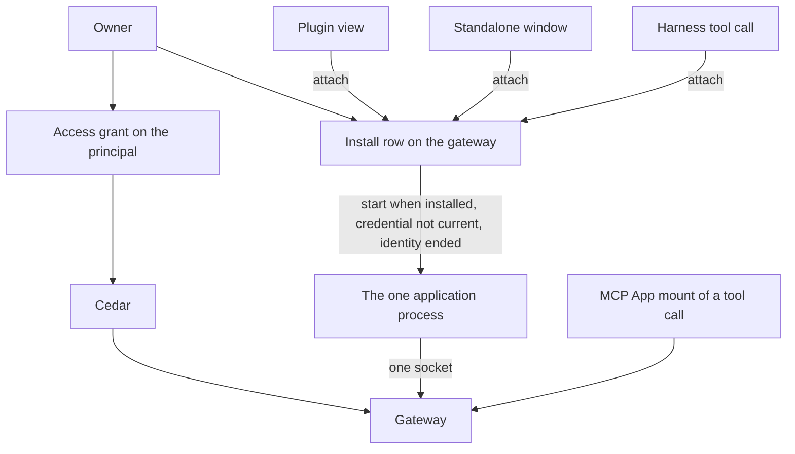
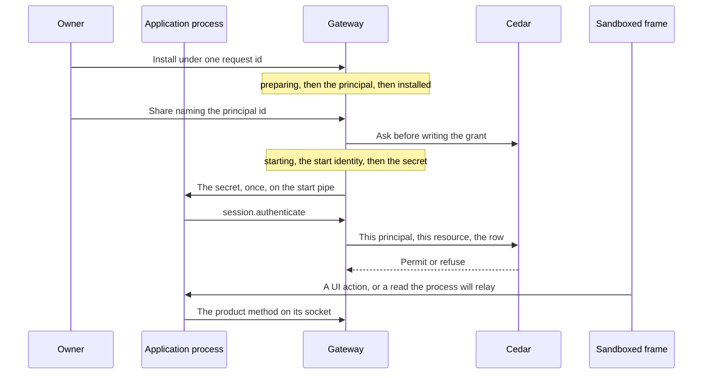

# Application framework

Status: proposal. The pull request that adds this document does not build it.
Public names in the examples are proposals. An ADR, when one is needed, takes
the number of the issue that settles that decision. This document does not
add one.

A developer has two ways to run one package. A **plugin** is a view the
desktop hosts. A **standalone app** is the same package in its own window.
One **application process** holds the gateway session. Cedar decides what
that principal may do with the [access grant](access-grants.md). The
package's own data stays the package's.

Harness scope stays Claude and Codex. Alpha has no migration.

## What is built

### Two clients already talk to one gateway

`@nessa/client` (`packages/nessa-client`) opens a WebSocket to `/session`,
answers `session.challenge`, and sends `session.authenticate`. The
credential decides the principal. The `surface` field is metadata.
[ADR 0010](../adr/done/0010-local-authentication.md) separates that
authentication from Cedar authorization on each later call. The package is
private and is not published. Its README says there is no separate plugin
SDK.

The desktop reads `auth/surfaces/nessa-panel.token` through the host
(`src-tauri/src/surface_credential.rs`) and connects with that owner
credential. Another process connects the same way with its own credential.
`crates/nessa-client-core/examples/read_only_sync.rs` is that second
process for a paired read credential: pair, sync, follow. It does not run
an agent.

`nessa-sdk` runs inside the gateway. A package does not embed it.

Credential kinds that exist (`crates/nessa-auth/src/domain/models.rs`):
`human`, `agent`, `integration`, `gateway`. Pairing is what creates a
`gateway` principal (`gateway:<key>`). `credential.issue` refuses one.
`hold.person` in `crates/nessa-auth/src/adapters/cedar/policies.cedar`
lets a human, agent, or integration hold `server.read`,
`credential.manage`, `conversation.read`, and `conversation.write`.
`hold.peer` lets a gateway principal hold `conversation.read` and
`environment.serve`. Those credential grants name no conversation and no
directory ([access grants](access-grants.md)). `issue.member` requires a
member role. `AuthenticateSession` refuses an inactive membership
(`crates/nessa-auth/src/application/session.rs`).

A second `credential.issue` with a new request id adds another credential
on that principal (`crates/nessa-auth/src/adapters/local/registry.rs`).
The webhook proposal's one-registration refusal is not this registry.

`nessa auth token` is already an integration. The CLI issues one with
`server.read` and `conversation.write`, a new member, and no receiver
(`crates/nessa-server/src/cli/infrastructure/gateway.rs`). It is admitted
by the no-binding owner path. An application cannot be "an integration"
with that path turned off, or those tokens stop being able to write.

### Admission when nothing is paired

`admit_conversation` returns success when the session has no receiver
binding (`crates/nessa-server/src/product/read_access.rs`). `reader` maps
that absence to `Reader::Owner`. `admit_request` then takes the owner
path: the credential's manifest grant, and `Initiation::owner()`. The
comment on that module records why: a gateway that pairs no device has no
binding, so every session reads as the owner.

A paired device is the other path. It has a receiver. Its credential holds
`conversation.read`. Comment and drive are the share row, and Cedar's
`grant.comment` and `grant.drive` also require `signedInAs == bindingOwner`
(`crates/nessa-server/src/conversation/infrastructure/access_policy/cedar/readers.cedar`).
A device meets that because it signs in as the owner. A peer gateway signs
in as itself, so those two permits do not match it. The grant lookup is
`receiver_id`. A row with no receiver is not that lookup
(`crates/nessa-server/src/conversation/infrastructure/store/share_grants.rs`).

`owner.read` and `owner.act` permit the principal whose id is the
conversation's owner
(`crates/nessa-server/src/conversation/infrastructure/access_policy/cedar/ownership.cedar`).
The no-binding success returns before that question is asked.

`mcp.callTool`, `mcp.readResource`, `mcp.sendMessage`, and
`mcp.updateModelContext` require the credential grant `conversation.write`
(`protocol/product/manifest.json`). They are not in
`ADMITTED_BY_ITS_OWN_CHECK`.

Revoking or expiring the credential closes a live socket with
`CredentialRevoked` or `CredentialExpired`
(`crates/nessa-server/src/product/socket.rs`).

### A plugin view is a widget, and an MCP App is a tool call

[ADR 326](../adr/done/326-widgets.md) hosts a view as a `WidgetRef`
(`plugin`, `id`) in a message, a pane, or over the panes. The window place
replaces whatever widget is there
(`openWidget` in `src/desktop/workspace/adapters/store/commands.ts`).
Two kinds share that host (`src/desktop/widgets/ui/plugin.ts`):

- `native` — React the window trusts, registered in composition.
  `widgetRegistry` in `src/desktop/dependencies.ts` registers the sample
  and subagents plugins only beside the sample workspace. A gateway
  window passes none.
- `app` — an MCP App, HTML in the sandbox, registered while the window
  runs.

An `app` plugin id is `mcp:` plus the server name
(`src/desktop/widgets/app/model/app-ref.ts`). Its widget id is the
conversation, the execution, and the tool call. The desktop registers the
plugin when a conversation view has a tool with UI
(`src/desktop/widgets/app/adapters/gateway/gateway-apps.ts`). The gateway
refuses `mcp.callTool` unless that call exists and declared a UI
(`crates/nessa-server/src/mcp_servers/domain/app_call.rs`,
`AppRefusal::AppUnknown`). `app_facts` selects the call by `executionId`
and `toolId`. Policy and audit name the app by those two.
`instanceId` is one mount
(`packages/nessa-client/src/generated/product.ts`, `McpAppReference`).

The mount speaks through the caller's credential. The frame does not
receive it. `ui/message` and `ui/update-model-context` are that mount's
conversation port ([MCP App calls](mcp-app-calls.md)). `requestMode` in
`src/desktop/widgets/app/model/places.ts` opens a pane when an inline view
asks for fullscreen. A ready app pane can still be opened in the window
place. The side rail (`src/desktop/workspace/ui/chrome/side-rail.tsx`) is
a prototype. It is not an install list.

`ui/open-link` and `ui/download-file` have ports. Production composition
does not supply them (`appPorts` in `dependencies.ts`).

### The grant row

[Issue 889](https://github.com/nessalabs/nessa-agent/issues/889) made a
conversation share a capability set: `read`, `read+comment`, or
`read+comment+drive`, plus constraints on a drive grant, plus the grant
epoch (`policy_revision`). Cedar's `grant.read`, `grant.comment`, and
`grant.drive` decide. `ShareGrant.receiver_id` is optional in the struct
for an integration
(`crates/nessa-server/src/conversation/application/share_grants.rs`).
`conversation.share` still refuses a target that is not an active paired
device or peer gateway (`share_target_not_paired`).

[The access-grant proposal](access-grants.md) (merged as
[#888](https://github.com/nessalabs/nessa-agent/issues/888)) is the rest
of that row: subject kind `principal` for an integration or a later
agent, one resource (one conversation, or one directory), capabilities
`read`, `comment`, `drive`, `write`, `exec`, constraints, epoch. Cedar
permits or refuses. `ResourceKind::Directory` is reserved and this build
does not write one. Webhook delivery is that proposal's outbox, not a
second grant. Its share target is an integration credential. This plan
names the application principal instead, and it does not give that share
a URL or a MAC.

```mermaid
flowchart TD
  panel[Desktop with the panel token]
  other[Another process with its own credential]
  gateway[Gateway]
  sdk[nessa-sdk Agent]
  call[Tool call that declared a UI]
  mount[MCP App mount]
  panel --> gateway
  other --> gateway
  gateway --> sdk
  call --> mount
  mount --> panel
  panel --> gateway
```

## What this proposes

One package. One integration principal. One install row, owned by the
gateway. One process. The process holds the one gateway socket and every
operation. The plugin view, the standalone window, and a harness tool
call ask that row to attach. The gateway is the only starter.



The plugin view is the widget window place, drawn in the sandbox, opened
with no tool call. The host asks the gateway to attach and proxies the
frame. It does not exec the package. The frame does not receive the
secret (row H1). The standalone window is the same attach. The MCP
App mount stays a tool call on the caller's session, drawn by the
desktop with the panel token, as today.

Third-party code is the sandbox or this process. The `native` widget kind
stays the trusted views the window registers in composition.

## One process

The application process is the only process that runs the package's
operations, and it holds the one gateway socket. The gateway owns the
install row and is the only starter. A plugin view, a standalone window,
and a harness tool call reach that process by asking the row to attach.
None of them execs the package. Opening the plugin while the standalone
window is already up is an attach, not a second start. Each installed
package has its own row, its own process, and its own socket. A second
package is a second row. It is not a second process for the first.

The row names the package, the one version, the UI document, the process
entry, and the endpoint. The endpoint is a loopback record of the same
kind as the gateway's `gateway-endpoint.json`
(`packages/nessa-client/src/transport/local-gateway-endpoint.ts`): a
private file. The endpoint is live only when that file is present and
the recorded process answers. A missing file, or a process that does
not answer, is not live. That is not death, and it is not permission to
start. A start waits until the record is installed, the credential is
not current, and the previous process is confirmed ended. If the record is installed and a start identity is still stored and
not confirmed ended, a missing file writes `stopping` for that identity
(R6). A `starting` record with a missing file is T3, T7, T8, or T9.
Confirmed ended, with the credential still current, is R9.
This plan does not add a second discovery protocol.

The desktop and the standalone window do not read the endpoint in
order to start. They ask the gateway to attach, and the gateway returns
the live endpoint. The gateway's own tool path reads the row and dials
that endpoint. Attach then follows the record.

- The record is installed, the endpoint is live, and the credential is
  current. The caller joins the process that published it. The desktop
  loads the UI into the plugin frame, or the standalone window loads the
  same UI. The harness dials the endpoint as a remote MCP URL. No
  process is started. A credential that is not current is R8, a stop.
  A record that is starting, stopping, or uninstalling is not this join.
- The endpoint is not live, the record is installed, the stored
  directory opens, the credential is not current, and any start identity
  is confirmed ended. The
  gateway starts the process entry from the row, once. That start stores
  the pid and creation time before it issues, and it writes the secret
  once on the pipe. The process reads it before it publishes the
  endpoint, then authenticates. The caller then attaches. A record that
  is preparing, starting, stopping, or uninstalling does not start. An
  attach on `starting` waits for the pass, and that wait ends at the
  publication deadline. It does not exec another.
- A second start is already in flight, or it finds the endpoint live. It
  exits before it issues and before `session.authenticate`. The process
  that published the endpoint keeps the socket.
- The endpoint is live and the credential is still current, and the
  socket has dropped. The process authenticates again with the secret it
  already holds. The gateway does not issue another credential and does
  not start another process.

The socket in the state table is that gateway session. A harness
connection is a client of the published endpoint. Two harness sessions
are two of those connections, and still one process and one gateway
socket. A harness session ending closes its connection. The process
stays.

A stored stdio server is a different process: one child per harness
session, ended with that session (`open_admitted` in
`crates/nessa-server/src/mcp_servers/infrastructure/relay.rs`). The
application process is not that child.

## One record

The install record is the single durable owner of one package and of
its process. The [lifecycle table](#lifecycle) is the whole of that
ownership: the phase, the identity, the deadline, and the audit of the
change. The auth registry and this record are not one commit. The phase
is written before each fallible effect, and a crash resumes that phase.
Gateway startup runs one reconciliation pass, and so does any attach,
before a start is considered. The pass does not mint a second principal
and it does not exec. It leaves a record `starting` on T2, T3, or T7 while the stored
deadline has not passed. T9 and R8 leave `starting` earlier. A passed
publication deadline is `stopping` (T8), except the T9 break.

The phases are `preparing`, `installed`, `starting`, `stopping`, and
`uninstalling`.

Four invariants hold on every row of that table.

The package identity is the opened directory, taken before the creating
write. The gateway opens the caller path and stores the identity of that
opened directory: symlinks, `.`, and `..` resolved, and the case the
filesystem reports where the volume does not distinguish case. The
caller spelling is not the key. Two commands that open the same
directory are one record. A path that does not open as a directory is
refused and writes nothing (I0). The registration stores this identity.
A later command resolves the same way and finds the record. It does not
walk the original spelling again. A directory that no longer opens does
not become a second package (D1).

The process identity is a start identity, not a bare pid. Before the
child is released, the record stores the pid and the creation time the
operating system reports for it, at the resolution that system uses to
tell processes apart, both in the same commit as the publication
deadline (T2). A coarser stamp is not the identity. Slice 2 may hold a
stronger handle while this
gateway process is up. Recovery after a restart uses the stored pid and
creation time, re-read from the operating system. A live process with
that number and a different creation time is not the recorded process:
it is not signalled, not injected, and not waited on (T6). A platform
that cannot supply a creation time the gateway can re-read after a
restart does not release the child. The child does not inherit the
registry lock. It stays on the pipe until that commit, then reads the
secret before it publishes an endpoint and before
`session.authenticate`. A pipe that closes first ends it without an
endpoint and without a socket.

Every wait has a finite deadline. The open that takes the directory
identity uses the command's deadline before a record exists (I0). The
install phase, the release of the child, the publication of the
endpoint, the registry close, and the confirmation of death each store
a finite instant on the record when their phase is written. A gateway
restart does not recompute that instant. The kill deadline is stored
with the stop, beside the close and death deadlines. The slice chooses
each duration and tests it with an injected clock. Infinity is not a
duration. When the instant passes, the row named for that wait runs:
the install command returns not-success and the pass still finishes the
phase (I7); a start that has not stored a start identity returns to
`installed` without a secret (T5); a start that has not published
becomes `stopping` (T8); a close that has not committed no longer blocks
the signal, and every later pass attempts the close again (S0, S0p, S0u, S0b); a
process that is still the recorded one after the death deadline is
killed, and if it is still that process after the kill deadline the
phase stays `stopping` and R2 does not run (S1b).

Every consequential transition writes its audit record in the same
commit as the state it describes. That audit is not a second sink: a
failed write is a failed phase change, and the pass retries it. The
shape is the one `CredentialTransition` already has
(`crates/nessa-auth/src/domain/transition.rs`): target, before, after,
cause, initiator. The target is the canonical directory, the principal
id when one exists, and the start identity when one is stored. The cause
is the owner command, revoke, expiry, process exit, a deadline, or
reconciliation. The initiator is the owner principal for an owner
command, including an explicit revoke. Expiry, a deadline, a process
exit, and reconciliation are system. They do not name an owner. Expiry
is not a registry cause: the issuance already holds `expires_at`, and
the registry writes no new transition for it
(`TransitionCause` in that file). The secret is not in the record. A
repeat of the same transition does not append a second record; the
original cause and initiator stay. A failed commit leaves the previous
phase, and the command does not report success. Once `stopping` is
committed, the signal does not wait on a later audit write. A failed
confirmation write retries and does not undo the signal. The registry close is its own commit, and the install record does not
claim the close until that commit returns. An owner revoke is `Revoked`
/ `Explicit`, initiator the owner (S0). When the credential is still current, a process exit, a publication
deadline, or a creation-time mismatch is `Revoked` / `ProcessExit`,
initiator system (S0p). A credential that is already not current has no
registry close. An owner uninstall is
`Revoked` / `Uninstalled`, initiator that owner (S0u). Slice 2 adds
`ProcessExit`, `Uninstalled`, and `Initiator::System`. The initiator
today is a principal or the local operator, and the revocation cause
today is `Explicit` or `Superseded`. A process exit has no owner and no
`credential.revoke` command, so neither of those values is its evidence.
Expiry is not one of these commits: the issuance already holds
`expires_at`. After the close deadline, the signal proceeds without
that claim (S0b). Every later pass attempts the same close again. S2
waits for it. Diagnostic logs are not this record.

The owner's install is one command with one request id. The record is
written `preparing` under the canonical identity, with that id, the one
version, and the install deadline, before a principal exists. A second
command for that identity resumes the record and does not mint. The id
is the registry receipt for the principal, the membership, and the
registration, the way `issue_receipts` in
`crates/nessa-auth/src/adapters/local/registry.rs` remembers a credential
issue. A repeated id returns that principal. Principal creation has no
such receipt today. Slice 1 adds one. Slice 2's install command is the
only caller. The command returns when the record is `installed`, when
the directory is refused (I4), or when the install deadline passes
without either (I7). A crash before that retries the same id. A
registration that already names the identity is that principal when the
record is missing: the pass adopts it and does not mint, and it does not
signal a pid taken from an endpoint file. A request id whose receipt
exists and whose registration is gone stays consumed.

A stop writes `stopping`, the start identity, and the close and death
deadlines before the credential is closed and before the process is
signalled. The endpoint file being gone, or the process not answering,
is not confirmation that the start identity has ended. Reconciliation
signals only a process whose pid and creation time still match, then
removes the endpoint file, and only then returns the record to
`installed` with the process down and the credential closed. R2 is
forbidden until then, and it is forbidden while the credential is
current. Installed, the endpoint not live, the credential current, and
the start identity confirmed ended or never stored, is R9: `stopping`,
then S0p. An attach during `starting`, `stopping`, or
`uninstalling` runs the pass and does not launch a replacement.
Uninstall writes `uninstalling` with the same order and ends at absent.

## Authentication

The process uses the existing handshake. The credential names the
application principal, an active member of kind `integration`. The panel
token stays the owner's. A `gateway:<key>` credential stays a peer.

The install command in [One record](#one-record) mints that principal,
its active membership, and an application registration under the install
request id. Install does not issue a credential and does not return a
secret. The principal id is the name share uses, once the record is
`installed`. A credential id is not. A `preparing` record is not a share
target.

The application principal is the subject of a grant. The grant key is
the one [access grants](access-grants.md) already gives an integration:
subject kind `principal`, that principal id, one conversation. The key
does not include a credential id. A process credential issued later is
asked the same grant. Replacing that credential does not move the key.

`conversation.share` and `conversation.unshare` take exactly one target.
`ConversationShareParams` requires `credentialId` today, and that field
is the paired device or peer gateway, as `credential.list` names it. An
application registration is `principalId`, the id A1 minted. Both
fields, or neither, is `invalid_request`. A `credentialId` of this
principal is not a target and not an alias: it is not a paired device.
The command receipt is bound to the principal id. A retry that names a
credential, or another principal, is `invalid_request`.
`conversation.shares` returns `principalId` on that row and no
`credentialId`. The cursor resumes by `grantedAtMs` and that same
target. The change journal stores the principal id and no credential id.
Unshare finds the row by that principal id. It is not found by a
credential the way a paired revoke is.

Product `credential.issue` does not mint a credential for this
principal. `issue.member` permits an integration member on every issue
path today
(`crates/nessa-auth/src/adapters/cedar/policies.cedar`). `issue_sync`
always uses `IssuePath::ProductIssue`. Slice 1 passes the registration
fact into `may_issue`. Cedar forbids the issue when that fact is set
and the path is not the start. Rust gathers the fact and the path and
acts on that answer. It does not compare the registration itself. The
path is the gateway's fact
(`IssuePath`), not a field of the command. The start uses a new path,
`application-start`, which is not `ProductIssue`. Cedar permits that
path for this registration. No product command selects it. A caller
with `credential.manage` gets no secret and no second socket (A14).

The process presents the secret the start injected. It does not call
`credential.issue` or `credential.revoke`. `hold.person` already
permits an integration to hold `server.read` and `conversation.read`.
The start's issue does not put `conversation.write` or
`credential.manage` on it.

The issue uses a new request id. The registry stores the verifier only
(`crates/nessa-auth/src/adapters/local/registry.rs`). The secret is in
the issue result and nowhere else the gateway keeps. A repeated request
id returns `ExistingSecretUnavailable` and no secret, so a start does
not retry an old id to recover one. The gateway writes the secret once,
on the pipe to the process it just exec'd, and does not write it to the
install row, the endpoint file, or a credential file. The process reads
it into memory before it publishes the endpoint. The frame does not see
the pipe (H1).

That secret's lifetime is the process. The start path closes any
earlier process credential for this principal before it issues, because
that secret died with the earlier process (A3). The process then has one
current credential, and the grants stay on the principal. A start that
finds the old credential already closed still issues (A2). A product
issue does not. This is not surface provisioning, which is the panel token's
rotation and supersedes whatever credential the principal holds. A
webhook's refusal of a second credential, while its own registration is
current, is that proposal's rule. This principal is not a webhook.

While the process is up and the credential is current, a dropped socket
is that process authenticating again with the secret it holds. The
gateway does not issue a replacement for the drop, and it does not
inject again.

Revoke, expiry, and process exit each have one stop, and the matrix
under [Lifecycle](#lifecycle) is the only match.

An owner revoke, while the record is `installed` or `starting`, is A10.
It writes `stopping` with the start identity and the close, death, and
kill deadlines before any registry close. S0 is that close, and it runs
only for that cause: `Revoked` / `Explicit`, initiator the owner. The
record is already `stopping`.

A process exit the gateway observes is R5. A pass that finds the record
still `installed`, the endpoint not live, and the credential still
current is R6 when the start identity is not yet confirmed ended, and R9
when it is confirmed ended or was never stored. A publication deadline
is T8. A creation-time mismatch, or a start identity already ended
while the record is `starting`, is T6. Each of those writes `stopping`
with initiator system. When the credential is still current, the
registry close is S0p: `Revoked` /
`ProcessExit`, initiator system. An owner uninstall is S0u: `Revoked` /
`Uninstalled`, initiator that owner. `Explicit` stays `credential.revoke`.

Expiry writes no registry transition. After `expires_at` the credential
is not current. The socket arm and a restart that finds the credential
already expired both take R8 when the endpoint is live. Installed, the endpoint not live, and the credential already expired is R6 when the identity is not confirmed ended, and otherwise the steady record an attach may R2. R8 writes `stopping`
and terminates the recorded process. S0 and S0p do not run, because the
credential is already not current. The socket arm still closes the
connection, and that close is not a registry transition. R8 is the only
lifecycle row at `expires_at`.

While the record is `installed`, a live endpoint and a current
credential are a join (R3). A live endpoint whose credential is not
current is R8. During `stopping` the file may still be present, and
that file is not a join. The process is signalled only when its pid and
creation time still match. A later attach does not start while the
record is `stopping`, including when the gateway died after the close
and before the signal, and including when the endpoint file is already
gone. R2 does not start while the credential is still current.
Reconciliation confirms that start identity has ended, removes the
endpoint file, and returns the record to `installed`. The next attach is
then one start. Uninstall writes `uninstalling` the same way, and there
is no next start.

The registration is the fact Cedar sees. It is not a fifth principal
kind. Slice 1 asks Cedar on the no-binding path and passes that fact:

- No registration. The owner fallback stays. That is the panel token,
  the owner, and `nessa auth token`.
- An application registration. The fallback does not match. A
  principal-subject grant on that resource permits, and anything else
  is refused. `owner.act` does not match this principal.
- A paired receiver stays on the receiver path already built.
- `mcp.*` is not a grant capability. The application process is not
  given a way to present those methods.

`grant.comment` and `grant.drive` as written require a binding owner.
They do not match an integration that signs in as itself. Slice 1 adds
the principal-subject permits for a principal that has an application
registration. Rust gathers the registration, the row, and the action,
and acts on Cedar's answer.

The share above is how an application registration is named. A webhook
registration, when that slice exists, keeps the target that proposal
gives it. This check does not read a webhook URL or a package path, and
it does not accept a browser token, which has neither registration. The
two registrations are two kinds of one record per principal. Each
command refuses a principal that already has the other kind.

A directory grant (`write`, `exec`) stays the directory slice of #888.



## Actions

The base contract is plain TypeScript. It does not import React or a
state library. Redux adapters are out of scope. Two functions, illustrative:

```ts
defineUiAction({ name: "selectChart" })
defineOperation({ name: "saveDashboard" })
```

The public module is what a browser or a sandbox may import. The service
binding lives on a second entry of the same package,
`packages/nessa-app`. The browser entry does not re-export it. The slice
that adds the package holds that with an import test.

A UI action names one live view. The process runs it there. A closed
view, or a different one, is `surface_unavailable`, and the call does not
become an operation and does not write the package's data.

An operation runs in the process. Closing every view leaves it running.
The acknowledgement is the process's. A view that has gone does not
report success (O3). The same request id and the same body are the same
attempt. A second body under that request id is refused, and the first
attempt is left as it was.

The attempt is a record in the process's own store: request id, body,
and outcome. For app-owned data the outcome record is the write, so
there is no gap between the effect and the record. For a Nessa resource
the process stores the gateway receipt before it acknowledges, and a
restart repeats that request id. The gateway already treats that id as
the same command. Restart reads the record and does not start a second
effect (O9–O11).

The package's own dashboard record is app-owned data. Cedar is not asked,
because the record is not a Nessa resource. An operation that both writes
that record and names a Nessa resource asks Cedar before either effect. A
refusal writes neither (row O8). An admitted attempt keeps the epoch it
read.

Registering an operation as an MCP tool is explicit. An unregistered name
is not a tool. A registered tool travels the gateway's existing MCP path
to Claude or Codex. The remote server's URL is the row's endpoint. If
that endpoint is not live, R2 starts the process before the dial, and
only when the record is installed, the directory opens, the credential
is not current, and any start identity is confirmed ended.
Any other phase waits for the pass.
Its UI, when the tool declares one, is the MCP App mount already built,
on the caller's session. The turn's tool policy is unchanged.

The reference package is a dashboard at `examples/dashboard`. It is not
imported by `src/desktop`. Selecting a chart is the UI action. Saving the
dashboard is the operation.

## Context

A live view may publish a bounded context: what is selected. Replacing it
drops the previous value. Closing the view drops it, and a later send
does not attach it. Two views keep two values.

That context is not `ui/update-model-context`. That method stays the
tool-call mount's port. The bytes a person-send carries from a plugin
view are for the plugin-entry slice to fix. This document fixes when the
value exists.

## States

Rows marked **built** are current behavior. The other rows are the
contract the slice named in [Slices](#slices) tests. Issue, bump, and
revoke of a grant stay the grant table in
[access grants](access-grants.md). The facts below are independent. A
flat status such as "granted" is not a state.

| Fact | Values |
| --- | --- |
| Principal | absent, or present as an active member |
| Credential | none, current, or closed (revoked or expired), per credential |
| Process secret | absent, or held by the running process |
| Grant on resource R | absent, or active at an epoch |
| Install record | absent, preparing, installed, starting, stopping, or uninstalling |
| Directory identity | the opened directory, or refused |
| Endpoint | live, or not live (no file, or the recorded process does not answer) |
| Start identity | none, or pid plus creation time not yet confirmed ended, or confirmed ended |
| Deadline | none, or a finite instant stored on the record |
| Process | down, or up — at most one |
| Socket | the process's one socket, closed or open |
| View | absent, or live with an id |
| Window place | empty, or showing one widget |
| Operation | idle, running, or uncertain |

### Principal, credential, grant, socket

| Row | Before | Event | After | Effect |
| --- | --- | --- | --- | --- |
| A1 | no principal for this install request id, and no registration for this canonical directory | that id is minted | one principal, registration written with that identity and the id, credential none, no grants | the same id returns this principal; a registration for the identity returns it too; neither mints another; the caller spelling is not stored |
| A2 | record starting, this start identity stored, no current process credential (none or closed) | the gateway's start issues on `application-start`, request id already on the record | one credential current, secret held by that process, record still starting | not `ProductIssue`; verifier stored; the secret is not on the row, the endpoint, the audit, or a later read of that request id; no issue before the start identity is stored; a closed credential is this row; the registry commit includes the issuance transition |
| A3 | record starting, this start identity stored, an earlier process credential current, that earlier start identity confirmed ended | the start, same path | that credential closed, one new credential current, secret held by the new process | grants stay on the principal; the new request id is not the old one; the closed secret is not replayed; this does not run while a start identity is unconfirmed; the close is `Revoked` / `ProcessExit`, initiator system, and the issuance is its own registry transition; R2 and S2 already require the credential not current, so this close is the break of that order |
| A4 | record installed, registration written | owner shares conversation R, naming `principalId`, Cedar permits | grant R active, keyed by that principal | a phase other than installed is refused; a current process credential does not block a second conversation; no `credentialId` on the row, the list, the cursor, or the receipt; the epoch of that commit |
| A14 | application registration present | product `credential.issue` for that principal, any caller, new request id | unchanged | Cedar forbids; no credential and no secret; `issue.member` does not decide this |
| A5 | grant R active | owner shares a set Cedar denies | unchanged | nothing written; the policy ids |
| A6 | credential current | that credential authenticates | its socket open | inactive membership is refused, as `AuthenticateSession` does today |
| A7 | socket open, grant R active | read or follow R | unchanged | Cedar permits; the epoch just read is stamped |
| A8 | socket open, grant R absent | read or follow R, or list it | unchanged | Cedar refuses; no row created |
| A9 | grant R active | owner unshares, naming `principalId` | grant R absent | a `credentialId` does not find this row; sockets stay; the next admission misses R |
| A10 | credential current, record installed or starting | the owner revokes that credential | record stopping, the start identity kept when one is stored, close, death, and kill deadlines stored, credential still current | the stop and its audit commit before the signal; initiator the owner; the registry close is S0; expiry is R8 and is not this row; grants and epochs stay; R2 is forbidden |
| A13 | record installed, process up, endpoint live, socket closed, credential current, secret held by the process | the socket drops and the gateway is back | socket open | the process authenticates with the secret it holds; no issue, no injection, no stop, no second process |
| A11 | record preparing, installed, starting, or stopping | owner uninstalls, one request id | record uninstalling, start identity kept if one was stored, close, death, and kill deadlines stored | the same id resumes this removal; it does not mint and it does not start; this commit includes the audit |
| A12 | credential current, no grants | authenticate | socket open | A8 on every conversation |

A4 applies again for a second conversation. The result is a second row,
still keyed by the principal. A9 on one row leaves the other. A6 is the
process's socket. A second process is R4: it exits before it execs and
before this authenticate. A2 and A3 run only inside `starting`, after
that start identity is on the record. A10 does not by itself close
the credential, kill the process, or remove the endpoint. The close is
S0, still in `stopping`. Expiry is R8: the credential is already not
current, and S0 does not run. A process exit closes through S0p. A13 is the same process and the same
credential, and it does not run while the record is starting, stopping,
or uninstalling. A socket that drops during `starting` uses the secret
just issued. That is the same process and not a new issue, and it is not
A13, which is the steady state after T4. A14 is every product issue,
including one from the owner.

### Lifecycle

This is the one table for the install record and the process it owns.
A phase-changing row commits its audit record in that same write. A row
that waits names the deadline that ends the wait. The registry effects
A1, A2, A3, and the credential half of A10 and A11 commit inside the
registry, with that store's `CredentialTransition`, at the row that
names them. Share, admission, and the socket stay the table above.
Which row runs is [the matrix](#which-transition-runs). A record matches
one line of it.

| Row | Before | Event | After | Deadline | Effect |
| --- | --- | --- | --- | --- | --- |
| I0 | a caller path, no record yet | owner installs | one canonical directory identity, or refused | the command's install deadline, before any record exists | the identity is the opened directory; if the open has not returned by that deadline the command returns not-success and writes nothing; a path that is not a directory writes nothing; two spellings are one identity |
| I1 | no record and no registration for that identity | the install continues, one request id | record preparing, that id, that identity, one version, no principal, install deadline stored | stored here; not extended by a restart | nothing is minted until this write commits; this write is the only creating write for the identity; the audit is in this commit; a second command resumes this record |
| I2 | record preparing, endpoint file absent, credential not current, directory is a package, registry has no receipt for the id | reconciliation or the install command continues | registry receipt and one principal (A1), record still preparing | the caller's wait is I7; this row still runs after that | the registry commit that mints the principal includes its audit, and a failed registry commit leaves preparing and no principal; I4 is not this row |
| I2a | record preparing, endpoint file absent, credential not current, directory is a package, registry receipt exists, principal not yet on the record | reconciliation or the install command continues | that principal on the record, record still preparing | the caller's wait is I7; this row still runs after that | it does not mint another; I4 is not this row; a repeat does not append a second audit |
| I3 | record preparing, endpoint file absent, credential not current, directory is a package, principal present | reconciliation or the install command continues | record installed, endpoint not live, process down, credential not current | the caller's wait is I7; this row still runs after that | the command returns success; I4 is not this row; the audit is in this commit |
| I4 | record preparing, endpoint file absent, credential not current, directory is not a package | the install command or reconciliation | record absent; the principal and its registration are removed if a receipt exists | none; this is the refusal | checked before I2, on the command as well as the pass; the command returns refused; the request id stays consumed; the same id does not mint again; the audit is in this commit |
| I5 | no record, an application registration names this identity | reconciliation or a later install | record preparing around that principal; an endpoint file with no stored start identity is removed | none | no second principal; a pid in that file is not signalled and not adopted; a current process credential for the principal is closed as `Revoked` / `ProcessExit`, initiator system, without a signal; the runtime exits when that credential closes and does not publish again; the audit is in this commit |
| X1 | record preparing, and an endpoint file is present or a process credential is current | reconciliation or the install command continues | record still preparing; the endpoint file is absent; a current process credential is closed | none | no stored start identity, so no signal and no adopt; the close is `Revoked` / `ProcessExit`, initiator system; then I4, I2, I2a, or I3; a pid in the file is not signalled |
| I6 | no record, that request id's receipt exists, no registration | the same id is presented | unchanged | none | the id stays consumed; no audit of a new install |
| I7 | record preparing, install deadline passed, a caller is still waiting | the deadline | record unchanged | this is the caller's timeout | the command returns not-success; one audit, cause deadline, initiator system; the pass still runs X1, I2, I2a, I3, or I4; a retry of the same id resumes those rows and does not mint |
| V1 | a record exists for this identity | owner installs again | unchanged when the version differs; the same record when the version is the same | none | a different version is refused and not rewritten; the same version does not mint and does not start a second process |
| D1 | record present, the stored directory does not open | start or reconciliation | no second record; the phase row still runs | the release deadline from T1, or the publication deadline from T2, and the death deadline if stopping | R2 is refused; R6, R8, R9, and a stop still run; uninstall still runs |
| T1 | record installed, directory opens, endpoint not live, credential not current, start identity confirmed ended or none | a start begins | record starting, no start identity yet, release deadline stored | stored here; not extended by a restart | this write commits before exec; R2 does not begin again; a current credential is R9 or R6, not this row; a leftover file is not a live process; the audit is in this commit |
| T2 | record starting, no start identity, credential not current, this start is in flight, release deadline not passed | the start continues | pid and creation time stored, publication deadline stored, secret not written, child not released | publication deadline stored here | both commit before the child runs; the creation time is at the operating system's resolution for telling processes apart; a restart does not extend the deadline; a platform with no re-readable creation time does not release the child |
| T3 | record starting, start identity stored, endpoint not live, the recorded process does not answer, publication deadline not passed, this start has not issued, and this is the in-flight issuer | the start continues | secret held by that process (A2, or A3 when an earlier credential is still current), record still starting | T8 | the issue request id is stored before the call; an earlier current credential is closed here as `ProcessExit`, initiator system, before the issue; the child is released only after T2 and only after that issue; a pass that is not this issuer, with an earlier credential still current, is T9; a child that already answers with no credential is T9 |
| T4 | record starting, start identity matches a live process, endpoint live, credential current | reconciliation or the start continues | record installed, process up | the deadline no longer applies | adopts this process; no exec; no second issue; the audit is in this commit |
| T5 | record starting, no start identity, credential not current, and either no in-flight start remains or the release deadline T1 stored has passed | reconciliation | record installed, process down, credential not current | the release deadline | no secret was issued for this start; an earlier revoked or expired credential stays that way; a child whose pipe closed exits without an endpoint; a file with no stored start identity is removed and not adopted; this pass does not exec; before that deadline an in-flight start stays on T2, whether or not the gateway process is still up; a current credential with no start identity is T9; the audit is in this commit |
| T9 | record starting, and either a credential is current and no start identity is stored, or the current credential belongs to an earlier start and this pass is not the issuer, or this pass is not the issuer, the credential is none, and a start identity is stored, or the endpoint is not live, this start has not issued, and the recorded process answers | reconciliation | record stopping, deadlines stored, no new credential | those deadlines | T2 stores the identity before T3 issues, and T3 releases the child only after the issue, so a process that answers with no credential for this start is this row; a child that does not answer yet, on the in-flight issuer, is T3; a live endpoint whose credential is not current is R8; no adopt and no second issue; S0p when a credential is current, otherwise S1; cause reconciliation, initiator system; the audit is in this commit |
| T6 | record starting, and the re-read finds no process with the stored pid and creation time, or the creation time mismatches | reconciliation | record stopping, that start identity, close, death, and kill deadlines stored | those deadlines stored here | this pass does not exec and does not signal the mismatched process; S0p when the credential is current, otherwise S1; not S0; cause process exit, initiator system; a current credential is not left on an installed record; the audit is in this commit |
| T7 | record starting, start identity stored, endpoint not live, publication deadline not passed, the re-read still finds that process, creation time matches, and the credential current was issued for this start identity | reconciliation | record still starting | T8 | no exec, no second issue, and no signal; the process may answer or not; this wait includes the issuer after T3; a mismatched creation time is T6; a revoked or expired credential is R8; a current credential that was not issued for this start is T9; the in-flight issuer that has not issued yet is T3 |
| T8 | record starting, start identity stored, endpoint not live, publication deadline passed, credential none or current for this start, the re-read still finds that process, creation time matches, and not a process that answers while the credential is still none | reconciliation | record stopping, that start identity, close, death, and kill deadlines stored | this is the timeout | S0p when the credential is current, otherwise S1; not S0; the process need not still answer; credential none and a live matching process is T9; this pass does not exec; R2 waits for S2; cause deadline, initiator system; the audit is in this commit; a failed commit retries on the next pass; the signal follows the committed stop and does not wait on a later audit write |
| S0 | record stopping or uninstalling, credential current, cause is an owner revoke | every reconciliation pass attempts the registry close | credential closed when that commit returns; otherwise unchanged | attempted on every pass, including after the close deadline | commits `Revoked` / `Explicit` with initiator the owner; S0p and S0u are not this row; expiry is not a registry cause, the issuance already holds `expires_at`, and the credential is then not current without this row; a repeat does not write a second transition; a later uninstall keeps this cause |
| S0p | record stopping or uninstalling, credential current, cause is process exit, a deadline, or reconciliation | every reconciliation pass attempts the registry close | credential closed when that commit returns; otherwise unchanged | attempted on every pass, including after the close deadline | commits `Revoked` / `ProcessExit` with initiator system; not `Explicit` and not an owner; slice 2 adds that cause and `Initiator::System`; S0 and S0u are not this row; a repeat does not write a second transition |
| S0u | record uninstalling, credential current, cause is the owner uninstall | every reconciliation pass attempts the registry close | credential closed when that commit returns; otherwise unchanged | attempted on every pass, including after the close deadline | commits `Revoked` / `Uninstalled` with initiator the owner; not `Explicit`, which is `credential.revoke`; a revoke that already selected S0 stays S0; a repeat does not write a second transition |
| S0b | the close selected by S0, S0p, or S0u did not return, and the close deadline has passed | the same pass, after the attempt | phase unchanged, close still owed, stored stop cause unchanged, S1 allowed | this is the timeout | S2 and S3 do not run until that same close's commit returns; the next pass attempts that same close; the deadline audit does not replace the stored stop cause; R2 stays forbidden; one audit, cause deadline, initiator system |
| S1 | record stopping or uninstalling, the live process still matches the stored pid and creation time, credential not current or S0b, death deadline not passed | reconciliation | that start identity signalled | death deadline stored with the stop, not extended by a restart | a mismatched creation time is S1c and is not signalled; a missing file is not this confirmation |
| S1b | that start identity still matches after the death deadline | reconciliation | that process is killed; if it still matches after the kill deadline, the phase stays | the kill deadline stored with the stop, not extended by a restart | R2 does not run; the next pass retries the kill; the original stop cause stays |
| S1c | record stopping or uninstalling, the ended confirmation is not stored yet, and the re-read finds no process with the stored pid and creation time, or the creation time mismatches, or no start identity was stored | reconciliation | ended confirmation stored, endpoint file absent | none | this re-read is the confirmation later rows require; a missing endpoint file while the re-read still finds the process is S1; not a `preparing` or in-flight `starting` record; the audit is in this commit; a failed confirmation write retries and does not undo the signal |
| S2 | record stopping, credential not current, ended confirmation stored | reconciliation continues | record installed, process down, credential closed or none | none | S1c stores that confirmation, and this row matches after that commit; a later attach may R2; grants stay; the audit is in this commit |
| S3 | record uninstalling, ended confirmation stored, credential not current | reconciliation continues | record absent, principal absent, grants removed, credentials closed | none | S1c stores that confirmation, and this row matches after that commit; the same uninstall id resumes here; a retry does not install; the audit is in this commit |
| R1 | no record | owner installs a directory | I0, then I1 or I5, then I4 or I2 or I2a, then I3 | I7 ends the caller's wait; the pass continues | one version; a different version of an existing identity is V1; a crash resumes the same request id; I6 does not install |
| R2 | record installed, directory opens, endpoint not live, credential not current, start identity confirmed ended or none | plugin, window, or a tool call asks to attach | T1, then T2, then T3, then T4 | T8 bounds the publication | the caller does not exec; preparing, starting, stopping, and uninstalling are not this row; a current credential is R9 or R6, not a start; a crash resumes T3, T4, T5, T6, T7, T8, T9, or R8 instead of a second exec; R6 is the row when a start identity is stored and not confirmed ended |
| R3 | record installed, endpoint live, credential current, start identity matches | another of those asks, including the plugin while the window is up | unchanged | none | the view attaches; a closed socket under that current credential is A13; starting, stopping, and uninstalling are not this row; a mismatched creation time is not this join |
| R4 | record starting, or a start already in flight | a second start | unchanged | the in-flight deadline | the second exits before it execs, before it issues, and before `session.authenticate` |
| R5 | start identity stored, record installed or starting | the process exits while the gateway is up | record stopping, that start identity, close, death, and kill deadlines stored | those deadlines stored here | cause process exit, initiator system; S0p when the credential is current, otherwise S1; an owner revoke is A10, and expiry is R8; an exit the gateway did not observe leaves the record where it was and the pass takes R9, R6, or T6; the attempt record remains (O9); the next attach is not R2 until S2; the audit is in this commit |
| R6 | record installed at the start of the pass, endpoint not live, start identity stored and not confirmed ended | the gateway reads it | record stopping, that start identity, close, death, and kill deadlines stored | those deadlines | a missing file and a process that does not answer are both this row; cause process exit, initiator system; S0p when the credential is current, otherwise S1; not R2 and not R9; a file whose pid and creation time are not the stored identity is not adopted; the audit is in this commit |
| R8 | record installed or starting; credential not current; the endpoint is live, or the record is starting, a process credential is revoked or expired, the re-read still finds that process, the start identity is stored, and the creation time matches | reconciliation, or the socket expiry arm | record stopping, the stored start identity when one exists, close, death, and kill deadlines stored, credential still not current | those deadlines stored here | the socket arm at `expires_at`, and a restart that finds the endpoint live after `expires_at`, are this row; an installed record whose endpoint is not live is R6 or the steady R2 cell; cause expiry when that instant has passed, otherwise reconciliation; initiator system; no registry write for expiry; S0 and S0p do not run; S1 signals only a matching start identity; not T4, T7, T8, or R3; an in-flight start whose credential is still none and whose endpoint is not live is T2, T3, or T7; the audit is in this commit |
| R9 | record installed, endpoint not live, credential current, start identity confirmed ended or none was stored | reconciliation | record stopping, the stored start identity when one exists, close, death, and kill deadlines stored | those deadlines | cause process exit, initiator system; then S0p; not R2; R6 is the row when the identity is stored and not yet confirmed ended; the audit is in this commit |
| R7 | gateway starts, or an attach finds a record that is not the R3 join | reconciliation | each record at the one row the matrix names, or still starting under T7 | each stored deadline | one pass, in the matrix order; I2–I7, X1, D1, T4–T9, S0, S0p, S0u, S0b, S1–S3, R6, R8, R9; no second principal and no exec; the pass does not wait past a stored deadline; R2 is not this pass |

### Which transition runs

The pass and the commands match one line. A second row that also fits is
a defect in this table. Endpoint live means the endpoint file is present
and the recorded process answers. No stored start identity means there
is no recorded process to join. A file may still be present. That file
is not a join, and X1 or I5 removes it without signalling the pid in it.
A file whose pid
and creation time are not the stored start identity is not live and is
not adopted. Credential none means this start has not issued. Expired
and revoked are not current, and expiry becomes not current at
`expires_at` with no registry write. Start identity is part of the
record. The cause stored with `stopping` or `uninstalling` is part of
the record too, and it picks the one close. Except for the in-flight
issuer, a gateway that is up and a gateway that has restarted take the
same line.

| Phase | Endpoint | Credential | Start identity | Gateway | The one transition |
| --- | --- | --- | --- | --- | --- |
| preparing | file absent | not current | none | either | I4 when the directory is not a package; otherwise I2, then I2a, then I3. I7 returns the caller and is not this line |
| preparing | file present, or the credential is current | any | none | either | X1, then the install chain. No signal |
| installed | not live | not current | confirmed ended, or none | either | an attach asks: R2. The pass leaves the record and does not exec. D1 refuses the start when the directory does not open |
| installed | not live | not current | stored, not confirmed ended | either | R6, then the stopping line. No registry close |
| installed | not live | current | stored, not confirmed ended | either | R6, then S0p, then the stopping line |
| installed | not live | current | confirmed ended, or none | either | R9, then S0p on the same pass after that commit |
| installed | live | current | matches | either | R3. A closed socket is A13 and is not a second phase change |
| installed | live | not current | matches | either | R8, then S1. The socket arm at `expires_at` and a restart that finds that instant already passed are this line |
| starting | not live | not current | none | up, this start in flight, release deadline not passed | T2, then T3. An earlier revoked or expired credential stays not current |
| starting | not live | not current | none | no in-flight start remains, or the release deadline has passed, gateway up or restarted | T5 |
| starting | not live | none | stored, and the recorded process answers | either | T9, then S1 |
| starting | not live | none | stored, process does not answer, not confirmed ended, creation time matches | up, this pass is the issuer, publication deadline not passed | T3 |
| starting | not live | current, and it belongs to an earlier start | stored, process does not answer | up, this pass is the issuer, publication deadline not passed | T3, and A3 closes that credential before the issue |
| starting | not live | current, and it belongs to an earlier start | stored | this pass is not the issuer | T9, then S0p |
| starting | not live | none | stored, process does not answer, this pass is not the issuer | either, publication deadline not passed | T9, then S1. The pass does not issue |
| starting | not live | current | none | either | T9, then S0p. No stored identity means the endpoint is not live |
| starting | not live | current for this start | stored, not confirmed ended, creation time matches | either, publication deadline not passed | T7. The issuer waits here after T3 |
| starting | not live | none, or current for this start | stored, not confirmed ended, creation time matches, and not a live process with credential none | either, publication deadline passed | T8, then S0p when the credential is current, otherwise S1. Credential none and a live matching process is the T9 line. A current credential from an earlier start is the T9 line |
| starting | not live | revoked or expired | stored, re-read still finds the process, creation time matches | either | R8, then the stopping line |
| starting | not live | either | re-read finds no such process, or the creation time mismatches | either | T6, then S0p when the credential is current, otherwise the stopping line |
| starting | live | current | matches | either | T4 |
| starting | live | not current | matches | either | R8, then S1 |
| stopping | either | current, cause owner revoke | either | either | S0, then S1 unless the close is still owed inside the close deadline |
| stopping | either | current, any other cause | either | either | S0p, then S1 on that same rule |
| stopping | either | not current | re-read still finds the process | either | S1, then S1b after the death deadline. A live endpoint is not a join |
| stopping | either | not current | re-read finds no such process, or the creation time mismatches, or none was stored, and the confirmation is not stored yet | either | S1c, and after that commit S2 |
| stopping | either | not current | confirmation stored | either | S2 |
| uninstalling | either | current, cause owner revoke | either | either | S0. A later uninstall keeps that cause |
| uninstalling | either | current, cause owner uninstall | either | either | S0u |
| uninstalling | either | current, any other cause | either | either | S0p |
| uninstalling | either | not current | re-read still finds the process | either | S1, then S1b after the death deadline |
| uninstalling | either | not current | re-read finds no such process, or the creation time mismatches, or none was stored, and the confirmation is not stored yet | either | S1c, and after that commit S3 |
| uninstalling | either | not current | confirmation stored | either | S3 |

An absent record is I5 when an application registration names the
identity, I6 when the request id's receipt exists and the registration
is gone, and otherwise idle until R1. I5 removes an endpoint file and
does not signal the pid in it.

S0, S0p, and S0u are one close each. The stored cause picks one. S0b is
that close when the attempt does not return and the close deadline has
passed: S1 may proceed, and the next pass retries the same close.

R5 is the exit the gateway observes while it is up. It writes
`stopping` with cause process exit, and the same pass then takes the
stopping line. The re-read on that line is S1 when the process is still
there and S1c when it is gone, so the record does not stay `stopping`.
An exit the gateway did not observe leaves the record where it was.
A10 is the owner revoke, including when no start identity is stored. It
writes `stopping` before a pass would take R9 or T9. R8 is expiry when
its before matches. D1 refuses R2 and
does not replace the line above. The pass does not exec on any line.

A line that names a second row commits the first, and the same pass
continues with the close and the signal. A crash after that commit
resumes at the close. The order inside one pass:

1. Absent: I5, else I6, else idle.
2. Preparing: X1 when an endpoint file is present or a credential is current, then I4 if the directory is not a package, else I2, else I2a, else I3. I7 may return the caller without replacing the line.
3. Installed or starting, matching R8: R8.
4. Starting, matching T9: T9.
5. Starting, no start identity, credential not current: T5, unless this start is in flight and the release deadline has not passed, which stays on T2. That holds when the gateway process is still up and the issuer is already gone.
6. Starting, credential none, identity stored, this pass is the issuer, publication deadline not passed, process not answering: T3.
7. Starting, identity confirmed ended or the creation time mismatches: T6.
8. Starting, endpoint live, credential current, identity matches: T4.
9. Starting, endpoint not live, credential none or current, publication deadline passed, identity not confirmed ended and creation time matches, and not a live process whose credential is still none: T8.
10. Starting, endpoint not live, credential none or current, deadline not passed, and this pass is not the issuer's pre-issue T3: T7.
11. Installed, endpoint live, credential current: leave it for R3.
12. Installed, endpoint not live, identity stored and not confirmed ended: R6.
13. Installed, endpoint not live, credential current, identity confirmed ended or none: R9.
14. Installed, endpoint not live, credential not current, identity confirmed ended or none: leave it. R2 is a later attach, and D1 can refuse it.
15. Stopping or uninstalling, credential current: S0, S0u, or S0p, by the stored cause.
16. Then S1, S1b, or S1c. S2 and S3 match only after S1c has stored the ended confirmation, and the same pass continues after that commit.

When step 3 through 14 writes `stopping` or `uninstalling`, the pass
commits that write and continues at step 15.

### Views, the window, and context

| Row | Before | Event | After | Effect |
| --- | --- | --- | --- | --- |
| U1 | no live view with that id | invoke the UI action | unchanged | `surface_unavailable`; the package writes nothing |
| U2 | view S live | invoke names S | S live | the action runs on S |
| U3 | view S live | invoke names another id | S live | `surface_unavailable` |
| U4 | action running on S | S closes first | S absent | `surface_unavailable`; the result is dropped; no operation starts |
| U5 | S and T live | each invoke names its own | both live | each runs on its view |
| U6 | S live | the selection changes | S live | S's context is replaced |
| U7 | S live | S closes | S absent | S's context is dropped |
| H1 | the frame is showing the plugin view | the frame reads its document and its bridge messages | unchanged | the credential bytes are not among them |
| M5 | record installed, or a phase reconciliation can finish | the person opens the plugin entry | window place shows the plugin | the pass runs first, including R6, R8, R9, T6, T8, and T9; the entry then joins on R3 or starts on R2; no tool call; the desktop asks the record to attach and does not exec |
| M6 built | window place showing any widget | `openWidget` to the window, or M5 | window place shows the new widget | the previous view closes, so U7 applies to it; a tool-call mount that lost the window is still that tool call |

### The operation

| Row | Before | Event | After | Effect |
| --- | --- | --- | --- | --- |
| O1 | process up, operation idle | invoke an operation, no view open | running in that process | the process owns it |
| O2 | running | the last view closes | running | it continues |
| O3 | running, attempt record stored | the caller disconnects before the ack | uncertain | the same request id and the same body are this attempt; a different body is refused and this attempt stays |
| O4 | process up | the operation names only a Nessa resource the grant does not admit | idle | refused before the effect; the refusal is the stored outcome |
| O5 | admitted | the grant epoch changes | running | this attempt keeps the epoch it read |
| O6 | — | a tool call for a name that was not registered | — | not a tool |
| O7 | registered | a turn calls the tool | one remote MCP connection to that process | if the endpoint is not live and R2's before matches, R2 runs first; otherwise the pass runs and the call does not exec; that wait ends at the stored deadline; the URL is the endpoint, not a stdio command; the session ending closes the connection; the process stays; the mount, if the tool has UI, is the caller's |
| O8 | process up | the operation writes app-owned data and names a Nessa resource | running, or idle | Cedar is asked first; a refusal writes neither and is stored |
| O9 | running or uncertain | the process exits | the attempt record remains | no second effect is started by the exit |
| O10 | record holds the outcome | the process starts again and the same request id and body arrive | idle | the stored outcome is the ack |
| O11 | record holds the attempt and no outcome | the process starts again | running or uncertain | that attempt continues; a different body is refused |

### The mount

| Row | Before | Event | After | Effect |
| --- | --- | --- | --- | --- |
| M1 built | a tool call with UI | the desktop applies the view | plugin `mcp:<server>` | the widget id is conversation, execution, tool |
| M2 built | no such call | `mcp.callTool` | — | `mcp_app_unknown` |
| M3 built | a mount | an `mcp.*` call from the desktop | the caller's session | recorded as the app, on behalf of that caller; the credential grant is `conversation.write` |
| M4 | the application socket | an `mcp.*` method | — | refused; those methods are not granted to this principal, including when a tool call with that id exists |

## Rules the slices test

Each rule names the rows that hold it.

1. Cedar decides an application principal's use of a Nessa resource.
   The no-binding owner fallback stays for a principal with no
   registration, which is how `nessa auth token` writes today. It does
   not match an application registration. Rows A7, A8, A12, O4, O8.
2. One grant is one principal, one resource, the capability set, and the
   constraints. The key does not include a credential. A second
   conversation is a second row. A4 applied twice, then A9 on one of
   them.
3. The process credential names an active integration member and holds
   `server.read` and `conversation.read`. It is not the panel token and
   not a peer gateway. Rows A1, A2, A6.
4. A UI action runs on the one live view it names. Rows U1–U5.
5. The gateway's install record owns the one process that runs every
   operation. A plugin view, a standalone window, and a tool call attach
   to it and do not exec. The gateway starts that process only when the
   record is installed, the stored directory opens, the endpoint is not
   live, the credential is not current, and any start identity is
   confirmed ended. That start writes
   `starting` before it execs, and the pid and creation time before it
   issues. A second start exits before it execs and before it opens a
   socket. The attempt record survives the process exiting, and the next
   start does not apply the effect twice. Rows R2–R9, T1–T9, S0–S2, S0p,
   S0u, O1–O3, O9–O11.
6. A view's context does not outlive that view. Rows U6, U7, M6.
7. An MCP App mount stays the tool call it is, on the caller's session.
   Rows M1–M4.
8. The browser entry imports the public contract only. The import test
   holds this.
9. The frame does not receive the credential. Row H1.
10. A registered tool is a remote MCP connection to the running
    application process, on the gateway's Claude and Codex path.
    OpenCode is not added. A stdio launch is not this tool. Row O7.
11. The install list slice 2 writes has one version. Another version is
    refused and not rewritten (V1). Reconciliation does not delete an
    installed version. Alpha: no migration.
12. The process credential's secret is held by that process and nowhere
    else. The start path issues it and injects it on the start pipe. A
    product issue does not. While the record is installed, a live
    endpoint and a current credential are a join (R3). A live endpoint
    whose credential is not current is a stop (R8), whether the gateway
    was up at `expires_at` or found the expiry on the next pass. An owner
    revoke writes `stopping` and then S0 (`Explicit`, initiator the
    owner). Process exit, a process that does not answer, and a
    publication deadline write `stopping`. When the credential is still
    current, the close is S0p (`ProcessExit`, initiator system). When it
    is already not current, the pass confirms the process and writes no
    registry close. Expiry writes no registry transition. The close
    stays in `stopping`. The endpoint is removed only after that start
    identity is confirmed ended. A file that remains during `stopping`
    is not a join. A socket that drops under a current credential, with
    the record installed, is the process authenticating again, not a new
    issue and not a stop. Rows A2, A3, A6, A10, A13, A14, R2, R3, R5, R6,
    R8, R9, S0, S0p, S0u, S0b, S1, S2.
13. The application principal is the subject. Share, unshare, the share
    list, the cursor, and the command receipt name that principal, not a
    credential. Product `credential.issue` does not mint a credential for
    it. The only issue is the gateway start's path, and that path is not
    a product command. Rows A2, A3, A4, A9, A14.
14. A half-finished install, start, stop, or uninstall is a phase on the
    install record. Startup reconciliation is the one pass that finishes
    it. The install request id, and a registration for that canonical
    directory, mint one principal. A start is forbidden while the record
    is preparing, starting, stopping, or uninstalling, and until the
    recorded start identity is confirmed ended and the credential is not
    current. The stop phase is written
    before the credential is closed. The matrix is the one match. Rows
    I0–I7, I2a, X1, D1, T1–T9, S0–S3, S0p, S0u, S0b, R1, R2, R6–R9, A1,
    A10, A11.
15. The package key is the opened directory, and the process key is the
    pid plus the creation time, at the operating system's resolution,
    stored before the child is released. Every
    wait ends at a finite instant stored on the record, and a restart
    does not move that instant. Every phase change commits its audit
    record in that same write: target, before, after, cause, initiator.
    A deadline's initiator is system. The secret is not in the audit. A
    failed commit does not report success. The registry close is its own
    commit and does not block the signal past the close deadline. A
    process-exit close names system, not an owner. Rows
    I0, I1, I7, V1, T1, T2, T5, T6, T8, T9, X1, S0, S0p, S0u, S0b, S1,
    S1b, S1c, R5, R6, R8, R9, A2, A10.

## Packaging

Today a native plugin is compiled into the window, an MCP server is a
stored command (`mcpServers.save`), and the Tauri updater replaces the
desktop binary (`src-tauri/src/updater.rs`). None of those is a package
a third party installs.

The package is a directory: a manifest (display name, process entry, UI
entry), the public actions, and the UI document the sandbox loads. The
owner installs it on this gateway. The install list is the owner's,
beside the stored MCP servers, not a channel of the updater. The first
install is a local path. That install is one command and one request id,
the record in [One record](#one-record). It does not issue the process
credential. That issue is the start, and only after the record is
installed. The record is how every entry point reaches the process, and
it lands before any view. A signed feed is out of scope.

A stored stdio server is one process per harness session, ended with
that session (`open_admitted` in
`crates/nessa-server/src/mcp_servers/infrastructure/relay.rs`). The
application process is not that child. Its tools are a remote server
whose URL is the row's endpoint. If that endpoint is not live, R2 starts
the process before the dial, and only when the record is installed, the
directory opens, the credential is not current, and any start identity is
confirmed ended. The session's
end closes the
connection.

`nessa init` scaffolds a directory the install command already accepts.
Views do not wait on the scaffold. They install a directory of that shape
with the same command.

First-party research views stay MCP servers in `nessa-extensions`
([ADR 344](../adr/done/344-mcp-ui.md)). This plan does not move them
into the desktop tree.

## Reference acceptance

The dashboard, in order, once the slices have landed:

1. The owner shares the conversation by `principalId` before any
   process credential exists. A product `credential.issue` for that
   principal is refused. The process then authenticates with the secret
   the start path injected, and the page it serves reads that
   conversation and does not open a gateway socket. Another conversation
   is refused, and so is a list of the rest. Revoking the credential
   writes the stop first. The next open waits until that start identity
   is confirmed ended, then starts one replacement against the same grant.
   A gateway restart that leaves the process up, with the record still
   installed, re-authenticates with the secret the process still holds.
   A restart that finds the endpoint live and the credential already
   not current stops that process (R8) and does not re-authenticate. A
   restart that finds `preparing`, `starting`, `stopping`, or
   `uninstalling` finishes that phase, or leaves `starting` while its
   process is still publishing, and does not mint or exec (A4, A6–A8, A10,
   A12–A14, R2, R3, R7, R8, S0p, S1, S2).
2. Chart selection runs on the open view and is refused when that view
   is closed, with nothing saved (U1, U2, U4).
3. Save runs with no view open. Dropping the view leaves the
   acknowledgement uncertain until the process answers. A retry with a
   different body is refused (O1–O3).
4. The save is an MCP tool only after it is registered. The remote
   server's URL is the row's endpoint, and an endpoint that is not live
   starts the process once before the dial when the record is installed,
   the directory opens, the credential is not current, and any start
   identity is confirmed ended. An
   unregistered name is not listed.
   Ending the harness session does not stop the process (O6, O7, R2).
5. The plugin entry opens the dashboard with no tool call. The desktop
   asks the row to attach and does not exec, including when the
   standalone window already has the process up. Opening it while a
   tool-call widget has the window place replaces that widget and drops
   its view context. Closing the entry does not stop the process
   (M5, M6, R3, O2, U7).
6. The standalone window asks the same row to attach and does not exec.
   When the process is already up, the window joins it and does not open
   an application socket. When the endpoint is absent, the record is
   installed, the credential is not current, and any start identity is
   confirmed ended, the gateway starts the process once and the window joins
   that process. A phase that is not installed is finished first (R2, R3,
   R7, R8).
7. `nessa init` produces a package that can do 1.

## Slices

Each slice is its own issue. None of them is this pull request.
Each slice depends only on slices above it.

| Slice | Delivers | Rows |
| --- | --- | --- |
| 1. Principal, grant, and admission ([#1052](https://github.com/nessalabs/nessa-agent/issues/1052)) | The active member and the application registration, with no process secret returned. The mint is idempotent on the install request id and on the canonical directory identity, both stored on the registration. Share, unshare, the share list, the cursor, and the command receipt name `principalId`. The grant key is that principal and one conversation. Cedar forbids product `credential.issue` for this registration and permits only the start path. No-binding admission asks Cedar with the registration fact: no registration keeps today's owner fallback; an application registration matches a principal-subject grant or is refused. `mcp.*` stays off this principal. | A1, A4, A5, A7–A9, A11, A12, A14, M4, rule 13 |
| 2. Install row and the one process ([#1067](https://github.com/nessalabs/nessa-agent/issues/1067)) | One record per canonical directory, in `preparing`, `installed`, `starting`, `stopping`, and `uninstalling`. The identity is the opened directory, taken before the creating write. Startup and every attach run one reconciliation pass. A `starting` record stays on T2, T3, or T7 while its deadline has not passed. T9 and R8 stop it earlier. A passed publication deadline is T8, except the T9 break. The gateway is the only starter. It stores a release deadline before exec, then the pid and the OS creation time before it releases the child and before `application-start`, injects the secret once on the pipe, and does not store it. It writes `stopping`, that start identity, and the close, death, and kill deadlines before it closes the credential. It signals only a process whose pid and creation time still match, and only after the close or the close deadline. A later pass still attempts a close the deadline did not finish. A restart does not move a stored deadline. A passed install deadline returns the command and the pass still finishes the phase. Another version is refused. Each phase change commits its audit record in that same write. Expiry does not add a registry cause. A process exit closes through S0p (`ProcessExit`, initiator system), not as an owner revoke. An owner uninstall closes through S0u. The matrix is the one match for every phase, endpoint, credential, start identity, and gateway combination, including an `installed` live endpoint whose credential expired while the gateway was down (R8). A current credential on an installed live endpoint re-authenticates in the same process. A start whose earlier credential is already closed still issues (A2). Uninstall writes `uninstalling` and resumes until the record and the principal are gone. The remote MCP URL is the endpoint of that process. A stdio child of a harness session is not this process. | A2, A3, A6, A10, A11, A13, I0–I7, I2a, X1, V1, D1, T1–T9, S0–S3, S0p, S0u, S0b, S1b, S1c, R1–R9, rule 11, rule 12, rule 14, rule 15, O7 |
| 3. Connected web view ([#1053](https://github.com/nessalabs/nessa-agent/issues/1053)) | `examples/dashboard` is a page the process serves. The page does not open a gateway socket. It renders the granted conversation. No desktop import. | A6–A8, A12, R3 |
| 4. Action contract and the dashboard save ([#1054](https://github.com/nessalabs/nessa-agent/issues/1054)) | `packages/nessa-app`. UI action, operation, the attempt record, explicit MCP registration, the import test. UI actions run on the page slice 3 serves. The process from slice 2 runs the operations. | U1–U7, O1–O11 |
| 5. Plugin entry ([#1055](https://github.com/nessalabs/nessa-agent/issues/1055)) | The window place asks the row to attach and does not exec, whether or not the endpoint is already live. H1. M6 against a tool-call widget already in the window place. Mounts stay M1–M3. | H1, M5, M6, R2, R3, U6, U7 |
| 6. Standalone window ([#1056](https://github.com/nessalabs/nessa-agent/issues/1056)) | The window asks the same row to attach and does not exec. A live endpoint with a current credential is a join. An endpoint that is not live, once the record is installed, the directory opens, the credential is not current, and any start identity is confirmed ended, is the gateway's one start, then the same join. | R2, R3, R7, R8, acceptance 6 |
| 7. `nessa init` ([#1057](https://github.com/nessalabs/nessa-agent/issues/1057)) | The scaffold writes a directory slice 2 already installs. It does not add a second start. | acceptance 7 |

[#1067](https://github.com/nessalabs/nessa-agent/issues/1067) is the
install row and the start that issues the process credential. It is not
a later packaging step that the views assume.
[#1052](https://github.com/nessalabs/nessa-agent/issues/1052) as filed
issues the credential at install, returns the secret once, and does not
name `principalId` on share. The process credential is the start path.
Share names the principal A1 minted. Product issue is refused. The mint
is idempotent on the install request id. The running gateway's only
caller of the start path, and the owner of the record's phases, is
slice 2.
[#1067](https://github.com/nessalabs/nessa-agent/issues/1067) as filed
does not yet say the canonical directory, the start identity, the
deadlines, the audit commit, or the reconciliation matrix. The lifecycle
table is the contract.
[#1057](https://github.com/nessalabs/nessa-agent/issues/1057) as filed
still bundles that install, the versioned list, and a stored-server
launch with the scaffold, and it says it depends on the action contract.
Those moved to #1067. What remains of #1057 is the scaffold. O7's tool
is the endpoint, not a stdio launch.
[#1055](https://github.com/nessalabs/nessa-agent/issues/1055) as filed
says the host starts the process. M5 and R3 are the contract: the
desktop asks the row to attach and does not exec.
[#1056](https://github.com/nessalabs/nessa-agent/issues/1056) as filed
says a second process is a second socket. R2 and R3 replace that: the
window joins the process the gateway started.

## Alternatives

**Give the package the panel token.** The process would connect as the
owner. `conversation.write` on that credential is the conversation
authority for the gateway. The frame would be one step from that secret.
The grant is the scope.

**Treat a stored grant row as enough.** That is the paired-device path,
and this principal does not walk it. No receiver means
`admit_conversation` returns success and `reader` says `Owner`.
`grant.comment` requires `signedInAs == bindingOwner`. A row with a null
`receiver_id` is not the lookup. Slice 1 asks Cedar with the registration.
It does not store a row and stop.

**Turn the owner fallback off for every integration.** `nessa auth token`
issues an integration with `conversation.write` and no registration, and
that fallback is how it writes. An application is the registration, not
the kind.

**Add a principal kind `application`.** `PrincipalKind` already has
`integration`, and #888 names an integration as a grant subject with no
receiver. The registration is the fact that separates an application
from a browser token. A fifth kind needs a hold policy beside
`hold.person`.

**Pair the package as a device.** Device pairing pins a key and a
receiver. `DeviceRead` signs in as the owner. A peer signs in as
`gateway:<key>`, and `hold.peer` is the limit on that kind. Only pairing
creates a gateway principal. Linked devices already own that enrollment.

**Make the plugin entry a synthetic tool call.** The widget id is the
conversation, the execution, and the tool. `known_app` refuses anything
else, and an opening's end ends that mount. The entry is a view (M5).

**Let the package decide its own allow list.** That is a second decider
beside Cedar.

**Extract the desktop transcript before a view exists.** The transcript
is a projection in `src/desktop/workspace`. The client already returns a
conversation view. A shared React kit, and any Redux adapter, wait until
a second app needs them.

**Ship packages through the Tauri updater.** The updater replaces the
desktop binary. The install list sits beside stored MCP servers. The
tool route is the row's endpoint, not a stdio command, because stdio's
process ends with the harness session.

**Keep the bearer on the install row or in the registry.** The registry
stores a verifier. A repeated request id does not return the secret.
The row is the rendezvous a view attaches through. Neither place can
supply `session.authenticate` on a later start.

**Store a panel-token file per package.** The panel file is the owner's
credential, read back by the desktop. A package file would be a second
persisted bearer. Revoke would have to delete it, or the next start
would present a dead secret. Surface provisioning is that panel
rotation, and it supersedes the principal's credentials. The process
credential is the start path, not that rotation, and its secret lives
only as long as the process.

**Leave the process up after the credential closes.** The endpoint
would stay live. The next attach would be R3 and would join a process
that cannot authenticate. The record writes `stopping` first. The
endpoint file comes off only after that start identity is confirmed
ended, and
the next attach starts again with a new credential.

**Let each entry point start the package.** The desktop would spawn a
process when the plugin opens, and the standalone window would spawn
another if it did not find one. Those are two sockets and two attempt
records. The gateway is the only starter. A plugin opened while the
window is already up attaches (R3). A second start exits before it
authenticates (R4).

**Make the plugin and the standalone window mutually exclusive.** That
drops the rendezvous by allowing only one of the two views. Both views
attach to the one process.

**One grant for the catalogue.** A grant by channel, by a folder of
chats, or by default sync is already refused. Two conversations are two
rows.

**Share by creating a credential first.** `credentialId` could then be
filled in. Install would return a secret again, and a product issue
would still mint a second bearer beside the start. The principal id
already exists at A1. Share names that.

**Let `issue.member` mint the application credential.** It permits an
integration member on the product path. The caller with
`credential.manage` would hold a secret the start did not inject, and
that secret is a second socket. Cedar forbids that path. The start's
path is not the product command.

**Treat credential closure and process death as one transition.** The
registry can commit the close while the process is still running and the
endpoint file is still present. The next attach would start a replacement
beside it. The record writes `stopping` and the start identity first.
The close, the signal, and deleting the file are later steps. R2 waits
until that start identity is confirmed ended.

**Record a process exit as `Explicit`.** That would name the owner as
the one who revoked, and the cause would be `credential.revoke`. The
process ended, or the deadline passed, or the gateway found it not
answering. Those close as `ProcessExit`, initiator system. Expiry still
adds no registry transition. An owner uninstall closes as `Uninstalled`,
initiator that owner, because that command is not `credential.revoke`.

**Leave expiry to the socket arm only.** The arm does not run while the
gateway is down. The restart would find the endpoint live and the
credential not current, and no row would match. R8 is that line whether
or not the socket is up, and it terminates the recorded process.

**Mint the principal and the install row as two commands with no shared
request id.** A crash between them, or a retry, mints a second principal.
The preparing record is written first, under one id, and that id is the
registry receipt. The same id, or a registration that already names the
directory, returns the one principal.

**Treat a missing endpoint file as the process being dead.** The file can
be gone while the process runs, and it can be present while the process
does not answer. Neither fact is death. Death is the recorded process,
confirmed before the record returns to `installed`.

**Keep the in-flight start in memory.** A gateway exit during exec loses
the process, and the next attach starts another. `starting` is on the
record before exec, and the start identity is on the record before the
secret.

**Key the record by the path the caller typed.** A symlink, a `..`
segment, or another case on a case-insensitive volume would be a second
record and a second process. The key is the opened directory, taken
before the creating write.

**Remember the process by its pid.** After a restart the number can
belong to another process. The record stores the creation time beside
the pid before the child is released, and a mismatch is not signalled.

**Wait until the package publishes.** A process that stays up and never
writes the endpoint would leave every attach on `starting`. The
publication deadline is stored with the start identity, and passing it
writes `stopping`.

**Log the lifecycle and treat that as the audit.** A log line is not the
commit. The phase change and its audit record are one write. A failed
write does not report success. The registry close keeps its own
transition in the registry commit.

**One share check owned by whichever slice merges first.** An
application share names `principalId`. A webhook keeps the target its
own proposal gives it. Neither check reads a URL. The registration
record is the one place a principal is one of those, or neither, and
neither is a browser token.

## Out of scope

- Redux or another state-library adapter.
- Publishing `@nessa/client` or `packages/nessa-app`.
- A marketplace or a signed package feed.
- Directory `write` and `exec`.
- The owner phone ([#811](https://github.com/nessalabs/nessa-agent/issues/811)).
- Moving `nessa-extensions` into this repository.
- Supplying `links` and `downloads` on the production app ports.
- OpenCode as a host.
- Loading third-party React as a `native` widget.
