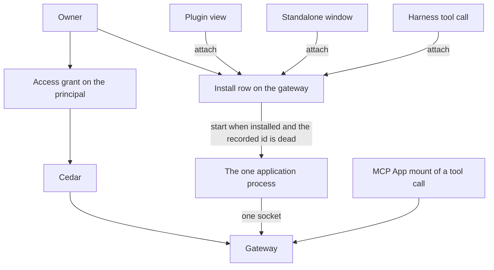

# Application framework

Status: proposal. The pull request that adds this document does not build it.
Public names in the examples are proposals. An ADR, when one is needed, takes
the number of the issue that settles that decision. This document does not
add one.

A developer has two ways to run one package. A **plugin** is a view the
desktop hosts. A **standalone app** is the same package in its own window.
One **application process** holds the gateway session. Cedar decides what
that principal may do with the [access grant](access-grants.md). The
package's own data stays the package's.

Harness scope stays Claude and Codex. Alpha has no migration.

## What is built

### Two clients already talk to one gateway

`@nessa/client` (`packages/nessa-client`) opens a WebSocket to `/session`,
answers `session.challenge`, and sends `session.authenticate`. The
credential decides the principal. The `surface` field is metadata.
[ADR 0010](../adr/done/0010-local-authentication.md) separates that
authentication from Cedar authorization on each later call. The package is
private and is not published. Its README says there is no separate plugin
SDK.

The desktop reads `auth/surfaces/nessa-panel.token` through the host
(`src-tauri/src/surface_credential.rs`) and connects with that owner
credential. Another process connects the same way with its own credential.
`crates/nessa-client-core/examples/read_only_sync.rs` is that second
process for a paired read credential: pair, sync, follow. It does not run
an agent.

`nessa-sdk` runs inside the gateway. A package does not embed it.

Credential kinds that exist (`crates/nessa-auth/src/domain/models.rs`):
`human`, `agent`, `integration`, `gateway`. Pairing is what creates a
`gateway` principal (`gateway:<key>`). `credential.issue` refuses one.
`hold.person` in `crates/nessa-auth/src/adapters/cedar/policies.cedar`
lets a human, agent, or integration hold `server.read`,
`credential.manage`, `conversation.read`, and `conversation.write`.
`hold.peer` lets a gateway principal hold `conversation.read` and
`environment.serve`. Those credential grants name no conversation and no
directory ([access grants](access-grants.md)). `issue.member` requires a
member role. `AuthenticateSession` refuses an inactive membership
(`crates/nessa-auth/src/application/session.rs`).

A second `credential.issue` with a new request id adds another credential
on that principal (`crates/nessa-auth/src/adapters/local/registry.rs`).
The webhook proposal's one-registration refusal is not this registry.

`nessa auth token` is already an integration. The CLI issues one with
`server.read` and `conversation.write`, a new member, and no receiver
(`crates/nessa-server/src/cli/infrastructure/gateway.rs`). It is admitted
by the no-binding owner path. An application cannot be "an integration"
with that path turned off, or those tokens stop being able to write.

### Admission when nothing is paired

`admit_conversation` returns success when the session has no receiver
binding (`crates/nessa-server/src/product/read_access.rs`). `reader` maps
that absence to `Reader::Owner`. `admit_request` then takes the owner
path: the credential's manifest grant, and `Initiation::owner()`. The
comment on that module records why: a gateway that pairs no device has no
binding, so every session reads as the owner.

A paired device is the other path. It has a receiver. Its credential holds
`conversation.read`. Comment and drive are the share row, and Cedar's
`grant.comment` and `grant.drive` also require `signedInAs == bindingOwner`
(`crates/nessa-server/src/conversation/infrastructure/access_policy/cedar/readers.cedar`).
A device meets that because it signs in as the owner. A peer gateway signs
in as itself, so those two permits do not match it. The grant lookup is
`receiver_id`. A row with no receiver is not that lookup
(`crates/nessa-server/src/conversation/infrastructure/store/share_grants.rs`).

`owner.read` and `owner.act` permit the principal whose id is the
conversation's owner
(`crates/nessa-server/src/conversation/infrastructure/access_policy/cedar/ownership.cedar`).
The no-binding success returns before that question is asked.

`mcp.callTool`, `mcp.readResource`, `mcp.sendMessage`, and
`mcp.updateModelContext` require the credential grant `conversation.write`
(`protocol/product/manifest.json`). They are not in
`ADMITTED_BY_ITS_OWN_CHECK`.

Revoking or expiring the credential closes a live socket with
`CredentialRevoked` or `CredentialExpired`
(`crates/nessa-server/src/product/socket.rs`).

### A plugin view is a widget, and an MCP App is a tool call

[ADR 326](../adr/done/326-widgets.md) hosts a view as a `WidgetRef`
(`plugin`, `id`) in a message, a pane, or over the panes. The window place
replaces whatever widget is there
(`openWidget` in `src/desktop/workspace/adapters/store/commands.ts`).
Two kinds share that host (`src/desktop/widgets/ui/plugin.ts`):

- `native` — React the window trusts, registered in composition.
  `widgetRegistry` in `src/desktop/dependencies.ts` registers the sample
  and subagents plugins only beside the sample workspace. A gateway
  window passes none.
- `app` — an MCP App, HTML in the sandbox, registered while the window
  runs.

An `app` plugin id is `mcp:` plus the server name
(`src/desktop/widgets/app/model/app-ref.ts`). Its widget id is the
conversation, the execution, and the tool call. The desktop registers the
plugin when a conversation view has a tool with UI
(`src/desktop/widgets/app/adapters/gateway/gateway-apps.ts`). The gateway
refuses `mcp.callTool` unless that call exists and declared a UI
(`crates/nessa-server/src/mcp_servers/domain/app_call.rs`,
`AppRefusal::AppUnknown`). `app_facts` selects the call by `executionId`
and `toolId`. Policy and audit name the app by those two.
`instanceId` is one mount
(`packages/nessa-client/src/generated/product.ts`, `McpAppReference`).

The mount speaks through the caller's credential. The frame does not
receive it. `ui/message` and `ui/update-model-context` are that mount's
conversation port ([MCP App calls](mcp-app-calls.md)). `requestMode` in
`src/desktop/widgets/app/model/places.ts` opens a pane when an inline view
asks for fullscreen. A ready app pane can still be opened in the window
place. The side rail (`src/desktop/workspace/ui/chrome/side-rail.tsx`) is
a prototype. It is not an install list.

`ui/open-link` and `ui/download-file` have ports. Production composition
does not supply them (`appPorts` in `dependencies.ts`).

### The grant row

[Issue 889](https://github.com/nessalabs/nessa-agent/issues/889) made a
conversation share a capability set: `read`, `read+comment`, or
`read+comment+drive`, plus constraints on a drive grant, plus the grant
epoch (`policy_revision`). Cedar's `grant.read`, `grant.comment`, and
`grant.drive` decide. `ShareGrant.receiver_id` is optional in the struct
for an integration
(`crates/nessa-server/src/conversation/application/share_grants.rs`).
`conversation.share` still refuses a target that is not an active paired
device or peer gateway (`share_target_not_paired`).

[The access-grant proposal](access-grants.md) (merged as
[#888](https://github.com/nessalabs/nessa-agent/issues/888)) is the rest
of that row: subject kind `principal` for an integration or a later
agent, one resource (one conversation, or one directory), capabilities
`read`, `comment`, `drive`, `write`, `exec`, constraints, epoch. Cedar
permits or refuses. `ResourceKind::Directory` is reserved and this build
does not write one. Webhook delivery is that proposal's outbox, not a
second grant. Its share target is an integration credential. This plan
names the application principal instead, and it does not give that share
a URL or a MAC.

```mermaid
flowchart TD
  panel[Desktop with the panel token]
  other[Another process with its own credential]
  gateway[Gateway]
  sdk[nessa-sdk Agent]
  call[Tool call that declared a UI]
  mount[MCP App mount]
  panel --> gateway
  other --> gateway
  gateway --> sdk
  call --> mount
  mount --> panel
  panel --> gateway
```

## What this proposes

One package. One integration principal. One install row, owned by the
gateway. One process. The process holds the one gateway socket and every
operation. The plugin view, the standalone window, and a harness tool
call ask that row to attach. The gateway is the only starter.



The plugin view is the widget window place, drawn in the sandbox, opened
with no tool call. The host asks the gateway to attach and proxies the
frame. It does not exec the package. The frame does not receive the
secret (row H1). The standalone window is the same attach. The MCP
App mount stays a tool call on the caller's session, drawn by the
desktop with the panel token, as today.

Third-party code is the sandbox or this process. The `native` widget kind
stays the trusted views the window registers in composition.

## One process

The application process is the only process that runs the package's
operations, and it holds the one gateway socket. The gateway owns the
install row and is the only starter. A plugin view, a standalone window,
and a harness tool call reach that process by asking the row to attach.
None of them execs the package. Opening the plugin while the standalone
window is already up is an attach, not a second start. Each installed
package has its own row, its own process, and its own socket. A second
package is a second row. It is not a second process for the first.

The row names the package, the one version, the UI document, the process
entry, and the endpoint. The endpoint is a loopback record of the same
kind as the gateway's `gateway-endpoint.json`
(`packages/nessa-client/src/transport/local-gateway-endpoint.ts`): a
private file. The endpoint is live only when that file is present and
the recorded process answers. A missing file, or a process that does
not answer, is not live. That is not death, and it is not permission to
start. A start waits until the record is installed and the previous
process is confirmed dead. If a process id is still recorded, a missing
file writes `stopping` for that id (R6).
This plan does not add a second discovery protocol.

The desktop and the standalone window do not read the endpoint in
order to start. They ask the gateway to attach, and the gateway returns
the live endpoint. The gateway's own tool path reads the row and dials
that endpoint. Attach then follows the record.

- The record is installed, the endpoint is live, and the credential is
  current. The caller joins the process that published it. The desktop
  loads the UI into the plugin frame, or the standalone window loads the
  same UI. The harness dials the endpoint as a remote MCP URL. No
  process is started. A closed credential is not this join, and neither
  is a record that is starting, stopping, or uninstalling.
- The endpoint is absent, the record is installed, and any recorded
  process id is confirmed dead. The gateway starts the process entry
  from the row, once. That start issues the process credential and
  writes the secret once on the pipe to the process. The process reads
  it before it publishes the endpoint, then authenticates. The caller
  then attaches. A record that is preparing, starting, stopping, or
  uninstalling does not start. An attach on `starting` waits for the
  process already being started. It does not exec another.
- A second start is already in flight, or it finds the endpoint live. It
  exits before it issues and before `session.authenticate`. The process
  that published the endpoint keeps the socket.
- The endpoint is live and the credential is still current, and the
  socket has dropped. The process authenticates again with the secret it
  already holds. The gateway does not issue another credential and does
  not start another process.

The socket in the state table is that gateway session. A harness
connection is a client of the published endpoint. Two harness sessions
are two of those connections, and still one process and one gateway
socket. A harness session ending closes its connection. The process
stays.

A stored stdio server is a different process: one child per harness
session, ended with that session (`open_admitted` in
`crates/nessa-server/src/mcp_servers/infrastructure/relay.rs`). The
application process is not that child.

## One record

The install record is the durable owner of one package. One directory
has one record. The auth registry and this record are not one commit, so
the phase is written before each fallible effect, and a crash resumes
that phase. A half-finished install, start, stop, or uninstall is the
phase, not a guess from whichever write happened to land. Gateway
startup runs one reconciliation pass, and so does any attach, before a
start is considered. The pass drives each record to `installed` or to
absent, except a `starting` record whose process id is alive and has not
published yet: that record stays `starting` until the endpoint is live
or that process is confirmed dead. The pass does not mint a second
principal and it does not exec.

The phases are `preparing`, `installed`, `starting`, `stopping`, and
`uninstalling`.

The owner's install is one command with one request id. The record is
keyed by the directory and is written `preparing`, with that id and the
one version, before a principal exists. A second command for a directory
that already has a record resumes that record and does not mint. The
same id is the registry receipt for the principal, the membership, and
the registration, the way `issue_receipts` in
`crates/nessa-auth/src/adapters/local/registry.rs` remembers a credential
issue. A repeated id returns that principal. Principal creation has no
such receipt today. Slice 1 adds one, and the registration stores the
directory and the install request id. Slice 2's install command is the
only caller. The command does not return until the record is
`installed`, or until the directory is refused (I4). A crash before that
retries the same id. A registration
that already names the directory is that principal when the record is
missing: the pass adopts it and does not mint. A request id whose
receipt exists and whose registration is gone stays consumed.

A start writes `starting` before it execs. The process does not inherit
the registry lock. The operating system returns the process id before
the package runs, and that id is synced onto the record before the start
issues a credential and before any secret is written. The runtime reads
the pipe before it publishes an endpoint and before
`session.authenticate`. A pipe that closes first ends the process
without an endpoint and without a socket. The issue uses a request id
stored on the record before the call, and a repeated id does not return
the secret. Reconciliation of `starting` adopts the recorded id when its
endpoint is live. Otherwise it returns the record to `installed` with
the process down, once that id is confirmed dead, or immediately when no
id was stored. It does not exec in that pass. A numeric id reused by a
later process is not the recorded process and is not injected.

A stop writes `stopping` and the process id before the credential is
closed and before the process is signalled. Closing the credential is
the next step, still in `stopping`. The signal comes after that close.
The endpoint file being gone, or the process not answering, is not
confirmation that the id is dead. Reconciliation signals the recorded id
and waits until that process is dead, then removes the endpoint file,
and only then returns the record to `installed` with the process down
and the credential closed. R2 is forbidden until then. An attach during
`starting`, `stopping`, or `uninstalling` runs the pass and does not
launch a replacement. Uninstall writes `uninstalling` with the same
order and ends at absent. An endpoint file left behind when no record
holds an id is a stop obligation on adopt, not permission to start.

## Authentication

The process uses the existing handshake. The credential names the
application principal, an active member of kind `integration`. The panel
token stays the owner's. A `gateway:<key>` credential stays a peer.

The install command in [One record](#one-record) mints that principal,
its active membership, and an application registration under the install
request id. Install does not issue a credential and does not return a
secret. The principal id is the name share uses, once the record is
`installed`. A credential id is not. A `preparing` record is not a share
target.

The application principal is the subject of a grant. The grant key is
the one [access grants](access-grants.md) already gives an integration:
subject kind `principal`, that principal id, one conversation. The key
does not include a credential id. A process credential issued later is
asked the same grant. Replacing that credential does not move the key.

`conversation.share` and `conversation.unshare` take exactly one target.
`ConversationShareParams` requires `credentialId` today, and that field
is the paired device or peer gateway, as `credential.list` names it. An
application registration is `principalId`, the id A1 minted. Both
fields, or neither, is `invalid_request`. A `credentialId` of this
principal is not a target and not an alias: it is not a paired device.
The command receipt is bound to the principal id. A retry that names a
credential, or another principal, is `invalid_request`.
`conversation.shares` returns `principalId` on that row and no
`credentialId`. The cursor resumes by `grantedAtMs` and that same
target. The change journal stores the principal id and no credential id.
Unshare finds the row by that principal id. It is not found by a
credential the way a paired revoke is.

Product `credential.issue` does not mint a credential for this
principal. `issue.member` permits an integration member on every issue
path today
(`crates/nessa-auth/src/adapters/cedar/policies.cedar`). `issue_sync`
always uses `IssuePath::ProductIssue`. Slice 1 passes the registration
fact into `may_issue`. Cedar forbids the issue when that fact is set
and the path is not the start. Rust gathers the fact and the path and
acts on that answer. It does not compare the registration itself. The
path is the gateway's fact
(`IssuePath`), not a field of the command. The start uses a new path,
`application-start`, which is not `ProductIssue`. Cedar permits that
path for this registration. No product command selects it. A caller
with `credential.manage` gets no secret and no second socket (A14).

The process presents the secret the start injected. It does not call
`credential.issue` or `credential.revoke`. `hold.person` already
permits an integration to hold `server.read` and `conversation.read`.
The start's issue does not put `conversation.write` or
`credential.manage` on it.

The issue uses a new request id. The registry stores the verifier only
(`crates/nessa-auth/src/adapters/local/registry.rs`). The secret is in
the issue result and nowhere else the gateway keeps. A repeated request
id returns `ExistingSecretUnavailable` and no secret, so a start does
not retry an old id to recover one. The gateway writes the secret once,
on the pipe to the process it just exec'd, and does not write it to the
install row, the endpoint file, or a credential file. The process reads
it into memory before it publishes the endpoint. The frame does not see
the pipe (H1).

That secret's lifetime is the process. The start path closes any
earlier process credential for this principal before it issues, because
that secret died with the earlier process (A3). The process then has one
current credential, and the grants stay on the principal. A start that
finds the old credential already closed still issues (A2). A product
issue does not. This is not surface provisioning, which is the panel token's
rotation and supersedes whatever credential the principal holds. A
webhook's refusal of a second credential, while its own registration is
current, is that proposal's rule. This principal is not a webhook.

While the process is up and the credential is current, a dropped socket
is that process authenticating again with the secret it holds. The
gateway does not issue a replacement for the drop, and it does not
inject again.

Revoke, or the socket's built expiry close, is a stop, whether the
record is `installed` or `starting`. The expiry arm writes `stopping`,
with the process id, and then does that built close. It does not close
while the record is still `installed` or `starting`. Nothing else runs
at `expires_at`. S0 is that close, and the record is already
`stopping`. The credential stays
closed. Grants stay. The process is signalled only after that close. A
later attach does not start while the record is `stopping`, including
when the gateway died after the close and before the signal, and
including when the endpoint file is already gone. Reconciliation
confirms that process is dead, removes the endpoint file, and returns
the record to `installed`. The next attach is then one start. While the
record is `installed`, a live endpoint is a current credential. During
`stopping` the file may still be present after the close, and that file
is not a join. Uninstall writes `uninstalling` the same way, and there
is no next start.

The registration is the fact Cedar sees. It is not a fifth principal
kind. Slice 1 asks Cedar on the no-binding path and passes that fact:

- No registration. The owner fallback stays. That is the panel token,
  the owner, and `nessa auth token`.
- An application registration. The fallback does not match. A
  principal-subject grant on that resource permits, and anything else
  is refused. `owner.act` does not match this principal.
- A paired receiver stays on the receiver path already built.
- `mcp.*` is not a grant capability. The application process is not
  given a way to present those methods.

`grant.comment` and `grant.drive` as written require a binding owner.
They do not match an integration that signs in as itself. Slice 1 adds
the principal-subject permits for a principal that has an application
registration. Rust gathers the registration, the row, and the action,
and acts on Cedar's answer.

The share above is how an application registration is named. A webhook
registration, when that slice exists, keeps the target that proposal
gives it. This check does not read a webhook URL or a package path, and
it does not accept a browser token, which has neither registration. The
two registrations are two kinds of one record per principal. Each
command refuses a principal that already has the other kind.

A directory grant (`write`, `exec`) stays the directory slice of #888.


## Actions

The base contract is plain TypeScript. It does not import React or a
state library. Redux adapters are out of scope. Two functions, illustrative:

```ts
defineUiAction({ name: "selectChart" })
defineOperation({ name: "saveDashboard" })
```

The public module is what a browser or a sandbox may import. The service
binding lives on a second entry of the same package,
`packages/nessa-app`. The browser entry does not re-export it. The slice
that adds the package holds that with an import test.

A UI action names one live view. The process runs it there. A closed
view, or a different one, is `surface_unavailable`, and the call does not
become an operation and does not write the package's data.

An operation runs in the process. Closing every view leaves it running.
The acknowledgement is the process's. A view that has gone does not
report success (O3). The same request id and the same body are the same
attempt. A second body under that request id is refused, and the first
attempt is left as it was.

The attempt is a record in the process's own store: request id, body,
and outcome. For app-owned data the outcome record is the write, so
there is no gap between the effect and the record. For a Nessa resource
the process stores the gateway receipt before it acknowledges, and a
restart repeats that request id. The gateway already treats that id as
the same command. Restart reads the record and does not start a second
effect (O9–O11).

The package's own dashboard record is app-owned data. Cedar is not asked,
because the record is not a Nessa resource. An operation that both writes
that record and names a Nessa resource asks Cedar before either effect. A
refusal writes neither (row O8). An admitted attempt keeps the epoch it
read.

Registering an operation as an MCP tool is explicit. An unregistered name
is not a tool. A registered tool travels the gateway's existing MCP path
to Claude or Codex. The remote server's URL is the row's endpoint. If
that endpoint is absent, R2 starts the process before the dial, and only
when the record is installed and any recorded process is confirmed dead.
Any other phase waits for the pass.
Its UI, when the tool declares one, is the MCP App mount already built,
on the caller's session. The turn's tool policy is unchanged.

The reference package is a dashboard at `examples/dashboard`. It is not
imported by `src/desktop`. Selecting a chart is the UI action. Saving the
dashboard is the operation.

## Context

A live view may publish a bounded context: what is selected. Replacing it
drops the previous value. Closing the view drops it, and a later send
does not attach it. Two views keep two values.

That context is not `ui/update-model-context`. That method stays the
tool-call mount's port. The bytes a person-send carries from a plugin
view are for the plugin-entry slice to fix. This document fixes when the
value exists.

## States

Rows marked **built** are current behavior. The other rows are the
contract the slice named in [Slices](#slices) tests. Issue, bump, and
revoke of a grant stay the grant table in
[access grants](access-grants.md). The facts below are independent. A
flat status such as "granted" is not a state.

| Fact | Values |
| --- | --- |
| Principal | absent, or present as an active member |
| Credential | none, current, or closed (revoked or expired), per credential |
| Process secret | absent, or held by the running process |
| Grant on resource R | absent, or active at an epoch |
| Install record | absent, preparing, installed, starting, stopping, or uninstalling |
| Endpoint | live, or not live (no file, or the recorded process does not answer) |
| Process id | none, or recorded and not yet confirmed dead, or confirmed dead |
| Process | down, or up — at most one |
| Socket | the process's one socket, closed or open |
| View | absent, or live with an id |
| Window place | empty, or showing one widget |
| Operation | idle, running, or uncertain |

### Principal, credential, grant, socket

| Row | Before | Event | After | Effect |
| --- | --- | --- | --- | --- |
| A1 | no principal for this install request id, and no registration for this directory | that id is minted | one principal, registration written with the directory and the id, credential none, no grants | the same id returns this principal; a registration for the directory returns it too; neither mints another |
| A2 | record starting, this start's process id recorded, no current process credential (none or closed) | the gateway's start issues on `application-start`, request id already on the record | one credential current, secret held by that process, record still starting | not `ProductIssue`; verifier stored; the secret is not on the row, the endpoint, or a later read of that request id; no issue before that id is stored; a closed credential is this row |
| A3 | record starting, this start's process id recorded, an earlier process credential current, that earlier process confirmed dead | the start, same path | that credential closed, one new credential current, secret held by the new process | grants stay on the principal; the new request id is not the old one; the closed secret is not replayed; this does not run while a recorded id is unconfirmed |
| A4 | record installed, registration written | owner shares conversation R, naming `principalId`, Cedar permits | grant R active, keyed by that principal | a phase other than installed is refused; a current process credential does not block a second conversation; no `credentialId` on the row, the list, the cursor, or the receipt; the epoch of that commit |
| A14 | application registration present | product `credential.issue` for that principal, any caller, new request id | unchanged | Cedar forbids; no credential and no secret; `issue.member` does not decide this |
| A5 | grant R active | owner shares a set Cedar denies | unchanged | nothing written; the policy ids |
| A6 | credential current | that credential authenticates | its socket open | inactive membership is refused, as `AuthenticateSession` does today |
| A7 | socket open, grant R active | read or follow R | unchanged | Cedar permits; the epoch just read is stamped |
| A8 | socket open, grant R absent | read or follow R, or list it | unchanged | Cedar refuses; no row created |
| A9 | grant R active | owner unshares, naming `principalId` | grant R absent | a `credentialId` does not find this row; sockets stay; the next admission misses R |
| A10 | credential current, process id recorded, record installed or starting | revoke or expire that credential | record stopping, that process id recorded, credential still current | the stop is durable before the credential is closed; grants and epochs stay; R2 is forbidden |
| A13 | record installed, process up, endpoint live, socket closed, credential current, secret held by the process | the socket drops and the gateway is back | socket open | the process authenticates with the secret it holds; no issue, no injection, no stop, no second process |
| A11 | record preparing, installed, starting, or stopping | owner uninstalls, one request id | record uninstalling, process id recorded if one was stored | the same id resumes this removal; it does not mint and it does not start |
| A12 | credential current, no grants | authenticate | socket open | A8 on every conversation |

A4 applies again for a second conversation. The result is a second row,
still keyed by the principal. A9 on one row leaves the other. A6 is the
process's socket. A second process is R4: it exits before it execs and
before this authenticate. A2 and A3 run only inside `starting`, after
that start's process id is on the record. A10 does not by itself close
the credential, kill the process, or remove the endpoint. The close is
S0, still in `stopping`. A13 is the same process and the same
credential, and it does not run while the record is starting, stopping,
or uninstalling. A socket that drops during `starting` uses the secret
just issued. That is the same process and not a new issue, and it is not
A13, which is the steady state after T4. A14 is every product issue,
including one from the owner.

### The install row

| Row | Before | Event | After | Effect |
| --- | --- | --- | --- | --- |
| I1 | no record, and no registration for this directory | owner installs, one request id | record preparing, that id, directory, one version, no principal | nothing is minted until this write commits; this write is the only creating write for the directory; a second command resumes this record |
| I2 | record preparing, directory is a package, registry has no receipt for the id | reconciliation or the install command continues | registry receipt and one principal (A1), record still preparing | the receipt commits before the record learns the principal; I4 is not this row |
| I2a | record preparing, directory is a package, registry receipt exists | reconciliation or the install command continues | that principal on the record, record still preparing | it does not mint another; I4 is not this row |
| I3 | record preparing, directory is a package, principal present | reconciliation or the install command continues | record installed, endpoint not live, process down, credential none | this is the first phase that can be shared or started; the command returns; I4 is not this row |
| I4 | record preparing, directory is not a package | reconciliation | record absent; the principal and its registration are removed if a receipt exists | checked before I2; the command returns refused; the request id stays consumed; the same id does not mint again |
| I5 | no record, an application registration names this directory | reconciliation or a later install | record stopping with the endpoint file's process id if that file exists; otherwise record preparing around that principal | no second principal; a file is a stop obligation, not a start; adopt stops that process before any later start |
| I6 | no record, that request id's receipt exists, no registration | the same id is presented | unchanged | the id stays consumed |
| T1 | record installed, endpoint not live, recorded id confirmed dead or none | a start begins | record starting, no process id yet | this write commits before exec; R2 does not begin again; a leftover file is not a live process |
| T2 | record starting, no process id | the start continues | process id recorded, secret not written, record still starting | synced before issue; the runtime has not published |
| T3 | record starting, process id recorded, endpoint not live | the start continues | secret held by that process (A2 or A3), record still starting | the issue request id is stored before the call |
| T4 | record starting, process id alive, endpoint live, credential current | reconciliation or the start continues | record installed, process up | adopts this process; no exec; no second issue |
| T5 | record starting, no process id, and the start's owner is gone | reconciliation | record installed, process down, credential none | no secret was issued; a child whose pipe closed exits without an endpoint; a file with no recorded id is removed and not adopted; this pass does not exec; an in-flight start stays on T2 |
| T6 | record starting, process id confirmed dead | reconciliation | record stopping, that process id recorded | this pass does not exec; S0 then S1; a current credential is not left on an installed record |
| T7 | record starting, process id alive as that same process, endpoint not live | reconciliation | record still starting | no exec, no second issue, and no signal; alive means that process, not a later reuse of the number; a reuse is T6; T4 or T6 finishes a real wait |
| S0 | record stopping or uninstalling, credential current | reconciliation continues | credential closed, same phase, same process id | after the phase write, before the signal; a repeat closes nothing further; R2 stays forbidden |
| S1 | record stopping or uninstalling, process id recorded, credential not current | reconciliation | that process confirmed dead, endpoint file absent | the file being missing is not this confirmation; the signal is to that process, and a reused number is not that process; the signal follows S0; R2 does not run in this pass |
| S2 | record stopping, credential not current, and that process confirmed dead or no id stored | reconciliation continues | record installed, process down, credential closed or none | a later attach may R2; grants stay |
| S3 | record uninstalling, that process confirmed dead or no id stored | reconciliation continues | record absent, principal absent, grants removed, credentials closed | the same uninstall id resumes here; a retry does not install |
| R1 | no record | owner installs a directory | I1 or I5, then I2 or I2a, then I3 | one version; a crash resumes the same request id; I6 does not install |
| R2 | record installed, endpoint not live, recorded id confirmed dead or none | plugin, window, or a tool call asks to attach | T1, then T2, then T3, then T4 | the caller does not exec; preparing, starting, stopping, and uninstalling are not this row; a crash resumes T4, T5, or T6 instead of a second exec; R6 is the row when an id is recorded and not confirmed dead |
| R3 | record installed, endpoint live, credential current, recorded id alive | another of those asks, including the plugin while the window is up | unchanged | the view attaches; a closed socket under that current credential is A13; starting, stopping, and uninstalling are not this row |
| R4 | record starting, or a start already in flight | a second start | unchanged | the second exits before it execs, before it issues, and before `session.authenticate` |
| R5 | process id recorded, record installed or starting | the process exits, or the credential must close | record stopping, that process id recorded | A10 when the cause is revoke or expiry; T6 when a start's id is already dead; S0 closes the credential after the write; the attempt record remains (O9); the next attach is not R2 until S2 |
| R6 | record installed, endpoint not live, process id recorded and not confirmed dead | the gateway reads it | record stopping, that process id recorded | a missing file and a process that does not answer are both this row; then S0 and S1; not R2; an id taken from the file that is not the recorded id is not adopted |
| R7 | gateway starts, or an attach finds a phase that is not installed, or an installed record whose recorded id is not confirmed dead and whose endpoint does not answer | reconciliation | each record installed or absent, or still starting under T7 | one pass; I2–I6, T4–T7, S0–S3, R6; no second principal and no exec |

### Views, the window, and context

| Row | Before | Event | After | Effect |
| --- | --- | --- | --- | --- |
| U1 | no live view with that id | invoke the UI action | unchanged | `surface_unavailable`; the package writes nothing |
| U2 | view S live | invoke names S | S live | the action runs on S |
| U3 | view S live | invoke names another id | S live | `surface_unavailable` |
| U4 | action running on S | S closes first | S absent | `surface_unavailable`; the result is dropped; no operation starts |
| U5 | S and T live | each invoke names its own | both live | each runs on its view |
| U6 | S live | the selection changes | S live | S's context is replaced |
| U7 | S live | S closes | S absent | S's context is dropped |
| H1 | the frame is showing the plugin view | the frame reads its document and its bridge messages | unchanged | the credential bytes are not among them |
| M5 | record installed, or a phase reconciliation can finish | the person opens the plugin entry | window place shows the plugin | R2 or R3 after the pass, or wait while T7; no tool call; the desktop asks the record to attach and does not exec |
| M6 built | window place showing any widget | `openWidget` to the window, or M5 | window place shows the new widget | the previous view closes, so U7 applies to it; a tool-call mount that lost the window is still that tool call |

### The operation

| Row | Before | Event | After | Effect |
| --- | --- | --- | --- | --- |
| O1 | process up, operation idle | invoke an operation, no view open | running in that process | the process owns it |
| O2 | running | the last view closes | running | it continues |
| O3 | running, attempt record stored | the caller disconnects before the ack | uncertain | the same request id and the same body are this attempt; a different body is refused and this attempt stays |
| O4 | process up | the operation names only a Nessa resource the grant does not admit | idle | refused before the effect; the refusal is the stored outcome |
| O5 | admitted | the grant epoch changes | running | this attempt keeps the epoch it read |
| O6 | — | a tool call for a name that was not registered | — | not a tool |
| O7 | registered | a turn calls the tool | one remote MCP connection to that process | if the endpoint is absent, R2 runs first; while the record is preparing, starting, stopping, or uninstalling the call waits for the pass and does not exec; the URL is the endpoint, not a stdio command; the session ending closes the connection; the process stays; the mount, if the tool has UI, is the caller's |
| O8 | process up | the operation writes app-owned data and names a Nessa resource | running, or idle | Cedar is asked first; a refusal writes neither and is stored |
| O9 | running or uncertain | the process exits | the attempt record remains | no second effect is started by the exit |
| O10 | record holds the outcome | the process starts again and the same request id and body arrive | idle | the stored outcome is the ack |
| O11 | record holds the attempt and no outcome | the process starts again | running or uncertain | that attempt continues; a different body is refused |

### The mount

| Row | Before | Event | After | Effect |
| --- | --- | --- | --- | --- |
| M1 built | a tool call with UI | the desktop applies the view | plugin `mcp:<server>` | the widget id is conversation, execution, tool |
| M2 built | no such call | `mcp.callTool` | — | `mcp_app_unknown` |
| M3 built | a mount | an `mcp.*` call from the desktop | the caller's session | recorded as the app, on behalf of that caller; the credential grant is `conversation.write` |
| M4 | the application socket | an `mcp.*` method | — | refused; those methods are not granted to this principal, including when a tool call with that id exists |

## Rules the slices test

Each rule names the rows that hold it.

1. Cedar decides an application principal's use of a Nessa resource.
   The no-binding owner fallback stays for a principal with no
   registration, which is how `nessa auth token` writes today. It does
   not match an application registration. Rows A7, A8, A12, O4, O8.
2. One grant is one principal, one resource, the capability set, and the
   constraints. The key does not include a credential. A second
   conversation is a second row. A4 applied twice, then A9 on one of
   them.
3. The process credential names an active integration member and holds
   `server.read` and `conversation.read`. It is not the panel token and
   not a peer gateway. Rows A1, A2, A6.
4. A UI action runs on the one live view it names. Rows U1–U5.
5. The gateway's install record owns the one process that runs every
   operation. A plugin view, a standalone window, and a tool call attach
   to it and do not exec. The gateway starts that process only when the
   record is installed, the endpoint is not live, and any recorded process
   id is confirmed dead. That start writes `starting` before it execs,
   and the process id before it issues. A second start exits before it
   execs and before it opens a socket. The attempt record survives the
   process exiting, and the next start does not apply the effect twice.
   Rows R2–R7, T1–T7, S0, S1, S2, O1–O3, O9–O11.
6. A view's context does not outlive that view. Rows U6, U7, M6.
7. An MCP App mount stays the tool call it is, on the caller's session.
   Rows M1–M4.
8. The browser entry imports the public contract only. The import test
   holds this.
9. The frame does not receive the credential. Row H1.
10. A registered tool is a remote MCP connection to the running
    application process, on the gateway's Claude and Codex path.
    OpenCode is not added. A stdio launch is not this tool. Row O7.
11. The install list slice 2 writes has one version. Another version is
    refused and not rewritten. Reconciliation does not delete an
    installed version. Alpha: no migration.
12. The process credential's secret is held by that process and nowhere
    else. The start path issues it and injects it on the start pipe. A
    product issue does not. While the record is installed, a live endpoint
    is a current credential. Revoke, expiry, and process exit write
    `stopping` and the process id before they close the credential. The
    close stays in `stopping`. The endpoint is removed only after that
    process is confirmed dead. A file that remains during `stopping` is
    not a join. A socket that drops under a current credential, with the
    record installed, is the process authenticating again, not a new
    issue and not a stop. Rows A2, A3, A6, A10, A13, A14, R2, R3, R5, S0,
    S1, S2.
13. The application principal is the subject. Share, unshare, the share
    list, the cursor, and the command receipt name that principal, not a
    credential. Product `credential.issue` does not mint a credential for
    it. The only issue is the gateway start's path, and that path is not
    a product command. Rows A2, A3, A4, A9, A14.
14. A half-finished install, start, stop, or uninstall is a phase on the
    install record. Startup reconciliation is the one pass that finishes
    it. The install request id, and a registration for that directory,
    mint one principal. A start is forbidden while the record is
    preparing, starting, stopping, or uninstalling, and until the recorded
    process is confirmed dead. The stop phase is written before the
    credential is closed. Rows I1–I6, I2a, T1–T7, S0–S3, R1, R2, R7, A1,
    A10, A11.

## Packaging

Today a native plugin is compiled into the window, an MCP server is a
stored command (`mcpServers.save`), and the Tauri updater replaces the
desktop binary (`src-tauri/src/updater.rs`). None of those is a package
a third party installs.

The package is a directory: a manifest (display name, process entry, UI
entry), the public actions, and the UI document the sandbox loads. The
owner installs it on this gateway. The install list is the owner's,
beside the stored MCP servers, not a channel of the updater. The first
install is a local path. That install is one command and one request id,
the record in [One record](#one-record). It does not issue the process
credential. That issue is the start, and only after the record is
installed. The record is how every entry point reaches the process, and
it lands before any view. A signed feed is out of scope.

A stored stdio server is one process per harness session, ended with
that session (`open_admitted` in
`crates/nessa-server/src/mcp_servers/infrastructure/relay.rs`). The
application process is not that child. Its tools are a remote server
whose URL is the row's endpoint. If that endpoint is absent, R2 starts
the process before the dial, and only when the record is installed and
any recorded process is confirmed dead. The session's end closes the
connection.

`nessa init` scaffolds a directory the install command already accepts.
Views do not wait on the scaffold. They install a directory of that shape
with the same command.

First-party research views stay MCP servers in `nessa-extensions`
([ADR 344](../adr/done/344-mcp-ui.md)). This plan does not move them
into the desktop tree.

## Reference acceptance

The dashboard, in order, once the slices have landed:

1. The owner shares the conversation by `principalId` before any
   process credential exists. A product `credential.issue` for that
   principal is refused. The process then authenticates with the secret
   the start path injected, and the page it serves reads that
   conversation and does not open a gateway socket. Another conversation
   is refused, and so is a list of the rest. Revoking the credential
   writes the stop first. The next open waits until that process id is
   confirmed dead, then starts one replacement against the same grant.
   A gateway restart that leaves the process up, with the record still
   installed, re-authenticates with the secret the process still holds.
   A restart that finds `preparing`, `starting`, `stopping`, or
   `uninstalling` finishes that phase, or leaves `starting` while its
   process is still publishing, and does not mint or exec (A4, A6–A8, A10,
   A12–A14, R2, R3, R7, S1, S2).
2. Chart selection runs on the open view and is refused when that view
   is closed, with nothing saved (U1, U2, U4).
3. Save runs with no view open. Dropping the view leaves the
   acknowledgement uncertain until the process answers. A retry with a
   different body is refused (O1–O3).
4. The save is an MCP tool only after it is registered. The remote
   server's URL is the row's endpoint, and an absent endpoint starts the
   process once before the dial when the record is installed and any
   recorded process is confirmed dead. An unregistered name is not listed.
   Ending the harness session does not stop the process (O6, O7, R2).
5. The plugin entry opens the dashboard with no tool call. The desktop
   asks the row to attach and does not exec, including when the
   standalone window already has the process up. Opening it while a
   tool-call widget has the window place replaces that widget and drops
   its view context. Closing the entry does not stop the process
   (M5, M6, R3, O2, U7).
6. The standalone window asks the same row to attach and does not exec.
   When the process is already up, the window joins it and does not open
   an application socket. When the endpoint is absent and the record is
   installed, the gateway starts the process once and the window joins
   that process. A phase that is not installed is finished first (R2, R3,
   R7).
7. `nessa init` produces a package that can do 1.

## Slices

Each slice is its own issue. None of them is this pull request.
Each slice depends only on slices above it.

| Slice | Delivers | Rows |
| --- | --- | --- |
| 1. Principal, grant, and admission ([#1052](https://github.com/nessalabs/nessa-agent/issues/1052)) | The active member and the application registration, with no process secret returned. The mint is idempotent on the install request id and on the directory, both stored on the registration. Share, unshare, the share list, the cursor, and the command receipt name `principalId`. The grant key is that principal and one conversation. Cedar forbids product `credential.issue` for this registration and permits only the start path. No-binding admission asks Cedar with the registration fact: no registration keeps today's owner fallback; an application registration matches a principal-subject grant or is refused. `mcp.*` stays off this principal. | A1, A4, A5, A7–A9, A11, A12, A14, M4, rule 13 |
| 2. Install row and the one process ([#1067](https://github.com/nessalabs/nessa-agent/issues/1067)) | One record per directory, in `preparing`, `installed`, `starting`, `stopping`, and `uninstalling`. Startup and every attach run one reconciliation pass to `installed` or absent, except a `starting` record whose own process is alive and has not published (T7). The install command writes `preparing` under one request id before the mint, and a directory that is not a package is refused before the mint (I4). The gateway is the only starter. It writes `starting` and the process id before `application-start`, injects the secret once on the pipe, and does not store it. It writes `stopping` and the process id before it closes the credential, from `installed` or from `starting`, and it removes the endpoint only after that process is confirmed dead. A current credential on an installed record re-authenticates in the same process. A start whose earlier credential is already closed still issues (A2). Uninstall writes `uninstalling` and resumes until the record and the principal are gone. The remote MCP URL is the endpoint of the recorded process. A stdio child of a harness session is not this process. | A2, A3, A6, A10, A11, A13, I1–I6, I2a, T1–T7, S0–S3, R1–R7, rule 11, rule 12, rule 14, O7 |
| 3. Connected web view ([#1053](https://github.com/nessalabs/nessa-agent/issues/1053)) | `examples/dashboard` is a page the process serves. The page does not open a gateway socket. It renders the granted conversation. No desktop import. | A6–A8, A12, R3 |
| 4. Action contract and the dashboard save ([#1054](https://github.com/nessalabs/nessa-agent/issues/1054)) | `packages/nessa-app`. UI action, operation, the attempt record, explicit MCP registration, the import test. UI actions run on the page slice 3 serves. The process from slice 2 runs the operations. | U1–U7, O1–O11 |
| 5. Plugin entry ([#1055](https://github.com/nessalabs/nessa-agent/issues/1055)) | The window place asks the row to attach and does not exec, whether or not the endpoint is already live. H1. M6 against a tool-call widget already in the window place. Mounts stay M1–M3. | H1, M5, M6, R2, R3, U6, U7 |
| 6. Standalone window ([#1056](https://github.com/nessalabs/nessa-agent/issues/1056)) | The window asks the same row to attach and does not exec. A live endpoint is a join. An absent endpoint, once the record is installed and any recorded process is confirmed dead, is the gateway's one start, then the same join. | R2, R3, R7, acceptance 6 |
| 7. `nessa init` ([#1057](https://github.com/nessalabs/nessa-agent/issues/1057)) | The scaffold writes a directory slice 2 already installs. It does not add a second start. | acceptance 7 |

[#1067](https://github.com/nessalabs/nessa-agent/issues/1067) is the
install row and the start that issues the process credential. It is not
a later packaging step that the views assume.
[#1052](https://github.com/nessalabs/nessa-agent/issues/1052) as filed
issues the credential at install, returns the secret once, and does not
name `principalId` on share. The process credential is the start path.
Share names the principal A1 minted. Product issue is refused. The mint
is idempotent on the install request id. The running gateway's only
caller of the start path, and the owner of the record's phases, is
slice 2.
[#1067](https://github.com/nessalabs/nessa-agent/issues/1067) as filed
does not yet say `preparing`, `starting`, `stopping`, or the one
reconciliation pass. Those rows are the contract.
[#1057](https://github.com/nessalabs/nessa-agent/issues/1057) as filed
still bundles that install, the versioned list, and a stored-server
launch with the scaffold, and it says it depends on the action contract.
Those moved to #1067. What remains of #1057 is the scaffold. O7's tool
is the endpoint, not a stdio launch.
[#1055](https://github.com/nessalabs/nessa-agent/issues/1055) as filed
says the host starts the process. M5 and R3 are the contract: the
desktop asks the row to attach and does not exec.
[#1056](https://github.com/nessalabs/nessa-agent/issues/1056) as filed
says a second process is a second socket. R2 and R3 replace that: the
window joins the process the gateway started.

## Alternatives

**Give the package the panel token.** The process would connect as the
owner. `conversation.write` on that credential is the conversation
authority for the gateway. The frame would be one step from that secret.
The grant is the scope.

**Treat a stored grant row as enough.** That is the paired-device path,
and this principal does not walk it. No receiver means
`admit_conversation` returns success and `reader` says `Owner`.
`grant.comment` requires `signedInAs == bindingOwner`. A row with a null
`receiver_id` is not the lookup. Slice 1 asks Cedar with the registration.
It does not store a row and stop.

**Turn the owner fallback off for every integration.** `nessa auth token`
issues an integration with `conversation.write` and no registration, and
that fallback is how it writes. An application is the registration, not
the kind.

**Add a principal kind `application`.** `PrincipalKind` already has
`integration`, and #888 names an integration as a grant subject with no
receiver. The registration is the fact that separates an application
from a browser token. A fifth kind needs a hold policy beside
`hold.person`.

**Pair the package as a device.** Device pairing pins a key and a
receiver. `DeviceRead` signs in as the owner. A peer signs in as
`gateway:<key>`, and `hold.peer` is the limit on that kind. Only pairing
creates a gateway principal. Linked devices already own that enrollment.

**Make the plugin entry a synthetic tool call.** The widget id is the
conversation, the execution, and the tool. `known_app` refuses anything
else, and an opening's end ends that mount. The entry is a view (M5).

**Let the package decide its own allow list.** That is a second decider
beside Cedar.

**Extract the desktop transcript before a view exists.** The transcript
is a projection in `src/desktop/workspace`. The client already returns a
conversation view. A shared React kit, and any Redux adapter, wait until
a second app needs them.

**Ship packages through the Tauri updater.** The updater replaces the
desktop binary. The install list sits beside stored MCP servers. The
tool route is the row's endpoint, not a stdio command, because stdio's
process ends with the harness session.

**Keep the bearer on the install row or in the registry.** The registry
stores a verifier. A repeated request id does not return the secret.
The row is the rendezvous a view attaches through. Neither place can
supply `session.authenticate` on a later start.

**Store a panel-token file per package.** The panel file is the owner's
credential, read back by the desktop. A package file would be a second
persisted bearer. Revoke would have to delete it, or the next start
would present a dead secret. Surface provisioning is that panel
rotation, and it supersedes the principal's credentials. The process
credential is the start path, not that rotation, and its secret lives
only as long as the process.

**Leave the process up after the credential closes.** The endpoint
would stay live. The next attach would be R3 and would join a process
that cannot authenticate. The record writes `stopping` first. The
endpoint file comes off only after that process is confirmed dead, and
the next attach starts again with a new credential.

**Let each entry point start the package.** The desktop would spawn a
process when the plugin opens, and the standalone window would spawn
another if it did not find one. Those are two sockets and two attempt
records. The gateway is the only starter. A plugin opened while the
window is already up attaches (R3). A second start exits before it
authenticates (R4).

**Make the plugin and the standalone window mutually exclusive.** That
drops the rendezvous by allowing only one of the two views. Both views
attach to the one process.

**One grant for the catalogue.** A grant by channel, by a folder of
chats, or by default sync is already refused. Two conversations are two
rows.

**Share by creating a credential first.** `credentialId` could then be
filled in. Install would return a secret again, and a product issue
would still mint a second bearer beside the start. The principal id
already exists at A1. Share names that.

**Let `issue.member` mint the application credential.** It permits an
integration member on the product path. The caller with
`credential.manage` would hold a secret the start did not inject, and
that secret is a second socket. Cedar forbids that path. The start's
path is not the product command.

**Treat credential closure and process death as one transition.** The
registry can commit the close while the process is still running and the
endpoint file is still present. The next attach would start a replacement
beside it. The record writes `stopping` and the process id first. The
close, the signal, and deleting the file are later steps. R2 waits until
that process is confirmed dead.

**Mint the principal and the install row as two commands with no shared
request id.** A crash between them, or a retry, mints a second principal.
The preparing record is written first, under one id, and that id is the
registry receipt. The same id, or a registration that already names the
directory, returns the one principal.

**Treat a missing endpoint file as the process being dead.** The file can
be gone while the process runs, and it can be present while the process
does not answer. Neither fact is death. Death is the recorded process,
confirmed before the record returns to `installed`.

**Keep the in-flight start in memory.** A gateway exit during exec loses
the process id, and the next attach starts another. `starting` is on the
record before exec, and the id is on the record before the secret.

**One share check owned by whichever slice merges first.** An
application share names `principalId`. A webhook keeps the target its
own proposal gives it. Neither check reads a URL. The registration
record is the one place a principal is one of those, or neither, and
neither is a browser token.

## Out of scope

- Redux or another state-library adapter.
- Publishing `@nessa/client` or `packages/nessa-app`.
- A marketplace or a signed package feed.
- Directory `write` and `exec`.
- The owner phone ([#811](https://github.com/nessalabs/nessa-agent/issues/811)).
- Moving `nessa-extensions` into this repository.
- Supplying `links` and `downloads` on the production app ports.
- OpenCode as a host.
- Loading third-party React as a `native` widget.
