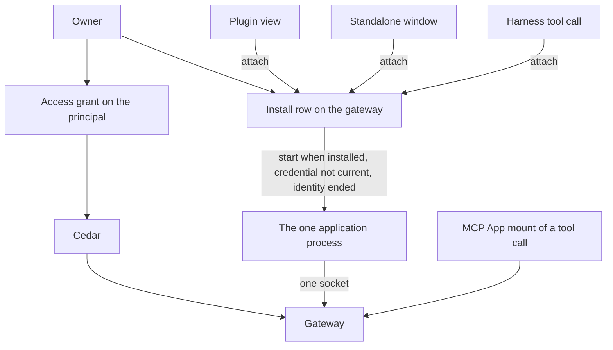
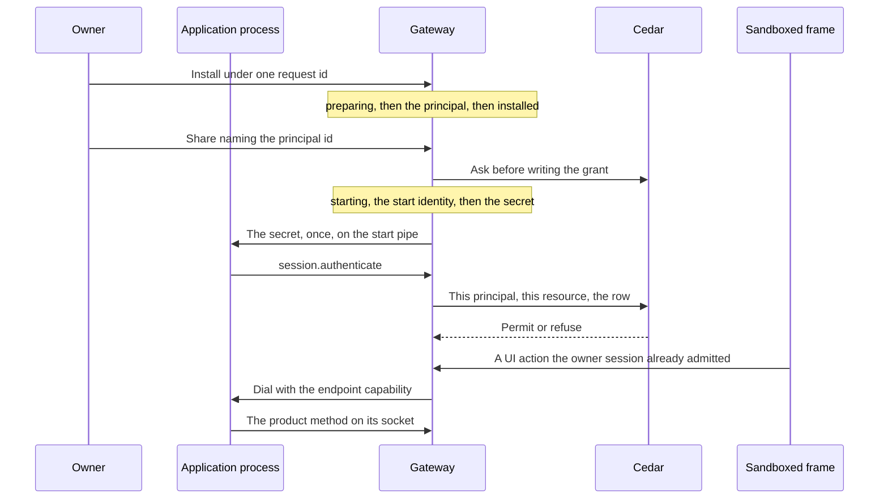

# Application framework

Status: proposal. The pull request that adds this document does not build it.
Public names in the examples are proposals. An ADR, when one is needed, takes
the number of the issue that settles that decision. This document does not
add one.

A developer has two ways to run one package. A **plugin** is a view the
desktop hosts. A **standalone app** is the same package in its own window.
One **application process** holds the gateway session. Cedar decides what
that principal may do with the [access grant](access-grants.md). The
package's own data stays the package's.

Harness scope stays Claude and Codex. Alpha has no migration.

## What is built

### Two clients already talk to one gateway

`@nessa/client` (`packages/nessa-client`) opens a WebSocket to `/session`,
answers `session.challenge`, and sends `session.authenticate`. The
credential decides the principal. The `surface` field is metadata.
[ADR 0010](../adr/done/0010-local-authentication.md) separates that
authentication from Cedar authorization on each later call. The package is
private and is not published. Its README says there is no separate plugin
SDK.

The desktop reads `auth/surfaces/nessa-panel.token` through the host
(`src-tauri/src/surface_credential.rs`) and connects with that owner
credential. Another process connects the same way with its own credential.
`crates/nessa-client-core/examples/read_only_sync.rs` is that second
process for a paired read credential: pair, sync, follow. It does not run
an agent.

`nessa-sdk` runs inside the gateway. A package does not embed it.

Credential kinds that exist (`crates/nessa-auth/src/domain/models.rs`):
`human`, `agent`, `integration`, `gateway`. Pairing is what creates a
`gateway` principal (`gateway:<key>`). `credential.issue` refuses one.
`hold.person` in `crates/nessa-auth/src/adapters/cedar/policies.cedar`
lets a human, agent, or integration hold `server.read`,
`credential.manage`, `conversation.read`, and `conversation.write`.
`hold.peer` lets a gateway principal hold `conversation.read` and
`environment.serve`. Those credential grants name no conversation and no
directory ([access grants](access-grants.md)). `issue.member` requires a
member role. `AuthenticateSession` refuses an inactive membership
(`crates/nessa-auth/src/application/session.rs`).

A second `credential.issue` with a new request id adds another credential
on that principal (`crates/nessa-auth/src/adapters/local/registry.rs`).
The webhook proposal's one-registration refusal is not this registry.

`nessa auth token` is already an integration. The CLI issues one with
`server.read` and `conversation.write`, a new member, and no receiver
(`crates/nessa-server/src/cli/infrastructure/gateway.rs`). It is admitted
by the no-binding owner path. An application cannot be "an integration"
with that path turned off, or those tokens stop being able to write.

### Admission when nothing is paired

`admit_conversation` returns success when the session has no receiver
binding (`crates/nessa-server/src/product/read_access.rs`). `reader` maps
that absence to `Reader::Owner`. `admit_request` then takes the owner
path: the credential's manifest grant, and `Initiation::owner()`. The
comment on that module records why: a gateway that pairs no device has no
binding, so every session reads as the owner.

A paired device is the other path. It has a receiver. Its credential holds
`conversation.read`. Comment and drive are the share row, and Cedar's
`grant.comment` and `grant.drive` also require `signedInAs == bindingOwner`
(`crates/nessa-server/src/conversation/infrastructure/access_policy/cedar/readers.cedar`).
A device meets that because it signs in as the owner. A peer gateway signs
in as itself, so those two permits do not match it. The grant lookup is
`receiver_id`. A row with no receiver is not that lookup
(`crates/nessa-server/src/conversation/infrastructure/store/share_grants.rs`).

`owner.read` and `owner.act` permit the principal whose id is the
conversation's owner
(`crates/nessa-server/src/conversation/infrastructure/access_policy/cedar/ownership.cedar`).
The no-binding success returns before that question is asked.

`mcp.callTool`, `mcp.readResource`, `mcp.sendMessage`, and
`mcp.updateModelContext` require the credential grant `conversation.write`
(`protocol/product/manifest.json`). They are not in
`ADMITTED_BY_ITS_OWN_CHECK`.

Revoking or expiring the credential closes a live socket with
`CredentialRevoked` or `CredentialExpired`
(`crates/nessa-server/src/product/socket.rs`).

### A plugin view is a widget, and an MCP App is a tool call

[ADR 326](../adr/done/326-widgets.md) hosts a view as a `WidgetRef`
(`plugin`, `id`) in a message, a pane, or over the panes. The window place
replaces whatever widget is there
(`openWidget` in `src/desktop/workspace/adapters/store/commands.ts`).
Two kinds share that host (`src/desktop/widgets/ui/plugin.ts`):

- `native` — React the window trusts, registered in composition.
  `widgetRegistry` in `src/desktop/dependencies.ts` registers the sample
  and subagents plugins only beside the sample workspace. A gateway
  window passes none.
- `app` — an MCP App, HTML in the sandbox, registered while the window
  runs.

An `app` plugin id is `mcp:` plus the server name
(`src/desktop/widgets/app/model/app-ref.ts`). Its widget id is the
conversation, the execution, and the tool call. The desktop registers the
plugin when a conversation view has a tool with UI
(`src/desktop/widgets/app/adapters/gateway/gateway-apps.ts`). The gateway
refuses `mcp.callTool` unless that call exists and declared a UI
(`crates/nessa-server/src/mcp_servers/domain/app_call.rs`,
`AppRefusal::AppUnknown`). `app_facts` selects the call by `executionId`
and `toolId`. Policy and audit name the app by those two.
`instanceId` is one mount
(`packages/nessa-client/src/generated/product.ts`, `McpAppReference`).

The mount speaks through the caller's credential. The frame does not
receive it. `ui/message` and `ui/update-model-context` are that mount's
conversation port ([MCP App calls](mcp-app-calls.md)). `requestMode` in
`src/desktop/widgets/app/model/places.ts` opens a pane when an inline view
asks for fullscreen. A ready app pane can still be opened in the window
place. The side rail (`src/desktop/workspace/ui/chrome/side-rail.tsx`) is
a prototype. It is not an install list.

`ui/open-link` and `ui/download-file` have ports. Production composition
does not supply them (`appPorts` in `dependencies.ts`).

### The grant row

[Issue 889](https://github.com/nessalabs/nessa-agent/issues/889) made a
conversation share a capability set: `read`, `read+comment`, or
`read+comment+drive`, plus constraints on a drive grant, plus the grant
epoch (`policy_revision`). Cedar's `grant.read`, `grant.comment`, and
`grant.drive` decide. `ShareGrant.receiver_id` is optional in the struct
for an integration
(`crates/nessa-server/src/conversation/application/share_grants.rs`).
`conversation.share` still refuses a target that is not an active paired
device or peer gateway (`share_target_not_paired`).

[The access-grant proposal](access-grants.md) (merged as
[#888](https://github.com/nessalabs/nessa-agent/issues/888)) is the rest
of that row: subject kind `principal` for an integration or a later
agent, one resource (one conversation, or one directory), capabilities
`read`, `comment`, `drive`, `write`, `exec`, constraints, epoch. Cedar
permits or refuses. `ResourceKind::Directory` is reserved and this build
does not write one. Webhook delivery is that proposal's outbox, not a
second grant. Its share target is an integration credential. This plan
names the application principal instead, and it does not give that share
a URL or a MAC.

```mermaid
flowchart TD
  panel[Desktop with the panel token]
  other[Another process with its own credential]
  gateway[Gateway]
  sdk[nessa-sdk Agent]
  call[Tool call that declared a UI]
  mount[MCP App mount]
  panel --> gateway
  other --> gateway
  gateway --> sdk
  call --> mount
  mount --> panel
  panel --> gateway
```

## What this proposes

One package. One integration principal. One install row, owned by the
gateway. One process. The process holds the one gateway socket and every
operation. The plugin view, the standalone window, and a harness tool
call ask that row to attach. The gateway is the only starter.



The plugin view is the widget window place, drawn in the sandbox, opened
with no tool call. The host asks the gateway to attach and proxies the
frame. It does not exec the package, and it does not dial the package
socket. The frame does not receive the process secret, the endpoint
capability, or the socket name (row H1). The standalone window is the
same attach. The MCP
App mount stays a tool call on the caller's session, drawn by the
desktop with the panel token, as today.

Third-party code in the window is the sandboxed frame. Third-party code
in a process is the application process below, and that process is not the
frame's sandbox. The `native` widget kind stays the trusted views the
window registers in composition.

## One process

The application process is the only process that runs the package's
operations, and it holds the one gateway socket. A helper it forks is a
member of that same launch container. It is not a second installation
and not a second start. The container ends as one. The gateway owns the
install row and is the only starter. A plugin view, a standalone window,
and a harness tool call reach that process by asking the row to attach.
None of them execs the package. Opening the plugin while the standalone
window is already up is an attach, not a second start. Each installed
package has its own row, its own process, and its own socket. A second
package is a second row. It is not a second process for the first.

The application process is third-party code running as the owner's OS
user. Mode `0600` is not a boundary: the child has that uid. Which
owner-level capabilities that child may reach is the
[authority table](#who-may-reach-owner-authority). An owner-level
capability that table does not grant the child is denied. T2 applies
the spawn denial before the child is released. That denial includes
process-control: the child cannot debug, read or write memory, duplicate
a handle, or signal a process outside its launch container. Cedar decides what the
process credential may do. It is not that denial. The HTML frame is a sandbox. This process is
not that frame. A stored stdio server is not this process and is not
under the denial.

### Who may reach owner authority

The application child is denied every owner-level capability this table
does not grant it. The spawn denial is four parts, applied together.
The credential denial stops the auth directory and every path in the bearer set.
That directory holds the surface bearers, the credential registry, and
offline `init`, `recover-owner`, and `provision-surface`. The bearer set is
not a fifth part. A path joins that set only in the bearer commit, which has denied it on every launch container that has a member before the secret exists. A path that already held bytes a child could read does not join as a presented credential. T2 applies the set already committed. The
package-trust root, in [What a path may do](#what-a-path-may-do), stops a
write to every installation's image, mutable directory, and retained
directory, and a read of any image, mutable directory, or retained
directory other than this child's own. Process-control
stops debug, process-memory, handle duplication, and signals against every
process outside this child's launch container, including the gateway and
the desktop. The launch container is the fourth part. Linux and Windows place the child
in a container it cannot leave, and T2 applies that denial before the child
is released. macOS places the child in a new session and a new process group
before release. macOS cannot deny setsid or setpgid. A descendant the gateway
can still link, whose process group is not the stored one, is R10. That leave
is not part of the denial T2 requires, and it is not T2b. T2b is the row when
the spawn cannot apply the credential denial, the package-trust denial, or the
process-control denial, or when Linux cannot keep a descendant in the cgroup,
or when Windows cannot deny breakaway or would name the job, or when macOS
cannot create that session with POSIX_SPAWN_SETSID, or the pre-resume re-read does not show the session id and the process-group id both equal to the pid. POSIX_SPAWN_SETPGROUP is not set with POSIX_SPAWN_SETSID. Product
`credential.issue` is denied by A14, not by the spawn. The child does not
inherit an open file descriptor, an environment value, or a pipe byte
of a denied path. The desktop and the gateway keep the cells this table
grants them. A platform that cannot apply the denial does not release
the child. The slice tests that outcome and chooses the platform
primitive.

The auth directory is the one `Environment::auth_directory_from_system`
resolves (`crates/nessa-server/src/env/environment.rs`). It holds
`credentials.v1.json`, `credentials.v1.lock`, and `auth/surfaces`.
Offline `nessa auth init`, `nessa auth recover-owner`, and `nessa auth
provision-surface` are never gateway commands
(`crates/nessa-server/src/composition/auth_command.rs`). OS access and
the exclusive registry lock are their authority. `init` and
`recover-owner` run the bearer commit for a new absolute output path
before they change the registry. A child that can open the registry mints an owner bearer
at a path it chooses, and Cedar on the application principal never sees
that bearer. The denial fails the registry open, so no owner bearer is
committed.

The bearer set is the gateway record, in that auth directory, of every
absolute path outside the directory at which a Nessa command writes a
credential secret, or which an online command is given as
`--credential-file`. The credential denial on a launch container is that
directory plus the bearer set committed at that moment, for as long as
the container has a member. It is not the set observed at T2. One commit
adds a path to the set. That commit returns only after every launch
container that has a member denies the path. The secret is written only
after the commit returns. A container the command cannot update blocks
the commit: the path is not recorded and the secret is not written. The
child is not stopped. T2 applies the set that is already committed. It
is not the commit that adds a path. Offline `init` and `recover-owner`
run this same commit. A container that outlives the gateway is still a
member that must deny the path. The offline command opens that object by
the stored token the same way S1 does. `nessa auth init --local
--owner-token-file` and `nessa auth recover-owner --local
--owner-token-file` run that commit before they change the registry and
before that file holds a usable secret. `auth:cli issue --out` runs it
before it writes a secret. A path that does not yet hold a secret,
including `--credential-file` naming a path that does not exist, is that
same commit: every live launch container denies the path before the
first secret byte, and the file is presented only after that commit
returns. A path `--credential-file` names that already exists and was
readable by the owner's user is not presented. A running application
child may already hold those bytes or an open descriptor of that file.
Recording the path in the bearer set does not revoke either, and the
no-binding owner fallback admits that bearer. The command revokes the
credential those bytes name and writes the replacement secret only into
a new path the bearer commit denied before the first byte, then presents
that new file. The old path is not recorded as a presented credential. A path inside the auth directory,
including the default `auth/surfaces/nessa-cli.token`, is the directory
denial and is not added to the set. A failed commit writes no usable
secret. An absent record is an empty set. A record that cannot be read
is T2b. A path leaves the set only in the commit that makes the secret
it held unusable. A private mode or ACL is not the denial, because the
child runs as the owner's user. The denial is the file. Its parent
directory stays reachable. The child does not inherit an open descriptor,
an environment value, or a pipe byte of a path in the set. A secret
copied to a path the set does not name is the unrecorded-copy row, not
the documents row. This plan does not scan the owner's documents for
copies. A platform that cannot deny an absolute file outside the auth
directory, while leaving that file's parent readable, does not release
the child (T2b). A live container that cannot take a newly committed
path is not T2b. That container blocks the bearer commit, and the secret
is not written.

| Capability | Owner OS session | Gateway | Application child | Frame |
| --- | --- | --- | --- | --- |
| Read a surface bearer: `auth/surfaces/nessa-panel.token`, `nessa-cli.token`, `nessa-browser.token`, or `auth/surfaces/<client.id>.token` | yes. The desktop reads the panel token through the host | yes | denied. No application registration, so a bearer that was read would be admitted by the no-binding owner fallback, including `conversation.write` and `credential.manage` on the panel token | denied |
| Open, read, write, or lock the credential registry (`credentials.v1.json`, `credentials.v1.lock`), including an offline backup or restore of that file | yes | yes. The server holds the lock while it serves | denied | denied |
| `nessa auth init --local` | yes | not a gateway command | denied. The binary may be exec'd. The registry open fails closed, and no owner bearer is committed | denied |
| `nessa auth recover-owner --local` | yes. Writes a new owner token at a new absolute path and revokes the previous owner credentials | not a gateway command | denied. The registry open fails before that output is a usable owner bearer | denied |
| `nessa auth provision-surface --local` | yes | not a gateway command | denied. The registry open fails closed | denied |
| `nessa auth token`, and presenting any owner or surface bearer to `/session` | yes. No registration, so the no-binding fallback admits the grants that credential holds | admits the session. It does not mint that bearer for the child | denied. `nessa auth token` presents a credential file and does not open the registry. The child is denied the auth directory and every path in the bearer set. A path in the bearer set is the recorded-bearer row, not the documents row. A file that already held a readable secret is not presented. The credential those bytes name is revoked, and only a file written after the bearer commit is presented | denied. The frame does not dial |
| Product `credential.issue` | when Cedar permits that caller | the start path issues only the application process credential (A2, A3). A14 forbids a product issue for this registration | denied by A14, not by the spawn | denied |
| The process secret on the start pipe | no | writes it once | granted. This is the only bearer the pipe carries | denied (H1) |
| The source directory the owner installed | yes | read once at I3s, through the opened directory handle, to pin the image before the installation id is a row. Not exec'd. A path that leaves that handle is not read. A preparing commit does not read it again | not a grant. A write is possible because owner paths are not sandboxed. It is not the image, not an attempt, and not the endpoint | not the directory |
| This installation's image in the package-trust root | no. The owner does not exec it | pins it at I3s, stores that digest at I1 or I5, publishes it at I3p, and execs it at T2 when the digest matches. I3 does not recompute the digest | read and exec. Not write | denied |
| This installation's mutable directory and its retained directory, and every other installation's image, mutable directory, and retained directory | no | this installation's mutable directory, to read the attempt and to dial. This installation's retained directory is the child's. Another installation's image, for that installation's start | read and write of this mutable directory and this retained directory only. Every other path in the root is denied | denied |
| The application local IPC socket | no | the only dialer, with the endpoint capability | granted to accept the enrolled gateway peer | denied (E5) |
| A Nessa call on the application principal | through the owner's own credential, not this principal | dials, and Cedar admits the caller first | granted only where Cedar permits this principal | denied |
| Debug, read, or write the memory of a process outside this launch container, or duplicate a handle of that process | yes | yes, of its own processes | denied. This includes the gateway, the desktop, and every other installation. The gateway pid and creation time on the start pipe name the dialing peer. They are not a grant of this reach. Linux denies `ptrace`, `process_vm_readv`, `process_vm_writev`, and `pidfd_getfd` of a pid outside the container, and it denies opening that pid's `/proc/<pid>/mem`. Yama is not the deny: a host may set `ptrace_scope` to 0. macOS denies `task_for_pid` and `ptrace`. Windows withholds `PROCESS_VM_READ`, `PROCESS_VM_WRITE`, `PROCESS_VM_OPERATION`, `PROCESS_CREATE_THREAD`, and `PROCESS_DUP_HANDLE`, and `SeDebugPrivilege` is absent. The user's SID stays. This is not a second OS user | denied |
| Signal, suspend, terminate, or change the scheduling of a process outside this launch container | yes | yes | denied. Windows also withholds `PROCESS_TERMINATE` on a process outside the job. A pid outside the container is not signalled by S1 | denied |
| Leave the launch container: breakaway, a new session, a new process group, cgroup migration, or an inherited job handle | the owner is not a child of this container | the gateway creates the container and is not inside it | Linux and Windows: denied. The container has enumerable members, and a descendant stays in the container T2 stored. Linux membership is `cgroup.procs`. The child cannot write `cgroup.procs` of a parent and cannot write `cgroup.freeze`. Windows denies breakaway: `JOB_OBJECT_LIMIT_BREAKAWAY_OK` and `JOB_OBJECT_LIMIT_SILENT_BREAKAWAY_OK` are unset, and a nested job stays a member. The job is unnamed. The handle is not inheritable, and the gateway does not duplicate it into the child, so the application identity cannot open the job. A named job is not this container. macOS starts the child in a new session and a new process group and cannot deny setsid or setpgid. A linked descendant that leaves that group is R10. That leave is not this deny, and it is not T2b. A launchd signal reaches the service instance and not a descendant that is not that instance, and that label is not the container. A platform that cannot apply the Linux or Windows deny, including a Windows spawn that would name the job, does not release the child (T2b). macOS matches T2b only when posix_spawn cannot create the new session with POSIX_SPAWN_SETSID, or the pre-resume re-read does not show the session id and the process-group id both equal to the pid. POSIX_SPAWN_SETPGROUP is not combined with POSIX_SPAWN_SETSID | denied |
| A recorded bearer outside the auth directory | yes. The command records the absolute path in the bearer set before the file holds a usable secret | yes. The bearer commit denies the path on every live launch container before the secret exists. T2 applies the committed set and does not add a path. An unreadable set is T2b | denied. The file is denied and its parent directory is not. A path that already held a readable secret is not this row: those bytes are revoked, and only a new file written after this commit is presented. A path absent from the set is not this row | denied |
| The owner's documents, the network, and an owner-chosen install directory | the owner's | the gateway's | not owner authority. Not a grant and not part of the filesystem spawn denial, except a path in the bearer set, which is the row above. An unrecorded copy of a credential secret is the path table's copy row, not this cell. This plan does not sandbox these paths and does not create a separate OS user. Process memory and process control of other programs are the rows above, and they are denied | the frame's sandbox is not this process |

A cell names one reach. The child is granted the process secret, read
and exec of its own image, read and write of its own mutable directory
and its own retained directory,
accept on its socket, and the Nessa calls Cedar permits. It is denied
the auth directory, every path in the bearer set, debug,
process-memory, and process-control of every process outside its
launch container, and, on Linux and Windows, it cannot leave that container. Linux keeps a descendant in the cgroup. An open file the child holds on that directory does not hide membership and does not suppress the next pass's freeze or signal. Windows keeps a descendant in an unnamed job, denies breakaway, and holds the only handle, so kill-on-close ends every member when the gateway exits. macOS releases the child into a new session and a new process group. macOS cannot stop a descendant from calling setsid or setpgid. A descendant the gateway can still link, and whose process group is not the stored one, is a containment breach: R10 stops the app and the audit in that commit names the leader and the escapee. There is no macOS job handle for a child to retain. The source
directory is not one of those grants. The gateway does not copy a manifest path that leaves the opened directory into the image. A stored stdio server is not this
process and is not under the denial.

A child-reachable path is not the outcome of a step. The table below
names which files are owner-only from creation, and which steps commit
their outcome on a store the child cannot write. A later read of a
child-writable path does not undo that commit and does not make the
step run again.

| State | Where it lives | Children | What finishes the step |
| --- | --- | --- | --- |
| Auth directory and every file created in it | the directory `Environment::auth_directory_from_system` resolves | denied before release. The directory denial is the boundary. A child does not inherit a descriptor | the spawn denial. A byte copied before this plan is not presented |
| A new credential file outside that directory | a path that does not yet hold a secret: `--out`, `--owner-token-file`, and `auth:cli issue --out` | denied on every live launch container before the first secret byte. The child is not stopped | the bearer commit returns, then the secret is written, then the file is presented |
| A file that already held bytes a child could read, named by `--credential-file` | an existing path the owner's user could read | already readable. A later deny does not revoke bytes or an open descriptor | not presented. The credential those bytes name is revoked. Only a new file written after the bearer commit is presented. The old path is not that credential |
| Source marker and the rest of the source directory | the owner-chosen install directory | writable. The directory lock is not a lock a child holds | not a committed outcome. I1 stores the id this command wrote. The pin digest is on the record. S3m stores marker-retired on the install record after the removal attempt |
| Install record, registry, grant store, and the bearer-set record | gateway stores | not readable | the commit of that store. S3 removes the row when marker-retired is stored and does not open the source marker |
| Image, staging directory, and the pin sentinel | the package-trust root | this child's own image is read and exec. Every other path in the root is denied | the digest on the record. I3p and I3 do not re-read the source |
| This child's mutable directory and retained directory | the package-trust root, this installation id | this child can write them | S3d deletes the mutable directory after the container has no members. The retained directory stays. Neither is the uninstall outcome |
| Endpoint file | this child's mutable directory | this child can write it | the kernel re-read of pid, creation time, and carrier membership. The file is not a live process |

### What a path may do

Every installed-package path, every credential path, and every
authority-bearing file is a row in the path table below. Every Cedar
decision point is a row in the policy table below. A path with no row
is a defect. A Cedar decision with no row is a defect. The
[authority table](#who-may-reach-owner-authority) names owner-level
capabilities. These tables name what a byte is trusted for, and which
Cedar policy admits a caller. The marker proves which installation a
directory is. It does not prove the bytes a start execs.

The package-trust root is a directory the gateway creates beside the
auth directory and includes in every spawn denial. Each installation
has an image, a mutable directory, and a retained directory under that
root. The retained directory is named by the installation id and holds
the dashboard document. The image is the
file set the manifest names: the process entry, the UI document, and
the files those two read. Those paths are opened only through the
directory handle from I0. A path the package-file rule does not admit is not copied.
That rule is in [One record](#one-record). The image and the
install record are not one commit. The source is read once, as the pin,
and that pin finishes before the installation id is a row. Under the
directory lock from I0, I3s copies the admitted set into a request-scoped
staging directory under the package-trust root, makes those bytes durable,
and writes a completion sentinel last. The sentinel names the source
directory and this command's install request id. No install row exists. No digest is on a row. The staging name
does not need an installation id. I3s holds the
[package-trust lock](#what-serializes-a-transition) and the directory
lock. The [pin fence](#process-ownership) pauses every recorded launch
container that has a member before the first byte is copied, and resumes
those containers after the sentinel. A descendant is a member of its
container and is paused with it. T2 takes that same lock before it execs,
so a child is not released during the copy. A container the fence cannot
pause does not copy and does not write the sentinel. The command retries
until the install deadline. A sibling process does not have to exit. I1w writes the marker only after that sentinel exists. I1
commits the preparing row, the server name, the version and the server
name taken from the pin, and the digest of that pinned tree. I1 does
not read the source. The directory lock is released when I1 returns. A
sibling write after that commit is not read. I5 stores the digest of a
pin that finished under the same locks before its preparing commit, and
I5 does not read the source after that commit. I5d does not pin. I3p
renames the pinned tree onto the image path and does not read the
source. The digest on the record stays the one the preparing commit
stored. I3 marks installed and copies tool descriptors from the pinned
tree. It does not replace the digest and does not read the source. A
mismatch between the image and that digest is not repaired from the
source. A failed pin deletes partial staging, writes no marker, does
not reserve the server name, and does not commit I1 or I5. That refusal
is not I4. I4 writes refusing for a preparing record whose pin is lost, or for an adoption whose pin name is already taken, after I5d has created the reclaiming record. I4 does not match when no row exists. I0's deadline
returns not-success, deletes partial staging, and writes nothing. A
retry of the request id that sentinel names does not re-copy. Bytes in the source
before that sentinel are the bytes the pin holds. A write after that
sentinel is not exec'd. A sentinel that names a different request id, or
that names the source and no request id, is not that pin. I3s or I5 deletes
that staging directory and pins again. I1 and I5 do not store its digest.

| What the sentinel names | Who reuses the tree | Who discards it |
| --- | --- | --- |
| none, or a partial staging directory and no sentinel | nobody | I3s or I5 deletes it and pins. The new sentinel names this command's install request id. I5 adopting an installation names that id instead |
| this command's install request id, and no install row stores a digest | a retry of that request. I1w then I1. The tree is not re-copied and the source is not read | a different request id. I3s deletes the staging directory and pins. I5 deletes it when adopting and does not store the digest. I1 does not store the old digest. K5 does not store it |
| this installation id, a registration names that id, and no install row stores a digest | I5 when the pin's server name is free, including the next reconciliation before the preparing row commits. The tree is not re-copied. A taken pin name is I4, which writes refusing and does not commit preparing. When the install deadline has passed, this reuse does not stay reclaiming: I5e writes refusing when this pin's server name is not in the name set, and I4 writes refusing when it is taken | a fresh install, which has no registration for that id. I3s deletes the staging directory and pins under the request id. K5 writes no sentinel and does not store the digest |
| only the source, or a request id that is not this command | nobody | I3s or I5 deletes the staging directory and pins. I1 does not bind the old tree |
| the preparing row already stores the digest | I3p and I3. They do not re-copy and do not recompute the digest. I3p renames the tree whose sentinel names the request id or the installation id that row pinned | a later command for that identity resumes the row and does not mint a second pin. A staging directory whose sentinel names another request is not renamed onto the image |

T2 execs the image only when a read under that lock matches the digest.
The source directory is not exec'd. A mismatch is T2m. T2m does not
issue, does not replace the digest from the source, and returns the
record to installed. I8 updates the locator and does not copy the
source into the image. V1 does not replace the image. S3d removes the
image, the mutable directory, and the staging directory after the cleanup intent and its deadline are stored, and it does not remove the retained directory. S3 removes the row only after that delete is confirmed, the grant store reports no row for the principal the uninstall obligation names, and S3m has stored marker-retired on the install record. S3 does not open the source marker. The installation id is retired. A file that remains in the source
directory is not the image, not an attempt, and not the endpoint. The dashboard document in the retained directory is not deleted.

A child may read and exec only its own image, and may read and write
only its own mutable directory and its own retained directory. Every other path in the root is denied.
The denial is the root, and the exception is only this child's own
directories, so a child spawned before a later installation exists
cannot write that installation's image. The source directory stays an
owner path. This plan does not sandbox it. A sibling may write it.
That write is not what the next start runs.

Cedar admits an attach before the gateway dials. The action is
`application.attach`. The resource is the target installation. The
facts are the principal's kind, whether it has an application
registration, the resource's application registration, and
`context.path`. `context.path` is the gateway's fact for which command
is running, the same kind of fact as `IssuePath`: `owner-session`,
`tool`, `product`, or `application-start`. It is not a comparison of
principal ids. Rust gathers those facts and acts on Cedar's answer.

`application.attach.owner` permits when the action is
`application.attach`, the principal is active, its kind is `human` or
`integration`, it has no application registration, `context.path` is
`owner-session`, and the resource has an application registration.
`application.attach.tool` permits when the action is
`application.attach`, the principal is active, its kind is `human` or
`agent`, it has no application registration, `context.path` is `tool`,
and the resource has an application registration.
`application.attach.application` forbids when the action is
`application.attach` and the principal has an application registration.
The forbid does not read the resource's principal id. It matches this
package and any other package. A forbid overrides a permit.
`server.read` is a different action, so a grant of it does not match.
`hold.person` does not list `application.attach`, so the process
credential cannot carry it.

An integration with no application registration on `owner-session` is
the owner fallback, including the panel token and `nessa auth token`.
It is not an application principal. A peer's kind is `gateway`, and no
attach policy permits it. A product path matches no attach policy.
Slice 1 tests these three policies and that each decision's Audit cell
has committed before a dial or a reported refusal. Slice 2 asks that
evaluator on the attach route, does not dial on a forbid (E6), and does
not dial on a permit whose Audit cell has not committed.

| Path | Writer | Reader | Trusted as | A sibling application child |
| --- | --- | --- | --- | --- |
| Source marker | the owner. A sibling can write it, because the source directory is not sandboxed | the gateway, to decide which installation the directory is | which installation a directory is, for an owner install (I8, V1, V2, D1). Not the uninstall outcome. Not the bytes T2 execs. S3m stores marker-retired on the install record, and a later rewrite is not that outcome | a changed marker is D1, I8, V1, or V2 for that id. It does not change the image or the digest. A rewrite after marker-retired is stored does not make S3m match again and does not keep S3 from removing the row |
| Source manifest, process entry, UI document, and the files that set names | the owner. A sibling can write them | the gateway, at I3s or I5, through the opened directory handle, and only while the pin fence pauses every recorded launch container that has a member | nothing, after the pin's sentinel. Not an exec, not a tool list, not the UI the frame is given. A path that escapes is not read. A write after the sentinel is not copied. A different install request does not reuse this sentinel | the pin fence pauses this child for the copy. A write after the sentinel is not copied. T2 does not exec it. I8 and V1 do not refresh the digest. A path that is not an admitted package file copies nothing and writes no marker. I4 does not rebuild a preparing image from the source |
| A manifest path the package-file rule does not admit: `..`, an absolute path, a symlink, a hard link, a FIFO, a device, or a file past the cap | the gateway does not read it | nobody | not a file in the image. Before a row exists this is I0 and I3s: no byte is copied, partial staging is deleted, no marker is written, and the refusal is not I4. I4 is a preparing record whose pin is lost, or an adoption whose pin name is already taken. No byte is copied, including a byte from the auth directory | the child does not receive it. The copy is the boundary, because the gateway itself is not sandboxed |
| Any other file left in the source directory | the owner. A sibling can write it | the owner | nothing. Not an attempt, not a receipt, not an endpoint | ignored. S3 does not need to delete it |
| This installation's image, under the package-trust root | the gateway. I3s pins a request-scoped staging directory before the row, and the sentinel names that request id. I1 or I5 stores the digest of that pin. I3p renames the complete tree onto this name under the package-trust lock. I3 does not recompute the digest | the gateway at T2. This installation's child, read and exec | the bytes T2 execs, and only when they match the digest I1 or I5 stored from the pin | denied by the spawn denial. A child started earlier is denied because the denial is the root. A staging directory is not this path |
| Another installation's image | the gateway, for that installation | that installation's child, read and exec. The gateway at that installation's T2 | that installation's exec | denied. Not readable and not writable |
| This installation's mutable directory: attempt store and endpoint file | this installation's child. The gateway removes it at S3d, after the cleanup intent and its deadline are stored | this child. The gateway reads the attempt as this principal and the endpoint file to dial | this principal's attempts and its socket name. Not the dashboard document. A file in the source directory is not any of these | denied |
| This installation's retained directory: the dashboard document | this installation's child. The gateway creates the empty directory at T2 and does not remove it at S3d | this child | the dashboard document for this installation id. Not an attempt, not a receipt, not an endpoint, and not a credential. The next installation id does not read it. S3m stores marker-retired on the install record before S3 removes the row, and S3 does not open the marker. I1w does not bind a marker that names no row | denied |
| Another installation's mutable directory | that installation's child | that child and the gateway, for that principal | that principal's attempts and socket name | denied |
| Another installation's retained directory | that installation's child | that child | that installation's dashboard document. Not adopted when this installation is created | denied |
| Auth directory, including the credential registry, `auth/surfaces`, `auth/audit`, and the bearer-set record | the owner OS session and the gateway | the gateway | owner authority. The authority table is the reach. The bearer-set record names paths outside this directory | denied. The spawn denial includes this directory. Not this table's source-directory exception |
| A path the bearer set names, outside the auth directory | the command that writes a new secret. The bearer commit returns, and every live launch container denies the path, before the first secret byte. An existing path that already held a readable secret is not this row | the owner OS session and the gateway | a credential secret. Not a document | denied. The file is denied. The parent directory is not |
| A copy of a credential secret at a path the bearer set does not name | the owner, outside a Nessa command | the owner | a credential secret. Not a document | a path that does not yet hold a secret is denied before the first byte and then presented. A path that already held a readable secret is not presented: the credential those bytes name is revoked, and only a new file written after the bearer commit is presented. Denial of a later open does not revoke bytes or a descriptor the child already holds. This plan does not scan the owner's documents, and it does not grant the file as a document |
| Install record, tool-descriptor copy, and the image digest | the gateway | the gateway. K2 reads the descriptor copy, not the source manifest | the record, the live tool list, and the digest T2 compares | denied. Not a file in the source directory |
| Endpoint capability secret | the gateway, in memory | the gateway, on a dial | the dial. Not a registry credential | the child never receives it |
| Process secret | the gateway, once, on the start pipe | the process that was released | `session.authenticate` for this principal. Not attach | the pipe is this child's. A sibling does not read it |
| The owner's documents, the network, and an owner-chosen install directory | the owner | whoever that path allows | not a package and not a credential secret. A path the bearer set names is the bearer row. An unrecorded copy of a credential secret is the copy row | not a filesystem sandbox. A write here is not the image. Process memory of another program is the authority table, and it is denied |
| A stored stdio server's files and command | the owner, through `mcpServers.save` | the harness session's stdio child | not this process and not this image | not under this spawn denial |

| Path | Caller | Policy | Audit | Result | A miss |
| --- | --- | --- | --- | --- | --- |
| `session.challenge` and `session.authenticate` with the process secret | this installation's process | authentication. Not a Cedar action | not this record | one session slot for this principal (A6, A12, A6x, A6c, A6d). An installed live current record with an empty slot stores a reauthentication deadline (A6c or A6w), and A6t stops when that instant passes | the secret does not authorize `application.attach` |
| `server.read` | a principal whose credential holds that grant | `server.read` | before the result | that read, when the grant names the resource | not `application.attach`. The process credential's hold does not make it one |
| `conversation.read` | the process credential, when a principal-subject grant names that conversation | `conversation.read` | before the result | that conversation (A7) | another conversation is A8. Not attach |
| `conversation.write` | the owner session. Not the process credential | `conversation.write` | before the result | the owner's write | the start does not put this grant on the process credential |
| `credential.manage` | the owner session. The panel token holds it | `credential.manage` | before the result | the owner's management | not on the process credential. Not attach |
| Product `credential.issue` for an application registration | any caller, new request id | Cedar forbids. A14. The registration fact is set and the path is not `application-start` | before the result | no credential and no secret | `issue.member` does not decide this. `server.read` does not decide this |
| `credential.issue` on `application-start` | the gateway start, after T2 has stored the identity | Cedar permits that path for this registration. No product command selects it | before the secret is reported. A registry commit without this record is retried and is not success | A2 or A3 | a caller of the product route is the product row |
| `credential.issue` with no application registration | today's issuer | `issue.member` or `issue.admin`, by kind, role, and path | before the result | today's issue | an application registration does not take this row |
| `application.attach` from the owner session | the panel token or the owner, no application registration, `context.path` `owner-session` | `application.attach.owner` | before T1 and before a dial | the gateway may R2 or dial (E1) | a registration on the caller is the forbid, not this permit |
| `application.attach` from the tool path | a human or agent with no application registration, `context.path` `tool` | `application.attach.tool` | before T1 and before a dial | the gateway may R2 or dial (E1) | an application principal on this path still matches the forbid, and the forbid wins |
| `application.attach` from an application principal | this package's process, or any other application principal, whether or not the credential holds `server.read` | `application.attach.application` | before the refusal is reported. No attempt | Cedar forbids. E6. No dial and no attempt | the resource id is not compared. This package and another package are the same forbid. Rust does not compare the principal ids |
| `application.attach` from a peer, or from a product path with no registration | a gateway principal, or an integration that is not on `owner-session` or `tool` | no policy | before the refusal is reported | no policy matched. No dial | not the owner fallback. The owner fallback is `owner-session` only |
| `conversation.share`, `conversation.unshare`, and `conversation.shares` | the owner, naming `principalId` | the share command's existing admission, then the grant row | before the result | A4 or A9. The list returns `principalId` and no `credentialId` | the application principal is not the caller. A `credentialId` is not the target |
| `credential.revoke` | the owner | the owner's revoke | before the result | A10, then S0 | the process does not call `credential.revoke` |
| `grant.read`, `grant.comment`, and `grant.drive` | a principal-subject grant on an application registration | the principal-subject permits slice 1 adds. Not the binding-owner policies | before the result | that grant's action on that resource | an integration with no registration does not take the new permits. The binding-owner policies still do not match an application principal |
| `mcp.*` | the application socket | no grant | before the result | M4 refuses | a tool call with that id does not grant the method |
| `credential.hold` for the process credential | the start's issue | `hold.person` | the issuance commit's record. Not a second record | `server.read` and `conversation.read` only | `application.attach`, `conversation.write`, `credential.manage`, and `environment.serve` are not in that list. `hold.peer` is a gateway principal, not this process |
| `credential.list` | the owner, listing paired credentials | the existing list | before the result | not an application target and not an attach | an application principal has no permit for it in this plan |
| `environment.serve` | a holder the existing policy permits | `environment.serve` | before the result | not this process | `hold.person` does not list it, and the start does not put it on the process credential |
| Directory `write` and `exec` | the directory slice of #888 | that slice | before the result | not the spawn denial and not attach | an application child is not given those grants by this plan |
| The endpoint capability, on a dial | the gateway | authentication at the process. Not Cedar and not a registry credential | not this record | E1 when the caller was already permitted | a caller does not receive the secret. A direct dial is E2 or E3 |
| A surface bearer, including the panel token | the owner OS session | no application registration, so the owner fallback | before the result | the grants that credential holds | the child is denied the file. Presenting it is not a grant of `application.attach` unless the attach row above permits |
| Another installation's process secret | nobody on this side of the pipe | that installation's `session.authenticate` | not this record | that principal's slot, if the secret were presented | this child does not have the secret. It is not a way to attach |

A cell names one path. The image is the only exec. A manifest path outside the opened directory is not a path in the image. `server.read` is not
attach. `application.attach.application` is the cross-application
refusal and the same-package refusal. The policy table's Audit cell is
the lifecycle audit record for that decision. It names the policy id
from the Policy cell, or that no policy matched, the caller, the target,
and the outcome allow, deny, or no-policy. The commit returns at the
moment that cell names, before the Result cell. What a failed write does
is the lifecycle audit below. An attempt is not this cell. The record
stores the answer this command just received. It is not a second Cedar
evaluation. A row whose Policy cell is a Cedar decision and whose Audit
cell says not this record is a defect.

The row names the package, the one version, the UI document, the process
entry, and the endpoint. The process entry and the UI document that T2
runs are the image, not the source files. The endpoint file lives in
the mutable directory. It is a private rendezvous of
the same kind as the gateway's `gateway-endpoint.json`
(`packages/nessa-client/src/transport/local-gateway-endpoint.ts`): a
private file, an endpoint instance, and the process id. The application
endpoint is not that file's TCP WebSocket. It is a local IPC socket, a
Unix-domain socket on macOS and Linux and a named pipe on Windows, and
the file holds that socket's name. That file is not a credential. The
endpoint is live only when that file is present, the recorded process
answers, and that process is a member of the object that matches the stored carrier. A missing file, or a
process that does not answer, is not live. That is not death, and it is
not permission to start. A start waits until the record is installed,
the credential is not current, and the previous process is confirmed
ended. If the record is installed and a start identity is still stored
and not confirmed ended, a missing file writes `stopping` for that
identity (R6). A `starting` record whose re-read finds no matching
process is T6. A `starting` record whose re-read still finds the
process, and whose file is missing, is T3, T3d, T7, T8, or T9.
Confirmed ended, with the credential still current, is R9.
This plan does not add a second discovery protocol.

The desktop, the standalone window, the frame, and the harness do not
read the endpoint and do not dial it. They ask the gateway to attach.
The gateway is the only process that dials, and only with the endpoint
capability [Endpoint admission](#endpoint-admission) names. Attach then
follows the record.

- The record is installed, the endpoint is live, the credential is
  current, and the slot holds the admitted session. The caller asks the gateway, and the gateway dials the
  process that published the endpoint. An empty slot is not this dial. It stores a reauthentication deadline. Before that instant the process authenticates at A6 or A12, and A13 dials only after that handshake holds the slot and clears the deadline. When the instant passes with the slot still empty, A6t writes stopping and this attach returns not-success. S2 clears that deadline in the commit that returns the record to installed, so a later start is not bound by it. The desktop loads the UI from the
  bytes the gateway fetched, and the standalone window loads the same
  bytes. A harness tool call is that same dial. The harness does not
  receive the capability or the socket name. No process is started. A credential
  that is not current is R8, a stop. A record that is reclaiming, starting, stopping,
  or uninstalling is not this join.
- The endpoint is not live, the record is installed, the stored
  directory presents this installation's marker, the credential is not
  current, and any start identity is confirmed ended. The
  gateway starts that installation's image, once, and only when the digest matches. That start stores
  the pid and creation time before it issues, and it writes the secret
  once on the pipe. The process reads it before it publishes the
  endpoint, then authenticates. That authenticate is not bound by a reauthentication deadline from a process S2 already ended, because S2 cleared it in the commit that returned the record to installed. The caller then attaches. A record that
  is preparing, reclaiming, starting, stopping, or uninstalling does not start. An
  attach on `starting` waits for the pass, and that wait ends at the
  publication deadline. It does not exec another.
- A second start is already in flight, or it finds the endpoint live. It
  exits before it issues and before `session.authenticate`. The process
  that published the endpoint keeps the socket.
- The endpoint is live and the credential is still current, and the
  socket has dropped. A6c empties the slot and, on this installed
  record, stores the reauthentication deadline in that commit. It does
  not extend a deadline already stored. The phase stays installed.
  The credential stays current. The process stays. Before that instant
  the process authenticates again with the secret it already holds, and
  that handshake is A6 or A12 because the slot is empty. A13 then dials
  and clears the deadline. The gateway does not issue another credential
  and does not start another process. R3 does not match while the slot
  is empty and does not dial. R2 does not match a live endpoint or a
  current credential. When the instant passes and the slot is still
  empty, A6t writes stopping. The attach returns not-success and the
  pass still finishes the stop. S2 clears the deadline in the commit that returns the record to installed. The next start is not bound by that instant. A restart that finds the slot empty and
  no deadline stored is A6w, which stores the same deadline and does not
  move an instant A6c already stored.

The socket in the state table is that gateway session. A harness
session is a caller of the gateway, not a client of that socket. Two
harness sessions are two gateway dials, and still one process and one
gateway socket. A harness session ending closes its dial. The process
stays. The capability stays until E7 or the next committed rotation.

The application credential has one session slot. `serve_session`
(`crates/nessa-server/src/product/socket.rs`) admits each connection on
its own. For this credential the slot is taken in one step before the
socket is admitted. A second handshake, including one that races the
first, finds the slot taken and is refused (A6x). The first session
stays. The owner's sessions are not this slot. One row empties the
slot. A6c empties it when the handshake or the admitted socket ends
and the record is not stopping, uninstalling, refusing, or reclaiming, and the replace hold is not stored. The phase,
the credential, and the process stay. The next handshake is A6 or A12, and only before the reauthentication
deadline. On an installed record whose endpoint is live and whose
credential is current, A6c stores that deadline. A6w stores it when a
restart finds the slot empty and none is stored. A13 clears it when the
slot is held. A6t writes stopping when the instant passes and the slot
is still empty. The deadline stays stored through that stop. S2 clears it, whether or not the instant has passed, in the commit that returns the record to installed. The next process is not bound by it. A drop during starting stores no reauthentication
deadline. T7 and T8 own that wait.
S0s empties it when the record is stopping, uninstalling, refusing, or reclaiming,
including any other socket still bound to this principal, before the
registry close, before a credential replacement, and before the signal. It also runs while a starting record holds the replace hold.

A stored stdio server is a different process: one child per harness
session, ended with that session (`open_admitted` in
`crates/nessa-server/src/mcp_servers/infrastructure/relay.rs`). The
application process is not that child.

## One record

The install record is the single durable owner of one package and of
its process. The [lifecycle table](#lifecycle) is the whole of that
ownership: the phase, the identity, the deadline, and the audit of the
change. The marker, the auth registry, and this record are not one
commit. The phase is written before each fallible effect, and a crash
resumes that phase.
Gateway startup runs one reconciliation pass, and so does any attach,
before a start is considered. The pass does not mint a second principal
and it does not exec. It leaves a record `starting` on T2 while this
start is in flight and the release deadline has not passed, including
when no child has been stored yet. It leaves it on T3 or T7 while that
deadline has not passed and the re-read still finds the child. T2b does not
leave it `starting`: the spawn could not apply the authority table's
spawn denial. T6, T3d,
T9, and R8 leave `starting` earlier. A passed publication deadline is
`stopping` (T8), except the T9 break. T3 issues only after that re-read.

The phases are `preparing`, `reclaiming`, `refusing`, `installed`, `starting`,
`stopping`, and `uninstalling`.

Seven invariants hold on every row of that table.

The package identity is an installation id the gateway mints into the
marker before any install row exists. The preparing row's creating write
copies that id, reserves the server name taken from the pin, and stores
the digest of the pin that finished before that write. It does not write
the marker and does not read the source. A reclaiming row does not reserve
a server name and does not read the manifest. The preparing commit is the
name-set compare-and-set. A name read from the live source is not kept.
The marker is the proof that a directory is that installation. It is
not the proof of the bytes the start execs. Those bytes are the image,
and the digest on the record is that proof. The path is the
locator, not the key. The filesystem directory id is a hint stored
beside the row: the device and inode on macOS and Linux, and the volume
serial and file index on Windows. A rename on the same volume often
keeps that hint, and it keeps the marker. After a directory is deleted,
the operating system can reuse the hint for a different directory. A
matching hint does not prove an installation exists, and it does not
select a row whose marker is missing or names another installation.
The caller spelling is not the key: symlinks, `.`, and `..` are
resolved, and so is the case the filesystem reports where the volume
does not distinguish case. Two spellings in one open are one directory.
That does not make the hint a key.

The marker names the row, or the open is not that row. I8 is that
installation when the version matches, the path or the hint differs,
and the open is not a copy. V1 is that installation when the version
differs, or the path and the hint already match, and the open is not a
copy. V2 is a copy: the marker names a row whose stored directory still
presents that marker at a different filesystem id, and the new path is
refused. A marker that names no row and no registration is not an
installation. I1w overwrites it and mints a new installation id. That
write does not reserve a server name and does not commit a row. I1
commits the preparing row only after a re-read through the same
directory handle still sees the marker this command wrote. A crash
between those writes leaves a marker and no row. The next owner install
is I1w when the server name is free, and K5 when it is not. I1w replaces
the marker the crash left and does not bind that id. I1 binds only the id
written under the directory lock this command still holds. It is not
D1. A
filesystem id that equals some row's hint does not turn that write into
that row, and it does not rewrite the marker. A path that does not open
as a directory writes nothing (I0). A stored path that does not present
this installation's marker leaves the row in place (D1), including when
the path is missing and including when a reused filesystem id opens
there. Uninstall of that row still runs and releases the server name.
The registration stores the installation id and, from T2 until S1c, the launch carrier of a child that is not confirmed ended. I5d commits `reclaiming` whenever a registration names the installation id and no install row exists. That commit stores the install deadline and does not pin. When a gateway session is open, a process credential is current, or that carrier is still stored, it also copies the carrier. I5d copies the carrier onto the record, leaves the credential unchanged, does not read the manifest, and does not reserve a server name. The child may still be running. S0s ends the session, and S0p closes a current credential. S1 ends the copied container. I5 adopts that reclaiming record only while the install deadline has not passed, no session is open, the credential is not current, and that container has no members. The pin finishes before that preparing commit, under the pin fence. A sibling process may be up. The commit reserves the server name and stores the version taken from the pin, under the name-set lock, and only when that name is free. A taken pin name is I4. That commit writes refusing, does not reserve the name, and does not stay reclaiming for a later retry. When the install deadline has passed, I5e writes refusing and does not stay reclaiming, including when no pin was stored. It does not keep a different name. It does not adopt a filesystem id, and I1w does not run for that marker. I5 and I5d store the grant-cleanup obligation naming that principal and do not delete a grant. I3 clears it, and the grants stay. I4 does not clear it. I4g deletes those grants before I4b removes the row.

Every path the manifest names is admitted by one package-file rule, or
it is not a package file. The gateway opens it from the directory
handle from I0, with a non-blocking open that does not follow a
symlink. A `..` component, an absolute path, or a symlink is not
admitted, and the open does not read the auth directory or another
installation's image. The descriptor must be a regular file. A
directory, a FIFO, a socket, or a device is not admitted. The
non-blocking open is what keeps a FIFO from stalling the process. The
link count is 1, observed by fstat on that held descriptor before any
content byte is read, and again before I3s writes the sentinel. Any
other count is not admitted, so a hard link to a file in the auth
directory is not copied. The fstat size is finite and at most the
per-file cap. The set is the names the manifest lists, not a walk of
the directory. The name count is at most the count cap, and the sum of
the sizes is at most the total cap. The slice chooses those caps. They
are gateway limits, not values the manifest sets. Infinity is not a
cap. The read copies at most the admitted size. This is every
manifest-named read: the tool server name, the version, the process
entry, the UI document, and the files those two name. The whole set is
checked before any staging byte is written. A set that is not admitted
is not a package. Before a row exists, that set deletes partial staging,
writes no marker, reserves no server name, and does not commit I1 or I5.
That refusal is not I4. On a preparing record, a missing pin digest, or
a missing image together with a missing sentinel, is I4, and I4 does not
read the source to stage a replacement. A symlink, a
new hard link, or any other failed check during the pin discards the
staging directory and is that same pre-row refusal. Once a sentinel names this command's install request id, or names the installation id I5 is adopting, that attempt's next pass does not re-read the source. A sentinel that names another request is deleted, and the source is read again. The refusal is the open
this pass observes. A crash before the sentinel does not remember a
failure that is no longer there: the next pass pins again when every path
is admitted, no row exists, and the install deadline has not passed, and
it writes nothing when a path is still not admitted. The read is cancelled at that
deadline. I3s does not open a file after it. R7 does not wait past it,
so startup reconciliation does not block on the copy. I8 and V1 read
the version only when the manifest is admitted. A manifest that is not
admitted is not a version, the install command writes nothing, and
that refusal is I0, not I8, not V1, and not I1w. A copy is V2, which
does not read the manifest, so that copy is not this refusal.
Resolving the caller's spelling of the directory itself is I0's
observation of one directory. It does not admit a file the manifest
names outside that directory.

The same id is what the other tables already key, once the path is
only the locator:

| Table | Key | A rename or a move |
| --- | --- | --- |
| Install row, I0, I1w, I1, I8, V1, V2, D1 | installation id, proven by the marker. The filesystem id is a hint. The path is the locator | I8 when the marker names the row, the manifest is an admitted package file, and the version matches. V1 when the manifest is admitted and the version differs. A manifest that is not admitted is I0. V2 refuses a copied marker whose original still presents it and does not read the manifest. D1 when the stored path does not present the marker, including a reused filesystem id |
| Registration, A1, I5d, I5 | installation id | a new path does not mint when the marker names a row. I5d commits reclaiming whenever no install row exists for that registration. That commit stores the install deadline, copies a launch identity when one is held, does not read the manifest, does not reserve a server name, and does not pin. I5 adopts that reclaiming record only while the install deadline has not passed, no session is open, the credential is not current, and that identity is not still stored. That preparing commit reserves the pin's name and version only when the name-set lock finds the name free. A taken pin name is I4 and does not reserve. A passed deadline is I5e, including when no pin was stored. A filesystem id match does not mint and does not adopt |
| Attempts, O10, O12 | principal id | the principal stays, so the namespace stays |
| Grants, A4 | principal id | a rename does not grant and does not drop a grant |
| Tool list, K2 | the record's phase | the same record stays listed. The path is not a server name |
| Endpoint, E1, R3 | the socket name stored on the record | the name is not derived from the package path, so I8 does not change it |
| Session, A6, A12, A6x, A6c, A6w, A6t, S0s | one slot for the application bearer, taken before the socket is admitted and emptied when that connection ends. An installed live current record with an empty slot stores a reauthentication deadline | a second handshake is A6x. A6c empties the slot on a plain disconnect and, when the record is installed, the endpoint is live, and the credential is current, stores the reauthentication deadline. A6w stores that deadline when a restart finds none. A6t writes stopping when the instant passes and the slot is still empty. A13 clears the deadline once the slot is held. The deadline stays stored while the stop runs. S2 clears it in the commit that returns the record to installed, so the next process is not bound by it. S0s empties the slot while stopping, uninstalling, refusing, or reclaiming, and while a starting record holds the replace hold. A close and a replacement wait for that drop |

The process identity is a start identity, not a bare pid. Before the
child is released, the record stores the pid and the creation time the
operating system reports for it, at the resolution that system uses to
tell processes apart, both in the same commit as the publication
deadline (T2). A coarser stamp is not the identity. Slice 2 may hold a
stronger handle while this
gateway process is up. Recovery after a restart uses the stored pid and
creation time, re-read from the operating system. A live process with
that number and a different creation time is not the recorded process:
it is not signalled, not injected, and not waited on (T6). An exit the
gateway observes carries the pid and the creation time of the process
that exited. It is R5 only when that pair is the record's current start
identity. A pair from an earlier start does not write `stopping` and
does not signal the current process. Confirmed ended means the ended
confirmation stores that same pair and that no member remained in the
object that matched the stored carrier. S1c is the only row that stores
that pair. S1n stores an absence confirmation when stopping or
uninstalling has no start identity and no launch container, and that
confirmation is not a pid. A confirmation for any other pair is not this
identity. A container that still has a member is not ended. An absence
confirmation does not block the next start, because no start identity is
stored. The
[serialization table](#what-serializes-a-transition) names the lock or
generation for every install and process transition. A platform
that cannot supply a creation time the gateway can re-read after a
restart does not release the child. The child does not inherit the
registry lock. It stays on the pipe until that commit, then reads the
process secret and the endpoint verifier, and the gateway's pid and
creation time, before it listens, before it publishes an endpoint, and
before `session.authenticate`. That pid names the dialing peer. It is
not a grant of debug, process-memory, or signal rights on the gateway. A pipe that closes first ends it without
an endpoint and without a socket. Who ends that process, and which transitions may run while it is up, is [Process ownership](#process-ownership). A process is up only as a member of a recorded container. On macOS that includes a descendant the gateway can still link to the leader after setsid or setpgid, until R10 and S1 have finished. Closing a view leaves it up. A pin pauses recorded containers and then resumes them. I5 does not pin while this installation's container has a member.

A principal's gateway sessions end before that principal's credential is
closed or replaced, and before a new owner of that principal proceeds.
An admitted socket keeps that principal's grants until S0s drops every
socket bound to the principal. Closing the registry credential does not
drop the socket. S0s is that end, and it runs only after a durable deny
is committed: the phase is `stopping`, `uninstalling`, `refusing`, or
`reclaiming`, or a starting record has stored the replace hold (A3d).
A6d refuses a new authenticate while that deny holds, so emptying the
slot does not admit another socket before the close. S0, S0p, S0u, I4a,
S3a, I5, X1, and A3 match only when no gateway session for that
principal is open. I5d and X1d commit `reclaiming` and leave the
credential unchanged. I5 creates `preparing` only after the session is
closed and the credential is not current. A3 replaces a credential only
after S0s. Uninstall removes the registry principal at S3a only after S0s. A11 has already stored the grant-cleanup obligation on the install record. S3a does not write the grant store. S3g stores an audit intent and then deletes the conversation grants. The delivery pass appends that completed deletion only after the grant store reports no row, and the row stays until that store reports none and S3m has stored marker-retired on the install record. A refused adoption stores an audit intent and then deletes its grants at I4g, not at I4a. The delivery pass appends that completed deletion only after the grant store reports no row. A failed log append does not restore a grant row. A stop
that will close a credential (A10, R5, R6, R8, R9, R10, R12, T3d, T4s, T6, T8, T9)
commits `stopping` first, and the close is S0, S0p, or S0u. A restart
has no session in memory. The deny is what makes the next pass drop a
session that is still open, and refuse a new one, before the new owner
commits.

Every released child is a member of one launch container, and stopped
or uninstalled is recorded only when that container has no members, or
when no container was stored. T2 mints a container token and never
reissues it, even for the same installation. The token is not a pid, a
creation time, a process-group id, a p_uniqueid, a start-attempt id, or any other
number the kernel assigns. The token is not a regular file inside the kernel
object. T2 creates the object, stores the token and that platform's
carrier in the same commit as the pid and creation time, and places the
child in the object. The child is not released before that commit.
Linux keeps a descendant in the cgroup. Windows keeps a descendant in the unnamed job. macOS places the child in a new session and a new process group. macOS cannot stop a descendant from calling setsid or setpgid, and a descendant that does leaves the group. The macOS census is a completed listing of every pid. It is not a kevent and it is not the live process tree. While the stored leader pid reports the stored p_uniqueid, a member is every process whose process-group id equals the stored process-group id, and every process whose p_puniqueid chain reaches a p_uniqueid stored for this container. A double-fork helper that has not called setsid or setpgid keeps that process-group id after its parent exits, so the listing names it even though the live tree does not. A linked descendant outside the stored group is a containment breach. R10 is that breach, including on a NOTE_FORK pass and on gateway start, while the record is installed or starting and the leader still reports the stored p_uniqueid: the record becomes stopping, and the audit in that commit names the leader pid, the leader's p_uniqueid, the escaped pid, that pid's p_uniqueid, and that pid's process-group id, cause containment breach, initiator system. S1 then stops the app. A NOTE_FORK is not a census. The kevent names neither a child nor a fork count, and kqueue may coalesce several forks into one event. R11 reads the stored process group once, because that read is what tells an ordinary fork from a merged one. The fork is ordinary when no tracking gap is stored and the only unstored member is one direct child of the watched pid still in that group. R11 stores that child's p_uniqueid and leaves the phase unchanged. It does not store a tracking gap, does not write stopping, does not write an audit, and does not block S1c, S2, S3, or R2. That child can be confirmed on this boot after it exits. The fork is missed or merged when the listing has any other shape. More than one unstored member, or a member that is not that direct child, is the census: R11 stores every member still inside the group, discharges an unfinished-listing gap if one was stored, does not discharge an unobserved-escape gap, carries the publication deadline and the release deadline while the phase stays starting, and leaves the phase unchanged. It does not write stopping and does not write an audit. No unstored member, and no process outside the group whose chain reaches a stored p_uniqueid, is an unobserved escape. The forked child is already gone, so a helper can have called setsid before any ancestor was stored. That finished read stores an unobserved-escape gap and the boot time from kern.boottime and leaves the phase unchanged. It does not write stopping and does not write a breach audit, because the plan has no pid to name. S1e does not clear an unobserved-escape gap. A later empty census is the same blind listing and is not proof the helper exited. S1g clears that gap when the boot time changes. S1c, S2, S3, and R2 do not match while it is stored. Storing one child the kevent suggested does not close a missed or merged event. When the listing does not finish, the fork is missed: R11 stores an unfinished-listing gap and the boot time from kern.boottime only when the stored gap is none, leaves an unobserved-escape gap stored, carries the publication deadline and the release deadline while the phase stays starting, and leaves the phase unchanged. Installed or starting does not become stopping. The app keeps running, and the next pass reads the group again. An unfinished listing writes no breach audit. The only fork outcome that stops the app and writes an audit is a member outside the group, and that is R10. S1e discharges an unfinished-listing gap that is still stored when a later stop's census finds no member and no ambiguous pid, and S1c then confirms, still on this boot. S1e does not discharge an unobserved-escape gap. S1w holds only while the record is stopping, uninstalling, or reclaiming and the listing is unfinished, an unobserved-escape gap is stored, or an ambiguous pid remains. S1g discharges either gap when the boot time changes. An ambiguous pid is a process whose process-group id equals the stored process-group id while the stored leader pid reports a different p_uniqueid, and whose p_puniqueid chain reaches neither the stored leader p_uniqueid nor the p_uniqueid that leader pid now reports. The plan does not signal an ambiguous pid. A gateway start whose leader still reports the stored p_uniqueid is a missed interval, because the watches were down. R13 runs the census. A completed census inside the group stores the members, discharges an unfinished-listing gap, does not discharge an unobserved-escape gap, carries the publication deadline and the release deadline while the phase stays starting, re-arms the watches, and leaves the phase unchanged. An unfinished listing stores an unfinished-listing gap only when the stored gap is none, leaves an unobserved-escape gap stored, and leaves the phase unchanged. It does not stop the app. A finished census that finds no member besides the leader and no linked outsider stores an unobserved-escape gap and leaves the phase unchanged. S1e does not clear that gap. A census that stores a member still in the group does not store it. Neither gap locks an ordinary fork, and neither writes stopping. A gateway start whose leader does not report the stored p_uniqueid is R12 and does not signal the process-group id. A completed listing with no member and no ambiguous pid does not store a tracking gap, so S1c can confirm on this boot. An unfinished listing or an ambiguous pid stores the gap. NOTE_TRACK is not registered, because it returns ENOTSUP and would invalidate the kqueue. S1 and S1b act on the object that
matches the stored carrier. An object that does not match is not the
container and is not signalled with killpg. On macOS that match is the leader pid still reporting the stored p_uniqueid, the stored creation time, and the stored process-group id. A recycled process-group id is not signalled. A process the gateway can still link to the stored leader stays a member while it is visible, in the group or outside it, and S1 signals that process by pid after its p_uniqueid is re-read. Absence of the object is no members on Linux and Windows:
S1c when a start identity was stored, and S1n when none was. On macOS no members means a completed census found no member. S1c stores
the ended confirmation only when no member remains in an object that
matches the stored carrier, and that commit releases the container.
S1c does not match while a macOS tracking gap is stored for the current boot. S1e discharges an unfinished-listing gap when a later census finds no member and no ambiguous pid, and that discharge does not claim a descendant that left the group before any ancestor was stored has exited. An unobserved-escape gap stays stored until S1g.
S1n stores an absence confirmation when stopping or uninstalling has no
start identity and no container, and it does not signal. R2, S2, and S3
match only after the confirmation that fits that record, so a helper
that outlived the recorded pid is not still running when the next start
is released, and a record that never started can still leave
uninstalling. A pid outside the container is not this process and is
not signalled. A macOS census member is this process until S1 has signalled it. The census is the completed process-group listing plus any p_puniqueid chain that reaches a stored p_uniqueid.

### Launch carrier

The carrier is this table. A path, a process-group id, and a job name
are locators. They are not the token, and they are not the proof. On macOS the process-group id is the locator. The leader's p_uniqueid, together with the creation time, is the proof that the pid is still the stored leader. p_uniqueid is not the token. A Windows job has no name, so no job name is stored. The
start identity stores the token and the carrier together. A platform
that cannot record the carrier does not release the child (T2b). A
pidfd observes the recorded pid while this gateway process is up. It is
not the membership test after a restart.

| Platform | Carrier stored at T2 | After a gateway restart | After the path or name is reused |
| --- | --- | --- | --- |
| Linux | A cgroup v2 directory created with mkdir under a parent the child cannot write, and the 64-bit inode the kernel reports for that directory. The inode is the kernfs id. Its low 32 bits can be recycled after the directory is removed, and the high 32 bits advance when that happens, so the 64-bit value is not reused for the life of the cgroup mount. No regular file is created in the directory. cgroup v2 does not allow one. Membership is `cgroup.procs`. A descendant stays in that directory. The child cannot write `cgroup.procs` of a parent. A platform that cannot keep a descendant from leaving does not release the child (T2b). An open file the child holds on the directory does not hide `cgroup.procs` and does not suppress freeze or signal. Linux does not use last-handle-close. | The cgroup and that inode outlive the gateway. The mount does not survive reboot, so after reboot the directory is gone. S1 opens the stored path and acts only when the reported inode is the stored 64-bit value. | A new directory at the same path has a different inode and is not the container. A missing path is absence. A process-group id is not the carrier. A platform that reports only the low 32 bits does not release the child (T2b). |
| macOS | T2 calls posix_spawn with POSIX_SPAWN_SETSID and POSIX_SPAWN_START_SUSPENDED. POSIX_SPAWN_SETPGROUP is not set. SETSID makes the child the session leader, which creates the new session and the new process group, and the process-group id is the child's pid. The parent does not call setsid. Before resume the gateway re-reads the suspended child and releases it only when the session id and the process-group id both equal the pid. A re-read that does not is T2b: the child is not resumed and the suspended child is killed. The child stays suspended until the registration write and the install-record write have both stored the minted token, the leader pid, the creation time, the leader's p_uniqueid, and the process-group id. Resume is the release. The token is not the pid, the creation time, p_uniqueid, or the process-group id. The process-group id is the locator. p_uniqueid comes from proc_pidinfo PROC_PIDUNIQIDENTIFIERINFO and is not recycled for the boot. While this gateway is up it registers EVFILT_PROC NOTE_FORK and NOTE_EXIT on the leader and on each member the census stores. NOTE_TRACK is not registered: it returns ENOTSUP and invalidates the kqueue. A NOTE_FORK kevent names neither a child nor a fork count, and kqueue may coalesce several forks into one event. R11 reads the stored process group once. The fork is ordinary when that read finds exactly one unstored member and that member is a direct child of the watched pid: R11 stores that child and does not start a recovery census. Any other shape is missed or merged, and that same read is the census. The census is a completed listing of every pid, not the live process tree. While the leader pid reports the stored p_uniqueid, a member is every process whose process-group id equals the stored process-group id, and every process whose p_puniqueid chain reaches a p_uniqueid stored for this container. A double-fork helper that has not called setsid or setpgid keeps that process-group id after its parent exits, so the listing names it. Storing one child the kevent suggested does not close a missed or merged event. An ordinary NOTE_FORK stores the one direct child and leaves the phase unchanged. A missed or merged census that completes inside the group stores every member and leaves the phase unchanged. An unfinished listing stores the tracking gap and leaves the phase unchanged. It does not write stopping. p_puniqueid is set at fork and does not change when the parent exits. macOS cannot stop a descendant from calling setsid or setpgid. A linked descendant whose process group is not the stored one has left the container. That leave is R10, not T2b. A platform that cannot set the new process group and the new session does not release the child (T2b). No launchd job is stored. A launchd signal reaches the service instance and not a descendant that is not that instance. There is no macOS job handle for a child to retain. | The kqueue watches die with the gateway. The stored pid, creation time, p_uniqueid, and process-group id do not. The next pass re-reads the leader and registers NOTE_FORK and NOTE_EXIT again. It does not register NOTE_TRACK. killpg, SIGSTOP, and SIGCONT run only when that pid still reports the stored p_uniqueid, the stored creation time, and the stored process-group id. | A process group whose current leader does not report the stored p_uniqueid is not this container and is not signalled. Absence of the leader is no members only when a completed census found no member and no tracking gap is stored for the current boot. A gateway start whose re-read does not find that leader is R12. A gateway start whose re-read finds that leader is R13 and runs the same census. A contained census does not store a tracking gap and does not write stopping. An unfinished-listing gap is stored when a missed or merged listing does not finish, or an ambiguous pid remains, and the stored gap is none. An ordinary fork does not store a gap. An unfinished listing does not write stopping and does not replace an unobserved-escape gap. S1e discharges an unfinished-listing gap that remains on a stopping record when a later census finds no member and no ambiguous pid. R11 or R13 discharges an unfinished-listing gap when a later census stores a member still inside the group, and does not discharge an unobserved-escape gap. S1w holds only while the record is stopping, uninstalling, or reclaiming. S1g discharges either gap on the next boot and is the only discharge of an unobserved-escape gap. S1c does not confirm while a gap is stored. R11 and R13 carry the publication deadline and the release deadline while the phase stays starting. A later launchd job is not this container. |
| Windows | An unnamed job. T2 creates it with no name and holds the only handle. Kill-on-close is set. The handle is not inheritable, and the gateway does not duplicate it into the child. The application identity cannot open the job: there is no name to pass to OpenJobObject, and no handle was given to the child. The spawn denial withholds `PROCESS_DUP_HANDLE` on the gateway, so the child cannot duplicate that handle out of this process. The token is the one the gateway minted, stored with this carrier. It is not a job name. A job has no field for a second token. Breakaway is denied: `JOB_OBJECT_LIMIT_BREAKAWAY_OK` and `JOB_OBJECT_LIMIT_SILENT_BREAKAWAY_OK` are unset. A nested job stays a member of this job. A platform that cannot deny breakaway, or that cannot create an unnamed job, does not release the child (T2b). A named job is T2b. | The handle dies with the gateway. It was the only handle, so kill-on-close ends every member and is not deferred by a handle the child holds. The next pass does not open a job, because the job has no name. A carrier already stored on the install record is an object that is gone. S1c records no members, and the next pass does not mint a replacement job. A carrier left only on the registration, with no install-record start identity, is cleared, and the next T2 mints a new token and a new unnamed job. It does not call OpenJobObject. | There is no name to reuse. A later named job is not this container. |

A Linux cgroup outlives the gateway. A descendant cannot hide its membership or suppress the next pass by holding the directory open. macOS stores the leader pid, the creation time, p_uniqueid, and the process-group id. The watches die with the gateway. The stored identity does not. There is no macOS job handle for a child to retain. A Windows object does not outlive the gateway. The job is unnamed, and the gateway's handle is the only one, so kill-on-close is not deferred by the child.
A carrier stored only on the registration, while the install record has
no start identity, is cleared when this process cannot reopen it, and
the next T2 mints a new token and a new job. It does not open a job by
name. A carrier already stored on the install record is not minted
again: kill-on-close has ended the members, and S1c records none. T4
adopts only a recorded pid whose creation time matches and that is a
member of the object that matches the stored carrier.


### macOS process ancestry

This table is every macOS ancestry case. Gateway is up while the kqueue watches are held, down while this process is not running, and restarting on the gateway-start pass. Leader alive means the stored leader pid reports the stored p_uniqueid. The macOS census is a completed listing of every pid. It is not a kevent and it is not the live process tree. While the leader pid reports the stored p_uniqueid, a member is every process whose process-group id equals the stored process-group id, and every process whose p_puniqueid chain reaches a p_uniqueid stored for this container. A double-fork helper that has not called setsid or setpgid keeps that process-group id after its parent exits, so the listing names it. A fork is seen when an ordinary NOTE_FORK stored that one direct child's p_uniqueid, or when a missed or merged census stored it. An ordinary NOTE_FORK is a finished process-group read whose only unstored member is one direct child of the watched pid, and no tracking gap is stored. macOS NOTE_FORK carries neither identity nor a count, and kqueue may coalesce several forks into one kevent, so the kevent is not a seen fork. Storing one child the kevent suggested does not close a missed or merged event. A fork is missed when that read is any other shape, when the watches were down, or when the listing does not finish. A missed or merged event is the census. A completed census that finds every member inside the group stores those p_uniqueids, leaves the phase unchanged, and is not a tracking gap. An unfinished listing stores the gap and leaves the phase unchanged. It does not stop the app and does not write a breach audit. The only fork outcome that stops the app and writes an audit is a member outside the group, and that row is R10. R10, R11, R12, and R13 are the commits named here. R11 and R13 do not own the pass. R12 owns the pass only when it writes stopping. S1e discharges an unfinished-listing gap when a later census finds no member and no ambiguous pid, and it does not discharge an unobserved-escape gap. macOS still releases the child. A descendant that can leave the group is not T2b. Linux still confirms from `cgroup.procs`. Windows still confirms from the unnamed job.

| Gateway | Leader | Forks | What the plan does | Honest limit | Breach |
| --- | --- | --- | --- | --- | --- |
| up | alive | seen | the watches are held and the last census completed inside the group. NOTE_FORK and NOTE_EXIT are registered on the leader and on each stored member. NOTE_TRACK is not registered. A member inside the stored process group is the same process. The next ordinary NOTE_FORK stores that one new direct child's p_uniqueid and leaves the phase unchanged. It does not run a recovery census. A process-group read that is not exactly one unstored direct child is the missed row | macOS cannot stop setsid or setpgid. A descendant that leaves the group before any ancestor is stored is not named by the census and is not signalled. A boot-long hold would not name that descendant either | a member outside the group is R10, including when this pass delivered NOTE_FORK. R10 writes stopping. The audit names the leader pid, the leader p_uniqueid, the escaped pid, that pid's p_uniqueid, and that pid's process-group id, cause containment breach, initiator system. S1 signals the group only while the leader still reports the stored p_uniqueid, the stored creation time, and the stored process-group id, and signals the escapee by pid after re-reading p_uniqueid. A contained census writes no breach audit |
| up | alive | missed | R11, because the NOTE_FORK is missed or merged: the process-group read is not exactly one unstored direct child of the watched pid, or a tracking gap is already stored. When the census completes inside the group, each member's p_uniqueid is stored, an unfinished-listing gap is discharged, an unobserved-escape gap stays stored, the publication deadline and the release deadline stay stored while the phase stays starting, and the phase stays. When the listing does not finish, an unfinished-listing gap and the boot time from kern.boottime are stored only when the stored gap is none, an unobserved-escape gap stays stored, and the phase stays. Installed or starting does not become stopping. The same pass still reaches R3, A6w, A6t, or T8. A completed ordinary fork is not this cell | until the listing finishes, a helper that stayed in the group is not yet stored by p_uniqueid. killpg still reaches it if a later stop matches the leader. A descendant that already left the group is not in that signal | the app keeps running. An unfinished listing writes no audit. A finished read that finds no unstored child and no linked outsider stores an unobserved-escape gap. S1e does not clear it. S1g clears it when the boot time changes. A member outside the group is R10, not this cell. R10 writes stopping and the breach audit. The next pass reads the group again. S1e discharges an unfinished-listing gap that remains after a later stop when a census finds no member and no ambiguous pid, and S1c then confirms on this boot. S1e does not discharge an unobserved-escape gap. S1w holds only while the record is stopping, uninstalling, or reclaiming. S1g discharges an unobserved-escape gap when the boot time changes |
| up | dead | seen | the exit was observed while the watches were held. R5 when the exit event carries the leader pid and creation time. Otherwise R6 or T6. The leader is not reaped until a census finishes or the leader pid no longer reports the stored p_uniqueid. A descendant the census names stays a member. S1 signals that pid after re-reading p_uniqueid. killpg runs only while the leader still reports the stored identity | a linked descendant that already left the group is still visible and is signalled by pid. The process-group id is not signalled once the leader's p_uniqueid does not match | the app is stopped. The audit is in the R5, R6, or T6 commit, cause process exit, initiator system. S1c confirms when a completed census finds no member and no tracking gap is stored |
| up | dead | missed | the leader exit stays R5, R6, or T6. When the identity is already gone, the process-group id is not signalled. Named members are signalled by pid after p_uniqueid is re-read. An empty listing stores no gap | an ambiguous pid may belong to a recycled process-group id. The plan does not signal it. A helper that stayed in the group is named while the identity still matches, and is not this cell | an ambiguous pid stores an unfinished-listing gap only when the stored gap is none. An unobserved-escape gap stays stored. S1w holds while it remains. S1e discharges an unfinished-listing gap when a later listing shows that p_uniqueid gone and no ambiguous pid remains, and S1c confirms on this boot. S1e does not discharge an unobserved-escape gap. S1g discharges an unobserved-escape gap when the boot time changes |
| down | alive | seen | this cell does not occur. The watches are not held, so this process stores no child p_uniqueid and walks no tree | a fork during the downtime is not seen. The plan writes nothing while the gateway is down | none is detected in this cell. The restarting row for a missed fork is the detection |
| down | alive | missed | nothing is written. The leader can fork an intermediate that forks a helper and exits while the leader stays alive. The helper's p_puniqueid names that intermediate. A helper that has not called setsid or setpgid keeps the stored process-group id | the plan cannot stop the app or write the audit during the downtime | detected on the restarting pass. A helper that stayed in the group is named by the R13 census and is not a gap |
| down | dead | seen | this cell does not occur. An exit while the gateway is down is not a watched exit, and the fork is not seen | the plan writes nothing while the gateway is down | detected on the restarting pass when the stored leader pid does not report the stored p_uniqueid |
| down | dead | missed | nothing is written. The leader can exit after an intermediate has forked a helper. The watches are gone, so R11 does not record a gap | no signal and no audit until the gateway starts. A recycled process-group id is not a target while the gateway is down | detected on the restarting pass. R12 does not treat an empty listing as a boot-long gap |
| restarting | alive | seen | R13. The re-read finds the leader and the census completes inside the group. Each member's p_uniqueid is stored. The phase stays. An unfinished-listing gap is discharged. An unobserved-escape gap stays stored. The publication deadline and the release deadline stay stored while the phase stays starting. The next pass registers NOTE_FORK and NOTE_EXIT and does not register NOTE_TRACK. The app keeps running | a descendant that left the group during the downtime, before any ancestor was stored, is not named. The plan does not claim that descendant exited, and it does not stop the app to wait for a new boot | a member outside the group is R10, not this cell. R10 stops the app and writes the audit. A contained census writes no breach record. S1c is not held by this pass. R3, A6w, and A6t are not held by this pass. R2 may run after a later confirmation |
| restarting | alive | missed | R13, because the watches were down and the listing did not finish. An unfinished-listing gap and the boot time from kern.boottime are stored only when the stored gap is none. An unobserved-escape gap stays stored. The publication deadline and the release deadline stay stored while the phase stays starting. The phase stays. Installed or starting does not become stopping. The same pass still reaches R3, A6w, A6t, or T8 | a helper that left the group before any ancestor was stored is not named when the listing later finishes. A helper that stayed in the group is named by that listing and is then the seen row | the app keeps running. An unfinished listing writes no audit. A member outside the group is R10. The next pass reads the group again. S1e discharges an unfinished-listing gap that remains after a later stop and does not discharge an unobserved-escape gap. S1g discharges an unobserved-escape gap when the boot time changes |
| restarting | dead | seen | R12. A descendant whose p_uniqueid was stored by an earlier census is a member. Installed or starting becomes stopping, and that commit discharges the publication deadline and the release deadline. The process-group id is not signalled. This commit does not store a tracking gap. An unobserved-escape gap already stored stays stored, and S1c does not confirm while it is stored. S1 signals that stored pid after re-reading p_uniqueid | the process-group id may already belong to another process. killpg is not used | R12 stops the app. The audit names the leader pid and that pid's p_uniqueid, cause process exit, initiator system, and states that the leader disappeared while the watches were not held. S1c confirms when a completed listing shows no stored member and no ambiguous pid. R2 may run after that confirmation |
| restarting | dead | missed | R12. The leader pid does not report the stored p_uniqueid, and no earlier census stored the members. The process-group id is not signalled. A completed listing with no member and no ambiguous pid writes stopping, discharges the publication deadline and the release deadline, and does not store an unfinished-listing gap. An unobserved-escape gap already stored stays stored. An ambiguous pid, or a listing that does not finish, stores the gap and the boot time from kern.boottime | an ambiguous pid might be a leftover member or a member of a recycled group. The plan does not signal it. A descendant that left the group before any ancestor was stored is not in the listing | the app is stopped because the leader is gone. An empty listing writes no unfinished-listing gap, and S1c confirms on this boot when no tracking gap remains. An unobserved-escape gap stays until S1g. An unfinished-listing gap is S1w until S1e, when a later listing shows no member and no ambiguous pid. R2 does not start another copy while the gap is stored |

### Process ownership

An application process is up only as a member of one recorded launch
container. This table is every such state. The lifecycle row named here
is the one that ends the process. Closing a view, ending a harness dial,
and installing a different package leave the process up.

The pin fence is how I3s and I5 read a source while other containers
have members. Under the package-trust lock, before the first byte is
copied, the fence pauses every recorded container that has a member and
does not copy until that pause is observed. On Linux the observation is
`cgroup.events` reporting `frozen 1`. On macOS the observation is every member still in the stored process group stopped, after the leader reports the stored p_uniqueid, the stored creation time, and the stored process-group id. The SIGSTOP is not that observation. A descendant outside that group is not a paused member. The copy and the sentinel run
during that pause. The fence then resumes every container it paused. T2
does not release a child during the pause, because T2 takes the same
lock. A container the fence cannot pause, including one not observed
paused before the pin's deadline, blocks the pin: no sentinel is
written, partial staging is deleted, and the containers the fence paused
are resumed. An owner install retries until the command's install
deadline. I5 retries only while the install deadline I5d stored has not
passed, and the pass does not block after that instant. I5e then writes refusing, including when no pin was stored. A platform whose spawn is T2b has no released container for the fence to pause. A crash releases the lock and leaves the pause in
place. The next pass resumes every recorded container before the matrix,
once it holds the lock. A pause is not an empty container. S1c still
requires no members. S1 remains the only signal. The bearer commit waits out a pin fence. A container paused by the fence is not a container that cannot take a denial.

| Platform | How the fence pauses a recorded container | After the sentinel |
| --- | --- | --- |
| Linux | The gateway writes `1` to `cgroup.freeze` on the cgroup whose 64-bit inode is the stored carrier. That write starts the freeze. The container is paused only when `cgroup.events` reports `frozen 1`. The write alone is not the pause, and the fence does not copy a byte until that observation. The wait stops at the pin's deadline: the command's install deadline when no row exists, and the install deadline stored on the record when I5 pins. A container that is not frozen by then is one the fence cannot pause. Membership is `cgroup.procs`. A descendant stays in that cgroup. The child cannot write `cgroup.freeze` and cannot write `cgroup.procs` of a parent. A platform that cannot keep a descendant from leaving, or that cannot freeze every member, does not release the child (T2b). A kernel with no `cgroup.freeze` file cannot pause that container. | It writes `0`. The members are still members. |
| macOS | After the leader reports the stored p_uniqueid, the stored creation time, and the stored process-group id, the gateway sends SIGSTOP with killpg on that process-group id. The container is paused only when every member still in that group is observed stopped. The signal is not the pause, and the fence does not copy a byte until that observation. The wait stops at the pin's deadline: the command's install deadline when no row exists, and the install deadline stored on the record when I5 pins. A group that is not fully stopped by then is one the fence cannot pause. A descendant whose process group is not the stored one is R10 and is not a paused member. A launchd label is not this group. A group whose leader fails the identity check is not paused and is not signalled. | SIGCONT to that same process group, after the same identity check. Members still in the group stay members. A group that fails the check is not resumed. |
| Windows | Suspend every member of the unnamed job whose handle T2 holds. The child has no handle and cannot open the job. Breakaway is denied: `JOB_OBJECT_LIMIT_BREAKAWAY_OK` and `JOB_OBJECT_LIMIT_SILENT_BREAKAWAY_OK` are unset, so a descendant stays a member, including one in a nested job. A platform that cannot deny breakaway, or that cannot create an unnamed job, does not release the child (T2b). | Resume those members. After the gateway exits, kill-on-close has ended every member, because the child held no handle, so the fence finds none. |

The fence pauses every member of the recorded container, not one pid. Linux treats the cgroup as paused only when `cgroup.events` reports `frozen 1`, and an open file on that directory does not hide a member or that observation. Windows suspends every member of the unnamed job, breakaway is denied, and the child cannot hold a handle that keeps the job alive. macOS sends SIGSTOP to the stored process group after the leader identity matches, and the pause is every member still in that group observed stopped. A descendant outside the group is R10, not a paused member, and that leave is not T2b. A Linux or Windows helper that can leave the container is T2b.

| Process | Who owns it | Who ends it | Trusted identity | What may run while it is up |
| --- | --- | --- | --- | --- |
| Installed, a view is live | that installation's record | A6t, A10, R5, R6, R8, R10, or A11, then S1 on the stored carrier. R11 or R13 ends this process only in the commit that writes stopping | the start identity T2 stored on the record and on the registration | R3 dials only while the slot holds the admitted session. An empty slot stores a reauthentication deadline and does not dial. Before that instant the child reauthenticates at A6 or A12, then A13 clears the deadline. When the instant passes, A6t writes stopping and S1 ends the container. R10 writes stopping when a linked macOS descendant has left the stored process group, and R3 does not match that observation. An ordinary NOTE_FORK stores the one new direct child and leaves the phase unchanged. It does not write stopping. A missed or merged NOTE_FORK runs the census. R11 leaves the phase unchanged when that census completes inside the group, and when the listing does not finish it stores an unfinished-listing gap only when the stored gap is none and leaves the phase unchanged. It does not own the pass, so R3, A6w, and A6t still match on that pass. It does not replace an unobserved-escape gap and it does not write stopping. It carries the publication deadline and the release deadline while the phase stays starting. The kevent is not a child list, and storing one child it suggested does not close a missed or merged event. R13 leaves the phase unchanged when gateway start's census completes inside the group, and when the listing does not finish it stores an unfinished-listing gap only when the stored gap is none and leaves the phase unchanged. It does not replace an unobserved-escape gap and it does not write stopping. It carries those same start deadlines while the phase stays starting. R10 is the fork outcome that writes stopping. R2 does not match a stored tracking gap. R2 does not replace the live process. S2 clears the reauthentication deadline when that stop returns the record to installed. The next attach may R2, and the new child's A6 or A12 is not bound by the cleared instant. A view staying open is not that session. Another package's pin fence pauses this container for the copy and then resumes it. The view staying open does not block that install. |
| Installed, every view is closed | that same record. O2 leaves the operation running | the same stop rows. Closing the view is not a stop, and ending the harness dial is not a stop | the same carrier | the same pin fence. The process stays a member after the fence resumes it. An empty slot stores the same reauthentication deadline and does not dial. A6t stops the process when that instant passes. S2 clears that deadline when the record returns to installed, and the next process is not bound by it. |
| Sibling of an install | the sibling's own record | that record's stop rows. The install command does not stop it | that sibling's carrier | I3s or I5 holds the pin fence, copies, and resumes this container. T2 of any installation waits on the package-trust lock. |
| Reclaiming, a carrier was copied | the reclaiming record | S0s, then S0p, then S1, S1b, and S1c. I5 waits until that container has no members | the carrier I5d copied from the registration. The endpoint file is not this identity | another installation's pin fence may pause this container too. S1 is still the signal. I5 does not pin this source yet. |
| No install row, and the registration holds a launch identity | the registration, until I5d | I5d commits reclaiming and copies that identity. S1 then ends the container. No signal runs before that commit | the registration's T2 carrier | I5 does not pin. A pid in an endpoint file is not signalled. |
| No install row, and the registration holds no launch identity | no process this plan owns | no signal | none | I5d commits reclaiming and stores the install deadline. I5 does not pin until that record exists, and only while the instant has not passed. I5e writes refusing when that instant has passed, including when no pin was stored. A sibling container is paused for the copy only after the pause is observed, and then resumed. |

T2 stores the token and the carrier on the registration, and that registry
write returns before the install record stores them. The two stores are
not one commit. The child is not released until both writes have
returned. When this process can reopen that object, the next T2 stores
that carrier and does not create a second object. When this process
cannot reopen it, the registration carrier is cleared and the next T2
mints a new token and a new unnamed job. It does not open a job, because the Windows job has no name and the child cannot hold a handle on it. A Linux cgroup outlives the gateway, so Linux reuses the carrier. macOS reuses the stored leader when the re-read still reports the stored p_uniqueid, and it does not signal a recycled process-group id. A Windows retry in the same process, while this
process still holds the job handle, stores that carrier and does not
create a second object. A carrier already stored on the install record
is not this gap: after the gateway exits, kill-on-close has ended the
members, S1c records no members, and the next pass does not mint a
replacement job. While an install row exists, S1 reads the row. The
registration's copy is what remains when that row is gone.
I5d copies it onto reclaiming. S1c clears the registration's copy in the
confirmation commit. S3a removes the registration only after that
confirmation, and it does not remove a conversation grant, so a finished uninstall does not leave a carrier. An owner
process that is not in a recorded container can still write the source.
The re-read before the sentinel rejects a mismatch, and that refusal
writes no marker.

Every timer and every containment handle that process holds is the next table. One row stores the fact. A later transition clears it or carries it. A lifecycle row that does not name the fact carries it and does not extend a stored instant. The lifecycle table is that commit. This table does not add a phase.

| Fact | Stored by | Carried by | Cleared by |
| --- | --- | --- | --- |
| Install deadline | I1, on a fresh preparing record, and I5d, when it creates reclaiming. Neither extends an instant already stored | preparing and reclaiming, including I5's pin and the caller's wait at I7. I5 carries the instant and does not extend it. I5e carries it onto refusing and does not extend it. A restart does not recompute it. I3 and later child rows carry the stored instant, and I7 does not match once the phase has left preparing and reclaiming | I4b or S3, when that commit removes the row. The instant is not copied onto the next installation id |
| Release deadline | T1, for this start attempt | T2, while no start identity is stored and the instant has not passed. T2 does not extend it. R11 and R13 carry it while the phase stays starting. T3 and T7 carry it the same way | T4, when the record becomes installed. T5, T2b, and T2m, when the attempt ends and no child is released. A commit that writes stopping discharges it, because that start has stopped. R11 and R13 are not this discharge |
| Publication deadline | T2 | T3 and T7, while the endpoint is not live and the instant has not passed. R11 and R13, while they leave the record starting. A restart does not extend it | T4, in the installed commit, because that start completed. A commit that writes stopping, because that start stopped: T3d, T4s, T6, T8, T9, R5, R6, R8, R9, R10, R12, A6t, A10, and A11. R11 and R13 are not this discharge. They carry this instant, so T8 still matches a starting record whose publication deadline has passed |
| Close, death, and kill deadlines | the commit that writes stopping, uninstalling, or reclaiming: A6t, A10, A11, R5, R6, R8, R9, R10, R12, T3d, T4s, T6, T8, T9, and I5d when that commit copies a carrier | S0s, S0, S0p, S0u, S0b, S1, S1b, and S1c. They do not extend the instants | S2, in the same commit that writes installed. I5 writes preparing and does not carry them. S3 and I4b remove the row, and the instants go with that commit |
| Reauthentication deadline | A6c or A6w, for the process whose slot was emptied, and only while the record is installed, the endpoint is live, and the credential is current | A6t and every other stop of that process. A restart does not move the instant and does not restore one that was cleared. Uninstall carries a stored instant until the row is removed. S2 does not match uninstalling | A13, when that same process holds the slot. S2, whether or not the instant has passed, in the installed commit. T1 does not carry it. The next process stores one only at its own A6c or A6w |
| Cleanup deadline | the commit that stores the cleanup intent: I4, I5e, and S3c. Each stores one finite instant with that intent and does not extend an instant already stored | I4a, I4g, S3d, and S3m, and the refusing or uninstalling row while the intent remains. A restart does not extend it. S3d reads the instant stored with the intent | S3 or I4b, when that commit removes the row. The instant is not copied onto the next installation id |
| Registration launch carrier | T2's registry write, before the install record stores the same token and carrier | a same-process retry that can still reopen the object. Linux carries the cgroup across a gateway restart. macOS carries the stored leader identity across a gateway restart, and a re-read that still names that p_uniqueid is the reopen. I5d copies the carrier onto reclaiming when no install row remains | S1c, in the confirmation commit. A carrier this process cannot reopen, while the install record has no start identity, is cleared, and the next T2 mints a new object. S3a removes the registration |
| Install-record launch carrier | T2's install-record write, or the copy I5d makes | S1 and S1b. A restart does not mint a replacement for a carrier already stored on the install record | S1c releases the container and stores the ended confirmation. S1n is the absence when no carrier was stored. S2 matches only after the confirmation that fits |
| Windows job handle | T2, in this gateway process. The job is unnamed. This process holds the only handle. Kill-on-close is set | a retry in this same process, which stores that handle and does not create a second object. The handle is not inheritable and is not duplicated into the child | the handle dies with the gateway. It was the only handle, so kill-on-close ends every member and is not deferred by a handle the child holds. The child cannot open the job: there is no name, and the spawn denial withholds `PROCESS_DUP_HANDLE` on the gateway. A named job is T2b, and the child is not created |
| Linux cgroup | T2. Membership is `cgroup.procs`. The carrier is that directory and its 64-bit inode | the object outlives the gateway and is reused. An open file the child holds on the directory does not hide membership and does not suppress freeze or signal. The child cannot write `cgroup.freeze` or `cgroup.procs` of a parent | S1c, when no member remains. Reboot drops the mount. A platform that cannot keep a descendant from leaving is T2b |
| macOS carrier | T2 stores the minted token, the leader pid, the creation time, the leader's p_uniqueid, and the process-group id. The process-group id is the locator. p_uniqueid is not the token. NOTE_FORK and NOTE_EXIT watches belong to this process and are not the carrier | the install record and the registration, including across a gateway restart. The watches die. The stored identity does not. A same-process retry that can still prove the leader stores that carrier and does not create a second child | S1c, when a completed macOS census found no member and no tracking gap is stored for the current boot. A tracking gap is not this carrier and is not cleared here. A reused process-group id is not this carrier and is not cleared by reuse |
| macOS tracking gap | R11 stores unfinished-listing when a missed or merged listing does not finish and the stored gap is none. R11 or R13 stores unobserved-escape when a finished census finds no unstored member inside the group and no linked outsider, including over an unfinished-listing gap. R12 stores unfinished-listing when the leader pid does not report the stored p_uniqueid, the listing is unfinished or an ambiguous pid remains, and the stored gap is none. R13 stores unfinished-listing when gateway start's listing does not finish and the stored gap is none. An ordinary NOTE_FORK does not store this fact. A later listing does not replace unobserved-escape with unfinished-listing. R11 and R13 leave the phase unchanged. The boot time is kern.boottime | installed, starting, stopping, uninstalling, and reclaiming, including across a gateway restart on the same boot, until the discharge in the next cell. An ordinary NOTE_FORK does not clear it. A census that stores an in-group member carries an unobserved-escape gap. S1w carries either value while the record is stopping, uninstalling, or reclaiming and does not confirm. A restart does not clear it | R11 or R13, and only unfinished-listing, when a later census stores a member still inside the group. S1e, and only unfinished-listing, when the record is stopping, uninstalling, or reclaiming and a completed census finds no member and no ambiguous pid. S1g, either value, when the current boot time differs from the stored boot time. S1g is the only discharge of unobserved-escape. S1c does not clear a gap and does not match while one is stored. An empty listing does not discharge unobserved-escape |

Every timed wait has a finite deadline. The macOS tracking gap is not a timed wait. Its strength is unobserved-escape, then unfinished-listing, then none. S1w holds the confirmation while either gap is stored or an ambiguous pid remains. S1e discharges unfinished-listing when a later census finds no member and no ambiguous pid. S1g is the only discharge of unobserved-escape, when the boot time changes. A row that leaves the phase starting carries the publication deadline and the release deadline. T4 discharges both when the record becomes installed. A commit that writes stopping discharges both. R11 and R13 are not that discharge. They record the census and do not own the pass. The open that takes the directory
identity uses the command's deadline before a record exists (I0). The
install phase, the release of the child, the publication of the
endpoint, the registry close, and the confirmation of death each store
a finite instant on the record when their phase is written. The trust-root cleanup stores its finite instant in the same commit as the cleanup intent. A gateway
restart does not recompute that instant. The kill deadline is stored
with the stop, beside the close and death deadlines. The slice chooses
each duration and tests it with an injected clock. Infinity is not a
duration. An installed record whose endpoint is live, whose credential is current, and whose slot is empty stores a reauthentication deadline: A6c when the socket ends, and A6w when a restart finds none stored. A13 clears it when the slot is held. S2 clears it, and clears the close, death, and kill deadlines stored for that stop, whether or not the reauthentication instant has passed, in the commit that returns the stopped process to installed. The next process is not bound by that instant. It stores a deadline only at its own A6c or A6w. A restart does not move a stored instant, and it does not restore one S2 cleared. The attach waits and does not dial. When the instant passes with the slot still empty, A6t writes `stopping`, the attach returns not-success, and the pass still finishes the stop. A starting record does not take this deadline. T7 and T8 own publication. When the instant passes, the row named for that wait runs:
the install command returns not-success and the pass still finishes the
phase (I7), and a pin still open before any row is cancelled at I0, partial staging is deleted, and no marker is written; an adoption pin is cancelled at the install deadline I5d stored, the fence resumes what it paused, and the pass does not block past that instant; I5e writes refusing when the install deadline has passed, including when no pin was stored; on a preparing record, a missing pin is I4 and is not another source read; a start that has not stored a start identity returns to
`installed` without a secret (T5); a start that has not published
becomes `stopping` (T8); an installed live current process whose slot is still empty becomes `stopping` (A6t); a registry close that has not committed no longer
blocks the signal once the gateway session is closed (S0s), and every later
pass attempts the close again (S0, S0p, S0u, S0b); a trust-root delete that has not finished stops waiting for this pass and the next pass retries it while the row remains (S3d); a
launch container that still has a member after the death deadline is
killed, and if any member remains after the kill deadline the
phase stays `stopping`, `uninstalling`, or `reclaiming`, and R2 does not run (S1b).

Every consequential transition whose effect and whose audit log are one
commit writes its audit record in that commit. That commit is the owning
store's confirmation. When the effect and the
log are different stores, the transition writes an audit intent
first, while the facts can still be read. That intent is not a completed
effect. The delivery pass appends the completed effect only after the
owning store confirms it. The grant store confirms a grant deletion by
reporting no row for the named principal. The install record confirms
removal by being absent. The effect that erases the match does not wait
for the append, and the transition is not reported as audited until the
record is marked delivered. R7 does not append an unconfirmed intent. Every Cedar decision writes an
authorization-audit record to that same log. A phase change whose log is
that commit keeps the record in the phase commit. A decision that does
not change a phase commits the record before a dial, before a credential
or grant effect, and before the command reports success or a refusal.
That audit is not a second sink and not an attempt: a failed write is a
failed phase change when the commit included a phase, and a failed
decision report when it did not. The pass retries it, does not dial, and
does not report the decision as delivered. The failure does not block a
delete S3d already owes or a signal S0s has already released. A failed
append of a confirmed audit-delivery record is not that rollback. The grants stay
deleted, the install row stays gone, and the record stays until the
append is observed. An unconfirmed intent is not appended, so a crash
before the effect leaves the log without the completed effect. The
shape is the one `CredentialTransition` already has
(`crates/nessa-auth/src/domain/transition.rs`): target, before, after,
cause, initiator. The target is the installation id, the principal
id when one exists, and the start identity when one is stored. A Cedar
decision's target also names the caller principal, and its after names
the policy id, or that no policy matched, and the outcome allow, deny,
or no-policy. The record stores the answer this command just received
and is not a second Cedar evaluation. The path
is the locator, not the target. The cause
is the owner command, the attach ask, revoke, expiry, process exit, a deadline, or
reconciliation. The initiator is the caller principal for a Cedar
decision, and the owner principal for an owner
command, including an explicit revoke. Expiry, a deadline, a process
exit, and reconciliation are system. They do not name an owner. Expiry
is not a registry cause: the issuance already holds `expires_at`, and
the registry writes no new transition for it
(`TransitionCause` in that file). The secret is not in the record. An audit-delivery record is that same
shape, plus a stable id and a delivered bit. While the owning store has not confirmed the effect, the record is intent and the log does not contain the completed effect. The id is the installation
id, the transition, and the uninstall request id or the install request
id, so a retry does not mint a second record. The target names the
installation id, the principal id, and the grant identities that were
present. delivered stays false until the append-only log contains that
id. The append runs only after the owning store confirms the effect. The log append is keyed by the id. A log that already contains it
is not appended again. The record is marked delivered only after that
append is observed. The record is not the grant store, not the registry,
and not the log. The grant delete, S3, and I4b do not remove it. A
repeat of the same transition does not append a second record; the
original cause and initiator stay. A failed commit leaves the previous
phase, and the command does not report success. Once `stopping` is
committed, the signal does not wait on a later audit write. A failed
confirmation write retries and does not undo the signal. The registry close is its own commit, and the install record does not
claim the close until that commit returns. An owner revoke is `Revoked`
/ `Explicit`, initiator the owner (S0). When the credential is still current, a process exit, a publication
deadline, or a creation-time mismatch is `Revoked` / `ProcessExit`,
initiator system (S0p). A credential that is already not current has no
registry close. An owner uninstall is
`Revoked` / `Uninstalled`, initiator that owner (S0u). Slice 2 adds
`ProcessExit`, `Uninstalled`, and `Initiator::System`. The initiator
today is a principal or the local operator, and the revocation cause
today is `Explicit` or `Superseded`. A process exit has no owner and no
`credential.revoke` command, so neither of those values is its evidence.
Expiry is not one of these commits: the issuance already holds
`expires_at`. After the close deadline, the signal proceeds without
that claim (S0b). Every later pass attempts the same close again. S2
waits for it. Diagnostic logs are not this record. An attempt in the mutable directory is not this record, and E6 writes no attempt. The lifecycle audit is an
append-only log the gateway owns, outside the source directory, the
package-trust root, and the row. S3 stores an audit intent for the transition to absent before it removes the row, and only after the grant store reports no row for the principal the obligation names. The delivery pass appends that completed effect only after the row is absent. A failed append does not rebuild the row. The name stays released. The transition is not reported as audited until the record is marked delivered. A restart reads the rows that still exist. It does not
rebuild a row, a tool list, or an attempt from the log.

The owner's install is one command with one request id. The record is
written `preparing` under the installation id, with that id, the one
version, and the install deadline, before a principal exists. A second
command for that identity resumes the record and does not mint. The id
is the registry receipt for the principal, the membership, and the
registration, the way `issue_receipts` in
`crates/nessa-auth/src/adapters/local/registry.rs` remembers a credential
issue. A repeated id returns that principal. Principal creation has no
such receipt today. Slice 1 adds one. Slice 2's install command is the
only caller. The command returns when the record is `installed`, when
the directory is refused (I4), or when the install deadline passes
without either (I7). On a reclaiming adoption, I5e writes refusing when the install deadline has passed, including when no pin was stored, and the command's return is not that commit. A crash before that retries the same id. A
registration that already names the identity is that principal when the
record is missing: I5d commits reclaiming whenever that registration has no install row, stores the install deadline, and does not pin. I5 adopts only after that record exists, the install deadline has not passed, the session is closed, the credential is not current, and S1 has ended a copied container. The pass does not mint, and it does not
signal a pid taken from an endpoint file. A request id whose receipt
exists and whose registration is gone stays consumed.

A stop writes `stopping`, the start identity, and the close and death
deadlines before the credential is closed and before the process is
signalled. The endpoint file being gone, or the process not answering,
is not confirmation that the start identity has ended. Reconciliation
signals the launch container only when the opened object matches the stored carrier, and only a pid that is a member of that object. A record with no start identity is S1n and is not signalled. Reclaiming with a carrier copied from the registration is S1, and S1n does not match it. Reclaiming with no carrier is I5 when the install deadline I5d stored has not passed and no stored pin has a server name already in the name set, including when no pin is stored, and I4 when a stored pin's server name is taken. A passed deadline does not pin, and I5e writes refusing, including when no pin was stored. Reconciliation then
removes the endpoint file, and only then returns the record to
`installed` with no container member and the credential closed. R2 is
forbidden until then, and it is forbidden while the credential is
current. Installed, the endpoint not live, the credential current, and
the start identity confirmed ended or never stored, is R9: `stopping`,
then S0p. An attach during `starting`, `stopping`, or
`uninstalling` runs the pass and does not launch a replacement.
Uninstall writes `uninstalling` and does not finish in one commit. The credential registry, the grant store, and the install record are three stores. A11 writes `uninstalling` and the grant-cleanup obligation on the install record, and that write does not delete a grant and does not remove the principal. The obligation names the principal id when the record or the registration has one, and it is none when neither does. S0s, then S0, S0u, or S0p, then S1c or S1n, still run before any of those stores is cleared. S3a then removes the registry principal, the registration, the credentials, and that principal's command receipts. It does not write the grant store. S3g writes an audit intent for that deletion while the grant rows can still be read, and that commit does not delete them. The intent is not a completed effect. The next S3g, once that intent is stored, deletes every conversation-grant row for the named principal. That delete is the grant store's confirmation. A failed log append does not restore a grant row. The delivery pass appends the completed deletion only after the grant store reports no row. The uninstall is not reported as audited until the record is marked delivered. S3c does not wait for that append. S3c stores the path-cleanup intent and the cleanup deadline with it only when the obligation is none or the grant store reports no row. S3d confirms the named paths absent. S3m attempts to remove the source marker when the stored path opens and the marker names this id, and then stores marker-retired on the install record. That commit is the install record. A later rewrite of the marker does not clear it. S3 writes an audit intent for the transition to absent while the row remains, and that commit does not remove the row. The intent is not a completed effect. The next S3, once that intent is stored, removes the install row when marker-retired is stored and does not open the source marker. That removal is the install record's confirmation. A failed log append does not rebuild the row. The name stays released. The delivery pass appends the completed removal only after the row is absent. A crash after S3a and before S3g resumes at S3g. A crash after the paths are confirmed and before marker-retired is stored resumes at S3m. The install row is the owner. `conversation.shares` keeps the row, and the per-conversation grant limit still counts it, until S3g's delete commit returns. I5 and I5d store the same obligation when they adopt a principal, and they do not delete a grant. I3 clears it when the record reaches installed, and the grants stay. I4 does not clear it. I4a stays in the registry. I4g writes an audit intent while the adopted principal's grants remain, and the next I4g deletes them before I4b. That delete is the grant store's confirmation, and the delivery pass appends the completed deletion only after the grant store reports no row. I4b writes an audit intent for the transition to absent before it removes the row. The delivery pass appends the completed removal only after the row is absent. A fresh refusal has obligation none, so I4g does not match and no grant-deletion record is written. A stop does not store the obligation, does not retire the installation id, and does not delete grants. I1 binds only an installation id this command wrote under the directory lock it still holds. A marker that names no row and no registration is I1w, which mints a new id, including after uninstall and after a refused adoption.

Every path that ends an installation, and the crash and stop paths beside those endings, names the installation id and the grants.

| Ending | Installation id | Grants | Recovery owner |
| --- | --- | --- | --- |
| Uninstall, principal or registration remains | not retired. The marker still names it. The row holds the server name | a grant row stays until S3g. None when the store has no row, including a principal minted before the record was installed. A4 requires installed | S3a. Then S3g when a grant row remains. S3c does not match while a grant row remains |
| Uninstall, principal gone, a grant row remains | not retired. The marker still names it. The row stays uninstalling | remain. `conversation.shares` lists them, and the per-conversation limit counts them | S3g. When no audit intent is stored, that commit writes the intent and does not delete the grants. The delivery pass does not append it. When the intent is stored, that commit deletes the grants, and that delete is the confirmation. S3c, S3d, S3m, and S3 do not match while a grant row remains. S3g does not match a refusing record. An unconfirmed audit intent is not a grant row and is not appended. A confirmed record that is still undelivered is not a grant row |
| Uninstall, grants none, cleanup intent not stored | not retired. The marker still names it | none. The obligation is none, or S3g has returned | S3c. The row stays |
| Uninstall, grants none, a named trust-root path remains | not retired. The marker still names it | none | S3d. S3m does not match while a named path remains |
| Uninstall, grants none, paths confirmed absent, marker-retired not stored | not retired. The server name stays reserved. I1w does not match while this row stores the path. A rewrite of the marker is not this outcome | none | S3m stores marker-retired on the install record after the removal attempt. A later rewrite does not match S3m again |
| Uninstall, grants none, paths confirmed absent, marker-retired stored | retired when S3 removes the row. Until that commit the name stays reserved. A marker that still names this id is stale | none | S3. When no audit intent for the transition to absent is stored, that commit writes the intent and does not remove the row. The delivery pass does not append it. When the intent is stored, S3 removes the row and does not open the source marker. That removal is the confirmation. The retained directory stays under this id and is not selected |
| Uninstall completed | retired. The next owner install of that directory is I1w and mints a new id. I1 does not bind this id. A marker written later that names this id names no row and no registration, and I1w replaces it. The retained directory stays and is not selected | none | none. The row is gone. A confirmed audit-delivery record that is still undelivered is appended by the delivery pass after the row is absent and does not rebuild the row |
| Fresh refusal. The record was not an adoption, so the obligation is none | after I4b, not a live installation. No retained directory, because T2 never ran. The marker may remain. The next owner install is I1w and mints a new id. I1 does not bind the refused id | none. I4g does not match. A4 never ran | I4a while a principal or registration remains, then S3d while a named path remains, then I4b, which stores an audit intent before it removes the row. The delivery pass appends the completed removal only after the row is absent. I4g does not write a grant-deletion record |
| Refused adoption, a grant row remains | not retired while the refusing row remains. The marker still names it. The name stays reserved | the adopted principal's conversation grants remain until I4g. `conversation.shares` lists them, and the per-conversation limit counts them | I4a while the principal or registration remains, then I4g. When no audit intent is stored, that commit writes the intent and does not delete the grants. The delivery pass does not append it. When the intent is stored, that commit deletes the grants, and that delete is the confirmation. S3d and I4b do not match while a grant row remains. S3g does not match. An unconfirmed audit intent is not a grant row and is not appended. A confirmed record that is still undelivered is not a grant row |
| Adoption refused because the pin name is taken | not reserved by this record. The conflicting name stays with its owner. After I4b this id is not a live installation. The next owner install is I1w and mints a new id | remain until I4g. I3 does not clear the obligation, because the record does not reach installed | I4 writes refusing and does not reserve the name. I5 does not match again. Then I4a, then I4g while a grant row remains, then S3d, then I4b |
| Refused adoption, grants none, row still refusing | not retired until I4b. After I4b the id is not live. The next owner install is I1w and mints a new id and does not open the retained directory this id already had | none. I4g does not match, because the store has no row | I4a while the principal or registration remains, then S3d while a named path remains, then I4b, which stores an audit intent before it removes the row. The delivery pass appends the completed removal only after the row is absent |
| Crash after I1w and before I1. The lock was released | the id in the marker was never a row. It has no principal and no retained directory. The next holder runs I1w and replaces the marker. I1 binds the new id and does not store a digest whose sentinel names another request | none | I1w, then I1, when the sentinel names that holder's request id. A sentinel that names another request is I3s first, and I1 does not store that digest. Not a bind of the id the crash left |
| Stop returns the record to installed | unchanged. The marker stays. S3m does not match | stay. The obligation is not stored | S2. S3g and I4g do not match |
| Adoption reaches installed | the adopted id stays. The marker stays. A later uninstall is A11, then S3g, then S3m | stay. I3 clears the obligation and does not write the grant store. A4 may add a row while installed | I3. I4 does not clear the obligation |

An audit intent is not a grant row and does not keep the install row. S3g and I4g match only while a grant row remains, including when the intent is already stored. The delivery pass does not append that intent while the grant store has a row. S3c, S3d, S3m, S3, and I4b match while a confirmed record is undelivered. The delivery pass appends a completed effect only after the owning store confirms it, and that append does not choose a lifecycle row.

## Authentication

The process uses the existing handshake. The credential names the
application principal, an active member of kind `integration`. The panel
token stays the owner's. A `gateway:<key>` credential stays a peer.

The install command in [One record](#one-record) mints that principal,
its active membership, and an application registration under the install
request id. Install does not issue a credential and does not return a
secret. The principal id is the name share uses, once the record is
`installed`. A credential id is not. A `preparing` record is not a share
target.

The application principal is the subject of a grant. The grant key is
the one [access grants](access-grants.md) already gives an integration:
subject kind `principal`, that principal id, one conversation. The key
does not include a credential id. A process credential issued later is
asked the same grant. Replacing that credential does not move the key.

`conversation.share` and `conversation.unshare` take exactly one target.
`ConversationShareParams` requires `credentialId` today, and that field
is the paired device or peer gateway, as `credential.list` names it. An
application registration is `principalId`, the id A1 minted. Both
fields, or neither, is `invalid_request`. A `credentialId` of this
principal is not a target and not an alias: it is not a paired device.
The command receipt is bound to the principal id. A retry that names a
credential, or another principal, is `invalid_request`.
`conversation.shares` returns `principalId` on that row and no
`credentialId`. The cursor resumes by `grantedAtMs` and that same
target. The change journal stores the principal id and no credential id.
Unshare finds the row by that principal id. It is not found by a
credential the way a paired revoke is.

Product `credential.issue` does not mint a credential for this
principal. `issue.member` permits an integration member on every issue
path today
(`crates/nessa-auth/src/adapters/cedar/policies.cedar`). `issue_sync`
always uses `IssuePath::ProductIssue`. Slice 1 passes the registration
fact into `may_issue`. Cedar forbids the issue when that fact is set
and the path is not the start. Rust gathers the fact and the path and
acts on that answer. It does not compare the registration itself. The
path is the gateway's fact
(`IssuePath`), not a field of the command. The start uses a new path,
`application-start`, which is not `ProductIssue`. Cedar permits that
path for this registration. No product command selects it. A caller
with `credential.manage` gets no secret and no second socket (A14).

The process presents the secret the start injected. It does not call
`credential.issue` or `credential.revoke`. `hold.person` already
permits an integration to hold `server.read` and `conversation.read`.
The start's issue does not put `conversation.write` or
`credential.manage` on it. It does not put `application.attach` on it.
`hold.person` does not list that action, so the credential cannot carry
it. Attach is [What a path may do](#what-a-path-may-do), and
`server.read` does not match it.

The issue uses a new request id. The registry stores the verifier only
(`crates/nessa-auth/src/adapters/local/registry.rs`). The secret is in
the issue result and nowhere else the gateway keeps. A repeated request
id returns `ExistingSecretUnavailable` and no secret, so a start does
not retry an old id to recover one. The gateway writes the secret once,
on the pipe to the process it just exec'd, and does not write it to the
install row, the endpoint file, or a credential file. The same write
carries the endpoint verifier and the gateway's pid and creation time.
That pid names the dialing peer and is not a grant of debug, process-memory, or signal rights.
The endpoint capability's secret stays in the gateway's memory. The
process reads the pipe before it listens and before it publishes. The
frame does not see the pipe (H1). Who may then dial that process is
[Endpoint admission](#endpoint-admission).

That secret's lifetime is the process. The start path closes any
earlier process credential for this principal before it issues, because
that secret died with the earlier process (A3). The process then has one
current credential, and the grants stay on the principal. A start that
finds the old credential already closed still issues (A2). A product
issue does not. This is not surface provisioning, which is the panel token's
rotation and supersedes whatever credential the principal holds. A
webhook's refusal of a second credential, while its own registration is
current, is that proposal's rule. This principal is not a webhook.

While the process is up and the credential is current, a dropped socket
is that process authenticating again with the secret it holds. The
gateway does not issue a replacement for the drop, and it does not
inject again.

Revoke, expiry, and process exit each have one stop, and the matrix
under [Lifecycle](#lifecycle) is the only match.

An owner revoke, while the record is `installed` or `starting`, is A10.
It writes `stopping` with the start identity and the close, death, and
kill deadlines before any registry close. S0 is that close, and it runs
only for that cause: `Revoked` / `Explicit`, initiator the owner. The
record is already `stopping`.

A process exit the gateway observes carries the exited pid and creation
time. It is R5 when that pair is the record's current start identity. A pass that finds the record
still `installed`, the endpoint not live, and the credential still
current is R6 when the start identity is not yet confirmed ended, and R9
when it is confirmed ended or was never stored. A publication deadline
is T8. A creation-time mismatch, or a start identity already ended
while the record is `starting`, is T6. Each of those writes `stopping`
with initiator system. When the credential is still current, the
registry close is S0p: `Revoked` /
`ProcessExit`, initiator system. An owner uninstall is S0u: `Revoked` /
`Uninstalled`, initiator that owner. `Explicit` stays `credential.revoke`.

Expiry writes no registry transition. After `expires_at` the credential
is not current. The socket arm and a restart that finds the credential
already expired both take R8 when the endpoint is live. Installed, the endpoint not live, and the credential already expired is R6 when the identity is not confirmed ended, and otherwise the steady record an attach may R2. R8 writes `stopping`
and terminates the recorded process. S0 and S0p do not run, because the
credential is already not current. The socket arm still closes the
connection, and that close is not a registry transition. R8 is the only
lifecycle row at `expires_at`.

While the record is `installed`, a live endpoint, a current
credential, and a slot that holds the admitted session are a join (R3). An empty slot is not that join. That empty slot stores a reauthentication deadline, and A6t writes stopping when the instant passes with the slot still empty. S2 clears that deadline when the stop returns the record to installed. R2 does not replace the live process. On that installed record, a live endpoint
whose credential is not current is R8. A starting record whose endpoint
is live and whose credential is none is T9. During `stopping` the file may still be present, and
that file is not a join. The launch container is signalled only when its object matches the stored carrier, and a pid is
signalled only when it is a member of that object. A record with no start identity is not signalled. A later attach does not start while the
record is `stopping`, including when the gateway died after the close
and before the signal, and including when the endpoint file is already
gone. R2 does not start while the credential is still current.
Reconciliation confirms that start identity has ended, removes the
endpoint file, and returns the record to `installed`. The next attach is
then one start. Uninstall writes `uninstalling` the same way, and there
is no next start.

The registration is the fact Cedar sees. It is not a fifth principal
kind. Slice 1 asks Cedar on the no-binding path and passes that fact:

- No registration. The owner fallback stays. That is the panel token,
  the owner, and `nessa auth token`.
- An application registration. The fallback does not match. A
  principal-subject grant on that resource permits, and anything else
  is refused. `owner.act` does not match this principal.
- A paired receiver stays on the receiver path already built.
- `mcp.*` is not a grant capability. The application process is not
  given a way to present those methods.

`grant.comment` and `grant.drive` as written require a binding owner.
They do not match an integration that signs in as itself. Slice 1 adds
the principal-subject permits for a principal that has an application
registration. Rust gathers the registration, the row, and the action,
and acts on Cedar's answer.

The share above is how an application registration is named. A webhook
registration, when that slice exists, keeps the target that proposal
gives it. This check does not read a webhook URL or a package path, and
it does not accept a browser token, which has neither registration. The
two registrations are two kinds of one record per principal. Each
command refuses a principal that already has the other kind.

A directory grant (`write`, `exec`) stays the directory slice of #888.



## Endpoint admission

The endpoint file is a rendezvous. It holds the local socket's name,
the endpoint instance, and the process id. It lives in this
installation's mutable directory. A file in the source directory is not
the endpoint, and another installation's child cannot write this one.
Reading it, or connecting to
the socket it names, admits nobody. A private file does not stop another
process of the same user, including another installed package.

Two checks admit a connection, and they are authentication, not policy.
Proving the peer is the gateway stays in the process, the way a
credential proves who is at a socket. Cedar decides whether the caller
who asked the gateway may take the action, before the gateway dials.
The process does not compare principals and does not keep an allow list.

The peer check reads the kernel's identity of the socket peer at
accept. On macOS and Linux that socket is a Unix-domain socket, and the
pid comes from the kernel's peer credentials. On Windows it is a named
pipe, and the pid comes from the kernel's client-process query. The
creation time is re-read the same way T2 re-reads a child. It is not a
field in the endpoint file and not a value the caller sends. The
enrolled peer is the gateway identity the process read on the start
pipe, or the identity a later rotation installed. A TCP accept does not
yield those values, so the endpoint is not a loopback TCP port and not
a WebSocket URL. A platform whose IPC socket cannot re-read a peer's
pid and creation time does not accept connections. The supported
desktops' sockets can.

The endpoint capability is the other check. It is not the process
credential. The process credential is what the process presents on
`session.authenticate`. The capability is what the gateway presents on
the dial. T3 mints it in the same step as the process secret. The pipe
carries the process secret, the capability's verifier, and the gateway's
pid and creation time. The capability secret stays in the gateway's
memory. The process enrolls the verifier and the peer before it listens,
before it publishes, and before it accepts. The record commits the capability generation before that pipe write,
and the audit names that generation. Secret-delivered is stored only
after the write returns. The secret and the verifier are not on the record, the
endpoint file, a credential file, or the audit. The process's enrolled
verifier is the only accept decision. The generation is the audit name.
The record does not accept or refuse a connection.

A gateway restart drops the secret. The gateway does not dial until E9.
A socket drop while the gateway still holds the secret does not rotate:
A13 re-authenticates the process, and the next dial is E1 with the
secret already held. E9 runs only after that re-authentication, and only
when the gateway holds no secret for the committed generation. The
gateway sends a new verifier and the new gateway pid and creation
time on that socket. The process swaps to them and drops the old
verifier. The record bumps the generation, and writes the audit, only
after that swap is acknowledged. A crash before that commit retries the
same rotation. A dial that presents the retired verifier is E3. Stop,
uninstall, and process exit drop the verifier and the secret together
with the phase change (E7). The capability is not a registry credential
and has no product issue path.

The desktop, the standalone window, the frame, and the harness never
receive the capability or the URL as authority. They ask the gateway.
The gateway fetches the UI document over the admitted dial, and the host
gives those bytes to the frame. The frame is the same sandbox as an MCP
App frame. Its bridge messages go to the host. The host asks the
gateway. Ending that caller's session ends the ask. It does not by
itself retire the capability. E7 or the next committed rotation retires
it.

Four invariants hold on every row below.

The endpoint file is not a credential. A client that only has the file
is refused.

The process accepts a connection only from the enrolled gateway peer and
only with the verifier it currently holds. Anything else is closed and
writes no attempt record.

The gateway dials only when it holds the secret for the generation the
record has committed, only after Cedar has permitted the caller who
asked, and only when the slot holds the admitted session. An empty slot is not a dial. It stores a reauthentication deadline, and A6t stops the process when that instant passes with the slot still empty. A caller does not receive that secret.

A direct dial is not a Cedar request. There is no principal on that
socket until the peer is the gateway, and a scanner is not given one.

| Row | Caller | What it presents | Record | Result |
| --- | --- | --- | --- | --- |
| E1 | owner session permitted by `application.attach.owner`, or the tool path permitted by `application.attach.tool` | the gateway dials: the kernel peer matches, the capability matches the enrolled verifier, and the gateway holds that secret | the process is accepting | the request enters the process. The host renders bytes the gateway fetched. This dial is the Result cell of the owner or tool attach row, and that row's Audit cell has already committed. A failed audit write does not dial. `server.read` is not this permit. R3 reaches this row only when the slot holds the admitted session. An empty slot does not dial. An empty slot whose reauthentication deadline has passed is A6t and does not reach this row |
| E2 | any process that is not the enrolled gateway, including another package, a scan, the desktop, the harness, or the frame | a connection to the socket, with the file's contents or a copied capability | the process is accepting | refused at accept. No attempt record. The kernel's peer identity is the check |
| E3 | the enrolled gateway peer | a capability that is absent, from another start, or a generation the process has retired | accepting | refused. No attempt record. If the gateway still holds the secret for the generation the process enrolled, the next dial is E1. If it holds no secret for that generation, E9 mints a new one |
| E4 | a caller `application.attach.owner` or `application.attach.tool` permits | the gateway holds no capability secret | process up, a generation is committed | the gateway does not dial and does not read the file as a fallback. The permit's Audit cell has committed before this wait is reported. A failed write does not dial. The ask waits until E9 commits |
| E5 | the frame | nothing. It is not a caller | any | the document and the bridge do not carry the socket name or the capability (H1). A dial the sandbox failed to stop is the dialed row for that phase: E2 while the process is accepting, E7 while the record is stopping or uninstalling, E8 while nothing is accepting |
| E6 | an application principal | an ask to the gateway to attach, to this package or to any other | any | Cedar forbid `application.attach.application`. The principal has an application registration. `server.read` does not match this action. Rust does not compare the principal ids. The refusal is reported only after that row's Audit cell has committed. A failed write does not report the refusal as delivered. The gateway does not dial. No attempt on this process |
| E7 | any | a dial, or an ask | stopping, uninstalling, or the verifier has been dropped | the process refuses. The gateway has dropped the secret and does not dial |
| E8 | any | a dial | preparing, starting before enroll, or the start identity confirmed ended | nothing accepts. That is not admission and not a start |
| E9 | the gateway, after the process has authenticated again and the slot holds that session, and only when the gateway holds no secret for the generation the process enrolled | a new verifier and the new gateway pid and creation time, on the process's gateway socket | installed, endpoint live, credential current | the process swaps and drops the old verifier. The record then commits the new generation and the audit, cause reconciliation, initiator system, with no secret. Until that commit, a dial is E4. A gateway that still holds the secret for the enrolled generation does not run this row; its next dial is E1 |
| E10 | the child, on the start pipe | the process secret, the verifier, and the gateway identity | starting, at T3's pipe write, and only after the generation commit has returned | the process enrolls them before it listens. Until then the socket is E8. The generation is already on the record. Secret-delivered is stored only after the write returns |

Caller and proof, when a second row would otherwise be easy to miss:

| Asked the gateway or dialed | Peer | Capability | Gateway holds the secret | The one row |
| --- | --- | --- | --- | --- |
| asked by the owner session or the tool path, or dialed | either | any | record stopping or uninstalling, or the verifier is dropped | E7 |
| asked by the owner session or the tool path, or dialed | either | any | process not accepting, record not stopping or uninstalling | E8. The gateway does not dial |
| asked, an application principal, including this package's own | — | any | any phase | E6 |
| asked, the frame | — | any | any phase | E5. A connection the frame opens anyway is the dialed row for that phase |
| asked, owner session or tool path | enrolled | the generation the process holds | yes, process accepting, not stopping or uninstalling | E1 |
| asked, owner session or tool path | no dial yet. The restart's pid is not enrolled, and this row does not dial | the gateway holds no secret | process accepting, not stopping or uninstalling | E4, until E9 commits a verifier for the new gateway pid |
| asked, owner session or tool path | enrolled | a generation the process has retired, and the gateway still holds the secret for the generation the process enrolled | process accepting, not stopping or uninstalling | E3 for that dial, then E1 with the held secret. Not E9 |
| asked, owner session or tool path | enrolled | a generation the process has retired, and the gateway holds no secret for the generation the process enrolled | process accepting, not stopping or uninstalling | E3 for that dial, then E9 |
| dialed | not the enrolled gateway | any, including a copy of the file | process accepting, not stopping or uninstalling | E2 |
| dialed | the enrolled gateway | none, stale, or another start | process accepting, not stopping or uninstalling | E3 |

E5 holds in every phase: the frame is not given a route. E6 holds in
every phase: an application principal is not admitted, including to its
own package. The owner and tool rows are callers
`application.attach.owner` or `application.attach.tool` permits. An
application principal is not one of them, so E7 and E1 do not also match. E7 is an
owner ask or a dial while the record is stopping or uninstalling, or
the verifier is dropped. E8 is an owner ask or a dial while nothing is
accepting and the record is not stopping. The remaining rows are a
process that is accepting and a record that is not stopping. E9 is the
rotation that moves the generation the process holds, and it is how E4
ends. E10 is enroll, and it finishes before the socket accepts. A second
row that also fits is a defect.

## Actions

The base contract is plain TypeScript. It does not import React or a
state library. Redux adapters are out of scope. Two functions, illustrative:

```ts
defineUiAction({ name: "selectChart" })
defineOperation({ name: "saveDashboard" })
```

The public module is what a browser or a sandbox may import. The service
binding lives on a second entry of the same package,
`packages/nessa-app`. The browser entry does not re-export it. The slice
that adds the package holds that with an import test.

A UI action names one live view. The process runs it there. A closed
view, or a different one, is `surface_unavailable`, and the call does not
become an operation and does not write the package's data.

An operation runs in the process. Closing every view leaves it running.
The acknowledgement is the process's. A view that has gone does not
report success (O3). The same request id and the same body, under the current installation's
principal, are the same attempt. A second body under that request id is
refused, and the first attempt is left as it was. A phase stored under
any other principal is not this attempt (O12).

The attempt is a record in this installation's mutable directory, the process's own store: the principal id,
the request id, the body, and the phase. The phase is the outbox. It is
not the dashboard document. [The attempt](#the-attempt) is every phase.
For app-owned data the write and its receipt are one commit in that
store, under that principal, so there is no gap between the effect and
the receipt. For a Nessa resource the process stores the gateway receipt
before it acknowledges, and a restart of the same installation repeats
that effect's request id. The gateway treats the calling principal and
that id as the same command. Restart reads the current principal's phase
and performs only an effect that has no receipt (O9–O11).

The package's own dashboard record is app-owned data. Cedar is not asked
for an operation that names no Nessa resource, because the record is not
a Nessa resource. An operation that names both lists every Nessa effect
before any app effect, under one request id. Cedar runs inside the
gateway command, once. A refusal of that command before any receipt
writes no app effect (row O8). An admitted command keeps the epoch in
its receipt (O5).

Registering an operation as an MCP tool is explicit data in the
package manifest: the tool name, the input schema, and whether it has a
UI. I3 copies that list onto the install record after I3p has published the image. The process is not
executed to discover it, and a registration the process performs is not
the list. K2 publishes the copy into the live set before any agent,
including while the process is down, so a call can see the tool and
then R2. A name that is not on the record is not a tool. A listed tool
travels the gateway's existing MCP path to Claude or Codex as a
stand-in. The gateway dials the row's endpoint with the endpoint
capability. The harness does not receive the socket name or the capability. If
that endpoint is not live, R2 starts the process before the dial, and
only when the record is installed, the stored path presents this
installation's marker, the credential is not current, and any start
identity is confirmed ended. Any other
phase waits for the pass and does not exec. Its UI, when the tool
declares one, is the MCP App mount already built, on the caller's
session. The tool method's own policy is unchanged. The attach
that reaches the dial is `application.attach.tool`, and the dial is E1.

The reference package is a dashboard at `examples/dashboard`. It is not
imported by `src/desktop`. Selecting a chart is the UI action. Saving the
dashboard is the operation.

## Context

A live view may publish a bounded context: what is selected. Replacing it
drops the previous value. Closing the view drops it, and a later send
does not attach it. Two views keep two values.

That context is not `ui/update-model-context`. That method stays the
tool-call mount's port. The bytes a person-send carries from a plugin
view are for the plugin-entry slice to fix. This document fixes when the
value exists.

## States

Rows marked **built** are current behavior. The other rows are the
contract the slice named in [Slices](#slices) tests. Issue, bump, and
revoke of a grant stay the grant table in
[access grants](access-grants.md). The facts below are independent. A
flat status such as "granted" is not a state. A deadline and the macOS
tracking gap are obligations on that record. None is weaker than a
stored deadline. For the tracking gap, none is weaker than
unfinished-listing, and unfinished-listing is weaker than
unobserved-escape. One obligation invariant holds on every row of the
lifecycle table. A row carries each obligation it does not discharge.
It may store a stronger gap over a weaker gap. It may not store a
weaker gap over a stronger gap, and it may not clear a stored deadline,
except the row the disposition table names as that obligation's
discharge. A row that keeps its phase keeps every obligation that phase
still owes.

One progress invariant holds on every row of the lifecycle table. A
stored obligation is data on the record. A row that only carries or
updates an obligation and does not change the phase does not own the
pass. The same pass continues to the progress transition the phase and
the other facts select. The macOS census is that kind of row when it
leaves the phase unchanged. R11 and R13 never own the pass. R12 owns
the pass only when the record is installed or starting and the leader
is gone, because that commit writes stopping. When the record is
already stopping, uninstalling, or reclaiming, R12 leaves the phase
unchanged and does not own the pass. R10 owns the pass because it
writes stopping. A stored tracking gap does not keep R3, A6w, A6t, or
T8 from that same pass. S1c still does not confirm while a tracking
gap is stored.

One exit invariant holds on every non-terminal phase. Preparing,
reclaiming, refusing, installed, starting, stopping, and uninstalling
each have an exit whose guard reads only facts that phase's creating
write stored. A guard does not read a pin, a pin digest, a sentinel,
or a server name taken from a pin unless that creating write stored
one. Reclaiming's creating write is I5d or X1d. I5d stores the install
deadline and does not pin, does not read the manifest, and does not
reserve a server name. I5e writes refusing when that deadline has
passed, the session is closed, the credential is not current, and
process cleanup is done, including when no pin was stored. I4 reads a
pin's server name only when a pin digest or a sentinel that names this
installation is stored.

One cleanup invariant holds on every stored cleanup intent. The commit
that stores the intent stores one finite cleanup deadline in that same
commit. I4, I5e, and S3c are those commits. A later row carries that
instant and does not extend it. S3d reads the instant stored with the
intent. S3 and I4b discharge it when they remove the row. An intent
that names no path still carries the instant.

One audit invariant holds on every audit-delivery record. A record
stored before its effect is intent. The delivery pass appends a
completed effect only after the owning store confirms that effect. The
grant store confirms a grant deletion by reporting no row for the named
principal. The install record confirms removal by being absent. A
commit whose effect and audit log are the same store is that
confirmation. R7 does not append an unconfirmed intent.

| Fact | Values |
| --- | --- |
| Principal | absent, or present as an active member |
| Credential | none, current, or closed (revoked or expired), per credential |
| Process secret | absent, or held by the running process |
| Grant on resource R | absent, or active at an epoch |
| Install record | absent, preparing, reclaiming, refusing, installed, starting, stopping, or uninstalling |
| Replace hold | unset, or stored on a starting record while an earlier credential is being replaced. A6d refuses while it is stored. A3's issue commit clears it, and S2 clears one left behind |
| Directory identity | the installation id the marker holds, or refused. The path is the locator. The filesystem directory id is a hint and is not proof |
| Endpoint | live, or not live (no file, or the recorded process does not answer) |
| Endpoint capability | none, or a generation committed on the install record before the pipe write. The secret stays in the gateway. A live endpoint with no committed generation is not adopted |
| Secret delivery | not delivered, or written on the pipe. The secret is not stored |
| Start identity | none, or pid plus creation time and a container token bound to the launch carrier, not yet confirmed ended, or confirmed ended, or an absence confirmation. Confirmed ended stores that pair and records that no member remained in the object that matched the stored carrier. A macOS tracking gap is not that confirmation. The token is not a pid or a kernel-assigned id, and it is not a file in a cgroup. The carrier is the launch-carrier table, stored in this same commit. On macOS the carrier stores the leader's p_uniqueid and the process-group id beside the token. Neither number is the token. The process-group id is the locator killpg uses after the leader's p_uniqueid and creation time match. An absence confirmation is not a pid and is not a container. S1n stores it. A start identity, its token, and its carrier are one install-record write, after the registry write of that same token and carrier has returned. The child is not released until both have returned. I5d copies the registration's carrier onto reclaiming when no install row remains. S1c clears that registration copy |
| Deadline | each named instant below is its own obligation. None is weaker than a stored instant. A restart does not recompute a stored instant. Infinity is not a duration. The disposition table under Process ownership names the row that stores, carries, or discharges each instant and each containment handle. A lifecycle row that is not that discharge carries the instant and does not extend it |
| Install deadline | none, or one finite instant. Preparing, reclaiming, and refusing carry it. I4b and S3 discharge it by removing the row |
| Release deadline | none, or the finite instant T1 stored for this start. T2 carries it and does not extend it. A row that keeps the phase starting carries it, including R11 and R13. T4 discharges it when the record becomes installed. T5, T2b, and T2m discharge it when the attempt ends and no child is released. A commit that writes stopping discharges it |
| Publication deadline | none, or the finite instant T2 stored for this start. T3, T7, R11, and R13 carry it while the record stays starting. T4 discharges it when the record becomes installed. A commit that writes stopping discharges it. T8 matches when this instant has passed, so a starting record keeps it until that discharge |
| Close, death, and kill deadlines | none, or the finite instants stored by the commit that writes stopping, uninstalling, or reclaiming with a copied carrier. The rows that carry that phase carry them and do not extend them. S2 discharges them in the commit that writes installed. I5 discharges them when it writes preparing. S3 and I4b discharge them by removing the row |
| Reauthentication deadline | none, or the finite instant stored for the process whose slot was emptied. It stays stored while that process is stopping. A13 discharges it when that process holds the slot again. S2 discharges it when that process has ended and the record returns to installed. A later process is not bound by it |
| Cleanup deadline | none, or one finite instant stored in the same commit as the cleanup intent. I4, I5e, and S3c store it. A row that carries the intent carries the instant and does not extend it. S3d reads it. S3 and I4b discharge it when the row is removed |
| macOS tracking gap | none, unfinished-listing, or unobserved-escape. The strength order is unobserved-escape, then unfinished-listing, then none. A row may store a stronger value over a weaker one. A row may not store a weaker value over a stronger one. An ordinary NOTE_FORK stores none and does not clear a stored gap. An unfinished listing stores unfinished-listing only when the stored gap is none. S1g is the only discharge of unobserved-escape. S1e discharges unfinished-listing only, when the record is stopping, uninstalling, or reclaiming and a completed census finds no member and no ambiguous pid. R11 and R13 discharge unfinished-listing only, when a later census stores a member still inside the group |
| Attempt phase | absent, opened, a prefix of receipts, done, refused, or incomplete, and only inside the current installation |
| Installation | the principal id minted for this install, or none |
| Tool descriptors | absent, or the manifest copy stored on the install record |
| Process | down, or up. Up is one launch container, and every member of it is that process. A helper is not a second process. On macOS the container is the process group T2 created. A descendant can leave it by setsid or setpgid, and macOS cannot prevent that call. A descendant the gateway can still link to the leader is the same process, and leaving the group is R10. A NOTE_FORK starts the macOS census. The kevent names neither a child nor a fork count, and storing one child it suggested does not close the census. When the census completes inside the group, the phase stays, and R2, R3, A6w, and A6t are not blocked. A gateway start runs the same census. R12 writes stopping and owns the pass when the record is installed or starting and the stored leader pid does not report the stored p_uniqueid. R13 records that census when the leader still reports the stored p_uniqueid and does not own the pass. A contained census does not store a tracking gap and does not clear an unobserved-escape gap. S1c does not confirm while a tracking gap is stored. S1e discharges an unfinished-listing gap when a later census finds no member and no ambiguous pid. S1g is the only discharge of an unobserved-escape gap. R2 may run after the confirmation that follows |
| Socket | closed, or open. While the record is stopping, uninstalling, refusing, or reclaiming, or while the replace hold is stored, an open socket is not authority. A connection that ends in any other phase is A6c, and the slot is empty. When that end is on an installed record whose endpoint is live and whose credential is current, A6c stores the reauthentication deadline in that commit and does not extend one already stored. A restart that finds the slot empty and no such deadline is A6w |
| View | absent, or live with an id |
| Window place | empty, or showing one widget |
| Operation | idle, running, or uncertain |

### Principal, credential, grant, socket

| Row | Before | Event | After | Effect |
| --- | --- | --- | --- | --- |
| A1 | no principal for this install request id, and no registration for this installation id | that id is minted | one principal, registration written with that installation id and the request id, credential none, no grants | the same id returns this principal; a registration for the installation id returns it too; neither mints another; the caller path is not the key |
| A2 | record starting, this start identity stored, no current process credential (none or closed) | the gateway's start issues on `application-start`, request id already on the record | one credential current, secret held by that process, record still starting | not `ProductIssue`; verifier stored; the secret is not on the row, the endpoint, the audit, or a later read of that request id; no issue before the start identity is stored; a closed credential is this row; the registry commit includes the issuance transition; the pipe write that delivers this secret also delivers the endpoint verifier and the gateway's pid and creation time, and only after the generation commit has returned; that pid names the dialing peer and is not a grant of debug, process-memory, or signal rights; the capability secret stays in the gateway; a pipe write that does not return is T3d and this secret is not held |
| A3 | record starting, endpoint not live, this start identity stored, an earlier process credential current, that earlier start identity confirmed ended, the re-read finds that process and it does not answer, this pass is the in-flight issuer, and no gateway session for this principal is open | the start, same path | that credential closed, one new credential current, secret held by the new process | grants stay on the principal; the new request id is not the old one; the closed secret is not replayed; this does not run while a start identity is unconfirmed; the close is `Revoked` / `ProcessExit`, initiator system, and the issuance is its own registry transition; R2 and S2 already require the credential not current, so this close is the break of that order; an open session is A3d, and this row does not close the credential until S0s has returned; this commit holds the session slot; when the replace hold is stored, the issue commit clears it |
| A3d | record starting, endpoint not live, this start identity stored, an earlier process credential current, that earlier start identity confirmed ended, the re-read finds that process and it does not answer, this pass is the in-flight issuer, and a gateway session for this principal is open | the start, same path | record still starting, replace hold stored, credential unchanged, session unchanged | the hold is the deny. It does not close the credential and does not issue. S0s drops every socket for this principal. A3 matches only after that drop. A6d refuses authenticate while the hold is stored. A3's issue commit clears the hold. S2 clears a hold left when the record has since returned from stopping |
| A4 | record installed, registration written | owner shares conversation R, naming `principalId`, Cedar permits | grant R active, keyed by that principal | a phase other than installed is refused; a current process credential does not block a second conversation; no `credentialId` on the row, the list, the cursor, or the receipt; the epoch of that commit |
| A14 | application registration present | product `credential.issue` for that principal, any caller, new request id | unchanged | Cedar forbids; no credential and no secret; `issue.member` does not decide this |
| A5 | grant R active | owner shares a set Cedar denies | unchanged | nothing written; the policy ids |
| A6 | credential current, a grant is present, the slot is empty, the record is not stopping, uninstalling, refusing, or reclaiming, the replace hold is not stored, and either no reauthentication deadline is stored or that deadline has not passed | that credential authenticates | the slot holds this handshake, then its socket is open | inactive membership is refused, as `AuthenticateSession` does today; the slot is taken before the socket is admitted, in this one step; a second handshake sees the slot held and is A6x, even when this socket is not admitted yet; a crash before admit releases the slot; no grant is A12; a denying phase or the replace hold is A6d |
| A6x | credential current, the slot is held, and the record is not stopping, uninstalling, refusing, or reclaiming, and the replace hold is not stored | a second `session.authenticate` with that bearer | the held slot stays. The new socket is not admitted | refused. The slot may be held by a handshake that has not admitted its socket yet. The owner's credentials are not this row. A handshake after the slot is empty is A6 or A12 |
| A6c | the slot holds this principal's handshake or its admitted socket, that connection has ended, and the record is not stopping, uninstalling, refusing, or reclaiming, and the replace hold is not stored | the socket drops, or the handshake ends before admit | the slot is empty. The phase is unchanged. The credential is unchanged. The process is unchanged | not S0s, and a denying phase or the replace hold is S0s; not R5; not a new issue; not itself the stop; when the record is installed, the endpoint is live, the credential is current, and the start identity matches, this commit stores the reauthentication deadline if none is stored and does not extend one already stored; the phase stays installed; the slot stays empty; R3 does not match and does not dial; R2 does not match; A6t is the stop when that instant passes and the slot is still empty; a drop during starting is this row, stores no reauthentication deadline, and is not A13, and T7 or T8 owns that wait; an installed record whose endpoint is not live, or whose credential is not current, stores no reauthentication deadline; the next authenticate before the deadline is A6 or A12, not A6x; A13 clears the deadline once the slot is held; a restart has no session and is not this row, and A6w stores the deadline when this commit did not; when this commit stores the deadline, the audit is in that commit, cause reconciliation, initiator system; the slot token serializes this with A6, A12, A6w, and A6t |
| A6d | record stopping, uninstalling, refusing, or reclaiming, or a starting record with the replace hold stored, and the credential is current | `session.authenticate` | socket stays closed | refused by the denying phase or by the replace hold. The registry credential may still be current. S0s is an already-open socket. This row is a new authenticate. The registry close keeps retrying |
| A7 | socket open, grant R active | read or follow R | unchanged | Cedar permits; the epoch just read is stamped |
| A8 | socket open, grant R absent | read or follow R, or list it | unchanged | Cedar refuses; no row created |
| A9 | grant R active | owner unshares, naming `principalId` | grant R absent | a `credentialId` does not find this row; sockets stay; the next admission misses R |
| A10 | credential current, record installed or starting | the owner revokes that credential | record stopping, the start identity kept when one is stored, close, death, and kill deadlines stored, credential still current. Publication deadline none. Release deadline none. A stored reauthentication deadline stays stored until S2.| the stop and its audit commit before the signal; initiator the owner; the registry close is S0; expiry is R8 and is not this row; grants and epochs stay; R2 is forbidden; when no start identity is stored, S1n follows the close and no pid is invented |
| A13 | record installed, process up, endpoint live, the slot is held, credential current, secret held by the process | the gateway would dial | the slot stays held | the handshake was A6 or A12. This commit clears a reauthentication deadline stored on the record. This row does not admit a socket. A slot that is held is this row even when that instant has passed, because the child has reauthenticated. A6t matches only while the slot is empty. When the gateway still holds the endpoint capability, it dials with that secret and does not rotate. When a restart has dropped the secret, E9 rotates it and the gateway does not dial until that generation is committed. No issue, no injection, no stop, no second process. R3 is the phase row, it does not match while the slot is empty, and this row is the dial that row reaches |
| A11 | record preparing, reclaiming, installed, starting, or stopping | owner uninstalls, one request id | record uninstalling, grant-cleanup obligation stored, start identity kept if one was stored, close, death, and kill deadlines stored. Publication deadline none. Release deadline none. A stored reauthentication deadline stays stored until S3 removes the row. S2 does not match uninstalling.| the same id resumes this removal; it does not mint and it does not start; the obligation names the principal id on the record, or on the registration when the record does not yet hold it, and it is none when neither has a principal; this commit is the install record only and does not delete a grant row and does not remove the principal; S0, S1, and S3a do not clear the obligation; a crash after it resumes the uninstalling line; a refusing record is not this row, and its cleanup is I4a, then I4g when the obligation names a principal, then S3d, then I4b, and it does not wait for S1n; A11 does not store that obligation, because I5 or I5d did, or it is none; a stopping or uninstalling record with no start identity leaves through S1n, which does not signal and does not invent a pid; this commit includes the audit |
| A12 | credential current, no grants, the slot is empty, the record is not stopping, uninstalling, refusing, or reclaiming, the replace hold is not stored, and either no reauthentication deadline is stored or that deadline has not passed | authenticate | the slot holds this handshake, then its socket is open | A8 on every conversation; the slot is taken before the socket is admitted; a second handshake is A6x; a denying phase or the replace hold is A6d |

A4 applies again for a second conversation. The result is a second row,
still keyed by the principal. A9 on one row leaves the other. A6 is the
process's socket, and only when the slot is empty. A6x is the second
handshake. A6c is the plain disconnect: the slot becomes empty. On an installed record whose endpoint is live and whose credential is current, that commit stores the reauthentication deadline and does not extend one already stored. A drop during starting stores no reauthentication deadline. A6d is that authenticate while the record is stopping,
uninstalling, refusing, or reclaiming, or while the replace hold is stored, and it does not open a socket. A second process is R4: it exits before it execs and
before this authenticate. A2 and A3 run only inside `starting`, after
that start identity is on the record. A10 does not by itself close
the credential, kill the process, or remove the endpoint. The close is
S0, still in `stopping`. Expiry is R8: the credential is already not
current, and S0 does not run. A process exit closes through S0p. A13 is the same process and the same
credential, and it does not run while the record is starting, stopping,
or uninstalling. A socket that drops during `starting`, or while the record is
installed, is A6c. The slot is empty. On that installed record, when the endpoint is live and the credential is current, the commit stores the reauthentication deadline. A6t is the later stop. This row is not that stop. The secret just issued stays the
secret. That is the same process and not a new issue. The next
authenticate is A6 or A12. A13 runs only after the slot is held again,
and only in the steady state after T4. A6x does not match an empty
slot. A14 is every product issue,
including one from the owner.

### Lifecycle

This is the one table for the install record and the process it owns.
A phase-changing row whose effect and whose audit log are one commit
writes its audit record in that same write. S3g, I4g, S3, and I4b write
an audit intent before the effect that erases the match. The delivery
pass appends the completed effect only after the owning store confirms
it. A row
that waits names the deadline that ends the wait. S1w names the unfinished listing or the ambiguous pid, not a timed deadline. S1e ends that wait when a later census finds no member and no ambiguous pid. S1g ends it when the boot time changes. The registry effects
A1, A2, A3, and the credential half of A10 and A11 commit inside the
registry, with that store's `CredentialTransition`, at the row that
names them. Share, admission, and the socket stay the table above.
Which row runs is [the matrix](#which-transition-runs). A record matches
one line of it.

| Row | Before | Event | After | Deadline | Effect |
| --- | --- | --- | --- | --- | --- |
| I0 | a caller path | owner installs | the open's observation: a marker if one is present, and the filesystem directory id as a hint, or refused | the command's install deadline, before any record exists | the path is not the key and the filesystem id is not the key; if the open has not returned by that deadline the command returns not-success and writes nothing; a path that is not a directory writes nothing; a manifest path that is not an admitted package file, when this open is not a copy, refuses the command and writes nothing, and that refusal is not I8, not V1, not R1, not K5, and not I1w; a copy is V2 and does not read the manifest; two spellings in this open are one directory, and that does not prove an installation; this row writes nothing; it takes the directory lock when the open returns; a command that does not get the lock writes nothing and waits until this deadline; the lock is held through the pin and until the preparing commit returns or this command ends; a crash releases it; a partial staging directory with no sentinel is deleted when the command ends or the deadline passes and that delete writes no marker; the sentinel is not an install row; I1w is the first write that names an installation id, and only after the sentinel |
| I1w | a complete staging sentinel names this command's install request id, no registration names an installation id, the server name taken from the pin is not in the gateway's name set, this command holds the directory lock, no install row stores this path, and either no marker is present or the marker names no install row and no registration names the id in it, and that marker is not an id this command wrote under this hold | the install continues, one request id | the marker in that directory names a new installation id. No install row. The server name is not reserved | none. The row does not exist yet | the marker is written through the open directory handle while this command holds the directory lock; the lock is not released between this write and I1's commit; this write does not commit an install row and does not reserve the server name; when a marker is already present and it names no install row and no registration, this write replaces it with a new installation id and does not bind the old id; a retained directory named by the replaced id is not selected; a marker that names a row is I8, V1, or V2 and is not overwritten; a registration that names the id is I5d or I5, and this row does not run; a filesystem id that equals some row's hint does not select that row, does not block this write, and does not rewrite that row's marker; K5 is checked before this write, so a taken name writes no marker; a crash here releases the lock and leaves a marker, the sentinel, and no row; the next holder runs this row when the sentinel names that holder's request id, replaces that marker with a new installation id, and does not read the source; a sentinel that names another request id is I3s, which deletes that staging directory and pins again before this row; I1 then binds the id written under the lock that holder still holds; the abandoned id has no row, no principal, no retained directory, and no grants; if the re-read misses the id this command wrote, this row matches again and replaces a marker that names no row; if the name is taken, K5 matches and this row does not write |
| I1 | a complete staging sentinel names this command's install request id, a marker is present, this command holds the directory lock, the marker generation in this commit is read under that hold, is the id in that marker, and is the id this command wrote at I1w under this same hold, that marker names no install record, no registration names an installation id in that marker, and the server name taken from the pin is not in the gateway's name set | the install continues, one request id | record preparing, the installation id from that marker, the path as locator, the filesystem id stored as a hint, one version, no principal, that server name reserved, install deadline stored, and the digest of the pinned tree. The version and the server name are the pin's. This commit does not write the marker and does not read the source | stored here; not extended by a restart | this commit is the creating write for the install row and for that server name; the digest is the pinned tree whose sentinel names this request id, and this commit does not read the source; a sentinel that names another request id does not match, and this commit does not store that tree's digest; the installation id was minted at I1w; nothing is a row until this write commits; a restart without this hold does not match this row; a marker found already present when this command took the lock is I1w, not this row; a re-read taken before the lock was released, and a commit after another command wrote, is not this row; the name-set lock is held for this commit's compare-and-set; a filesystem id that equals some row's hint does not select that row; the name set is the install records, the stored MCP servers, and the built-in server names; the name is checked again here; when it is already in the set this row does not commit, the marker still names no row, and the request id is consumed as K5; the audit is in this commit; a second command resumes this record only after this commit; two installs of different directories can both pass I1w, and the loser of the name check does not commit a row |
| I2 | record preparing, endpoint file absent, credential not current, no gateway session, the pin digest is on the record, registry has no receipt for the id | reconciliation or the install command continues | registry receipt and one principal (A1), record still preparing | the caller's wait is I7; this row still runs after that | the registry commit that mints the principal includes its audit, and a failed registry commit leaves preparing and no principal; I4 is not this row |
| I2a | record preparing, endpoint file absent, credential not current, no gateway session, the pin digest is on the record, registry receipt exists, principal not yet on the record | reconciliation or the install command continues | that principal on the record, record still preparing | the caller's wait is I7; this row still runs after that | it does not mint another; I4 is not this row; a repeat does not append a second audit |
| I3s | no install row for this directory, this command holds the directory lock from I0, no complete staging sentinel names this command's install request id, the manifest is an admitted package file, the server name taken from that manifest is not in the name set, this request id has no receipt, the install deadline has not passed, no registration names an installation id in a marker | the install continues, before any marker or preparing row | no install row. The request-scoped staging directory holds the contained file set, its completion sentinel is the last durable write, and the sentinel names this source and this command's install request id. The image name is absent. No digest is on a row | the command's install deadline. No record exists, so this wait is not I7 | the copy admits a file only by the package-file rule in One record, and the whole set is checked before the first staging byte; a partial staging directory is deleted before the copy; a path that is not admitted, including a hard link, a FIFO, a device, or a file past the cap, deletes that staging directory, writes no sentinel, writes no marker, reserves no server name, and does not commit I1 or I5; that refusal is not I4; the read copies at most the admitted size and is cancelled when the install deadline passes; the sentinel is written only after the staging bytes are durable and a re-read through the same handle matches them; a mismatch deletes the staging directory and writes no sentinel; this row holds the package-trust lock and the directory lock; the source is not exec'd; the process is not executed; a resume of a sentinel that names this request id does not match this row and does not re-copy; a sentinel that names another request id, or that names the source and no request id, matches this row, and this row deletes that staging directory before the copy and does not store its digest; the pin fence pauses every recorded launch container that has a member before the first staging byte and resumes those containers after the sentinel; a container the fence cannot pause blocks the copy, writes no sentinel, and writes no marker; a sibling process stays a member and is running again after the resume; this row does not require that sibling to exit; I1w or I5 is the later identity commit and I3p is the later rename |
| I3p | record preparing, endpoint file absent, credential not current, no gateway session, principal present, the pin digest is on the record, the staging directory has its completion sentinel, and the image name is absent | reconciliation or the install command continues | record still preparing. The image path holds that tree. The staging name is absent. The digest on the record stays the pin | the caller's wait is I7; this row still runs after that | a durable rename onto the image name of the staging directory whose sentinel names the request id or the installation id this row pinned, on the same filesystem under the package-trust root, holding the package-trust lock; a staging directory whose sentinel names another request is deleted in this step and is not renamed and is not the digest; it runs only when the image name is absent; it does not read the source and does not copy; it does not replace the digest and does not commit installed; a running application process does not block it, because it does not read the source; a source change after the sentinel does not change this tree; I3s does not match once the sentinel is present; I4 does not match once the sentinel is present |
| I3 | record preparing, endpoint file absent, credential not current, no gateway session, principal present, server name already reserved by this record, the published image is present, and the digest on the record is the pin | reconciliation or the install command continues | record installed, endpoint not live, process down, credential not current, tool descriptors copied, and the server published when the gateway is already running. A grant-cleanup obligation stored by I5 or I5d is cleared | the caller's wait is I7; this row still runs after that | the command returns success; the descriptors are the manifest's explicit tools, copied from the pinned tree in this commit; the digest stays the pin stored at I1 or I5; this commit does not rehash and does not replace it; this commit does not read the source directory and does not copy; a staging name that remains is deleted and is not renamed onto the image; the source directory is not exec'd; the process is not executed to discover the tools; a gateway that is already running publishes the server in this same commit; K2 is that publish when the gateway itself is starting; K5 is not this row; I4 is not this row; an obligation stored by I5 or I5d is cleared in this commit, conversation grants stay, and this commit does not write the grant store; a later uninstall stores a new obligation at A11; I3s and I3p have already returned; T2m does not replace the digest from the source; the audit is in this commit |
| I4 | record preparing, endpoint file absent, credential not current, no gateway session, and either the pin digest is not on the record, or the published image is absent and no complete staging sentinel is present; or the record is reclaiming, no gateway session is open, the credential is not current, no stored container has a member, a pin digest or a sentinel that names this installation is stored, and that pin's server name is already in the name set | the install command or reconciliation | record refusing. The registry is unchanged in this commit. This commit does not create a record. A registration with no row is I5d. On the reclaiming record, a taken pin name writes refusing and does not reserve a server name | the cleanup deadline, stored here with the intent, not extended by a restart. The install deadline stays the instant already stored | it matches before I2; it does not read the source and does not stage a replacement; a not-admitted set before a row exists never creates this record; a taken pin name on an adoption is this row and is not a retry of I5; a reclaiming record becomes refusing in this commit and does not stay reclaiming; a registration with no row is I5d and this row does not match it; a reclaiming record that stores no pin is not this row, and a passed install deadline on that record is I5e; on the reclaiming record this commit does not reserve the taken name; the request id stays consumed; reconciliation does not match I5 again and does not reach preparing or I3; I3 does not clear that obligation; the grants stay until I4g; this commit is the install record only; the command returns refused; the request id stays consumed; this commit does not clear a grant-cleanup obligation; a fresh preparing row has none; an adopted row keeps the obligation I5 or I5d stored; the same id does not mint again; this commit stores the cleanup intent for the staging directory, the image, and the mutable directory, and one finite cleanup deadline with that intent, and it does not name the retained directory; it does not delete those paths; S3d deletes the named paths and does not delete the retained directory; I4b removes the row only after the named paths are confirmed absent, and it does not require the retained directory to be absent; a crash before this commit resumes here; I3s, I3p, and I3 do not run after this commit; the audit in this commit records the refusal and does not record the named paths as absent |
| I4a | record refusing, no gateway session open, and the principal or its registration is still present | reconciliation continues | registry principal, registration, credentials, and that principal's command receipts removed. The install request id's receipt stays. The record stays refusing. No conversation grant is removed | the cleanup deadline stored with the intent. This row does not extend it | an open session is S0s; the cleanup intent stays stored; this commit is the registry only and does not write the grant store; when the obligation is none, A4 wrote no conversation grant, because this record was not an adoption of an installed principal, and I4g does not match; when the obligation names a principal, I5 or I5d stored that obligation and the grants stay until I4g; S3g does not match a refusing record; the registry commit runs before the row is removed; a crash after it resumes at I4g when the obligation names a principal and the grant store has a row, at S3d when a named trust-root path remains and no grant row remains, and at I4b when those paths are confirmed absent and no grant row remains; a crash before it resumes here; the files are not deleted in this commit; I3s, I3p, and I3 do not read the directory; I5 does not adopt, because the record exists; the audit is in this commit |
| I4g | record refusing, no gateway session open, principal absent, registration absent, the obligation names a principal, and the grant store has a row for that principal | reconciliation continues | those conversation-grant rows absent. The install row stays refusing. The obligation stays. The registry is unchanged. The cleanup deadline stays the instant stored with the intent | the cleanup deadline stored with the intent. This row does not extend it | when no audit intent is stored, this commit writes that intent and does not delete the grants and does not write the registry and does not remove the row. The intent is not a completed effect, and the delivery pass does not append it while the grant store has a row; when the intent is stored, this commit is the grant store only and does not write the registry and does not remove the row and does not write a second record. That delete is the grant store's confirmation; I4a has already returned; a fresh refusal stores no obligation, so this row does not match it and no grant-deletion record is written; A4 does not match while refusing; conversation.shares lists the row, and the per-conversation grant limit counts it, until the delete commit returns; I4b and S3d do not match while a row remains; S3g does not match a refusing record; a crash before the record is stored resumes here and writes it; a crash after the record and before the delete resumes here and deletes the grants; a crash after the delete, when the store reports none, does not match; the delivery pass appends the completed grant deletion only after the grant store reports no row; a failed log append does not restore a grant row; the refusal is not reported as audited until the record is marked delivered; the grant store's removal record is the delete commit |
| I4b | record refusing, no gateway session open, principal absent, registration absent, cleanup intent stored and the cleanup deadline is stored with that intent, the image, the mutable directory, and the staging directory are confirmed absent, and either the obligation is none or the grant store reports no row for the named principal | reconciliation continues | record absent, server name released | discharged when this commit removes the row. Until then it is the cleanup deadline stored with the intent | an open session is S0s; the removing commit runs only after I4a's commit has returned and S3d has confirmed the named trust-root paths absent; the retained directory is not a named path; a refused install has not started, so no dashboard is required; when the cleanup intent names no path, S3d does not match, and this row removes the record after I4a once the image, the mutable directory, and the staging directory are confirmed absent; a directory that is a package again is not I3s, I3p, or I3; a refusing record that never reserved a server name does not remove a name held by another record; the refused id does not install; I6 is a later retry of that id; this row does not match while the obligation names a principal and the grant store has a row; that state is I4g; when the obligation is none, no conversation grant was written; this commit does not remove the source marker; after it the id is not a live installation; the next owner install is I1w and mints a new id; I1 does not bind this id; a retained directory named by this id is not selected; when no audit intent for the transition to absent is stored, this commit writes that intent and does not remove the row. The intent is not a completed effect, and the delivery pass does not append it while the row remains; when the intent is stored, this commit removes the row and does not write a second record. That removal is the install record's confirmation; a crash after the record and before the removal resumes here; a crash after the removal leaves the name released and does not rebuild the row; the delivery pass appends the completed removal only after the row is absent; the refusal is not reported as audited until the record is marked delivered |
| I5d | the marker names no install record and an application registration names the installation id in that marker | reconciliation or a later install | record reclaiming around that principal, no server name reserved, the path taken from this open, the filesystem id stored as a hint, cause reconciliation, close deadline stored. When the registration holds a launch identity, this commit copies that token, carrier, pid, and creation time onto the record and stores the death and kill deadlines. The credential is unchanged. The session is unchanged. The manifest is not read. The grant-cleanup obligation names this principal. The install deadline is stored here when none is stored, and this commit does not extend one already stored. This commit does not pin | the install deadline, stored here and not extended by a restart; the close deadline, and the death and kill deadlines when a carrier is copied, stored here, not extended by a restart | no registry close and no socket drop in this commit; this commit stores the install deadline and does not pin; a registration with no install row is this row, including when no session is open, the credential is not current, and no launch identity is held; I5 does not match until this record exists; no second principal; no server name is reserved and the name-set lock is not taken; this commit does not read the manifest, so a name the running child writes is not this record's name; this commit holds the directory lock, and without that lock it does not commit; an open whose marker names a row is I8, V1, or V2, not this row; a filesystem id match is not a row; a taken server name does not block this commit; a pid in an endpoint file is not copied and is not signalled; the copied identity is the registration's carrier, or none; this commit does not signal; S1 signals a copied carrier after S0s and S0p; S0s is the open session and S0p is the current credential; I5 does not match until the session is closed, the credential is not current, and a copied container has no members, and I5 reserves the pin's name when it is free; a taken pin name is I4, which writes refusing and does not stay reclaiming; I7 does not match in this commit, because the deadline is stored here and has not passed; once that instant has passed, I7 returns a waiting caller and does not write refusing; this commit does not pin, does not write a sentinel, and does not store a digest; this commit stores the grant-cleanup obligation naming the adopted principal and does not delete a grant; A11 on this reclaiming record names that same principal and does not store a second obligation; I3 clears the obligation when adoption reaches installed, and the grants stay; I4 does not clear it; a lost pin after I5 is I4, and I4g deletes the grants before I4b; the audit is in this commit |
| I5 | the record is reclaiming, the install deadline is stored and has not passed, no gateway session is open, the credential is not current, and either no start identity is stored or the ended confirmation names the stored identity and no member remains in that container, and no stored pin has a server name already in the name set. No pin stored is this row. A stored pin whose server name is not in the name set is this row. A stored pin whose server name is already in the name set is I4 | reconciliation or a later install | record preparing around that principal, the server name and the version taken from the pin, that server name reserved, the digest of the pinned tree, the path taken from this open, the filesystem id stored as a hint; an endpoint file with no stored start identity is removed. The credential stays not current. This commit does not read the source. The grant-cleanup obligation names this principal. Close, death, and kill deadlines none. A carrier released at S1c is not carried onto this preparing record. The install deadline stays the instant I5d stored | the install deadline I5d stored, carried and not extended. The pin stops when that instant passes | no second principal; this commit does not close a credential and does not drop a socket; a registration with no install row is I5d, which stores the install deadline and does not pin, and this row does not run until that record is reclaiming; this commit holds the directory lock, the name-set lock, and the package-trust lock, and without the directory lock it does not commit; the server name and the version are the pin's, read in this commit, and a name read from the live source is not reserved; this row matches only when the pin's server name is not in the name set; a taken pin name is I4, which writes refusing, consumes the request id, and does not leave a reclaiming record for a later retry; I4 does not match when no row exists; I5d creates the reclaiming record first, and on that record I4 does not reserve the name; this row does not return refused for that conflict; an open whose marker names a row is I8, V1, or V2, not this row; a filesystem id match is not a row; a pid in an endpoint file is not signalled and not adopted; the preparing line runs next and does not mint; the preparing commit stores the digest of a pin that finished before this commit returns; when no sentinel names this installation id, this commit pins under the directory lock and the package-trust lock, under the pin fence, and the sentinel is written before the row commit; the fence does not copy until the pause is observed and resumes every container it paused after the sentinel; on Linux the observation is `cgroup.events` reporting `frozen 1`, and the write of `1` is not that observation; on macOS the observation is every member still in the stored process group stopped, after the leader reports the stored p_uniqueid, the stored creation time, and the stored process-group id, and the SIGSTOP is not that observation; a descendant outside that group is R10 and is not a paused member; the wait stops when the install deadline passes; that pass resumes what it paused, deletes partial staging, writes no sentinel, does not commit preparing, and does not extend the deadline; the next commit on that reclaiming record is I5e when the deadline has passed, including when no pin was stored, and I4 when a stored pin's server name is in the name set, and this row does not write refusing; a container the fence cannot pause writes no sentinel and does not commit preparing; a pin that is not admitted deletes partial staging, writes no sentinel, reserves no server name, and does not commit preparing; when a sentinel already names this installation id, this commit does not re-copy and the name check reads that pin; a sentinel that names an install request id, or that names only the source, is deleted with its staging directory before this pin, and this commit does not store its digest; the sentinel this commit writes names this installation id; this commit does not read the source after it returns; I5d does not pin and does not reserve a server name; this commit stores the grant-cleanup obligation naming this principal when the record does not already hold it, and it does not delete a grant and does not store a second obligation; I3 clears that obligation when the record reaches installed, and the grants stay; I4 does not clear it; a lost pin after this commit is I4, and I4g deletes those grants before I4b; the pin is not rebuilt from the source; this row does not match while this record's container has a member, or while the registration holds a launch identity; a sibling process does not block this commit; the audit is in this commit |
| I5e | the record is reclaiming, the install deadline is stored and has passed, no gateway session is open, the credential is not current, either no start identity is stored or the ended confirmation names the stored identity and no member remains in that container, and no stored pin has a server name already in the name set. No pin stored is this row. This guard does not read a server name when no pin is stored. A stored pin whose server name is not in the name set is this row. A stored pin whose server name is already in the name set is I4 | reconciliation or a later install, after the install deadline has passed | record refusing. The registry is unchanged in this commit. This commit does not reserve a server name. The grant-cleanup obligation stays the one I5d stored. This commit stores the cleanup intent and the cleanup deadline with that intent. The install deadline stays the instant already stored. When no pin was stored the intent names no path, and the image, the mutable directory, and the staging directory are confirmed absent. When a pin is stored and its server name is not in the name set, the intent names the staging directory, the image, and the mutable directory, and this commit does not delete those paths. This commit does not read a server name when no pin is stored. Cause deadline | the cleanup deadline, stored here with the intent, not extended by a restart. The install deadline stays the instant already stored | not I5, because the deadline has passed and this commit does not pin and does not extend that instant; not I4 when no pin is stored, because I5d stored no name; a stored pin whose server name is in the name set is I4 even after the deadline; this row does not match when no install row exists; I7 matches a waiting caller and does not write this row; this commit does not read the source and does not stage; when a pin wait was in progress, the same pass resumes what it paused, deletes partial staging, and writes no sentinel before this commit; when pinning never started, there is no pause to resume and no sentinel to delete; a container that still has a member is S1, not this row; the request id of a waiting install command stays consumed; a reconciliation that held no request id does not mint one; the command returns refused after this commit; this commit does not clear the grant-cleanup obligation; I4a, I4g, S3d, and I4b retire the refusing record; a refusing record that never reserved a name does not release another record's name; the audit in this commit records the refusal, cause deadline, initiator system, and does not record the named paths as absent; a failed audit write does not report the refusal as audited |
| X1d | record preparing, and a gateway session for this principal is open or a process credential is current | reconciliation or the install command continues | record reclaiming, cause reconciliation, close deadline stored. The install deadline stays the instant already stored. The credential is unchanged. The endpoint file is unchanged | the close deadline, stored here, not extended by a restart. The install deadline stays the instant already stored and is not extended | no registry close and no socket drop in this commit; no signal; S0s is the open session and S0p is the current credential; I5 returns the record to preparing only after the session is closed, the credential is not current, and the install deadline has not passed; I5e writes refusing when that deadline has passed, including when no pin was stored; the audit is in this commit |
| X1 | record preparing, no gateway session, credential not current, and an endpoint file is present | reconciliation or the install command continues | record still preparing; the endpoint file is absent | none | no stored start identity, so no signal and no adopt; this commit does not close a credential; a current credential or an open session is X1d, not this row; then the preparing line, which is I4, I2, I2a, I3p, or I3. I3s does not match a preparing record; a pid in the file is not signalled |
| I6 | no record, that request id's receipt exists, no registration | the same id is presented | unchanged | none | the id stays consumed; no audit of a new install |
| I7 | record preparing or reclaiming, install deadline passed, a caller is still waiting | the deadline | record unchanged | this is the caller's timeout | the command returns not-success; a reclaiming record continues on its phase line, S0s, S0p, S1, S1c, and I5e; I5 does not match once this deadline has passed, so a free pin name does not pin and does not block; I5e writes refusing on that reclaiming record when the install deadline has passed and no member remains, including when no pin was stored; I4 writes refusing when a stored pin's server name is taken; the deadline does not by itself write refusing; one audit, cause deadline, initiator system; the pass does not open a manifest file after this deadline; a preparing record with no pin digest, or with no image and no sentinel, is I4 and not I3s; a sentinel already written is I3p then I3, which do not read the source and do not replace the digest; X1d still runs when a session is open or a credential is current, and X1 still runs; a preparing record reserved its server name from the pin at I1 or I5, so K5 is not that row; a reclaiming record has not reserved a name; a retry of the same id resumes those rows and does not mint |
| V1 | the marker names this row's installation id, this open is not a copy, the manifest is an admitted package file, and either the manifest version differs or the version matches and the stored path and filesystem hint already match this open | owner installs again | the record stays. The locator and the hint stay when the version differs | none | a different version is refused and does not create a row at the new path and does not replace the image; the manifest is read only when it is an admitted package file, and a manifest that is not admitted is I0's refusal, not this row; a same version whose path or hint differs, and whose stored directory no longer presents this marker, is I8; the same version at the same path and hint does not mint and does not start a second process; a copy is V2; a filesystem id match without this marker is not this row and does not rewrite a marker |
| I8 | the marker names this row's installation id, the manifest is an admitted package file, the manifest version matches, the stored path or the stored filesystem hint differs from this open, and this open is not a copy | owner installs that path | the same record. The stored path and the filesystem hint are updated. The marker already names this installation | none | no new principal, no new process, no new installation id, and no new image or digest; the manifest is read only when it is an admitted package file, and a manifest that is not admitted is I0's refusal, not this row; the socket name on the record is unchanged; a missing marker or a marker that names someone else is not this row and is not rewritten; V2 is the copy; a different version is V1 and does not update the locator or the hint; the same path and the same hint are V1 |
| V2 | the marker names a row, the filesystem id differs from that row's hint, and that row's stored filesystem id still opens a directory whose marker names that same installation id | owner installs the new path | the new path is not a record. The old row is unchanged | none | a copy is refused; the marker is not rewritten onto a row whose hint matches this filesystem id; deleting the original so that it no longer presents the marker, while the row remains, is I8 on the next open when the version matches and V1 when it differs; uninstalling the row and then installing a directory whose marker names no row, or whose marker still names the retired id, is I3s, then I1w, then I1, and the pin finishes before the marker; I1w replaces that marker and I1 does not bind the retired id; a marker that names no row is not an installation |
| D1 | record present, and the open of its stored path does not present a marker naming this installation id | start or reconciliation | no second record; the phase row still runs. The marker is not rewritten. The stored hint is not replaced | the release deadline from T1, or the publication deadline from T2, and the death deadline if stopping | the stored path may be missing, or it may open a different directory, including one whose filesystem id was reused; R2 and T1 are refused; R6, R8, R9, and a stop still run; uninstall still runs; a filesystem id match is not this installation; an owner install of a directory whose marker does not name this row is K5, I5d, I5, or a pin then I1w then I1, and I1w does not write this row's id into that directory; uninstall still runs, including while the row is preparing; uninstall releases the name only at S3, after S3g has left the grant store with no row for the named principal or the obligation is none, S3c stores the cleanup intent and the cleanup deadline with it, S3d confirms the trust-root paths are gone, and S3m has stored marker-retired on the install record, and S3 does not open the source marker, so the row is not a permanent K5; a preparing row is committed only after I1 re-read the marker, so this row is not a crash that reserved the name before the marker existed; an open whose marker names this installation is I8 or V1, and a copy whose original still presents the marker is V2 |
| T1 | record installed, the stored path presents this installation's marker, endpoint not live, credential not current, and either no start identity is stored, or an absence confirmation is stored, or the ended confirmation names the stored identity | a start begins | record starting, no start identity yet, release deadline stored. One in-flight start attempt | stored here; not extended by a restart | close, death, and kill deadlines are already none, because S2 cleared them; this row stores the release deadline and does not store a publication deadline; this write commits before exec; the attempt is the only in-flight start; an ended confirmation for an earlier pair does not end this attempt, and an absence confirmation stored for an earlier stop is cleared in this commit; a reauthentication deadline is already none, because S2 cleared it in the installed commit, and this row does not carry a previous process's instant onto this attempt; R2 does not begin again; a directory that opens without that marker is D1, not this row; a current credential is R9 or R6, not this row; a leftover file is not a live process; the audit is in this commit |
| T2 | record starting, no start identity, credential not current, this start is in flight, release deadline not passed, and the spawn can deny the child the authority table's spawn denial, and a read of the image under the package-trust lock matches the committed digest | the start continues | pid, creation time, and launch container stored, publication deadline stored, release deadline carried and not extended, secret not written, child not released, the denial already on the spawn | publication deadline stored here | this row carries the release deadline and does not extend it, and it stores the publication deadline; both commit before the child runs; the child is created only inside that container and with that denial, and it is not released before this commit; it does not inherit a descriptor, an environment value, or a pipe byte of the auth directory or of a path in the bearer set; that directory is the one `Environment::auth_directory_from_system` resolves, and the denial is the authority table's spawn denial, including the credential registry, `auth/surfaces`, every path in the bearer set already committed, and the package-trust root; this row does not add a path to the set; the exec is this installation's image and not the source process entry; the package-trust lock is held from the digest read until the child is released; the creation time is at the operating system's resolution for telling processes apart; a restart does not extend the deadline; a platform with no re-readable creation time does not release the child; a spawn that cannot apply the denial is T2b; the gateway mints a container token in this commit and never reissues it, even for the same installation; the token is not a pid, a creation time, a process-group id, a start-attempt id, or a file in a cgroup directory; the kernel object is created before either write; the registration stores the token and the carrier, and that registry write returns before the install record stores them; the two stores are not one commit; the child is not released until both have returned; a crash after the registry write and before the install-record write does not release the child; when this process can reopen that object, the next T2 stores that carrier and does not create a second object; when this process cannot reopen it, the registration carrier is cleared and the next T2 mints a new token and a new object, and it does not open a job, because the Windows job is unnamed and the child cannot hold a handle on it; the handle is not inheritable, and this row does not duplicate it into the child; a named job is T2b; a Linux cgroup outlives the gateway, so Linux reuses the carrier; macOS reuses the stored leader when the re-read still reports the stored p_uniqueid and does not signal a recycled process-group id; a Windows retry while this process still holds the job handle stores that carrier and does not create a second object; a child placed in the old object was not released, and kill-on-close has ended it, and it is not adopted; a registry write that does not return does not release the child; the child is placed in the object before it is released; on Linux and Windows it cannot leave that object; on macOS it is placed in a new session and a new process group and a descendant can leave by setsid or setpgid, and that leave is R10 rather than T2b; a platform that cannot create that object, cannot record the carrier, or, on Linux, cannot keep a descendant from leaving the cgroup or cannot keep the child from writing `cgroup.freeze` or `cgroup.procs` of a parent, or, on Windows, cannot deny breakaway or cannot create an unnamed job the child cannot open, or, on macOS, cannot posix_spawn the new session with POSIX_SPAWN_SETSID, or the pre-resume re-read does not show the session id and the process-group id both equal to the pid, or cannot deny process-control outside the container is T2b. On macOS the spawn is posix_spawn with POSIX_SPAWN_SETSID and POSIX_SPAWN_START_SUSPENDED. POSIX_SPAWN_SETPGROUP is not set. The parent does not call setsid. SETSID makes the child the session leader, so the new session and the new process group are created together and the process-group id is the child's pid. The child stays suspended until both writes have stored the token, the leader pid, the creation time, the leader's p_uniqueid, and the process-group id. Before resume the gateway re-reads the suspended child. Resume is the release only when that re-read shows the session id and the process-group id both equal the pid. A re-read that does not is T2b, the child is not resumed, and the suspended child is killed. A descendant that can call setsid or setpgid is not T2b. No launchd job is stored. NOTE_TRACK is not registered; the empty retained directory is created before release as spawn setup; a failure to create it is not T2b; the next pass creates it while this process is up, and that create is not a lifecycle row; the denial exception is that path whether or not the directory exists yet |
| T2b | record starting, no start identity, credential not current, this start is in flight, release deadline not passed, and the spawn cannot deny the child the authority table's spawn denial | the start would release the child | record installed, process down, credential not current, no secret, no start identity, release deadline none| none; the child is not created | not T2 and not T3; no pipe; macOS matches this row when posix_spawn cannot create the new session, or the pre-resume re-read does not show the session id and the process-group id both equal to the pid. POSIX_SPAWN_SETPGROUP is not combined with POSIX_SPAWN_SETSID. A descendant that can leave the group is not this row; no launchd job is stored; Linux matches when a descendant can leave the cgroup or can write `cgroup.freeze`; Windows matches when breakaway cannot be denied or when the job would have a name the application identity can open; a container already created for this attempt is killed and not adopted; the process-control deny and the launch container are part of the denial this row means; the credential registry, the surface bearer files, and every path in the bearer set stay outside the process; a live container that cannot take a new path is not this row and blocks the bearer commit instead; a later attach is R2 and meets this row again until the platform can apply the denial; one audit, cause reconciliation, initiator system |
| T2m | record starting, no start identity, credential not current, this start is in flight, release deadline not passed, the spawn can deny the authority table's spawn denial, and the image bytes do not match the committed digest | the start would exec | record installed, process down, credential not current, no secret, no start identity, digest unchanged, release deadline none| none; the child is not created | not T2 and not T2b and not T3; the digest is not replaced from the source directory; a sibling write to that directory is not copied; the package-trust lock is held for the read; one audit, cause reconciliation, initiator system |
| T3 | record starting, start identity stored, endpoint not live, the re-read finds that process, creation time matches, the process does not answer, publication deadline not passed, this start has not issued, secret not delivered, and this is the in-flight issuer, and an earlier current credential does not still have a gateway session open. This row does not match when a linked descendant has left the stored process group. A gateway start whose stored macOS leader pid still reports the stored p_uniqueid records the census in this same pass and does not keep this row from matching. That census is R13 whether or not a tracking gap is stored| the start continues | secret held by that process only after the pipe write returns (A2, or A3 when an earlier credential is still current), record still starting, secret delivered, capability generation stored | T8 | the issue request id is stored before the call; an earlier current credential is closed here as `ProcessExit`, initiator system, before the issue, and only when no gateway session for this principal is open; an open session is A3d and this close does not run; the pipe write re-reads in this same step and writes the process secret, the endpoint verifier, and the gateway pid and creation time only while that re-read still finds the child; the capability secret stays in the gateway; after the issue returns, the generation is committed on the record before the pipe write, and the secret is not in that commit; a generation is not committed when the issue does not return; secret-delivered is stored only after the write returns; a generation commit that does not return discards the capability secret and does not write the pipe; a miss, or a write that does not return, discards the secret and does not retry the request id. The endpoint is not live at the start of this row. If it is live by the time the failure is observed, the pass takes T4 when a generation is committed and T4s when it is not. Otherwise the cell is T3d when the re-read still finds the child, and T6 when it does not; a pass that is not this issuer is not this row; a child that already answers with no credential for this start is T9; a re-read that finds no process is T6 |
| T3d | record starting, endpoint not live, credential current for this start, secret not delivered, and the re-read still finds that process. This row does not match when a linked descendant has left the stored process group. A gateway start whose stored macOS leader pid still reports the stored p_uniqueid records the census in this same pass and does not keep this row from matching. That census is R13 whether or not a tracking gap is stored| the issue committed and the pipe write did not, or this pass finds that pair | record stopping, close, death, and kill deadlines stored, stored stop cause reconciliation. Publication deadline none. Release deadline none. A stored reauthentication deadline stays stored until S2.| those deadlines | the secret is discarded and not stored; the request id is not retried (`ExistingSecretUnavailable`); the registry close is S0p, `Revoked` / `ProcessExit`, initiator system; the install audit's cause is reconciliation, initiator system; not T7 and not a second issue; a re-read that finds no process is T6; an endpoint that is already live is T4 when a generation is committed and T4s when it is not; the audit is in this commit |
| T4 | record starting, start identity matches a live process, that process is a member of the object that matches the stored carrier, endpoint live, credential current, capability generation committed. This row does not match when a linked descendant has left the stored process group. A gateway start whose stored macOS leader pid still reports the stored p_uniqueid records the census in this same pass and does not keep this row from matching. That census is R13 whether or not a tracking gap is stored| reconciliation or the start continues | record installed, process up, secret delivered, that generation kept, release deadline none, publication deadline none| release deadline none and publication deadline none. This commit clears both. It does not store a reauthentication deadline| adopts this process only when its creation time matches and it is a member of the object that matches the stored carrier; a recorded pid outside that object is T6 and is not signalled; a linked macOS descendant outside the group while the leader is still a member is R10, and this row does not match; an object that does not match the stored carrier is not adopted; descendants in the container stay with this process; a Windows gateway exit has already ended every job member, because the job was unnamed and the child held no handle, so kill-on-close was not deferred, and this row does not match after that exit; a missing secret-delivered bit is stored in this commit, because a live endpoint means the pipe write was read; the generation was committed before that write, so a gateway crash after the write still names it; the capability secret, if the crash dropped it, is recovered by E9 and not by minting here; no exec; no second issue; no second capability; T4s is not this row; the audit is in this commit |
| T4s | record starting, start identity matches a live process, endpoint live, credential current, no capability generation committed. This row does not match when a linked descendant has left the stored process group. A gateway start whose stored macOS leader pid still reports the stored p_uniqueid records the census in this same pass and does not keep this row from matching. That census is R13 whether or not a tracking gap is stored| reconciliation | record stopping, close, death, and kill deadlines stored. Publication deadline none. Release deadline none. A stored reauthentication deadline stays stored until S2.| those deadlines | does not adopt, and a live process that is not a member of the object that matches the stored carrier is T6 rather than this row; does not commit a generation the process reports; the gateway cannot name a generation it never stored, so E9 cannot rotate; S0p closes the credential; cause reconciliation, initiator system; the audit is in this commit |
| T5 | record starting, no start identity, credential not current, and either no in-flight start remains or the release deadline T1 stored has passed | reconciliation | record installed, process down, credential not current, release deadline none| this is the timeout. The commit stores none| no secret was issued for this start; an earlier revoked or expired credential stays that way; a child whose pipe closed exits without an endpoint; a file with no stored start identity is removed and not adopted; a launch container named for this attempt is killed and not adopted; a carrier stored on the registration for this attempt is cleared once that container has no members; this pass does not exec; before that deadline an in-flight start is T2 when the spawn can deny the authority table's spawn denial and the image matches the digest, T2m when the denial can be applied and the image does not match, and T2b when the denial cannot be applied, whether or not the gateway process is still up; a current credential with no start identity is T9; the audit is in this commit |
| T9 | record starting, and when a start identity is stored the re-read still finds that process, and one of these holds: a credential is current and no start identity is stored; the current credential belongs to an earlier start, this pass is not the issuer, and the process does not answer; this pass is not the issuer, the credential is none, a start identity is stored, the process does not answer, and the publication deadline has not passed; the credential is none and the recorded process answers, or the endpoint is not live, an earlier credential is still current, and the recorded process answers. This row does not match when a linked descendant has left the stored process group. A gateway start whose stored macOS leader pid still reports the stored p_uniqueid records the census in this same pass and does not keep this row from matching. That census is R13 whether or not a tracking gap is stored| reconciliation | record stopping, close, death, and kill deadlines stored, publication deadline none, release deadline none, no new credential. A stored reauthentication deadline stays stored until S2| those deadlines | a process that answers with no credential for this start is this row, including after the publication deadline; a child that does not answer yet, on the in-flight issuer, before that deadline, is T3; a re-read that finds no process, or a creation-time mismatch, is T6 and not this row; a live endpoint whose credential is revoked or expired is R8; a live endpoint whose credential is none stays this row; no adopt and no second issue; S0p when a credential is current, and the no-start-identity arm then continues at S1n; otherwise S1 when a start identity is stored; cause reconciliation, initiator system; the audit is in this commit |
| T6 | record starting, and the re-read finds no process with the stored pid and creation time, or the creation time mismatches, or the recorded pid is not a member of the object that matches the stored carrier. This row does not match while a macOS leader still reports the stored creation time and the stored p_uniqueid| reconciliation | record stopping, that start identity, close, death, and kill deadlines stored. Publication deadline none. Release deadline none. A stored reauthentication deadline stays stored until S2.| those deadlines stored here | the pass matches this row before T3, T3d, T8, and T9; an exit event that carries this identity is R5, and this row does not also commit for that exit; this pass does not exec, does not issue, and does not signal a pid outside the container; a descendant still in the container is S1 after this commit, and S1c does not match until the container has no members; on macOS a descendant can still be in the group, or linked and outside it, after the recorded pid is gone; S1 signals the group only when the leader still reports the stored p_uniqueid, the stored creation time, and the stored process-group id, and signals a linked escapee by pid after re-reading that p_uniqueid; a recycled process-group id is not killed; S1c does not confirm while a linked escapee is visible; a gateway start that does not find the stored macOS leader is R12, and this row does not match that disappearance; a gateway start that finds that leader still reporting the stored p_uniqueid is R13, and this row does not match that interval; S0p when the credential is current, otherwise S1; not S0; cause process exit, initiator system; a current credential is not left on an installed record; a secret that was not written is discarded and its request id is not retried; the audit is in this commit |
| T7 | record starting, start identity stored, endpoint not live, publication deadline not passed, the re-read still finds that process, creation time matches, the credential current was issued for this start identity, and the secret was delivered on the pipe. This row does not match when a linked descendant has left the stored process group. A gateway start whose stored macOS leader pid still reports the stored p_uniqueid records the census in this same pass and does not keep this row from matching. That census is R13 whether or not a tracking gap is stored| reconciliation | record still starting | T8 | no exec, no second issue, and no signal; the process may answer or not; this wait is the issuer after the pipe write; a mismatched creation time is T6; a revoked or expired credential is R8; a current credential that was not issued for this start is T9; the in-flight issuer that has not issued yet is T3; a current credential whose secret was not delivered is T3d |
| T8 | record starting, start identity stored, endpoint not live, publication deadline passed, the re-read still finds that process, creation time matches, and either the credential is none and the process does not answer, or the credential is current for this start and the secret was delivered, or an earlier credential is still current and this pass is the issuer and the process does not answer. This row does not match when a linked descendant has left the stored process group. A gateway start whose stored macOS leader pid still reports the stored p_uniqueid records the census in this same pass and does not keep this row from matching. That census is R13 whether or not a tracking gap is stored| reconciliation | record stopping, that start identity, close, death, and kill deadlines stored. Publication deadline none. Release deadline none. A stored reauthentication deadline stays stored until S2.| this is the timeout | this commit discharges the publication deadline and the release deadline because it writes stopping; a stored tracking gap stays at its strength; an unobserved-escape gap is not replaced and is not discharged here; S0p when the credential is current, otherwise S1; not S0; a process that answers while this start has not issued is T9; a secret that was not delivered is T3d; a pass that is not the issuer, with an earlier credential still current, is T9; a re-read that finds no process is T6; this pass does not exec; R2 waits for S2; cause deadline, initiator system; the audit is in this commit; a failed commit retries on the next pass; the signal follows the committed stop and does not wait on a later audit write |
| S0s | record stopping, uninstalling, refusing, or reclaiming, or a starting record with the replace hold stored, and a gateway session for this principal is open | the pass, before the registry close, before a credential replacement, and before the signal | session closed, phase unchanged, registry credential unchanged | none | the slot's socket is dropped, and so is any other socket still bound to this principal; the slot is empty; `session.authenticate` is refused while the phase stays stopping, uninstalling, refusing, or reclaiming, or while the replace hold is stored; the registry close is not this row and keeps retrying; S1, I5, X1, and A3 do not match until this row has run; a restart has no session, and the refusal still holds |
| S0 | record stopping or uninstalling, credential current, cause is an owner revoke, no gateway session open | every reconciliation pass attempts the registry close | credential closed when that commit returns; otherwise unchanged | attempted on every pass, including after the close deadline | commits `Revoked` / `Explicit` with initiator the owner; S0p and S0u are not this row; an open session is S0s; expiry is not a registry cause, the issuance already holds `expires_at`, and the credential is then not current without this row; a repeat does not write a second transition; a later uninstall keeps this cause; a gateway start that finds the stored macOS leader pid still reporting the stored p_uniqueid records the census in this same pass, and that census does not keep this row from matching |
| S0p | record stopping, uninstalling, or reclaiming, credential current, cause is process exit, a deadline, or reconciliation, no gateway session open | every reconciliation pass attempts the registry close | credential closed when that commit returns; otherwise unchanged | attempted on every pass, including after the close deadline | commits `Revoked` / `ProcessExit` with initiator system; not `Explicit` and not an owner; slice 2 adds that cause and `Initiator::System`; S0 and S0u are not this row; a repeat does not write a second transition; a gateway start that finds the stored macOS leader pid still reporting the stored p_uniqueid records the census in this same pass, and that census does not keep this row from matching |
| S0u | record uninstalling, credential current, cause is the owner uninstall, no gateway session open | every reconciliation pass attempts the registry close | credential closed when that commit returns; otherwise unchanged | attempted on every pass, including after the close deadline | commits `Revoked` / `Uninstalled` with initiator the owner; not `Explicit`, which is `credential.revoke`; a revoke that already selected S0 stays S0; a repeat does not write a second transition; a gateway start that finds the stored macOS leader pid still reporting the stored p_uniqueid records the census in this same pass, and that census does not keep this row from matching |
| S0b | the close selected by S0, S0p, or S0u did not return, the close deadline has passed, and no gateway session is open | the same pass, after the attempt | phase unchanged, close still owed, stored stop cause unchanged, session stays closed, S1 allowed | this is the timeout | an open session is S0s and S1 does not run; S2, S3g, S3c, S3d, S3m, and S3 do not run until that same close's commit returns; I4g does not match while the principal remains; the next pass attempts that same close; the deadline audit does not replace the stored stop cause; R2 stays forbidden; the registry credential may still be current, and it is not a session; I5 and A3 do not match while that credential is still current; one audit, cause deadline, initiator system; a gateway start that finds the stored macOS leader pid still reporting the stored p_uniqueid records the census in this same pass, and that census does not keep this row from matching |
| S1 | record stopping, uninstalling, or reclaiming, a start identity is stored, credential not current or S0b, no gateway session open, death deadline not passed, and either the opened object matches the stored carrier and has at least one member or a macOS census member is still visible | reconciliation | that container signalled, every member | death deadline stored with the stop, or at I5d when that commit copied a carrier, not extended by a restart | an open session is S0s and is not signalled; an object that does not match the stored carrier is not the container and is not signalled with killpg; the launch-carrier table is that match; on Windows the job is unnamed and this row uses the handle T2 holds; there is no name to open, and the child holds no handle; a pid outside the container is not signalled; a mismatched creation time is not a member; a descendant whose recorded pid is already gone is still a member, and this row still matches; S1c matches only when no member remains in an object that matches the stored carrier, and on macOS only when a completed macOS census found no member; no start identity is S1n, not this row; a missing endpoint file is not this confirmation; reclaiming with a carrier copied from the registration is this row; the signal is every member of that container; Linux membership is `cgroup.procs`; Windows breakaway is denied, so a nested job stays a member; on macOS, killpg of the stored process-group id runs only when the leader pid still reports the stored p_uniqueid, the stored creation time, and that process-group id; a group that fails that check is not signalled with killpg; each still-visible process the gateway can link, in the group or outside it, is signalled by pid after that pid's p_uniqueid is re-read and still links to the stored leader; a pid that does not link is not signalled; when this stop's cause is not the containment breach R10 stored, and a linked escapee is signalled, this row's audit names the leader pid, the leader p_uniqueid, the escapee's pid, p_uniqueid, and process-group id, cause containment breach, initiator system, and a failed audit write does not skip the signal; after R10 this row does not write that audit again; NOTE_TRACK is not registered; on macOS S1c also requires that a completed macOS census found no member; a descendant that left the group before any ancestor was stored is not a member this row can see; a double-fork helper that stayed in the group is a member the census names, and killpg reaches it while the leader identity matches; the audit states that the census cannot name a descendant that left before any ancestor was stored; a gateway start that finds the stored macOS leader pid still reporting the stored p_uniqueid records the census in this same pass, and that census does not keep this row from matching |
| S1b | record stopping, uninstalling, or reclaiming, a start identity is stored, no gateway session is open, the death deadline has passed, and either the object that matches the stored carrier still has a member or a macOS census member is still visible | reconciliation | that container is killed; if any member remains after the kill deadline, the phase stays | the kill deadline stored with the stop, not extended by a restart | an installed or starting record is not this row; R2 does not run; the recorded pid being gone does not leave this row; an object that does not match the stored carrier is not killed with killpg; the next pass retries the kill of the container that matches the stored carrier; the original stop cause stays; on macOS the kill is SIGKILL; killpg runs only when the leader still reports the stored p_uniqueid, the stored creation time, and the stored process-group id; a linked process, in the group or outside it, is signalled by pid after its p_uniqueid is re-read; a group that fails that check is not killed with killpg; a gateway start that finds the stored macOS leader pid still reporting the stored p_uniqueid records the census in this same pass, and that census does not keep this row from matching |
| S1c | record stopping, uninstalling, or reclaiming, a start identity is stored, no gateway session, the ended confirmation does not yet name the stored pid and creation time, no member remains in an object that matches the stored carrier, and a completed macOS census found no member, and no macOS tracking gap is stored for the current boot | reconciliation | ended confirmation stored for that pid and creation time, endpoint file absent, container released | none | absence of the object, and an object that does not match the stored carrier, are no members, and a recycled id is not signalled; on macOS no members means a completed macOS census found no member; a macOS tracking gap stored for the current boot is S1e when a completed census finds no member and no ambiguous pid, and S1w when the listing has not finished or an ambiguous pid remains, and this row does not match either; a tracking gap whose boot time is not the current boot is S1g, and this row does not match it; this commit does not claim a descendant that left the group before any ancestor was stored has exited; a recycled process-group id is not signalled; a container that still has a member and matches the stored carrier is S1, not this row; a macOS process the gateway can still link that is still visible is S1, not this row; a pid outside the container is not signalled; the container object is released in this same commit, and a release that does not return does not store the confirmation; a later start identity is not this confirmation; no start identity is S1n, not this row; not a `preparing` or in-flight `starting` record; refusing is not this row; on reclaiming the next row is I5 and S2 does not match; this commit clears the registration's copy of this token; the audit is in this commit; a failed confirmation write retries and does not undo the signal |
| S1w | record stopping, uninstalling, or reclaiming, a start identity is stored, no gateway session, a macOS tracking gap is stored, the stored boot time is the current boot, and either the listing has not finished, an unobserved-escape gap is stored, or an ambiguous pid remains | reconciliation | record unchanged. The ended confirmation is not stored. The tracking gap stays stored | none | not S1c and not S1e; a completed census with no member and no ambiguous pid is S1e; not S1g, and a different boot time is S1g; a census member still visible is S1, not this row; this pass does not signal a process-group id and does not signal an ambiguous pid; R2, S2, and S3 do not match; an unfinished-listing gap ends when S1e or S1g matches. An unobserved-escape gap ends only when S1g matches |
| S1e | record stopping, uninstalling, or reclaiming, an unfinished-listing gap is stored, the stored boot time is the current boot, a completed census finds no member, and no ambiguous pid remains. An unobserved-escape gap is not this row | reconciliation | unfinished-listing gap cleared. An unobserved-escape gap is not this row and is not cleared. The ended confirmation is not stored in this commit | none | not S1c, and this commit does not store the ended confirmation; not S1w, and an unfinished listing, an unobserved-escape gap, or an ambiguous pid is S1w; not S1g, and a different boot time is S1g; an unobserved-escape gap is not cleared here; this commit does not signal a process-group id and does not signal an ambiguous pid; the audit names the leader pid and that pid's p_uniqueid, cause census closed, initiator system; a failed audit write does not clear the gap; the next pass is S1c when no member remains |
| S1g | record stopping, uninstalling, or reclaiming, a macOS tracking gap is stored, and the stored boot time is not the current boot | reconciliation, including gateway start | unobserved-escape gap cleared, and an unfinished-listing gap cleared when one is stored. The ended confirmation is not stored in this commit | none | no process from the previous boot still exists, and this commit does not signal a pid from that boot; the next pass is S1c when no member remains and no process the gateway can link is visible; R2 does not match this commit; the audit is in this commit, cause boot changed, initiator system, and names the previous boot time; a failed audit write does not clear the gap |
| S1n | record stopping or uninstalling, no gateway session, no start identity stored, no launch container stored, and the absence confirmation is not stored | reconciliation | absence confirmation stored. No pid is stored. No process is signalled | none | an in-flight start attempt whose container T2 never committed is killed in this commit and is not adopted; that object is not a stored container; a stored start identity is S1 or S1c, not this row; a stored container, even with no members, is S1c, not this row; refusing finishes through I4a, I4g, S3d, and I4b and is not this row; reclaiming with no stored carrier finishes through S0p and I5 and is not this row; reclaiming with a copied carrier is S1 or S1c, not this row; the audit is in this commit |
| S2 | record stopping, credential not current, no gateway session, no stored launch container has a member, and either the ended confirmation names the start identity stored on this stop or no start identity is stored and the absence confirmation is stored | reconciliation continues | record installed, process down, credential closed or none, reauthentication deadline none, close deadline none, death deadline none, kill deadline none| none | S1c stores the pair confirmation only after no member remains in the object that matched the stored carrier and no macOS tracking gap is stored for the current boot, and S1n stores the absence confirmation when no identity was stored; a tracking gap for the current boot is S1w, and this row does not match it; this row matches after that commit; an absence confirmation does not block the next R2, because no start identity is stored; a later attach may R2; conversation grants stay in the grant store; S3g does not match a stopping record; the obligation is not stored here; a replace hold left on the record is cleared in this commit; this commit clears a reauthentication deadline stored for the process that just ended, whether or not that instant has passed; this commit also clears the close, death, and kill deadlines stored for that stop and does not carry them onto the installed record; the record it writes stores none of those instants; a later child's A6 or A12 is not refused for that instant; R2 matches only after this commit; a crash before this commit resumes here and still clears the deadline; a crash after leaves installed with no reauthentication deadline; the audit is in this commit |
| S3a | record uninstalling, the pair confirmation or the absence confirmation is stored, credential not current, no gateway session, no stored launch container has a member, and the principal or its registration is still present | reconciliation continues | registry principal, registration, credentials, and that principal's command receipts removed. Conversation grants stay. The obligation stays. The row stays uninstalling. Cleanup intent is not stored. The image, the mutable directory, the staging directory, and the retained directory stay | none | this commit is the registry only and does not write the grant store; the registry commit runs before S3g and before the cleanup intent; a crash after it resumes at S3g while the grant store has a row for the principal the obligation names, and at S3c when the obligation is none or that store reports no row; a crash before it resumes here; a row that never minted a principal does not match; the files are not deleted here; I5 does not adopt, because the row remains; the audit is in this commit |
| S3g | record uninstalling, the pair confirmation or the absence confirmation is stored, credential not current, no gateway session, no stored launch container has a member, principal absent, registration absent, the obligation names a principal, and the grant store has a row for that principal | reconciliation continues | those conversation-grant rows absent. The install row stays uninstalling. The obligation stays. The registry is unchanged. Cleanup intent is not stored. No cleanup deadline is stored | none. S3c stores the cleanup deadline with the intent | when no audit intent is stored, this commit writes that intent and does not delete the grants and does not write the registry and does not change the install row. The intent is not a completed effect, and the delivery pass does not append it while the grant store has a row; when the intent is stored, this commit is the grant store only and does not write the registry and does not change the install row and does not write a second record. That delete is the grant store's confirmation; A4 does not match while uninstalling, so no new grant is written; A9 may remove one row, and the delete removes whatever remains; the audit-delivery record is not rewritten; a crash before the record is stored resumes here and writes it; a crash after the record and before the delete resumes here and deletes the grants; a crash after the delete, when the store reports none, does not match, and S3c matches when the cleanup intent is not stored; the delivery pass appends the completed grant deletion only after the grant store reports no row; the uninstall is not reported as audited until the record is marked delivered; conversation.shares returns no row for that principal, and the per-conversation grant limit does not count it; S3c, S3d, S3m, and S3 do not match while a row remains; a stopping record is S2 and is not this row; a refusing record is I4g when its obligation names a principal, and is not this row; the credential still current is S0, S0u, or S0p, and this row does not match; I5 does not adopt, because the row remains; the grant store's removal record is this commit; a failed log append does not restore a grant row |
| S3c | record uninstalling, the pair confirmation or the absence confirmation is stored, credential not current, no gateway session, no stored launch container has a member, principal absent, registration absent, cleanup intent not stored, and either the obligation is none or the grant store reports no row for the named principal | reconciliation continues | cleanup intent stored, naming this installation's image, mutable directory, and staging directory. The retained directory is not named. The row stays uninstalling. Those paths are not deleted. The obligation stays | the cleanup deadline, stored here with the intent, not extended by a restart | a grant row for the named principal is S3g, not this row; this commit does not write the grant store; the obligation stays until S3; this commit is the install record only; a crash after it resumes at S3d; a crash before it resumes here; the row is not removed; I5 does not adopt; the source directory is not one of the named paths; the retained directory is not one of the named paths; the audit is in this commit |
| S3d | cleanup intent stored and the cleanup deadline is stored with that intent, principal absent, registration absent, no gateway session, no stored launch container has a member, record uninstalling or refusing, the image or the mutable directory or the staging directory is still present, and either the obligation is none or the grant store reports no row for the named principal | reconciliation continues | those paths absent when the delete returns. The retained directory is not deleted. The row stays. The phase stays | the cleanup deadline stored with the intent. This pass stops waiting when it passes. The next pass is this row again | holds the package-trust lock; a delete that does not return does not remove the row; not S3 and not I4b; I5 does not adopt; the source directory is not deleted; the retained directory is not deleted, and this row does not wait for it; a refused install has not started, so that directory may be absent; an uninstalling record with a grant row still present is S3g, not this row; a refusing record whose obligation names a principal and whose grant store has a row is I4g, not this row; a refusing record with obligation none has no conversation grant; a pass that stops at the deadline leaves the intent and the deadline stored; one audit when that deadline passes, cause deadline, initiator system, and that audit records the deadline and does not record the paths as absent |
| S3m | record uninstalling, the pair confirmation or the absence confirmation is stored, credential not current, no gateway session, no stored launch container has a member, principal absent, registration absent, cleanup intent stored and the cleanup deadline is stored with that intent, the image, the mutable directory, and the staging directory are confirmed absent, either the obligation is none or the grant store reports no row for the named principal, and marker-retired is not stored on this record | reconciliation continues | marker-retired is stored on this record. The row stays uninstalling. The server name stays reserved. The retained directory stays. No conversation grant remains | the cleanup deadline stored with the intent. This row does not extend it | when the stored path opens and the marker names this installation id, this commit holds the directory lock and attempts to remove that marker; a removal that does not return does not store marker-retired, and this row matches again; when the path does not open, or the marker already does not name this id, there is nothing to remove; once that attempt has returned, or there was nothing to remove, this commit stores marker-retired on the install record, including when a later read of the marker would show this id; a rewrite after that commit does not clear marker-retired and does not make this row match again; this commit does not read the manifest, does not pin, does not write a new installation id, does not remove the row, does not release the server name, does not delete the retained directory, and does not write the grant store; D1 is the observation while the row remains and does not mint a second installation; I1w does not match while this row stores the path; the name stays reserved until S3, so a concurrent install does not commit; the audit is in this commit |
| S3 | record uninstalling, the pair confirmation or the absence confirmation is stored, credential not current, no gateway session, no stored launch container has a member, principal absent, registration absent, cleanup intent stored and the cleanup deadline is stored with that intent, the image, the mutable directory, and the staging directory are confirmed absent, and either the obligation is none or the grant store reports no row for the named principal, and marker-retired is stored on this record | reconciliation continues | record absent, server name released. The principal is already absent. No conversation grant remains | discharged when this commit removes the row. Until then it is the cleanup deadline stored with the intent | the removing commit runs only after S3d has confirmed those paths absent and the grant store reports no row; the retained directory remains, named by this retired installation id; S3m has stored marker-retired on this record, and this row does not open the source marker; the next owner install is I1w and mints a new id; I1 does not bind this id; a marker written later that names this id names no row and no registration, and I1w replaces it; that retained directory is not selected; nothing in this plan deletes it; this commit does not delete the named paths, does not call the registry, does not delete a grant row, and does not remove the marker; a grant row still present is S3g and this row does not match; a marker that still names this id is stale, and S3m does not match while marker-retired is stored; the name is released here; I5 does not adopt; a file left in the source directory is not the image; the same uninstall id resumes here; a retry does not install; when no audit intent for the transition to absent is stored, this commit writes that intent and does not remove the row. The intent is not a completed effect, and the delivery pass does not append it while the row remains; when the intent is stored, this commit removes the row and does not write a second record. That removal is the install record's confirmation; a failed log append does not rebuild the row; the name stays released; the delivery pass appends the completed removal only after the row is absent; the uninstall is not reported as audited until the record is marked delivered |
| R1 | the marker names no install record, no install row stores this path, and every manifest path is an admitted package file | owner installs a directory | I0, then I5d when a registration names the id, and that commit stores the install deadline, copies a launch identity when one is held, and does not pin; otherwise I3s while no sentinel names this request id, under the pin fence, and a sentinel that names another request id is deleted before that copy, then K5 or I6 when no registration names the marker, otherwise I5 when the record is reclaiming, the install deadline I5d stored has not passed, and no stored pin has a server name already in the name set, including when no pin is stored, or I4 when a stored pin's server name is taken. A passed deadline does not pin. On that reclaiming record I5e writes refusing when the install deadline has passed, including when no pin was stored. When no registration names the marker, I1w replaces a marker that names no row and no registration, then I1, which binds only the id this command wrote. The preparing commit stores the pin digest and the pin's server name. Then I4 or I2 or I2a, then I3p, then I3. I3s does not run after the row exists | I7 ends the caller's wait; the pass continues | an open whose marker names a row is I8, V1, or V2 in step 1, not this row; a filesystem id that equals a row's hint is not a row; a server name already in the name set is K5 for a fresh install, and I1w and I1 do not commit; I5d still commits reclaiming and does not reserve; a taken pin name on that adoption is I4, which writes refusing and does not reserve the name, and I5 does not match again; a crash after the row commits resumes the same request id; a crash after the marker and before the row is the crash table's marker row, and the next holder runs I1w and does not bind the id the crash left; a crash after a sentinel that names this request id, and before the marker, does not re-copy. A sentinel that names another request id is deleted and pinned again; a container the pin fence cannot pause writes no sentinel and no marker; a sibling the fence pauses does not block the marker; I6 does not install and does not pin |
| R2 | record installed, the stored path presents this installation's marker, endpoint not live, credential not current, and either no start identity is stored, or an absence confirmation is stored, or the ended confirmation names the stored identity | plugin, window, or a tool call asks to attach | T1, then T2, T2b, or T2m. Only T2 continues to T3 and then T4 | T8 bounds the publication | the caller does not exec and does not dial until the permit's authorization-audit record has committed; a failed audit write does not start; T2 execs the image only when the digest matches, and T2m does not exec when it does not; preparing, reclaiming, starting, stopping, and uninstalling are not this row; a macOS tracking gap is not an ended confirmation, and this row does not start a second copy while it is stored; a directory that opens without that marker is D1, not this row; a current credential is R9 or R6, not a start; a crash resumes T2m, T3, T3d, T4 when a generation is committed, T4s when the endpoint is live and no generation is committed, T5, T6, T7, T8, T9, or R8 instead of a second exec; R6 is the row when a start identity is stored and the ended confirmation does not name it; T2b is the row when the spawn cannot deny the authority table's spawn denial; a container that still has a member is not confirmed ended, so this row does not exec beside it; S2 cleared any reauthentication deadline that belonged to the process just ended, in the same commit that wrote installed, so this row matches with none stored; the child this row starts authenticates at A6 or A12 with no reauthentication deadline stored |
| A6w | record installed, endpoint live, credential current, start identity matches, the slot is empty, and no reauthentication deadline is stored. This row does not match when a linked descendant has left the stored process group. A gateway start whose stored macOS leader pid still reports the stored p_uniqueid records the census in this same pass and does not keep this row from matching. That census is R13 whether or not a tracking gap is stored| reconciliation or an attach asks, including a gateway restart that finds the slot empty | reauthentication deadline stored. The phase stays installed. The slot stays empty. The credential stays current. The process stays | stored here; not extended by a restart | does not dial and does not exec; R3 does not match; R2 does not match a live endpoint or a current credential; A6c is the disconnect that stores this same deadline when the gateway is up, and this row is the restart that finds it absent; a deadline already stored is not this row; a starting record is T7 or T8 and is not this row; a denying phase or the replace hold is S0s and is not this row; the child may A6 or A12 before the instant; A13 clears the deadline once the slot is held; the attach waits and does not dial; the audit is in this commit, cause reconciliation, initiator system; the slot token and the start identity serialize this row |
| A6t | record installed, endpoint live, credential current, start identity matches, the slot is empty, and the reauthentication deadline is stored and has passed. This row does not match when a linked descendant has left the stored process group. A gateway start whose stored macOS leader pid still reports the stored p_uniqueid records the census in this same pass and does not keep this row from matching. That census is R13 whether or not a tracking gap is stored| the deadline, reconciliation, or an attach asks | record stopping, the start identity kept, close, death, and kill deadlines stored, credential still current, cause deadline. Publication deadline none. Release deadline none. A stored reauthentication deadline stays stored until S2.| this is the timeout | does not dial and does not exec; R3 does not match; R2 does not replace this live process; a slot that is held is A13, not this row, even when the instant has passed; S0p follows because the credential is current and the slot is empty, then S1 on the stored carrier; a linked macOS descendant outside the stored group is R10, and this row does not match that leave; a deadline that has not passed is A6 or A12, not this row; A6 and A12 do not match once the instant has passed; the attach returns not-success and the pass still finishes the stop; cause deadline, initiator system; the audit is in this commit; grants stay; marker-retired is not stored; the installation id is unchanged; the reauthentication deadline stays stored through this stop, so A6 and A12 stay refused while the phase is stopping; S2 clears it in the commit that writes installed; this row does not clear it and does not leave the instant on the next process; the slot token and the start identity serialize this row |
| R3 | record installed, endpoint live, credential current, start identity matches, and the slot holds this principal's admitted session. This row does not match when a linked descendant has left the stored process group. A gateway start whose stored macOS leader pid still reports the stored p_uniqueid records the census in this same pass and does not keep this row from matching. That census is R13 whether or not a tracking gap is stored| another of those asks, including the plugin while the window is up | unchanged | none | the gateway dials E1 only while that slot is held, and the host renders the document the gateway fetched; the caller does not receive the socket name or the capability; when the slot is empty this row does not match and does not dial; a linked macOS descendant outside the stored group is R10, and this row does not match and does not dial; no reauthentication deadline is A6w; a deadline that has not passed is A6 when a grant is present and A12 when it is not, then A13, which clears the deadline; a deadline that has passed is A6t and this row does not match; the child authenticates at A6 when a grant is present and at A12 when it is not; A13 is that dial once the handshake holds the slot, and this row reaches E1 only then; A13 does not run while the slot is empty; a closed socket is A6c and is not a dial; A13 rotates the capability only when the gateway no longer holds it; a gateway that still holds the secret dials with that secret; starting, stopping, and uninstalling are not this row; a view that stays open is not the slot; a mismatched creation time is not this join |
| R4 | record starting, or the one start attempt is already in flight | a second start | unchanged | the in-flight deadline | the second is not a second attempt. It exits before it execs, before it issues, and before `session.authenticate` |
| R5 | record installed or starting, the exit event carries a pid and creation time, that pair is the record's current start identity, and the ended confirmation does not name that pair | the process exits while the gateway is up | record stopping, that start identity, close, death, and kill deadlines stored. Publication deadline none. Release deadline none. A stored reauthentication deadline stays stored until S2.| those deadlines stored here | an exit whose pair is not the current start identity, or an exit that does not carry both, writes nothing and signals nothing; a descendant still in the container is S1, and S1c matches only when the container has no members; a linked macOS descendant that has left the group while the leader still reports the stored p_uniqueid is R10, and this row does not match that leave; cause process exit, initiator system; S0p when the credential is current, otherwise S1; an owner revoke is A10, and expiry is R8; an exit the gateway did not observe leaves the record where it was and the pass takes R9, R6, or T6; the attempt record remains (O9); the next attach is not R2 until S2; the audit is in this commit |
| R6 | record installed at the start of the pass, endpoint not live, a pid and creation time are stored, and the ended confirmation does not name that identity. This row matches a linked descendant outside the group only when the leader no longer reports the stored p_uniqueid| the gateway reads it | record stopping, that start identity, close, death, and kill deadlines stored. Publication deadline none. Release deadline none. A stored reauthentication deadline stays stored until S2.| those deadlines | an absence confirmation is not a stored pid, and this row does not match it; a missing file and a process that does not answer are both this row; a descendant still in the container is this row and is not R2; a linked macOS descendant that has left the group while the leader still reports the stored p_uniqueid is R10, and this row does not match that leave; the recorded pid being gone does not by itself confirm the container empty; a gateway start that does not find the stored macOS leader is R12, and this row does not match that disappearance; a gateway start that finds that leader still reporting the stored p_uniqueid is R13, and this row does not match that interval; cause process exit, initiator system; S0p when the credential is current, otherwise S1; not R2 and not R9; a file whose pid and creation time are not the stored identity is not adopted; the audit is in this commit |
| R8 | record installed, endpoint live, credential not current, start identity matches; or record starting, credential revoked or expired, start identity matches, and either the endpoint is live or the re-read still finds that process. This row does not match when a linked descendant has left the stored process group. A gateway start whose stored macOS leader pid still reports the stored p_uniqueid records the census in this same pass and does not keep this row from matching. That census is R13 whether or not a tracking gap is stored| reconciliation, or the socket expiry arm | record stopping, the stored start identity when one exists, close, death, and kill deadlines stored, credential still not current. Publication deadline none. Release deadline none. A stored reauthentication deadline stays stored until S2.| those deadlines stored here | the socket arm at `expires_at`, and a restart that finds the endpoint live after `expires_at`, are this row; an installed record whose endpoint is not live is R6 or the steady R2 cell; a starting record whose credential is none is the issuance table, not this row; cause expiry when that instant has passed, otherwise reconciliation; initiator system; no registry write for expiry; S0 and S0p do not run; S1 signals the launch container, including a descendant whose recorded pid is already gone, and a pid outside the container is not signalled; a linked macOS descendant outside the stored group, while the leader still reports the stored p_uniqueid, is R10 and this row does not match; not T3, T3d, T4, T6, T7, T8, or T9; the audit is in this commit |
| R9 | record installed, endpoint not live, credential current, and either no start identity is stored, or an absence confirmation is stored, or the ended confirmation names the stored identity | reconciliation | record stopping, the stored start identity when one exists, close, death, and kill deadlines stored. Publication deadline none. Release deadline none. A stored reauthentication deadline stays stored until S2.| those deadlines | cause process exit, initiator system; then S0p; a stop with no start identity continues at S1n, and an absence confirmation already stored continues at S2; not R2; R6 is the row when a pid is stored and not yet confirmed ended; the audit is in this commit |
| R10 | record installed or starting, a start identity is stored, the leader pid still reports the stored creation time and the stored p_uniqueid, and a process the gateway can link to that leader has a process group other than the stored one | the macOS census, including a census started by NOTE_FORK or by gateway start | record stopping, that start identity kept, close, death, and kill deadlines stored, cause containment breach. Publication deadline none. Release deadline none. A stored reauthentication deadline stays stored until S2. | those deadlines stored here | not R5, and a leader exit observed while the watches were held stays R5, R6, or T6; a gateway start that finds the leader gone is R12, and this row does not match it; a gateway start whose census stays inside the group is R13, and this row does not match it; a NOTE_FORK whose census stays inside the group is R11, and this row does not match it; this row matches a member outside the group on a NOTE_FORK pass and on gateway start; not R3, R6, R8, A6t, A6w, T3, T3d, T4, T4s, T7, T8, or T9; a descendant still in the stored group is not this row; a pid whose p_uniqueid does not link to the leader is not this row and is not signalled; this commit does not signal; S1 then sends killpg only when the leader's process group is still the stored one, and S1 signals each still-visible linked escapee by pid after re-reading p_uniqueid; NOTE_TRACK is not registered; the pass does not return the record to installed while a linked escapee is still visible; the audit is in this commit and names the leader pid, the leader p_uniqueid, the escaped pid, that pid's p_uniqueid, and that pid's process-group id, cause containment breach, initiator system; a failed audit write does not report the breach as audited and does not skip the later signal; a child the census names inside the group is R11 and is not this row; this audit does not claim a descendant that left before any ancestor was stored has exited |
| R11 | record installed, starting, stopping, uninstalling, or reclaiming, a start identity is stored, the ended confirmation does not yet name it, this pass is not gateway start, the leader pid still reports the stored p_uniqueid, no member is outside the stored group, and either a watched process delivered NOTE_FORK or the record is installed or starting and a tracking gap is stored. This row does not own the pass. The publication deadline does not select it | NOTE_FORK, or a stored tracking gap on an installed or starting record. An ordinary NOTE_FORK is the one new direct child. A missed or merged event runs the macOS census | when the fork is ordinary, the phase stays, that one child's p_uniqueid is stored, and this commit does not store a tracking gap. When a missed or merged census completes and finds an unstored member inside the group, the phase stays and each member's p_uniqueid is stored. That commit discharges an unfinished-listing gap and does not discharge an unobserved-escape gap. When that census finishes, finds no unstored member, and finds no linked outsider, the phase stays. An unobserved-escape gap and the boot time from kern.boottime are stored when the stored gap is none or unfinished-listing, and an unobserved-escape gap already stored stays stored. When the listing does not finish, the phase stays, whether the record is installed, starting, stopping, uninstalling, or reclaiming. An unfinished-listing gap and the boot time from kern.boottime are stored only when the stored gap is none. An unobserved-escape gap stays stored. The publication deadline and the release deadline stay stored while the phase stays starting. This row does not store close, death, or kill deadlines and does not clear ones already stored. The record does not become stopping because the listing did not finish. A stored reauthentication deadline stays until S2 | no deadline stored here. The publication deadline and the release deadline stay carried while the phase stays starting. A gap is stored only as the After cell says, and an unobserved-escape gap is not replaced by an unfinished-listing gap | not R10, and a member outside the group is R10; not R12 and not R13, and gateway start is those rows; the kevent names neither a child nor a fork count, and kqueue may coalesce several forks into that one event; an ordinary fork is exactly one unstored direct child in the stored process group; a missed or merged event is any other shape of that listing; the census is that listing, not the live process tree; a double-fork helper that stayed in the group is a member of the missed or merged census; storing one child the kevent suggested does not close a missed or merged event; this commit does not signal and does not close a gateway session; an ordinary fork does not block S1c, S2, R2, or S3; a completed census blocks them while an unobserved-escape gap stays stored; an unfinished listing leaves the phase unchanged, does not replace an unobserved-escape gap, and does not write a breach audit; the next pass reads the group again; S1e discharges an unfinished-listing gap that remains after a later stop and does not discharge an unobserved-escape gap; S1w holds only while the record is stopping, uninstalling, or reclaiming; S1g is the discharge of an unobserved-escape gap, when the boot time changes; this row carries the publication deadline and the release deadline while the phase stays starting, and T8 still matches when that publication instant has passed; T4 discharges both when the record becomes installed, and a commit that writes stopping discharges them; NOTE_TRACK is not registered; a contained fork does not write a breach audit. This row does not own the pass. The progress transition commits in the same pass. A stored gap does not keep R3, A6w, A6t, or T8 from that pass |
| R12 | record installed, starting, stopping, uninstalling, or reclaiming, a start identity is stored, the ended confirmation does not yet name it, this pass is gateway start, and the stored macOS leader pid does not report the stored p_uniqueid | gateway start, then the pid listing | when the listing completes with no member and no ambiguous pid, or completes with only members whose p_uniqueid was already stored, and the record is installed or starting, record stopping, that start identity kept, and close, death, and kill deadlines stored. This commit discharges the publication deadline and the release deadline because it writes stopping. It does not store an unfinished-listing gap. An unobserved-escape gap already stored stays stored. When the listing is unfinished or an ambiguous pid remains, and the record is installed or starting, record stopping and close, death, and kill deadlines stored. This commit discharges the publication deadline and the release deadline because it writes stopping. An unfinished-listing gap and the boot time from kern.boottime are stored only when the stored gap is none. An unobserved-escape gap stays stored. When the record is already stopping, uninstalling, or reclaiming, the phase stays. An unobserved-escape gap stays stored. An unfinished-listing gap is stored only in that unfinished or ambiguous case and only when the stored gap is none. A publication deadline and a release deadline already discharged by the earlier stop stay discharged. A stored reauthentication deadline stays until S2 | those deadlines when this row writes stopping; the gap only when the listing is unfinished or an ambiguous pid remains | not R13, and a gateway start that finds the leader still reporting the stored p_uniqueid is R13; not R11; this commit does not signal a process-group id, does not signal an ambiguous pid, and does not close a gateway session; an open session is S0s on the next pass; a stored member is signalled by S1 by pid after re-reading p_uniqueid; an empty listing does not store a gap and does not block S1c when no tracking gap remains; an unobserved-escape gap stays stored and S1c does not match; S1e discharges an unfinished-listing gap when a later listing finds no member and no ambiguous pid and does not discharge an unobserved-escape gap; S1w holds while the listing is unfinished, an unobserved-escape gap is stored, or an ambiguous pid remains; S1g discharges an unobserved-escape gap when the boot time changes; this commit discharges the publication deadline and the release deadline only in the commit that writes stopping; the audit names the leader pid and that pid's p_uniqueid, cause process exit, initiator system, and states that the leader disappeared while the watches were not held; a failed audit write does not clear a stored gap. When this commit writes stopping it owns the pass and the dial does not run. When the phase stays it does not own the pass, and the stopping or reclaiming line still commits in the same pass |
| R13 | record installed, starting, stopping, uninstalling, or reclaiming, a start identity is stored, the ended confirmation does not yet name it, this pass is gateway start, the stored macOS leader pid still reports the stored p_uniqueid, and no member is outside the stored group. This row does not own the pass | gateway start, then the macOS census | when the census completes and finds a member besides the leader inside the group, the phase stays and each member's p_uniqueid is stored. That commit discharges an unfinished-listing gap and does not discharge an unobserved-escape gap. An unobserved-escape gap is not stored for that read. When the census finishes, finds no member besides the leader, and finds no linked outsider, the phase stays. An unobserved-escape gap and the boot time from kern.boottime are stored when the stored gap is none or unfinished-listing, and an unobserved-escape gap already stored stays stored. S1e does not discharge that gap. When the listing does not finish, the phase stays. An unfinished-listing gap and the boot time from kern.boottime are stored only when the stored gap is none. An unobserved-escape gap stays stored. The record does not become stopping because the listing did not finish. The publication deadline and the release deadline stay stored while the phase stays starting. This row does not store close, death, or kill deadlines and does not clear ones already stored. A stored reauthentication deadline stays until S2 | no deadline stored here. The publication deadline and the release deadline stay carried while the phase stays starting. A gap is stored only as the After cell says, and an unobserved-escape gap is not replaced by an unfinished-listing gap | not R12; not R10, and a member outside the group is R10; not R11, and a NOTE_FORK observed while this gateway was up is R11; not R6 and not T6; this commit does not signal and does not close a gateway session; a contained census re-arms NOTE_FORK and NOTE_EXIT and does not register NOTE_TRACK; S1c, S2, R2, and S3 are blocked while an unobserved-escape gap stays stored; an unfinished listing leaves the phase unchanged, stores unfinished-listing only when the stored gap is none, and does not write a breach audit; the next pass reads the group again; S1e discharges an unfinished-listing gap that remains after a later stop and does not discharge an unobserved-escape gap; S1w holds only while the record is stopping, uninstalling, or reclaiming; S1g is the discharge of an unobserved-escape gap, when the boot time changes; this row carries the publication deadline and the release deadline while the phase stays starting, and T8 still matches when that publication instant has passed; a contained census does not write a breach audit. This row does not own the pass. The progress transition commits in the same pass. A stored gap does not keep R3, A6w, A6t, or T8 from that pass |
| R7 | gateway starts, or an attach finds a record that is not the R3 join | reconciliation | each record at the one row the matrix names, or still starting under T7 | each stored deadline | an audit intent is not appended before the owning store confirms the effect, and that append does not choose a lifecycle row; a grant-deletion intent stays unappended while the grant store has a row, so S3g or I4g still deletes; a row-removal intent stays unappended while the install row remains, so S3 or I4b still removes it; after that confirmation, an undelivered completed effect is appended and S3c, S3d, S3m, S3, and I4b still match while it is undelivered; when no command holds the package-trust lock, every recorded container left paused by a pin fence is resumed before the matrix; one pass, in the matrix order; I2–I7, I3p, I4a, I4g, I4b, I5d, I5e, X1, X1d, D1, A3d, A6w, A6t, T3d, T4, T4s, T5–T9, S0s, S0, S0p, S0u, S0b, S1, S1b, S1c, S1e, S1w, S1g, S1n, S2, S3, S3a, S3g, S3c, S3d, S3m, R6, R8, R9, R10, R11, R12, R13; no second principal and no exec; the pass does not wait past a stored deadline; an owner install's I3s read is cancelled at the install deadline and does not run on a preparing record; a trust-root delete stops waiting at the cleanup deadline and retries next pass; R2 is not this pass; at gateway start the pass finishes, including S0p and S2 when a current credential is being closed. An unwatched macOS interval records the census in that same pass. R12 owns the pass only when the record is installed or starting and the leader is gone, and that pass continues on the stopping line, which reaches S2 only after S1c. R13 does not own the pass. A stored tracking gap still keeps S1c, and therefore S2, from matching. Then K2 is the one publish, before any agent |
| K5 | no record, no registration names the installation id in the marker, and the server name taken from the pin, or from the admitted manifest when no sentinel exists yet, is already in the gateway's name set: another install record, a stored MCP server, or a built-in name | the install's creating write, or reconciliation that would prepare around an existing registration | no record, name not reserved, live set unchanged | none | I1 and I5 do not commit; I5d does not read a name and does not reserve one, so this row does not block it; a manifest that is not an admitted package file is I0 and this row does not read a name from outside the directory; on a fresh install it runs before I3s and before I1w, so a taken name does not pin, writes no sentinel, writes no marker, and does not store the digest of a sentinel that names another request. The next install whose name is free deletes that staging directory at I3s; a marker already present that names no row stays until a later install whose name is free, and I1 does not bind it; on an adoption a registration names the id, so this row does not match; a taken pin name is I4, not a retry of I5; a reclaiming record is I4, not this row; the command returns refused when no record exists; the request id stays consumed; the process is not executed |
| K2 | reconciliation has finished for this start, and composition has not yet built an agent | gateway start | the live MCP set includes one stand-in per record whose phase is installed or starting, and no server for any other phase | none | this is the one publish at gateway start, in `composition::mcp_servers`, beside configured servers, before any agent (`crates/nessa-server/src/composition/mcp_servers.rs`); the descriptors are the copy on the record, not a fresh read of the manifest and not a registration the process performs; the stand-in does not carry the socket name; each server name has one owner in the name set, so this publish does not choose between two claimants; K4 does not also publish at this start |
| K6 | a stored MCP server save uses the server name on an install record | `mcpServers.save` | the save is refused, and the application server stays | none | the name has one owner while the record exists. K5 is the other direction, an install against a name already stored |
| K3 | a record enters stopping or uninstalling, or S3 has removed it | that commit | that server is absent from the live set | none | the replacement is the same publish a stored-server change uses; a call already inside the gateway still obeys R2 and does not start; being listed is not permission to start |
| K4 | S2 commits the record installed, and the gateway is already running | that commit | the server is listed again from the descriptors on the record | none | the manifest is not re-read; the process is not executed; at gateway start K2 is the publish instead, after the pass, including a record this pass returned to installed |

### Which transition runs

The pass and the commands match one line. The one transition is the
progress row. A census clause that records members and a tracking gap
and does not own the line is the prefix of that same pass, and it is
not a second match. R10 owns the line when it writes stopping. R12 owns
the line when the record is installed or starting and that commit writes
stopping. R11 and R13 do not own the line. A second row that also fits is
a defect in this table. Endpoint live means the endpoint file is present
and the process that answers has the pid and creation time stored on
the record and is a member of the object that matches the stored carrier. An answer from any other process is not live. Confirmed
ended means the ended confirmation stores that same pair and that no member remained in the object that matched the stored carrier. An absence confirmation is not that pair. S1n stores it, and it is not a pid. No members means no process is a member of an object that matches the stored carrier. On macOS a member is a process the gateway can still link to the stored leader, in the stored process group or outside it. killpg runs only while the leader still reports the stored p_uniqueid, the stored creation time, and the stored process-group id. No members on macOS means no such linked process is still visible. A NOTE_FORK is not no members. The kevent names neither a child nor a fork count, and storing one child it suggested does not close the census. No members on macOS is a completed census that found no member. S1c does not match while a tracking gap is stored for the current boot. S1e clears that gap when a later census finds no member and no ambiguous pid. S1w holds while the listing is unfinished or an ambiguous pid remains, and it does not claim a descendant that left the group before any ancestor was stored has exited. S1g discharges either gap when the boot time changes. A gateway start that does not find the stored macOS leader is R12. A gateway start that finds that leader still reporting the stored p_uniqueid is R13 and runs the census before a later exit of the leader is no members. A contained census does not write stopping and does not own the pass. An absent object, and an object that does not match the stored carrier, are no members on Linux and Windows and are not signalled. On macOS that non-match withholds killpg. A process the gateway can still link stays a member until it is no longer visible, and S1 signals that process by pid after its p_uniqueid is re-read. A start identity, its container token, and its launch carrier are one T2 commit on the install record, so a container is not stored without that identity and that identity is not stored without the carrier. The registration stores the same token and carrier in an earlier registry write, and the child is not released until both have returned. When this process cannot reopen that object, and the install record has no start identity, that carrier is cleared before T2 mints a new token. T2 does not open a job, because the Windows job is unnamed and the child cannot hold a handle on it. A Linux descendant cannot hide membership by holding the cgroup open. Linux reopens the cgroup and does not create a second one. macOS has no job handle to reopen. The next pass re-reads the stored leader. When that pid reports the stored p_uniqueid and the stored creation time, the carrier is reused. When it does not, the process-group id is not signalled. A retry that still holds the Windows job handle stores that carrier. A confirmation
for another pair does not match this column. An exit event is R5 only
when it carries the current pair. On a starting record, "does not answer"
means the re-read found the process and it has not accepted a connection.
A re-read that finds no process, a different creation time, or a recorded pid that is not a member of the object that matches the stored carrier, is T6, and
the pass matches T6 before T3 and before T9. The
[issuance table](#issuance-and-the-live-child) is those starting lines.
No stored start identity means there
is no recorded process to join. A file may still be present. That file
is not a join, and X1 or I5 removes it without signalling the pid in it, and only after S0s when a session is open.
A file whose pid
and creation time are not the stored start identity is not live and is
not adopted. Credential none means this start has not issued. Expired
and revoked are not current, and expiry becomes not current at
`expires_at` with no registry write. Start identity is part of the
record. The cause stored with `stopping` or `uninstalling` is part of
the record too, and it picks the one close. Except for the in-flight
issuer, a gateway that is up and a gateway that has restarted take the
same line.

| Phase | Endpoint | Credential | Start identity | Gateway | The one transition |
| --- | --- | --- | --- | --- | --- |
| preparing | file absent | not current | none | either | X1d when a gateway session is open, and that commit is reclaiming and does not close the credential; otherwise I4 when the pin digest is not on the record, or the published image is absent and no staging sentinel is present, and that commit is refusing and does not read the source; otherwise I2, then I2a, then I3p, then I3. I3s does not match a preparing record. I3p and I3 do not read the source and do not replace the digest. The server name and the pin digest were stored at I1 or I5. I7 returns the caller and is not this line |
| preparing | file present, or the credential is current | any | none | either | X1d when a gateway session is open or the credential is current, and that commit is reclaiming and does not close the credential; otherwise X1 when the endpoint file is present, the credential is not current, and no gateway session is open. X1 removes the file and does not close a credential. No signal |
| refusing | either | any | none | either | S0s when a gateway session is open; otherwise I4a when the principal or its registration is still present; otherwise I4g when the obligation names a principal and the grant store has a row; otherwise S3d when a named trust-root path remains and the cleanup deadline is stored with the intent; otherwise I4b. The source directory is not read. I3s, I3p, I3, and I5 do not run |
| installed | not live | not current | confirmed ended, none, or an absence confirmation | either | an attach asks: R2 when the stored path presents this installation's marker. S2 has cleared a reauthentication deadline that belonged to the process just ended. The child R2 starts authenticates with none stored. When the path does not present the marker, including when a directory opens under a reused filesystem id, D1 refuses the start. The pass does not exec |
| installed | not live | not current | pid stored, not confirmed ended | either | R10 when a completed census finds a member outside the stored process group and the leader still reports the stored p_uniqueid; otherwise R12 when this pass is gateway start, the record is installed or starting, and the stored macOS leader pid does not report the stored p_uniqueid; otherwise the census records members and the tracking gap in this same pass and does not own the line; otherwise R6, then the stopping line. No registry close |
| installed | not live | current | pid stored, not confirmed ended | either | R10 when a completed census finds a member outside the stored process group and the leader still reports the stored p_uniqueid; otherwise R12 when this pass is gateway start, the record is installed or starting, and the stored macOS leader pid does not report the stored p_uniqueid; otherwise the census records members and the tracking gap in this same pass and does not own the line; otherwise R6, then S0p, then the stopping line |
| installed | not live | current | confirmed ended, none, or an absence confirmation | either | R9, then S0p on the same pass after that commit |
| installed | live | current | matches | either | R10 when a completed census finds a member outside the stored process group and the leader still reports the stored p_uniqueid; otherwise R12 when this pass is gateway start, the record is installed or starting, and the stored macOS leader pid does not report the stored p_uniqueid; otherwise the census records members and the tracking gap in this same pass and does not own the line; otherwise R3 when the slot holds the admitted session, and that row dials E1. When the slot is empty and no reauthentication deadline is stored, A6w stores it and does not dial. When the slot is empty and that deadline has not passed, the child authenticates at A6 or A12, then A13 clears the deadline and dials, and R3 reaches E1 only after the slot is held. When the slot is empty and that deadline has passed, A6t writes stopping, cause deadline, initiator system, and the pass continues at S0p then S1. S2 clears the reauthentication deadline when it writes installed. R3 does not dial. R2 does not replace the live process. A closed socket on this line is A6c and stores the deadline. It is not a dial and not itself the stop |
| installed | live | not current | matches | either | R10 when a completed census finds a member outside the stored process group and the leader still reports the stored p_uniqueid; otherwise R12 when this pass is gateway start, the record is installed or starting, and the stored macOS leader pid does not report the stored p_uniqueid; otherwise the census records members and the tracking gap in this same pass and does not own the line; otherwise R8, then S1. The socket arm at `expires_at` and a restart that finds that instant already passed are this line |
| starting | not live | not current | none | this start in flight, release deadline not passed, gateway up or restarted | T2 when the spawn can deny the authority table's spawn denial and the image matches the digest, then T3. T2b when the denial cannot be applied, and T3 does not run. T2m when the denial can be applied and the image does not match, and T3 does not run. An earlier revoked or expired credential stays not current |
| starting | not live | not current | none | no in-flight start remains, or the release deadline has passed, gateway up or restarted | T5 |
| starting | not live | current | none | either | T9, then S0p. No stored identity means the endpoint is not live |
| starting | not live | either | re-read finds no such process, or the creation time mismatches, or the recorded pid is not a member of the object that matches the stored carrier | either | R10 when a completed census finds a member outside the stored process group and the leader still reports the stored p_uniqueid; otherwise R12 when this pass is gateway start, the record is installed or starting, and the stored macOS leader pid does not report the stored p_uniqueid; otherwise the census records members and the tracking gap in this same pass and does not own the line; otherwise T6, then S0p when the credential is current, otherwise the stopping line. This is the only starting line for a missing child. A descendant still in the container is not confirmed ended |
| starting | not live | none | re-read finds the process, and it answers | either | R10 when a completed census finds a member outside the stored process group and the leader still reports the stored p_uniqueid; otherwise R12 when this pass is gateway start, the record is installed or starting, and the stored macOS leader pid does not report the stored p_uniqueid; otherwise the census records members and the tracking gap in this same pass and does not own the line; otherwise T9, then S1 |
| starting | not live | current, and it belongs to an earlier start | re-read finds the process, and it answers | either | R10 when a completed census finds a member outside the stored process group and the leader still reports the stored p_uniqueid; otherwise R12 when this pass is gateway start, the record is installed or starting, and the stored macOS leader pid does not report the stored p_uniqueid; otherwise the census records members and the tracking gap in this same pass and does not own the line; otherwise T9, then S0p |
| starting | not live | none | re-read finds the process, it does not answer | up, this pass is the issuer, publication deadline not passed | R10 when a completed census finds a member outside the stored process group and the leader still reports the stored p_uniqueid; otherwise R12 when this pass is gateway start, the record is installed or starting, and the stored macOS leader pid does not report the stored p_uniqueid; otherwise the census records members and the tracking gap in this same pass and does not own the line; otherwise T3. The pipe write re-reads again |
| starting | not live | current, and it belongs to an earlier start | re-read finds the process, it does not answer | up, this pass is the issuer, publication deadline not passed | R10 when a completed census finds a member outside the stored process group and the leader still reports the stored p_uniqueid; otherwise R12 when this pass is gateway start, the record is installed or starting, and the stored macOS leader pid does not report the stored p_uniqueid; otherwise the census records members and the tracking gap in this same pass and does not own the line; otherwise A3d when a gateway session is open, and that commit stores the replace hold and does not close the credential; otherwise T3, and A3 closes that credential only when no gateway session is open. The pipe write re-reads again |
| starting | not live | none | re-read finds the process, it does not answer, this pass is not the issuer | either, publication deadline not passed | R10 when a completed census finds a member outside the stored process group and the leader still reports the stored p_uniqueid; otherwise R12 when this pass is gateway start, the record is installed or starting, and the stored macOS leader pid does not report the stored p_uniqueid; otherwise the census records members and the tracking gap in this same pass and does not own the line; otherwise T9, then S1. The pass does not issue |
| starting | not live | current, and it belongs to an earlier start | re-read finds the process, it does not answer | this pass is not the issuer | R10 when a completed census finds a member outside the stored process group and the leader still reports the stored p_uniqueid; otherwise R12 when this pass is gateway start, the record is installed or starting, and the stored macOS leader pid does not report the stored p_uniqueid; otherwise the census records members and the tracking gap in this same pass and does not own the line; otherwise T9, then S0p |
| starting | not live | current for this start, secret not delivered | re-read finds the process | either | R10 when a completed census finds a member outside the stored process group and the leader still reports the stored p_uniqueid; otherwise R12 when this pass is gateway start, the record is installed or starting, and the stored macOS leader pid does not report the stored p_uniqueid; otherwise the census records members and the tracking gap in this same pass and does not own the line; otherwise T3d, then S0p. The request id is not retried |
| starting | not live | current for this start, secret delivered | re-read finds the process | either, publication deadline not passed | R10 when a completed census finds a member outside the stored process group and the leader still reports the stored p_uniqueid; otherwise R12 when this pass is gateway start, the record is installed or starting, and the stored macOS leader pid does not report the stored p_uniqueid; otherwise the census records members and the tracking gap in this same pass and does not own the line; otherwise T7. The issuer waits here after the pipe write |
| starting | not live | none, or current for this start and the secret was delivered, or an earlier credential still current and this pass is the issuer | re-read finds the process, and not a process that answers while this start has not issued | either, publication deadline passed | R10 when a completed census finds a member outside the stored process group and the leader still reports the stored p_uniqueid; otherwise R12 when this pass is gateway start, the record is installed or starting, and the stored macOS leader pid does not report the stored p_uniqueid; otherwise the census records members and the tracking gap in this same pass and does not own the line; otherwise T8, then S0p when a credential is current, otherwise S1 |
| starting | not live | revoked or expired | re-read still finds the process, creation time matches | either | R10 when a completed census finds a member outside the stored process group and the leader still reports the stored p_uniqueid; otherwise R12 when this pass is gateway start, the record is installed or starting, and the stored macOS leader pid does not report the stored p_uniqueid; otherwise the census records members and the tracking gap in this same pass and does not own the line; otherwise R8, then the stopping line |
| starting | live | current | matches | either | R10 when a completed census finds a member outside the stored process group and the leader still reports the stored p_uniqueid; otherwise R12 when this pass is gateway start, the record is installed or starting, and the stored macOS leader pid does not report the stored p_uniqueid; otherwise the census records members and the tracking gap in this same pass and does not own the line; otherwise T4 when a capability generation is committed, and that commit stores a missing secret-delivered bit. T4s when no generation is committed, and that row does not adopt |
| starting | live | none | matches | either | R10 when a completed census finds a member outside the stored process group and the leader still reports the stored p_uniqueid; otherwise R12 when this pass is gateway start, the record is installed or starting, and the stored macOS leader pid does not report the stored p_uniqueid; otherwise the census records members and the tracking gap in this same pass and does not own the line; otherwise T9, then S1. A live process with no credential for this start is not adopted |
| starting | live | revoked or expired | matches | either | R10 when a completed census finds a member outside the stored process group and the leader still reports the stored p_uniqueid; otherwise R12 when this pass is gateway start, the record is installed or starting, and the stored macOS leader pid does not report the stored p_uniqueid; otherwise the census records members and the tracking gap in this same pass and does not own the line; otherwise R8, then S1 |
| stopping | either | current, cause owner revoke | either | either | the census records members and the tracking gap in this same pass and does not own the line; otherwise S0s when a gateway session is open; otherwise S0, then S1 when the stored container matches the stored carrier and has a member, or on macOS when a process the gateway can still link to the stored leader is still visible, S1g when a macOS tracking gap is stored and its boot time is not the current boot, S1w when a macOS tracking gap is stored for the current boot, S1c when a start identity is stored and that container has no members and no macOS tracking gap is stored, and S1n when no start identity and no launch container are stored, unless the close is still owed inside the close deadline |
| stopping | either | current, any other cause | either | either | the census records members and the tracking gap in this same pass and does not own the line; otherwise S0s when a gateway session is open; otherwise S0p, then S1 when the stored container matches the stored carrier and has a member, or on macOS when a process the gateway can still link to the stored leader is still visible, S1g when a macOS tracking gap is stored and its boot time is not the current boot, S1w when a macOS tracking gap is stored for the current boot, S1c when a start identity is stored and that container has no members and no macOS tracking gap is stored, and S1n when no start identity and no launch container are stored, on that same rule |
| stopping | either | not current | stored container matches the stored carrier and has a member, or a macOS census member is still visible | either | the census records members and the tracking gap in this same pass and does not own the line; otherwise S0s when a gateway session is open; otherwise S1, then S1b after the death deadline. S1 signals that container. An object that does not match the stored carrier is not signalled with killpg. A process the census names is signalled by pid after its p_uniqueid is re-read. A live endpoint is not a join |
| stopping | either | not current | start identity stored, container has no members, pair confirmation not stored | either | the census records members and the tracking gap in this same pass and does not own the line; otherwise S0s when a gateway session is open; otherwise S1g when a macOS tracking gap is stored and its boot time is not the current boot; otherwise S1w when a macOS tracking gap is stored for the current boot, and S2 does not match that wait; otherwise S1c, and after that commit S2. Absence of the object is no members on Linux and Windows. On macOS a process the gateway can still link is still a member. A recycled id is not signalled. The recorded pid being gone is not this line while a member remains |
| stopping | either | not current | no start identity, no launch container, absence confirmation not stored | either | S0s when a gateway session is open; otherwise S1n, and after that commit S2. No pid is stored and no process is signalled |
| stopping | either | not current | no members, and the confirmation that fits is stored | either | S0s when a gateway session is open; otherwise S2. That commit clears the reauthentication deadline and the close, death, and kill deadlines. The installed record stores none of them. The confirmation is the pair confirmation when a start identity is stored, and the absence confirmation when none is |
| uninstalling | either | current, cause owner revoke | either | either | the census records members and the tracking gap in this same pass and does not own the line; otherwise S0s when a gateway session is open; otherwise S0, then S1 when the stored container matches the stored carrier and has a member, or on macOS when a process the gateway can still link to the stored leader is still visible, S1g when a macOS tracking gap is stored and its boot time is not the current boot, S1w when a macOS tracking gap is stored for the current boot, S1c when a start identity is stored and that container has no members and no macOS tracking gap is stored, and S1n when no start identity and no launch container are stored. A later uninstall keeps that cause |
| uninstalling | either | current, cause owner uninstall | either | either | the census records members and the tracking gap in this same pass and does not own the line; otherwise S0s when a gateway session is open; otherwise S0u, then S1 when the stored container matches the stored carrier and has a member, or on macOS when a process the gateway can still link to the stored leader is still visible, S1g when a macOS tracking gap is stored and its boot time is not the current boot, S1w when a macOS tracking gap is stored for the current boot, S1c when a start identity is stored and that container has no members and no macOS tracking gap is stored, and S1n when no start identity and no launch container are stored |
| uninstalling | either | current, any other cause | either | either | the census records members and the tracking gap in this same pass and does not own the line; otherwise S0s when a gateway session is open; otherwise S0p, then S1 when the stored container matches the stored carrier and has a member, or on macOS when a process the gateway can still link to the stored leader is still visible, S1g when a macOS tracking gap is stored and its boot time is not the current boot, S1w when a macOS tracking gap is stored for the current boot, S1c when a start identity is stored and that container has no members and no macOS tracking gap is stored, and S1n when no start identity and no launch container are stored |
| uninstalling | either | not current | stored container matches the stored carrier and has a member, or a macOS census member is still visible | either | the census records members and the tracking gap in this same pass and does not own the line; otherwise S0s when a gateway session is open; otherwise S1, then S1b after the death deadline. S1 signals that container. An object that does not match the stored carrier is not signalled with killpg. A macOS process the gateway can still link is signalled by pid after its p_uniqueid is re-read |
| uninstalling | either | not current | start identity stored, container has no members, pair confirmation not stored | either | the census records members and the tracking gap in this same pass and does not own the line; otherwise S0s when a gateway session is open; otherwise S1g when a macOS tracking gap is stored and its boot time is not the current boot; otherwise S1w when a macOS tracking gap is stored for the current boot, and S3 does not match that wait; otherwise S1c, and after that commit S3a when the principal or registration remains, otherwise S3g when the obligation names a principal and the grant store has a row, otherwise S3c when the cleanup intent is absent, otherwise S3d when a named trust-root path remains and the cleanup deadline is stored with the intent, otherwise S3m when marker-retired is not stored, otherwise S3. S3 does not read the source marker. Absence of the object is no members on Linux and Windows. On macOS a process the gateway can still link is still a member. A recycled id is not signalled. The recorded pid being gone is not this line while a member remains |
| uninstalling | either | not current | no start identity, no launch container, absence confirmation not stored | either | S0s when a gateway session is open; otherwise S1n, and after that commit S3a when the principal or registration remains, otherwise S3g when the obligation names a principal and the grant store has a row, otherwise S3c when the cleanup intent is absent, otherwise S3d when a named trust-root path remains and the cleanup deadline is stored with the intent, otherwise S3m when marker-retired is not stored, otherwise S3. S3 does not read the source marker. No pid is stored and no process is signalled. A preparing record before I2 has obligation none, so that chain skips S3a and S3g. An installed record on this line still takes S3a |
| uninstalling | either | not current | no members, and the confirmation that fits is stored | either | S0s when a gateway session is open; otherwise S3a when the principal or registration remains, otherwise S3g when the obligation names a principal and the grant store has a row, otherwise S3c when the cleanup intent is absent, otherwise S3d when a named trust-root path remains and the cleanup deadline is stored with the intent, otherwise S3m when marker-retired is not stored, otherwise S3. S3 does not read the source marker. The confirmation is the pair confirmation when a start identity is stored, and the absence confirmation when none is. The retained directory is not a named path |
| reclaiming | either | current | either | either | the census records members and the tracking gap in this same pass and does not own the line; otherwise S0s when a gateway session is open; otherwise S0p, then S1 while the death deadline has not passed and S1b after it, when the stored container matches the stored carrier and has a member, or on macOS when a process the gateway can still link to the stored leader is still visible, unless the close is still owed inside the close deadline. S0b is that deadline. No start identity is not signalled. I5 does not match while the credential is current |
| reclaiming | either | not current | stored container matches the stored carrier and has a member, or a macOS census member is still visible | either | the census records members and the tracking gap in this same pass and does not own the line; otherwise S0s when a gateway session is open; otherwise S1, then S1b after the death deadline. I5 does not match. An endpoint pid is not this identity |
| reclaiming | either | not current | start identity stored, container has no members, pair confirmation not stored | either | the census records members and the tracking gap in this same pass and does not own the line; otherwise S0s when a gateway session is open; otherwise S1g when a macOS tracking gap is stored and its boot time is not the current boot; otherwise S1w when a macOS tracking gap is stored for the current boot, and I5 does not match that wait; otherwise S1c, and after that commit the confirmation line: I5 when the install deadline has not passed and no stored pin has a server name already in the name set, including when no pin is stored, or I4 when a stored pin's server name is taken. A passed deadline does not pin, and I5e writes refusing, including when no pin was stored. S2 is not this line |
| reclaiming | either | not current | no start identity, or the ended confirmation names the stored identity | either | S0s when a gateway session is open; otherwise I5 under the pin fence while the install deadline I5d stored has not passed. A sentinel that names this installation id is not re-copied. A sentinel that names a request id is deleted and is not the digest. A sibling container may have a member. This line does not signal. I5 removes an endpoint file and does not close a credential. The preparing commit reserves the pin's name and version only when the name is free. A taken pin name is I4, which writes refusing, does not reserve the name, consumes the request id, and does not retry I5. I5 matches only while the install deadline I5d stored has not passed. The fence copies only after the pause is observed, and the wait stops at that instant. When the instant has passed, the pass does not pin and does not block. I5e writes refusing when the install deadline has passed, the session is closed, the credential is not current, and no member remains, including when no pin was stored. I4 writes refusing when the name is taken. I7 returns a waiting caller and does not write refusing. I3 does not clear the obligation |

An absent record is I5d when a registration names the installation id in
the marker. I5d creates reclaiming, stores the install deadline, copies a
launch identity when one is held, does not read the manifest, does not
reserve a server name, and does not pin. S1 ends a copied container. I5
pins only after that record is reclaiming and the install deadline has
not passed. I5 pins under the pin fence, and the fence copies only after
the pause is observed. A sentinel that names this installation id is not re-copied. A sentinel that names a request id is deleted and is not the digest. A sibling process may be up. I5's preparing commit reserves
the pin's server name and stores the pin's version only when the name-set
lock finds that name free. A taken pin name is I4, which writes refusing and does not
reserve. I5 does not match again. K5 is that refusal when no record exists. I6 when the request id's
receipt exists and the registration is gone, and otherwise idle until R1. A
filesystem id match is not that id. I5d commits reclaiming and does not close
the credential. I5 removes an endpoint file and does not signal the pid in it,
and it does not close a credential. I5d does not pin.

S0s closes the gateway session before any of those lines. S0, S0p, and
S0u are one close each, and they match only when that session is already
closed. I5, X1, and A3 match only then. Reclaiming closes through S0p. A copied carrier is S1 until no member remains, then S1c, then I5 when the install deadline has not passed and no stored pin has a server name already in the name set, including when no pin is stored, or I4 when a stored pin's server name is taken. Reclaiming with no carrier is I5 when the install deadline has not passed and no stored pin has a server name already in the name set, including when no pin is stored, or I4 when a stored pin's server name is taken. A passed deadline does not pin and does not block. I5e writes refusing when the install deadline has passed, including when no pin was stored, and I4 writes refusing when a stored pin's server name is taken. The stored cause picks one. S0b is that close when the attempt
does not return and the close deadline has passed: S1 may proceed, the
session stays closed, and the next pass retries the same close.

R5 is the exit the gateway observes while it is up, and only when the
event carries the current start identity. An exit for any other pair
writes nothing. R5 writes
`stopping` with cause process exit, and the same pass then takes the
stopping line. T6 does not also commit for that exit. The re-read on that line is S1 when the container has a
member, S1g when a macOS tracking gap is stored and its boot time is not the current boot, S1w when a macOS tracking gap is stored for the current boot, S1c when a start identity is stored and that container has no members and no macOS tracking gap is stored, and S1n when no start identity and no container are stored, so the record does not stay `stopping`.
An exit the gateway did not observe leaves the record where it was.
A10 is the owner revoke, including when no start identity is stored. It
writes `stopping` before a pass would take R9 or T9. That stop completes through S1n when no start identity was stored. R8 is expiry when
its before matches. D1 is the row when the stored path does not present
this installation's marker, including when the filesystem id matches. It
refuses R2 and T1, and it does not rewrite the marker or replace the
hint. It does not replace a stop. The pass does not exec on any line.

A line that names a second row commits the first, and the same pass
continues with the close and the signal. A crash after that commit
resumes at the close. The order inside one pass. When a macOS start identity is stored and the ended confirmation does not name it, the pass runs the macOS census first, whether or not a tracking gap is stored. A member outside the group is R10. R10 writes stopping and owns the pass. On gateway start, when the record is installed or starting and the stored leader pid does not report the stored p_uniqueid, the pass is R12. R12 writes stopping and owns the pass, and that commit discharges the publication deadline and the release deadline. R12 stores an unfinished-listing gap only when the listing is unfinished or an ambiguous pid remains and the stored gap is none. An unobserved-escape gap stays stored. When R10 or that R12 owns the pass, steps 3 through 15 do not run, and the pass continues at step 16. Every other census leaves the phase unchanged and does not own the pass. R13 is that census on gateway start when the stored leader pid still reports the stored p_uniqueid and no member is outside the group. R11 is that census when this pass is not gateway start, the leader still reports the stored p_uniqueid, and no member is outside the group. R12 is that census when the record is already stopping, uninstalling, or reclaiming and the leader is gone. An ordinary NOTE_FORK, exactly one unstored direct child and no tracking gap stored, stores that child's p_uniqueid and leaves the phase unchanged. It does not write an audit. Any other shape, and a tracking gap already stored while the record is installed or starting, is missed or merged. A census that completes inside the group stores each member's p_uniqueid, discharges an unfinished-listing gap, does not discharge an unobserved-escape gap, carries the publication deadline and the release deadline while the phase stays starting, and leaves the phase unchanged. A listing that does not finish stores an unfinished-listing gap only when the stored gap is none and leaves the phase unchanged. It does not write stopping and does not write a breach audit. Storing one child the kevent suggested does not close a missed or merged event. A stored unobserved-escape gap does not select that census ahead of R3, A6w, A6t, or T8. The numbered steps still commit on that same pass. A pass whose census wrote stopping continues at step 16. Every other pass uses these steps:

1. Absent: an open whose marker names a row is V2 when the filesystem id differs and the stored directory still presents that marker. V2 does not read a manifest path, so an escaping manifest on a copy is V2 and not I0. Otherwise an open whose manifest is not an admitted package file writes nothing and is I0's refusal, not I8, not V1, and not I1w. Otherwise the open is I8 or V1 for that installation when the manifest is admitted. A filesystem id that matches a different row is not a second match and does not rewrite the marker. An owner install whose marker names no row, and whose open is not an install row's stored path, is R1. An open of a row's stored path that does not present that row's marker is D1, and the phase line still runs. The source is read once, as the pin, before an installation id is a row. I5d matches before any pin when a registration names the installation id. I5d creates reclaiming, stores the install deadline, copies a launch identity when one is stored, does not pin, does not read the manifest, and does not reserve a server name. I6 matches before the pin when that request id's receipt exists and no registration names the marker, and I6 does not copy. K5 matches a fresh install, when no registration names the marker, and the server name taken from the admitted manifest is already in the name set, before I3s, and a taken name does not pin and writes no marker. A registration is not that check. I5 reads the name from the pin. Otherwise I3s pins when no complete sentinel names this request id. A sentinel that names another request id, or that names the source and no request id, is deleted before that copy. The pin fence pauses every recorded container that has a member, copies only after that pause is observed, and resumes it after the sentinel. A sentinel that names this request id is not re-copied. A container the fence cannot pause writes no sentinel and no marker, and the command retries until the install deadline. A sibling that the fence pauses does not block the pin. Else I5 when the record is reclaiming, the install deadline has not passed, no session is open, the credential is not current, and no unended carrier remains. The fence copies only after the pause is observed, and the wait stops at that deadline. I5 stores the pin digest, the pin's version, and the pin's server name, and does not read the source after the commit. I5 reuses a sentinel that names this installation id and does not re-copy it. I5 deletes a sentinel that names a request id and does not store that digest. The name-set lock keeps that name only when it is free. A taken pin name, when a registration names the id, is I4: that commit writes refusing and does not reserve the name, on the reclaiming record I5d created. I4 does not match when no row exists. I5 does not match, and reconciliation does not retry the adoption. I5 does not commit while the registration holds a launch identity, and a sibling process does not block it. Else I1w when no marker is present, or when the marker names no install row and no registration names that id and no install row stores this path. I1w replaces a marker that names no row. Then I1 binds only the id this command wrote under the lock it still holds. I1 stores the pin digest and does not read the source. A marker that names a row is not overwritten. A registration that names the id is I5d or I5, and I1w does not run. The lock is not released between the pin and that preparing commit. A reconciliation that is not an owner install, when a registration names the installation id and no install row exists, is I5d. That commit stores the install deadline and does not pin, including when no session is open, the credential is not current, and no launch identity is held. I5d does not read a server name. I5 matches only after that record is reclaiming, the install deadline has not passed, no session is open, the credential is not current, and no unended carrier remains, and that commit reserves the pin's name only when it is free. A taken pin name is I4. A passed deadline does not pin and does not block, and I5e writes refusing on that reclaiming record, including when no pin was stored. Else I6, else idle. I5 does not commit while the registration holds a launch identity. A stored path that does not present its row's marker is D1 on that row, not I8.
2. Preparing: X1d when a gateway session is open or a credential is current, and that commit is reclaiming and does not close the credential, then the reclaiming line; X1 when the endpoint file is present, the credential is not current, and no session is open, and X1 does not close a credential; then I4 if the pin digest is not on the record, or the published image is absent and no staging sentinel is present. I4 does not read the source and does not stage a replacement. Else I2, else I2a, else I3p, else I3. I3s does not match a preparing record. I4 writes refusing, stores the cleanup intent and the cleanup deadline with that intent, and this pass continues at S0s when a session is open, then I4a, then I4g while the obligation names a principal and the grant store has a row, then S3d while a named trust-root path remains and the cleanup deadline is stored with the intent, then I4b. I3p and I3 do not run after that write. I7 may return the caller without replacing the line. I3p renames the pinned tree onto the image name and does not replace the digest. I3 copies the tool descriptors from that tree, leaves the digest, and publishes the server when the gateway is already running. I3p and I3 do not read the source. The digest was stored at I1 or I5 from the pin. Refusing: S0s when a session is open, then I4a while the principal or registration remains, then I4g while the obligation names a principal and the grant store has a row, then S3d while a named trust-root path remains and the cleanup deadline is stored with the intent, then I4b. The directory is not read.
3. Installed or starting, matching R8: R8. R8's starting arm is a revoked or expired credential whose re-read still finds the process, or a live endpoint with that credential. Credential none, and a missing child, are not this step.
4. Starting, identity stored, and the re-read finds no process with that pid and creation time, or the creation time mismatches, or the recorded pid is not a member of the object that matches the stored carrier: T6. This step is before T3, T3d, T8, and T9. T6 does not signal a pid outside the container.
5. Starting, no start identity, credential not current: T5, unless this start is in flight and the release deadline has not passed. That in-flight start is T2 when the spawn can deny the authority table's spawn denial and the image matches the digest, T2m when the denial can be applied and the image does not match, and T2b when the denial cannot be applied, whether or not the gateway process is still up. T3 does not run from T2m or T2b.
6. Starting, endpoint not live, credential current for this start, secret not delivered, re-read still finds the process: T3d. An endpoint that is already live is T4 when a generation is committed and T4s when it is not.
7. Starting, matching T9, and, when an identity is stored, the re-read still finds that process: T9.
8. Starting, credential none or an earlier current credential, identity stored, re-read finds the process and it does not answer, this pass is the issuer, publication deadline not passed: T3. The pipe write re-reads again in that step.
9. Starting, endpoint live, credential current, identity matches: T4 when a generation is committed, and this step stores secret-delivered if the bit was unset. T4s when no generation is committed, and it does not adopt. The bit is not a precondition of T4.
10. Starting, endpoint not live, publication deadline passed, re-read finds the process, and the T8 before matches: T8.
11. Starting, endpoint not live, credential current for this start, secret delivered, deadline not passed, re-read finds the process: T7.
12. Installed, endpoint live, credential current, and the slot holds the admitted session: R3. An empty slot whose reauthentication deadline has passed is A6t, and that commit writes stopping. An empty slot with no reauthentication deadline is A6w, and that commit stores the deadline and does not dial. An empty slot whose deadline has not passed waits for A6 or A12, then A13, and does not dial and does not exec. R3 does not match until the slot is held. R2 does not match this step.
13. Installed, endpoint not live, a pid is stored and not confirmed ended: R6. An absence confirmation is not this step.
14. Installed, endpoint not live, credential current, identity confirmed ended, none, or an absence confirmation: R9.
15. Installed, endpoint not live, credential not current, identity confirmed ended, none, or an absence confirmation: leave it. R2 is a later attach, and D1 can refuse it. S2 has cleared any reauthentication deadline and the close, death, and kill deadlines. The child R2 starts is not bound by an instant from the process that just ended.
16. Stopping, uninstalling, refusing, or reclaiming, or starting with the replace hold stored, and a gateway session is open: S0s. This step is before the registry close, before a credential replacement, and before the signal.
17. Stopping or uninstalling, credential current, session closed: S0, S0u, or S0p, by the stored cause. Reclaiming, credential current, session closed: S0p. After the close deadline, S0b allows step 18 to signal a copied container while that close is still owed. Reclaiming, credential not current, session closed, and the stored container has a member: step 18 signals it, and I5 does not commit. Reclaiming, credential not current, session closed, identity stored, container empty, confirmation not stored: step 18 is S1c, then I5 when the install deadline has not passed and no stored pin has a server name already in the name set, including when no pin is stored, or I4 when a stored pin's server name is taken. Reclaiming, credential not current, session closed, and either no start identity is stored or the ended confirmation names it: I5 only while that deadline has not passed, and I4 when the pin name is taken. I5 pins under the pin fence. A sentinel that names this installation id is not re-copied. A sentinel that names a request id is deleted and is not the digest. A sibling container may have a member. I5 does not pin while this record's container has a member. That commit reserves the pin's name and stores the pin's version and digest only when the name is free, and it does not read the source after the commit. A taken pin name is I4, which writes refusing and does not retry I5. I5 matches only while the install deadline I5d stored has not passed. The fence copies only after the pause is observed, and the wait stops at that instant. When the instant has passed, the pass does not pin and does not block. I5e writes refusing when the install deadline has passed, including when no pin was stored, and that commit stores the cleanup deadline with the cleanup intent. I4 writes refusing when it is taken. I5 does not close a credential.
18. Then S1, S1b, S1c, S1e, S1w, S1g, or S1n. S1 and S1b act only on the launch container whose object matches the stored carrier, not only the recorded pid, and not on a recycled process-group id, cgroup path, or job name. S1 does not match while a session is open. S1c matches only when a start identity is stored, no member remains in an object that matches the stored carrier, a completed macOS census found no member, and no macOS tracking gap is stored for the current boot. S1e matches when an unfinished-listing gap is stored for the current boot and a completed census finds no member and no ambiguous pid, and it discharges that gap without storing the ended confirmation. An unobserved-escape gap is not S1e. S1w matches when either gap is stored for the current boot and the listing has not finished, an unobserved-escape gap is stored, or an ambiguous pid remains, and it does not confirm. R12 stores an unfinished-listing gap on gateway start only when the listing is unfinished or an ambiguous pid remains and the stored gap is none. R13 stores an unfinished-listing gap on gateway start only when the listing does not finish and the stored gap is none, and leaves the phase unchanged. It does not write stopping. R11 and R13 carry the publication deadline and the release deadline while the phase stays starting. An ordinary NOTE_FORK stores the one new direct child and does not store a gap. That census is the prefix of this pass. It does not own the pass, and it does not keep S1, R3, A6w, A6t, or T8 from this pass. S1c still does not match while a tracking gap is stored. R11 stores an unfinished-listing gap only when a missed or merged listing does not finish and the stored gap is none, and leaves the phase unchanged. It does not write stopping. A completed census inside the group stores each member's p_uniqueid and discharges an unfinished-listing gap. It does not discharge an unobserved-escape gap. S1g discharges either gap when the stored boot time is not the current boot, and the next pass is S1c. S1n matches only when no start identity and no launch container are stored, and it does not signal. On stopping, S2 matches after S1c or S1n, and that commit clears the reauthentication deadline and the close, death, and kill deadlines. On reclaiming, I5 matches after S1c when the install deadline has not passed and no stored pin has a server name already in the name set, including when no pin is stored, and I4 matches when a stored pin's server name is taken. A passed deadline does not pin, and I5e writes refusing, including when no pin was stored. S2 does not. S3a, S3g, S3c, S3d, S3m, and S3 match after that same confirmation. S3a does not match a row that never minted a principal and does not write the grant store. S3g matches when the obligation names a principal and the grant store still has a row. S3c, S3d, S3m, and S3 do not match while that row remains. S3m stores marker-retired on the install record after the removal attempt, including when the path does not open or the marker already does not name this id. S3 matches when marker-retired is stored and does not open the source marker. A rewrite after that commit does not match S3m again. The same pass continues after that commit. Refusing does not take this step: it finishes through I4a, I4g, S3d, and I4b. I4g matches when the obligation names a principal and the grant store still has a row. I4b does not match while that row remains. An unconfirmed audit intent is not appended and does not keep S3g or I4g from deleting. A confirmed record that is still undelivered does not keep S3c from matching and is not S3g. I4b stores an audit intent before it removes the row. The delivery pass appends the completed removal only after the row is absent, and that intent does not keep I4b from matching once it is stored.

When step 3 through 15 writes `stopping` or `uninstalling`, the pass
commits that write and continues at step 16 when a gateway session is
open, and at step 17 when it is not. When A3d stores the replace hold, the pass continues at step 16. When I5d or X1d writes reclaiming, the pass continues at step 16 when a session is open, and at step 17 when it is not. At gateway start, K2 is the one publish after the pass: it lists a
record the pass left `installed` or `starting`, and it omits one the
pass left `stopping`, `uninstalling`, `reclaiming`, or absent. On an already-running
gateway, K4 lists a record when S2 commits it `installed`, I3 publishes
when that commit runs, and K3 withdraws a record that enters `stopping`,
`uninstalling`, `reclaiming`, or absent. K4 does not publish again at gateway start.

### Issuance and the live child

T3 is the only row that issues. It issues only when a re-read in that
same step finds the stored pid and creation time, and that pid is a member of the object that matches the stored carrier. A missing process, a
different creation time, or a pid that is not a member, is T6 and no other row. The pass matches T6
before T3, before T3d, and before T9. "Does not answer" means the
re-read found the process and it has not accepted a connection. A
process the re-read did not find does not answer either, and that fact
is T6, not T3.

The pipe write re-reads again. The secret is written only when that
second re-read still finds the child. The record commits the capability generation before the pipe write,
and does not store the secret. Secret-delivered is stored after the
write returns. If the generation commit does not return, the pipe is
not written. If the re-read misses, or the write does not return, the
secret is discarded. The
request id is not presented again (`ExistingSecretUnavailable`). That
cell is T3d when the endpoint is not live and the re-read still
finds the child, and T6 when the re-read does not. A live endpoint
with a committed generation is T4. A live endpoint with no generation
is T4s. Both T3d and T6 close a current credential through S0p. There is no later
delivery. T7 waits only on a secret that was delivered.

A secret that was written, and a child that exits before it
authenticates, is the next pass's T6. The credential is current, S0p
closes it, and the request id is not retried.

These rows are the starting lines of the matrix. Each cell is one
transition. A starting line that is not here, or a row here that names
a different transition from its line, is a defect.

| Re-read | Credential | Pass | Deadline | Transition |
| --- | --- | --- | --- | --- |
| no start identity | not current | this start in flight, the spawn can deny the authority table's spawn denial, and the image matches the digest | release not passed | T2 |
| no start identity | not current | this start in flight, the spawn can deny the authority table's spawn denial, and the image does not match the digest | release not passed | T2m. No child and no secret. The digest is not replaced from the source |
| no start identity | not current | this start in flight, and the spawn cannot deny the authority table's spawn denial | release not passed | T2b. No child and no secret |
| no start identity | not current | no in-flight start, or the release deadline has passed | — | T5 |
| no start identity | current | either | either | T9, then S0p |
| no process with that pid and creation time, or the creation time mismatches, or that pid is not a member of the object that matches the stored carrier | any | either | either | T6. Not T3, T3d, T7, T8, or T9. A descendant still in the container is not confirmation |
| finds the process, and it does not answer | none | the issuer | publication not passed | T3 |
| finds the process, and it does not answer | an earlier credential still current | the issuer | publication not passed | T3, and A3 closes that credential before the issue |
| finds the process, and it does not answer | none | not the issuer | publication not passed | T9. This pass does not issue |
| finds the process, and it does not answer | none | either | publication passed | T8 |
| finds the process, and it does not answer | an earlier credential still current | not the issuer | either | T9, then S0p |
| finds the process, and it does not answer | an earlier credential still current | the issuer | publication passed | T8, then S0p |
| finds the process, and it answers | none | either | either | T9. The endpoint may be live. This start is not adopted |
| finds the process, and it answers, endpoint not live | an earlier credential still current | either | either | T9, then S0p |
| finds the process, endpoint not live | current for this start, secret delivered | either | publication not passed | T7 |
| finds the process, endpoint not live | current for this start, secret delivered | either | publication passed | T8, then S0p |
| finds the process, endpoint not live | current for this start, secret not delivered | either | either | T3d, then S0p. The request id is not retried |
| finds the process, endpoint live | current, generation committed | either | the publication deadline no longer applies | T4. This commit stores secret-delivered if the bit was unset. It does not mint a generation |
| finds the process, endpoint live | current, no generation committed | either | either | T4s. The process is not adopted |
| finds the process, endpoint live or not | revoked or expired | either | either | R8, when the endpoint is live, or when it is not and the re-read still finds the process |

A starting record matches one of these and no installed row. A live
endpoint with a current credential and a committed generation is T4,
and that commit stores secret-delivered if the crash landed before the
bit. A live endpoint with no committed generation is T4s. T3d requires
the endpoint not live, so it does not stop a process that has published.
The pipe-write failure inside T3 is the same T3d or T6 cell, reached in
that step rather than on a later pass. The matrix line is the match the
pass uses. This table is that line read along the re-read. Slice 2
tests the matrix.

### Records across a restart and a reinstall

The process being down, and the source directory still being on disk,
are two different facts. A restart has to list tools and finish a phase
without the process. A new principal is minted only when the marker names no remaining row.
A filesystem id match is not a remaining row. While the marker names a
row, I8 or V1 keeps the principal.
Files the old process left behind are not a new installation's
authority.

Four invariants hold on every row below.

Anything the gateway must read while the process is down lives in the
gateway's store. The install record, the registry, and the tool
descriptors on the record are that store. A registration that exists
only in the process cannot be what starts the process.

The live MCP set is a projection of those records. Composition publishes
it before any agent, from configured servers and from records whose
phase is `installed` or `starting`. The matrix remains the one phase
match. K2 does not choose a second lifecycle row.

An attempt, its receipts, and the gateway command are scoped by the
installation's principal id. The start pipe carries that id. The process
opens that namespace and no other. The gateway's command receipt is the
pair the registry already uses for an issue, issuer principal and
request id. A previous installation's files are not an ack and are not
a Cedar decision.

The source directory is the owner's copy. The image in the
package-trust root is what T2 execs. After S3d confirms the delete, the grant store reports no row for the named principal, and S3m has stored marker-retired on the install record, S3 removes the row. S3 does not open the source marker. The image and the mutable
directory are already gone. The retained directory is not part of that delete. A file that remains in the source directory is
not an endpoint, not a tool list, not an attempt, and not a credential.
The dashboard document lives in the retained directory, a sibling of the mutable directory under the package-trust root, named by the installation id. It is not a
receipt. The receipt is the attempt row in the current namespace.
After the row is gone the dashboard remains on disk under that installation id. It is not a receipt, not an attempt, and not a credential. The next install mints a new id at I1w and does not read it. I1 does not bind a marker left from the retired id. Nothing in this plan deletes it.

| Record | Where it lives | Gateway restart, process down | Gateway restart, process up | S3 | Install after the row is gone |
| --- | --- | --- | --- | --- | --- |
| Install row | gateway | R7 reads it | R7. An empty slot with no reauthentication deadline is A6w and does not dial. A13 runs only after the slot holds the admitted session. A passed deadline is A6t | S3m stores marker-retired, then the row is removed. S3 does not open the marker. The id is not reused | a new row and a new installation id. I1w mints it and does not bind a marker that names no row. While a marker names a live row, I8 or V1 keeps it. A reused filesystem id does not |
| Principal, credential verifiers, command receipts | registry | R6 or R9 closes a current credential through S0p in that same pass. Any other record's registry rows stay | the same close when R6 or R9 matches. A13 runs only when the credential stays current, the endpoint is live, and the slot holds the admitted session. An empty slot is A6w or A6t, not A13 | S3a removes them. The install row stays. This commit does not write the grant store | a new principal and no old receipts |
| Conversation grants | the grant store in [access grants](access-grants.md). Not the credential registry | A4 and A9. A restart leaves the rows. Stopping does not delete them | the same rows. S2 returns the record to installed and leaves them | S3g stores an audit intent and then deletes every row for the principal the obligation names. The delivery pass appends that completed deletion only after the grant store reports no row. A failed log append does not restore a row. S3a does not. I4g is that delete when a refusing record's obligation names the principal. I4a and I4b do not write this store. I4b does not match while a row remains. S3c, S3m, and S3 do not match while a row remains. conversation.shares lists it, and the per-conversation limit counts it, until that delete returns | the next principal has none. A row for the removed principal is not this installation |
| Tool descriptors | the copy on the install row, taken at I3 | K2 lists the phase the pass left. When S0p's close returns in that pass, S2 leaves the record installed and K2 lists it; a call then R2s. When the close does not return, the record stays stopping, K2 omits it, and K4 lists it when a later pass reaches S2. A record left starting is listed and the call waits. A call does not R2 while stopping | K2 lists a record left installed or starting. A call dials when the endpoint is live and the slot holds the admitted session. An empty slot stores a reauthentication deadline and does not dial. A call on starting with the endpoint not live waits for that pass and does not dial | K3 withdraws the server | I3 commits the descriptors and publishes the server in that commit, because the gateway is already running. The digest was stored at I1 or I5. I3 does not recompute it. I3s and I3p do not write the record |
| Endpoint capability secret | gateway memory | absent. The process is not up, so the next start is T3, not E4 | E9 when the record is installed, the endpoint is live, the credential is current, the slot holds the admitted session, and the gateway holds no secret. An empty slot is A6w or A6t and does not rotate. R8 drops it and does not rotate. R6 and R9 do not dial | dropped | minted at the next T3 |
| Process secret and endpoint verifier | that process's memory | absent | A13 when the credential is current, the endpoint is live, and the slot holds the admitted session. An empty slot is A6w or A6t and does not dial. R8, R6, and R9 stop that process and do not reuse the secret as a new start | gone with the process | minted at the next T3 |
| Endpoint file | this installation's mutable directory. The socket name, not a TCP URL. A file in the source directory is not this endpoint | not authority. The process is down, so the endpoint is not live | live only while that process answers on the local socket | removed. A file that remains meets X1 on the next prepare and is not adopted | not adopted |
| Gateway session | gateway memory | absent. `session.authenticate` is refused while stopping, uninstalling, refusing, or reclaiming, and while the replace hold is stored | S0s closes it when the phase is one of those four or the replace hold is stored. A6c empties the slot when the connection ends in any other phase. On an installed live current record that commit stores the reauthentication deadline, and the credential and the process stay. A6w stores that deadline when a restart finds the slot empty and none is stored. A6t writes stopping when the instant passes and the slot is still empty. S2 clears the deadline when that stop returns the record to installed. A13 runs only when the record is installed, the endpoint is live, the credential is current, and the slot is held, and that commit clears the deadline | closed by S0s before the registry commit. The previous principal's session is already closed | absent. The new principal has no session, and S0s ran before S3a |
| Attempt phase | this installation's mutable directory in the package-trust root, namespace is the principal id | the same namespace. O9–O11 | the same namespace | after the registry commit the old namespace is not current, even if the row is still uninstalling. Before that commit this is still the same installation. The files may remain either way | the new principal's namespace is empty. The old phase is not O10 |
| Dashboard document | this installation's retained directory in the package-trust root, named by the installation id. Not the mutable directory and not the source directory | the package's data | the package's data | remains the package's data. S3d does not delete this directory. The row is removed while the document stays | not a receipt. The next installation id does not adopt it. I1w mints that id and does not bind a retired marker. Nothing in this plan deletes it |
| Lifecycle audit | gateway log | evidence. It is not a row | evidence | the completed removal is appended from the audit intent stored before the row was removed, and only after the row is absent. The row is not rebuilt from the log | not an installation |
| Audit delivery | a gateway record. Not the grant store, not the registry, and not the append-only log. The id is the installation id, the transition, and the uninstall request id or the install request id | the delivery pass appends it when the owning store has confirmed the effect and it is not marked delivered, and does not choose a lifecycle row. An unconfirmed intent is not appended | the same pass | S3 and I4b do not delete it. The grant delete does not delete it | it stays until it is marked delivered. The new installation does not adopt it |

A cell names one treatment. The live set lists a server only for
`installed` and `starting`. `preparing`, `reclaiming`, `refusing`, `stopping`, `uninstalling`, and
absent contribute no server. The server name is reserved in one
gateway name set at I1, after I1w's marker was re-read, or at I5 when a registration is adopted. That commit stores the pin's digest and does not read the source. K5 creates no record.
The set includes install records, stored MCP servers, and built-in
names. K6 refuses a stored-server save that takes a name already in
the set. A dashboard document is the
package's layout. A conversation is read through the gateway under the
current grant, so a document left from the previous principal is not a
second read of that conversation.

### What serializes a transition

Every install transition and every process-lifecycle transition names
the lock or generation its commit holds. A commit that takes two names
both. The commit runs only while it holds them, and an event that does
not carry its token does not commit. A
transition in the lifecycle table with no row here is a defect. R7
runs the one row this table names and does not add a token. The delivery pass appends a confirmed undelivered audit-delivery record and does not add a lifecycle row. It does not append an unconfirmed intent. K2, K3, and
K4 publish the phase that row left. They do not choose a second row.
The crash table uses the same token names.

| Token | What it is | Transitions | A miss |
| --- | --- | --- | --- |
| Directory lock | Exclusive on the open directory. Taken when I0's open returns and held through the pin, I1w, and I1, or through I5's preparing commit. Released when that commit returns or the command ends. Not taken again to re-read the source after the preparing commit. S3m takes it for the removal attempt and then stores marker-retired on the install record. A rewrite after that commit is not a second S3m. S3 does not open the source marker. A crash releases it. Not the registry lock, and the child does not inherit it | I0, I1w, I1, I3s, I5, I5d, R1, S3m | A second owner install of that directory writes nothing until it holds the lock. I1 does not commit an id read outside the hold, and it does not bind an id this command did not write under that hold. I3s does not read the source without the lock. A preparing commit does not read the source after the lock is released. S3 matches when marker-retired is stored and does not open the source marker |
| Package-trust lock | Exclusive across the pin, the image publish, and the process release. One lock for every installation. The digest is stored at I1 or I5 under this lock together with the directory lock | I3s, I1, I5, I3p, I3, T2, T2m, T2b, S3d | A start does not release a child while a pin holds it. I3s and I5 read the source only while the pin fence pauses every recorded container that has a member. A sibling does not have to exit. This installation's unended container is S1, and I5 does not read the source while that container has a member. I1 and I5 store the pin's digest and do not read the source after that commit. I3p publishes only a tree whose sentinel names the request id or the installation id the row pinned. I3 does not replace the digest. T2 does not exec without the lock. S3d does not delete while a pin or a release holds the lock |
| Name-set lock | The gateway server-name set. Held for the compare-and-set at the preparing commit, together with the directory lock when both apply. The name compared is the pin's | K5, I1, I5, K6 | The loser does not commit a preparing row. K5 before I1w writes no marker. I5d does not take this lock. I5 reserves the pin's name when it is free, and a taken name on an adoption is I4 |
| Marker generation | The installation id in the marker. A filesystem id is not this token. I5's sentinel names this id | I8, V1, V2, D1, I5, I5d, R1 | A hint match does not select a row and does not rewrite a marker. A sentinel that names a request id is not I5's pin |
| Install request id | The command's request id. I3s records it in the sentinel before it is consumed. It is consumed when I1, K5, or I4 commits | I3s, I1w, I1, I2, I2a, I3p, I3, I4, I4a, I4g, I4b, I6, I7, X1, X1d, A1, S3d | A retry of a consumed id does not mint. A sentinel that names a different request id is not this pin, and I1 does not store its digest. I2 takes the registry lock for A1. I3s is before this id is consumed |
| Start attempt | One in-flight start on the record, stored at T1 and closed when T2 stores an identity or T2m, T2b, or T5 returns the record to installed. This attempt names the pre-commit container. While the attempt is in flight, a carrier already on the registration is the container T2 stores when this process can reopen that object, and a second object is not created. When this process cannot reopen it, that carrier is cleared and T2 mints a new token and a new object, and it does not open a job, because the Windows job is unnamed and the child cannot hold a handle on it. The container is killed if the attempt ends without that store. The durable container identity is the token T2 stores, and that token is not this attempt id | T1, T2, T2b, T2m, T5, R4 | A second start does not exec, does not issue, and does not authenticate. A container named for this attempt is killed and not released when the attempt ends without the install record storing the carrier. While the attempt is in flight, the next T2 stores the carrier the registration already holds when this process can reopen that object, and it does not create a second object. When this process cannot reopen it, the next T2 clears that carrier and mints a new token and a new object, and it does not open a job, because the Windows job is unnamed and the child cannot hold a handle on it. Linux can reopen the cgroup. macOS reuses the carrier when the re-read still names the leader's p_uniqueid, and it does not signal a recycled process-group id. A child not yet resumed was not released. A carrier left on the registration for that attempt is cleared once the container has no members |
| Start identity | The pid, the creation time, and the container token bound to the launch carrier, stored at T2. The token is not a kernel-assigned id and not a file in a cgroup. The carrier is the launch-carrier table. An exit, a signal, a re-read, and a publish carry that pair. Confirmed ended stores that same pair and an empty container whose object matched the stored carrier. An absence confirmation is not this token. T2 stores this token on the registration before release. I5d copies it onto reclaiming when no install row remains. S1c clears the registration copy | T3, T3d, T4, T4s, T6, T7, T8, T9, S1, S1b, S1c, S2, R2, R3, R5, R6, R8, R9, R10, A2, A3, A3d, A10, A13, A6w, A6t, I5d | An exit for any other pair writes nothing and signals nothing. A signal is the container that matches the stored carrier. A pid outside the container is not signalled. S1c does not confirm while that container has a member. On macOS that member includes a process the gateway can still link to the stored leader, in the group or outside it. R10 is the row when a linked descendant has left the group and the leader still reports the stored p_uniqueid. S1n is not this token. I5d copies the registration's token onto reclaiming and does not signal. S1c clears that copy |
| Capability generation | Committed on the record after issue returns and before the pipe write | T4, T4s, E1, E2, E3, E4, E5, E6, E7, E8, E9, E10, A13 | No committed generation does not adopt. E9 rotates only a generation the record stored |
| Issue request id | One id stored before `application-start`. A14 does not take it | A2, A3, T3, T3d, A14 | A pipe write that does not return does not present the id again |
| Session slot | One slot for the application bearer, taken before the socket is admitted and emptied when that connection ends | A6, A6x, A12, A6c, A6w, A6t, A13, R3, A3, A3d, S0s | The second handshake is not admitted. A plain disconnect is A6c and leaves the slot empty. On an installed live current record A6c stores the reauthentication deadline and does not extend one already stored. A6w stores it when the slot is empty and none is stored, and it does not dial. A6t writes stopping when that deadline has passed and the slot is still empty. A13 clears the deadline once the slot is held. S2 clears it when the stopped process returns to installed, and the next process is not bound by it. A restart does not move a stored deadline and does not restore one S2 cleared. R3 does not dial while the slot is empty. A13 does not run while the slot is empty. R2 does not replace the live process. The owner's sessions are not this slot. A3 holds the slot while it replaces a credential |
| Phase gate | `stopping`, `uninstalling`, `refusing`, or `reclaiming` on the record, or the replace hold on a starting record | A6d, S0s, S1n, R4 | `session.authenticate` does not open a socket. S1, I5, X1, and A3 wait until S0s has closed the session. S1n holds this gate and does not hold a start identity |
| Registry lock | The credential registry's exclusive lock | I2, I4a, S0, S0p, S0u, S0b, S3a | A close that does not return is retried. S2 and S3a wait for that commit. The child does not inherit the lock |
| Uninstall request id | The id A11 stored. A11 also stores the grant-cleanup obligation on this record | A11, S1n while uninstalling, S3a, S3g, S3c, S3d, S3m, S3 | A retry resumes that removal and does not mint. S3g resumes the grant delete and does not mint. A refusing S3d holds the install request id instead. A stopping S1n holds the phase gate and not this id. S3 matches when marker-retired is stored on this record and does not open the source marker |
| Grant store | The access-grant store. Not the credential registry. A conversation grant is one row there, keyed by subject kind principal and that principal id | A4, A9, S3g, I4g | S3a does not write it. S3c, S3d, S3m, and S3 do not match while it still has a row for the principal the obligation names. A4 does not match while the record is uninstalling. A refusing record whose obligation is none has no row here. A refusing record whose obligation names a principal is I4g until the store reports none. I4a and I4b do not write it. I4b does not match while a row remains. S3m does not write it. Stopping leaves the rows |
| Lifecycle audit | The append-only gateway log outside the source directory, the package-trust root, and the row. A Cedar decision's authorization-audit record commits here | the policy table's Cedar decisions. A phase-changing row whose effect and whose log are one commit already commits its audit on that row's own token. S3g, I4g, S3, and I4b store an audit intent, and the delivery pass appends the completed effect only after the owning store confirms it | No committed record does not dial and does not report success or a refusal. A repeat does not append a second record. The record stores this command's answer and is not a second evaluation |
| Audit delivery | The gateway record of one transition whose effect and whose log are not one commit. The id is the installation id, the transition, and the uninstall request id or the install request id. It stores target, before, after, cause, and initiator. It is not the grant store, not the registry, and not the append-only log. S3, I4b, and the grant delete do not remove it. delivered stays false until the log append is observed | the delivery pass. Not a lifecycle row | An undelivered record is appended only after the owning store confirms the effect: the grant store reports no row, or the install row is absent. An unconfirmed intent is not appended. A log that already contains its id is not appended again. It is marked delivered only after that append is observed. Grants are not restored. The install row is not rebuilt. Cleanup does not wait. The transition is not reported as audited until the record is marked delivered |
| Bearer set | The gateway record of absolute credential paths, and the credential denial on every live launch container. A path joins the set only in the commit that has denied it on every container that has a member | the bearer commit. Not an install-phase row | A container that cannot take the denial blocks the commit. The secret is not written. T2 does not add a path. A path that already held a readable secret is not recorded as a presented credential. The credential those bytes name is revoked, and only a new file written after this commit is presented |

### Crash points

The marker, the install record, and the registry are not one commit.
The capability secret and the gateway session live in memory. The
install's durable order is I3s, then I1w, then I1, then I2, then I2a,
then I3p, then I3. I5d does not pin. I5 stores the digest of a pin that
finished before its preparing commit. The digest is not recomputed from
the source. A sentinel names the install request id that wrote it, or the installation id when I5 wrote it. Only that attempt reuses the tree. The staging directory, the image path, and the
install record are not one commit.
Before a row exists, a directory that is not a package, or a manifest path that is not an admitted package file, deletes partial staging, writes no marker, and does not take I4. After a preparing row, a missing pin digest, or a missing image with no sentinel, takes I4 and does not read the source, then I4a, then I4g when the obligation names a principal, then S3d, then I4b instead
of I2. A start's durable order through release is T1, then T2. The
generation, the pipe write, and secret-delivered stay the T3d, T4, and
T4s rows. Stop and uninstall stay the S0s, S0b, S1n, S3a, S3g, S3c, S3d, S3m, and S3 rows. A11 stores the grant-cleanup obligation before S3a. S3a does not write the grant store. S3g stores an audit intent before it deletes the conversation grants. The delivery pass does not append that intent until the grant store reports no row. S3 and I4b store an audit intent before they remove the row. The delivery pass does not append that intent until the row is absent. A Windows carrier this process cannot reopen, left on the registration with no start identity on the install record, is cleared before the next T2 mints a token. The cleanup intent and its cleanup deadline are stored before the trust-root delete. S3m stores marker-retired on the install record after the removal attempt, and the row is removed only after the grant store reports no row for the named principal, that delete is confirmed, and marker-retired is stored. S3 does not open the source marker. I5 and I5d store the same obligation for an adopted principal. I4g stores an audit intent and then deletes those grants. The delivery pass does not append that intent until the grant store reports no row. I4b does not match while a grant row remains. A crash after I1w leaves a marker the next I1w replaces. The named paths are the image, the mutable directory, and the staging directory. The retained directory is not named. S1n stores an absence confirmation when no start identity was stored. Each row
below is one pair of adjacent durable writes, or one race between two
holders of a token. The recovery owner is the only lifecycle row that runs. A crash row whose owner is the delivery pass appends a completed effect only after the owning store confirms it, and does not replace the lifecycle row the matrix still names. An unconfirmed intent is not appended. S3c, S3d, S3m, S3, and I4b still match while a confirmed record is undelivered. The
authority column is what a caller can use while that crash is
unrecovered. Serializes on is the token from
[What serializes a transition](#what-serializes-a-transition).

A durable write and its audit, or its follow-up write, are not always one commit. This table is every such split. A split with no crash row is a defect.

| Split | What survives | Recovery owner | What does not happen |
| --- | --- | --- | --- |
| Two stores, and the surviving row is still the next lifecycle match. The marker and the row, the pin and the row, the registry principal and the record, and the close and the phase are this class | the next lifecycle row still matches | that lifecycle row, in the crash table | a second owner |
| The effect deletes the match, and the audit log is a different store. S3g and I4g delete grant rows. S3 and I4b remove the install row. S3a's audit stays in the registry commit, so it is not this class | an audit intent written before that effect. It is not a completed effect. The grant delete and the row removal do not delete it | the delivery pass appends the completed effect from that intent only after the grant store reports no row or the install row is absent. It does not append while the grants remain or the row remains. S3g and I4g do not match once the grants are gone. S3c, S3d, S3m, S3, and I4b still match | grants are not restored. The install row is not rebuilt. The transition is not reported as audited until the record is marked delivered |
| A kernel object that does not survive this process, and its carrier is left on the registration while the install record has no start identity | nothing this process can reopen. On Windows the job was unnamed and the child held no handle, so kill-on-close already ended every member | clear the registration carrier. The next T2 mints a new token and a new unnamed job | the vanished carrier is not reused, and a Windows job is not opened, because it has no name. A Linux cgroup survives the process, and a descendant's open file does not hide membership, so Linux reuses the carrier. macOS stores the leader identity on the registration. The watches die. When the re-read still names that leader, the carrier is reused and this split does not clear it. When the re-read does not, the carrier is cleared and the process-group id is not signalled. There is no macOS job handle for a child to retain. A carrier already stored on the install record is S1c and is not minted again |

| Crash | Recovery owner | Authority while it is unrecovered | Serializes on |
| --- | --- | --- | --- |
| Before any durable install write | the command retries. Nothing durable was written. A partial staging directory with no sentinel is deleted | none | directory lock, once the open returns. Until then nothing is written |
| Partial staging, no sentinel, no marker, no install row | delete the partial directory and pin again. The source read is allowed because no installation id is reserved | nothing blessed | directory lock |
| Pin fence left a recorded container paused, and no command holds the package-trust lock | the next pass resumes every recorded container, then the matrix runs. On Linux that resume writes `0` to `cgroup.freeze`. On macOS it is SIGCONT to the stored process group, and only after the leader reports the stored p_uniqueid, the stored creation time, and the stored process-group id. A group that fails that check is not resumed. On Windows it resumes the members of the unnamed job. A partial staging directory with no sentinel is deleted | a sibling is up again. No sentinel was written | package-trust lock |
| Gateway restarted on macOS, the kqueue watches were not held, and the stored leader pid still reports the stored p_uniqueid | R13 runs the macOS census. When the census completes inside the group, each member's p_uniqueid is stored, the phase stays, an unfinished-listing gap is discharged, and an unobserved-escape gap stays stored. The publication deadline and the release deadline stay stored while the phase stays starting. The next pass registers NOTE_FORK and NOTE_EXIT on the leader and on each stored member, and does not register NOTE_TRACK. When the listing does not finish, an unfinished-listing gap and the boot time are stored only when the stored gap is none, an unobserved-escape gap stays stored, and the phase stays. The record does not become stopping. That census does not own the pass. The same pass still reaches R3, A6w, A6t, or T8. The next pass reads the group again. A member outside the group is R10, and that is the commit that writes stopping. S1e discharges an unfinished-listing gap that remains after that stop and does not discharge an unobserved-escape gap. | a contained census does not stop the app and does not block a later restart. An unfinished listing is not reported ended. A recycled pid is not this leader. A SIGSTOP left by the pin fence is resumed only by the pin-fence row, after the same identity check | start identity |
| Gateway restarted on macOS, the kqueue watches were not held, and the stored leader pid does not report the stored p_uniqueid | R12 does not signal the process-group id. Installed or starting becomes stopping. A completed listing with no member and no ambiguous pid stores no unfinished-listing gap, and S1c confirms on this boot when no tracking gap remains. An unobserved-escape gap already stored stays until S1g. An unfinished listing or an ambiguous pid stores an unfinished-listing gap only when the stored gap is none. S1w holds until S1e for an unfinished-listing gap, or until S1g for an unobserved-escape gap. An ambiguous pid is not signalled | an empty listing is not a boot lock. A second copy does not start while a gap is stored | start identity |
| macOS posix_spawn sets POSIX_SPAWN_SETPGROUP together with POSIX_SPAWN_SETSID, or the pre-resume re-read does not show the session id and the process-group id both equal to the pid | the child stays suspended. It is killed and not resumed. The row is T2b. No launchd job is stored | no running child. No second spawn from this attempt | start identity, which this attempt does not store |
| macOS NOTE_FORK delivered | R11 reads the stored process group. The kevent names neither a child nor a fork count, and kqueue may coalesce several forks into one event. An ordinary fork stores the one new direct child, the phase stays, and no tracking gap is stored. The publication deadline and the release deadline stay stored while the phase stays starting, so T8 still matches when that publication instant has passed. A helper that stays in the group and then exits can be confirmed on this boot. A missed or merged census that completes inside the group stores each member, the phase stays, discharges an unfinished-listing gap, and does not discharge an unobserved-escape gap. Storing one child the kevent suggested does not close that event. When the listing does not finish, an unfinished-listing gap is stored only when the stored gap is none, an unobserved-escape gap stays stored, and the phase stays. The record does not become stopping. That census does not own the pass. S1e discharges an unfinished-listing gap that remains after a later stop and does not discharge an unobserved-escape gap | a contained fork is not a reboot. A second copy does not start while a gap is stored. A descendant that left the group before any ancestor was stored is not named and is not signalled | start identity |
| Two owner installs of one directory | the holder of the directory lock runs I3s when no sentinel names that holder's request id, then I1w, then I1, without releasing the lock. A sentinel that names that request id is not re-copied. A sentinel that names another request id is deleted and this holder pins again. The other command writes nothing while this holder has the lock. If this holder crashes before the row, the next holder discards a sentinel that names a different request id | no row for an id that holder did not commit. The old tree is not a digest | directory lock, and the marker generation read under that hold. The name-set lock is taken for I1's commit |
| Marker written, the sentinel names this command's request id, install row not committed, and no registration names the id in that marker | I1w replaces the marker with a new installation id, then I1 binds that new id. The tree is not re-copied. Not a bind of the id the crash left, and not a source read. K5 when the name is in the set writes no marker and I1 does not commit. Reconciliation that is not an owner install stays idle until an owner install. Not D1 and not I5 | no row. The abandoned id has no principal, no retained directory, and no grants. The name is reserved only when some other record already holds it. The pin is not exec'd | directory lock, released by the crash. The next holder takes it |
| Marker written, the sentinel names another request id or names the source and no request id, install row not committed, and no registration names the id in that marker | I3s deletes that staging directory and pins under this request id, then I1w replaces the marker, then I1 binds the new id. I1 does not store the old digest. Not a bind of the id the crash left. K5 writes no marker and does not store the old digest. Reconciliation that is not an owner install stays idle until an owner install. Not D1 and not I5 | no row. The abandoned id has no principal. The old tree is not exec'd and is not a digest | directory lock, released by the crash. The next holder takes it |
| Marker written, no sentinel, and no install row | not a pin this plan wrote. The next owner install does not adopt that marker as a digest. I3s pins under the pin fence, and I1w then replaces that marker with a new installation id. I1 binds the new id. A sibling process does not have to exit. I1 does not bind the id that was already in the marker. K5 when the name is taken writes no sentinel and does not replace the marker | no row and no blessed bytes | directory lock |
| Sentinel names this request id, no marker, no install row | I1w then I1. The existing tree is not re-copied. K5 when the name is taken writes no marker and does not store that digest | no installation id yet. The pin is not exec'd | directory lock and the package-trust lock |
| Sentinel names another request id, or names the source and no request id, no marker, no install row | I3s deletes that staging directory and pins again. The new sentinel names this request id. I1 and I5 do not store the old digest. The old tree is not exec'd. K5 when the name is taken writes no marker and does not store that digest | no installation id yet. The old pin is not a digest | directory lock and the package-trust lock |
| Marker names no install row, and a registration names the id in that marker | I5d. That commit creates reclaiming, stores the install deadline, copies a launch identity when one is stored, does not read the manifest, does not reserve a name, and does not pin. S1 ends a copied container. I5 when the record is reclaiming, the install deadline has not passed, no session is open, the credential is not current, and no unended carrier remains. The pin copies only after the fence has observed the pause, and the wait stops at the install deadline. The preparing commit reserves the pin's name only when the name-set lock finds it free. A taken pin name is I4, which writes refusing and does not reserve the name. I5 does not match again. A passed install deadline does not pin and does not block. I5e writes refusing when the install deadline has passed, the session is closed, the credential is not current, and no member remains, including when no pin was stored. The record does not stay reclaiming. A sentinel that names this installation id is not re-copied. While that deadline has not passed, a sentinel that names a request id, or that names only the source, is deleted, and I5 pins again and does not store that digest. Not I1w. Reconciliation takes the same row. I5d does not close the credential and does not drop the socket | Until I5d commits, an admitted session can still call. I5d commits reclaiming and leaves the credential unchanged. No second principal. The marker is not overwritten. No server name is held yet. I4's refusing record does not reserve the conflicting name | directory lock and marker generation. The name-set lock is I5's preparing commit, and I4's when the name is taken, not I5d |
| Reclaiming, no gateway session, and the credential is current | S0p | no socket. The close is this row. I5 does not adopt | registry lock |
| Reclaiming, no gateway session, and the credential is not current | S1 when the copied carrier still has a member; S1c when the identity is stored, the container has no members, and the confirmation is not stored; I5 when no identity is stored or the confirmation names it. I5's pin finishes before the preparing commit, under the pin fence. A sentinel that names this installation id is not re-copied. A sentinel that names a request id is deleted before that pin, and its digest is not stored. A sibling may be up. That commit stores the digest, the pin's version, and the pin's server name only when the name-set lock finds the name free. A taken pin name is I4, which writes refusing, stores no digest, and reserves nothing. I5 does not match again. I3 does not clear the obligation | no session. A free pin name begins preparing around the same principal. Not a second principal. The source is not read after the commit. A name I5d did not reserve is not kept | directory lock, the name-set lock, and the package-trust lock for the pin |
| Preparing, a gateway session is open or a process credential is current | X1d | reclaiming next. This commit does not close the credential and does not drop the socket | install request id |
| Starting, the replace hold is stored, no gateway session, and an earlier credential is current | A3 | the earlier credential is closed and the new one is issued. The hold is cleared. A session still open is S0s | start identity, the issue request id, and the session slot |
| Marker names a row, the version matches, the path or the hint differs, and this open is not a copy | I8 | that installation. The hint is updated. No second principal | marker generation |
| Marker names a row, this open is not a copy, and the version differs or the path and the hint already match | V1 | that installation. The locator and the hint stay when the version differs. No second row | marker generation |
| Marker names a row, the filesystem id differs, and the stored directory still presents that marker | V2 | the copy is refused. The named row is unchanged | marker generation |
| Reconciliation opens the stored path, the filesystem id matches the row, and the marker does not name that installation | D1 | the hinted principal is not used. The marker is not rewritten. Not I8 | the installation id on the row. Not the filesystem id |
| T1 committed, T2 not committed | T2 when this start is in flight, the release deadline has not passed, the spawn can deny the authority table's spawn denial, and the image matches the digest. T2m when that denial can be applied and the image does not match. T2b when that denial cannot be applied. T5 when the deadline has passed or no in-flight start remains. This row does not match when the registration stores a carrier for this attempt and this process cannot reopen that object. That state clears the carrier first | no released child and no secret. A container named for this attempt is killed before T2, T2m, T2b, or T5, and it is not adopted. Exactly one of those four rows matches | start attempt, and the package-trust lock for T2, T2m, and T2b |
| The install record is starting, it stores this start attempt, it has no start identity, the registration stores a carrier for that attempt, and this process cannot reopen that object | clear that registration carrier. The next T2 mints a new token and a new object. It does not open a job, because the Windows job is unnamed and the child cannot hold a handle on it | no released child. A child placed in the old object was not released. Kill-on-close has ended it, because the child held no handle, and it is not adopted. There is no stale name. A named job is not a container. Linux can reopen the cgroup, so this row does not match it. macOS has no handle to reopen. When the re-read still names the leader's p_uniqueid and creation time, this row does not match, and the next T2 stores that carrier and does not create a second child. The child stays suspended until that install-record write returns. When the re-read does not name the leader, this row clears the carrier and does not signal the process-group id. A retry that still holds the Windows handle does not match this row | start attempt and the registry lock |
| An exit whose pid and creation time are not the record's current start identity | no row. The event is discarded. Not R5 and not a signal | the current process stays | start identity. An event that does not carry both is the same miss |
| Two handshakes present one application bearer | A6 takes the empty slot when a grant is present. A12 takes it when no grant is present. The other handshake is A6x | one session. The owner's sessions are not this slot | session slot |
| The application socket, or its not-yet-admitted handshake, ends, and the record is not stopping, uninstalling, refusing, or reclaiming, and the replace hold is not stored | A6c | the slot is empty. The credential stays current. The process stays. When the record is installed, the endpoint is live, and the credential is current, this commit stores the reauthentication deadline and does not extend one already stored. R3 does not match and does not dial. R2 does not match. The authority is the process and the credential, not a dial. Before the deadline the next handshake is A6 or A12, not A6x, then A13, which clears the deadline, and R3 reaches E1 only after the slot holds that session. A6t is the stop when the instant passes and the slot is still empty. This row is not that stop and not a new issue. A crash before this commit, with the slot empty and no deadline stored, is A6w | session slot |
| Installed, endpoint live, credential current, start identity matches, slot empty, and no reauthentication deadline is stored | A6w stores the deadline. No dial. Not R2 and not R3. A restart is this row and is not A6c | the process stays. The attach does not dial | session slot and start identity |
| Installed, endpoint live, credential current, start identity matches, slot empty, and the reauthentication deadline is stored and has not passed | A6 when a grant is present, otherwise A12. Not A6t and not R2. A13 clears the deadline once the slot is held. A restart does not move the stored instant | no dial. The process stays | session slot |
| Installed, endpoint live, credential current, start identity matches, slot empty, and the reauthentication deadline has passed | A6t writes stopping, cause deadline, initiator system. Not R3 and not R2. Then S0p and S1. The deadline stays stored until S2 | the attach returns not-success. The process is not replaced by R2. The passed instant is not cleared in this commit | session slot and start identity |
| Stopping, credential not current, no gateway session, the confirmation that fits is stored, no stored container has a member, and a reauthentication deadline is stored | S2. That commit writes installed and clears the reauthentication deadline and the close, death, and kill deadlines | the next child's A6 or A12 is not refused for that instant. A crash before the commit resumes at S2 and still clears it. A crash after leaves no reauthentication deadline, and the next attach is R2. The deadline is not carried onto the new process | session slot and the phase gate |
| Record installed, the image bytes differ from the committed digest | the next start is T1 then T2m. This pass does not exec and does not replace the digest. An in-flight start is the T1 row, not this one | the source may have been written. It is not executed | the digest. The package-trust lock is taken at that start |
| I1 committed, I2 not committed, and the pin is still present | I2. The pin and its digest are already on the record. I4 does not re-read the source. I3s does not match | the server name is reserved. The digest is the pin. No principal and no session | install request id. The name-set lock already reserved the name |
| I2 committed, the principal is not on the record yet | I2a | the principal exists in the registry. The record exists, so I5 does not adopt | install request id, after the registry lock returned |
| Preparing, the pin digest is on the record, no staging sentinel, published image absent | I4. It does not read the source and does not stage a replacement. This commit stores the cleanup deadline with the cleanup intent. I3s does not match | the server name stays reserved. The image is not exec'd | install request id |
| Staging sentinel present, record preparing, published image absent | I3p renames the tree whose sentinel names the request id or the installation id the row pinned. A sentinel that names another request is not published. The digest stays the pin. Not I3s, not I3, and not I4 | the record is preparing. The tree is not exec'd until I3 has marked installed and a later T2 matches the digest I1 or I5 stored | install request id and the package-trust lock |
| Published image present, the digest is the pin, record still preparing | I3. It does not rehash and does not read the source. Leftover staging is deleted and is not published | not installed until this commit. T2 does not match. T2m does not repair this image from the source | install request id and the package-trust lock |
| Preparing, no digest on the record | I4. This plan does not create that row. I4 does not read the source and does not hash the image. This commit stores the cleanup deadline with the cleanup intent | the name stays reserved until I4b. Nothing is exec'd | install request id |
| I4 committed, named trust-root paths confirmed absent, no principal and no registration, and the obligation is none or the grant store reports no row | I4b. When no audit intent for the transition to absent is stored, this commit writes that intent and does not remove the row. The delivery pass does not append it while the row remains. When the intent is stored, this commit removes the row. That removal is the confirmation | refusing. No registry delete was owed. No conversation grant remains. I4g does not match. I3s, I3p, and I3 do not revalidate. I5 does not adopt. The refusal is not reported as audited until the record is marked delivered | Audit delivery, then the install request id |
| Refusing, principal absent, registration absent, the obligation names a principal, and the grant store has a row | I4g. When no audit intent is stored, this commit writes that intent and does not delete the grants. The delivery pass does not append it while the grant store has a row. When the intent is stored, this commit deletes the grants. That delete is the confirmation | conversation.shares still lists the row until the delete commit returns, and the per-conversation grant count still includes it. The install row stays. I4b does not match. S3g does not match a refusing record. A failed log append does not restore a grant row | Audit delivery, then the grant store and the install request id |
| I4 committed, the principal or registration remains, and no session is open | I4a. Files stay until the principal is gone | refusing. I3s, I3p, and I3 do not revalidate. I5 does not adopt. I4g waits when a grant row remains. S3d waits when no grant row remains | registry lock, then install request id |
| I4a committed, the obligation is none or the grant store reports no row, named trust-root paths confirmed absent, the row is still refusing | I4b. When no audit intent for the transition to absent is stored, this commit writes that intent and does not remove the row. The delivery pass does not append it while the row remains. When the intent is stored, this commit removes the row. That removal is the confirmation | no principal. The install receipt stays, so the id stays consumed. The row blocks I5. The refusal is not reported as audited until the record is marked delivered | Audit delivery, then the install request id |
| I4b committed | I6 on a retry of that id | none | install request id |
| T2 committed, credential none, the child is still there | T3 when this pass is the in-flight issuer. T9 when it is not | no secret and no generation | start identity |
| T2 committed, the re-read finds no such process, or the recorded pid is not a member of the object that matches the stored carrier | T6 | no secret. On Windows, kill-on-close has ended every job member, because the job was unnamed and the child held no handle, so no descendant remains to adopt. On Linux the cgroup can still hold a descendant after the recorded pid is gone. On macOS a descendant can still be in the group, or linked and outside it, after the recorded pid is gone. A recycled process-group id is not killed. T6 writes stopping either way, and S1c does not confirm until no member remains in an object that matches the stored carrier and a completed macOS census found no member. An object that does not match the stored carrier is not killed | start identity |
| Endpoint not live, credential current for this start, secret-delivered unset, and the re-read still finds that process | T3d. A re-read that finds no process is T6 | the record cannot tell whether the pipe write landed. It does not adopt. A generation, if already committed, is not enrolled. E9 does not run | start identity and the issue request id |
| Endpoint live, generation committed | T4, then E9 when the gateway holds no secret | the committed generation is the name E9 replaces. No dial until that rotation commits | capability generation and start identity |
| Endpoint live, credential current, no generation committed | T4s | no dial. The process does not supply the generation | start identity. No capability generation was stored |
| Cedar answered allow for attach, and the authorization-audit record is not committed | retry that record. Do not run T1 and do not dial | no session opened by this decision. The process is unchanged | Lifecycle audit |
| Cedar answered deny or no policy for attach, and the authorization-audit record is not committed | retry that record. Do not report the refusal as delivered | no dial and no attempt | Lifecycle audit |
| Bearer path not yet denied on a live container | retry the bearer commit. Do not write the secret. An existing path that already held a readable secret is not presented | no usable secret at the new path. The child keeps running. The path is not in the set. Bytes the child already holds are revoked with the credential they name, and only a new file written after the commit is presented | Bearer set |
| Attach, the authorization-audit record is committed, and the gateway holds the secret for the committed generation | R3, which dials as E1 only when the slot holds the admitted session. An empty slot with no reauthentication deadline is A6w and does not dial. An empty slot whose deadline has not passed is A6 or A12, then A13, and this row does not dial. An empty slot whose deadline has passed is A6t and does not dial | the process and the credential. Not a dial while the slot is empty | capability generation, start identity, the session slot, and Lifecycle audit |
| Attach, the generation is committed, the secret is gone, and the process is up | A6w when the slot is empty and no reauthentication deadline is stored. A6 or A12 when the slot is empty and that deadline has not passed, then A13, then E9. A6t when that deadline has passed, and E9 does not run | no dial until the slot is held and E9's commit returns. A passed deadline does not dial | capability generation and the session slot |
| `stopping`, `uninstalling`, `refusing`, or `reclaiming` is committed, or the replace hold is stored, and a gateway session is open | S0s, before the registry close, before a credential replacement, before I4a, and before S1 | the session is not authority. The registry credential may still be current. I5 and A3 do not run | session slot and the phase gate |
| `stopping`, `uninstalling`, `refusing`, or `reclaiming`, or the replace hold is stored, and no session is open, `session.authenticate` | the deny refuses it. A6, A6x, and A12 do not match | no socket. The registry close keeps retrying | phase gate |
| The close deadline has passed, the session is closed, and the registry close has not returned | S0b retries the close. S1 may signal the container | the session stays denied. A grant is not usable without a session. S2, S3g, S3m, and S3 wait for the registry commit | registry lock |
| S1 has signaled, or the recorded pid is gone, and the object that matches the stored carrier still has a member | S1 when the death deadline has not passed, otherwise S1b | the descendant still runs. An object that does not match the stored carrier is not killed. R2 and S3 do not run. S1c does not match | start identity |
| Stopping or uninstalling, no start identity, no launch container, no gateway session, absence confirmation not stored | S1n | no process to signal. A recycled pid is not killed. An uncommitted start-attempt container is killed and not adopted | phase gate, and the uninstall request id when the phase is uninstalling |
| Uninstall, no gateway session, credential not current, the pair confirmation or the absence confirmation is stored, no stored launch container has a member, and the registry commit has not returned | S3a | this installation. Conversation grants stay. The obligation names the principal. The files stay. The row stays | registry lock and the uninstall request id |
| Uninstall, the registry commit has returned, the obligation names a principal, and the grant store still has a row for that principal | S3g. When no audit intent is stored, this commit writes that intent and does not delete the grants. The delivery pass does not append it while the grant store has a row. When the intent is stored, this commit deletes the grants. That delete is the confirmation | the principal may already be absent. conversation.shares still lists the row until the delete commit returns, and the per-conversation grant count still includes it. The install row stays. S3c does not match. A failed log append does not restore a grant row | Audit delivery, then the grant store and the uninstall request id |
| Grant rows absent, and an audit-delivery record for that deletion is not marked delivered | the delivery pass appends the completed effect from that record only because the owning store has already confirmed it, and marks it delivered only after the append is observed. S3g and I4g do not match | grants stay absent. S3c may match. The transition is not reported as audited | Audit delivery |
| Uninstall, the registry commit has returned, the obligation is none or the grant store reports no row for the named principal, and the cleanup intent is not stored | S3c. This commit stores the cleanup deadline with the cleanup intent. A confirmed grant-deletion record that is still undelivered does not move this row. The delivery pass appends that confirmed effect and does not append an unconfirmed intent | the principal is gone. No conversation grant remains. The files stay. I5 does not adopt. The row is the owner. The uninstall is not reported as audited until the record is marked delivered | uninstall request id |
| Cleanup intent stored and the cleanup deadline is stored with that intent, principal absent, no stored launch container has a member, and a named trust-root path remains | S3d | the row stays, refusing or uninstalling. A grant row still present on an uninstalling record is S3g. A grant row still present on a refusing record is I4g. The retained directory is not a named path. I4b and S3 do not match. I5 does not adopt. A failed delete retries here | package-trust lock, and the install request id or the uninstall request id for that phase |
| Uninstall, the named trust-root paths are confirmed absent, the grant store reports no row for the named principal or the obligation is none, no stored launch container has a member, the row remains, and marker-retired is not stored | S3m attempts the removal when the path opens and the marker names this id, then stores marker-retired on the install record | the id is not retired yet. The name stays reserved. No conversation grant remains. The retained directory stays. I1w does not commit while this row stores the path. A rewrite before this commit is stored is still this row. A rewrite after marker-retired is stored is not | directory lock and the uninstall request id |
| Uninstall, the named trust-root paths are confirmed absent, the grant store reports no row for the named principal or the obligation is none, no stored launch container has a member, the row remains, and marker-retired is stored | S3. When no audit intent for the transition to absent is stored, this commit writes that intent and does not remove the row. The delivery pass does not append it while the row remains. When the intent is stored, this commit removes the row. That removal is the confirmation and does not open the source marker | no image, mutable directory, or staging directory remains. No conversation grant remains. The installation id is retired when the row is removed. The retained directory may remain and is not selected. I5 does not adopt. A grant row still present is S3g, not this row. A marker that still names this id is stale and is not S3m. The uninstall is not reported as audited until the record is marked delivered | Audit delivery, then the uninstall request id |
| Install row absent, and an audit-delivery record for the transition to absent is not marked delivered | the delivery pass appends the completed effect from that record only because the owning store has already confirmed it, and marks it delivered only after the append is observed | the name stays released. The row is not rebuilt. The transition is not reported as audited until the record is marked delivered | Audit delivery |

A cell names one owner and the token that owner holds. The marker and
the preparing row share the directory lock, and so do two owner installs
of one directory. An exit shares the start identity with the start that
stored it. I3s, I3p, and I3 do not run on a refusing record. A staging directory without a sentinel is not the image. A published image with no digest is I3 and is not T2m. A6c empties the slot when the connection ends outside stopping, uninstalling, refusing, and reclaiming, and while the replace hold is not stored. On an installed live current record that commit stores the reauthentication deadline. A6w stores it when a restart finds none. A6t writes stopping when the instant passes and the slot is still empty. S2 clears that deadline when the record returns to installed, and the next process is not bound by it. R3 does not match and does not dial while the slot is empty. R2 does not replace that live process. S0s is that deny. A file the package-file rule does not admit is not staged. S3d deletes the trust root only while the row remains. S3 does not run while a named path remains. T4 does
not run when no generation is committed. S1 does not run while a
gateway session is open. E9 does not run for a generation the record
never stored. R5 does not run for a pair that is not the current start
identity. An unconfirmed audit intent is not a second lifecycle row and is not appended. The delivery pass appends a completed effect only after the owning store confirms it, and S3c, S3d, S3m, S3, and I4b still match while a confirmed record is undelivered.

### Views, the window, and context

| Row | Before | Event | After | Effect |
| --- | --- | --- | --- | --- |
| U1 | no live view with that id | invoke the UI action | unchanged | `surface_unavailable`; the package writes nothing |
| U2 | view S live | invoke names S | S live | the action runs on S |
| U3 | view S live | invoke names another id | S live | `surface_unavailable` |
| U4 | action running on S | S closes first | S absent | `surface_unavailable`; the result is dropped; no operation starts |
| U5 | S and T live | each invoke names its own | both live | each runs on its view |
| U6 | S live | the selection changes | S live | S's context is replaced |
| U7 | S live | S closes | S absent | S's context is dropped |
| H1 | the frame is showing the plugin view | the frame reads its document and its bridge messages | unchanged | the process credential, the endpoint capability, and the socket name are not among them. The frame is not a dialer (E5) |
| M5 | record installed, or a phase reconciliation can finish | the person opens the plugin entry | window place shows the plugin | the pass runs first, including R6, R8, R9, T6, T8, and T9; the entry then joins on R3 or starts on R2; no tool call; the desktop asks the record to attach and does not exec |
| M6 built | window place showing any widget | `openWidget` to the window, or M5 | window place shows the new widget | the previous view closes, so U7 applies to it; a tool-call mount that lost the window is still that tool call |

### The operation

| Row | Before | Event | After | Effect |
| --- | --- | --- | --- | --- |
| O1 | process up, operation idle | invoke an operation, no view open | running in that process | the process owns it |
| O2 | running | the last view closes | running | it continues |
| O3 | running, attempt record stored | the caller disconnects before the ack | uncertain | the same request id and the same body are this attempt; a different body is refused and this attempt stays |
| O4 | process up | the operation names only a Nessa resource the grant does not admit | idle | refused before the effect; the refusal is the stored outcome |
| O5 | a gateway receipt is stored | the grant epoch changes | running | this attempt keeps the epoch in that receipt; a command with no receipt has not read an epoch yet |
| O6 | — | a tool call for a name that is not on the install record, or for a server K2 did not publish | — | not a tool. A name only the process knows is this row |
| O7 | the name is on the record and the server is in the live set | a turn calls the tool | one gateway dial to that process | the server was listed before the call, including when the process was down; if the endpoint is not live and R2's before matches, R2 runs first; otherwise the pass runs and the call does not exec; that wait ends at the stored deadline; the gateway dials with the endpoint capability; the harness does not receive the socket name or the capability; the dial is not a stdio command; the session ending closes that dial; the process stays; the mount, if the tool has UI, is the caller's |
| O8 | process up, no attempt stored for that request id | the operation writes app-owned data and names a Nessa resource | opened, then the phase table | the body lists every Nessa effect before any app effect; Cedar runs inside the first gateway command; a refusal of that command, with no receipt yet, stores refused and writes no app effect; a crash continues from the phase the store committed |
| O9 | any stored phase | the process exits | that phase remains | the exit starts no effect and is not an ack |
| O10 | phase done, refused, or incomplete, and its installation id is the current principal | the process starts again and the same request id and body arrive | idle | that stored outcome is the ack; a phase that still lacks a receipt is O11; a phase stored under any other principal is O12 |
| O11 | phase opened, or a prefix of receipts, under the current principal | the process starts again and the same body arrives | that phase, advanced only by a missing effect | the first effect with no receipt runs; a stored receipt is not performed again; a different body is refused and the phase stays; another installation's phase is O12 |
| O12 | a phase is stored under a principal id that is not the current installation | a read of that phase | the old phase unchanged, and not loaded | the old phase is ignored. It is not an ack, not continued, and not a Cedar decision. The current principal's namespace is a different row: an invoke there is absent until it stores its own phase |

### The attempt

One operation is one request id, one body, and one phase, stored in
this installation's mutable directory, the process's own store. The phase record is the outbox. It is not the
dashboard document. A mixed body names Nessa effects first and app
effects after that. A body that names an app effect before a Nessa
effect is refused before any effect, and that refusal consumes the
request id. Two request ids for one operation would leave a crash
between them with no single outcome.

The app write and its receipt are one commit in the process store,
keyed by the installation's principal id, the request id, and that
effect's place in the body. The dashboard document is not that receipt.
The gateway command uses the request id joined with its place, and the
receipt key is the calling principal together with that id, the pair
`issue_receipts` already uses (`issuer_principal_id`, `request_id` in
`crates/nessa-auth/src/adapters/local/registry.rs`). The gateway
treats that pair as the same command. A different principal does not
match it. Cedar runs inside that command,
once, as the gateway's existing admission. The process does not ask
Cedar ahead of the command and does not keep a second answer. A replay
that finds the receipt does not send the command again, so it does not
ask Cedar again. A command the gateway has not committed is sent once
on replay, and that send is the Cedar decision. The epoch in the
receipt is the epoch O5 keeps.

The ack exists only when the phase is done, refused, or incomplete.
Done means every named effect has a receipt. Refused means a gateway
command refused, or the body was illegal, and no receipt exists.
Incomplete means a later effect refused after an earlier receipt. The
earlier receipt stays. Nothing is undone. A phase that still lacks a
receipt is not an ack. A missing answer is not a refusal: the receipt
is absent, and replay sends the same id.

| Phase | Event | Result |
| --- | --- | --- |
| absent | invoke, legal body | phase opened: the body and the effect list are stored, no effect yet |
| absent | invoke, an app effect is listed before a Nessa effect | phase refused, no effect, request id consumed |
| absent | crash before opened commits | stays absent. The next invoke stores opened |
| opened | the next effect is a Nessa command, and the command commits | that receipt is stored. Cedar ran inside the command |
| opened | that command is refused, and no receipt exists yet | phase refused. No app write. This is O4 when the body names only a Nessa resource, and O8 when it names both |
| opened | the command returns no answer | stays opened. Replay sends the same id |
| a prefix of receipts | replay of the same body | the next effect only. A stored receipt is not performed again |
| a prefix of receipts | the next Nessa command is refused | phase incomplete, naming the receipts and the refusal. No compensation. That outcome is the ack |
| a prefix of receipts, and the next effect is the app write | the process commits | the write and the receipt commit together. The last receipt makes the phase done |
| a prefix of receipts, or opened with no Nessa effect left | the app write fails as a typed refusal | phase incomplete when a receipt already exists; phase refused when none does. No compensation |
| opened, or a prefix that still lacks the app receipt | the app commit crashes | the receipt is absent, so replay retries the upsert. The upsert key is the principal id, the request id, and the effect's place |
| done, refused, or incomplete, under the current principal | replay of the same body | that stored outcome is the ack. No effect |
| any phase under a different principal | a read of that phase | O12. Ignored. The current namespace's own row is the invoke |
| any stored phase | replay of a different body | refused. The phase is unchanged (O3) |
| any stored phase | the process exits | the phase remains (O9). The exit is not an ack |

App-only walks opened, then the one app commit, then done. It does not
ask Cedar. Nessa-only walks opened, then the one command, then done or
refused. Mixed walks the Nessa commands, then the app commits. Two
Nessa effects are two places, two derived request ids, and two receipts.
A refusal of the second, after the first receipt, is incomplete. O10 is
the done, refused, and incomplete rows. O11 is every other stored phase.


### The mount

| Row | Before | Event | After | Effect |
| --- | --- | --- | --- | --- |
| M1 built | a tool call with UI | the desktop applies the view | plugin `mcp:<server>` | the widget id is conversation, execution, tool |
| M2 built | no such call | `mcp.callTool` | — | `mcp_app_unknown` |
| M3 built | a mount | an `mcp.*` call from the desktop | the caller's session | recorded as the app, on behalf of that caller; the credential grant is `conversation.write` |
| M4 | the application socket | an `mcp.*` method | — | refused; those methods are not granted to this principal, including when a tool call with that id exists |

## Rules the slices test

Each rule names the rows that hold it.

1. Cedar decides an application principal's use of a Nessa resource.
   The no-binding owner fallback stays for a principal with no
   registration, which is how `nessa auth token` writes today. It does
   not match an application registration. Rows A7, A8, A12, O4, O8.
2. One grant is one principal, one resource, the capability set, and the
   constraints. The key does not include a credential. A second
   conversation is a second row. A4 applied twice, then A9 on one of
   them.
3. The process credential names an active integration member and holds
   `server.read` and `conversation.read`. It is not the panel token and
   not a peer gateway. One application bearer has one session slot. Rows A1, A2, A6, A6c, A6w, A6t, A6x, A6d, A12.
4. A UI action runs on the one live view it names. Rows U1–U5.
5. The gateway's install record owns the one process that runs every
   operation. A plugin view, a standalone window, and a tool call attach
   to it and do not exec. The gateway starts that process only when the
   record is installed, the stored path presents this installation's
   marker, the endpoint is not live, the credential is not current, and
   any start identity is confirmed ended. That start writes
   `starting` before it execs, and the pid and creation time before it
   issues. The spawn denies the child the authority table's spawn denial, including the bearer set, the package-trust root, process-control outside the launch container, and, on Linux and Windows, leaving that container, before release. The child is released only inside that container. Linux keeps descendants in the cgroup, and an open file on that directory does not hide a member. Windows denies breakaway and uses an unnamed job whose only handle the gateway holds. macOS releases the child into a new session and a new process group. It cannot stop a descendant from calling setsid or setpgid. A linked descendant that leaves is R10, which stops the app and records the breach. The container's identity is a token the gateway mints and never reissues, and S1 acts only when the leader identity matches. Confirmed ended requires that container to have no members. A record with no start identity leaves stopping or uninstalling by S1n and is not given a pid. A
   platform that cannot apply the denial does not release the child. T2 execs the image only when the digest matches, and T2m does not exec a mismatch. A
   second start exits before it execs and before it opens a
   socket. The attempt record survives the process exiting, and the next
   start does not apply the effect twice. Rows R2–R10, T1–T9, T2b, T2m, S0–S2, S0p,
   S0u, S1n, O1–O3, O9–O11.
6. A view's context does not outlive that view. Rows U6, U7, M6.
7. An MCP App mount stays the tool call it is, on the caller's session.
   Rows M1–M4.
8. The browser entry imports the public contract only. The import test
   holds this.
9. The frame does not receive the process credential, the endpoint
   capability, or the socket name. It does not dial the package socket.
   Row H1, and E5.
10. A registered tool is a server in the live MCP set, built from the
    descriptors on the install record before any agent, including while
    the process is down. A call then dials the running process, or R2
    starts it when the record is installed and the endpoint is not live.
    OpenCode is not added. A stdio launch is not this tool. The process
    does not register the set. Rows I3, K2–K6, O6, O7.
11. The install list slice 2 writes has one version. Another version is
    refused and not rewritten (V1). Reconciliation does not delete an
    installed version. Alpha: no migration.
12. The process credential's secret is held by that process and nowhere
    else. The start path issues it and injects it on the start pipe. A
    product issue does not. While the record is installed, a live
    endpoint, a current credential, and a slot that holds the admitted session are a join (R3). An empty slot is not that join. While the record
    is installed, a live endpoint whose credential is not current is a
    stop (R8), whether the gateway was up at `expires_at` or found the
    expiry on the next pass. While it is starting, a live endpoint whose
    credential is revoked or expired is that same stop, and a live
    endpoint whose credential is none is T9. An owner
    revoke writes `stopping` and then S0 (`Explicit`, initiator the
    owner). Process exit writes `stopping`. On an installed record, an
    endpoint that is not live writes `stopping` (R6). On a starting
    record, a re-read that finds no process writes `stopping` (T6) and
    does not issue. A starting process the re-read still finds, which
    has not issued, is T3 only when this pass is the issuer, the
    publication deadline has not passed, and the process does not
    answer. Any other starting cell the re-read finds, while this start
    has not issued, is T8 or T9. A
    publication deadline writes `stopping` (T8). When the credential is still
    current, the close is S0p (`ProcessExit`, initiator system). When it
    is already not current, the pass confirms the launch container that matches the stored carrier has no members, or stores an absence confirmation when no start identity was stored, and writes no
    registry close. Expiry writes no registry transition. The close
    stays in `stopping`. The endpoint is removed only after that start
    identity is confirmed ended. A file that remains during `stopping`
    is not a join. A socket that drops under a current credential, while the record is
    not stopping, uninstalling, refusing, or reclaiming, and the replace hold is not stored, is A6c. The slot is empty.
    On an installed live current record that commit stores the reauthentication deadline. The next handshake is A6 or A12 only before that instant, and then A13 dials when the record
    is installed, the endpoint is live, and the slot holds that session, and A13 clears the deadline. R3 does not dial while the slot is empty. A6t writes stopping when the instant passes and the slot is still empty. S2 clears that deadline in the commit that writes installed. The next process authenticates with none stored. A6c is not itself that stop and not a new issue. R2 does not replace the live process. Rows A2, A3, A3d, A6, A6c, A6w, A6t, A6x, A12, A10, A13, A14, R2, R3, R5, R6,
    R8, R9, R10, S0, S0p, S0u, S0b, S1, S1c, S1n, S2.
13. The application principal is the subject. Share, unshare, the share
    list, the cursor, and the command receipt name that principal, not a
    credential. Product `credential.issue` does not mint a credential for
    it. The only issue is the gateway start's path, and that path is not
    a product command. Rows A2, A3, A4, A9, A14.
14. A half-finished install, start, stop, or uninstall is a phase on the
    install record. Startup reconciliation is the one pass that finishes
    it. The install request id, and a registration for that installation
    id, mint one principal. A start is forbidden while the record
    is preparing, reclaiming, starting, stopping, or uninstalling, and until the
    recorded start identity is confirmed ended, which requires the launch container that matches the stored carrier to have no members, or an absence confirmation is stored, and the credential is not
    current. A record with no start identity leaves stopping or uninstalling by S1n. The stop phase, the reclaiming phase, or the replace hold is written before the credential is closed, and S0s ends that principal's sessions first. The matrix is the one match. Rows
    I0–I8, I1w, I2a, I3s, I3p, I4a, I4g, I4b, I5d, I5e, V2, X1, X1d, A3d, D1, T1–T9, T2b, T3d, T4s, S0–S3, S0p, S0u, S0b, S0s, S1n, S3a, S3g, S3c, S3d, S3m, R1, R2, R6–R10, A1,
    A6c, A6w, A6t, A10, A11.
15. The package key is the installation id. The marker holds that id
    and is the proof a directory is that installation. It is not the
    proof of the bytes the start execs. The digest on the image is that
    proof. The marker is
    written before the install row. The row commit does not write it.
    The path is the locator. The filesystem directory id is a staleness hint. A match of
    the hint does not prove the directory is the row, and it does not
    rewrite a marker. A rename is the same installation because the
    marker moves with the directory. A reused file id after delete is
    not the old installation. The process key is
    the pid plus the creation time and the container token, at the operating system's resolution,
    stored before the child is released. The token is minted by the gateway and never reissued. A process-group id, a cgroup path, and a job name are not that token. The launch carrier table is what S1 opens. Linux records the cgroup directory's 64-bit inode and does not create a file in that directory. macOS records the leader pid, the creation time, the leader's p_uniqueid, and the process-group id beside the token. The process-group id is the locator. p_uniqueid is not the token. A descendant can leave the group by setsid or setpgid, and that leave is R10. Windows denies breakaway, creates an unnamed job, withholds the handle from the child, and signals through the handle T2 holds. There is no name to open after a restart. Confirmed ended requires that container to have no members. A record with no start identity is confirmed absent by S1n, which does not invent a pid. Every
    wait ends at a finite instant stored on the record, and a restart
    does not move that instant. Every phase change commits its audit
    record in that same write when the effect and the log are one commit:
    target, before, after, cause, initiator. When they are different
    stores, the phase writes an audit intent first. The delivery pass
    appends the completed effect only after the owning store confirms it.
    Cleanup does not wait
    for the append. The transition is not reported as audited until the
    record is marked delivered.
    Every Cedar decision commits its authorization-audit record before a
    dial and before success or a refusal is reported.
    A deadline's initiator is system. The secret is not in the audit. A
    failed commit does not report success. The registry close is its own
    commit. It does not block the signal past the close deadline, and the
    signal waits until S0s has closed the gateway session. A
    process-exit close names system, not an owner. Rows
    I0, I1w, I1, I7, V1, T1, T2, T3d, T5, T6, T8, T9, A6w, A6t, X1, X1d, I5d, S0, S0p, S0u, S0b, S1,
    S1b, S1c, S1n, R5, R6, R8, R9, R10, A2, A10, E9.
16. The gateway is the only client of the application endpoint. The
    endpoint is a local IPC socket, not a TCP port. A connection is
    admitted only from the enrolled gateway peer, read from that socket,
    and only with the verifier that process holds. Reading the endpoint
    file, connecting to the socket it names, or presenting another
    package's capability writes no attempt. Callers ask the gateway.
    Cedar admits that caller, and that decision's authorization-audit record commits, before the gateway dials. The caller does
    not receive the capability. E7 drops it, and E9 rotates it. Rows
    E1–E10, H1, A13, R3, O7.
17. An operation that names more than one effect has one attempt, one
    body, and one phase, under the installation's principal id. Nessa
    effects run before app effects. The app write and its receipt commit
    in the process store. The gateway effect is one derived request id
    scoped by that principal, and its receipt is stored before the ack.
    Replay performs only an effect that has no receipt, and it does not
    ack a phase that still lacks one. A phase stored under any other
    principal is not an ack. A refusal stored before any receipt writes
    no effect. A refusal after a receipt is incomplete: that receipt
    stays, and nothing is undone. Rows O3, O4, O8–O12, and the attempt
    phase table.
18. The current installation is the principal id on the install record.
    Tool descriptors and command receipts live in the gateway's store.
    Attempt files live in this installation's mutable directory and are an attempt only
    under that id. A file in the source directory is not an attempt. The dashboard document lives in the retained directory and is not an attempt. The image is pinned before the preparing row (I3s). That row stores the digest (I1 or I5) and does not recompute it. The pin is published by rename (I3p) before the descriptor commit (I3). S3d deletes the image, the mutable directory, and the staging directory only after the cleanup intent and its deadline are stored, and it does not delete the retained directory. S3 removes the row after that delete, after the grant store reports no row, and after S3m has stored marker-retired on the install record. A restart rebuilds the live set before any agent. An
    install after the row is gone is a new principal, and the previous
    principal's files and receipts are not that installation. While the
    row remains, I8 or V1 keeps the principal. Rows I3, I3s, I3p, K2–K6, S3, O10, O12,
    and the record table.
19. A crash between two stores has one recovery owner. The phase or the
    generation is written before the effect that can be lost. A refusing
    record is not revalidated. A generation the record did not commit is
    not adopted. A gateway session is not authority while the record is
    stopping, uninstalling, refusing, or reclaiming, or while a starting record holds the replace hold. A rename is the same
    installation. An application bearer has one session. A filesystem
    id match is not an installation. The child is not released without
    the authority table's spawn denial. A marker with no row is not an
    installation. I1w and I1 share the directory lock, and I1 reads the
    marker under that hold. An exit is R5 only when it carries the
    current start identity. The image is exec'd only when the digest
    matches, and a sibling write to the source directory does not refresh
    that digest. The image is pinned (I3s) before the preparing row stores its digest (I1 or I5), published by rename (I3p),
    and only then marked installed (I3), which does not recompute the digest. A crash between those stores has one of
    those owners, and T2m does not repair a preparing image. A manifest
    path is opened from the directory handle. An escape before a row writes no marker and copies
    nothing. I4 does not rebuild a preparing image from the source. The package-file rule is the only admission of a manifest path: a regular file, link count 1, no symlink, inside the finite caps, cancelled at the install deadline. A plain disconnect is A6c. On an installed live current record that commit stores the reauthentication deadline, and A6t stops when it passes and the slot is still empty. A restart that finds no deadline is A6w. A credential is not closed or replaced while a gateway session for that principal is open. I5d and X1d commit reclaiming first, and A3d stores the replace hold first. S0s drops every socket for that principal, and only then S0, S0p, S0u, I4a, S3a, I5, or A3 proceeds. S0s empties the slot only while
    stopping, uninstalling, refusing, or reclaiming. S1c does not confirm while the launch container that matches the stored carrier has a member, and S1c does not confirm while a macOS tracking gap is stored for the current boot. S1w is that wait, and R2 does not start another copy. S1n confirms absence when no start identity and no container were stored, and it does not signal. I5d does not reserve a server name. I5's preparing commit reserves the pin's name and version under the name-set lock, and a taken pin name on an adoption is I4, which writes refusing and does not retry I5. I5d copies an unended launch identity from the registration onto reclaiming and does not signal. S1 ends that container, including while the record is reclaiming. I5 pins under the pin fence after that container has no members, and only while the install deadline I5d stored has not passed. The fence copies only after the pause is observed. A passed deadline does not pin, and I5e writes refusing, including when no pin was stored. A sibling process stays up. S1 acts only on the object that matches the stored carrier. A pid outside the container is not signalled. A linked macOS descendant that leaves the process group is R10. S1c does not confirm while that descendant is visible. On macOS a re-read that still names the leader's p_uniqueid is a reopen, and a failed re-read does not signal the process-group id. Debug and process-memory of a process outside the container are denied before release. The cleanup intent names the image, the mutable directory, and the staging directory. It does not name the retained directory. The cleanup intent and its cleanup deadline are stored before the trust-root delete. A11 stores the grant-cleanup obligation. S3a does not write the grant store. S3g stores an audit intent before it deletes the conversation grants. The delivery pass does not append that intent until the grant store reports no row. S3 and I4b store an audit intent before they remove the row. The delivery pass does not append that intent until the row is absent. A failed log append does not restore a grant and does not rebuild the row. A registration carrier this process cannot reopen, with no start identity on the install record, is cleared, and the next T2 mints a new token and does not open a job, because the Windows job is unnamed and the child cannot hold a handle on it. S3m stores marker-retired on the install record after the removal attempt. S3 does not open the source marker. The next install mints a new installation id. I5 and I5d store the obligation for an adopted principal. I4g stores an audit intent and then deletes those grants before I4b. The delivery pass appends that completed deletion only after the grant store reports no row. A fresh refusal has obligation none. The row is removed only after the grant store reports no row, the named paths are confirmed absent, and marker-retired is stored.
    Rows I4, I4a, I4g,
    I4b, I1w, I3s, I3p, I3, I8, V2, D1, T2b, T3, T4, T4s, I5d, X1d, A3d, S0s, S0b, S1n, S3a, S3g, S3c, S3d, S3m, S3, A6c, A6w, A6t, A6d, A6x, and the crash table.
20. The application process runs as the owner's OS user. Before it is
    released, the spawn denies it the authority table's spawn denial. That
    set is the auth directory
    `Environment::auth_directory_from_system` resolves, which holds the
    credential registry, `auth/surfaces`, `auth/audit`, and the bearer-set record, every path that record names, the package-trust
    root except this child's own image, mutable directory, and retained directory, process-control of every process outside the launch container, and, on Linux and Windows, staying inside that container. On macOS the child starts in a new session and a new process group, and a descendant that leaves that group is R10. It does not inherit those
    files, and it does not write another installation's image. A platform that cannot apply the denial does not release the
    child. Cedar on the application principal is not that denial. The
    plan does not sandbox the owner's documents, the network, or an
    owner-chosen install directory, and it does not create a separate
    OS user. A path the bearer set names is denied even when it sits in
    those trees. A file that already held a readable secret is not presented: the credential those bytes name is revoked, and only a new file written after the bearer commit is presented. The parent directory stays reachable. The plan denies debug, process-memory, and process-control of
    every process outside the launch container, and it denies leaving
    that container. The frame's sandbox does not confine this process.
    Rows T2, T2b, T2m, and the authority table.

21. Every installed-package path, every credential path, and every
    authority-bearing file has one row
    in [What a path may do](#what-a-path-may-do). The image is the only
    exec. A manifest path is resolved against the opened directory
    handle. A `..` component, an absolute path, a symlink, a hard link, a FIFO, a device, and a file past the cap are not
    opened and are not copied. The read is cancelled at the install deadline. `server.read` is not `application.attach`.
    Every Cedar decision in the policy table has an Audit cell, and that
    commit returns before the result. A Cedar decision with no row is a
    defect.
    An application principal is forbidden to attach to every installation,
    including its own, by `application.attach.application`. Rust does not
    compare the principal ids. Rows T2, T2m, I3, I3s, I3p, I4, E1, E6,
    and both path tables.

## Packaging

Today a native plugin is compiled into the window, an MCP server is a
stored command (`mcpServers.save`), and the Tauri updater replaces the
desktop binary (`src-tauri/src/updater.rs`). None of those is a package
a third party installs.

The package source is a directory: a manifest (display name, process entry, UI
entry), the public actions, and the UI document the sandbox loads. I3s
copies that file set into a staging directory through the opened
directory handle, I3p publishes the complete tree as the image, and T2
execs the image. A manifest path that leaves the directory is not
copied. The
owner installs it on this gateway. The install list is the owner's,
beside the stored MCP servers, not a channel of the updater. The first
install is a local path. That install is one command and one request id,
the record in [One record](#one-record). It does not issue the process
credential. That issue is the start, and only after the record is
installed. The record is how every entry point reaches the process, and
it lands before any view. A signed feed is out of scope.

A stored stdio server is one process per harness session, ended with
that session (`open_admitted` in
`crates/nessa-server/src/mcp_servers/infrastructure/relay.rs`). The
application process is not that child. Its tools are a remote server
the gateway dials at the row's endpoint. The harness does not receive
that socket name or the endpoint capability. If that endpoint is not live, R2
starts the process before the dial, and only when the record is
installed, the stored path presents this installation's marker, the
credential is not current, and any start identity is confirmed ended.
The session's end closes the dial.
The process stays.

`nessa init` scaffolds a directory the install command already accepts.
Views do not wait on the scaffold. They install a directory of that shape
with the same command.

First-party research views stay MCP servers in `nessa-extensions`
([ADR 344](../adr/done/344-mcp-ui.md)). This plan does not move them
into the desktop tree.

## Reference acceptance

The dashboard, in order, once the slices have landed:

1. The owner shares the conversation by `principalId` before any
   process credential exists. A product `credential.issue` for that
   principal is refused. The process then authenticates with the secret
   the start path injected, and the page it serves reads that
   conversation and does not open a gateway socket. Another conversation
   is refused, and so is a list of the rest. Revoking the credential
   writes the stop first. The next open waits until that start identity
   is confirmed ended, then starts one replacement against the same grant.
   A gateway restart that leaves the process up, with the record still
   installed, re-authenticates with the secret the process still holds.
   A restart that finds the endpoint live and the credential already
   not current stops that process (R8) and does not re-authenticate. A
   restart that leaves the process up rotates the endpoint capability
   on that re-authentication and does not hand the socket name to the
   desktop or the harness (E4, E9, A13). A
   restart that finds `preparing`, `starting`, `stopping`, or
   `uninstalling` finishes that phase, or leaves `starting` while its
   process is still publishing, and does not mint or exec (A4, A6–A8, A10,
   A12–A14, R2, R3, R7, R8, S0p, S1, S2).
2. Chart selection runs on the open view and is refused when that view
   is closed, with nothing saved (U1, U2, U4).
3. Save runs with no view open. Dropping the view leaves the
   acknowledgement uncertain until the process answers. A retry with a
   different body is refused (O1–O3).
4. The save is an MCP tool only after it is registered. The gateway
   dials the row's endpoint with the endpoint capability. The harness
   does not receive the socket name or the capability. An endpoint that is not
   live starts the process once before that dial when the record is
   installed, the stored path presents this installation's marker, the
   credential is not current, and any start identity is confirmed ended.
   An unregistered name is not
   listed. Ending the harness session does not stop the process
   (O6, O7, R2, E1).
5. The plugin entry opens the dashboard with no tool call. The desktop
   asks the row to attach and does not exec, including when the
   standalone window already has the process up. Opening it while a
   tool-call widget has the window place replaces that widget and drops
   its view context. Closing the entry does not stop the process
   (M5, M6, R3, O2, U7).
6. The standalone window asks the same row to attach and does not exec.
   When the process is already up, the window joins it through the
   gateway and does not open an application socket. The window does not
   receive the endpoint capability. When the endpoint is absent, the record is
   installed, the credential is not current, and any start identity is
   confirmed ended, the gateway starts the process once and the window joins
   that process. A phase that is not installed is finished first (R2, R3,
   R7, R8).
7. `nessa init` produces a package that can do 1.

## Slices

Each slice is its own issue. None of them is this pull request.
Each slice depends only on slices above it.

| Slice | Delivers | Rows |
| --- | --- | --- |
| 1. Principal, grant, and admission ([#1052](https://github.com/nessalabs/nessa-agent/issues/1052)) | The active member and the application registration, with no process secret returned. The mint is idempotent on the install request id and on the installation id, both stored on the registration. The path is not the key. Share, unshare, the share list, the cursor, and the command receipt name `principalId`. The grant key is that principal and one conversation. The row is in the grant store, not the credential registry. Uninstall does not delete it at S3a. A refused adoption deletes it at I4g, not at I4a. A fresh refusal has no row to delete. Cedar forbids product `credential.issue` for this registration and permits only the start path. `application.attach` is its own action: `application.attach.owner` and `application.attach.tool` permit, and `application.attach.application` forbids an application principal for every installation, including its own. `server.read` does not match that action. Rust does not compare principal ids. Each attach decision's Audit cell commits before a dial or a reported refusal, and a failed write does not dial and does not report success. No-binding admission asks Cedar with the registration fact: no registration keeps today's owner fallback; an application registration matches a principal-subject grant or is refused. `mcp.*` stays off this principal. | A1, A4, A5, A7–A9, A11, A12, A14, M4, E6, rule 13, rule 21 |
| 2. Install row and the one process ([#1067](https://github.com/nessalabs/nessa-agent/issues/1067)) | One record per installation id, in `preparing`, `reclaiming`, `installed`, `starting`, `stopping`, and `uninstalling`. The identity is the installation id minted into the marker before the preparing row commits. That preparing commit reserves the server name taken from the pin and does not write the marker. I5d does not reserve a name. I5e writes refusing when the install deadline I5d stored has passed, including when no pin was stored. I4 and I5e store one finite cleanup deadline in the same commit as the cleanup intent. S3c stores that same pair. I4 reads a pin name only when a pin is stored. I5 reserves the pin's name under the name-set lock when it is free. A taken pin name on an adoption is I4, which writes refusing and does not retry I5. The marker is the proof of which installation the directory is. The digest on the image is the proof of the bytes T2 execs. The path is the locator. The filesystem id is a hint and cannot by itself select a row. A rename is the same record because the marker moves with the directory. A copy whose original still presents the marker is refused. A reused filesystem id, with the marker missing or naming another installation, is not the old row. Startup and every attach run one reconciliation pass. A `starting` record stays on T2 while this start is in flight, the release deadline has not passed, and the image matches the digest, including when no child has been stored yet. It stays on T3 or T7 while the publication deadline has not passed and the re-read still finds the child. T2b leaves `starting` when the spawn cannot deny the authority table's spawn denial. T2m leaves `starting` when the image does not match the digest, and it does not refresh that digest from the source. I3s pins the admitted file set before the installation id is a row, and the sentinel names that command's install request id. A retry of that request does not re-copy. A different request deletes that staging directory and pins again. admits only a regular file with link count 1 inside the finite caps, cancels the read at the install deadline, and copies under the pin fence, which pauses every recorded launch container for the copy and then resumes it. A sibling process does not have to exit. I5d copies a launch identity from the registration, and S1 ends that container before I5 pins. The preparing commit at I1 or I5 stores that digest and does not read the source again. I3p renames the pinned tree onto the image name. I3 marks installed and copies tool descriptors from that tree. It does not recompute the digest. Those writes are not one commit. A6c empties the session slot when the connection ends and the phase is not stopping, uninstalling, refusing, or reclaiming, and the replace hold is not stored. T6, T3d, T9, and R8 stop it earlier. A passed publication deadline is T8, except the T9 break. T3 issues only when that re-read finds the child, and the pipe write re-reads again. A secret that cannot be delivered is discarded, the request id is not retried, and the credential closes as `ProcessExit` (T3d). The gateway is the only starter. It stores a release deadline before exec, then the pid and the OS creation time before it releases the child and before `application-start`. The spawn denies the child the authority table's spawn denial before that release, and a platform that cannot apply the denial does not release the child (T2b). I1w and I1 hold the directory lock, and the row commit reads the marker under that hold. An exit is R5 only when it carries the current start identity. It injects the secret once on the pipe, and does not store it. It writes `stopping`, that start identity, and the close, death, and kill deadlines before it closes the credential. It places every child in a launch container before release. The container identity is a token the gateway mints at T2 and never reissues, bound to the launch carrier. S1 acts only when the object matches that carrier. Linux stores the cgroup directory's 64-bit inode and does not create a regular file there. Membership is `cgroup.procs`, and `cgroup.freeze` pauses every member. Windows uses an unnamed job, denies breakaway, withholds the handle from the child, and suspends every job member. macOS releases the child into a new session and a new process group with posix_spawn. The pause is SIGSTOP to that group, observed when every member still in the group is stopped, and the resume is SIGCONT. The stop is killpg after the leader's p_uniqueid and creation time match. A descendant that calls setsid or setpgid can leave the group. That leave is R10: the record becomes stopping and the audit names the breach. The macOS census is a completed listing of every pid, not a NOTE_FORK kevent and not the live process tree. While the leader pid reports the stored p_uniqueid, a member is every process in that process group, including a double-fork helper whose parent has exited, and every process whose p_puniqueid chain reaches a stored p_uniqueid. kqueue may coalesce several forks into one kevent. Storing one child the kevent suggested does not close the census. An ordinary NOTE_FORK has exactly one unstored direct child still in the stored process group. R11 stores that child's p_uniqueid and leaves the phase unchanged. It does not store a tracking gap. A missed or merged NOTE_FORK runs the census. When that census completes inside the group, R11 stores each member and leaves the phase unchanged, so a helper that stays in the group and then exits can be confirmed, restarted, and uninstalled on this boot. When the listing does not finish, R11 stores an unfinished-listing gap only when the stored gap is none and leaves the phase unchanged. It does not replace an unobserved-escape gap and it does not write stopping. R11 and R13 carry the publication deadline and the release deadline while the phase stays starting. T4 discharges both when the start becomes installed. A commit that writes stopping discharges both. T8 still matches a starting record whose publication deadline has passed. R13 is that census on gateway start while the leader still reports the stored p_uniqueid. A contained census does not stop the app. That census does not own the pass, so the same pass still reaches R3, A6w, A6t, or T8. An unfinished R13 listing stores an unfinished-listing gap only when the stored gap is none and leaves the phase unchanged. The only fork outcome that stops the app and writes an audit is R10. Slice 2 owns R11, R12, R13, S1e, S1w, and S1g. R12 is gateway start when the leader pid does not report the stored p_uniqueid: no killpg, and no boot lock when a completed listing has no member and no ambiguous pid. An ambiguous pid is not signalled. S1e discharges an unfinished-listing gap when a later census finds no member and no ambiguous pid. S1e does not discharge an unobserved-escape gap. S1w holds while either gap is stored or an ambiguous pid remains. S1g is the only discharge of an unobserved-escape gap, when the boot time changes. A process-group id, a p_uniqueid, a cgroup path, and a job name are not the identity. It signals that container, not only the recorded pid, and only after the close or the close deadline. Confirmed ended requires the container to have no members. A record stopped or uninstalled with no start identity leaves by S1n and is not given a pid. S3d deletes the image, the mutable directory, and the staging directory. The dashboard document stays in the retained directory. The spawn denial includes process-control of every process outside that container. A later pass still attempts a close the deadline did not finish. A restart does not move a stored deadline. A passed install deadline returns the command and the pass still finishes the phase. Another version is refused. Each phase change commits its audit record in that same write. Expiry does not add a registry cause. A process exit closes through S0p (`ProcessExit`, initiator system), not as an owner revoke. An owner uninstall closes through S0u. The matrix is the one match for every phase, endpoint, credential, start identity, and gateway combination, including an `installed` live endpoint whose credential expired while the gateway was down (R8). A current credential on an installed live endpoint stores a reauthentication deadline when the slot is empty (A6c or A6w). Before that instant the child re-authenticates at A6 or A12, and A13 clears the deadline. When the instant passes, A6t writes stopping, and S2 clears that deadline when the record returns to installed, so the next child's A6 or A12 is not bound by it. R3 dials only while the slot holds the admitted session. R2 does not replace that live process. A start whose earlier credential is already closed still issues (A2). Uninstall writes `uninstalling` and the grant-cleanup obligation. S3a removes the registry principal and does not write the grant store. S3g stores an audit intent and then deletes the conversation grants. The delivery pass appends that completed deletion only after the grant store reports no row. S3 stores an audit intent and then removes the row without opening the source marker. The delivery pass appends that completed removal only after the row is absent. S3m stores marker-retired on the install record after the removal attempt. The next install mints a new installation id. I5 and I5d store the grant-cleanup obligation for an adopted principal. I4g stores an audit intent and then deletes those grants before I4b. The delivery pass appends that completed deletion only after the grant store reports no row. A registration carrier this process cannot reopen, with no start identity on the install record, is cleared before the next T2 mints a token. The uninstalling row stays until the grant store reports none, the named paths are confirmed absent, and marker-retired is stored. The gateway is the only dialer of that process, over the local IPC socket, and only after the caller's authorization-audit record has committed. A forbid writes that record and does not dial. E6 writes no attempt. It dials with an endpoint capability whose secret stays in the gateway. The generation is committed before that secret's verifier is written on the pipe. A live child with no committed generation is stopped. Entering refusing, stopping, uninstalling, or reclaiming closes the gateway session before a credential close and before the signal, and the registry close keeps retrying. I5d commits reclaiming and does not close the credential. A3d stores the replace hold and does not replace the credential. The desktop, the harness, the frame, and other packages do not receive it. E9 rotates it, and only when a restart has dropped the secret, before the gateway dials again. A socket drop that leaves the secret in the gateway does not rotate. Tool descriptors are copied from the manifest onto the record at I3. Composition publishes that copy into the live set before any agent, for a record that is installed or starting, including while the process is down. The process does not register that set. A stdio child of a harness session is not this process. | A2, A3, A3d, A6, A6c, A6d, A6w, A6t, A6x, A10, A11, A13, I0–I8, I1w, I2a, I3s, I3p, I4a, I4g, I4b, I5d, I5e, V2, X1, X1d, V1, D1, K2–K6, T1–T9, T2b, T2m, T3d, T4s, E1–E10, S0–S3, S0p, S0u, S0b, S0s, S3a, S3g, S3c, S3d, S3m, S1b, S1c, S1e, S1n, S1w, S1g, R1–R13, rule 11, rule 12, rule 14, rule 15, rule 16, rule 18, rule 19, O7 |
| 3. Connected web view ([#1053](https://github.com/nessalabs/nessa-agent/issues/1053)) | `examples/dashboard` is a page the process serves. The page does not open a gateway socket. It renders the granted conversation. No desktop import. | A6–A8, A12, R3 |
| 4. Action contract and the dashboard save ([#1054](https://github.com/nessalabs/nessa-agent/issues/1054)) | `packages/nessa-app`. UI action, operation, the attempt outbox, explicit MCP registration, the import test. One request id, one body, one phase, namespaced by the installation's principal id. A mixed operation lists Nessa effects before app effects. Replay performs only an effect with no receipt and does not ack a partial phase. A previous installation's phase is not an ack. UI actions run on the page slice 3 serves. The process from slice 2 runs the operations. | U1–U7, O1–O12, rule 17, rule 18, the attempt phase table |
| 5. Plugin entry ([#1055](https://github.com/nessalabs/nessa-agent/issues/1055)) | The window place asks the row to attach and does not exec, whether or not the endpoint is already live. H1. M6 against a tool-call widget already in the window place. Mounts stay M1–M3. | H1, M5, M6, R2, R3, U6, U7 |
| 6. Standalone window ([#1056](https://github.com/nessalabs/nessa-agent/issues/1056)) | The window asks the same row to attach and does not exec. A live endpoint with a current credential is a join the gateway dials only while the slot holds the admitted session. An empty slot stores a reauthentication deadline. Before that instant it is A6 or A12, then A13. When the instant passes, A6t writes stopping and the window's attach returns not-success. S2 clears that deadline before the next start, so the new child's authenticate is not refused for the cleared instant. The window does not open a socket to the package and does not receive the endpoint capability. An endpoint that is not live, once the record is installed, the stored path presents this installation's marker, the credential is not current, and any start identity is confirmed ended, is the gateway's one start, then the same join. | R2, R3, R7, R8, A6w, A6t, E1, E5, acceptance 6 |
| 7. `nessa init` ([#1057](https://github.com/nessalabs/nessa-agent/issues/1057)) | The scaffold writes a directory slice 2 already installs. It does not add a second start. | acceptance 7 |

[#1067](https://github.com/nessalabs/nessa-agent/issues/1067) is the
install row and the start that issues the process credential. It is not
a later packaging step that the views assume.
[#1052](https://github.com/nessalabs/nessa-agent/issues/1052) as filed
issues the credential at install, returns the secret once, and does not
name `principalId` on share. The process credential is the start path.
Share names the principal A1 minted. Product issue is refused. The mint
is idempotent on the install request id. The running gateway's only
caller of the start path, and the owner of the record's phases, is
slice 2.
[#1067](https://github.com/nessalabs/nessa-agent/issues/1067) as filed
does not yet say the installation id, the start identity, the
deadlines, the audit commit, the reconciliation matrix, the endpoint
capability, or the T3 re-read. The lifecycle table and endpoint
admission are the contract.
[#1057](https://github.com/nessalabs/nessa-agent/issues/1057) as filed
still bundles that install, the versioned list, and a stored-server
launch with the scaffold, and it says it depends on the action contract.
Those moved to #1067. What remains of #1057 is the scaffold. O7's tool
is a gateway dial to the endpoint, not a stdio launch.
[#1054](https://github.com/nessalabs/nessa-agent/issues/1054) as filed
does not yet say the attempt outbox or the installation namespace.
The attempt phase table is the contract. #1067 as filed does not yet
say the tool descriptors or the live-set publish. K2 is the contract.
[#1055](https://github.com/nessalabs/nessa-agent/issues/1055) as filed
says the host starts the process. M5 and R3 are the contract: the
desktop asks the row to attach and does not exec.
[#1056](https://github.com/nessalabs/nessa-agent/issues/1056) as filed
says a second process is a second socket. R2 and R3 replace that: the
window joins the process the gateway started.

## Alternatives

**Give the package the panel token.** The process would connect as the
owner. `conversation.write` on that credential is the conversation
authority for the gateway. The frame would be one step from that secret.
The grant is the scope.

**Treat a stored grant row as enough.** That is the paired-device path,
and this principal does not walk it. No receiver means
`admit_conversation` returns success and `reader` says `Owner`.
`grant.comment` requires `signedInAs == bindingOwner`. A row with a null
`receiver_id` is not the lookup. Slice 1 asks Cedar with the registration.
It does not store a row and stop.

**Turn the owner fallback off for every integration.** `nessa auth token`
issues an integration with `conversation.write` and no registration, and
that fallback is how it writes. An application is the registration, not
the kind.

**Add a principal kind `application`.** `PrincipalKind` already has
`integration`, and #888 names an integration as a grant subject with no
receiver. The registration is the fact that separates an application
from a browser token. A fifth kind needs a hold policy beside
`hold.person`.

**Pair the package as a device.** Device pairing pins a key and a
receiver. `DeviceRead` signs in as the owner. A peer signs in as
`gateway:<key>`, and `hold.peer` is the limit on that kind. Only pairing
creates a gateway principal. Linked devices already own that enrollment.

**Make the plugin entry a synthetic tool call.** The widget id is the
conversation, the execution, and the tool. `known_app` refuses anything
else, and an opening's end ends that mount. The entry is a view (M5).

**Let the package decide its own allow list.** That is a second decider
beside Cedar.

**Extract the desktop transcript before a view exists.** The transcript
is a projection in `src/desktop/workspace`. The client already returns a
conversation view. A shared React kit, and any Redux adapter, wait until
a second app needs them.

**Ship packages through the Tauri updater.** The updater replaces the
desktop binary. The install list sits beside stored MCP servers. The
tool route is the row's endpoint, not a stdio command, because stdio's
process ends with the harness session.

**Keep the bearer on the install row or in the registry.** The registry
stores a verifier. A repeated request id does not return the secret.
The row is the rendezvous a view attaches through. Neither place can
supply `session.authenticate` on a later start.

**Store a panel-token file per package.** The panel file is the owner's
credential, read back by the desktop. A package file would be a second
persisted bearer. Revoke would have to delete it, or the next start
would present a dead secret. Surface provisioning is that panel
rotation, and it supersedes the principal's credentials. The process
credential is the start path, not that rotation, and its secret lives
only as long as the process.

**Leave the process up after the credential closes.** The endpoint
would stay live. The next attach would be R3 and would join a process
that cannot authenticate. The record writes `stopping` first. The
endpoint file comes off only after that start identity is confirmed
ended, and
the next attach starts again with a new credential.

**Let each entry point start the package.** The desktop would spawn a
process when the plugin opens, and the standalone window would spawn
another if it did not find one. Those are two sockets and two attempt
records. The gateway is the only starter. A plugin opened while the
window is already up attaches (R3). A second start exits before it
authenticates (R4).

**Make the plugin and the standalone window mutually exclusive.** That
drops the rendezvous by allowing only one of the two views. Both views
attach to the one process.

**One grant for the catalogue.** A grant by channel, by a folder of
chats, or by default sync is already refused. Two conversations are two
rows.

**Share by creating a credential first.** `credentialId` could then be
filled in. Install would return a secret again, and a product issue
would still mint a second bearer beside the start. The principal id
already exists at A1. Share names that.

**Let `issue.member` mint the application credential.** It permits an
integration member on the product path. The caller with
`credential.manage` would hold a secret the start did not inject, and
that secret is a second socket. Cedar forbids that path. The start's
path is not the product command.

**Treat credential closure and process death as one transition.** The
registry can commit the close while the process is still running and the
endpoint file is still present. The next attach would start a replacement
beside it. The record writes `stopping` and the start identity first.
The close, the signal, and deleting the file are later steps. R2 waits
until that start identity is confirmed ended.

**Record a process exit as `Explicit`.** That would name the owner as
the one who revoked, and the cause would be `credential.revoke`. The
process ended, or the deadline passed, or the gateway found it not
answering. Those close as `ProcessExit`, initiator system. Expiry still
adds no registry transition. An owner uninstall closes as `Uninstalled`,
initiator that owner, because that command is not `credential.revoke`.

**Leave expiry to the socket arm only.** The arm does not run while the
gateway is down. The restart would find the endpoint live and the
credential not current, and no row would match. R8 is that line whether
or not the socket is up, and it terminates the recorded process.

**Mint the principal and the install row as two commands with no shared
request id.** A crash between them, or a retry, mints a second principal.
The marker is written first. The preparing record is the next commit,
under the id in that marker, and that id is the registry receipt. The same id, or a registration that already names the
installation id, returns the one principal.

**Treat a missing endpoint file as the process being dead.** The file can
be gone while the process runs, and it can be present while the process
does not answer. Neither fact is death. Death is the recorded process,
confirmed before the record returns to `installed`.

**Keep the in-flight start in memory.** A gateway exit during exec loses
the process, and the next attach starts another. `starting` is on the
record before exec, and the start identity is on the record before the
secret.

**Key the record by the path the caller typed.** A symlink, a `..`
segment, or another case on a case-insensitive volume would be a second
record and a second process. The path is the locator. The key is the
installation id.

**Key the record by the resolved path.** A rename is a new path. The
old row would stay under the missing path, and the new path would mint
a second principal and a second process. The marker moves with the
directory, so a rename is the same installation id. The filesystem id
is a hint a rename often keeps, and it is not proof. A copy, while the
original still presents the marker, is refused.

**Treat a matching filesystem id as the installation.** Unix can reuse
a device and inode after the directory is deleted, and Windows can
reuse a file id. A new directory at the stored path would then be the
old row, and the gateway would rewrite its marker and run its files
under the old principal. The marker is the proof of identity. The digest is the proof of the bytes. The filesystem id is
a hint. A hint match without the marker is D1, not I8.

**Treat the application principal's Cedar checks as confinement.** Those
checks apply to the process credential. `auth/surfaces/nessa-panel.token`
is mode `0600` and has no application registration. A child that can
read it connects as the owner, and the no-binding fallback admits
`conversation.write` and `credential.manage`. The spawn denial is the authority table's spawn denial: this file and
the credential registry outside `auth/surfaces`.
Cedar decides the credential the child was given.

**Treat an owner token outside the auth directory as a document.**
`--owner-token-file` and `--credential-file` are absolute paths, and the
documented examples sit in the owner's home directory. The documents row
would then let the child read a live bearer and present it to `/session`.
No application registration means the no-binding fallback admits the
grants that bearer holds. The bearer set records a new path only after the bearer commit has denied it on every live launch container, and the secret is written only then. A path that already held a readable secret is not presented. Documents
that the set does not name stay reachable. Denying the whole home
directory would hide documents the child is granted. A separate OS user
is the alternative below, and it stays rejected.

**Record a new bearer path and let the next start deny it.** A child
already released keeps the denial from its T2. A Linux launch container outlives the gateway, so a stopped server can still have a child that can read the owner's documents. macOS releases the child. The process group is not a file denial. Recording the path does not
update that container. The bearer commit denies the new path on every
launch container that has a member, and only then writes the secret. A
container that cannot take the denial blocks the commit. The child is
not stopped by it.

**Stop every running package before an external credential is written.**
Stopping every package keeps a live child from reading the new file, and
it couples the owner's `init` and `recover-owner` to every installation's
stop. The bearer commit updates the container and leaves the process up.
Stop stays the owner's stop command.

**Present a credential file that already existed and was readable, after denying new opens.** A child may already hold the bytes or a descriptor. The no-binding owner fallback admits that bearer. Denial of a later open does not revoke either. The command revokes the credential those bytes name and presents only a file written after the bearer commit. The old path is not recorded as a presented credential.

**Deny only `auth/surfaces`.** The credential registry is
`credentials.v1.json` in the auth directory, outside that subdirectory.
`nessa auth recover-owner --local` opens the registry, takes the
exclusive lock, and writes a new owner token at a new absolute path.
That output is reserved before the registry changes. A child running as
the owner's uid would mint owner authority the application principal's
Cedar checks never see. The spawn denial is the auth directory the
gateway resolved, including the registry, the surface files, and
`auth/audit`, plus every path in the bearer set.

**Write the preparing row and the marker as one commit.** They are
different stores. A crash after the row and before the marker leaves a
preparing row that reserved the server name and a directory with no
marker. The next install is not that row, and K5 refuses the name.
Repairing the marker because the filesystem id matches would adopt a
reused directory. The marker is written first (I1w). The row commits
only after a re-read through the same directory handle still sees that
marker (I1). A crash between them leaves a marker that names no row and
reserves no name.

**Re-read the marker, release the directory, then commit the row.**
Another owner install of that directory can replace the marker in the
gap, and the first commit then stores the id it no longer sees. The
directory lock is held from I1w until I1 returns. I1 reads the marker
generation under that hold.

**Exec the source directory when the marker matches.** A sibling
running as the owner can replace the process entry and leave the marker
and the version alone. The next start would inject the victim's
credential into that code. The start execs the image, and only when the
digest matches. A mismatch is T2m and does not refresh the digest.

**Copy the image and commit installed as one write.** The image is a
directory under the package-trust root and the install record is
another store. A crash cannot roll both back. If installed were
committed before the image was durable, T2 would read a missing image,
T2m would return the record to installed, and I3 would not run again
because the record would no longer be preparing. I8 and V1 do not
refresh the image. The pin finishes before the preparing row. I1 or I5 stores the digest of that pin. I3p renames it onto the image name. I3 does not recompute the digest. A copy after the row would bless bytes a sibling wrote into the still-mutable source.

**Stage the image after the row reserves the server name.** The directory
lock stops another gateway install. It does not stop an installed child,
and the source directory is not sandboxed. A child can replace the
process entry after I1 and before the copy. The later digest then blesses
those bytes, and the process credential is issued to them. The pin
finishes before I1w and before I5's preparing commit. The digest stored
there is not recomputed from the source.

**Reuse any complete sentinel that names the source.** A crash after the sentinel and before the row, then a new install request, would store the bytes from before the owner edited the package and would publish them under the principal I1 mints. The sentinel names the install request id. Only that request reuses the tree. A different request deletes the staging directory and pins again. I1 and I5 do not store the old digest.

**Re-copy on every retry of the same request.** The pin is the bytes before the sentinel. A source write after that sentinel would become the image. A retry of that request id does not re-copy.

**Key an adoption pin on the install request id.** Reconciliation resumes I5 and has no request id. It would delete the sentinel and copy again, and a sibling write between those copies would be the digest. I5's sentinel names the installation id. A fresh install has no row and no registration, so its sentinel names the request id. I5 deletes that tree and does not store its digest.

**Follow a manifest symlink or a `../` path.** The gateway is not
sandboxed. A copy that follows either path can read the auth directory
into the child's image, and the spawn denial never sees that read.
Every manifest path is opened from the directory handle and does not
follow a symlink. An escape before a row writes no marker and copies nothing. I4 does not rebuild a preparing image from the source.

**Admit a hard link, a FIFO, or every name the manifest lists.** A hard
link is not a symlink and does not leave the directory, and on the
same filesystem it can be the surface token. A FIFO blocks the open.
A list with no cap fills the trust root, and I7 only returns the
caller, so startup reconciliation never reaches K2. The package-file
rule admits a regular file with link count 1, inside finite gateway
caps, and cancels the read at the install deadline.

**Remove the install row and then delete the image.** The image and
the row are different stores. A crash after the row is gone leaves
the image, the mutable directory, and the attempts with no record to
retry. S3c stores the cleanup intent and the cleanup deadline with it while the row remains. S3d
deletes the image, the mutable directory, and the staging directory. It
does not delete the retained directory. S3 removes the row only after the delete is
confirmed, the grant store reports no row, and marker-retired is stored on the install record. S3 does not open the source marker.

**Remove the row only after the source marker stays clear.** A sibling child can write the installation id back. The source directory is not sandboxed, and the child does not hold the directory lock. S3m would match again and the name would stay reserved. S3m stores marker-retired on the install record after the removal attempt. S3 reads that record and does not open the marker. I1w replaces a stale marker after the row is gone.

**Remove conversation grants in S3a's registry commit.** The grant store is not the credential registry, so that commit cannot delete the rows. A crash after the principal is gone lets S3c see the principal and the registration absent and advance through S3. `conversation.shares` keeps the row, and the per-conversation grant limit still counts it. A11 stores the obligation on the install record. S3g is the grant-store delete. S3c, S3m, and S3 re-read that store and do not match while a row remains.

**Drop the install row once the principal is gone, and delete grants later.** Nothing durable still names the principal, so the next pass has no owner for the leftover rows. The obligation stays on the install row, and S3 waits for the grant store. I4b waits the same way when the obligation names an adopted principal.

**Bind a leftover marker's installation id on the next install.** The marker can name an id whose row and registration are gone. That id's retained directory is still on disk. Binding it gives the new process the previous installation's dashboard. S3m stores marker-retired on the install record after the removal attempt, and S3 does not wait for the marker to stay clear. I1w replaces a marker that names no row and no registration, including one a sibling writes back after the row is gone. I1 binds only the id this command wrote under the directory lock it still holds.

**Delete an adopted principal's grants in I4a's registry commit.** The grant store is not the credential registry. I5 and I5d store the obligation on the install record. I4g deletes the grants. I4b does not match while a row remains.

**Drop a refusing row before the grant delete.** I4b would remove the only owner of the retry. `conversation.shares` would keep the row, and the per-conversation limit would still count it. I4g runs first.

**Restore the grant rows when the audit write fails.** That would put grants back after a successful delete and could race A4. The confirmed audit-delivery record retries the append and does not restore the grants. The append runs only after the grant store reports no row. Cleanup continues. The transition is not reported as audited until the record is marked delivered.

**Treat every refusing record as never having grants.** A fresh install that I4 refuses before I3 has obligation none, and A4 never wrote a grant. An I5 or I5d adoption of a principal that was previously installed can already have grants. I4a does not skip the grant store for that principal.

**Treat `server.read` as attach.** The process credential holds
`server.read`. That policy does not name `application.attach`. An
application principal is forbidden by `application.attach.application`
for every installation, including its own. Rust does not compare the
principal ids.

**Treat any child exit as the current start.** A late exit from the
previous pid would move the replacement to `stopping` and signal it.
The exit carries the pid and creation time, and R5 commits only when
that pair is the record's current start identity.

**Admit every connection that presents the bearer.** `serve_session`
does that for each socket. The application credential has one slot.
The second handshake is refused, and the first session stays.

**Leave the slot held after a plain disconnect.** The next authenticate
would be A6x, and the process could not return. S0s empties the slot
only while stopping, uninstalling, refusing, or reclaiming. A6c empties it when
the connection ends in any other phase. The credential and the process
stay. When the record is installed, the endpoint is live, and the
credential is current, that commit stores the reauthentication deadline.

**Dial when the endpoint is live and the credential is current.** A6c has emptied the slot. The process has not authenticated again. R3 would reach E1 before A6 or A12. R3 matches only when the slot holds the admitted session. An empty slot stores a reauthentication deadline. Before that instant the child authenticates at A6 or A12, then A13. When the instant passes, A6t writes stopping. R2 does not replace the live process.

**Wait forever for a live child to authenticate again.** After A6c the slot is empty, the endpoint is live, and the credential is current. R3 does not dial. R2 does not replace a live current process. Only the child can start A6 or A12. A child that never does leaves every later attach pending. A6c or A6w stores a reauthentication deadline. A13 clears it when the slot is held. A6t writes stopping when the instant passes and the slot is still empty. The attach returns not-success and the pass still finishes the stop. A starting record stays on T7 and T8 and does not take this deadline.

**Leave the reauthentication deadline stored after the stop.** S2 would return the record to installed with the instant still passed. R2 would start a new child. A6 and A12 require that deadline not to have passed, so the new child never holds the slot, and T8 stops it on every later start. The deadline belongs to the process whose slot was emptied. S2 clears it in the commit that writes installed, whether or not the instant has passed. The next process stores a deadline only at its own A6c or A6w.

**Leave a child timer or a containment handle unstated when the phase changes.** A passed instant would stay on the record, and the next start could treat it as still in force. A handle the child could open would keep the Windows job alive after the gateway exits. The disposition table names the row that stores each instant and each containment handle. A later transition clears it or carries it. S2 clears the reauthentication deadline and the close, death, and kill deadlines in the installed commit. The Windows job is unnamed, and the gateway holds the only handle. macOS stores the leader pid, the creation time, p_uniqueid, and the process-group id beside the minted token. S1c clears that carrier when a completed macOS census found no member. A descendant that leaves the group is R10.

**Close the registry credential and leave the admitted socket.** The
socket was admitted under that principal and keeps the grants. A
preparing record does not run S0s, so an orphan principal's old
process would keep calling through re-adoption. S0s drops every
socket for the principal after a denying phase or the replace hold
is committed, and the close and the new owner wait for that drop.

**Remember the process by its pid.** After a restart the number can
belong to another process. The record stores the creation time beside
the pid before the child is released, and a mismatch is not signalled.

**Wait until the package publishes.** A process that stays up and never
writes the endpoint would leave every attach on `starting`. The
publication deadline is stored with the start identity, and passing it
writes `stopping`.

**Log the lifecycle and treat that as the audit.** A log line is not the
commit. The phase change and its audit record are one write. A failed
write does not report success. The registry close keeps its own
transition in the registry commit. A Cedar allow, deny, or no-policy
is that same log, including a decision that does not change the phase.
The commit returns before the dial and before the refusal is reported.

**Let a missing attempt stand in for an attach audit.** E6 writes no
attempt, and an attempt is the process outbox in the mutable directory.
S3d deletes that directory. The authorization-audit record is the
lifecycle log. It commits before T1 on a permit and before the refusal
is reported on a deny. A failed write does not dial and does not report
the decision as delivered. It does not block cleanup.

**One share check owned by whichever slice merges first.** An
application share names `principalId`. A webhook keeps the target its
own proposal gives it. Neither check reads a URL. The registration
record is the one place a principal is one of those, or neither, and
neither is a browser token.

**Trust the private endpoint file.** A same-user process can read the
file or connect to the socket it names, and another installed package
is such a process. The file stays a rendezvous. Admission is the
enrolled gateway peer plus the endpoint capability.

**Put the endpoint key in the endpoint file.** The file is what a
same-user process can read. The capability secret stays in the gateway's
memory. The process holds the verifier.

**Hand the socket name to the desktop, the harness, or the frame.**
Each of those would be a client of the socket, and the name would sit
in the frame's document. They ask the gateway. The gateway is the only
dialer, and it fetches the document for the host.

**Admit the endpoint on loopback TCP and read the peer from accept.** A
TCP accept does not yield the connecting process's pid or creation
time. The peer credentials the kernel provides belong to a Unix-domain
socket, and on Windows to a named pipe. The endpoint is that socket on
every desktop. A capability-only check on TCP would be a second
admission mechanism.

**Adopt a live child whose capability generation was never stored.**
The gateway no longer holds the secret, and it cannot name a generation
it did not commit, so E9 cannot rotate. T4 adopts only a committed
generation. T4s stops the other child.

**Leave the gateway session up until the registry close returns.** The
close can hang past its deadline. The session is gateway memory. S0s
closes it before S1, and the registry close keeps retrying.

**Delete the install row and the principal in one I4 effect.** The
stores are not one commit. Removing the principal and losing the row
lets a later I3 install a principal that is gone. Removing the row
first lets I5 adopt the principal. Refusing keeps the row until the
registry commit has returned.

**Reuse the process credential as the inbound bearer.** That secret is
what the process presents to the gateway. Putting it on the inbound port
would cross the two directions, and a scanner who saw it could open a
gateway socket. The endpoint capability is the other direction, and its
secret does not leave the gateway.

**Isolate packages by operating-system user.** A separate account would
hide the owner's documents, the network, and the owner-chosen install
directory. Those paths stay reachable because the child is the owner's
user, and the authority table keeps them outside the filesystem denial.
A path in the bearer set is denied even when it sits on one of those
paths. That deny is the file, not a second OS user.
The image, the mutable directory, the retained directory, and the local IPC socket are created
and dialed as this user. A second user would need a new owner for each
of them. A separate user also does not stop a token that still holds
debug rights. The boundary is the platform sandbox in the spawn denial:
no debug, no process memory, no process control, and no leaving the
launch container. T2b is the row when the platform cannot apply that
denial. The process runs as the owner. Documents and the network are
not sandboxed. The peer check and the capability admit the gateway's dial.

**Leave other local programs reachable, including their memory.** The
authority table used to put documents, the network, and other local
programs in one cell, and that cell was outside the spawn denial. On
Windows, and on Linux when the same user may trace, the child can open
the gateway or the desktop and read a panel bearer, a registry secret,
or the endpoint capability out of memory. Cedar never sees that call.
The start pipe names the gateway pid so the child can recognize the
dialing peer, which also names the process to open. That pid is not a
grant of debug, process-memory, or signal rights. The authority table
denies those rights for every process outside the launch container.
Documents, the network, and an owner-chosen install directory stay
outside the filesystem denial. A path in the bearer set does not.

**Signal only the recorded pid, and treat its exit as cleanup.** A
helper the package forks keeps running after S1c, and S2 or S3 would
report the package stopped or uninstalled. The next R2 would release a
second copy beside it. S1 and S1b signal the launch container only when its object matches the stored carrier. S1c
stores the ended confirmation only when that container has no members.
R2 does not run before that confirmation. A record that never stored a start identity is S1n and is not given a pid. On macOS, killpg runs only when the leader still reports the stored p_uniqueid, the stored creation time, and the stored process-group id. A linked process still visible when that check fails, in the group or outside it, is signalled by pid after its p_uniqueid is re-read. An unrelated pid is not signalled.

**Use a macOS process-group id as the container identity.** The kernel
reuses a process-group id after the group is empty. After the gateway is
down long enough for the group to empty, an unrelated owner process can
hold that id. killpg would signal it. Creation time of the recorded
leader does not by itself bless an arbitrary member of a recycled group.
The process-group id is the locator, not the token and not the proof.
The proof is the leader's p_uniqueid together with the creation time.
killpg, SIGSTOP, and SIGCONT run only when the leader pid still reports
that p_uniqueid, that creation time, and the stored process-group id.
A group whose leader does not is not signalled. A launchd label is not
the tree either: signalling it reaches the service instance and not a
descendant that is not that instance. macOS has no public tree container
whose members are enumerable and that the child cannot leave. The child
is released anyway. A linked descendant that leaves is R10.

**Validate every member of a process group before killing it.** Trusting
the numeric process-group id, or a list of pids recorded earlier, is the
rejected check. A descendant forked while the gateway was down was never
on that list, and a recycled process-group id names an unrelated owner.
The launch carrier table is the check. On macOS the leader must still
report the stored p_uniqueid and the stored creation time, and a
descendant counts only when its p_puniqueid chain or the live tree links
it to that leader. A linked process still in the group is a member. A
linked process outside the group is R10 while the leader still reports the stored p_uniqueid, and it is not a pid to killpg blindly. After the leader no longer reports that p_uniqueid, S1 signals each still-visible linked process by pid and does not use killpg. A
reused path, process-group id, or job name is not the container.

**Invent a pid for a record that never started.** The number can be a
live owner process. S1n stores an absence confirmation and does not
signal. No pid is written.

**Delete the dashboard document with the mutable directory.** S3d would
then erase the data the record table says remains, or S3 would wait
forever for a path that must stay. The dashboard lives in the retained
directory. S3d does not name it. S3 removes the row while the document
stays. The next installation id does not read it.

**Put the dashboard in the source directory.** A sibling can write that
directory. It is not the package store. The retained directory is under
the package-trust root, named by the installation id.

**Use a pidfd, or a process group alone, as the Linux container.** A
pidfd does not survive the gateway, so the next pass cannot list
descendants. A process group can be left with a new session, and the
helper is then invisible to a kill of the group. A cgroup path can be
reused after the directory is deleted. The low 32 bits of a cgroup
inode can be recycled too. The carrier is the 64-bit inode stored in
the start identity. A new directory at the same path has a different
value. A pidfd observes the recorded pid while this gateway is up.
Membership after a restart is that inode. The fence pauses every member only when `cgroup.events` reports `frozen 1`. A descendant that can write `cgroup.procs` of a parent is T2b.

**Write the container token into the cgroup as a regular file.** A
cgroup v2 directory exposes kernel control files and does not accept an
arbitrary file, so the write fails and every Linux launch is T2b. The
carrier is the 64-bit inode in the start identity. No file is created
in the directory.

**Store a second token inside the Windows job, and reopen the job by name.**
A job object has no field for that token. The job is unnamed, so there is
no name to reopen and no name another job can take. After the gateway exits,
kill-on-close has ended the members, because the gateway held the only handle.
While this process is up, S1 uses the handle T2 holds.

**Report an adoption refused and leave the record reclaiming.** The command consumes the request id, and a later pass still matches I5. When the conflicting name is freed, that pass reaches installed and I3 clears the grant-cleanup obligation, so the adopted principal's grants stay. A taken pin name is I4. That commit writes refusing, does not reserve the name, and does not match I5 again. I4g deletes those grants before I4b.

**Leave a reclaiming adoption in place after its install deadline.** The registration, the principal, and the grant-cleanup obligation would stay until an owner uninstall. I5 does not match once the instant has passed, so no later install retries the pin. I5e writes refusing when the install deadline has passed, the session is closed, the credential is not current, and no member remains, including when no pin was stored. I4 writes refusing when the name is taken. I4a, I4g, S3d, and I4b then retire that record. I7 returns the waiting caller and does not write refusing.

**Reserve the live manifest's server name at I5d, then pin.** The old
child can still write the source, so the pin's name and version can
differ from the reservation, and I3 would publish that pin under the
reserved name. I5d does not read the manifest and does not reserve.
I5's preparing commit is the name-set compare-and-set. It keeps the
pin's name only when that name is free, and it stores the pin's version.
A taken name on a fresh install is K5. A taken name on an adoption is I4, which writes refusing and does not leave the record reclaiming.

**Require every application process to be down before a pin.** Closing
a view leaves the process up, so the next fresh install retries until
the deadline and times out. The pin fence pauses every recorded
container for the copy and then resumes it. A sibling does not have to
exit.

**Signal the pid in the endpoint file to end an orphan.** The child
writes that file. I5d copies the carrier the registration stored at T2,
and S1 signals that container. A pid from the endpoint file is not a
carrier.

**Stop every sibling for the whole install and leave it stopped.** The
owner closed a view in order to keep the process. The fence resumes the
container when the sentinel is written. S1 ends a container whose record
is stopping, uninstalling, or reclaiming. That stop is the record's, not
the pin's.

**Treat a paused container as ended.** `cgroup.freeze`, a Windows job
suspend, and macOS SIGSTOP leave the members in place. S1c confirms only
when no member remains. On macOS that means a completed macOS census found no member. I5 waits on this
installation's container. A sibling's pause is not that wait.

**Hold a Windows job and do not set kill-on-close.** The job handle
dies with the gateway. The job is unnamed, so the next process cannot open it, and descendants
keep running with no S1 to kill them. Kill-on-close ends every member
when the gateway exits, and only because the child holds no second handle. Linux does not use that bit: the cgroup
outlives the gateway, and the next pass kills the object that presents
the token. macOS has no launchd job to look up, because a launchd label is not the process group. The stop is killpg on the stored process-group id after the leader identity matches.

**Open the Windows job by the name left on the registration.** The job is unnamed, so the registration holds no name. Kill-on-close already ended that object when the sole handle closed. The next T2 clears the stale carrier and mints a new token and a new unnamed job. It does not release the child until both new writes return.

**Name the Windows job and keep the gateway's handle out of the child.** The default discretionary access control list lets the same user open the job by name. A handle the child takes keeps the job and its members alive after the gateway exits, because kill-on-close waits for the last handle. The restarted gateway treats the object as gone, S1c records no members, and a later T2 starts a second process beside the first. The job is unnamed. The gateway holds the only handle. The handle is not inheritable and is not duplicated into the child. The spawn denial withholds `PROCESS_DUP_HANDLE` on the gateway, so the child cannot copy that handle out of the gateway process. A platform that cannot create that unnamed job is T2b and does not release the child. Linux does not have this last-handle gap: an open file on the cgroup does not hide `cgroup.procs`. macOS has no job handle for a child to retain. The process group is not a handle.

**Suspend only the recorded Windows pid, and allow the job to break away.** A helper that leaves the job keeps running during the pin and after stop. The job denies breakaway. `JOB_OBJECT_LIMIT_BREAKAWAY_OK` and `JOB_OBJECT_LIMIT_SILENT_BREAKAWAY_OK` are unset. A nested job stays a member of the job T2 holds. The fence suspends every member of that job. A platform that cannot deny breakaway is T2b and does not release the child.

**Pause macOS descendants by SIGSTOP through the launchd label.** `launchctl kill` sends the signal to the service instance. A helper that is not that instance keeps running and can rewrite the source during I3s. The same signal cannot prove every descendant ended before stop or uninstall. The fence sends SIGSTOP to the stored process group after the leader's p_uniqueid, creation time, and process-group id match, and the pause is the observation that every member still in that group is stopped. The resume is SIGCONT to that group after the same check. A descendant that leaves the group is R10. S1 uses killpg on that group after the same check, and signals a linked escapee by pid.

**Register NOTE_TRACK to follow every macOS fork.** NOTE_TRACK has returned ENOTSUP since macOS 10.5, and registering it invalidates the kqueue. The gateway registers NOTE_FORK and NOTE_EXIT. A NOTE_FORK is not a list of children. An ordinary NOTE_FORK stores the one direct child the process-group read found and leaves the phase unchanged. A missed or merged event uses that read as the census. A double-fork helper that stayed in the group is a member of that census even when its parent has exited. R11 stores an unfinished-listing gap only when the listing does not finish and the stored gap is none, and it does not write stopping. R13 does the same on gateway start while the leader still reports the stored p_uniqueid. Neither row replaces an unobserved-escape gap. R12 does not signal the process-group id. S1e discharges an unfinished-listing gap when a later census finds no member and no ambiguous pid. S1g is the only discharge of an unobserved-escape gap.

**Set POSIX_SPAWN_SETPGROUP together with POSIX_SPAWN_SETSID.** POSIX leaves that combination unspecified, and an implementation may reject the spawn or fail to create the process group later killpg calls assume. POSIX_SPAWN_SETSID already makes the child the session leader, which creates the new session and the new process group. The spawn sets POSIX_SPAWN_SETSID and POSIX_SPAWN_START_SUSPENDED. Before resume the gateway re-reads the suspended child and releases it only when the session id and the process-group id both equal the pid. A re-read that does not is T2b, and the suspended child is killed.

**Hold the macOS app until the next boot after every fork.** A completed process-group census names a helper that stayed in the group, including a double-fork whose parent has exited. Refusing S1c, S2, S3, and R2 until kern.boottime changes makes that helper one-shot after it has exited, and the wait does not signal a descendant the census cannot name. That wait is not the recovery. An unfinished listing does not write stopping. The app keeps running while the next pass reads the group again. S1e discharges an unfinished-listing gap that remains after a later stop when a census finds no member and no ambiguous pid. S1g remains the only discharge of an unobserved-escape gap, when the boot time changes.

**Treat one stored child as the whole of a NOTE_FORK.** kqueue may coalesce several forks into one kevent, and the event names neither a child nor a count. A tree walk would miss a second child that double-forks a helper and exits. The census is the completed process-group listing, which names that helper when it has not called setsid or setpgid. Storing one child the kevent suggested does not close a missed or merged event. The ordinary path stores the one direct child the process-group read found, and only when that child is the only unstored member. A second unstored member is the census. A completed census inside the group is not a tracking gap. Linux and Windows still confirm from enumerable membership.

**Run the full macOS census as a tracking gap after every NOTE_FORK.** The kevent cannot say that it coalesced, so R11 reads the process group. When that read finds exactly one unstored direct child, the fork is ordinary: store that child and leave the phase. The read is the census only when the shape is anything else. An ordinary fork is not a tracking gap and is not a stop.

**Treat a finished macOS listing with no child as contained.** A NOTE_FORK whose child is already gone, and a gateway start whose census finds only the leader, can hide a helper that called setsid before any ancestor was stored. That finished read stores an unobserved-escape gap. The phase stays. S1e does not discharge the gap, and S1c does not confirm over it. S1g discharges it when the boot time changes. An ordinary fork that stores the one direct child is not this gap.

**Append a completed-effect audit before the owning store confirms it.** The record stored before the grant delete or the row removal names facts that can still be read. Appending it on R7 before the matrix makes the log say the grants are absent, or the row is gone, while the store still has them. That record is intent. The delivery pass appends the completed effect only after the grant store reports no row, or the install row is absent.

**Store a cleanup intent and leave the cleanup deadline unset.** S3d stops waiting at the deadline stored with the intent and holds the package-trust lock while it deletes. A refusing record whose intent has no deadline has no bound on a stalled delete. I4, I5e, and S3c store one finite cleanup deadline in the same commit as the intent. A later row carries that instant and does not extend it. S3 and I4b discharge it when they remove the row.

**Let a stored tracking gap own the pass.** R11 and R13 would stay the one transition whenever an unobserved-escape gap is stored. An authenticated app would never receive an attach, and a disconnected app would never reach A6t. The gap stays stored until S1g. It does not select the row ahead of R3, A6w, A6t, or T8.

**Read a pin name that I5d never stored in order to refuse an expired adoption.** I5d creates reclaiming, stores the install deadline, and does not pin. A guard that requires the pin's server name has no fact to read after a crash in that window. Expiry, a closed session, a credential that is not current, and finished process cleanup are enough. I5e writes refusing, including when no pin was stored. I4 reads a server name only when a pin digest or a sentinel that names this installation is stored.

**Replace an unobserved-escape gap with an unfinished listing, or clear a start deadline because the phase stayed.** A later census that does not finish is a weaker obligation. Storing that weaker gap lets S1e and then S1c run after a stop, while the unnamed helper may still be alive. Clearing the publication deadline and the release deadline while R11 or R13 leaves the record starting means T8 never matches, and an attach has no bound. The tracking gap and each deadline are obligations. A row may store a stronger gap over a weaker one. It may not store a weaker gap over a stronger one, and it may not clear a stored deadline, except the row that discharges that obligation. An unobserved-escape gap stays until S1g. R11 and R13 carry the publication deadline and the release deadline while the phase stays starting. T4 discharges both when the start becomes installed. A commit that writes stopping discharges both.

**Stop the macOS app because a fork listing did not finish.** An unfinished census is not an escape. The gap stays stored, the phase stays, and the next pass reads the group again. No breach audit is written. The stop and the breach audit are R10, when a linked descendant is outside the stored process group.

**Confirm a macOS stop after the leader disappears while the gateway is down, from the absence of a linked descendant.** The watches are gone, so R11 does not see the fork. A helper that stayed in the process group is named by the pid listing when the leader pid has not been reused. R12 does not signal the process-group id. An empty listing stores no unfinished-listing gap, and S1c confirms on this boot when no tracking gap remains. An unobserved-escape gap stays until S1g. An ambiguous pid is not signalled. S1e discharges an unfinished-listing gap when a later listing shows no member and no ambiguous pid. S1g is the only discharge of an unobserved-escape gap.

**Confirm a macOS stop from the live process tree after an unwatched interval.** The leader can fork an intermediate that forks a helper and exits during that interval, and the leader itself stays alive. The helper's p_puniqueid names the dead intermediate, so a tree walk cannot link the helper. A helper that has not called setsid or setpgid keeps the stored process-group id, and the process-group listing names it. R13 runs that census. When the census completes inside the group, the phase stays and no tracking gap is stored. A descendant that left the group before any ancestor was stored is not named. The plan does not claim that descendant exited, and it does not hold the boot for a census that completed inside the group.

**Withhold the macOS child because a descendant can leave the process group.** macOS cannot stop setsid or setpgid. Refusing the spawn leaves the platform with no plugin app. The child is released into a new session and a new process group. The spawn uses POSIX_SPAWN_SETSID and does not set POSIX_SPAWN_SETPGROUP with it. A linked descendant that leaves is R10: the app stops, and the audit names the breach. An ordinary NOTE_FORK stores the one new direct child and does not stop the app, so S1c can confirm on this boot after that child exits, and R2 can run. A missed or merged event runs the census. An unfinished listing stores an unfinished-listing gap only when the stored gap is none and does not stop the app. It does not replace an unobserved-escape gap. R10 is the stop. An unwatched interval is R13 when the leader still reports the stored p_uniqueid and R12 when the leader is gone. A contained R13 census does not stop the app. Linux still refuses a spawn whose descendant can leave the cgroup. Windows still refuses a spawn that cannot deny breakaway.

**Let the package allow-list its callers.** That is a second decider
beside Cedar. Cedar admits the caller who asked the gateway. The process
admits only the gateway peer.

**Make the endpoint capability a registry credential.** The registry
stores a verifier and does not return a secret on a repeated request id.
A product issue could then mint a second inbound bearer, which A14
forbids. The capability secret lives in the gateway's memory, and E9
rotates it without a registry close.

**Issue when the child does not answer.** A dead child does not answer,
and so does a child that is alive and has not published. T3 requires a
re-read that still finds the pid and creation time, and the pipe write
re-reads again. A miss is T6. The pass takes T6 before T3.

**Retry the issue request id when the pipe write fails.** The registry
does not return the secret again. The secret is discarded, the id stays
consumed, and T3d closes that credential. T7 does not wait on a secret
the gateway can no longer write.

**Ask Cedar in a separate step, then mutate.** The command's admission
and a prior permit are two answers, and they can disagree. Cedar runs
inside the gateway command. The process stores that command's receipt
and does not keep a second decision.

**Write the app record first and undo it if the gateway refuses.** The
undo is a second effect and can crash the same way. Nessa effects run
first. A refusal before any receipt writes no app effect. A refusal
after a receipt is incomplete, the receipt stays, and nothing is undone.

**Ack the mixed operation when the app write commits.** The Nessa effect
can still be missing. A replay would either repeat the app write or
report success for a command the gateway never saw. The ack waits until
every named effect has a receipt, or the phase is refused with no
receipt, or the phase is incomplete after a terminal refusal.

**One transaction across the process store and the gateway.** They are
not one commit. The gateway treats the effect's request id as the same
command. The process stores that receipt before it acks, and replay
sends the id only when the receipt is absent.

**Split a mixed operation into two attempts.** A crash between them has
no single outcome, and the caller cannot tell which half ran. One
request id, one body, one phase.

**Let the process register its tools when it starts.** The live set is
built before any agent, and the process is down when a call has to be
able to start it. The descriptors are on the install record from I3.
K2 publishes that copy.

**Execute the package at gateway start to discover its tools.** Listing
would be a start. The gateway is the only starter, and it starts on R2
after the tool is already listed. The manifest is data.

**Re-read the manifest into the live set on every restart.** A disk edit
would change the listed tools with no install. The record's copy is the
installation. K2 reads the record.

**Delete the attempt files and treat that as the uninstall.** S3 can
return before the directory delete, and the directory is the package.
The principal id is the namespace. A file under any other id is not an
attempt. Deleting the files is cleanup, not the check.

**Key an attempt by the request id alone.** The same id after a new
principal would return the old outcome and skip the gateway command and
Cedar. The attempt and the command receipt both take the principal id.

## Out of scope

- Redux or another state-library adapter.
- Publishing `@nessa/client` or `packages/nessa-app`.
- A marketplace or a signed package feed.
- Directory `write` and `exec`.
- The owner phone ([#811](https://github.com/nessalabs/nessa-agent/issues/811)).
- Moving `nessa-extensions` into this repository.
- Supplying `links` and `downloads` on the production app ports.
- OpenCode as a host.
- Loading third-party React as a `native` widget.
