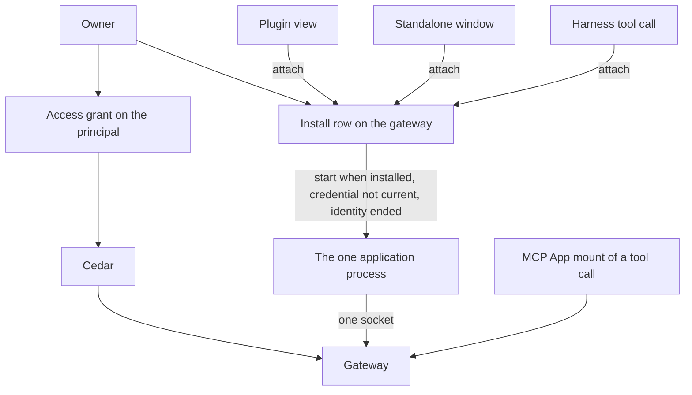
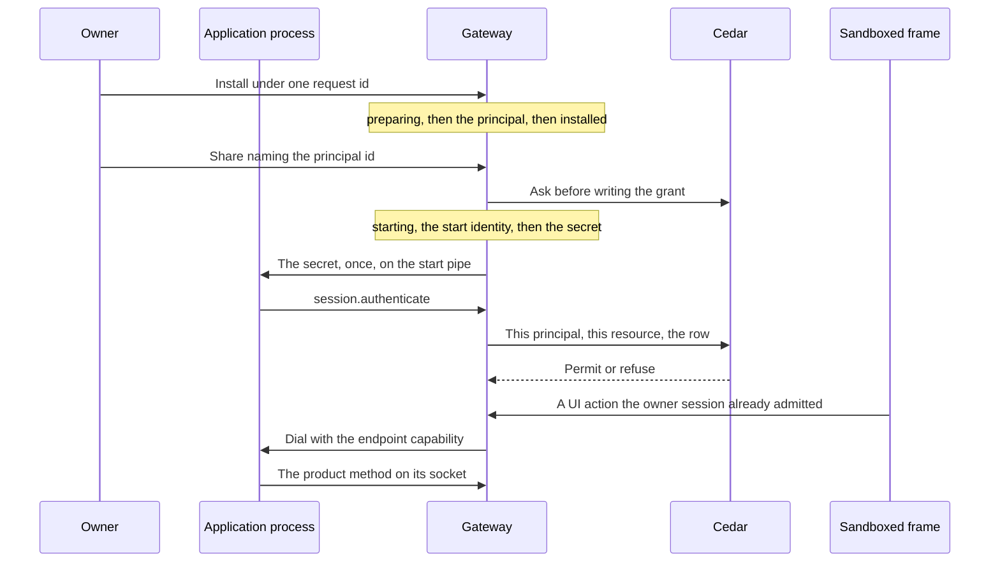

# Application framework

Status: proposal. The pull request that adds this document does not build it.
Public names in the examples are proposals. An ADR, when one is needed, takes
the number of the issue that settles that decision. This document does not
add one.

A developer has two ways to run one package. A **plugin** is a view the
desktop hosts. A **standalone app** is the same package in its own window.
One **application process** holds the gateway session. Cedar decides what
that principal may do with the [access grant](access-grants.md). The
package's own data stays the package's.

Harness scope stays Claude and Codex. Alpha has no migration.

## What is built

### Two clients already talk to one gateway

`@nessa/client` (`packages/nessa-client`) opens a WebSocket to `/session`,
answers `session.challenge`, and sends `session.authenticate`. The
credential decides the principal. The `surface` field is metadata.
[ADR 0010](../adr/done/0010-local-authentication.md) separates that
authentication from Cedar authorization on each later call. The package is
private and is not published. Its README says there is no separate plugin
SDK.

The desktop reads `auth/surfaces/nessa-panel.token` through the host
(`src-tauri/src/surface_credential.rs`) and connects with that owner
credential. Another process connects the same way with its own credential.
`crates/nessa-client-core/examples/read_only_sync.rs` is that second
process for a paired read credential: pair, sync, follow. It does not run
an agent.

`nessa-sdk` runs inside the gateway. A package does not embed it.

Credential kinds that exist (`crates/nessa-auth/src/domain/models.rs`):
`human`, `agent`, `integration`, `gateway`. Pairing is what creates a
`gateway` principal (`gateway:<key>`). `credential.issue` refuses one.
`hold.person` in `crates/nessa-auth/src/adapters/cedar/policies.cedar`
lets a human, agent, or integration hold `server.read`,
`credential.manage`, `conversation.read`, and `conversation.write`.
`hold.peer` lets a gateway principal hold `conversation.read` and
`environment.serve`. Those credential grants name no conversation and no
directory ([access grants](access-grants.md)). `issue.member` requires a
member role. `AuthenticateSession` refuses an inactive membership
(`crates/nessa-auth/src/application/session.rs`).

A second `credential.issue` with a new request id adds another credential
on that principal (`crates/nessa-auth/src/adapters/local/registry.rs`).
The webhook proposal's one-registration refusal is not this registry.

`nessa auth token` is already an integration. The CLI issues one with
`server.read` and `conversation.write`, a new member, and no receiver
(`crates/nessa-server/src/cli/infrastructure/gateway.rs`). It is admitted
by the no-binding owner path. An application cannot be "an integration"
with that path turned off, or those tokens stop being able to write.

### Admission when nothing is paired

`admit_conversation` returns success when the session has no receiver
binding (`crates/nessa-server/src/product/read_access.rs`). `reader` maps
that absence to `Reader::Owner`. `admit_request` then takes the owner
path: the credential's manifest grant, and `Initiation::owner()`. The
comment on that module records why: a gateway that pairs no device has no
binding, so every session reads as the owner.

A paired device is the other path. It has a receiver. Its credential holds
`conversation.read`. Comment and drive are the share row, and Cedar's
`grant.comment` and `grant.drive` also require `signedInAs == bindingOwner`
(`crates/nessa-server/src/conversation/infrastructure/access_policy/cedar/readers.cedar`).
A device meets that because it signs in as the owner. A peer gateway signs
in as itself, so those two permits do not match it. The grant lookup is
`receiver_id`. A row with no receiver is not that lookup
(`crates/nessa-server/src/conversation/infrastructure/store/share_grants.rs`).

`owner.read` and `owner.act` permit the principal whose id is the
conversation's owner
(`crates/nessa-server/src/conversation/infrastructure/access_policy/cedar/ownership.cedar`).
The no-binding success returns before that question is asked.

`mcp.callTool`, `mcp.readResource`, `mcp.sendMessage`, and
`mcp.updateModelContext` require the credential grant `conversation.write`
(`protocol/product/manifest.json`). They are not in
`ADMITTED_BY_ITS_OWN_CHECK`.

Revoking or expiring the credential closes a live socket with
`CredentialRevoked` or `CredentialExpired`
(`crates/nessa-server/src/product/socket.rs`).

### A plugin view is a widget, and an MCP App is a tool call

[ADR 326](../adr/done/326-widgets.md) hosts a view as a `WidgetRef`
(`plugin`, `id`) in a message, a pane, or over the panes. The window place
replaces whatever widget is there
(`openWidget` in `src/desktop/workspace/adapters/store/commands.ts`).
Two kinds share that host (`src/desktop/widgets/ui/plugin.ts`):

- `native` — React the window trusts, registered in composition.
  `widgetRegistry` in `src/desktop/dependencies.ts` registers the sample
  and subagents plugins only beside the sample workspace. A gateway
  window passes none.
- `app` — an MCP App, HTML in the sandbox, registered while the window
  runs.

An `app` plugin id is `mcp:` plus the server name
(`src/desktop/widgets/app/model/app-ref.ts`). Its widget id is the
conversation, the execution, and the tool call. The desktop registers the
plugin when a conversation view has a tool with UI
(`src/desktop/widgets/app/adapters/gateway/gateway-apps.ts`). The gateway
refuses `mcp.callTool` unless that call exists and declared a UI
(`crates/nessa-server/src/mcp_servers/domain/app_call.rs`,
`AppRefusal::AppUnknown`). `app_facts` selects the call by `executionId`
and `toolId`. Policy and audit name the app by those two.
`instanceId` is one mount
(`packages/nessa-client/src/generated/product.ts`, `McpAppReference`).

The mount speaks through the caller's credential. The frame does not
receive it. `ui/message` and `ui/update-model-context` are that mount's
conversation port ([MCP App calls](mcp-app-calls.md)). `requestMode` in
`src/desktop/widgets/app/model/places.ts` opens a pane when an inline view
asks for fullscreen. A ready app pane can still be opened in the window
place. The side rail (`src/desktop/workspace/ui/chrome/side-rail.tsx`) is
a prototype. It is not an install list.

`ui/open-link` and `ui/download-file` have ports. Production composition
does not supply them (`appPorts` in `dependencies.ts`).

### The grant row

[Issue 889](https://github.com/nessalabs/nessa-agent/issues/889) made a
conversation share a capability set: `read`, `read+comment`, or
`read+comment+drive`, plus constraints on a drive grant, plus the grant
epoch (`policy_revision`). Cedar's `grant.read`, `grant.comment`, and
`grant.drive` decide. `ShareGrant.receiver_id` is optional in the struct
for an integration
(`crates/nessa-server/src/conversation/application/share_grants.rs`).
`conversation.share` still refuses a target that is not an active paired
device or peer gateway (`share_target_not_paired`).

[The access-grant proposal](access-grants.md) (merged as
[#888](https://github.com/nessalabs/nessa-agent/issues/888)) is the rest
of that row: subject kind `principal` for an integration or a later
agent, one resource (one conversation, or one directory), capabilities
`read`, `comment`, `drive`, `write`, `exec`, constraints, epoch. Cedar
permits or refuses. `ResourceKind::Directory` is reserved and this build
does not write one. Webhook delivery is that proposal's outbox, not a
second grant. Its share target is an integration credential. This plan
names the application principal instead, and it does not give that share
a URL or a MAC.

```mermaid
flowchart TD
  panel[Desktop with the panel token]
  other[Another process with its own credential]
  gateway[Gateway]
  sdk[nessa-sdk Agent]
  call[Tool call that declared a UI]
  mount[MCP App mount]
  panel --> gateway
  other --> gateway
  gateway --> sdk
  call --> mount
  mount --> panel
  panel --> gateway
```

## What this proposes

One package. One integration principal. One install row, owned by the
gateway. One process. The process holds the one gateway socket and every
operation. The plugin view, the standalone window, and a harness tool
call ask that row to attach. The gateway is the only starter.



The plugin view is the widget window place, drawn in the sandbox, opened
with no tool call. The host asks the gateway to attach and proxies the
frame. It does not exec the package, and it does not dial the package
socket. The frame does not receive the process secret, the endpoint
capability, or the socket name (row H1). The standalone window is the
same attach. The MCP
App mount stays a tool call on the caller's session, drawn by the
desktop with the panel token, as today.

Third-party code is the sandbox or this process. The `native` widget kind
stays the trusted views the window registers in composition.

## One process

The application process is the only process that runs the package's
operations, and it holds the one gateway socket. The gateway owns the
install row and is the only starter. A plugin view, a standalone window,
and a harness tool call reach that process by asking the row to attach.
None of them execs the package. Opening the plugin while the standalone
window is already up is an attach, not a second start. Each installed
package has its own row, its own process, and its own socket. A second
package is a second row. It is not a second process for the first.

The row names the package, the one version, the UI document, the process
entry, and the endpoint. The endpoint file is a private rendezvous of
the same kind as the gateway's `gateway-endpoint.json`
(`packages/nessa-client/src/transport/local-gateway-endpoint.ts`): a
private file, an endpoint instance, and the process id. The application
endpoint is not that file's TCP WebSocket. It is a local IPC socket, a
Unix-domain socket on macOS and Linux and a named pipe on Windows, and
the file holds that socket's name. That file is not a credential. The
endpoint is live only when that file is present and the recorded process
answers. A missing file, or a
process that does not answer, is not live. That is not death, and it is
not permission to start. A start waits until the record is installed,
the credential is not current, and the previous process is confirmed
ended. If the record is installed and a start identity is still stored
and not confirmed ended, a missing file writes `stopping` for that
identity (R6). A `starting` record whose re-read finds no matching
process is T6. A `starting` record whose re-read still finds the
process, and whose file is missing, is T3, T3d, T7, T8, or T9.
Confirmed ended, with the credential still current, is R9.
This plan does not add a second discovery protocol.

The desktop, the standalone window, the frame, and the harness do not
read the endpoint and do not dial it. They ask the gateway to attach.
The gateway is the only process that dials, and only with the endpoint
capability [Endpoint admission](#endpoint-admission) names. Attach then
follows the record.

- The record is installed, the endpoint is live, and the credential is
  current. The caller asks the gateway, and the gateway dials the
  process that published the endpoint. The desktop loads the UI from the
  bytes the gateway fetched, and the standalone window loads the same
  bytes. A harness tool call is that same dial. The harness does not
  receive the capability or the socket name. No process is started. A credential
  that is not current is R8, a stop. A record that is starting, stopping,
  or uninstalling is not this join.
- The endpoint is not live, the record is installed, the stored
  directory opens, the credential is not current, and any start identity
  is confirmed ended. The
  gateway starts the process entry from the row, once. That start stores
  the pid and creation time before it issues, and it writes the secret
  once on the pipe. The process reads it before it publishes the
  endpoint, then authenticates. The caller then attaches. A record that
  is preparing, starting, stopping, or uninstalling does not start. An
  attach on `starting` waits for the pass, and that wait ends at the
  publication deadline. It does not exec another.
- A second start is already in flight, or it finds the endpoint live. It
  exits before it issues and before `session.authenticate`. The process
  that published the endpoint keeps the socket.
- The endpoint is live and the credential is still current, and the
  socket has dropped. The process authenticates again with the secret it
  already holds. The gateway does not issue another credential and does
  not start another process.

The socket in the state table is that gateway session. A harness
session is a caller of the gateway, not a client of that socket. Two
harness sessions are two gateway dials, and still one process and one
gateway socket. A harness session ending closes its dial. The process
stays. The capability stays until E7 or the next committed rotation.

A stored stdio server is a different process: one child per harness
session, ended with that session (`open_admitted` in
`crates/nessa-server/src/mcp_servers/infrastructure/relay.rs`). The
application process is not that child.

## One record

The install record is the single durable owner of one package and of
its process. The [lifecycle table](#lifecycle) is the whole of that
ownership: the phase, the identity, the deadline, and the audit of the
change. The auth registry and this record are not one commit. The phase
is written before each fallible effect, and a crash resumes that phase.
Gateway startup runs one reconciliation pass, and so does any attach,
before a start is considered. The pass does not mint a second principal
and it does not exec. It leaves a record `starting` on T2, T3, or T7 while the stored
deadline has not passed and the re-read still finds the child. T6, T3d,
T9, and R8 leave `starting` earlier. A passed publication deadline is
`stopping` (T8), except the T9 break. T3 issues only after that re-read.

The phases are `preparing`, `refusing`, `installed`, `starting`,
`stopping`, and `uninstalling`.

Four invariants hold on every row of that table.

The package identity is the opened directory, taken before the creating
write. The gateway opens the caller path and stores the identity of that
opened directory: symlinks, `.`, and `..` resolved, and the case the
filesystem reports where the volume does not distinguish case. The
caller spelling is not the key. Two commands that open the same
directory are one record. A path that does not open as a directory is
refused and writes nothing (I0). The registration stores this identity.
A later command resolves the same way and finds the record. It does not
walk the original spelling again. A directory that no longer opens does
not become a second package (D1).

The process identity is a start identity, not a bare pid. Before the
child is released, the record stores the pid and the creation time the
operating system reports for it, at the resolution that system uses to
tell processes apart, both in the same commit as the publication
deadline (T2). A coarser stamp is not the identity. Slice 2 may hold a
stronger handle while this
gateway process is up. Recovery after a restart uses the stored pid and
creation time, re-read from the operating system. A live process with
that number and a different creation time is not the recorded process:
it is not signalled, not injected, and not waited on (T6). A platform
that cannot supply a creation time the gateway can re-read after a
restart does not release the child. The child does not inherit the
registry lock. It stays on the pipe until that commit, then reads the
process secret and the endpoint verifier, and the gateway's pid and
creation time, before it listens, before it publishes an endpoint, and
before `session.authenticate`. A pipe that closes first ends it without
an endpoint and without a socket.

Every wait has a finite deadline. The open that takes the directory
identity uses the command's deadline before a record exists (I0). The
install phase, the release of the child, the publication of the
endpoint, the registry close, and the confirmation of death each store
a finite instant on the record when their phase is written. A gateway
restart does not recompute that instant. The kill deadline is stored
with the stop, beside the close and death deadlines. The slice chooses
each duration and tests it with an injected clock. Infinity is not a
duration. When the instant passes, the row named for that wait runs:
the install command returns not-success and the pass still finishes the
phase (I7); a start that has not stored a start identity returns to
`installed` without a secret (T5); a start that has not published
becomes `stopping` (T8); a registry close that has not committed no longer
blocks the signal once the gateway session is closed (S0s), and every later
pass attempts the close again (S0, S0p, S0u, S0b); a
process that is still the recorded one after the death deadline is
killed, and if it is still that process after the kill deadline the
phase stays `stopping` and R2 does not run (S1b).

Every consequential transition writes its audit record in the same
commit as the state it describes. That audit is not a second sink: a
failed write is a failed phase change, and the pass retries it. The
shape is the one `CredentialTransition` already has
(`crates/nessa-auth/src/domain/transition.rs`): target, before, after,
cause, initiator. The target is the canonical directory, the principal
id when one exists, and the start identity when one is stored. The cause
is the owner command, revoke, expiry, process exit, a deadline, or
reconciliation. The initiator is the owner principal for an owner
command, including an explicit revoke. Expiry, a deadline, a process
exit, and reconciliation are system. They do not name an owner. Expiry
is not a registry cause: the issuance already holds `expires_at`, and
the registry writes no new transition for it
(`TransitionCause` in that file). The secret is not in the record. A
repeat of the same transition does not append a second record; the
original cause and initiator stay. A failed commit leaves the previous
phase, and the command does not report success. Once `stopping` is
committed, the signal does not wait on a later audit write. A failed
confirmation write retries and does not undo the signal. The registry close is its own commit, and the install record does not
claim the close until that commit returns. An owner revoke is `Revoked`
/ `Explicit`, initiator the owner (S0). When the credential is still current, a process exit, a publication
deadline, or a creation-time mismatch is `Revoked` / `ProcessExit`,
initiator system (S0p). A credential that is already not current has no
registry close. An owner uninstall is
`Revoked` / `Uninstalled`, initiator that owner (S0u). Slice 2 adds
`ProcessExit`, `Uninstalled`, and `Initiator::System`. The initiator
today is a principal or the local operator, and the revocation cause
today is `Explicit` or `Superseded`. A process exit has no owner and no
`credential.revoke` command, so neither of those values is its evidence.
Expiry is not one of these commits: the issuance already holds
`expires_at`. After the close deadline, the signal proceeds without
that claim (S0b). Every later pass attempts the same close again. S2
waits for it. Diagnostic logs are not this record. The lifecycle audit is an
append-only log the gateway owns, outside the package directory and
outside the row. S3 appends the transition to absent and the row is
then gone. A restart reads the rows that still exist. It does not
rebuild a row, a tool list, or an attempt from the log.

The owner's install is one command with one request id. The record is
written `preparing` under the canonical identity, with that id, the one
version, and the install deadline, before a principal exists. A second
command for that identity resumes the record and does not mint. The id
is the registry receipt for the principal, the membership, and the
registration, the way `issue_receipts` in
`crates/nessa-auth/src/adapters/local/registry.rs` remembers a credential
issue. A repeated id returns that principal. Principal creation has no
such receipt today. Slice 1 adds one. Slice 2's install command is the
only caller. The command returns when the record is `installed`, when
the directory is refused (I4), or when the install deadline passes
without either (I7). A crash before that retries the same id. A
registration that already names the identity is that principal when the
record is missing: the pass adopts it and does not mint, and it does not
signal a pid taken from an endpoint file. A request id whose receipt
exists and whose registration is gone stays consumed.

A stop writes `stopping`, the start identity, and the close and death
deadlines before the credential is closed and before the process is
signalled. The endpoint file being gone, or the process not answering,
is not confirmation that the start identity has ended. Reconciliation
signals only a process whose pid and creation time still match, then
removes the endpoint file, and only then returns the record to
`installed` with the process down and the credential closed. R2 is
forbidden until then, and it is forbidden while the credential is
current. Installed, the endpoint not live, the credential current, and
the start identity confirmed ended or never stored, is R9: `stopping`,
then S0p. An attach during `starting`, `stopping`, or
`uninstalling` runs the pass and does not launch a replacement.
Uninstall writes `uninstalling` with the same order and ends at absent.

## Authentication

The process uses the existing handshake. The credential names the
application principal, an active member of kind `integration`. The panel
token stays the owner's. A `gateway:<key>` credential stays a peer.

The install command in [One record](#one-record) mints that principal,
its active membership, and an application registration under the install
request id. Install does not issue a credential and does not return a
secret. The principal id is the name share uses, once the record is
`installed`. A credential id is not. A `preparing` record is not a share
target.

The application principal is the subject of a grant. The grant key is
the one [access grants](access-grants.md) already gives an integration:
subject kind `principal`, that principal id, one conversation. The key
does not include a credential id. A process credential issued later is
asked the same grant. Replacing that credential does not move the key.

`conversation.share` and `conversation.unshare` take exactly one target.
`ConversationShareParams` requires `credentialId` today, and that field
is the paired device or peer gateway, as `credential.list` names it. An
application registration is `principalId`, the id A1 minted. Both
fields, or neither, is `invalid_request`. A `credentialId` of this
principal is not a target and not an alias: it is not a paired device.
The command receipt is bound to the principal id. A retry that names a
credential, or another principal, is `invalid_request`.
`conversation.shares` returns `principalId` on that row and no
`credentialId`. The cursor resumes by `grantedAtMs` and that same
target. The change journal stores the principal id and no credential id.
Unshare finds the row by that principal id. It is not found by a
credential the way a paired revoke is.

Product `credential.issue` does not mint a credential for this
principal. `issue.member` permits an integration member on every issue
path today
(`crates/nessa-auth/src/adapters/cedar/policies.cedar`). `issue_sync`
always uses `IssuePath::ProductIssue`. Slice 1 passes the registration
fact into `may_issue`. Cedar forbids the issue when that fact is set
and the path is not the start. Rust gathers the fact and the path and
acts on that answer. It does not compare the registration itself. The
path is the gateway's fact
(`IssuePath`), not a field of the command. The start uses a new path,
`application-start`, which is not `ProductIssue`. Cedar permits that
path for this registration. No product command selects it. A caller
with `credential.manage` gets no secret and no second socket (A14).

The process presents the secret the start injected. It does not call
`credential.issue` or `credential.revoke`. `hold.person` already
permits an integration to hold `server.read` and `conversation.read`.
The start's issue does not put `conversation.write` or
`credential.manage` on it.

The issue uses a new request id. The registry stores the verifier only
(`crates/nessa-auth/src/adapters/local/registry.rs`). The secret is in
the issue result and nowhere else the gateway keeps. A repeated request
id returns `ExistingSecretUnavailable` and no secret, so a start does
not retry an old id to recover one. The gateway writes the secret once,
on the pipe to the process it just exec'd, and does not write it to the
install row, the endpoint file, or a credential file. The same write
carries the endpoint verifier and the gateway's pid and creation time.
The endpoint capability's secret stays in the gateway's memory. The
process reads the pipe before it listens and before it publishes. The
frame does not see the pipe (H1). Who may then dial that process is
[Endpoint admission](#endpoint-admission).

That secret's lifetime is the process. The start path closes any
earlier process credential for this principal before it issues, because
that secret died with the earlier process (A3). The process then has one
current credential, and the grants stay on the principal. A start that
finds the old credential already closed still issues (A2). A product
issue does not. This is not surface provisioning, which is the panel token's
rotation and supersedes whatever credential the principal holds. A
webhook's refusal of a second credential, while its own registration is
current, is that proposal's rule. This principal is not a webhook.

While the process is up and the credential is current, a dropped socket
is that process authenticating again with the secret it holds. The
gateway does not issue a replacement for the drop, and it does not
inject again.

Revoke, expiry, and process exit each have one stop, and the matrix
under [Lifecycle](#lifecycle) is the only match.

An owner revoke, while the record is `installed` or `starting`, is A10.
It writes `stopping` with the start identity and the close, death, and
kill deadlines before any registry close. S0 is that close, and it runs
only for that cause: `Revoked` / `Explicit`, initiator the owner. The
record is already `stopping`.

A process exit the gateway observes is R5. A pass that finds the record
still `installed`, the endpoint not live, and the credential still
current is R6 when the start identity is not yet confirmed ended, and R9
when it is confirmed ended or was never stored. A publication deadline
is T8. A creation-time mismatch, or a start identity already ended
while the record is `starting`, is T6. Each of those writes `stopping`
with initiator system. When the credential is still current, the
registry close is S0p: `Revoked` /
`ProcessExit`, initiator system. An owner uninstall is S0u: `Revoked` /
`Uninstalled`, initiator that owner. `Explicit` stays `credential.revoke`.

Expiry writes no registry transition. After `expires_at` the credential
is not current. The socket arm and a restart that finds the credential
already expired both take R8 when the endpoint is live. Installed, the endpoint not live, and the credential already expired is R6 when the identity is not confirmed ended, and otherwise the steady record an attach may R2. R8 writes `stopping`
and terminates the recorded process. S0 and S0p do not run, because the
credential is already not current. The socket arm still closes the
connection, and that close is not a registry transition. R8 is the only
lifecycle row at `expires_at`.

While the record is `installed`, a live endpoint and a current
credential are a join (R3). On that installed record, a live endpoint
whose credential is not current is R8. A starting record whose endpoint
is live and whose credential is none is T9. During `stopping` the file may still be present, and
that file is not a join. The process is signalled only when its pid and
creation time still match. A later attach does not start while the
record is `stopping`, including when the gateway died after the close
and before the signal, and including when the endpoint file is already
gone. R2 does not start while the credential is still current.
Reconciliation confirms that start identity has ended, removes the
endpoint file, and returns the record to `installed`. The next attach is
then one start. Uninstall writes `uninstalling` the same way, and there
is no next start.

The registration is the fact Cedar sees. It is not a fifth principal
kind. Slice 1 asks Cedar on the no-binding path and passes that fact:

- No registration. The owner fallback stays. That is the panel token,
  the owner, and `nessa auth token`.
- An application registration. The fallback does not match. A
  principal-subject grant on that resource permits, and anything else
  is refused. `owner.act` does not match this principal.
- A paired receiver stays on the receiver path already built.
- `mcp.*` is not a grant capability. The application process is not
  given a way to present those methods.

`grant.comment` and `grant.drive` as written require a binding owner.
They do not match an integration that signs in as itself. Slice 1 adds
the principal-subject permits for a principal that has an application
registration. Rust gathers the registration, the row, and the action,
and acts on Cedar's answer.

The share above is how an application registration is named. A webhook
registration, when that slice exists, keeps the target that proposal
gives it. This check does not read a webhook URL or a package path, and
it does not accept a browser token, which has neither registration. The
two registrations are two kinds of one record per principal. Each
command refuses a principal that already has the other kind.

A directory grant (`write`, `exec`) stays the directory slice of #888.



## Endpoint admission

The endpoint file is a rendezvous. It holds the local socket's name,
the endpoint instance, and the process id. Reading it, or connecting to
the socket it names, admits nobody. A private file does not stop another
process of the same user, including another installed package.

Two checks admit a connection, and they are authentication, not policy.
Proving the peer is the gateway stays in the process, the way a
credential proves who is at a socket. Cedar decides whether the caller
who asked the gateway may take the action, before the gateway dials.
The process does not compare principals and does not keep an allow list.

The peer check reads the kernel's identity of the socket peer at
accept. On macOS and Linux that socket is a Unix-domain socket, and the
pid comes from the kernel's peer credentials. On Windows it is a named
pipe, and the pid comes from the kernel's client-process query. The
creation time is re-read the same way T2 re-reads a child. It is not a
field in the endpoint file and not a value the caller sends. The
enrolled peer is the gateway identity the process read on the start
pipe, or the identity a later rotation installed. A TCP accept does not
yield those values, so the endpoint is not a loopback TCP port and not
a WebSocket URL. A platform whose IPC socket cannot re-read a peer's
pid and creation time does not accept connections. The supported
desktops' sockets can.

The endpoint capability is the other check. It is not the process
credential. The process credential is what the process presents on
`session.authenticate`. The capability is what the gateway presents on
the dial. T3 mints it in the same step as the process secret. The pipe
carries the process secret, the capability's verifier, and the gateway's
pid and creation time. The capability secret stays in the gateway's
memory. The process enrolls the verifier and the peer before it listens,
before it publishes, and before it accepts. The record commits the capability generation before that pipe write,
and the audit names that generation. Secret-delivered is stored only
after the write returns. The secret and the verifier are not on the record, the
endpoint file, a credential file, or the audit. The process's enrolled
verifier is the only accept decision. The generation is the audit name.
The record does not accept or refuse a connection.

A gateway restart drops the secret. The gateway does not dial until E9.
A socket drop while the gateway still holds the secret does not rotate:
A13 re-authenticates the process, and the next dial is E1 with the
secret already held. E9 runs only after that re-authentication, and only
when the gateway holds no secret for the committed generation. The
gateway sends a new verifier and the new gateway pid and creation
time on that socket. The process swaps to them and drops the old
verifier. The record bumps the generation, and writes the audit, only
after that swap is acknowledged. A crash before that commit retries the
same rotation. A dial that presents the retired verifier is E3. Stop,
uninstall, and process exit drop the verifier and the secret together
with the phase change (E7). The capability is not a registry credential
and has no product issue path.

The desktop, the standalone window, the frame, and the harness never
receive the capability or the URL as authority. They ask the gateway.
The gateway fetches the UI document over the admitted dial, and the host
gives those bytes to the frame. The frame is the same sandbox as an MCP
App frame. Its bridge messages go to the host. The host asks the
gateway. Ending that caller's session ends the ask. It does not by
itself retire the capability. E7 or the next committed rotation retires
it.

Four invariants hold on every row below.

The endpoint file is not a credential. A client that only has the file
is refused.

The process accepts a connection only from the enrolled gateway peer and
only with the verifier it currently holds. Anything else is closed and
writes no attempt record.

The gateway dials only when it holds the secret for the generation the
record has committed, and only after Cedar has permitted the caller who
asked. A caller does not receive that secret.

A direct dial is not a Cedar request. There is no principal on that
socket until the peer is the gateway, and a scanner is not given one.

| Row | Caller | What it presents | Record | Result |
| --- | --- | --- | --- | --- |
| E1 | owner session or the gateway tool path, Cedar already permitted | the gateway dials: the kernel peer matches, the capability matches the enrolled verifier, and the gateway holds that secret | the process is accepting | the request enters the process. The host renders bytes the gateway fetched. The tool path is one dial on the turn's existing policy |
| E2 | any process that is not the enrolled gateway, including another package, a scan, the desktop, the harness, or the frame | a connection to the socket, with the file's contents or a copied capability | the process is accepting | refused at accept. No attempt record. The kernel's peer identity is the check |
| E3 | the enrolled gateway peer | a capability that is absent, from another start, or a generation the process has retired | accepting | refused. No attempt record. If the gateway still holds the secret for the generation the process enrolled, the next dial is E1. If it holds no secret for that generation, E9 mints a new one |
| E4 | owner session or the tool path, Cedar already permitted | the gateway holds no capability secret | process up, a generation is committed | the gateway does not dial and does not read the file as a fallback. The ask waits until E9 commits |
| E5 | the frame | nothing. It is not a caller | any | the document and the bridge do not carry the URL or the capability (H1). A dial the sandbox failed to stop is the dialed row for that phase: E2 while the process is accepting, E7 while the record is stopping or uninstalling, E8 while nothing is accepting |
| E6 | another application principal | an ask to the gateway to reach this package | any | no policy permits one application principal to attach to another package. Cedar's refusal says that no policy matched. Rust does not compare the two principal ids. The gateway does not dial. No attempt on this process |
| E7 | any | a dial, or an ask | stopping, uninstalling, or the verifier has been dropped | the process refuses. The gateway has dropped the secret and does not dial |
| E8 | any | a dial | preparing, starting before enroll, or the start identity confirmed ended | nothing accepts. That is not admission and not a start |
| E9 | the gateway, after the process has authenticated again, and only when the gateway holds no secret for the generation the process enrolled | a new verifier and the new gateway pid and creation time, on the process's gateway socket | installed, endpoint live, credential current | the process swaps and drops the old verifier. The record then commits the new generation and the audit, cause reconciliation, initiator system, with no secret. Until that commit, a dial is E4. A gateway that still holds the secret for the enrolled generation does not run this row; its next dial is E1 |
| E10 | the child, on the start pipe | the process secret, the verifier, and the gateway identity | starting, at T3's pipe write, and only after the generation commit has returned | the process enrolls them before it listens. Until then the socket is E8. The generation is already on the record. Secret-delivered is stored only after the write returns |

Caller and proof, when a second row would otherwise be easy to miss:

| Asked the gateway or dialed | Peer | Capability | Gateway holds the secret | The one row |
| --- | --- | --- | --- | --- |
| asked by the owner session or the tool path, or dialed | either | any | record stopping or uninstalling, or the verifier is dropped | E7 |
| asked by the owner session or the tool path, or dialed | either | any | process not accepting, record not stopping or uninstalling | E8. The gateway does not dial |
| asked, another application principal | — | any | any phase | E6 |
| asked, the frame | — | any | any phase | E5. A connection the frame opens anyway is the dialed row for that phase |
| asked, owner session or tool path | enrolled | the generation the process holds | yes, process accepting, not stopping or uninstalling | E1 |
| asked, owner session or tool path | no dial yet. The restart's pid is not enrolled, and this row does not dial | the gateway holds no secret | process accepting, not stopping or uninstalling | E4, until E9 commits a verifier for the new gateway pid |
| asked, owner session or tool path | enrolled | a generation the process has retired, and the gateway still holds the secret for the generation the process enrolled | process accepting, not stopping or uninstalling | E3 for that dial, then E1 with the held secret. Not E9 |
| asked, owner session or tool path | enrolled | a generation the process has retired, and the gateway holds no secret for the generation the process enrolled | process accepting, not stopping or uninstalling | E3 for that dial, then E9 |
| dialed | not the enrolled gateway | any, including a copy of the file | process accepting, not stopping or uninstalling | E2 |
| dialed | the enrolled gateway | none, stale, or another start | process accepting, not stopping or uninstalling | E3 |

E5 holds in every phase: the frame is not given a route. E6 holds in
every phase: another application principal is not admitted. E7 is an
owner ask or a dial while the record is stopping or uninstalling, or
the verifier is dropped. E8 is an owner ask or a dial while nothing is
accepting and the record is not stopping. The remaining rows are a
process that is accepting and a record that is not stopping. E9 is the
rotation that moves the generation the process holds, and it is how E4
ends. E10 is enroll, and it finishes before the socket accepts. A second
row that also fits is a defect.

## Actions

The base contract is plain TypeScript. It does not import React or a
state library. Redux adapters are out of scope. Two functions, illustrative:

```ts
defineUiAction({ name: "selectChart" })
defineOperation({ name: "saveDashboard" })
```

The public module is what a browser or a sandbox may import. The service
binding lives on a second entry of the same package,
`packages/nessa-app`. The browser entry does not re-export it. The slice
that adds the package holds that with an import test.

A UI action names one live view. The process runs it there. A closed
view, or a different one, is `surface_unavailable`, and the call does not
become an operation and does not write the package's data.

An operation runs in the process. Closing every view leaves it running.
The acknowledgement is the process's. A view that has gone does not
report success (O3). The same request id and the same body, under the current installation's
principal, are the same attempt. A second body under that request id is
refused, and the first attempt is left as it was. A phase stored under
any other principal is not this attempt (O12).

The attempt is a record in the process's own store: the principal id,
the request id, the body, and the phase. The phase is the outbox. It is
not the dashboard document. [The attempt](#the-attempt) is every phase.
For app-owned data the write and its receipt are one commit in that
store, under that principal, so there is no gap between the effect and
the receipt. For a Nessa resource the process stores the gateway receipt
before it acknowledges, and a restart of the same installation repeats
that effect's request id. The gateway treats the calling principal and
that id as the same command. Restart reads the current principal's phase
and performs only an effect that has no receipt (O9–O11).

The package's own dashboard record is app-owned data. Cedar is not asked
for an operation that names no Nessa resource, because the record is not
a Nessa resource. An operation that names both lists every Nessa effect
before any app effect, under one request id. Cedar runs inside the
gateway command, once. A refusal of that command before any receipt
writes no app effect (row O8). An admitted command keeps the epoch in
its receipt (O5).

Registering an operation as an MCP tool is explicit data in the
package manifest: the tool name, the input schema, and whether it has a
UI. I3 copies that list onto the install record. The process is not
executed to discover it, and a registration the process performs is not
the list. K2 publishes the copy into the live set before any agent,
including while the process is down, so a call can see the tool and
then R2. A name that is not on the record is not a tool. A listed tool
travels the gateway's existing MCP path to Claude or Codex as a
stand-in. The gateway dials the row's endpoint with the endpoint
capability. The harness does not receive the URL or the capability. If
that endpoint is not live, R2 starts the process before the dial, and
only when the record is installed, the directory opens, the credential
is not current, and any start identity is confirmed ended. Any other
phase waits for the pass and does not exec. Its UI, when the tool
declares one, is the MCP App mount already built, on the caller's
session. The turn's tool policy is unchanged. The dial is E1.

The reference package is a dashboard at `examples/dashboard`. It is not
imported by `src/desktop`. Selecting a chart is the UI action. Saving the
dashboard is the operation.

## Context

A live view may publish a bounded context: what is selected. Replacing it
drops the previous value. Closing the view drops it, and a later send
does not attach it. Two views keep two values.

That context is not `ui/update-model-context`. That method stays the
tool-call mount's port. The bytes a person-send carries from a plugin
view are for the plugin-entry slice to fix. This document fixes when the
value exists.

## States

Rows marked **built** are current behavior. The other rows are the
contract the slice named in [Slices](#slices) tests. Issue, bump, and
revoke of a grant stay the grant table in
[access grants](access-grants.md). The facts below are independent. A
flat status such as "granted" is not a state.

| Fact | Values |
| --- | --- |
| Principal | absent, or present as an active member |
| Credential | none, current, or closed (revoked or expired), per credential |
| Process secret | absent, or held by the running process |
| Grant on resource R | absent, or active at an epoch |
| Install record | absent, preparing, refusing, installed, starting, stopping, or uninstalling |
| Directory identity | the opened directory, or refused |
| Endpoint | live, or not live (no file, or the recorded process does not answer) |
| Endpoint capability | none, or a generation committed on the install record before the pipe write. The secret stays in the gateway. A live endpoint with no committed generation is not adopted |
| Secret delivery | not delivered, or written on the pipe. The secret is not stored |
| Start identity | none, or pid plus creation time not yet confirmed ended, or confirmed ended |
| Deadline | none, or a finite instant stored on the record |
| Attempt phase | absent, opened, a prefix of receipts, done, refused, or incomplete, and only inside the current installation |
| Installation | the principal id minted for this install, or none |
| Tool descriptors | absent, or the manifest copy stored on the install record |
| Process | down, or up — at most one |
| Socket | closed, or open. While the record is stopping, uninstalling, or refusing, an open socket is not authority |
| View | absent, or live with an id |
| Window place | empty, or showing one widget |
| Operation | idle, running, or uncertain |

### Principal, credential, grant, socket

| Row | Before | Event | After | Effect |
| --- | --- | --- | --- | --- |
| A1 | no principal for this install request id, and no registration for this canonical directory | that id is minted | one principal, registration written with that identity and the id, credential none, no grants | the same id returns this principal; a registration for the identity returns it too; neither mints another; the caller spelling is not stored |
| A2 | record starting, this start identity stored, no current process credential (none or closed) | the gateway's start issues on `application-start`, request id already on the record | one credential current, secret held by that process, record still starting | not `ProductIssue`; verifier stored; the secret is not on the row, the endpoint, the audit, or a later read of that request id; no issue before the start identity is stored; a closed credential is this row; the registry commit includes the issuance transition; the pipe write that delivers this secret also delivers the endpoint verifier and the gateway's pid and creation time, and only after the generation commit has returned; the capability secret stays in the gateway; a pipe write that does not return is T3d and this secret is not held |
| A3 | record starting, this start identity stored, an earlier process credential current, that earlier start identity confirmed ended | the start, same path | that credential closed, one new credential current, secret held by the new process | grants stay on the principal; the new request id is not the old one; the closed secret is not replayed; this does not run while a start identity is unconfirmed; the close is `Revoked` / `ProcessExit`, initiator system, and the issuance is its own registry transition; R2 and S2 already require the credential not current, so this close is the break of that order |
| A4 | record installed, registration written | owner shares conversation R, naming `principalId`, Cedar permits | grant R active, keyed by that principal | a phase other than installed is refused; a current process credential does not block a second conversation; no `credentialId` on the row, the list, the cursor, or the receipt; the epoch of that commit |
| A14 | application registration present | product `credential.issue` for that principal, any caller, new request id | unchanged | Cedar forbids; no credential and no secret; `issue.member` does not decide this |
| A5 | grant R active | owner shares a set Cedar denies | unchanged | nothing written; the policy ids |
| A6 | credential current, and the record is not stopping, uninstalling, or refusing | that credential authenticates | its socket open | inactive membership is refused, as `AuthenticateSession` does today; those three phases are the refusal row below |
| A6d | record stopping, uninstalling, or refusing, credential current | `session.authenticate` | socket stays closed | refused by the phase. The registry credential may still be current. S0s is an already-open socket. This row is a new authenticate. The registry close keeps retrying |
| A7 | socket open, grant R active | read or follow R | unchanged | Cedar permits; the epoch just read is stamped |
| A8 | socket open, grant R absent | read or follow R, or list it | unchanged | Cedar refuses; no row created |
| A9 | grant R active | owner unshares, naming `principalId` | grant R absent | a `credentialId` does not find this row; sockets stay; the next admission misses R |
| A10 | credential current, record installed or starting | the owner revokes that credential | record stopping, the start identity kept when one is stored, close, death, and kill deadlines stored, credential still current | the stop and its audit commit before the signal; initiator the owner; the registry close is S0; expiry is R8 and is not this row; grants and epochs stay; R2 is forbidden |
| A13 | record installed, process up, endpoint live, socket closed, credential current, secret held by the process | the socket drops and the gateway is back | socket open | the process authenticates with the secret it holds; when the gateway still holds the endpoint capability, it dials with that secret and does not rotate; when a restart has dropped the secret, E9 rotates it and the gateway does not dial until that generation is committed; no issue, no injection, no stop, no second process |
| A11 | record preparing, installed, starting, or stopping | owner uninstalls, one request id | record uninstalling, start identity kept if one was stored, close, death, and kill deadlines stored | the same id resumes this removal; it does not mint and it does not start; a refusing record is not this row, and its cleanup is I4a then I4b; this commit includes the audit |
| A12 | credential current, no grants, and the record is not stopping, uninstalling, or refusing | authenticate | socket open | A8 on every conversation; those three phases are A6d |

A4 applies again for a second conversation. The result is a second row,
still keyed by the principal. A9 on one row leaves the other. A6 is the
process's socket. A6d is that authenticate while the record is stopping,
uninstalling, or refusing, and it does not open a socket. A second process is R4: it exits before it execs and
before this authenticate. A2 and A3 run only inside `starting`, after
that start identity is on the record. A10 does not by itself close
the credential, kill the process, or remove the endpoint. The close is
S0, still in `stopping`. Expiry is R8: the credential is already not
current, and S0 does not run. A process exit closes through S0p. A13 is the same process and the same
credential, and it does not run while the record is starting, stopping,
or uninstalling. A socket that drops during `starting` uses the secret
just issued. That is the same process and not a new issue, and it is not
A13, which is the steady state after T4. A14 is every product issue,
including one from the owner.

### Lifecycle

This is the one table for the install record and the process it owns.
A phase-changing row commits its audit record in that same write. A row
that waits names the deadline that ends the wait. The registry effects
A1, A2, A3, and the credential half of A10 and A11 commit inside the
registry, with that store's `CredentialTransition`, at the row that
names them. Share, admission, and the socket stay the table above.
Which row runs is [the matrix](#which-transition-runs). A record matches
one line of it.

| Row | Before | Event | After | Deadline | Effect |
| --- | --- | --- | --- | --- | --- |
| I0 | a caller path, no record yet | owner installs | one canonical directory identity, or refused | the command's install deadline, before any record exists | the identity is the opened directory; if the open has not returned by that deadline the command returns not-success and writes nothing; a path that is not a directory writes nothing; two spellings are one identity |
| I1 | no record and no registration for that identity, and the manifest's tool server name is not in the gateway's name set | the install continues, one request id | record preparing, that id, that identity, one version, no principal, that server name reserved, install deadline stored | stored here; not extended by a restart | nothing is minted until this write commits; this write is the only creating write for the identity and for that server name; the name set is the install records, the stored MCP servers, and the built-in server names; K5 is the same write when the name is already in the set, and then this row does not commit; the audit is in this commit; a second command resumes this record |
| I2 | record preparing, endpoint file absent, credential not current, directory is a package, registry has no receipt for the id | reconciliation or the install command continues | registry receipt and one principal (A1), record still preparing | the caller's wait is I7; this row still runs after that | the registry commit that mints the principal includes its audit, and a failed registry commit leaves preparing and no principal; I4 is not this row |
| I2a | record preparing, endpoint file absent, credential not current, directory is a package, registry receipt exists, principal not yet on the record | reconciliation or the install command continues | that principal on the record, record still preparing | the caller's wait is I7; this row still runs after that | it does not mint another; I4 is not this row; a repeat does not append a second audit |
| I3 | record preparing, endpoint file absent, credential not current, directory is a package, principal present, server name already reserved by this record | reconciliation or the install command continues | record installed, endpoint not live, process down, credential not current, tool descriptors copied, and the server published when the gateway is already running | the caller's wait is I7; this row still runs after that | the command returns success; the descriptors are the manifest's explicit tools, copied in this commit; the process is not executed to discover them; a gateway that is already running publishes the server in this same commit; K2 is that publish when the gateway itself is starting; K5 is not this row; I4 is not this row; the audit is in this commit |
| I4 | record preparing, endpoint file absent, credential not current, directory is not a package | the install command or reconciliation | record refusing. The registry is unchanged in this commit | none; this is the refusal | checked before I2, on the command as well as the pass; this commit is the install record only; the command returns refused; the request id stays consumed; the same id does not mint again; I3 does not run after this commit; the audit is in this commit |
| I4a | record refusing, no gateway session open, and the principal or its registration is still present | reconciliation continues | registry principal, registration, grants, credentials, and that principal's command receipts removed. The install request id's receipt stays. The record stays refusing | none | an open session is S0s; the registry commit runs before the row is removed; a crash after it resumes at I4b; a crash before it resumes here; I3 does not read the directory; I5 does not adopt, because the record exists; the audit is in this commit |
| I4b | record refusing, no gateway session open, principal absent, registration absent | reconciliation continues | record absent, server name released | none | an open session is S0s; the row is removed only after I4a's commit has returned; a directory that is a package again is not I3; the refused id does not install; I6 is a later retry of that id; the audit stays in the gateway log |
| I5 | no record, an application registration names this identity, and the manifest's tool server name is not in the name set | reconciliation or a later install | record preparing around that principal, that server name reserved; an endpoint file with no stored start identity is removed | none | no second principal; the name reservation is the same set as I1; K5 is this write when the name is already taken, and then this row does not commit; a pid in that file is not signalled and not adopted; a current process credential for the principal is closed as `Revoked` / `ProcessExit`, initiator system, without a signal; the runtime exits when that credential closes and does not publish again; the audit is in this commit |
| X1 | record preparing, and an endpoint file is present or a process credential is current | reconciliation or the install command continues | record still preparing; the endpoint file is absent; a current process credential is closed | none | no stored start identity, so no signal and no adopt; the close is `Revoked` / `ProcessExit`, initiator system; then the preparing line, which is I4, I2, I2a, or I3; a pid in the file is not signalled |
| I6 | no record, that request id's receipt exists, no registration | the same id is presented | unchanged | none | the id stays consumed; no audit of a new install |
| I7 | record preparing, install deadline passed, a caller is still waiting | the deadline | record unchanged | this is the caller's timeout | the command returns not-success; one audit, cause deadline, initiator system; the pass still runs X1, I2, I2a, I3, or I4; this record already reserved its server name at I1, so K5 is not this row; a retry of the same id resumes those rows and does not mint |
| V1 | a record exists for this identity | owner installs again | unchanged when the version differs; the same record when the version is the same | none | a different version is refused and not rewritten; the same version does not mint and does not start a second process |
| D1 | record present, the stored directory does not open | start or reconciliation | no second record; the phase row still runs | the release deadline from T1, or the publication deadline from T2, and the death deadline if stopping | R2 is refused; R6, R8, R9, and a stop still run; uninstall still runs |
| T1 | record installed, directory opens, endpoint not live, credential not current, start identity confirmed ended or none | a start begins | record starting, no start identity yet, release deadline stored | stored here; not extended by a restart | this write commits before exec; R2 does not begin again; a current credential is R9 or R6, not this row; a leftover file is not a live process; the audit is in this commit |
| T2 | record starting, no start identity, credential not current, this start is in flight, release deadline not passed | the start continues | pid and creation time stored, publication deadline stored, secret not written, child not released | publication deadline stored here | both commit before the child runs; the creation time is at the operating system's resolution for telling processes apart; a restart does not extend the deadline; a platform with no re-readable creation time does not release the child |
| T3 | record starting, start identity stored, endpoint not live, the re-read finds that process, creation time matches, the process does not answer, publication deadline not passed, this start has not issued, secret not delivered, and this is the in-flight issuer | the start continues | secret held by that process only after the pipe write returns (A2, or A3 when an earlier credential is still current), record still starting, secret delivered, capability generation stored | T8 | the issue request id is stored before the call; an earlier current credential is closed here as `ProcessExit`, initiator system, before the issue; the pipe write re-reads in this same step and writes the process secret, the endpoint verifier, and the gateway pid and creation time only while that re-read still finds the child; the capability secret stays in the gateway; after the issue returns, the generation is committed on the record before the pipe write, and the secret is not in that commit; a generation is not committed when the issue does not return; secret-delivered is stored only after the write returns; a generation commit that does not return discards the capability secret and does not write the pipe; a miss, or a write that does not return, discards the secret and does not retry the request id. The endpoint is not live at the start of this row. If it is live by the time the failure is observed, the pass takes T4 when a generation is committed and T4s when it is not. Otherwise the cell is T3d when the re-read still finds the child, and T6 when it does not; a pass that is not this issuer is not this row; a child that already answers with no credential for this start is T9; a re-read that finds no process is T6 |
| T3d | record starting, endpoint not live, credential current for this start, secret not delivered, and the re-read still finds that process | the issue committed and the pipe write did not, or this pass finds that pair | record stopping, close, death, and kill deadlines stored, stored stop cause reconciliation | those deadlines | the secret is discarded and not stored; the request id is not retried (`ExistingSecretUnavailable`); the registry close is S0p, `Revoked` / `ProcessExit`, initiator system; the install audit's cause is reconciliation, initiator system; not T7 and not a second issue; a re-read that finds no process is T6; an endpoint that is already live is T4 when a generation is committed and T4s when it is not; the audit is in this commit |
| T4 | record starting, start identity matches a live process, endpoint live, credential current, capability generation committed | reconciliation or the start continues | record installed, process up, secret delivered, that generation kept | the deadline no longer applies | adopts this process; a missing secret-delivered bit is stored in this commit, because a live endpoint means the pipe write was read; the generation was committed before that write, so a gateway crash after the write still names it; the capability secret, if the crash dropped it, is recovered by E9 and not by minting here; no exec; no second issue; no second capability; T4s is not this row; the audit is in this commit |
| T4s | record starting, start identity matches a live process, endpoint live, credential current, no capability generation committed | reconciliation | record stopping, close, death, and kill deadlines stored | those deadlines | does not adopt; does not commit a generation the process reports; the gateway cannot name a generation it never stored, so E9 cannot rotate; S0p closes the credential; cause reconciliation, initiator system; the audit is in this commit |
| T5 | record starting, no start identity, credential not current, and either no in-flight start remains or the release deadline T1 stored has passed | reconciliation | record installed, process down, credential not current | the release deadline | no secret was issued for this start; an earlier revoked or expired credential stays that way; a child whose pipe closed exits without an endpoint; a file with no stored start identity is removed and not adopted; this pass does not exec; before that deadline an in-flight start stays on T2, whether or not the gateway process is still up; a current credential with no start identity is T9; the audit is in this commit |
| T9 | record starting, and when a start identity is stored the re-read still finds that process, and one of these holds: a credential is current and no start identity is stored; the current credential belongs to an earlier start, this pass is not the issuer, and the process does not answer; this pass is not the issuer, the credential is none, a start identity is stored, the process does not answer, and the publication deadline has not passed; the credential is none and the recorded process answers, or the endpoint is not live, an earlier credential is still current, and the recorded process answers | reconciliation | record stopping, deadlines stored, no new credential | those deadlines | a process that answers with no credential for this start is this row, including after the publication deadline; a child that does not answer yet, on the in-flight issuer, before that deadline, is T3; a re-read that finds no process, or a creation-time mismatch, is T6 and not this row; a live endpoint whose credential is revoked or expired is R8; a live endpoint whose credential is none stays this row; no adopt and no second issue; S0p when a credential is current, otherwise S1; cause reconciliation, initiator system; the audit is in this commit |
| T6 | record starting, and the re-read finds no process with the stored pid and creation time, or the creation time mismatches | reconciliation | record stopping, that start identity, close, death, and kill deadlines stored | those deadlines stored here | the pass matches this row before T3, T3d, T8, and T9; this pass does not exec, does not issue, and does not signal the mismatched process; S0p when the credential is current, otherwise S1; not S0; cause process exit, initiator system; a current credential is not left on an installed record; a secret that was not written is discarded and its request id is not retried; the audit is in this commit |
| T7 | record starting, start identity stored, endpoint not live, publication deadline not passed, the re-read still finds that process, creation time matches, the credential current was issued for this start identity, and the secret was delivered on the pipe | reconciliation | record still starting | T8 | no exec, no second issue, and no signal; the process may answer or not; this wait is the issuer after the pipe write; a mismatched creation time is T6; a revoked or expired credential is R8; a current credential that was not issued for this start is T9; the in-flight issuer that has not issued yet is T3; a current credential whose secret was not delivered is T3d |
| T8 | record starting, start identity stored, endpoint not live, publication deadline passed, the re-read still finds that process, creation time matches, and either the credential is none and the process does not answer, or the credential is current for this start and the secret was delivered, or an earlier credential is still current and this pass is the issuer and the process does not answer | reconciliation | record stopping, that start identity, close, death, and kill deadlines stored | this is the timeout | S0p when the credential is current, otherwise S1; not S0; a process that answers while this start has not issued is T9; a secret that was not delivered is T3d; a pass that is not the issuer, with an earlier credential still current, is T9; a re-read that finds no process is T6; this pass does not exec; R2 waits for S2; cause deadline, initiator system; the audit is in this commit; a failed commit retries on the next pass; the signal follows the committed stop and does not wait on a later audit write |
| S0s | record stopping, uninstalling, or refusing, and a gateway session for this principal is open | the pass, before the registry close and before the signal | session closed, phase unchanged, registry credential unchanged | none | the socket is dropped; `session.authenticate` is refused while the phase stays stopping, uninstalling, or refusing; the registry close is not this row and keeps retrying; S1 does not match until this row has run; a restart has no session, and the refusal still holds |
| S0 | record stopping or uninstalling, credential current, cause is an owner revoke, no gateway session open | every reconciliation pass attempts the registry close | credential closed when that commit returns; otherwise unchanged | attempted on every pass, including after the close deadline | commits `Revoked` / `Explicit` with initiator the owner; S0p and S0u are not this row; an open session is S0s; expiry is not a registry cause, the issuance already holds `expires_at`, and the credential is then not current without this row; a repeat does not write a second transition; a later uninstall keeps this cause |
| S0p | record stopping or uninstalling, credential current, cause is process exit, a deadline, or reconciliation, no gateway session open | every reconciliation pass attempts the registry close | credential closed when that commit returns; otherwise unchanged | attempted on every pass, including after the close deadline | commits `Revoked` / `ProcessExit` with initiator system; not `Explicit` and not an owner; slice 2 adds that cause and `Initiator::System`; S0 and S0u are not this row; a repeat does not write a second transition |
| S0u | record uninstalling, credential current, cause is the owner uninstall, no gateway session open | every reconciliation pass attempts the registry close | credential closed when that commit returns; otherwise unchanged | attempted on every pass, including after the close deadline | commits `Revoked` / `Uninstalled` with initiator the owner; not `Explicit`, which is `credential.revoke`; a revoke that already selected S0 stays S0; a repeat does not write a second transition |
| S0b | the close selected by S0, S0p, or S0u did not return, the close deadline has passed, and no gateway session is open | the same pass, after the attempt | phase unchanged, close still owed, stored stop cause unchanged, session stays closed, S1 allowed | this is the timeout | an open session is S0s and S1 does not run; S2 and S3 do not run until that same close's commit returns; the next pass attempts that same close; the deadline audit does not replace the stored stop cause; R2 stays forbidden; the registry credential may still be current, and it is not a session; one audit, cause deadline, initiator system |
| S1 | record stopping or uninstalling, the live process still matches the stored pid and creation time, credential not current or S0b, no gateway session open, death deadline not passed | reconciliation | that start identity signalled | death deadline stored with the stop, not extended by a restart | an open session is S0s and is not signalled; a mismatched creation time is S1c and is not signalled; a missing file is not this confirmation |
| S1b | that start identity still matches after the death deadline | reconciliation | that process is killed; if it still matches after the kill deadline, the phase stays | the kill deadline stored with the stop, not extended by a restart | R2 does not run; the next pass retries the kill; the original stop cause stays |
| S1c | record stopping or uninstalling, the ended confirmation is not stored yet, and the re-read finds no process with the stored pid and creation time, or the creation time mismatches, or no start identity was stored | reconciliation | ended confirmation stored, endpoint file absent | none | this re-read is the confirmation later rows require; a missing endpoint file while the re-read still finds the process is S1; not a `preparing` or in-flight `starting` record; the audit is in this commit; a failed confirmation write retries and does not undo the signal |
| S2 | record stopping, credential not current, ended confirmation stored | reconciliation continues | record installed, process down, credential closed or none | none | S1c stores that confirmation, and this row matches after that commit; a later attach may R2; grants stay; the audit is in this commit |
| S3 | record uninstalling, ended confirmation stored, credential not current | reconciliation continues | record absent, principal absent, grants removed, credentials closed, that principal's command receipts removed | none | S1c stores that confirmation, and this row matches after that commit; the registry commit runs first and removes the principal, its grants, its credentials, and the command receipts keyed by that principal; the install row is removed only after that commit returns; a crash after the registry commit resumes here, the principal is already absent, and I5 does not adopt it; a crash before the registry commit is still this installation; the principal id is not reused; files left in the package directory are not attempts, tools, or an endpoint once that commit has returned; the same uninstall id resumes here; a retry does not install; the audit stays in the gateway log; the audit is in this commit |
| R1 | no record | owner installs a directory | I0, then I1 or K5 or I5, then I4 or I2 or I2a, then I3 | I7 ends the caller's wait; the pass continues | one version; a different version of an existing identity is V1; a server name already in the name set is K5, and I1 and I5 do not commit; a crash resumes the same request id; I6 does not install |
| R2 | record installed, directory opens, endpoint not live, credential not current, start identity confirmed ended or none | plugin, window, or a tool call asks to attach | T1, then T2, then T3, then T4 | T8 bounds the publication | the caller does not exec and does not dial; preparing, starting, stopping, and uninstalling are not this row; a current credential is R9 or R6, not a start; a crash resumes T3, T3d, T4, T5, T6, T7, T8, T9, or R8 instead of a second exec; R6 is the row when a start identity is stored and not confirmed ended |
| R3 | record installed, endpoint live, credential current, start identity matches | another of those asks, including the plugin while the window is up | unchanged | none | the gateway dials with the current endpoint capability (E1) and the host renders the document the gateway fetched; the caller does not receive the URL or the capability; a closed socket under that current credential is A13. A13 rotates the capability only when the gateway no longer holds it; a gateway that still holds the secret dials with that secret; starting, stopping, and uninstalling are not this row; a mismatched creation time is not this join |
| R4 | record starting, or a start already in flight | a second start | unchanged | the in-flight deadline | the second exits before it execs, before it issues, and before `session.authenticate` |
| R5 | start identity stored, record installed or starting | the process exits while the gateway is up | record stopping, that start identity, close, death, and kill deadlines stored | those deadlines stored here | cause process exit, initiator system; S0p when the credential is current, otherwise S1; an owner revoke is A10, and expiry is R8; an exit the gateway did not observe leaves the record where it was and the pass takes R9, R6, or T6; the attempt record remains (O9); the next attach is not R2 until S2; the audit is in this commit |
| R6 | record installed at the start of the pass, endpoint not live, start identity stored and not confirmed ended | the gateway reads it | record stopping, that start identity, close, death, and kill deadlines stored | those deadlines | a missing file and a process that does not answer are both this row; cause process exit, initiator system; S0p when the credential is current, otherwise S1; not R2 and not R9; a file whose pid and creation time are not the stored identity is not adopted; the audit is in this commit |
| R8 | record installed, endpoint live, credential not current, start identity matches; or record starting, credential revoked or expired, start identity matches, and either the endpoint is live or the re-read still finds that process | reconciliation, or the socket expiry arm | record stopping, the stored start identity when one exists, close, death, and kill deadlines stored, credential still not current | those deadlines stored here | the socket arm at `expires_at`, and a restart that finds the endpoint live after `expires_at`, are this row; an installed record whose endpoint is not live is R6 or the steady R2 cell; a starting record whose credential is none is the issuance table, not this row; cause expiry when that instant has passed, otherwise reconciliation; initiator system; no registry write for expiry; S0 and S0p do not run; S1 signals only a matching start identity; not T3, T3d, T4, T6, T7, T8, or T9; the audit is in this commit |
| R9 | record installed, endpoint not live, credential current, start identity confirmed ended or none was stored | reconciliation | record stopping, the stored start identity when one exists, close, death, and kill deadlines stored | those deadlines | cause process exit, initiator system; then S0p; not R2; R6 is the row when the identity is stored and not yet confirmed ended; the audit is in this commit |
| R7 | gateway starts, or an attach finds a record that is not the R3 join | reconciliation | each record at the one row the matrix names, or still starting under T7 | each stored deadline | one pass, in the matrix order; I2–I7, I4a, I4b, X1, D1, T3d, T4, T4s, T5–T9, S0s, S0, S0p, S0u, S0b, S1–S3, R6, R8, R9; no second principal and no exec; the pass does not wait past a stored deadline; R2 is not this pass; at gateway start the pass finishes, including S0p and S2 when a current credential is being closed, and then K2 is the one publish, before any agent |
| K5 | no record, and the manifest's tool server name is already in the gateway's name set: another install record, a stored MCP server, or a built-in name | the install's creating write, or reconciliation that would prepare around an existing registration | no record, name not reserved, live set unchanged | none | I1 and I5 do not commit; it runs before a preparing record exists; the command returns refused; the request id stays consumed; the process is not executed |
| K2 | reconciliation has finished for this start, and composition has not yet built an agent | gateway start | the live MCP set includes one stand-in per record whose phase is installed or starting, and no server for any other phase | none | this is the one publish at gateway start, in `composition::mcp_servers`, beside configured servers, before any agent (`crates/nessa-server/src/composition/mcp_servers.rs`); the descriptors are the copy on the record, not a fresh read of the manifest and not a registration the process performs; the stand-in does not carry the socket name; each server name has one owner in the name set, so this publish does not choose between two claimants; K4 does not also publish at this start |
| K6 | a stored MCP server save uses the server name on an install record | `mcpServers.save` | the save is refused, and the application server stays | none | the name has one owner while the record exists. K5 is the other direction, an install against a name already stored |
| K3 | a record enters stopping or uninstalling, or S3 has removed it | that commit | that server is absent from the live set | none | the replacement is the same publish a stored-server change uses; a call already inside the gateway still obeys R2 and does not start; being listed is not permission to start |
| K4 | S2 commits the record installed, and the gateway is already running | that commit | the server is listed again from the descriptors on the record | none | the manifest is not re-read; the process is not executed; at gateway start K2 is the publish instead, after the pass, including a record this pass returned to installed |

### Which transition runs

The pass and the commands match one line. A second row that also fits is
a defect in this table. Endpoint live means the endpoint file is present
and the recorded process answers. On a starting record, "does not answer"
means the re-read found the process and it has not accepted a connection.
A re-read that finds no process, or a different creation time, is T6, and
the pass matches T6 before T3 and before T9. The
[issuance table](#issuance-and-the-live-child) is those starting lines.
No stored start identity means there
is no recorded process to join. A file may still be present. That file
is not a join, and X1 or I5 removes it without signalling the pid in it.
A file whose pid
and creation time are not the stored start identity is not live and is
not adopted. Credential none means this start has not issued. Expired
and revoked are not current, and expiry becomes not current at
`expires_at` with no registry write. Start identity is part of the
record. The cause stored with `stopping` or `uninstalling` is part of
the record too, and it picks the one close. Except for the in-flight
issuer, a gateway that is up and a gateway that has restarted take the
same line.

| Phase | Endpoint | Credential | Start identity | Gateway | The one transition |
| --- | --- | --- | --- | --- | --- |
| preparing | file absent | not current | none | either | I4 when the directory is not a package, and that commit is refusing; otherwise I2, then I2a, then I3. The server name was reserved at I1. I7 returns the caller and is not this line |
| preparing | file present, or the credential is current | any | none | either | X1, then the install chain. No signal |
| refusing | either | any | none | either | S0s when a gateway session is open; otherwise I4a when the principal or its registration is still present; otherwise I4b. The directory is not read. I3 and I5 do not run |
| installed | not live | not current | confirmed ended, or none | either | an attach asks: R2. The pass leaves the record and does not exec. D1 refuses the start when the directory does not open |
| installed | not live | not current | stored, not confirmed ended | either | R6, then the stopping line. No registry close |
| installed | not live | current | stored, not confirmed ended | either | R6, then S0p, then the stopping line |
| installed | not live | current | confirmed ended, or none | either | R9, then S0p on the same pass after that commit |
| installed | live | current | matches | either | R3. A closed socket is A13 and is not a second phase change |
| installed | live | not current | matches | either | R8, then S1. The socket arm at `expires_at` and a restart that finds that instant already passed are this line |
| starting | not live | not current | none | up, this start in flight, release deadline not passed | T2, then T3. An earlier revoked or expired credential stays not current |
| starting | not live | not current | none | no in-flight start remains, or the release deadline has passed, gateway up or restarted | T5 |
| starting | not live | current | none | either | T9, then S0p. No stored identity means the endpoint is not live |
| starting | not live | either | re-read finds no such process, or the creation time mismatches | either | T6, then S0p when the credential is current, otherwise the stopping line. This is the only starting line for a missing child |
| starting | not live | none | re-read finds the process, and it answers | either | T9, then S1 |
| starting | not live | current, and it belongs to an earlier start | re-read finds the process, and it answers | either | T9, then S0p |
| starting | not live | none | re-read finds the process, it does not answer | up, this pass is the issuer, publication deadline not passed | T3. The pipe write re-reads again |
| starting | not live | current, and it belongs to an earlier start | re-read finds the process, it does not answer | up, this pass is the issuer, publication deadline not passed | T3, and A3 closes that credential before the issue. The pipe write re-reads again |
| starting | not live | none | re-read finds the process, it does not answer, this pass is not the issuer | either, publication deadline not passed | T9, then S1. The pass does not issue |
| starting | not live | current, and it belongs to an earlier start | re-read finds the process, it does not answer | this pass is not the issuer | T9, then S0p |
| starting | not live | current for this start, secret not delivered | re-read finds the process | either | T3d, then S0p. The request id is not retried |
| starting | not live | current for this start, secret delivered | re-read finds the process | either, publication deadline not passed | T7. The issuer waits here after the pipe write |
| starting | not live | none, or current for this start and the secret was delivered, or an earlier credential still current and this pass is the issuer | re-read finds the process, and not a process that answers while this start has not issued | either, publication deadline passed | T8, then S0p when a credential is current, otherwise S1 |
| starting | not live | revoked or expired | re-read still finds the process, creation time matches | either | R8, then the stopping line |
| starting | live | current | matches | either | T4 when a capability generation is committed, and that commit stores a missing secret-delivered bit. T4s when no generation is committed, and that row does not adopt |
| starting | live | none | matches | either | T9, then S1. A live process with no credential for this start is not adopted |
| starting | live | revoked or expired | matches | either | R8, then S1 |
| stopping | either | current, cause owner revoke | either | either | S0s when a gateway session is open; otherwise S0, then S1 unless the close is still owed inside the close deadline |
| stopping | either | current, any other cause | either | either | S0s when a gateway session is open; otherwise S0p, then S1 on that same rule |
| stopping | either | not current | re-read still finds the process | either | S0s when a gateway session is open; otherwise S1, then S1b after the death deadline. A live endpoint is not a join |
| stopping | either | not current | re-read finds no such process, or the creation time mismatches, or none was stored, and the confirmation is not stored yet | either | S1c, and after that commit S2 |
| stopping | either | not current | confirmation stored | either | S2 |
| uninstalling | either | current, cause owner revoke | either | either | S0s when a gateway session is open; otherwise S0. A later uninstall keeps that cause |
| uninstalling | either | current, cause owner uninstall | either | either | S0s when a gateway session is open; otherwise S0u |
| uninstalling | either | current, any other cause | either | either | S0s when a gateway session is open; otherwise S0p |
| uninstalling | either | not current | re-read still finds the process | either | S0s when a gateway session is open; otherwise S1, then S1b after the death deadline |
| uninstalling | either | not current | re-read finds no such process, or the creation time mismatches, or none was stored, and the confirmation is not stored yet | either | S1c, and after that commit S3 |
| uninstalling | either | not current | confirmation stored | either | S3 |

An absent record is K5 when a registration names the identity and the
server name is already in the name set, I5 when that registration names
the identity and the name is free, I6 when the request id's receipt
exists and the registration is gone, and otherwise idle until R1. I5
removes an endpoint file and does not signal the pid in it. I5 reserves
the server name.

S0s closes the gateway session before any of those lines. S0, S0p, and
S0u are one close each, and they match only when that session is already
closed. The stored cause picks one. S0b is that close when the attempt
does not return and the close deadline has passed: S1 may proceed, the
session stays closed, and the next pass retries the same close.

R5 is the exit the gateway observes while it is up. It writes
`stopping` with cause process exit, and the same pass then takes the
stopping line. The re-read on that line is S1 when the process is still
there and S1c when it is gone, so the record does not stay `stopping`.
An exit the gateway did not observe leaves the record where it was.
A10 is the owner revoke, including when no start identity is stored. It
writes `stopping` before a pass would take R9 or T9. R8 is expiry when
its before matches. D1 refuses R2 and
does not replace the line above. The pass does not exec on any line.

A line that names a second row commits the first, and the same pass
continues with the close and the signal. A crash after that commit
resumes at the close. The order inside one pass:

1. Absent: K5 when a registration exists and the server name is already in the name set, else I5, else I6, else idle. An owner install of a directory with no registration is R1, which is I1 or K5.
2. Preparing: X1 when an endpoint file is present or a credential is current, then I4 if the directory is not a package, else I2, else I2a, else I3. I4 writes refusing and this pass continues at S0s when a session is open, then I4a, then I4b. I3 does not run after that write. I7 may return the caller without replacing the line. I3 copies the tool descriptors and publishes the server when the gateway is already running. The server name was reserved at I1. Refusing: S0s when a session is open, then I4a while the principal or registration remains, then I4b. The directory is not read.
3. Installed or starting, matching R8: R8. R8's starting arm is a revoked or expired credential whose re-read still finds the process, or a live endpoint with that credential. Credential none, and a missing child, are not this step.
4. Starting, identity stored, and the re-read finds no process with that pid and creation time, or the creation time mismatches: T6. This step is before T3, T3d, T8, and T9.
5. Starting, no start identity, credential not current: T5, unless this start is in flight and the release deadline has not passed, which stays on T2. That holds when the gateway process is still up and the issuer is already gone.
6. Starting, endpoint not live, credential current for this start, secret not delivered, re-read still finds the process: T3d. An endpoint that is already live is T4 when a generation is committed and T4s when it is not.
7. Starting, matching T9, and, when an identity is stored, the re-read still finds that process: T9.
8. Starting, credential none or an earlier current credential, identity stored, re-read finds the process and it does not answer, this pass is the issuer, publication deadline not passed: T3. The pipe write re-reads again in that step.
9. Starting, endpoint live, credential current, identity matches: T4 when a generation is committed, and this step stores secret-delivered if the bit was unset. T4s when no generation is committed, and it does not adopt. The bit is not a precondition of T4.
10. Starting, endpoint not live, publication deadline passed, re-read finds the process, and the T8 before matches: T8.
11. Starting, endpoint not live, credential current for this start, secret delivered, deadline not passed, re-read finds the process: T7.
12. Installed, endpoint live, credential current: leave it for R3.
13. Installed, endpoint not live, identity stored and not confirmed ended: R6.
14. Installed, endpoint not live, credential current, identity confirmed ended or none: R9.
15. Installed, endpoint not live, credential not current, identity confirmed ended or none: leave it. R2 is a later attach, and D1 can refuse it.
16. Stopping, uninstalling, or refusing, and a gateway session is open: S0s. This step is before the registry close and before the signal.
17. Stopping or uninstalling, credential current, session closed: S0, S0u, or S0p, by the stored cause.
18. Then S1, S1b, or S1c. S1 does not match while a session is open. S2 and S3 match only after S1c has stored the ended confirmation, and the same pass continues after that commit.

When step 3 through 15 writes `stopping` or `uninstalling`, the pass
commits that write and continues at step 16 when a gateway session is
open, and at step 17 when it is not. At gateway start, K2 is the one publish after the pass: it lists a
record the pass left `installed` or `starting`, and it omits one the
pass left `stopping`, `uninstalling`, or absent. On an already-running
gateway, K4 lists a record when S2 commits it `installed`, I3 publishes
when that commit runs, and K3 withdraws a record that enters `stopping`,
`uninstalling`, or absent. K4 does not publish again at gateway start.

### Issuance and the live child

T3 is the only row that issues. It issues only when a re-read in that
same step finds the stored pid and creation time. A missing process, or
a different creation time, is T6 and no other row. The pass matches T6
before T3, before T3d, and before T9. "Does not answer" means the
re-read found the process and it has not accepted a connection. A
process the re-read did not find does not answer either, and that fact
is T6, not T3.

The pipe write re-reads again. The secret is written only when that
second re-read still finds the child. The record commits the capability generation before the pipe write,
and does not store the secret. Secret-delivered is stored after the
write returns. If the generation commit does not return, the pipe is
not written. If the re-read misses, or the write does not return, the
secret is discarded. The
request id is not presented again (`ExistingSecretUnavailable`). That
cell is T3d when the endpoint is not live and the re-read still
finds the child, and T6 when the re-read does not. A live endpoint
with a committed generation is T4. A live endpoint with no generation
is T4s. Both T3d and T6 close a current credential through S0p. There is no later
delivery. T7 waits only on a secret that was delivered.

A secret that was written, and a child that exits before it
authenticates, is the next pass's T6. The credential is current, S0p
closes it, and the request id is not retried.

These rows are the starting lines of the matrix. Each cell is one
transition. A starting line that is not here, or a row here that names
a different transition from its line, is a defect.

| Re-read | Credential | Pass | Deadline | Transition |
| --- | --- | --- | --- | --- |
| no start identity | not current | this start in flight | release not passed | T2 |
| no start identity | not current | no in-flight start, or the release deadline has passed | — | T5 |
| no start identity | current | either | either | T9, then S0p |
| no process with that pid and creation time, or the creation time mismatches | any | either | either | T6. Not T3, T3d, T7, T8, or T9 |
| finds the process, and it does not answer | none | the issuer | publication not passed | T3 |
| finds the process, and it does not answer | an earlier credential still current | the issuer | publication not passed | T3, and A3 closes that credential before the issue |
| finds the process, and it does not answer | none | not the issuer | publication not passed | T9. This pass does not issue |
| finds the process, and it does not answer | none | either | publication passed | T8 |
| finds the process, and it does not answer | an earlier credential still current | not the issuer | either | T9, then S0p |
| finds the process, and it does not answer | an earlier credential still current | the issuer | publication passed | T8, then S0p |
| finds the process, and it answers | none | either | either | T9. The endpoint may be live. This start is not adopted |
| finds the process, and it answers, endpoint not live | an earlier credential still current | either | either | T9, then S0p |
| finds the process, endpoint not live | current for this start, secret delivered | either | publication not passed | T7 |
| finds the process, endpoint not live | current for this start, secret delivered | either | publication passed | T8, then S0p |
| finds the process, endpoint not live | current for this start, secret not delivered | either | either | T3d, then S0p. The request id is not retried |
| finds the process, endpoint live | current, generation committed | either | the publication deadline no longer applies | T4. This commit stores secret-delivered if the bit was unset. It does not mint a generation |
| finds the process, endpoint live | current, no generation committed | either | either | T4s. The process is not adopted |
| finds the process, endpoint live or not | revoked or expired | either | either | R8, when the endpoint is live, or when it is not and the re-read still finds the process |

A starting record matches one of these and no installed row. A live
endpoint with a current credential and a committed generation is T4,
and that commit stores secret-delivered if the crash landed before the
bit. A live endpoint with no committed generation is T4s. T3d requires
the endpoint not live, so it does not stop a process that has published.
The pipe-write failure inside T3 is the same T3d or T6 cell, reached in
that step rather than on a later pass. The matrix line is the match the
pass uses. This table is that line read along the re-read. Slice 2
tests the matrix.

### Records across a restart and a reinstall

The process being down, and the package directory still being on disk,
are two different facts. A restart has to list tools and finish a phase
without the process. A reinstall of the same directory is a new
principal, and files the old process left behind are not that principal's
authority.

Four invariants hold on every row below.

Anything the gateway must read while the process is down lives in the
gateway's store. The install record, the registry, and the tool
descriptors on the record are that store. A registration that exists
only in the process cannot be what starts the process.

The live MCP set is a projection of those records. Composition publishes
it before any agent, from configured servers and from records whose
phase is `installed` or `starting`. The matrix remains the one phase
match. K2 does not choose a second lifecycle row.

An attempt, its receipts, and the gateway command are scoped by the
installation's principal id. The start pipe carries that id. The process
opens that namespace and no other. The gateway's command receipt is the
pair the registry already uses for an issue, issuer principal and
request id. A previous installation's files are not an ack and are not
a Cedar decision.

The package directory is the package. After S3, a file that remains
there is not an endpoint, not a tool list, not an attempt, and not a
credential. The dashboard document may remain as the package's own data.
It is not a receipt. The receipt is the attempt row in the current
namespace.

| Record | Where it lives | Gateway restart, process down | Gateway restart, process up | S3 | Reinstall of the same directory |
| --- | --- | --- | --- | --- | --- |
| Install row | gateway | R7 reads it | R7, then A13 when the endpoint is live and the credential is current | row removed | a new row and a new principal |
| Principal, grants, credential verifiers, command receipts | registry | R6 or R9 closes a current credential through S0p in that same pass. Any other record's registry rows stay | the same close when R6 or R9 matches. A13 runs only when the credential stays current and the endpoint is live | the registry commit runs before the install row is removed | a new principal, no grants, no old receipts |
| Tool descriptors | the copy on the install row, taken at I3 | K2 lists the phase the pass left. When S0p's close returns in that pass, S2 leaves the record installed and K2 lists it; a call then R2s. When the close does not return, the record stays stopping, K2 omits it, and K4 lists it when a later pass reaches S2. A record left starting is listed and the call waits. A call does not R2 while stopping | K2 lists a record left installed or starting. A call dials when the endpoint is live. A call on starting with the endpoint not live waits for that pass and does not dial | K3 withdraws the server | I3 copies the descriptors and publishes the server in that commit, because the gateway is already running |
| Endpoint capability secret | gateway memory | absent. The process is not up, so the next start is T3, not E4 | E9 when the record is installed, the endpoint is live, the credential is current, and the gateway holds no secret. R8 drops it and does not rotate. R6 and R9 do not dial | dropped | minted at the next T3 |
| Process secret and endpoint verifier | that process's memory | absent | A13 when the credential is current and the endpoint is live. R8, R6, and R9 stop that process and do not reuse the secret as a new start | gone with the process | minted at the next T3 |
| Endpoint file | package directory. The socket name, not a TCP URL | not authority. The process is down, so the endpoint is not live | live only while that process answers on the local socket | removed. A file that remains meets X1 on the next prepare and is not adopted | not adopted |
| Gateway session | gateway memory | absent. `session.authenticate` is refused while stopping, uninstalling, or refusing | S0s closes it when the phase is stopping, uninstalling, or refusing. A13 runs only when the record is installed, the endpoint is live, and the credential is current | closed by S0s before the registry commit | absent. The new principal has no session |
| Attempt phase | package directory, namespace is the principal id | the same namespace. O9–O11 | the same namespace | after the registry commit the old namespace is not current, even if the row is still uninstalling. Before that commit this is still the same installation. The files may remain either way | the new principal's namespace is empty. The old phase is not O10 |
| Dashboard document | package directory | the package's data | the package's data | remains the package's data | not a receipt. A new attempt writes its receipt under the new principal |
| Lifecycle audit | gateway log | evidence. It is not a row | evidence | the absent transition stays in the log. The row is not rebuilt from it | not an installation |

A cell names one treatment. The live set lists a server only for
`installed` and `starting`. `preparing`, `refusing`, `stopping`, `uninstalling`, and
absent contribute no server. The server name is reserved in one
gateway name set at I1, or that write is K5 and no record is created.
The set includes install records, stored MCP servers, and built-in
names. K6 refuses a stored-server save that takes a name already in
the set. A dashboard document is the
package's layout. A conversation is read through the gateway under the
current grant, so a document left from the previous principal is not a
second read of that conversation.

### Crash points

The install record and the registry are not one commit. The capability
secret and the gateway session live in memory. Each row below is one
crash between those stores. The recovery owner is the only row that
runs. The authority column is what a caller can use while that crash is
unrecovered.

| Crash | Recovery owner | Authority while it is unrecovered |
| --- | --- | --- |
| Install, before I1 commits | the command. Nothing durable was written | none |
| I1 committed, I2 not committed | I2 | the server name is reserved. No principal and no session |
| I2 committed, the principal is not on the record yet | I2a | the principal exists in the registry. The record exists, so I5 does not adopt |
| I2a committed, the directory is still a package | I3 | this installation. The record is not installed yet |
| I4 committed, no principal and no registration | I4b | refusing. No registry delete was owed. I3 does not revalidate. I5 does not adopt |
| I4 committed, the principal or registration remains, and no session is open | I4a | refusing. I3 does not revalidate. I5 does not adopt |
| I4a committed, the row is still refusing | I4b | no principal. The install receipt stays, so the id stays consumed. The row blocks I5 |
| I4b committed | I6 on a retry of that id | none |
| T2 committed, credential none, the child is still there | T3 when this pass is the in-flight issuer. T9 when it is not | no secret and no generation |
| T2 committed, the re-read finds no such process | T6 | no secret |
| Endpoint not live, credential current for this start, secret-delivered unset | T3d | the record cannot tell whether the pipe write landed. It does not adopt. A generation, if already committed, is not enrolled. E9 does not run |
| Endpoint live, generation committed | T4, then E9 when the gateway holds no secret | the committed generation is the name E9 replaces. No dial until that rotation commits |
| Endpoint live, credential current, no generation committed | T4s | no dial. The process does not supply the generation |
| Attach, and the gateway holds the secret for the committed generation | R3, which dials as E1 | the gateway |
| Attach, the generation is committed, the secret is gone, and the process is up | E9, after A13 | no dial until E9's commit |
| `stopping`, `uninstalling`, or `refusing` is committed and a gateway session is open | S0s, before the registry close, before I4a, and before S1 | the session is not authority. The registry credential may still be current |
| `stopping`, `uninstalling`, or `refusing`, no session open, `session.authenticate` | the phase refuses it. A6 and A12 do not match | no socket. The registry close keeps retrying |
| The close deadline has passed, the session is closed, and the registry close has not returned | S0b retries the close. S1 may signal | the session stays denied. A grant is not usable without a session. S2 and S3 wait for the registry commit |
| S1 has signaled and the process is still alive | S1b retries the kill | the session stays denied |
| Uninstall, and the registry commit has not returned | S3 resumes that commit first | this installation, until that commit returns |
| Uninstall, the registry commit has returned, and the row remains | S3 removes the row | the principal is gone. An old attempt is not current. I5 does not adopt |

A cell names one owner. I3 does not run on a refusing record. T4 does
not run when no generation is committed. S1 does not run while a
gateway session is open. E9 does not run for a generation the record
never stored.

### Views, the window, and context

| Row | Before | Event | After | Effect |
| --- | --- | --- | --- | --- |
| U1 | no live view with that id | invoke the UI action | unchanged | `surface_unavailable`; the package writes nothing |
| U2 | view S live | invoke names S | S live | the action runs on S |
| U3 | view S live | invoke names another id | S live | `surface_unavailable` |
| U4 | action running on S | S closes first | S absent | `surface_unavailable`; the result is dropped; no operation starts |
| U5 | S and T live | each invoke names its own | both live | each runs on its view |
| U6 | S live | the selection changes | S live | S's context is replaced |
| U7 | S live | S closes | S absent | S's context is dropped |
| H1 | the frame is showing the plugin view | the frame reads its document and its bridge messages | unchanged | the process credential, the endpoint capability, and the socket name are not among them. The frame is not a dialer (E5) |
| M5 | record installed, or a phase reconciliation can finish | the person opens the plugin entry | window place shows the plugin | the pass runs first, including R6, R8, R9, T6, T8, and T9; the entry then joins on R3 or starts on R2; no tool call; the desktop asks the record to attach and does not exec |
| M6 built | window place showing any widget | `openWidget` to the window, or M5 | window place shows the new widget | the previous view closes, so U7 applies to it; a tool-call mount that lost the window is still that tool call |

### The operation

| Row | Before | Event | After | Effect |
| --- | --- | --- | --- | --- |
| O1 | process up, operation idle | invoke an operation, no view open | running in that process | the process owns it |
| O2 | running | the last view closes | running | it continues |
| O3 | running, attempt record stored | the caller disconnects before the ack | uncertain | the same request id and the same body are this attempt; a different body is refused and this attempt stays |
| O4 | process up | the operation names only a Nessa resource the grant does not admit | idle | refused before the effect; the refusal is the stored outcome |
| O5 | a gateway receipt is stored | the grant epoch changes | running | this attempt keeps the epoch in that receipt; a command with no receipt has not read an epoch yet |
| O6 | — | a tool call for a name that is not on the install record, or for a server K2 did not publish | — | not a tool. A name only the process knows is this row |
| O7 | the name is on the record and the server is in the live set | a turn calls the tool | one gateway dial to that process | the server was listed before the call, including when the process was down; if the endpoint is not live and R2's before matches, R2 runs first; otherwise the pass runs and the call does not exec; that wait ends at the stored deadline; the gateway dials with the endpoint capability; the harness does not receive the URL or the capability; the dial is not a stdio command; the session ending closes that dial; the process stays; the mount, if the tool has UI, is the caller's |
| O8 | process up, no attempt stored for that request id | the operation writes app-owned data and names a Nessa resource | opened, then the phase table | the body lists every Nessa effect before any app effect; Cedar runs inside the first gateway command; a refusal of that command, with no receipt yet, stores refused and writes no app effect; a crash continues from the phase the store committed |
| O9 | any stored phase | the process exits | that phase remains | the exit starts no effect and is not an ack |
| O10 | phase done, refused, or incomplete, and its installation id is the current principal | the process starts again and the same request id and body arrive | idle | that stored outcome is the ack; a phase that still lacks a receipt is O11; a phase stored under any other principal is O12 |
| O11 | phase opened, or a prefix of receipts, under the current principal | the process starts again and the same body arrives | that phase, advanced only by a missing effect | the first effect with no receipt runs; a stored receipt is not performed again; a different body is refused and the phase stays; another installation's phase is O12 |
| O12 | a phase is stored under a principal id that is not the current installation | a read of that phase | the old phase unchanged, and not loaded | the old phase is ignored. It is not an ack, not continued, and not a Cedar decision. The current principal's namespace is a different row: an invoke there is absent until it stores its own phase |

### The attempt

One operation is one request id, one body, and one phase, stored in the
process's own store. The phase record is the outbox. It is not the
dashboard document. A mixed body names Nessa effects first and app
effects after that. A body that names an app effect before a Nessa
effect is refused before any effect, and that refusal consumes the
request id. Two request ids for one operation would leave a crash
between them with no single outcome.

The app write and its receipt are one commit in the process store,
keyed by the installation's principal id, the request id, and that
effect's place in the body. The dashboard document is not that receipt.
The gateway command uses the request id joined with its place, and the
receipt key is the calling principal together with that id, the pair
`issue_receipts` already uses (`issuer_principal_id`, `request_id` in
`crates/nessa-auth/src/adapters/local/registry.rs`). The gateway
treats that pair as the same command. A different principal does not
match it. Cedar runs inside that command,
once, as the gateway's existing admission. The process does not ask
Cedar ahead of the command and does not keep a second answer. A replay
that finds the receipt does not send the command again, so it does not
ask Cedar again. A command the gateway has not committed is sent once
on replay, and that send is the Cedar decision. The epoch in the
receipt is the epoch O5 keeps.

The ack exists only when the phase is done, refused, or incomplete.
Done means every named effect has a receipt. Refused means a gateway
command refused, or the body was illegal, and no receipt exists.
Incomplete means a later effect refused after an earlier receipt. The
earlier receipt stays. Nothing is undone. A phase that still lacks a
receipt is not an ack. A missing answer is not a refusal: the receipt
is absent, and replay sends the same id.

| Phase | Event | Result |
| --- | --- | --- |
| absent | invoke, legal body | phase opened: the body and the effect list are stored, no effect yet |
| absent | invoke, an app effect is listed before a Nessa effect | phase refused, no effect, request id consumed |
| absent | crash before opened commits | stays absent. The next invoke stores opened |
| opened | the next effect is a Nessa command, and the command commits | that receipt is stored. Cedar ran inside the command |
| opened | that command is refused, and no receipt exists yet | phase refused. No app write. This is O4 when the body names only a Nessa resource, and O8 when it names both |
| opened | the command returns no answer | stays opened. Replay sends the same id |
| a prefix of receipts | replay of the same body | the next effect only. A stored receipt is not performed again |
| a prefix of receipts | the next Nessa command is refused | phase incomplete, naming the receipts and the refusal. No compensation. That outcome is the ack |
| a prefix of receipts, and the next effect is the app write | the process commits | the write and the receipt commit together. The last receipt makes the phase done |
| a prefix of receipts, or opened with no Nessa effect left | the app write fails as a typed refusal | phase incomplete when a receipt already exists; phase refused when none does. No compensation |
| opened, or a prefix that still lacks the app receipt | the app commit crashes | the receipt is absent, so replay retries the upsert. The upsert key is the principal id, the request id, and the effect's place |
| done, refused, or incomplete, under the current principal | replay of the same body | that stored outcome is the ack. No effect |
| any phase under a different principal | a read of that phase | O12. Ignored. The current namespace's own row is the invoke |
| any stored phase | replay of a different body | refused. The phase is unchanged (O3) |
| any stored phase | the process exits | the phase remains (O9). The exit is not an ack |

App-only walks opened, then the one app commit, then done. It does not
ask Cedar. Nessa-only walks opened, then the one command, then done or
refused. Mixed walks the Nessa commands, then the app commits. Two
Nessa effects are two places, two derived request ids, and two receipts.
A refusal of the second, after the first receipt, is incomplete. O10 is
the done, refused, and incomplete rows. O11 is every other stored phase.


### The mount

| Row | Before | Event | After | Effect |
| --- | --- | --- | --- | --- |
| M1 built | a tool call with UI | the desktop applies the view | plugin `mcp:<server>` | the widget id is conversation, execution, tool |
| M2 built | no such call | `mcp.callTool` | — | `mcp_app_unknown` |
| M3 built | a mount | an `mcp.*` call from the desktop | the caller's session | recorded as the app, on behalf of that caller; the credential grant is `conversation.write` |
| M4 | the application socket | an `mcp.*` method | — | refused; those methods are not granted to this principal, including when a tool call with that id exists |

## Rules the slices test

Each rule names the rows that hold it.

1. Cedar decides an application principal's use of a Nessa resource.
   The no-binding owner fallback stays for a principal with no
   registration, which is how `nessa auth token` writes today. It does
   not match an application registration. Rows A7, A8, A12, O4, O8.
2. One grant is one principal, one resource, the capability set, and the
   constraints. The key does not include a credential. A second
   conversation is a second row. A4 applied twice, then A9 on one of
   them.
3. The process credential names an active integration member and holds
   `server.read` and `conversation.read`. It is not the panel token and
   not a peer gateway. Rows A1, A2, A6, A6d.
4. A UI action runs on the one live view it names. Rows U1–U5.
5. The gateway's install record owns the one process that runs every
   operation. A plugin view, a standalone window, and a tool call attach
   to it and do not exec. The gateway starts that process only when the
   record is installed, the stored directory opens, the endpoint is not
   live, the credential is not current, and any start identity is
   confirmed ended. That start writes
   `starting` before it execs, and the pid and creation time before it
   issues. A second start exits before it execs and before it opens a
   socket. The attempt record survives the process exiting, and the next
   start does not apply the effect twice. Rows R2–R9, T1–T9, S0–S2, S0p,
   S0u, O1–O3, O9–O11.
6. A view's context does not outlive that view. Rows U6, U7, M6.
7. An MCP App mount stays the tool call it is, on the caller's session.
   Rows M1–M4.
8. The browser entry imports the public contract only. The import test
   holds this.
9. The frame does not receive the process credential, the endpoint
   capability, or the socket name. It does not dial the package socket.
   Row H1, and E5.
10. A registered tool is a server in the live MCP set, built from the
    descriptors on the install record before any agent, including while
    the process is down. A call then dials the running process, or R2
    starts it when the record is installed and the endpoint is not live.
    OpenCode is not added. A stdio launch is not this tool. The process
    does not register the set. Rows I3, K2–K6, O6, O7.
11. The install list slice 2 writes has one version. Another version is
    refused and not rewritten (V1). Reconciliation does not delete an
    installed version. Alpha: no migration.
12. The process credential's secret is held by that process and nowhere
    else. The start path issues it and injects it on the start pipe. A
    product issue does not. While the record is installed, a live
    endpoint and a current credential are a join (R3). While the record
    is installed, a live endpoint whose credential is not current is a
    stop (R8), whether the gateway was up at `expires_at` or found the
    expiry on the next pass. While it is starting, a live endpoint whose
    credential is revoked or expired is that same stop, and a live
    endpoint whose credential is none is T9. An owner
    revoke writes `stopping` and then S0 (`Explicit`, initiator the
    owner). Process exit writes `stopping`. On an installed record, an
    endpoint that is not live writes `stopping` (R6). On a starting
    record, a re-read that finds no process writes `stopping` (T6) and
    does not issue. A starting process the re-read still finds, which
    has not issued, is T3 only when this pass is the issuer, the
    publication deadline has not passed, and the process does not
    answer. Any other starting cell the re-read finds, while this start
    has not issued, is T8 or T9. A
    publication deadline writes `stopping` (T8). When the credential is still
    current, the close is S0p (`ProcessExit`, initiator system). When it
    is already not current, the pass confirms the process and writes no
    registry close. Expiry writes no registry transition. The close
    stays in `stopping`. The endpoint is removed only after that start
    identity is confirmed ended. A file that remains during `stopping`
    is not a join. A socket that drops under a current credential, with
    the record installed, is the process authenticating again, not a new
    issue and not a stop. Rows A2, A3, A6, A10, A13, A14, R2, R3, R5, R6,
    R8, R9, S0, S0p, S0u, S0b, S1, S2.
13. The application principal is the subject. Share, unshare, the share
    list, the cursor, and the command receipt name that principal, not a
    credential. Product `credential.issue` does not mint a credential for
    it. The only issue is the gateway start's path, and that path is not
    a product command. Rows A2, A3, A4, A9, A14.
14. A half-finished install, start, stop, or uninstall is a phase on the
    install record. Startup reconciliation is the one pass that finishes
    it. The install request id, and a registration for that canonical
    directory, mint one principal. A start is forbidden while the record
    is preparing, starting, stopping, or uninstalling, and until the
    recorded start identity is confirmed ended and the credential is not
    current. The stop phase is written
    before the credential is closed. The matrix is the one match. Rows
    I0–I7, I2a, I4a, I4b, X1, D1, T1–T9, T3d, T4s, S0–S3, S0p, S0u, S0b, S0s, R1, R2, R6–R9, A1,
    A10, A11.
15. The package key is the opened directory, and the process key is the
    pid plus the creation time, at the operating system's resolution,
    stored before the child is released. Every
    wait ends at a finite instant stored on the record, and a restart
    does not move that instant. Every phase change commits its audit
    record in that same write: target, before, after, cause, initiator.
    A deadline's initiator is system. The secret is not in the audit. A
    failed commit does not report success. The registry close is its own
    commit. It does not block the signal past the close deadline, and the
    signal waits until S0s has closed the gateway session. A
    process-exit close names system, not an owner. Rows
    I0, I1, I7, V1, T1, T2, T3d, T5, T6, T8, T9, X1, S0, S0p, S0u, S0b, S1,
    S1b, S1c, R5, R6, R8, R9, A2, A10, E9.
16. The gateway is the only client of the application endpoint. The
    endpoint is a local IPC socket, not a TCP port. A connection is
    admitted only from the enrolled gateway peer, read from that socket,
    and only with the verifier that process holds. Reading the endpoint
    file, connecting to the socket it names, or presenting another
    package's capability writes no attempt. Callers ask the gateway.
    Cedar admits that caller before the gateway dials. The caller does
    not receive the capability. E7 drops it, and E9 rotates it. Rows
    E1–E10, H1, A13, R3, O7.
17. An operation that names more than one effect has one attempt, one
    body, and one phase, under the installation's principal id. Nessa
    effects run before app effects. The app write and its receipt commit
    in the process store. The gateway effect is one derived request id
    scoped by that principal, and its receipt is stored before the ack.
    Replay performs only an effect that has no receipt, and it does not
    ack a phase that still lacks one. A phase stored under any other
    principal is not an ack. A refusal stored before any receipt writes
    no effect. A refusal after a receipt is incomplete: that receipt
    stays, and nothing is undone. Rows O3, O4, O8–O12, and the attempt
    phase table.
18. The current installation is the principal id on the install record.
    Tool descriptors and command receipts live in the gateway's store.
    Attempt files live in the package directory and are an attempt only
    under that id. A restart rebuilds the live set before any agent. A
    reinstall is a new principal, and the previous principal's files and
    receipts are not that installation. Rows I3, K2–K6, S3, O10, O12,
    and the record table.
19. A crash between two stores has one recovery owner. The phase or the
    generation is written before the effect that can be lost. A refusing
    record is not revalidated. A generation the record did not commit is
    not adopted. A gateway session is not authority while the record is
    stopping, uninstalling, or refusing. Rows I4, I4a, I4b, T3, T4, T4s,
    S0s, S0b, S3, A6d, and the crash table.

## Packaging

Today a native plugin is compiled into the window, an MCP server is a
stored command (`mcpServers.save`), and the Tauri updater replaces the
desktop binary (`src-tauri/src/updater.rs`). None of those is a package
a third party installs.

The package is a directory: a manifest (display name, process entry, UI
entry), the public actions, and the UI document the sandbox loads. The
owner installs it on this gateway. The install list is the owner's,
beside the stored MCP servers, not a channel of the updater. The first
install is a local path. That install is one command and one request id,
the record in [One record](#one-record). It does not issue the process
credential. That issue is the start, and only after the record is
installed. The record is how every entry point reaches the process, and
it lands before any view. A signed feed is out of scope.

A stored stdio server is one process per harness session, ended with
that session (`open_admitted` in
`crates/nessa-server/src/mcp_servers/infrastructure/relay.rs`). The
application process is not that child. Its tools are a remote server
the gateway dials at the row's endpoint. The harness does not receive
that socket name or the endpoint capability. If that endpoint is not live, R2
starts the process before the dial, and only when the record is
installed, the directory opens, the credential is not current, and any
start identity is confirmed ended. The session's end closes the dial.
The process stays.

`nessa init` scaffolds a directory the install command already accepts.
Views do not wait on the scaffold. They install a directory of that shape
with the same command.

First-party research views stay MCP servers in `nessa-extensions`
([ADR 344](../adr/done/344-mcp-ui.md)). This plan does not move them
into the desktop tree.

## Reference acceptance

The dashboard, in order, once the slices have landed:

1. The owner shares the conversation by `principalId` before any
   process credential exists. A product `credential.issue` for that
   principal is refused. The process then authenticates with the secret
   the start path injected, and the page it serves reads that
   conversation and does not open a gateway socket. Another conversation
   is refused, and so is a list of the rest. Revoking the credential
   writes the stop first. The next open waits until that start identity
   is confirmed ended, then starts one replacement against the same grant.
   A gateway restart that leaves the process up, with the record still
   installed, re-authenticates with the secret the process still holds.
   A restart that finds the endpoint live and the credential already
   not current stops that process (R8) and does not re-authenticate. A
   restart that leaves the process up rotates the endpoint capability
   on that re-authentication and does not hand the socket name to the
   desktop or the harness (E4, E9, A13). A
   restart that finds `preparing`, `starting`, `stopping`, or
   `uninstalling` finishes that phase, or leaves `starting` while its
   process is still publishing, and does not mint or exec (A4, A6–A8, A10,
   A12–A14, R2, R3, R7, R8, S0p, S1, S2).
2. Chart selection runs on the open view and is refused when that view
   is closed, with nothing saved (U1, U2, U4).
3. Save runs with no view open. Dropping the view leaves the
   acknowledgement uncertain until the process answers. A retry with a
   different body is refused (O1–O3).
4. The save is an MCP tool only after it is registered. The gateway
   dials the row's endpoint with the endpoint capability. The harness
   does not receive the URL or the capability. An endpoint that is not
   live starts the process once before that dial when the record is
   installed, the directory opens, the credential is not current, and
   any start identity is confirmed ended. An unregistered name is not
   listed. Ending the harness session does not stop the process
   (O6, O7, R2, E1).
5. The plugin entry opens the dashboard with no tool call. The desktop
   asks the row to attach and does not exec, including when the
   standalone window already has the process up. Opening it while a
   tool-call widget has the window place replaces that widget and drops
   its view context. Closing the entry does not stop the process
   (M5, M6, R3, O2, U7).
6. The standalone window asks the same row to attach and does not exec.
   When the process is already up, the window joins it through the
   gateway and does not open an application socket. The window does not
   receive the endpoint capability. When the endpoint is absent, the record is
   installed, the credential is not current, and any start identity is
   confirmed ended, the gateway starts the process once and the window joins
   that process. A phase that is not installed is finished first (R2, R3,
   R7, R8).
7. `nessa init` produces a package that can do 1.

## Slices

Each slice is its own issue. None of them is this pull request.
Each slice depends only on slices above it.

| Slice | Delivers | Rows |
| --- | --- | --- |
| 1. Principal, grant, and admission ([#1052](https://github.com/nessalabs/nessa-agent/issues/1052)) | The active member and the application registration, with no process secret returned. The mint is idempotent on the install request id and on the canonical directory identity, both stored on the registration. Share, unshare, the share list, the cursor, and the command receipt name `principalId`. The grant key is that principal and one conversation. Cedar forbids product `credential.issue` for this registration and permits only the start path. No-binding admission asks Cedar with the registration fact: no registration keeps today's owner fallback; an application registration matches a principal-subject grant or is refused. `mcp.*` stays off this principal. | A1, A4, A5, A7–A9, A11, A12, A14, M4, rule 13 |
| 2. Install row and the one process ([#1067](https://github.com/nessalabs/nessa-agent/issues/1067)) | One record per canonical directory, in `preparing`, `installed`, `starting`, `stopping`, and `uninstalling`. The identity is the opened directory, taken before the creating write. Startup and every attach run one reconciliation pass. A `starting` record stays on T2, T3, or T7 while its deadline has not passed and the re-read still finds the child. T6, T3d, T9, and R8 stop it earlier. A passed publication deadline is T8, except the T9 break. T3 issues only when that re-read finds the child, and the pipe write re-reads again. A secret that cannot be delivered is discarded, the request id is not retried, and the credential closes as `ProcessExit` (T3d). The gateway is the only starter. It stores a release deadline before exec, then the pid and the OS creation time before it releases the child and before `application-start`, injects the secret once on the pipe, and does not store it. It writes `stopping`, that start identity, and the close, death, and kill deadlines before it closes the credential. It signals only a process whose pid and creation time still match, and only after the close or the close deadline. A later pass still attempts a close the deadline did not finish. A restart does not move a stored deadline. A passed install deadline returns the command and the pass still finishes the phase. Another version is refused. Each phase change commits its audit record in that same write. Expiry does not add a registry cause. A process exit closes through S0p (`ProcessExit`, initiator system), not as an owner revoke. An owner uninstall closes through S0u. The matrix is the one match for every phase, endpoint, credential, start identity, and gateway combination, including an `installed` live endpoint whose credential expired while the gateway was down (R8). A current credential on an installed live endpoint re-authenticates in the same process. A start whose earlier credential is already closed still issues (A2). Uninstall writes `uninstalling` and resumes until the record and the principal are gone. The gateway is the only dialer of that process, over the local IPC socket. It dials with an endpoint capability whose secret stays in the gateway. The generation is committed before that secret's verifier is written on the pipe. A live child with no committed generation is stopped. Entering refusing, stopping, or uninstalling closes the gateway session before the signal, and the registry close keeps retrying. The desktop, the harness, the frame, and other packages do not receive it. E9 rotates it, and only when a restart has dropped the secret, before the gateway dials again. A socket drop that leaves the secret in the gateway does not rotate. Tool descriptors are copied from the manifest onto the record at I3. Composition publishes that copy into the live set before any agent, for a record that is installed or starting, including while the process is down. The process does not register that set. A stdio child of a harness session is not this process. | A2, A3, A6, A6d, A10, A11, A13, I0–I7, I2a, I4a, I4b, X1, V1, D1, K2–K6, T1–T9, T3d, T4s, E1–E10, S0–S3, S0p, S0u, S0b, S0s, S1b, S1c, R1–R9, rule 11, rule 12, rule 14, rule 15, rule 16, rule 18, rule 19, O7 |
| 3. Connected web view ([#1053](https://github.com/nessalabs/nessa-agent/issues/1053)) | `examples/dashboard` is a page the process serves. The page does not open a gateway socket. It renders the granted conversation. No desktop import. | A6–A8, A12, R3 |
| 4. Action contract and the dashboard save ([#1054](https://github.com/nessalabs/nessa-agent/issues/1054)) | `packages/nessa-app`. UI action, operation, the attempt outbox, explicit MCP registration, the import test. One request id, one body, one phase, namespaced by the installation's principal id. A mixed operation lists Nessa effects before app effects. Replay performs only an effect with no receipt and does not ack a partial phase. A previous installation's phase is not an ack. UI actions run on the page slice 3 serves. The process from slice 2 runs the operations. | U1–U7, O1–O12, rule 17, rule 18, the attempt phase table |
| 5. Plugin entry ([#1055](https://github.com/nessalabs/nessa-agent/issues/1055)) | The window place asks the row to attach and does not exec, whether or not the endpoint is already live. H1. M6 against a tool-call widget already in the window place. Mounts stay M1–M3. | H1, M5, M6, R2, R3, U6, U7 |
| 6. Standalone window ([#1056](https://github.com/nessalabs/nessa-agent/issues/1056)) | The window asks the same row to attach and does not exec. A live endpoint with a current credential is a join the gateway dials. The window does not open a socket to the package and does not receive the endpoint capability. An endpoint that is not live, once the record is installed, the directory opens, the credential is not current, and any start identity is confirmed ended, is the gateway's one start, then the same join. | R2, R3, R7, R8, E1, E5, acceptance 6 |
| 7. `nessa init` ([#1057](https://github.com/nessalabs/nessa-agent/issues/1057)) | The scaffold writes a directory slice 2 already installs. It does not add a second start. | acceptance 7 |

[#1067](https://github.com/nessalabs/nessa-agent/issues/1067) is the
install row and the start that issues the process credential. It is not
a later packaging step that the views assume.
[#1052](https://github.com/nessalabs/nessa-agent/issues/1052) as filed
issues the credential at install, returns the secret once, and does not
name `principalId` on share. The process credential is the start path.
Share names the principal A1 minted. Product issue is refused. The mint
is idempotent on the install request id. The running gateway's only
caller of the start path, and the owner of the record's phases, is
slice 2.
[#1067](https://github.com/nessalabs/nessa-agent/issues/1067) as filed
does not yet say the canonical directory, the start identity, the
deadlines, the audit commit, the reconciliation matrix, the endpoint
capability, or the T3 re-read. The lifecycle table and endpoint
admission are the contract.
[#1057](https://github.com/nessalabs/nessa-agent/issues/1057) as filed
still bundles that install, the versioned list, and a stored-server
launch with the scaffold, and it says it depends on the action contract.
Those moved to #1067. What remains of #1057 is the scaffold. O7's tool
is a gateway dial to the endpoint, not a stdio launch.
[#1054](https://github.com/nessalabs/nessa-agent/issues/1054) as filed
does not yet say the attempt outbox or the installation namespace.
The attempt phase table is the contract. #1067 as filed does not yet
say the tool descriptors or the live-set publish. K2 is the contract.
[#1055](https://github.com/nessalabs/nessa-agent/issues/1055) as filed
says the host starts the process. M5 and R3 are the contract: the
desktop asks the row to attach and does not exec.
[#1056](https://github.com/nessalabs/nessa-agent/issues/1056) as filed
says a second process is a second socket. R2 and R3 replace that: the
window joins the process the gateway started.

## Alternatives

**Give the package the panel token.** The process would connect as the
owner. `conversation.write` on that credential is the conversation
authority for the gateway. The frame would be one step from that secret.
The grant is the scope.

**Treat a stored grant row as enough.** That is the paired-device path,
and this principal does not walk it. No receiver means
`admit_conversation` returns success and `reader` says `Owner`.
`grant.comment` requires `signedInAs == bindingOwner`. A row with a null
`receiver_id` is not the lookup. Slice 1 asks Cedar with the registration.
It does not store a row and stop.

**Turn the owner fallback off for every integration.** `nessa auth token`
issues an integration with `conversation.write` and no registration, and
that fallback is how it writes. An application is the registration, not
the kind.

**Add a principal kind `application`.** `PrincipalKind` already has
`integration`, and #888 names an integration as a grant subject with no
receiver. The registration is the fact that separates an application
from a browser token. A fifth kind needs a hold policy beside
`hold.person`.

**Pair the package as a device.** Device pairing pins a key and a
receiver. `DeviceRead` signs in as the owner. A peer signs in as
`gateway:<key>`, and `hold.peer` is the limit on that kind. Only pairing
creates a gateway principal. Linked devices already own that enrollment.

**Make the plugin entry a synthetic tool call.** The widget id is the
conversation, the execution, and the tool. `known_app` refuses anything
else, and an opening's end ends that mount. The entry is a view (M5).

**Let the package decide its own allow list.** That is a second decider
beside Cedar.

**Extract the desktop transcript before a view exists.** The transcript
is a projection in `src/desktop/workspace`. The client already returns a
conversation view. A shared React kit, and any Redux adapter, wait until
a second app needs them.

**Ship packages through the Tauri updater.** The updater replaces the
desktop binary. The install list sits beside stored MCP servers. The
tool route is the row's endpoint, not a stdio command, because stdio's
process ends with the harness session.

**Keep the bearer on the install row or in the registry.** The registry
stores a verifier. A repeated request id does not return the secret.
The row is the rendezvous a view attaches through. Neither place can
supply `session.authenticate` on a later start.

**Store a panel-token file per package.** The panel file is the owner's
credential, read back by the desktop. A package file would be a second
persisted bearer. Revoke would have to delete it, or the next start
would present a dead secret. Surface provisioning is that panel
rotation, and it supersedes the principal's credentials. The process
credential is the start path, not that rotation, and its secret lives
only as long as the process.

**Leave the process up after the credential closes.** The endpoint
would stay live. The next attach would be R3 and would join a process
that cannot authenticate. The record writes `stopping` first. The
endpoint file comes off only after that start identity is confirmed
ended, and
the next attach starts again with a new credential.

**Let each entry point start the package.** The desktop would spawn a
process when the plugin opens, and the standalone window would spawn
another if it did not find one. Those are two sockets and two attempt
records. The gateway is the only starter. A plugin opened while the
window is already up attaches (R3). A second start exits before it
authenticates (R4).

**Make the plugin and the standalone window mutually exclusive.** That
drops the rendezvous by allowing only one of the two views. Both views
attach to the one process.

**One grant for the catalogue.** A grant by channel, by a folder of
chats, or by default sync is already refused. Two conversations are two
rows.

**Share by creating a credential first.** `credentialId` could then be
filled in. Install would return a secret again, and a product issue
would still mint a second bearer beside the start. The principal id
already exists at A1. Share names that.

**Let `issue.member` mint the application credential.** It permits an
integration member on the product path. The caller with
`credential.manage` would hold a secret the start did not inject, and
that secret is a second socket. Cedar forbids that path. The start's
path is not the product command.

**Treat credential closure and process death as one transition.** The
registry can commit the close while the process is still running and the
endpoint file is still present. The next attach would start a replacement
beside it. The record writes `stopping` and the start identity first.
The close, the signal, and deleting the file are later steps. R2 waits
until that start identity is confirmed ended.

**Record a process exit as `Explicit`.** That would name the owner as
the one who revoked, and the cause would be `credential.revoke`. The
process ended, or the deadline passed, or the gateway found it not
answering. Those close as `ProcessExit`, initiator system. Expiry still
adds no registry transition. An owner uninstall closes as `Uninstalled`,
initiator that owner, because that command is not `credential.revoke`.

**Leave expiry to the socket arm only.** The arm does not run while the
gateway is down. The restart would find the endpoint live and the
credential not current, and no row would match. R8 is that line whether
or not the socket is up, and it terminates the recorded process.

**Mint the principal and the install row as two commands with no shared
request id.** A crash between them, or a retry, mints a second principal.
The preparing record is written first, under one id, and that id is the
registry receipt. The same id, or a registration that already names the
directory, returns the one principal.

**Treat a missing endpoint file as the process being dead.** The file can
be gone while the process runs, and it can be present while the process
does not answer. Neither fact is death. Death is the recorded process,
confirmed before the record returns to `installed`.

**Keep the in-flight start in memory.** A gateway exit during exec loses
the process, and the next attach starts another. `starting` is on the
record before exec, and the start identity is on the record before the
secret.

**Key the record by the path the caller typed.** A symlink, a `..`
segment, or another case on a case-insensitive volume would be a second
record and a second process. The key is the opened directory, taken
before the creating write.

**Remember the process by its pid.** After a restart the number can
belong to another process. The record stores the creation time beside
the pid before the child is released, and a mismatch is not signalled.

**Wait until the package publishes.** A process that stays up and never
writes the endpoint would leave every attach on `starting`. The
publication deadline is stored with the start identity, and passing it
writes `stopping`.

**Log the lifecycle and treat that as the audit.** A log line is not the
commit. The phase change and its audit record are one write. A failed
write does not report success. The registry close keeps its own
transition in the registry commit.

**One share check owned by whichever slice merges first.** An
application share names `principalId`. A webhook keeps the target its
own proposal gives it. Neither check reads a URL. The registration
record is the one place a principal is one of those, or neither, and
neither is a browser token.

**Trust the private endpoint file.** A same-user process can read the
file or connect to the socket it names, and another installed package
is such a process. The file stays a rendezvous. Admission is the
enrolled gateway peer plus the endpoint capability.

**Put the endpoint key in the endpoint file.** The file is what a
same-user process can read. The capability secret stays in the gateway's
memory. The process holds the verifier.

**Hand the socket name to the desktop, the harness, or the frame.**
Each of those would be a client of the socket, and the name would sit
in the frame's document. They ask the gateway. The gateway is the only
dialer, and it fetches the document for the host.

**Admit the endpoint on loopback TCP and read the peer from accept.** A
TCP accept does not yield the connecting process's pid or creation
time. The peer credentials the kernel provides belong to a Unix-domain
socket, and on Windows to a named pipe. The endpoint is that socket on
every desktop. A capability-only check on TCP would be a second
admission mechanism.

**Adopt a live child whose capability generation was never stored.**
The gateway no longer holds the secret, and it cannot name a generation
it did not commit, so E9 cannot rotate. T4 adopts only a committed
generation. T4s stops the other child.

**Leave the gateway session up until the registry close returns.** The
close can hang past its deadline. The session is gateway memory. S0s
closes it before S1, and the registry close keeps retrying.

**Delete the install row and the principal in one I4 effect.** The
stores are not one commit. Removing the principal and losing the row
lets a later I3 install a principal that is gone. Removing the row
first lets I5 adopt the principal. Refusing keeps the row until the
registry commit has returned.

**Reuse the process credential as the inbound bearer.** That secret is
what the process presents to the gateway. Putting it on the inbound port
would cross the two directions, and a scanner who saw it could open a
gateway socket. The endpoint capability is the other direction, and its
secret does not leave the gateway.

**Isolate packages by operating-system user.** Every package the owner
installs runs as that owner. The peer check and the capability are the
boundary.

**Let the package allow-list its callers.** That is a second decider
beside Cedar. Cedar admits the caller who asked the gateway. The process
admits only the gateway peer.

**Make the endpoint capability a registry credential.** The registry
stores a verifier and does not return a secret on a repeated request id.
A product issue could then mint a second inbound bearer, which A14
forbids. The capability secret lives in the gateway's memory, and E9
rotates it without a registry close.

**Issue when the child does not answer.** A dead child does not answer,
and so does a child that is alive and has not published. T3 requires a
re-read that still finds the pid and creation time, and the pipe write
re-reads again. A miss is T6. The pass takes T6 before T3.

**Retry the issue request id when the pipe write fails.** The registry
does not return the secret again. The secret is discarded, the id stays
consumed, and T3d closes that credential. T7 does not wait on a secret
the gateway can no longer write.

**Ask Cedar in a separate step, then mutate.** The command's admission
and a prior permit are two answers, and they can disagree. Cedar runs
inside the gateway command. The process stores that command's receipt
and does not keep a second decision.

**Write the app record first and undo it if the gateway refuses.** The
undo is a second effect and can crash the same way. Nessa effects run
first. A refusal before any receipt writes no app effect. A refusal
after a receipt is incomplete, the receipt stays, and nothing is undone.

**Ack the mixed operation when the app write commits.** The Nessa effect
can still be missing. A replay would either repeat the app write or
report success for a command the gateway never saw. The ack waits until
every named effect has a receipt, or the phase is refused with no
receipt, or the phase is incomplete after a terminal refusal.

**One transaction across the process store and the gateway.** They are
not one commit. The gateway treats the effect's request id as the same
command. The process stores that receipt before it acks, and replay
sends the id only when the receipt is absent.

**Split a mixed operation into two attempts.** A crash between them has
no single outcome, and the caller cannot tell which half ran. One
request id, one body, one phase.

**Let the process register its tools when it starts.** The live set is
built before any agent, and the process is down when a call has to be
able to start it. The descriptors are on the install record from I3.
K2 publishes that copy.

**Execute the package at gateway start to discover its tools.** Listing
would be a start. The gateway is the only starter, and it starts on R2
after the tool is already listed. The manifest is data.

**Re-read the manifest into the live set on every restart.** A disk edit
would change the listed tools with no install. The record's copy is the
installation. K2 reads the record.

**Delete the attempt files and treat that as the uninstall.** S3 can
return before the directory delete, and the directory is the package.
The principal id is the namespace. A file under any other id is not an
attempt. Deleting the files is cleanup, not the check.

**Key an attempt by the request id alone.** The same id after a new
principal would return the old outcome and skip the gateway command and
Cedar. The attempt and the command receipt both take the principal id.

## Out of scope

- Redux or another state-library adapter.
- Publishing `@nessa/client` or `packages/nessa-app`.
- A marketplace or a signed package feed.
- Directory `write` and `exec`.
- The owner phone ([#811](https://github.com/nessalabs/nessa-agent/issues/811)).
- Moving `nessa-extensions` into this repository.
- Supplying `links` and `downloads` on the production app ports.
- OpenCode as a host.
- Loading third-party React as a `native` widget.
