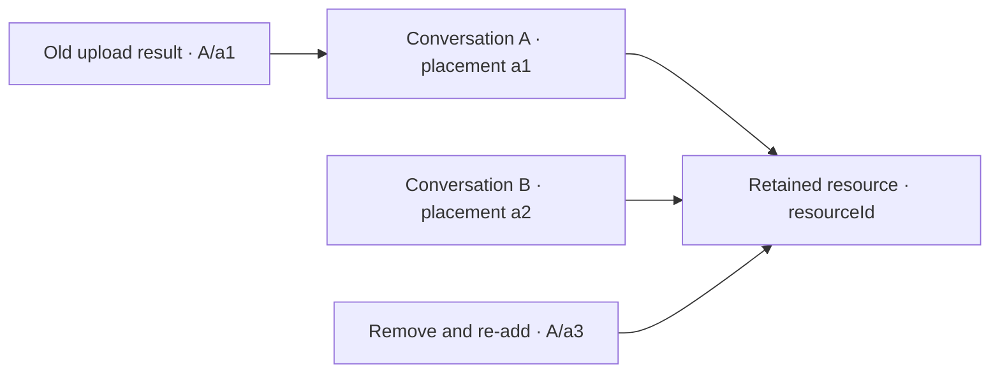

# Attachment lifetimes — issue 816

A retained resource identifies bytes and their preview. A placement identifies one
admission into a local draft. The conversation application mints a fresh placement
at every successful `attachFiles` insertion; callers supply resource descriptors,
not placement identities or upload state. The existing per-store allocator owns
placement numbering, including across restoration. Moving a draft into a turn and
recovering a refused draft preserves that admission. Removing and attaching again
creates a different placement, even when the bytes are the same.

Path-only descriptors also carry a resource identity but allocate no bytes or URL.

Upload progress and scheduling use the enclosing conversation and placement;
resource reads and retention use resource identity. These process-local values
confer no gateway authority and change no wire or saved-tab schema. Saved tabs
contain remote references and titles, not drafts or retained resources.

`attachmentResourceUsage` is the owner of resource retention classification. A
resource referenced by any draft or unsettled local turn remains needed and counts
once against the window byte budget. Otherwise accepted local references retain it
only as a preview. Preview eviction converts all accepted references for a selected
resource together. Needed resources remain held; absent resources are released.
Within a draft, duplicate resource descriptors remain refused; separate drafts may
share one resource with independent placements and upload outcomes.

Admission reads the indexed descriptor fields once into an ordinary snapshot; caller array methods and getters do not participate in validation or issuance. Every changed conversation publication reconciles the preview bound through the same resource classification, including removing the final needed reference.

## Ordering and enforcement

| Row | Input or ordering | Required result | Enforcer |
| --- | --- | --- | --- |
| AL1 | Admit a resource, remove it, and admit it again | Fresh placement; retained old callbacks miss the replacement | `attachFiles`, placement allocator and tests |
| AL2 | Caller supplies an old placement/upload along with resource data | Owner constructs fresh placement with not-started upload | Explicit admission construction and type checks |
| AL3 | Hash/preparation/stage waits across removal and re-add | Original parent/placement retained; replacement unchanged on success/failure/abort | Progress and staging tests; browser checks |
| AL4 | Same resource is admitted in two parents | Independent scheduler slots, transitions and cancellation; shared bytes retained | Scheduler and store tests |
| AL5 | Original placement fails then retries | Same placement continues; retry follows existing predecessor transitions | Upload and scheduler tests |
| AL6 | Draft moves to a turn, is refused, and returns | Same placement/resource retained; no new admission fabricated | Send/recovery tests |
| AL7 | One shared placement is accepted while another still needs bytes | Resource remains budgeted once, and cannot be freed by preview eviction | Resource usage, retention and eviction tests |
| AL8 | Several accepted turns reference one resource | Preview bytes counted once; eviction converts all accepted references together | Resource usage and preview eviction tests |
| AL9 | Last placement/turn reference disappears | Resource released once; another store's identities remain local | Retention and per-store tests |
| AL10 | Restore tabs or reject an attachment batch | Restoration preserves placement counter; rejected batch allocates no placements | Restoration/admission tests |
| AL11 | Provider replaces its store/resources while an old upload waits | Queues belong to resource owners; old completion neither settles nor pumps replacement owner | Owner-keyed scheduler and Provider-swap tests |
| AL12 | Revisit the same owner, or unmount and mount another owner before completion | Original capacity and abort ownership survive; only the corresponding queue changes | Scheduler revisit/unmount tests |

| AL13 | Caller overrides array methods or descriptor getters vary across reads | Validate and admit the same copied snapshot; fresh owner-issued placement | Admission snapshot tests |
| AL14 | Remove, close, delete or replace the final needed reference | Newly preview-only resources obey the bound immediately | Reducer publication reconciliation tests |
| AL15 | Coordinator unmounts while three active uploads hold a queued sibling | Physical uploads settle without starting the sibling; remount resumes it | Owner-scoped pump subscription and tests |
| AL16 | Preview is open while owner changes or placement disappears | No retired preview is rendered; current descriptor follows its placement | Owner/placement selection tests |

A resource manager belongs to one store lifetime; normal composition creates one
per store. Scheduler bookkeeping is weakly keyed by that existing owner, so local
placement numbers may repeat in another store without sharing slots or settlements.
Each mounted coordinator subscribes one pump callback to its resource owner and disposes that subscription on cleanup. Completion signals only the currently attached subscriber; queue capacity survives detached intervals. Preview selection retains the owner and placement, and resolves the current descriptor from the draft on every render.
Already admitted uploads retain their original store and queue across a component
unmount; React ownership changes confer no authority over the replacement owner.

No upload attempt state or global seen-ID registry is introduced. The guarantee is
about an admitted placement's lifetime, not arbitrary fabricated progress histories
within a still-live placement. Retries remain governed by existing upload states.
