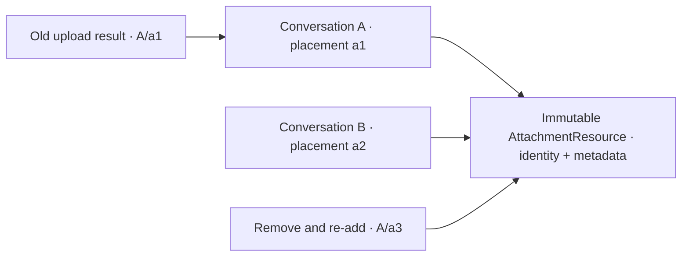

# Attachment lifetimes — issue 816

The final resource design was agreed during the third implementation pass, after
review demonstrated 128 MiB retained bytes could be described as two bytes by
recombining a resource ID with different metadata. The immutable resource value
below replaces that representation; this migration is implemented and undergoing current-main integration review.

A retained resource identifies bytes and their preview. A placement identifies one
admission into a local draft. The conversation application mints a fresh placement
at every successful `attachFiles` insertion; callers supply an immutable `AttachmentResource` value,
not placement identities or upload state. The existing per-store allocator owns
placement numbering, including across restoration. Moving a draft into a turn and
recovering a refused draft preserves that admission. Removing and attaching again
creates a different placement, even when the bytes are the same.

Path-only descriptors also carry a resource identity but allocate no bytes or URL.

Upload progress and scheduling use the enclosing conversation and placement;
resource reads and retention use the exact resource value as identity. These process-local values
confer no gateway authority and change no wire or saved-tab schema. Saved tabs
contain remote references and titles, not drafts or retained resources.

`attachmentResourceUsage` is the owner of resource retention classification. A
resource referenced by any draft or unsettled local turn remains needed and counts
once against the window byte budget. A terminal failed turn with no stored image
reference also retains its original. Stored references in settled turns, including
failed submissions, retain it only as a preview. Preview eviction converts all stored
references for a selected resource together. A stored reference records the gateway
image returned at upload; it does not promise that image is still available. Evicted
history uses the existing held-file unavailable placeholder if the gateway no longer
holds it. A refusal that requires reupload resets the recovered draft, which keeps
the shared resource needed until that draft is sent or removed. Needed resources remain held; absent resources are released.
Within a draft, duplicate resource descriptors remain refused; separate drafts may
share one resource with independent placements and upload outcomes.

Resource construction captures and validates scalar metadata once, normalizes its media type, and freezes the non-draftable value. Admission captures indexed resource values and carries them intact; caller array methods cannot bypass placement issuance. Every changed conversation publication reconciles the preview bound through the same resource classification, including removing the final needed reference.

## Ordering and enforcement

| Row | Input or ordering | Required result | Enforcer |
| --- | --- | --- | --- |
| AL1 | Admit a resource, remove it, and admit it again | Fresh placement; retained old callbacks miss the replacement | `attachFiles`, placement allocator and tests |
| AL2 | Caller supplies a placement or mutable descriptor instead of a resource value | Admission rejects it; only the resource value enters a fresh not-started placement | Resource/admission construction and type checks |
| AL3 | Hash/preparation/stage waits across removal and re-add | Original parent/placement retained; replacement unchanged on success/failure/abort | Progress and staging tests; browser checks |
| AL4 | Same resource is admitted in two parents | Independent scheduler slots, transitions and cancellation; shared bytes retained | Scheduler and store tests |
| AL5 | Original placement fails then retries | Same placement continues; retry follows existing predecessor transitions | Upload and scheduler tests |
| AL6 | Draft moves to a turn, is refused, and returns | Same placement/resource retained; no new admission fabricated | Send/recovery tests |
| AL7 | One shared placement is accepted while another still needs bytes | Resource remains budgeted once, and cannot be freed by preview eviction | Resource usage, retention and eviction tests |
| AL8 | Several accepted turns reference one resource | Preview bytes counted once; eviction converts all accepted references together | Resource usage and preview eviction tests |
| AL9 | Last placement/turn reference disappears | Resource released once; another store's identities remain local | Retention and per-store tests |
| AL10 | Restore tabs or reject an attachment batch | Restoration preserves placement counter; rejected batch allocates no placements | Restoration/admission tests |
| AL11 | Provider replaces its store/resources while an old upload waits | Queues belong to resource owners; old completion neither settles nor pumps replacement owner | Owner-keyed scheduler and Provider-swap tests |
| AL12 | Revisit the same owner, or unmount and mount another owner before completion | Original capacity and abort ownership survive; only the corresponding queue changes | Scheduler revisit/unmount tests |
| AL13 | Caller overrides array methods or resource metadata getters vary during construction | Capture indexed resources; constructor captures scalar fields once and admission issues fresh placements | Resource construction and admission tests |
| AL14 | Remove, close, delete or replace the final needed reference | Newly preview-only resources obey the bound immediately | Reducer publication reconciliation tests |
| AL15 | Coordinator unmounts while three active uploads hold a queued sibling | Physical uploads settle without starting the sibling; remount resumes it | Owner-scoped pump subscription and tests |
| AL16 | Preview is open while owner changes or placement disappears | No retired preview is rendered; current descriptor follows its placement | Owner/placement selection tests |
| AL17 | Spread/copy a resource or fabricate its prototype with different metadata | Neither is an issued value nor addresses original bytes; a separately minted value addresses no original bytes | Private runtime construction brand, manager object keys, negative TS/runtime tests |
| AL18 | Try to change original size, MIME type, path, name or URL after issuance | Immutable resource remains one authoritative metadata value | Frozen resource and primitive constructor tests |
| AL19 | Resource crosses Redux/Immer admission, upload, send and refusal recovery | Same reference survives and cannot be redrafted/mutated; same-resource draft dedup holds | Non-draftable resource and public-store reference tests |
| AL20 | Two native 64 MiB resources have shared drafts and accepted previews, with copied or newly minted size-one metadata offered | Actual originals remain correctly counted; after needed references disappear, retained previews total at most 64 MiB | Native-resource accounting/bound regression |
| AL21 | Resource value is dispatched alongside an unrelated class or Blob | Resource own scalar fields remain traversed; arbitrary nonserializable values still fail Redux diagnostics | Scoped isPlain-or-resource predicate tests |
| AL22 | Constructor receives boxed/mutable scalar hooks or invalid sizes | Reject before issuing a value; getter fields captured once | Constructor negative/runtime/type tests |
| AL23 | A File overrides size/type, or a caller tries to shadow retained Blob hooks after issuance | Manager preserves intrinsic Blob size/type/content in frozen snapshots, and exposes no mutable byte-wrapper metadata | Native Blob metadata provenance test |

| AL24 | Stored input is refused, restored to its draft, then accepted by a new send, with or without reupload | Draft and pending send retain original bytes; terminal failed history no longer prevents shared preview eviction after acceptance | Refusal/resend resource-query regression and revert probe |
| AL25 | Terminal failed content has no stored image fallback | Preserve its local resource rather than fabricate a gateway reference | Local-only failed-content query regression |

## Immutable resource agreement

`AttachmentResource` is a frozen class value with a private construction brand,
readonly own scalar metadata, and no independent resource ID. It is deliberately
non-draftable: Immer must not replace the identity used by the resource owner.
The public pure `conversation/resources.ts` entry exposes the constructor and
resource ownership types without loading UI. Its constructor is the headless/test seam; constructing another
value does not grant access to any existing bytes. The manager snapshots native Blob bytes without re-encoding and issues its values
from that intrinsic Blob size and captured File/host metadata, and stores only
`Map<AttachmentResource, Blob>`. Object URLs, sizes and names are read from that
one resource value rather than shadowed in entries or placements.

A placement is exactly `{ type: "file", placementId, resource, upload }`. The
resource survives draft-to-turn and refusal recovery by reference. Queries
classify sets of resource values; byte bounds sum each value's size once and
eviction converts every reference to selected resources. This is a local
resource lifetime, not gateway authority. Saved tabs store no resource values.
Redux serializability recognizes ordinary `isPlain` data or this exact immutable
value class and retains normal recursive traversal; no general ignore is added.

A resource manager belongs to one store lifetime; normal composition creates one
per store. Scheduler bookkeeping is weakly keyed by that owner, so another store
can repeat placement numbers without sharing slots or settlements. Admitted
uploads retain their original store and queue when the coordinator unmounts.
Each mounted coordinator subscribes one pump callback to its owner and disposes
that subscription on cleanup. Completion signals only the currently attached
subscriber; physical queue capacity survives detached intervals. Preview
selection retains its owner and placement, and resolves the current descriptor
from the draft on each render.

No upload attempt state or global seen-ID registry is introduced. The guarantee is
about an admitted placement's lifetime, not arbitrary fabricated progress histories
within a still-live placement. Retries remain governed by existing upload states.
