# Peer gateways — issue 705, slice H

Status: on main. The granting side, reads behind share grants, enrollment
and the poller are merged
([#725](https://github.com/nessalabs/nessa-agent/pull/725),
[#728](https://github.com/nessalabs/nessa-agent/pull/728),
[#729](https://github.com/nessalabs/nessa-agent/pull/729),
[#731](https://github.com/nessalabs/nessa-agent/pull/731),
[#738](https://github.com/nessalabs/nessa-agent/pull/738)); a read goes
direct or through the relay
([#266](https://github.com/nessalabs/nessa-agent/issues/266)). Local
discovery is not this slice. Part of [#252](https://github.com/nessalabs/nessa-agent/issues/252)
(slice H of [ADR 252](../../adr/todo/252-runtime-roles-and-execution-leases.md)).
The map's rules are in
[Identity and trust](../runtime-architecture.md#identity-and-trust),
[The mesh](../runtime-architecture.md#the-mesh) and
[Security](../runtime-architecture.md#security). This builds on
[device pairing](device-pairing.md), which it reuses whole.

## The problem

Device pairing lets a phone enroll with a one-use code. What it issues is a
credential that **acts as the owner**: the credential's principal is the
owner's, and it holds `conversation.read`. That is right for the owner's own
phone and wrong for another gateway, which is another party: a friend's Nessa,
or a second machine whose reads the owner wants to see and limit on their own.

The map asks for a peer gateway to be "a key-bound credential from pairing"
under a principal kind of its own, "never both authorities over one
conversation", with "the same enrollment and listener" and no second pairing
flow.

## What changes

The owner chooses **who an invitation enrolls** when creating it:

```text
pairing.create {}                     -> a device (unchanged)
pairing.create {"enrollee":"device"}  -> a device
pairing.create {"enrollee":"gateway"} -> a peer gateway
```

That choice is the consent's **class**, and it is the only difference between
the two enrollments (slice I adds a third, `"environment"`; see Environment
peers):

| | Device (`gateway-conversation-read`) | Peer gateway (`peer-gateway-conversation-read`) |
|---|---|---|
| Enrollment | One-use code, OPAQUE over TLS with raw public keys, owner approves the exact key | The same, on the same listener |
| Grant asked for | `conversation.read` on this gateway | The same |
| Credential names | The owner | `gateway:<key in hex>`, a principal of kind `gateway`, member of the owner's organization |
| Credential proof | Bound to the key pairing pinned | The same |
| Revocation | `credential.revoke` or cancelling the Active pairing | The same |

The class is public and bound into the PAKE transcript beside the invitation,
attempt, consent and generation, so it cannot be changed in transit: a client
that relabels it cannot complete the exchange. A client also checks the class
on the first reply and refuses an invitation made for the other kind of party
before any attempt is charged (`NativeClientError::OtherEnrollee`): a phone
handed a peer's code does not become a gateway principal.

### One owner for each fact

- **Which principal a credential names** is `ConsentClass::credential_principal`
  in the auth domain: the owner for a device, `peer_principal(key)` for a peer.
  Publication mints it, and the registry's replay check (`credential_binding_matches`)
  asks the same function, so a stored credential that names anyone else is
  refused on open.
- **What a principal kind can hold** is the Cedar action `credential.hold`
  in nessa-auth's policy bundle, asked through the `GrantPolicyEvaluator`
  port. Each policy permits one list of grants for some kinds: `hold.peer`
  lets a gateway hold `conversation.read` and, since slice I,
  `environment.serve`, and nothing else; `hold.person` lets a person, agent
  or integration hold `server.read`, `credential.manage`, `conversation.read`
  and `conversation.write`, never `environment.serve`. A
  grant no permit lists is refused, so a gateway can never hold
  `conversation.write` (admitting commands into a conversation and answering
  its approvals) or `credential.manage` (holding credentials and pairing,
  which also admits every grant-management method). Those are the
  conversation authority's, and the gateway that owns a conversation keeps
  them. Widening the peer's list means editing `hold.peer` and naming each
  action it adds, so a widening cannot admit one of the authority's actions
  by mistake. A person or an agent never serves. Whatever a peer is later
  allowed to run for a conversation, it therefore cannot also be that
  conversation's authority. The `hold.administration` forbid adds one rule
  over the issuing path: `credential.manage` is never handed out by an
  issue over the product protocol, only by the local operator's paths.
- **That the registry agrees** is `validate_principal_kind` and
  `validate_grants`, run by `validate_registry` on open and before every
  write. A gateway principal's credential must be pairing-bound and its
  membership a member's; every credential's grants must be ones its kind may
  hold, and `credential.issue`, bootstrap and owner recovery ask the same
  check before they write. A pairing-bound credential names a gateway
  principal exactly when its pairing's class is a peer's, and a principal's
  id starts with `gateway:` exactly when its kind is a gateway.
  `credential.issue` refuses a gateway principal, and any principal id with
  that prefix whatever kind it claims, up front: pairing is the only way one
  is made.
- **Which class an enrollment is** is stored with it (`class: "peer"` in the
  registry's pairing record; absent means a device, so every existing registry
  reads unchanged) and in the client's private record (a separate pair of
  magics, so a device's file is byte-for-byte what it was).

### What a peer can do once paired

Read, on the native listener, exactly what the owner granted it, as a paired
device does. The owner shares a conversation with the peer's credential
(`conversation.share`, slice G, #704, merged in #720); the grant names the
peer's receiver, and every read the peer makes asks that receiver's grants:

- **Record head and pages** go through
  `AdmitPassiveRead::execute`, which asks the conversation access policy
  (`conversation.read`, ADR 803) with the receiver's grant on that
  conversation; an ungranted one is `wrong_owner`.
- **Catalogue manifest and resolve** are narrowed in SQL to the receiver's
  granted rows (`store::share_grants::granted`). A manifest pass may not reach
  past the receiver's own head, so probing boundaries finds that head and not
  the owner's; an ungranted id resolves as one that does not exist.
- **Catalogue head** is the latest revision among the receiver's granted rows
  and its own grant changes. The owner's work on a conversation the peer was
  not granted does not move it; a grant, a revoke or a change to a granted row
  does, and in steady state it never goes backwards. Its values are still the
  owner's catalogue revisions (see Known limits). This applies to every paired reader,
  devices included: it is the head over granted rows that slice G left for
  when paired readers are more than the owner's own phones.
- **Catalogue changes** reach a peer only when it polls its head. Nothing
  pushes them to it: a notice that fires on every change to the owner's
  catalogue, granted or not, would show a peer when the owner works on
  conversations it cannot read. (The socket's catalogue watch, which was
  refused to a peer for that reason, was removed in #257.)
- **The socket's `conversation.read`, `.list`, `.observe` and subscriptions**
  need `conversation.write`, which a gateway principal can never hold, so the
  policy refuses them. Behind that, `binding_of` makes a paired reader of a
  peer like a device: its read and view ask the access policy
  (`conversation.read`), and its lists are refused (`conversation.list`).

Admission matches the receiver binding to the session by credential and
organization. The binding's `owner_id` is the **grantor**: the owner whose
conversations the receiver reads, who paired it. It is never the reader and is
never compared with the session's principal, which for a peer is its own
`gateway` principal. Whatever records a peer's activity names that session
principal: its session is logged as it. The grant journal names the owner, who made the decision.

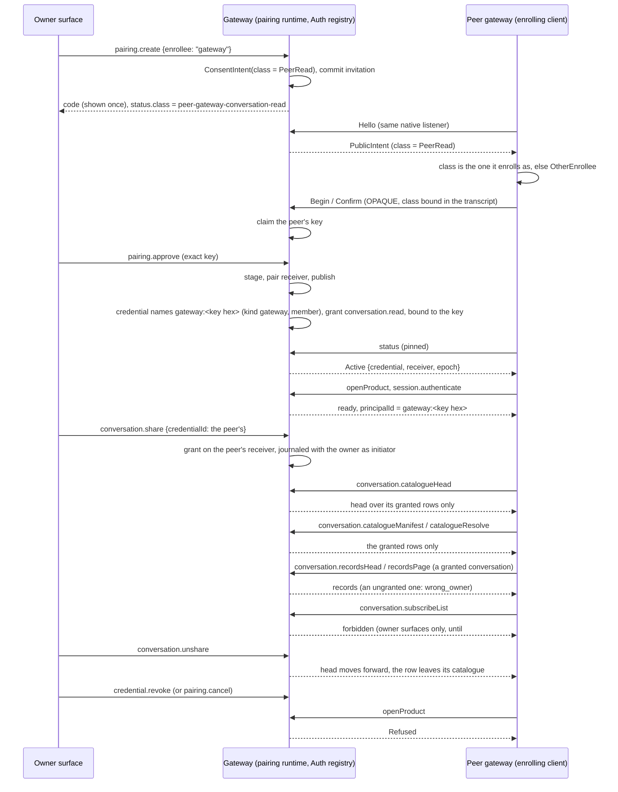

## Environment peers

Slice I ([#706](https://github.com/nessalabs/nessa-agent/issues/706)) lets
another machine run agents for this gateway: a paired environment that dials
in. Its first part only lets the owner pair one. A third class does it, on the
same method, listener and PAKE:

```text
pairing.create {"enrollee":"environment"} -> a gateway that serves as an environment
```

| | Peer gateway (`peer-gateway-conversation-read`) | Environment (`peer-gateway-environment-serve`) |
|---|---|---|
| Grant asked for | `conversation.read` on this gateway | `environment.serve` on this gateway |
| Credential names | `gateway:<key in hex>` | The same principal |
| Owner must hold | `credential.manage` and the read | `credential.manage` only |

- **Why a grant and not a setting.** Whether a machine may serve this gateway
  is a credential fact, so the registry is its one authority, revoked the way
  every credential is. A worker's credential holds `environment.serve` and
  nothing else, so a machine that runs agents can never read a conversation.
- **Which grant a class carries** is `ConsentClass::grant`, asked by the
  intent, the disclosure check and the stored pairing, so a relabelled grant
  is refused at each. The owner does not hold `environment.serve` (no person
  may), so admission asks the owner for the proposed grant only when the class
  delegates the owner's own (`ConsentClass::delegates_owner_grant`).
- **One key, two credentials.** On this side, a key paired as both a reader
  and an environment names the same principal both times, and each
  credential holds its class's one grant. The dialing side keeps each
  enrollment apart: a gateway's reading enrollment in its own pairing state,
  and an environment's in `<data>/environment/pairing`, which only
  `nessa env enroll` writes.
- **It can never read.** `conversation.share` refuses an environment's
  credential (`share_target_not_paired`), since it can never read what it
  would be granted.

### Serving over the connection it dials

Part 1b lets a paired environment serve. It dials this gateway's native
listener with the key it paired with, asks for the environment phase, and
then runs `nessa env serve`'s own frame loop over that same TLS connection.
The gateway treats it as it treats an SSH host: the same lease frames, the
same per-lease routing, the same audit. Only how the connection is had
differs: the gateway runs `ssh` to a host, and a paired environment calls in.

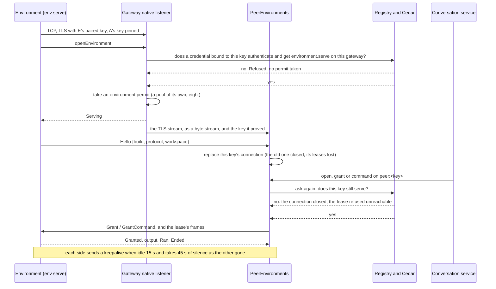

- **One authority for "may serve".** The listener and the environment both
  ask the same question, `ServingCredentials::serves`: is there a credential
  bound to the key this connection proved that authenticates and that Cedar
  allows `environment.serve` on this gateway, now? Nothing keeps a copy of the
  answer. It is asked when the connection is admitted, again before every
  lease, and again every keepalive interval while the connection is open,
  so a revoked credential or a disabled membership ends the connection and
  the leases on it (row I8, below) whether or not a lease is asked.
- **One name per key.** A paired environment is `peer:` and its key in
  lowercase hex (`PeerEnvironment`), whichever connection it last made. A
  new connection from the same key takes the place of the old one: the old
  one is closed and its leases are lost, then accounted on the new one as any
  lost lease is.
- **Placing a conversation** on a paired environment needs it connected
  then, so a name nobody serves is never kept. A conversation already placed
  waits for it to dial in again.
- **Liveness.** A network that goes quiet tells neither side. Each side sends
  a keepalive frame when it has sent nothing for 15 s, and each takes 45 s
  with nothing read as the other gone, so a lost connection ends its leases
  on both sides within that bound.
- **Its own permits.** An environment's connection moves to a pool of its
  own once admitted, as a product session does, so environments never take
  the permits enrollment and status need. A key that may not serve is
  refused before it takes one.
- **Files it publishes** are read over the connection's own lease frames
  (row I9, below).
- **Known limits.** Nothing is fetched into a paired environment yet: the
  connection has no file channel, so the agent's fetch there is refused
  unavailable before the environment is asked.

### Reading a published file over the connection (row I9)

Part I-2b fetches what a paired environment publishes. Over SSH the gateway
reads a staged copy with sftp on a second channel of the same connection.
A paired connection is one TLS stream with nothing beside it, and the
gateway cannot dial the environment for a second one, so the file's bytes
ride the lease frames, as the gateway asks for them.

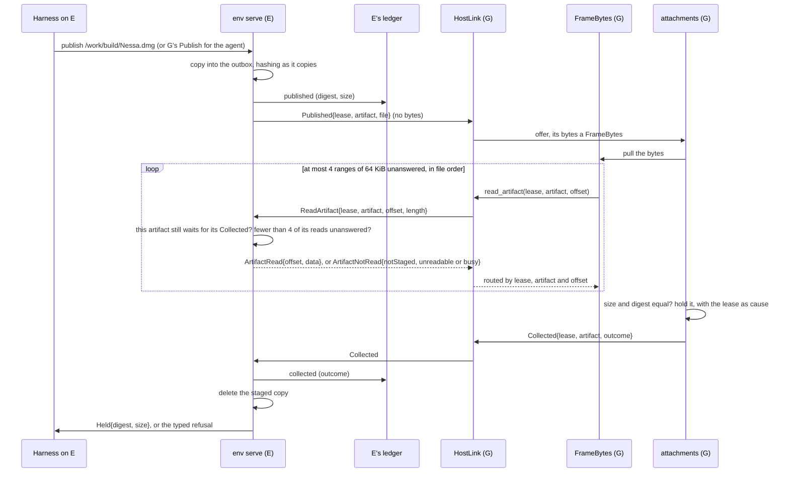

- **The environment says what may be read.** A read names the lease, the
  artifact's number and a range, never a path. The environment answers
  only for a copy it staged under that lease that is still waiting for its
  `Collected`; anything else, an artifact answered already, one never
  published, or a lease ended or not held there, is `notStaged`. That
  holds for a read under way when the answer comes too: what it read is
  not sent. So a gateway can read nothing on the machine but what was
  published to it, and only until it answers.
- **Bounded on both sides.** Each range is at most 64 KiB, one frame's
  data. The gateway keeps at most four ranges of one file unanswered
  (`MAX_ARTIFACT_READS_IN_FLIGHT`). The environment does not rely on that:
  a read holds its place under the same bound of four per artifact from
  its arrival until its answer is handed to the writer, or until the
  gateway is gone, and a fifth is refused `busy`. So a gateway that keeps
  asking but stops reading holds at most four answers per artifact on the
  environment, never more. The file bound, the lease's budgets and the
  publish deadline are the SSH path's.
- **No answer after the end.** When a lease ends on the environment, its
  reads still under way are stopped, their answers not sent, and the end
  waits for them before it says `Ended`, a read already on the disk until
  it returns, since it cannot be stopped there. So the gateway never gets
  a read's answer for a lease it has let go, which it would record as a
  frame naming nothing it holds, and no read holds a file of a lease said
  ended.
- **What a read failing means.** The bytes are checked where they are
  kept, by size and digest, as over SSH: a copy cut short, or one answered
  with other bytes, is refused `mismatch`, nothing held. A copy the
  environment cannot read is `mismatch` too. A `notStaged` answer, or the
  lease's route going (the connection lost or the lease ended), is
  `leaseEnded`. `busy` is the host misspeaking, since the gateway keeps
  within the bound: `channelUnavailable`. Nothing is resumed: the frames
  have no channel of their own to fail, and when the connection goes the
  lease goes with it.
- **Revocation.** Once revoked, the gateway asks no new publish, as row I8
  says. A read of a file already offered still goes; the environment,
  which ended the lease and let its copies go, answers it `notStaged` (and
  records it as a frame naming no lease it holds), so the file is refused
  `leaseEnded`.
- **Both sides record it** as over SSH: the environment's ledger has
  `published`, then `collected` with the gateway's answer (or `unanswered`
  when the connection was lost first), and the gateway's hold names the
  lease as its cause. The reads themselves are not records: a file is kept
  or not, and that is what both sides record.

### Revocation ends a live connection (row I8)

Part I-2a ends what a revoked environment is running, and its connection,
without waiting for a lease to be asked of it.

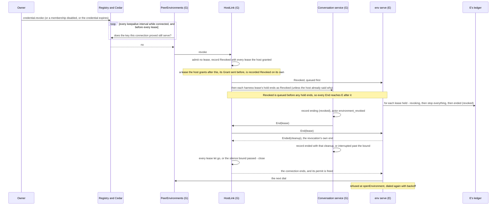

- **How it is noticed.** Whether a key may serve depends on more than the
  revoke call: a credential can also expire, and the owner's organization
  can disable the membership, and neither tells the connection anything.
  So the gateway does not hook the revoke call. It asks the one authority,
  `ServingCredentials::serves`, again every keepalive interval (15 s) for
  as long as the connection is open, and before every lease as before; a
  "yes" holds only for the moment it was given. An answer that cannot be
  read is not taken as a revocation: the next one is asked.
- **One response, wherever it is noticed.** The periodic check and a
  lease's own check both call `HostLink::revoke`. It refuses every new
  lease on that connection at once (the environment leaves the connected
  list), records `revoked` in the gateway's environment audit with every
  lease the environment granted on the connection, queues `Revoked` for
  the environment first, and only then sets each harness lease's ending
  cause to revoked. That order is the guarantee: the conversation asks a
  lease's `End` only once it sees the lease ending, and the frames to the
  environment go in the order queued, so every such `End` reaches the
  environment after `Revoked`, and the environment records the revocation
  as that end's cause rather than an ordinary end. A grant still being
  answered is not listed, because the environment may yet refuse it. Its
  `Grant` may already be ahead of `Revoked`, though, and the environment
  grants it. Then the gateway records a second `revoked` naming only that
  lease when the grant arrives, so every lease the gateway ends as revoked
  is named in some `revoked` record. If that record cannot be written, the
  lease settles nothing as confirmed. Asked twice, it acts once.
- **Both sides record why.** The gateway's conversation sees its hold end
  as revoked and stops it as the system (`environment_revoked`, never a
  person): the lease is recorded ending (revoked) and then ended with the
  environment's cleanup, or interrupted past the cleanup bound, as for an
  expiry. The environment, told `Revoked`, ends every lease it holds on
  that connection itself: it records `revoking` with the gateway it was
  for, stops everything under the lease, and records `ended` with cause
  `revoked`; a running command is stopped and answers its `Ran`, and one
  granted but never run ends holding nothing. A command that already ended
  by itself is left alone, even while its `Ran` still waits for room on
  the connection: its end is recorded with its own cause, and no
  `revoking` is written after it. The command's task and the revocation
  decide this under one lock, so the ledger has exactly one of the two. Each `End` the gateway then
  asks is answered with what that end took. The environment admits nothing
  more on the connection: a grant that crossed the revocation is refused
  `revoked` and recorded with that reason, never as the owner's
  `not_granted`, and the gateway reports it unreachable. Once revoked, the
  gateway itself starts no harness and asks no publish on the connection; a
  command's `Run` still goes, and the environment, which ended that lease
  unrun, answers it as never started, holding nothing. The gateway forgets
  a grant the host refused.
- **The connection closes.** The gateway closes the connection once every
  lease on it has been let go, or once the silence bound (45 s) has passed,
  whichever is first, so a revoked environment never keeps its permit. Its
  next dial is refused, as before.
- **The first cause wins.** A lease the environment had already said was
  ending as expired keeps that cause on both sides; an expiry said after
  the gateway revoked it does not replace the revocation. If the
  environment's deadline passes just as the gateway revokes, the gateway
  may record the lease revoked while the environment's ledger says
  expired; both keep their cleanup evidence. A revocation the gateway
  cannot record still ends and closes everything, and settles none of
  those leases as confirmed; one the environment cannot record still
  stops everything and answers `uncertain`.

### The agent catalogue follows the connected environments (row I10)

Part I-3. `agents.list` names the paired environments connected when it is
asked, so it is right when read, but a surface that read it once kept
offering an environment that had gone and never offered one that came. The
catalogue now has a subscription, with a change source of its own.

- **The count of changes is the environments' fact.** `PeerEnvironments`
  publishes it (`connections()`, a `watch` counter), and each paired
  environment moves it where its connection changes, after the change is
  made: when a connection is admitted (it takes its place in `serving`),
  when one ends (`serve` sees it ended), and when one is revoked
  (`HostLink::revoke`, which says whether this call revoked it, so a
  revocation asked twice moves it once). Which environments are connected is
  still read from their connections; nothing keeps a second list. A
  revoked environment moves it twice, once when revoked and once when its
  connection ends; a connection that takes another's place moves it with the
  list unchanged.
- **The socket only watches it.** `agents.subscribe` is one more target of
  the [record subscriptions](../record-subscriptions.md) machinery (rows
  AC1–AC8 there). Its first frame follows the reply, as every subscription's
  does; then each move of the count reads the catalogue again, the same
  function `agents.list` answers through (`agents_catalog_now`), and sends
  `agents.listed {subscriptionId, catalog}` when it differs from the last
  one sent. Moves while a frame waits for the writer are one read after it,
  since a `watch` receiver wakes once however many moves it missed.
- **The conversation catalogue does not move.** Its head and watches are
  about conversations, and moving them for an environment would move every
  paired reader's head for a fact it was never granted (row H9). The agent
  catalogue's subscription registers no conversation source, and nothing in
  `PeerEnvironments` writes the conversation store.
- **Who may follow it** is who may read it: the method asks the gateway's
  read grant (`server.read`), as `agents.list` does, before it registers
  anything and again before every read, so a grant lost while it is followed
  ends it `refused` before its next frame. A peer gateway's credential holds
  `conversation.read` or `environment.serve` and never `server.read`, so a
  peer cannot learn which environments are connected.
- **Bounds and ending.** The catalogue is one target, so a connection
  follows it at most once (a second is `subscription_duplicate`).
  `agents.unsubscribe` stops it, asking the same grant; it and
  `conversation.unsubscribe` each answer `unknown_subscription` for the
  other's. It ends with its connection, and `source_closed` if the
  environments' source closes. A gateway that pairs no environments has no
  source, and its first frame is its last.
- **The panel holds it.** The pickers' choices follow the catalogue
  (`followAgentChoices`) while the gateway is available, and stop it on
  unmount; a follow that ends is opened again at the pace the panel's other
  follows keep, at once after `lagging`.

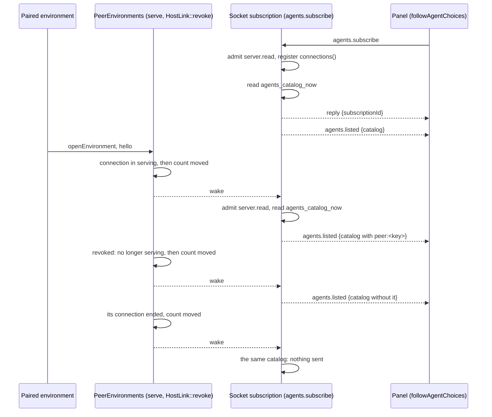

### Staying dialed in

Part 1c is the environment's own side: two commands on the machine that
cannot be reached.

```text
nessa env enroll ADDRESS CODE   pair as an environment, with an environment invitation's code
nessa env dial ADDRESS          wait for the owner's approval, then serve, dialing again whenever a connection ends
                                [--relay HOST:PORT] asked for the gateway when a direct dial does not connect (relay.md, row RL14)
                                [--drain-deadline 20s] a signal drains every lease before it stops (row K1)
                                [--enroll-code-file PATH] enroll first when nothing is paired here (row K2)
```

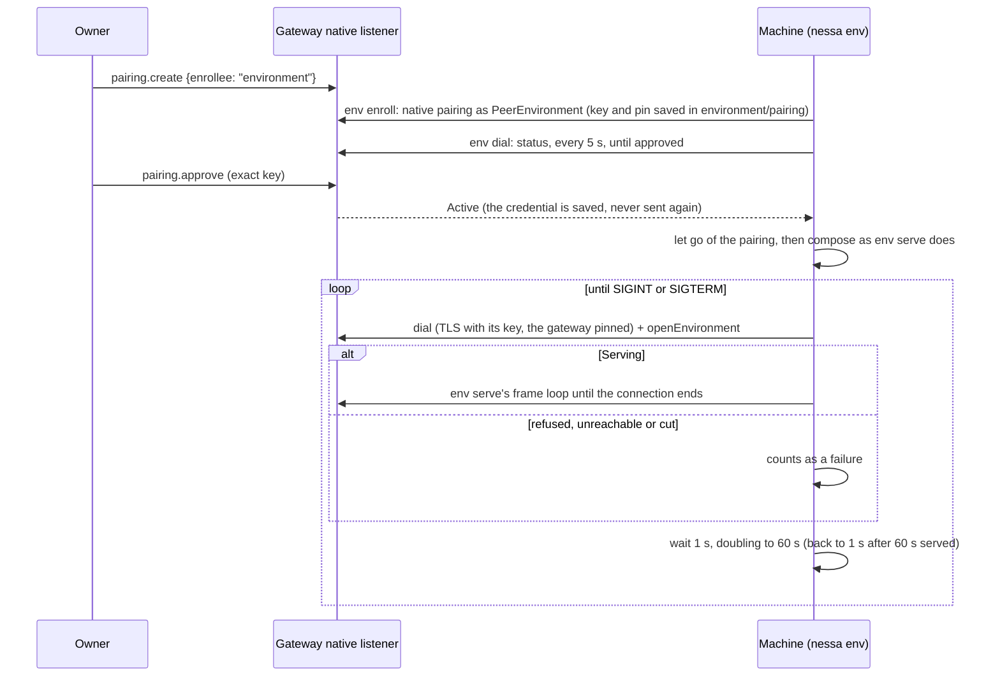

- **Approval first.** `env dial` asks the pairing's status until the owner
  approves, and only then composes, so an unpaired machine is told so at once
  (before any connection) and `env serve` is not locked out while the owner
  decides. A denied, cancelled or expired pairing stops it with that reason;
  reading that status ends the enrollment here, so `env enroll` with a new
  code works at once. A gateway out of reach, busy or refusing is asked
  again; a pairing record this machine cannot use stops it.
  The address is checked for its `HOST:PORT` form only: the name is looked up
  on every dial, so a machine started before names resolve keeps trying.
- **The same serving.** `env dial` then composes what `env serve` does (the
  lock, the ledger, the launcher, the outbox) once, and serves each
  connection it dials with the same frame loop. Only one serves per data
  directory, whether over SSH or dialed in.
- **A refusal is dialed again.** The gateway's refusal is redacted: no
  credential to serve, no room, or a registry it could not read look the
  same. So the dialer waits and dials again, doubling the wait up to 60 s;
  a connection served for 60 s or more starts the wait over, and one that
  ends sooner counts as a failure, so a gateway that drops each connection
  is not dialed in a loop. A gateway with no protocol in common, as across
  an upgrade, fails the handshake and is dialed again too. Only a failure
  no dial can change stops it (`InvalidInput`: a pin that is not a key, a
  TLS setup this build cannot make). Each address the name resolves to is
  tried in turn. With `--relay`, the status asks and each dial go to the
  relay for the gateway's pinned key when the direct dial has not
  connected within a short head start, as a phone's read does
  ([relay.md](relay.md#who-uses-it)); enrolling still needs the address.
- **Stopping.** SIGINT or SIGTERM closes the connection being served, so its
  leases end as they do when a gateway goes away, and then dialing stops. A
  second signal while that drains exits at once. With `--drain-deadline`,
  the signal drains instead ([row K1](#draining-before-it-stops-row-k1)).
- **Known limits.** An approved machine pairs again only by removing
  `environment/pairing` first, and a pairing still pending is abandoned the
  same way: the same-enrollment retry the device client has is not offered
  here yet.

### Draining before it stops (row K1)

A hosted worker (slice K, [#708](https://github.com/nessalabs/nessa-agent/issues/708))
runs `nessa env dial` in a container, and a container is stopped with SIGTERM
and then, a grace period later, killed. Closing the connection at SIGTERM, as
a laptop does, would leave the gateway to find each lease lost, with no
cleanup it can trust. So a worker drains first:

```text
nessa env dial ADDRESS --drain-deadline 20s
```

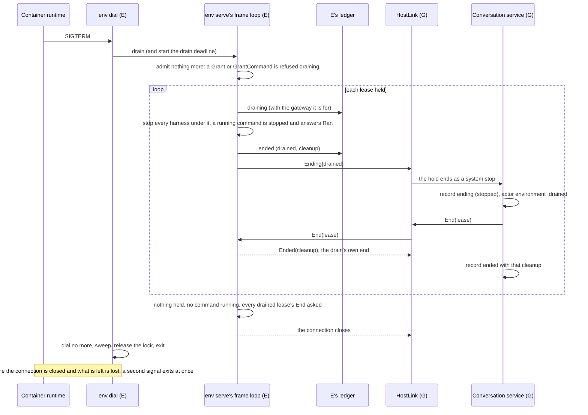

- **Inert until asked.** Only `--drain-deadline` makes a signal drain;
  without it a signal closes the connection at once, as before. `env serve`
  over SSH never drains: the SSH session's own end is its stop.
- **Composition asks it, never the gateway.** The drain is a watch handed to
  serving with its peer and grants, so a gateway cannot make a worker drain
  or stop draining.
- **One end per lease, recorded first.** Each lease held is recorded
  `draining` with the gateway it was for, then ended as an end does, and
  recorded `ended` with cause `drained` and what that took; a harness's
  lease is said with `Ending{drained}`, so the gateway asks its `End` and is
  answered with that cleanup. A drain that cannot be recorded still stops
  everything, and that end answers `uncertain`. A command lease is stopped
  through its own stop and answers its `Ran`, since the gateway takes no
  `Ending` for a command; that `Ran` says the command ended `drained`, not
  `stopped`, since the gateway asked no stop and would otherwise take it
  for lost. One granted and never run is recorded ended
  holding nothing on the worker, and serving stays open until the gateway
  sends its `Run` (answered never started, with that cleanup) or its `End`,
  so the gateway never finds it lost. A file still in flight is left
  unanswered, as on an expiry.
- **A system stop on the gateway.** The gateway records the lease ending as
  `stopped` ("a person, or a system stop such as the gateway retiring"), by
  the actor `environment_drained`, never a person and never `lost`, then
  `ended` with the environment's cleanup, or `interrupted` past the cleanup
  bound. A command its host drained is stopped with the same `stopped`
  cause. No stored shape changes.
- **When it ends.** Serving ends by itself once nothing is held, no command
  runs (a stopped command's `Ran` needs no `End`, so its end alone can be
  the last), the gateway has asked the `End` of every lease the worker
  ended unasked, drained or earlier expired or revoked, and every
  answer has gone to the writer: the connection then closes, `env dial`
  dials no more, and it exits after sweeping. A drain asked while waiting
  for approval or between dials ends that wait. One asked while a gateway
  that is not reading holds the worker up answering starts at once, so
  every lease is ended and recorded before a deadline closes the
  connection. A gateway that never asks
  an `End` holds the drain open until the deadline, which then closes the
  connection: whatever is still held is lost there, as when a gateway goes
  away. Set the deadline below the container's stop grace.
- **What crosses it.** A grant the gateway sent before it saw `Ending` is
  refused `draining` (one waiting to be read as the drain is asked
  included: the drain is taken first), recorded with that reason (never the owner's
  `not_granted`), and reported unreachable by the gateway. A revocation
  arriving during a drain ends nothing twice: each lease keeps the drain as
  its cause.
- **Replacing a worker** that conversations name by its `peer:` name is
  draining one container and then starting the next on the same pairing
  volume, so the key, and the name, stays the same. The two must not
  overlap: a second connection from the same key takes the first one's
  place and its leases are lost, and only one process serves a data
  directory at a time. Conversations placed on `peer:any` need no gap: a
  replacement with a key of its own serves beside the old worker, and the
  old one drains (below).
- **Said before anything else.** The first frame a draining worker sends
  is `Draining`, so the gateway takes no new lease there while its old
  leases end; a grant already on its way is refused `draining`, which marks
  the link the same way.

### Starting from a container (row K2)

A container runs one command on every start, and a pairing code is good
once. So `env dial` takes the code from a file, as a mounted secret, and
enrolls with it only while nothing is paired on the volume:

```text
nessa env dial ADDRESS --enroll-code-file /run/secrets/nessa_enroll_code --drain-deadline 20s
```

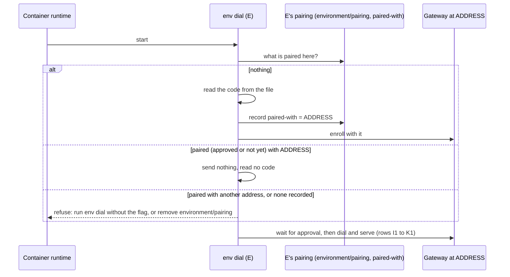

- **One organization per container.** A gateway is one organization and a
  pairing names one gateway, so the organization a worker serves is the
  gateway its pin names. Nothing on the worker copies an organization id.
- **Decided in the application, read in adapters.** `enrollment.rs` decides
  through two ports: `EnrollingPairing` (what is saved, the recorded
  address, recording it, sending the code) and `EnrollmentCode` (the code
  file). `FilePairingEnvironment` and `FileEnrollmentCode` are their real
  adapters, and composition turns a refusal into what to do.
- **The address enrolled with is recorded** beside the pairing, in
  `environment/paired-with`, before the code is sent, and read only while a
  pairing exists. A reply lost after the pending record is saved still
  finds that address on the next start, which then waits for approval; a
  code the gateway refuses leaves no pairing, so the file is read by
  nothing. It is compared as written: the same gateway named another way is
  refused, which fails safe. A volume
  paired with gateway A that is given gateway B's address and code refuses
  rather than dialing B with A's pin or taking B's code as its own; B is
  sent nothing, so B's invitation stays unclaimed. A pairing that recorded
  no address (made before this) refuses too, rather than guess, and is
  still served by `env dial` without the flag.
- **Starting cannot reach the gateway** to enroll: `env dial` exits with the
  reason, and the container's restart policy tries again. Nothing was sent,
  so the next start enrolls with the same code.
- **The example** in `docs/guides/env-worker/` builds an image holding
  `nessa` alone, with the volume at `NESSA_DATA_DIR`, the code as a secret,
  the deadline below `stop_grace_period`, and a compose service per
  organization.

### Two organizations, nothing shared (row K3)

A hosted worker serves one organization because of what already holds,
not because of a check of its own: a gateway is one organization, a
pairing names one gateway, and each container keeps its own volume and
workspace. Row K3 runs two of them side by side, gateways A and B, with
worker W paired to A and worker X paired to B, and checks that nothing
crosses:

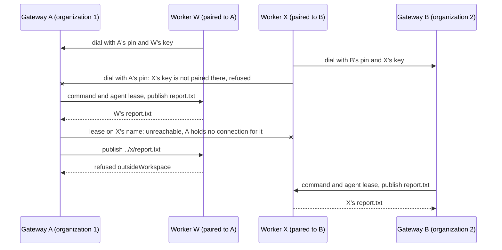

- **Leases.** A key paired with B is refused at A's door (`permissionDenied`),
  and with its own pin the dial is cut when A's key is not the one pinned
  (`connectionAborted`). A lease A asks on X's name finds no
  connection: `PeerEnvironments` keeps only the keys that dialed this
  gateway, and a name an agent makes up adds nothing.
- **Workspaces and artifacts.** Each worker publishes from its own
  workspace, so the same path gives each gateway its own organization's
  file, and a path that leaves the workspace, even into a neighbour's
  directory on the same disk, is refused `outsideWorkspace` before it is
  read. In production the container boundary adds to this; the test does
  not rely on it.
- **Tools.** `environments_list`, `run`, `artifacts_publish` and
  `artifacts_fetch` find environments through the gateway's
  `PeerEnvironments` (`Environments::connected_peers` and `named`). The
  two-gateway test checks that each gateway's list holds its own worker
  alone, and that a command or lease on the other's name is refused
  `environmentUnreachable`. A second test drives the tools' service calls
  on a gateway whose own worker is connected, over the production
  registry: `environments_list` lists that worker alone, `run` runs there
  and is refused `environmentUnreachable` on the other organization's
  worker though the command policy names both. A third places a
  conversation on its own worker: `artifacts_publish` keeps a file from
  it, and `artifacts_publish` and `artifacts_fetch` on the other's name
  are refused `environmentNotLeased` before anything more is asked. A
  conversation's placement on a paired environment is kept under its
  `peer:` name and read back as it.
- **Audit.** Each worker's ledger records the command its own gateway ran
  and its own gateway's agent lease, from `granted` to `ended`, and
  neither of the other's. Each gateway's
  environment audit, which records its workers' connections, names its own
  worker at that worker's workspace and nothing of the other's. The
  gateway's own lease records are kept in its own record store, one per
  gateway, and are not read by this row.
- **No read grant outside its leases.** A worker's credential holds
  `environment.serve` alone. It opens a session on the gateway it serves,
  and the catalogue head and a conversation's records head are each
  refused `forbidden`. A device the owner shared with gets past the same
  checks with the same calls (an answered head, then `history_pruned`). An owner's share to a worker is refused
  (row I1).

### A pool of workers, and organization budgets ([#791](https://github.com/nessalabs/nessa-agent/issues/791))

A conversation can name one worker, as it names one SSH host, or
`peer:any`: any worker of this gateway's pool. The pool is every paired
environment whose credential serves this gateway, which is the registry's
fact; nothing else keeps a member list. Which worker holds a pool
conversation now is a separate fact, its **binding**, kept in
`conversations/bindings/<id>.json` as
`{"schemaVersion":1,"worker":"peer:…","context":"…"}`. The placement is
written once and never moves; the binding may.

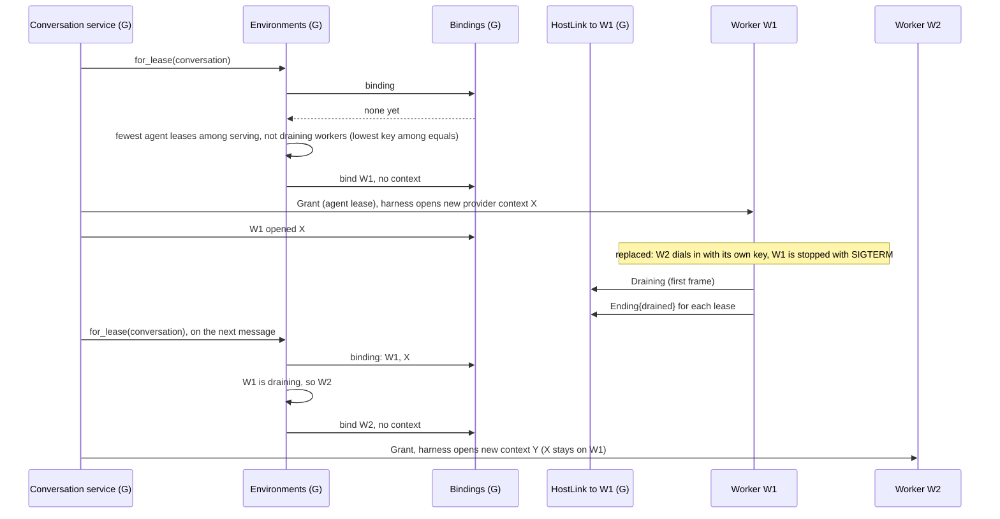

- **One worker at a time.** A pool conversation is bound when its agent is
  opened, which happens only while no lease of it is live, so the worker it
  leaves holds nothing of it. It stays on its worker while that worker
  serves and is not draining, however loaded, so its provider context is
  found there again.
- **Context stays where it was opened.** A provider session is a file on
  the worker that opened it. The binding keeps the context last opened on
  its worker, and the lease restores a saved context only when it is that
  one (`AgentProvider::restores_saved_context`); otherwise the agent opens
  new context. A binding write that is lost costs only that context, never
  a restore of one the worker does not hold. Each worker's harness works in
  its own workspace, so the agent's identity there differs from the last
  worker's in its context fingerprint; a history whose saved context is not
  restored goes on under the new fingerprint
  (`SessionChange::ProviderIdentityChanged`), while its provider and model
  stay fixed. Resuming across workers is
  [#1040](https://github.com/nessalabs/nessa-agent/issues/1040).
- **Refused, then elsewhere.** An opening refused on a worker that has
  since drained or gone is asked once more of another, and the history
  keeps that refusal as a refused lease before the lease the other worker
  issued; a worker that is simply busy or not granting is reported as any
  worker's refusal is.
  With no worker serving, the lease is asked of the bound worker and is
  refused unreachable, as any absent worker's is; a pool conversation
  never bound is unavailable. Placing on `peer:any` is refused
  `environment_not_configured` while no worker serves.
- **Listed first.** The catalogue lists `peer:any` before the workers
  while any is connected, so a surface offers it like any environment.
- **Organization budgets.** `limits.organizationLeases` and
  `limits.organizationCommands` in `config.json` bound the agent leases and
  the commands running at once across every paired environment (rows
  `organization.leases` and `organization.commands`; 0, the default, bounds
  nothing). A place is taken before the environment is asked and given back
  when the lease or command ends; past it, the lease is refused
  `environment_busy`, as a busy worker's is. It is a count of work running
  now, kept in memory, so it is no policy and asks nothing of Cedar. Leases
  on SSH hosts and here are not counted: an organization's own machines
  are its own. Artifact bytes per organization are
  [#1041](https://github.com/nessalabs/nessa-agent/issues/1041).

### What the environment grants

Part 1d lets the environment's owner decide what each gateway may lease
there. The gateway's credential says whether it may serve this gateway at
all; what a machine lets a gateway run on it is the machine's own fact, so
it lives on the machine, in `<data>/environment/grants.json`:

```text
nessa env grant [--peer ssh|PIN] [--agent NAME... | --all-agents] [--commands --max-timeout 10m]
nessa env ungrant [--peer ssh|PIN] (--agent NAME | --commands | --all)
nessa env grants
```

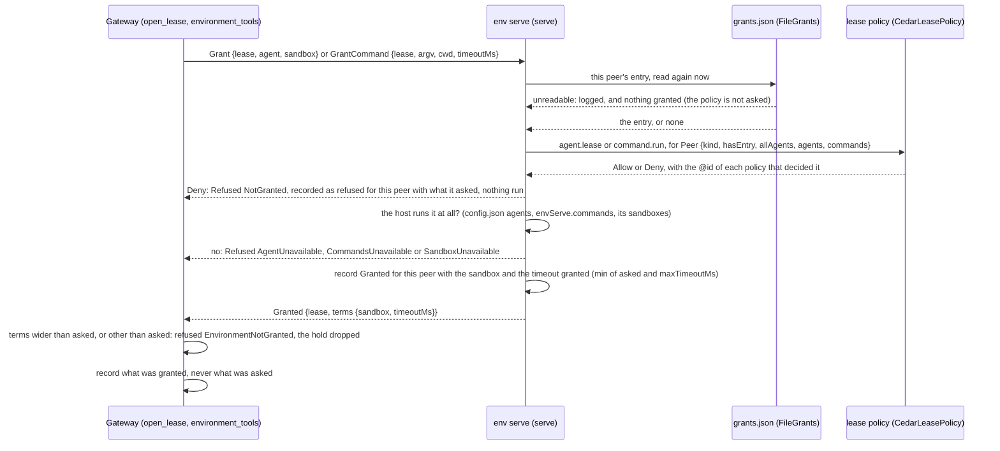

- **Why the machine's file and not the gateway's credential.** The gateway's
  registry answers "may this key serve me", which only the gateway can
  revoke. What a machine runs for a gateway is the machine owner's choice,
  and the gateway must not be able to widen it, so its one authority is a
  file on the machine that only its owner writes. The peer is named by how
  composition reached it, never by what the gateway says: `ssh` for
  `env serve`, the pin the pairing keeps for `env dial`.
- **Read at every lease.** Serving reads the file again for every `Grant`
  and `GrantCommand`, so a change applies from the next lease and the leases
  already running go on. A file this build cannot read (another schema
  version, larger than 64 KiB, not private, not this shape) grants nothing,
  to `ssh` as well, and is logged: a broken file is not taken as no file.
- **A policy decides, the file holds facts.** Whether a peer may lease an
  agent or run a command is decided by Cedar (ADR 803), over the peer and
  the grant it holds (below): the checked-in bundle in
  `env_serve/infrastructure/cedar/`, validated strictly when serving starts
  (a bundle that does not validate refuses to serve). What a yes comes with,
  the timeout narrowed and the lease's longest, stays with the grant in
  Rust.
- **Defaults.** With no file or no entry, `ssh` keeps everything the host
  runs, as before this part; a dialed gateway is granted nothing until the
  owner grants it. Those defaults are data, stated once by
  `domain::unwritten` as a missing field's default is the file's: the
  policy is handed the grant a peer holds, its entry or those defaults, and
  its permits (`grant.*`) decide every peer alike, so a lease and its terms
  always come from the same grant. `env grant` and `env ungrant` default
  `--peer` to the gateway this machine's pairing was approved by, else
  `ssh`; an entry equal to the peer's defaults is removed rather than kept.
- **The grant first.** The peer's grant is checked before what the host
  runs, so a gateway not granted a lease learns nothing of which agents the
  host runs or whether it runs commands. `CommandsUnavailable` answers only
  a peer granted commands.
- **Narrow, never widen.** `config.json` stays the host's switch for what it
  runs at all (`envServe.commands`, its agents); a grant only takes away.
  A command's timeout is the one asked, or the grant's `maxTimeoutMs` when
  that is shorter, and the command runs with it. The gateway checks each
  answer in one place per kind (`open_lease` for agents, `environment_tools`
  for commands), refuses one wider than asked, and runs the command's hold
  with the timeout it checked, so a misbehaving machine cannot have more
  recorded or waited for than the gateway asked.
- **Which side refused.** A refusal the environment gave, or an answer it
  gave wider than asked, is `EnvironmentNotGranted` inside the lease
  refusal (`Environment(EnvironmentNotGranted)` for a command), stored under
  a record kind of its own; a command this gateway's own policy refuses
  stays `CommandRefusal::EnvironmentNotGranted`. A file change that would
  pass 64 KiB is refused before anything is written.
- **Each lease names its peer.** The host's `leases.jsonl` records the
  peer every grant and refusal was for (`ssh`, or the gateway's pin as the
  grants file spells it), and a refusal what was asked: the agent and
  sandbox, or the command, its directory and timeout. Lines written before
  these fields still account.
- **Every change is audited, twice.** `env grant` and `env ungrant` keep
  records of each change in `<data>/environment/grants-audit.jsonl`, all
  while holding the grants' lock, in a private journal opened to append
  only, each line synced. Each record says when it was made, by which
  account (`unix:` and its uid, as the install audit names it; no name is
  looked up), for which peer, the operation and its arguments, and the
  peer's whole grant before and after. A change that leaves the grant as it
  was leaves one `unchanged` record. Any other leaves `intended` before the
  new file replaces `grants.json` (if that record cannot be kept,
  `grants.json` stays as it was and the command fails), then its outcome:
  `written` once the file was replaced, with `durable: false` when the
  directory could not then be synced (the command fails: in force, not yet
  durable), or `not_written` when it could not be replaced (the command
  fails, the grant unchanged). An `intended` record with nothing after it
  is a change whose process died between the two, or whose outcome record
  could not be kept (the command then fails: in force, unconfirmed). It may
  or may not be in force, and `grants.json` is the authority for what is.
  The journal is not bounded: it grows by two lines per change the owner
  makes by hand, which no gateway can cause.
- **One entry per peer.** A peer named twice in `grants.json` makes the file
  unreadable, whichever entry comes first: it is never read as the last of
  them.

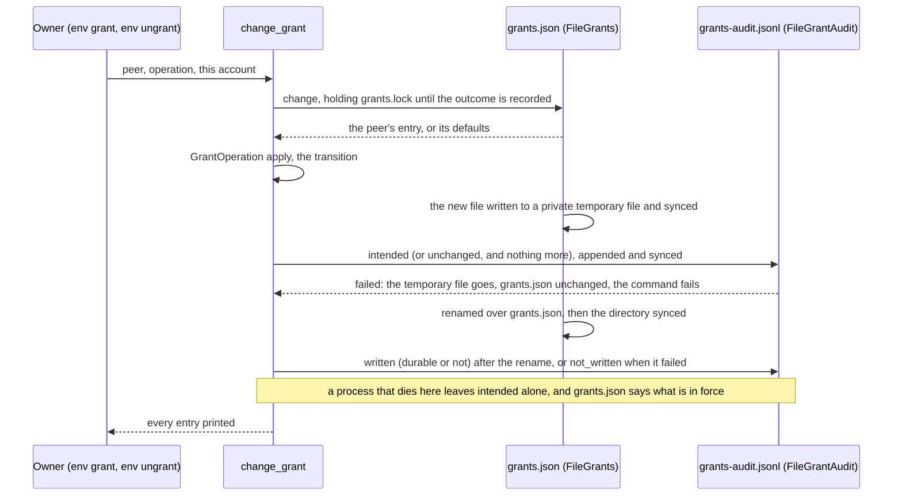

- **A lease lasts at most what the owner grants (row I7).** An entry may
  carry `maxLeaseMs`, set with `env grant --max-lease 8h`: the longest one
  of the peer's agent leases may last from its grant. Without it a lease
  lasts until it is ended, so `ssh` with no entry is unchanged. A command
  lease is bounded by its own narrowed timeout instead. The environment is
  the one authority on the deadline: it says the duration in `Granted`
  (`leaseMs`, which the Grant frame does not ask for), measures it on its
  serving timer, and, once it passes, records `expiring`, stops every
  harness under the lease as an end does, records `ended` with cause
  `expired`, and says `Ending{expired}`. A passed deadline is acted on
  even while a frame's answer is held up, the gateway reading nothing:
  handling a frame waits for nothing, its answers queued, and the queue is
  handed to the writer, before the next frame is read, by a wait for room
  that is given up on at the earliest deadline as it stands then, a lease
  the frame itself granted included. An answer leaves the queue only once
  the writer has room for it, so a wait given up on loses nothing, and the
  answers still waiting go before the `Ending`. Ending a lease waits for
  nothing either: its `Ending` is queued, so one lease's expiry never holds
  another's back, whether they fall due together or one after the other.
  However serving ends, at the silence bound above all, a lease whose
  deadline has come is expired first; only what is left is lost. A passed deadline is also acted on
  before another frame is read or handled, so a gateway that sends without
  pause cannot put it off, and a Start read after it starts nothing. A file
  still in flight is left unanswered, as on a lost connection: the gateway
  may already have kept it, and only its own end says it took none. A
  deadline passing is not the gateway heard from: the silence bound still
  runs from its last frame.
  The gateway keeps no timer of its own. It accepts any `leaseMs` on an
  agent lease, since a limit is narrower than none, and records it as the
  lease's deadline from its own wall clock read before it sent `Grant`:
  the earliest the environment's deadline can be, never after it, so an
  expiry the environment decides never comes before what the gateway
  recorded. That record is the gateway's observation; the environment's
  timer is the authority. An
  `Ending` stops the conversation as the system (`environment_expired`,
  never a person), recording the lease ending for that cause, and asks the
  lease's `End`, which the environment answers with what its own end took:
  `ended` with that cleanup, or `interrupted` past the cleanup bound.
  Commands run under the lease end with it, as they do with any end of
  their parent. An `Ending` naming a lease the gateway does not hold is
  dropped and recorded (row L9), as is one naming a command's lease, which
  only its timeout bounds; a command answer carrying `leaseMs` is refused. An `expiring` that cannot be recorded
  still stops everything, and the lease's end then answers `uncertain`. A
  file with a `maxLeaseMs` is written as schema version 2, and as version 1
  otherwise; both are read, and a build that reads only version 1 refuses
  a version 2 file rather than serving leases without the limit. If the
  connection drops between `expiring` and the gateway reading `Ending`,
  the gateway records the lease lost while the environment's ledger says
  expired; both keep the cleanup evidence, which `Account` reads.

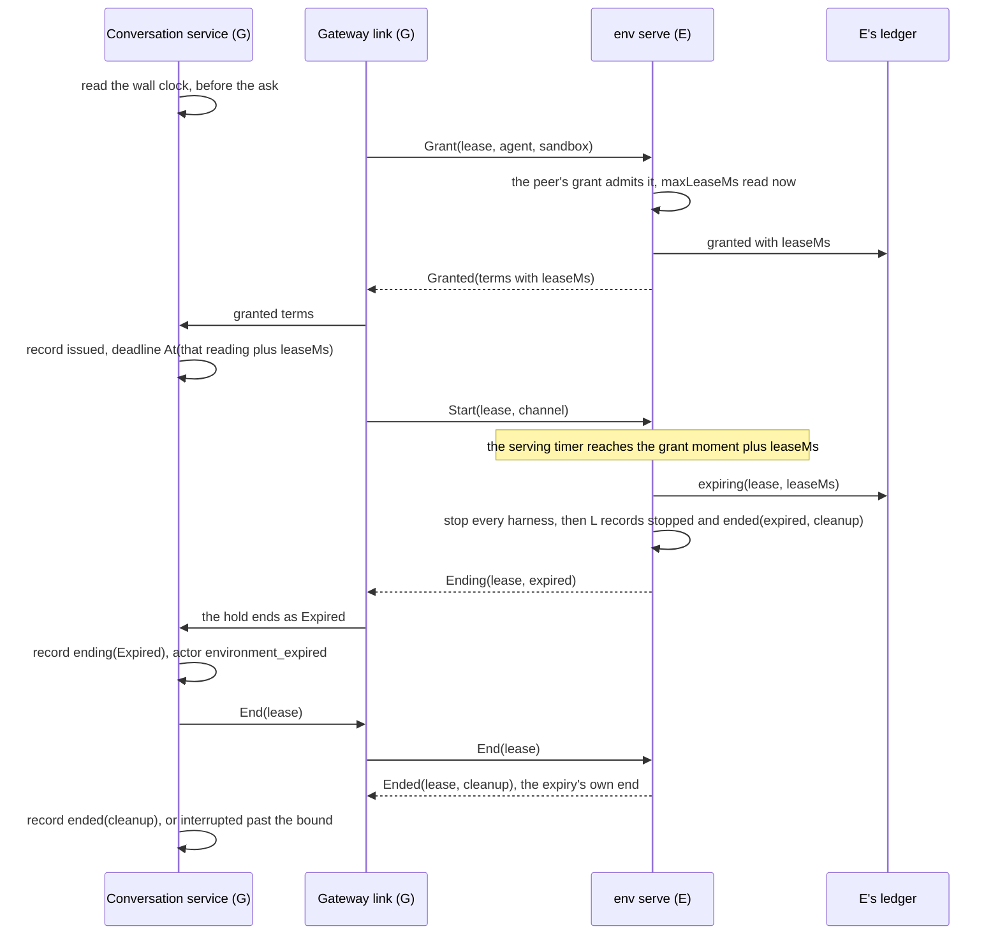

- **Known limits.** The product shows a lease the machine did not grant as
  the environment being unavailable; the run tool names it
  `environment_not_granted`, with a message saying the environment's owner
  refused it. A sandbox is granted as asked or refused: no
  host narrows one yet, since `env serve` only runs the harness default.

## State and order table

Each row has at least one test.

| Row | State and input | Result | Test |
|---|---|---|---|
| H1 | The owner creates a peer invitation; a peer claims it; the owner approves its key | Same enrollment and listener; the credential names `gateway:<key hex>`, kind `gateway`, an active member, holding only `conversation.read`, bound to that key; the record and the client's file keep the class | `owner_route_creates_a_peer_gateway_invitation`; `a_peer_enrollment_issues_a_gateway_principal_bound_to_its_key`; `an_enrollment_record_keeps_its_class`; `the_class_decides_which_principal_a_credential_names` |
| H2 | A client given an invitation for the other kind of party, or a client that relabels the class | Refused `OtherEnrollee` at the first reply, no attempt charged, nothing saved, the invitation still open; a relabelled class does not complete the PAKE; the wire carries the class as sent | `a_client_refuses_an_invitation_for_another_kind_of_party`; `a_relabelled_enrollment_class_does_not_complete_the_pake`; `the_enrollment_class_is_carried_and_never_changes_in_transit` |
| H3 | A paired peer authenticates and reads before anything is shared with it | `ready` as its own principal; its catalogue head is zero, so it has nothing to page; `conversation.list` is `forbidden` | `a_peer_gateway_pairs_as_its_own_principal_and_reads_nothing_ungranted` |
| H4 | A gateway principal with `conversation.write` or `credential.manage`, an admin membership, a bearer credential, a credential naming another principal, or a peer record that lost its class | Refused on open and never written | `which_grants_each_kind_may_hold`; `a_gateway_principal_holds_only_what_pairing_issued_it` |
| H5 | The owner revokes a paired peer's credential | Its next connection is refused at `openProduct` | `a_revoked_peer_gateway_is_refused_its_next_connection` |
| H6 | `credential.issue` for a principal of kind `gateway` | Refused `Conflict`, nothing written: no second way to make a peer. The registry refuses the reserved `gateway:` id and a kind that does not match its id before it asks; the policy's refusal (`credential.issue` has no permit for a gateway) is tested at the adapter | `a_gateway_principal_holds_only_what_pairing_issued_it`; `who_may_be_issued_a_credential_on_each_path` |
| H7 | A gateway that pairs no peer | Every device enrollment, registry and client file reads and writes as before | the existing device pairing suites |
| H8 | The owner shares one of two conversations with a paired peer, then unshares it | The share applies (an access answer about another credential, or one that contradicts itself, is still refused); the peer's record head on the granted one reaches the source and on the other is `wrong_owner`, as is a record page on it; resolving the other answers as an id that does not exist; a manifest boundary one past the peer's head is `invalid_request` though the owner's head is past it; its manifest lists the granted one alone; the owner's work on the other conversation does not move the peer's head; the unshare moves the head forward and takes the row away. On the socket, a binding whose owner is not the session principal reads only what it was granted, and its lists are refused | `a_peer_reads_only_what_it_was_granted`; `a_binding_owned_by_another_principal_reads_only_its_grantors_grants` |
| H9 | A paired reader's catalogue head as the owner works, grants and revokes | An ungranted change and a grant to another receiver leave it; a grant, a change to a granted row and a revoke each move it; a revoke moves it forward, never back to an older granted row | `a_paired_readers_head_moves_only_with_what_it_was_granted` |
| I1 | The owner creates an environment invitation; a gateway claims it; the owner approves its key | Same enrollment and listener; the credential names the same `gateway:<key hex>` a reading enrollment of that key would, an active member, holding only `environment.serve`, bound to that key; the owner needs `credential.manage` and never holds the grant; the record keeps `class: "environment"`. A registry in which that credential also or instead reads, or a person's credential serves, is refused on open; `credential.issue` of `environment.serve` to anyone is refused `Conflict`, nothing written; a share to its credential is refused `share_target_not_paired`, nothing granted; Cedar allows the action only to an active member holding it | `owner_route_creates_an_environment_invitation`; `owner_route_without_the_consent_grant_is_forbidden`; `owner_route_refuses_a_member_before_disclosure`; `an_environment_enrollment_issues_the_peer_principal_holding_only_serve`; `an_environment_is_paired_but_never_shared_with`; `cedar_allows_serving_only_to_a_member_holding_the_grant`; `each_class_discloses_only_its_own_grant`; `an_enrollment_record_keeps_its_class`; `the_enrollment_class_is_carried_and_never_changes_in_transit` |
| I2 | A paired environment dials the native listener and asks for `openEnvironment`; the gateway runs a command there; the environment dials again; then its credential is revoked | Admitted only for a key whose credential is allowed `environment.serve` now: a key paired to read is refused before it takes a permit. The command runs on the environment over its own connection and answers its exit, output and cleanup; a second connection takes the place of the first, whose serving ends; once revoked, the next command is refused unreachable, the connection is closed, and the next dial is refused | `a_paired_environment_dials_in_serves_and_stops_at_revocation`; `a_key_paired_to_read_is_refused_at_open_environment` |
| I3 | A machine pairs with `env enroll`'s pairing and waits as `env dial` does; the owner approves it, or denies it; one host serves what it dials; its first connection is cut, and it is stopped later | It waits while the pairing is pending and gets its key and the gateway's pin once approved; a denied pairing, or a machine never paired, stops waiting with that reason; a cut connection is dialed again and served by the same host; failed dials wait twice as long each time up to the most, a connection served at least that long starts the wait over, and a failure no dial can change stops it (a pin that is not a key is `InvalidInput`, a key that is not the gateway's is dialed again); stop closes the connection being served, which the gateway sees disconnected | `an_enrolled_environment_waits_for_approval_then_stays_dialed_in`; `waiting_for_approval_ends_when_denied_or_never_paired`; `a_pin_that_is_not_a_key_is_invalid_input_and_another_key_is_not`; `failed_dials_wait_twice_as_long_each_time_up_to_the_most`; `each_connection_is_served_and_a_long_one_starts_the_wait_over`; `a_setup_dialing_again_cannot_change_stops_it`; `stop_closes_the_connection_being_served_and_dials_no_more`; `stop_asked_while_waiting_ends_the_wait` |
| I4 | A gateway asks a lease of an agent, or a command, that the environment's owner did not grant it, or a sandbox the host cannot enforce; the owner changes the grant | A dialed gateway with no entry, or one leaving the agent or commands out, is refused `NotGranted`, recorded as refused, nothing run, before anything about what the host runs is said, and the gateway answers `EnvironmentNotGranted` as the environment's refusal; `ssh` with no file or no entry keeps everything the host runs; grants that cannot be read refuse every lease; a sandbox the host cannot enforce is refused `SandboxUnavailable`, mapped as such; a change applies from the next lease, the running ones go on | `i4_a_dialed_gateway_without_a_grant_is_refused_and_nothing_runs`; `ssh_without_grants_keeps_everything_the_host_runs`; `grants_that_cannot_be_read_refuse_every_lease`; `a_sandbox_the_host_cannot_enforce_is_refused`; `a_sandbox_the_host_cannot_enforce_is_refused_as_such`; `what_the_hosts_owner_did_not_grant_is_refused_and_a_narrowed_timeout_is_answered`; `a_dialed_gateway_runs_only_what_the_environment_granted_it`; `an_entry_allows_its_named_agents_only`; `an_entry_allows_commands_only_when_it_grants_them`; `ssh_without_an_entry_is_allowed_every_agent_and_commands`; `a_gateway_without_an_entry_is_not_permitted`; `whether_an_entry_was_written_does_not_decide`; `a_forbid_is_named_in_the_refusal`; `unreadable_grants_refuse_without_asking`; `an_ungranted_gateway_learns_nothing_of_what_the_host_runs`; `grants_and_refusals_name_their_peer_and_old_lines_still_read` |
| I5 | A gateway asks a command longer than the grant's `maxTimeoutMs`; or an environment answers terms wider than, or other than, asked | The environment records the narrowed timeout and the timeout asked, answers the terms it granted, and runs the command with the narrowed timeout; the gateway records the granted terms and waits for the command that long; a wider or other answer is refused as the environment's `EnvironmentNotGranted` and its hold dropped, nothing run | `i5_a_command_timeout_is_narrowed_recorded_and_run_with`; `a_command_timeout_is_narrowed_and_never_widened`; `i5_a_narrowed_command_is_recorded_as_granted_and_a_wider_one_is_refused`; `l1_an_environment_granting_other_terms_than_asked_is_refused_and_nothing_runs`; `a_grant_names_its_sandbox_and_its_answer_the_granted_terms` |
| I6 | The owner runs `env grant`, `env ungrant` and `env grants`; the file is another version, too large, not private or not this shape | Each change is written whole and private under a lock and read back as given, an entry equal to the defaults removed; an unreadable file is refused, never taken as no grants, and no change is made over it; a change past the size bound is refused, nothing written; a peer named twice is unreadable in either order; each grant and ungrant appends a private `intended` record of who, when, which peer, the operation and the grant before and after, and then `written` (durable or not) or `not_written`, both under the lock; one whose intent cannot be recorded leaves grants.json unchanged, a sync failure after the rename is `written`, not durable, and fails the command, and an outcome that cannot be recorded fails it as unconfirmed; an ungrant applies to the next lease while the leases running go on | `a_change_is_written_privately_and_read_back`; `every_agent_and_missing_fields_are_read_as_written`; `a_file_this_build_cannot_read_is_refused`; `a_change_past_the_bound_is_refused_and_writes_nothing`; `a_peer_is_spelled_one_way_and_read_back`; `an_absent_file_is_no_entries`; `granting_adds_and_ungranting_takes_away`; `i6_an_ungrant_applies_to_the_next_lease_and_running_leases_stay`; `env_grant_names_agents_or_every_agent_and_commands_with_their_longest_run`; `env_ungrant_takes_one_thing_back_and_env_grants_lists_them`; `a_peer_named_twice_is_refused_in_either_order`; `a_grant_writes_intended_then_written`; `a_rename_failure_writes_intended_then_not_written`; `a_sync_failure_after_the_rename_writes_written_and_is_not_durable`; `an_outcome_that_cannot_be_recorded_leaves_the_change_unconfirmed`; `a_change_that_cannot_be_audited_leaves_the_grants_unchanged` |
| I7 | The environment's owner grants a peer `maxLeaseMs`; one of its agent leases outlives it, or is ended as the deadline passes, or its expiry cannot be recorded, or its connection is lost first; a command lease under the same grant; a host says it is ending a lease the gateway does not hold | E grants the lease with `leaseMs`, records it, and at the deadline (not a moment before, and however continuously the gateway sends) records `expiring`, stops the harness, records `ended` with cause `expired` and says `Ending`; the silence bound still runs from the gateway's last frame; a Start read after the deadline starts nothing; an answer held up on a full output queue does not hold the expiry back, nor does one lease's `Ending` waiting for room hold another lease's expiry back, due at once or later, nor a lease's own `Granted` waiting for room hold back its expiry; a lease due as the gateway is taken as gone is expired, not lost; a file still in flight is recorded unanswered, never refused as the lease ending; the gateway's End is answered with that cleanup; an End and the deadline at once end the lease once; without a limit nothing expires and the wait is only the silence bound; an expiry that cannot be recorded still stops and answers `uncertain`; after the connection is lost nothing more is recorded; a command is bounded by its own timeout, granted no `leaseMs`; G records the deadline as its clock read before the Grant plus `leaseMs` (the earliest E's can be), and on `Ending` records the lease ending as expired by the system and then ended with the cleanup, or interrupted with none; an `Ending` for a lease not held, or for a command's lease, is dropped and recorded; a command answer carrying `leaseMs` is refused as the environment's `EnvironmentNotGranted`; `--max-lease` writes grants.json as version 2, version 1 still reads, and the audit's operation, before and after carry it | `a_lease_past_its_granted_duration_is_stopped_recorded_expired_and_said`; `an_end_and_a_deadline_at_once_end_the_lease_once`; `a_lease_with_no_max_never_expires`; `an_expiry_that_cannot_be_recorded_still_stops_and_answers_uncertain`; `a_deadline_after_the_connection_is_lost_records_nothing_more`; `a_command_is_bounded_by_its_timeout_not_the_max_lease`; `max_lease_is_written_as_version_2_and_version_1_still_reads`; `a_granted_duration_is_recorded_as_the_deadline`; `an_environment_expiry_is_recorded_ending_then_ended_with_its_cleanup`; `an_expiry_whose_end_goes_unanswered_is_interrupted`; `an_ending_for_a_lease_not_held_is_dropped_with_evidence`; `an_ending_for_a_command_lease_is_dropped_with_evidence`; `a_gateway_sending_without_pause_cannot_put_off_an_expiry`; `a_reply_blocked_on_a_full_output_queue_does_not_hold_back_an_expiry`; `two_leases_due_at_once_both_expire_at_the_deadline`; `staggered_deadlines_each_expire_at_their_own`; `a_lease_granted_while_the_gateway_reads_nothing_expires_at_its_deadline`; `a_lease_due_as_the_gateway_falls_silent_is_expired_not_lost`; `a_granted_duration_is_recorded_on_the_issued_lease`; `a_file_in_flight_when_its_lease_expires_is_left_unanswered`; `i5_a_narrowed_command_is_recorded_as_granted_and_a_wider_one_is_refused`; `a_paired_environment_expires_a_lease_and_both_sides_record_it`; `a_grant_writes_intended_then_written`; `env_grant_names_agents_or_every_agent_and_commands_with_their_longest_run`; `a_grant_names_its_sandbox_and_its_answer_the_granted_terms` |
| I8 | The owner revokes a paired environment's credential while it is connected, idle or running a lease; the revocation races an expiry or a grant; either side cannot record it | Without a lease being asked, the gateway sees it at its next check (each keepalive interval), refuses new leases, harness starts and publishes there (a command run after it is answered never started, holding nothing) and drops the environment from the connected list, records `revoked` with the leases the host granted (and one more `revoked` for a lease granted after, its Grant sent before), queues `Revoked` before any lease is seen ending so every End follows it, ends each harness lease as revoked by the system (`environment_revoked`), and says `Revoked`; the environment records `revoking` naming the gateway, stops everything, records `ended` with cause `revoked`, stops a running command (its `Ran` answers), never writing `revoking` after a command's own recorded end, and ends an unrun one holding nothing, refuses anything more as `revoked` (never `not_granted`), never waits on a gone gateway to say a command's `Ran` whatever stopped it, and answers each `End` with that cleanup; the gateway records the lease ending (revoked) then ended with that cleanup, or interrupted with none; the connection closes once every lease is let go, or at the silence bound when one is never ended; the first cause known is kept on each side, and the environment ends an expired lease once; said or asked twice, it acts once; an unrecordable revocation still ends everything, harness and command leases unconfirmed on the gateway and `uncertain` on the environment; the next dial is refused | `a_paired_environment_revoked_mid_lease_ends_it_on_both_sides_and_closes`; `an_idle_paired_environment_is_closed_once_revoked`; `a_paired_environment_dials_in_serves_and_stops_at_revocation`; `a_revoked_link_ends_each_lease_as_revoked_and_closes_once_they_are_ended`; `a_revoked_link_closes_at_its_bound_when_a_lease_is_never_ended`; `a_revocation_whose_audit_fails_leaves_its_leases_unconfirmed`; `a_lease_granted_after_its_revocation_is_recorded_revoked_on_its_own`; `a_command_run_after_its_revocation_is_answered_never_started`; `a_command_whose_end_is_recorded_is_not_revoked_while_its_ran_waits_for_room`; `a_lease_ending_for_one_cause_keeps_it_when_the_other_comes`; `a_revoked_gateway_has_every_lease_ended_recorded_revoked_and_its_ends_answered`; `a_revocation_that_cannot_be_recorded_still_stops_and_answers_uncertain`; `a_revocation_after_an_expiry_ends_the_lease_once_as_expired`; `an_environment_revocation_is_recorded_ending_then_ended_with_its_cleanup`; `a_revocation_whose_end_goes_unanswered_is_interrupted`; `every_frame_round_trips_and_names_its_lease` |
| I9 | A paired environment's harness publishes a file, or the gateway asks it to publish one for the agent; the gateway reads it over the connection; the connection is lost mid-read, or the staged copy is cut short; the gateway reads a range of an artifact not waiting for its answer, or more ranges than the bound | The file's bytes come over the lease frames, at most four 64 KiB ranges of one file unanswered, no artifact channel opened; verified by digest and held with the lease as cause; E records `published` then `collected` (held) and answers the harness `held`, and lets the copy go. A loss mid-read refuses the file `leaseEnded` with nothing held, E records it `unanswered`; a copy cut short is refused `mismatch`. E answers only a copy staged under that lease and still unanswered (else `notStaged`, and a lease not held is a recorded drop), clamps a range to 64 KiB, answers short or empty at the copy's end, refuses a fifth read of one artifact `busy` while four are read or wait for the writer (a gateway reading nothing holds no more), stops a lease's reads at its end so none answers after `Ended`, an unreadable copy `unreadable`, and one let go while it was read `notStaged`; after `Revoked`, a read of a file it had offered is `notStaged` | `a_paired_environment_publishes_a_file_and_the_gateway_reads_it_back`; `a_paired_connection_carries_a_published_file_on_its_lease_frames_and_it_verifies`; `a_paired_lease_lost_mid_read_fails_as_ended_and_leaves_no_partial_hold`; `a_staged_copy_cut_short_mid_read_on_a_paired_connection_is_a_mismatch`; `a_staged_copy_is_read_by_range_only_while_it_waits_for_its_answer`; `reads_past_the_bound_are_refused_busy_and_an_unreadable_copy_is_said`; `a_read_after_the_gateway_revoked_is_answered_not_staged`; `a_copy_let_go_while_it_is_read_is_answered_not_staged`; `no_read_answers_after_its_lease_ended`; `a_gateway_that_reads_nothing_holds_a_bounded_number_of_answers`; `an_artifact_read_names_its_range_and_its_answer_the_bytes_or_why_not`; `every_frame_round_trips_and_names_its_lease` |
| I10 | A surface follows the agent catalogue (`agents.subscribe`) while a paired environment connects, its connection ends, it connects again and is revoked; a change leaves the catalogue as it was; the follower's grant is lost; it subscribes twice, or unsubscribes with the other kind's method | `PeerEnvironments::connections` moves once each time a connection is admitted and once each time one ends, and once more when one is revoked, each after the connected list has changed; the subscription sends the catalogue `agents.list` answers then, after its reply and again on each move, and nothing when it is the same; moves while a frame waits are one frame; the conversation catalogue's head and list do not move; it is admitted as `agents.list` is (`server.read`, which no peer's credential holds), and a lost grant ends it `refused`; a second is `subscription_duplicate`; each unsubscribe answers `unknown_subscription` for the other's; it ends with its socket, and `source_closed` with its source; the panel's choices replace the list on each frame and stop the subscription on unmount | `connection_changes_are_said_as_a_paired_environment_connects_ends_and_is_revoked`; `the_agent_catalog_is_sent_again_as_paired_environments_come_and_go`; `a_gateway_pairing_no_environments_sends_its_catalog_once`; `changes_while_a_catalog_frame_waits_collapse_into_one_frame`; `paired_environments_coming_and_going_never_move_the_conversation_catalogue`; `a_second_agent_catalog_subscription_is_a_duplicate`; `following_the_agent_catalog_is_admitted_as_reading_it_is`; `each_unsubscribe_stops_only_its_own_kind`; `the_environments_source_closing_ends_the_catalog_subscription`; `an_agent_catalog_frame_is_the_generated_shape`; `replaces the choices with each catalog the follow sends, and stops it on unmount` (`src/panel/ui/use-agent-choices.test.ts`) |
| K1 | A worker started with `env dial --drain-deadline` is signalled while it holds a harness's lease, a running command and a command never run; a grant crosses the drain; the drain's record cannot be kept; the gateway revokes it while it drains; it holds nothing; the deadline passes | Each lease is recorded `draining` (with its gateway) then `ended` with cause `drained`; the harness is stopped, `Ending{drained}` is said and the gateway's `End` answered with that cleanup; the command is stopped and answers its `Ran` as drained, which the gateway takes as a system stop; the unrun one ends holding nothing, and serving waits for its `Run`, answered never started; a crossing grant is refused `draining`, recorded so; an unrecorded drain still stops and answers `uncertain`; a revocation after it ends nothing twice; serving ends once every drained lease's `End` is asked, at once when nothing is held; on the gateway the lease is recorded ending as `stopped` by `environment_drained`, then ended with E's cleanup, and E leaves the connected list; a drain asked between dials ends the wait and dials no more; past the deadline stop is asked | `k1_a_drain_ends_every_lease_recorded_then_serving_ends_once_answered`; `k1_an_idle_host_asked_to_drain_stops_serving_at_once`; `k1_a_drain_that_cannot_be_recorded_still_stops_and_answers_uncertain`; `k1_a_drain_waits_for_the_run_of_a_command_it_ended_unrun`; `k1_a_drain_asked_while_the_gateway_reads_nothing_ends_the_lease_at_once`; `k1_a_grant_waiting_as_the_drain_is_asked_is_refused`; `k1_a_command_its_host_drained_is_stopped_by_the_system_not_lost`; `k1_an_unrecorded_drain_of_an_unrun_command_answers_its_run_uncertain`; `k1_a_revocation_after_a_drain_ends_the_lease_once_as_drained`; `k1_a_paired_environment_drains_and_both_sides_record_its_cleanup`; `k1_an_environment_drain_is_recorded_stopped_by_the_system_then_ended`; `a_drain_lets_the_connection_end_by_itself_and_dials_no_more`; `a_drain_asked_while_waiting_ends_the_wait`; `a_drain_past_its_deadline_asks_stop` |
| K2 | `env dial --enroll-code-file` starts on a volume paired with nothing, again before approval, and again after; a volume paired with A starts with B's address and code; a pairing that recorded no address; a file holding no code; a code the gateway never gave | It enrolls once, then each restart sends nothing and finds A's pin; the volume paired with A refuses naming A, and B's invitation stays unclaimed; no recorded address refuses; the file is refused as holding no code; the wrong code is refused and leaves no pairing, so the right one then enrolls | `k2_a_code_file_enrolls_once_then_dials`; `k2_a_volume_paired_to_one_gateway_refuses_enrolling_with_another`; `env_enroll_names_a_gateway_and_a_code_and_env_dial_a_gateway`; and, through the `EnrollingPairing` and `EnrollmentCode` ports, `nothing_paired_records_the_address_then_sends_the_code`, `a_pairing_with_this_gateway_reads_and_sends_nothing`, `a_pairing_with_another_gateway_or_none_recorded_is_refused_untouched`, `a_code_that_cannot_be_read_sends_and_records_nothing`, `an_address_that_cannot_be_recorded_sends_no_code`, `a_gateway_that_refuses_the_code_is_said`, `a_pairing_that_cannot_be_read_enrolls_nothing`, `enrolling_over_a_pairing_keeps_its_recorded_address` |
| K3 | Gateways A and B, one organization each, with workers W paired to A and X paired to B; X's key dials A, with A's pin and with its own; each gateway runs a command and an agent lease on its own worker and on the other's name; each publishes the same relative path; A asks W for a path into X's workspace; a worker's credential reads the gateway it serves | X is refused at A's door, `permissionDenied` with A's pin and `connectionAborted` with its own; each gateway's commands and leases run on its own worker, and on the other's name are refused `environmentUnreachable`; each gateway's paired list holds its own worker alone, and through the tools' service calls `environments_list` lists it alone, `run` on the other's name is refused `environmentUnreachable` though the policy names it, and with a conversation placed on its own worker, `artifacts_publish` keeps a file from it while `artifacts_publish` and `artifacts_fetch` on the other's name are refused `environmentNotLeased`; each reads its own organization's file; the path out of W's workspace is refused `outsideWorkspace`; each worker's ledger records its own gateway's command and its agent lease from `granted` to `ended`, and neither of the other's; each gateway's environment audit (connections) names its own worker and workspace alone; the worker's session holds `environment.serve` alone, and the catalogue head and records head are each refused `forbidden` and its one grant names this gateway, while a device shared with gets an answered head and `history_pruned` | `k3_two_organizations_share_no_lease_workspace_artifact_tool_or_audit`; `k3_the_agents_tools_reach_only_this_gateways_own_worker`; `k3_artifacts_move_only_on_this_gateways_own_worker`; `a_placement_on_a_paired_environment_is_read_back_as_written`; `k3_a_worker_reads_nothing_on_the_gateway_it_serves` |
| H10 | A registry whose owner membership is disabled or not an admin | Refused on open (`owner_membership`). The pairing initiator's membership is what keeps a grantor live; the owner's is the one the registry pins | `a_registry_whose_owner_is_not_an_active_admin_does_not_open` |

## The dialing side

Part 2b gives a gateway the other end: its owner enrolls it into another
gateway's peer invitation, and it keeps what it learned there. The enrolling
client is `nessa-client-core`'s, which the gateway links without its `cli`
feature ([ADR 483](../../adr/done/483-protocol-and-client-core-crates.md),
amended).

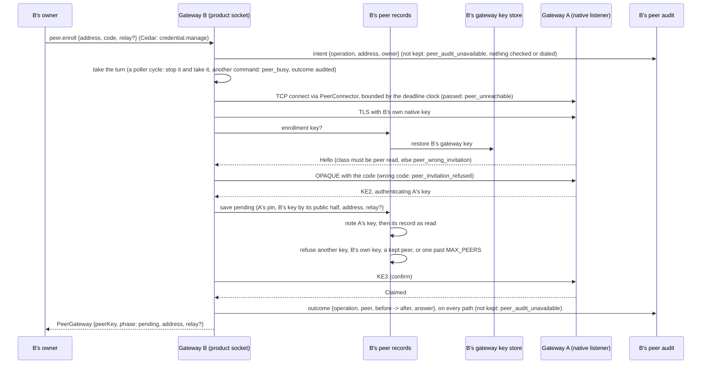

- **One key, one principal.** B enrolls with the gateway's own native key,
  injected from the gateway key store, never a key made for the enrollment
  (`ClientPendingStore::enrollment_key`). A therefore names B by the same
  `gateway:<key>` principal however often it is enrolled, which slice I
  needs. The record names that key by its public half; the private half
  stays in the key store alone, and a record made with a key that is no longer
  the gateway's does not read.
- **One file per peer.** `peer-gateways/<peer key hex>.json` beneath the
  namespace, private, published by rename through `nessa-local-storage`. It
  holds the peer's pin, the enrollment it claimed, the credential once
  issued, and the address that last answered, with its own `schemaVersion`
  ([ADR 202](../../adr/todo/202-versioned-local-datasets.md), record scope: a
  record that does not read is listed `unreadable` and fails only that
  peer).
- **What the owner is told.** `peer.enroll` returns the pending record;
  approval happens on A. The credential reaches the record when B next reads
  its pinned status, which the poller does ("Reading a peer", below). `peer.list` shows
  every kept peer; `peer.forget` removes B's record only.
- **A peer can keep a relay.** `peer.enroll` takes an optional `relay`
  (`host:port`) and `peer.relay {peerKey, relay}` sets or clears it, owner
  only and audited like the other commands. The enrollment itself always
  dials the address directly: until A's key is pinned there is nothing to
  ask a relay for. Once pinned, the poller's status dial and its read race
  the direct address with the relay, as a phone's reader does
  ([relay](relay.md), rows RL19 and RL20). A record without a relay keeps
  its old shape on disk.
- **It dials what the owner names.** `peer.enroll` connects from this
  gateway's host to whatever IP address and port the owner gives, which is
  why it is owner-only (`credential.manage`) and why every failure that is
  not the peer protocol's own answer is `peer_unreachable`: an open port and
  a closed one answer alike. The client keeps a failed TLS handshake
  (`NativeClientError::Handshake`) apart from a failed PAKE proof, so a
  service that is not a gateway never reads as a wrong code.
- **Every deadline is the injected clock's.** The connect goes through the
  `PeerConnector` port, which sets no timeout of its own; the command reads
  the injected monotonic clock every wake tick and drops the attempt once
  the connect deadline passes, and reads it again when a connection
  completes, so one that completes past the deadline is closed unused.
  Each audit record is bounded the same way, by `AUDIT_DEADLINE`: one not
  acknowledged in time counts as not kept, though the audit may still keep
  it later. Each enrollment's entropy comes from an injected source too, so
  a failing generator is a typed `peer_unavailable`, audited. The handshake and enrollment deadlines read
  the same clock, so a substituted clock drives the whole enrollment.
- **Enrolling and forgetting take turns.** One enrollment or forget runs at a
  time, and another is `peer_busy` while it does, so a forget cannot remove
  the record an enrollment is saving and spend the peer's invitation for
  nothing. A poller cycle takes the same turn, but never makes a command
  busy: the command stops the cycle and takes the turn once it is given
  back, within `PREEMPT` (10 s) on the injected clock ("Reading a peer", below).
- **Every enroll and forget call is audited.** Both commands run only
  through one audited wrapper. It hands an intent to the `PeerAudit` port
  before anything else, even the check that no other command holds the turn
  (the address or the peer named, and the owner who asked), and an outcome
  on every way the call ends (the peer, its record before and after, and the
  answer), correlated by one operation id. The command body answers with
  that evidence on each of its returns, as its type demands, so no early
  return skips the outcome. The enrollment's slot notes the peer's key the
  moment the peer's pin reaches it, and its record as first read, so every
  later refusal (`peer_exists`, `peer_capacity`, `peer_own_gateway`) names
  them; a call that ended before reading the record says `not_read`.
  `DurablePeerAudit` keeps each record as its own private file in
  `peer-gateways-audit/`, synced before it is acknowledged. It is the one
  authority over the records' order: it gives each record its `sequence`
  (from 1 in each process), id and `observedAtMs` the moment it is handed
  over, under the same lock that puts it on a bounded queue
  (`AUDIT_QUEUE`, a row of [`limits.md`](../../limits.md)), and one
  writer thread writes the queue in that order. A full queue refuses the
  record at once rather than wait; a refused record uses up its sequence,
  so a gap in the files is a refusal the log names. Stopping native pairing
  first joins the poller, then closes the peer commands, in one step with
  the count of those running: a command asked from then is refused
  `peer_unavailable` before its intent, one already past its intent no
  longer takes the turn (`peer_unavailable`, its outcome kept, before any
  effect), and those running are waited for, within `PREEMPT` on the
  injected clock, so no effect is left without its outcome (see Known
  limits for one that outlasts it). Only then is the audit closed (a command from then on is refused
  before its intent) and its writer waited for, within one `AUDIT_DEADLINE`;
  records still queued past it are logged by sequence and not written, and
  a writer that panics ends the drain at once, its unwritten records logged
  by sequence. An intent that is
  not kept refuses the command before anything is dialed or removed; an
  outcome that is not kept answers `peer_audit_unavailable` while the effect
  stands, so the owner never sees success without its evidence. A process
  that stops between an effect and its outcome leaves the intent, and the
  peer record says what it came to. Logs carry the same fields; never the
  code or key material.
- **Forgetting is local.** A gateway principal can never hold
  `credential.manage`, so B cannot revoke what A issued it. A's owner revokes
  it on A (`credential.revoke`), which is what stops B reading.

| Row | Situation | Result | Test |
| --- | --- | --- | --- |
| P1 | B enrolls into A's peer invitation | A records B's own native key as the claim; B keeps a pending record pinning A's key | `a_gateway_enrolls_into_a_peer_with_its_own_key_and_keeps_only_a_reference`, `a_composed_gateway_enrolls_into_another_with_its_own_key` |
| P2 | B's record on disk | A's pin and B's key's public half; B's private key in no spelling | same |
| P3 | A's owner approves; B reads its pinned status | The credential replaces pending in the same record; listed `active` | `a_gateway_enrolls_into_a_peer_with_its_own_key_and_keeps_only_a_reference` |
| P4 | `peer.forget` | The record is removed, its cache first; a second forget is `peer_not_found`. A cache removal not confirmed durable leaves the record untouched and is audited `cache: unconfirmed` beside it, `peer_unavailable`; forgetting again finishes it | same |
| P5 | A device invitation's code | `peer_wrong_invitation`, before the PAKE; nothing saved | `a_refused_or_wrong_class_invitation_saves_nothing`, `a_composed_gateway_enrolls_into_another_with_its_own_key` |
| P6 | A wrong code, or a cancelled invitation | `peer_invitation_refused`; nothing saved | `a_refused_or_wrong_class_invitation_saves_nothing` |
| P7 | Nothing at the address; a peer already kept | `peer_unreachable`; `peer_exists`, the kept record unchanged byte for byte, and audited with that peer's key and its state before and after, both as found | same |
| P8 | No native pairing; a member; malformed params, a relay that is not `host:port` among them | `peer_not_configured`; `forbidden`; `invalid_request`, before any effect | `peer_routes_refuse_before_any_effect` |
| P9 | A pending save with any key but the gateway's own, or for a pin that is the gateway's own key | Refused, nothing written; the second is `peer_own_gateway` | `a_record_takes_only_the_gateways_key_and_an_unreadable_one_can_be_forgotten` |
| P10 | A record of another shape, or a valid one whose `gatewayKey` is not this gateway's | Listed `unreadable`; its credential does not load (`Corrupt`); enrolling into that peer is `peer_exists` and `peer.relay` on it `peer_unavailable`, each audited `unreadable` before and after and leaving it as it was; `peer.forget` removes it | same |
| P11 | `peer.forget` while an enrollment runs | `peer_busy`; once the enrollment ends, forget runs | `forgetting_waits_for_a_running_enrollment` |
| P12 | An enroll or forget that succeeds or is refused; its intent, or its outcome, not kept | Intent and outcome kept, naming the operation, peer, address, state before and after, answer, cause and owner; no intent: nothing dialed or removed, `peer_audit_unavailable`; no outcome: the record made or removed stands, `peer_audit_unavailable` | `enrolling_and_forgetting_are_audited_and_answer_only_when_kept`, `the_durable_peer_audit_reports_a_record_it_could_not_keep` |
| P13 | A connect that never answers; one that completes past the deadline | Held while the injected deadline clock stands still; once it passes the connect deadline, `peer_unreachable`, audited, the attempt dropped and nothing saved; a late connection is closed unused, `peer_unreachable` | `a_connect_that_never_answers_ends_when_the_injected_clock_passes_its_deadline`, `a_connect_completed_after_the_deadline_is_refused_and_closed` |
| P14 | Every answer of `peer.enroll` (ok, busy, unreachable, refused code, wrong invitation, own gateway, exists, capacity), of `peer.forget` (ok, busy, not found) and of `peer.relay` (ok, busy, not found) | Exactly one intent and one outcome per call under one operation id, naming the owner, the target, and the peer once known; the table must list every answer | `every_peer_command_answer_keeps_one_intent_and_one_outcome` |
| P15 | The injected entropy for an enrollment fails | `peer_unavailable`, nothing saved, its intent and outcome kept | `an_enrollment_whose_entropy_fails_is_unavailable_and_audited` |
| P16 | The audit never acknowledges an intent, or an outcome | Held while the injected clock stands; once it passes `AUDIT_DEADLINE`, `peer_audit_unavailable`: no intent, nothing dialed; no outcome, the effect stands | `an_audit_that_never_answers_ends_the_call_at_its_deadline` |
| P17 | `peer.enroll` with a relay; `peer.relay` setting it, then clearing it | Listed and stored with the relay; changed, then gone from the record, which no longer names the field; each change audited with the relay before and after | `a_peer_keeps_its_relay_and_peer_relay_changes_it` |

## Reading a peer

Part 2b-3 reads what each peer granted. One task per gateway,
`PeerPoller`, started and joined with native pairing, schedules the kept
peers and reads up to `READS_AT_ONCE` (4) of them side by side. Each cycle
holds that peer's turn. `peer.forget` and `peer.relay` stop the cycle of the
peer they name and go ahead; a cycle of any other peer keeps going. A peer,
however slow, never keeps an owner command waiting except the command that
names it, and never keeps the other peers' reads waiting past its own place
in the cap. `peer.enroll` does not stop a read. It shares the record set
with `peer.forget` and `peer.relay`, one at a time: enroll and forget both
change how many records are kept and `MAX_PEERS` is checked against that
set, and a relay that cannot take the set does not stop a read.

```mermaid
sequenceDiagram
    participant O as B's owner
    participant P as B's poller
    participant R as B's peer records
    participant U as B's peer audit
    participant A as Gateway A (native listener)
    participant C as B's retained cache of A
    P->>R: list kept peers to schedule (pending or active)
    P->>P: start each due peer, up to READS_AT_ONCE, each on its own turn
    P->>R: read the record again (gone, revoked or unreadable: drop the peer)
    P->>A: pinned status, through PeerConnector under the deadline clock (a relay kept: raced with it after DIRECT_HEAD_START, or at once on refusal)
    A-->>P: Pending / Claimed / Approved: wait an interval
    A-->>P: Terminal or Unclaimed: the client removes the cache, then marks the record revoked
    A-->>P: Active {receiver, epoch}: the client saves the credential into the record
    P->>U: what is held before and after the status, if it changed (approved / ended)
    P->>A: openProduct with B's own key and the issued credential (read budget starts)
    P->>A: catalogueHead (unchanged, and a finished walk noted there: done)
    P->>A: catalogue manifest pass and resolve
    P->>C: what A grants, by its owner's catalogue stream
    P->>A: recordsHead for each cached conversation, while the budget lasts
    A-->>P: wrong_owner: no longer granted
    P->>C: withdraw it (entry and transcript)
    P->>A: record pages for the rest (cache full: heads only, to withdraw)
    C-->>P: ResetRequired or damaged: empty the cache, read once more
    A-->>P: openProduct refused (redacted)
    P->>A: pinned status again, only Terminal ends the enrollment
    O->>P: peer.forget or peer.relay of this peer, while its cycle holds its turn
    P->>P: that peer's cycle stopped: its sockets shut, its stop flag asked every 50 ms, waits woken, its turn given back
    P-->>O: the command runs; another peer's read is not stopped and carries on
    O->>P: peer.enroll while reads run
    P-->>O: the record set, if no enroll, forget, or relay holds it; no read is stopped
    P->>U: each change as it is made (status, reset, conversations withdrawn): queued, in turn order
    P->>P: give back the turn, keep the read slot
    P->>U: log each record at AUDIT_DEADLINE
    P->>P: keep the read slot until those records leave the queue, or the poller stops
    P->>P: free the read slot
```

- **Status first, every time.** No read happens without a fresh Active
  status, and nothing is removed without a Terminal one: a refused
  `openProduct` is redacted, so a revoked credential and a full session pool
  look alike until the status is asked, as a device does.
- **What is read is decided under that peer's turn.** The listing only
  schedules peers. Once a cycle holds the peer's turn it reads the record
  again, and a peer forgotten, ended or unreadable since is dropped, its
  sync with it, so a forget is never followed by a stale `sync` coming
  back. An unreadable record is skipped at the listing; a list that cannot
  be read waits the interval and does not stop a read already running.
- **The core is the device's.** `nessa-client-core::retained` is the one
  public entry the gateway calls: open a cache, read into it, count what it
  holds. It composes the same engine, cache and gateway session the device
  example uses; the crate's `cli` feature now gates only that example's
  entrypoint, not the reading core ([ADR 483](../../adr/done/483-protocol-and-client-core-crates.md),
  amended).
- **Synced means walked.** Whether a cache is up to date is a fact about the
  cache, so the cache keeps it: a walk of every cached conversation that
  finishes notes the catalogue head and progress generation it walked at
  (`retained_walks`). A read skips the walk only when A's head is unchanged
  and that note is there at the same head and generation. A walk cut short
  by the budget, a failure, a stop or a restart notes nothing, so the next
  read walks again and withdraws what it had not reached; a note that
  cannot be written fails the read as the cache's own failure (`quota`, or
  `failed`), backed off like any other, rather than walked again at once.
  One read withdraws at most `WITHDRAWN_PER_READ` (1024) conversations, so
  one cycle's audit records fill at most about half the audit's queue; a
  read that reaches it ends incomplete and the next cycle, soon, withdraws
  the rest. Adding the
  table moved the cache's schema version to 2: a cache of the older version
  is refused (`OutdatedSchema`) and, being derived, emptied and read again.
- **Whose catalogue.** A device's session principal owns the catalogue it
  reads, so it checks the answered scope names exactly that owner. A peer
  signs in as itself and reads an owner it cannot name, the one A bound its
  receiver to, so it checks what it can: the catalogue schema, an owner
  stream's shape (lowercase hex digest), its receiver and its epoch
  (`check_granted_catalogue_scope`). The cache keeps the stream it first
  read, one per receiver; an answer naming another is `ResetRequired`.
- **An unshare withdraws.** A's catalogue answers only rows B is granted, so
  an unshared conversation is absent from the pass, not deleted in it. Each
  read therefore asks every cached conversation's record head, and A's
  `wrong_owner` removes that conversation's entry and transcript together. A
  conversation A deletes arrives as a deleted row and leaves the cache too.
- **A cache that cannot continue is emptied.** One that cannot continue
  against what A now serves (another scope or incarnation, or a head behind
  what it completed: `ResetRequired`), or that is damaged or of a shape this
  build does not read (`Corrupt`, `OutdatedSchema`), is deleted and read
  again from nothing. It is derived from A, so nothing is lost. A full cache
  is not emptied: it lists `quota` and backs off. A full cache, or one a
  write fails on, still withdraws: from then on the read asks each remaining
  conversation only whether it is still granted, so what the peer stopped
  sharing always leaves and frees what it held.
- **Every read has a budget.** `READ_BUDGET` (60 s) on the peer commands'
  injected clock, the one their deadlines and `PREEMPT` use: no physical
  read or write waits past it, and no conversation starts after it. A read
  that reaches it having saved something ends incomplete (`syncing`), and
  the next cycle carries on soon. One that saved nothing made no headway:
  it is `unreachable`, backed off, and its last finished read is not
  refreshed, so a peer that trickles is not read again every few seconds.
- **The owner comes first, for the peer it names.** A cycle registers itself
  with that peer's turn, and gives the turn back and clears itself under one
  lock, so an owner command never finds that turn taken with no cycle to
  stop. `peer.forget` and `peer.relay` stop that peer's cycle: its sockets
  are shut and its waits woken, and the command takes the turn once given
  back, within `PREEMPT` (10 s) on the injected clock. No other peer's cycle
  is stopped. `peer.enroll`, `peer.forget`, and `peer.relay` take the record
  set without waiting, and the second is `peer_busy` at once; a forget or
  relay that cannot take the record set does not stop the peer's read.
  Shutting a socket does not
  wake a receive blocked in another thread on every system (Windows does
  not), so a read
  never waits on its socket longer than 50 ms at a time and asks its stop
  between. What a stop cannot cut short is an operating-system connect, at
  most the 5 s handshake budget; `PREEMPT` is at least twice that, checked
  when the gateway is built, to leave as long again for local writes. The
  cycle only hands its audit records over under the turn, which queues them
  at once, and waits for them after it gives the turn back, so a slow audit
  never counts against `PREEMPT`. It logs each record at `AUDIT_DEADLINE`
  and keeps its read slot until those records leave the queue, or the poller
  stops, so another cycle does not enqueue while they are still queued
  (`a_read_slot_stays_until_queued_records_leave`). Only another owner
  command, or a stopped cycle that does not give the turn back within
  `PREEMPT`, answers
  `peer_busy`. The stopped read carries on at the next cycle.
- **Revocation ends reading.** A Terminal or Unclaimed status removes the
  peer's cache and then marks the record `revoked`, both under the records'
  lock in the client's own call, so a stopped poller cannot leave a revoked
  peer's cache behind; a failure between them leaves the record as it was,
  for the next status to end again. The peer is not read again;
  `peer.forget` removes the record.
- **Every change the poller makes is audited.** It changes what is held of a
  peer through three steps only: the status (credential saved, enrollment
  ended), the cache reset, and the read (conversations withdrawn). Each
  step reads the record and whether the cache is there before and after,
  and keeps both with the cause (`peer_approved`, `peer_ended` with the
  status's cause or outcome, `cache_reset_required`, `cache_damaged`,
  `peer_withdrew` with the conversations) and the system as initiator. A
  status step is named by the transition the record's store began (the
  credential's save, or the ending), not by what the record holds after,
  so a write that then fails is still named by what it was; whether it
  succeeded is the store's answer too (`SlotOutcome`), not whether the
  status read then did. The ended detail is that status answer's cause or
  outcome. A stop that wins the wait does not drop the answer: the worker
  is woken and the answer is taken before the change is recorded, so the
  audit names the cause that answer carried (`terminal: denied`,
  `terminal: credential_revoked`, `unclaimed: …`) rather than an ended
  change with no cause
  (`a_stop_after_an_ended_transition_commits_keeps_the_status_cause`).
  Recording that cause happens before the stop returns, so the cycle does
  not continue into a read
  (`a_stopped_status_records_its_cause_and_does_not_read`).
  The conversations one read withdrew are one record, or one per 64
  (`WITHDRAWN_PER_RECORD`); they are kept outside the
  read's worker, so a worker that panics still reports what it withdrew.
  Each record goes to `PeerCommands::poller_changed` as the step ends,
  while the cycle still holds the turn, and the audit queues it at once; so
  the records are in the order the turn was held, and a change the cycle
  made comes before the owner command that stopped it. The cycle logs each
  answer at one `AUDIT_DEADLINE` once it has given back the turn, and it
  keeps its read slot until those records leave the queue or the poller
  stops (`a_read_slot_stays_until_queued_records_leave`). An owner command's
  own record waits behind those ahead of it in the queue, within its own
  `AUDIT_DEADLINE`: a stalled store answers it `peer_audit_unavailable`,
  never holds it longer. A record not kept is logged as an error and the
  change stands: cleanup is never held back or undone for its evidence.

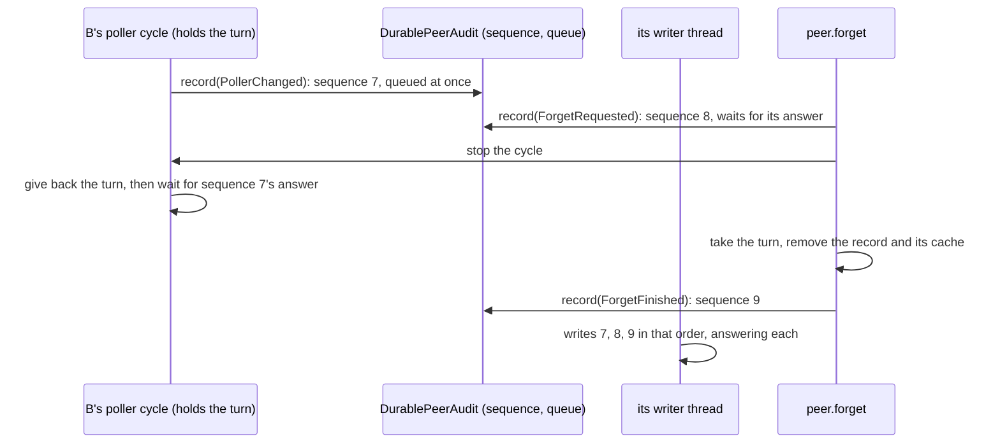
- **The evidence is after the fact.** Each record describes a change
  already made: a withdrawal, for one, has already removed the conversation
  from the cache, and its before and after both show what the read left. A
  process that stops between a change and its record, a withdrawal included,
  loses that record; the peer's record and cache on disk say what the change
  came to, as an owner command's outcome does.
- **Cadence.** The poller scans the peer records when they change, and
  again each interval; a read in flight wakes every tick to notice that
  change and to start a peer waiting on a free slot, and does not scan the
  directory on each tick
  (`a_held_read_lists_when_the_records_change_not_on_every_tick`).
  Each peer is read every `POLL_INTERVAL` (30 s), spread 80 to
  120 percent, and after a failure after a backoff that doubles; every wait,
  jitter included, is held to `POLL_BACKOFF_CAP` (15 min). That is the wait
  a peer is scheduled for. A peer that is due while every read slot is taken
  waits for a slot, and is not failed for it. A read stopped at a bound, or
  by an owner command, continues sooner. Every wait is on the
  injected monotonic clock and the jitter is drawn from injected entropy.
  `POLL_INTERVAL`, `POLL_BACKOFF_CAP`, `READ_BUDGET`, `READS_AT_ONCE` and
  `PREEMPT` are rows of [`limits.md`](../../limits.md).
- **`peer.list` shows the reading.** Beside each pending or active peer:
  `sync.state` (`waiting`, `synced`, `syncing`, `unreachable`, `away`,
  `failed`, `quota`), the wall time the last read finished and how many
  conversations the cache holds. `away` is a peer whose address did not
  answer and whose relay said it is not registered there; it backs off as
  `unreachable` does, and only the word differs
  ([relay.md](relay.md#the-sleeping-gateway)). It is what this process saw
  since it started; nothing persists it.
- **Shutdown leaves nothing running.** Stopping native pairing stops the
  poller first: its wait ends, every cycle is stopped (a status read is not
  continued, its answer kept for the cause, a read's sockets shut), and
  `join` returns once every blocking worker has. Then
  the peer commands are closed, and those past their intent are waited
  for, within `PREEMPT`. Then the peer audit is closed and its writer
  waited for, within one `AUDIT_DEADLINE` on the injected clock.

The composed checks sample the sync cutoff before starting enrollment: its first
sync can finish before the enrollment caller resumes. After a timed-out audit,
releasing the writer hook does not finish its queued prefix. The next forget's
unchanged stop window begins after the writer handles that prefix, with its
records checked separately; observing completion neither closes the queue nor
claims an acknowledgement. The audit case holds an authenticated record read
through the existing source gate: advancing the shared audit clock must not also
expire a held handshake with the same five-second deadline. The captured
cycle's existing stop flag is recorded after forget and before poller cleanup;
an already-ended read cannot count as that stop. Controlled late-observation,
late-write and ended-read cases, plus cancellation of the synthetic write and
record-hold controllers, cover these boundaries (#1012). The record source's
shutdown joins its held physical worker before fixture teardown. Production deadlines and the
original stop assertions are unchanged.

| Row | Situation | Expected | Test |
| --- | --- | --- | --- |
| R1 | B enrolls into A and A's owner approves | B's poller reads Active, saves the credential and reads; `peer.list` shows `active`, `synced`, no conversations; audited `peer_approved`, pending to active | `a_peer_reads_only_what_it_is_granted_and_stops_at_revocation` |
| R2 | A shares X and not Y with B | B's cache holds X only | same |
| R3 | A shares Y and unshares X | The next read takes both: B's cache holds Y only; X's withdrawal audited | same |
| R4 | A unshares Y and shares nothing else; then shares it again | B's cache empties, Y's withdrawal audited; Y comes back; each finished walk is noted in the cache | same |
| R5 | A shares Z, then deletes it | Z leaves B's cache | same |
| R6 | B's cache records more of A's catalogue than A serves | `ResetRequired`: B empties the cache, audits it, and reads again from nothing; `synced`, holding Y | same |
| R7 | B's cache names another owner stream than the one A answers | The scope pin refuses it: `ResetRequired`, emptied and read again | same |
| R8 | B's cache has a shape this build does not read: an older schema version, as every cache made before walks were noted | `OutdatedSchema`, so `cache_damaged`: emptied, audited, read again | same; `an_older_cache_file_is_refused_as_outdated_schema` |
| R9 | A read runs out of its budget having saved nothing | A failure: `unreachable`, backed off; its last finished read not refreshed; the conversations it held kept. One that saved something ends incomplete, `syncing` | same; `a_read_its_budget_cut_short_counts_only_if_it_saved_something` |
| R10 | The poller stops while a read is held | The read's socket is shut, its stop asked every slice, and `join` returns at once, well before the read's own handshake deadline, on every system | same; `a_stop_ends_a_blocked_read_without_shutting_its_socket`, `a_sliced_wait_lasts_as_long_as_the_caller_set` |
| R11 | A's owner revokes B's credential | B's read is refused, its status is Terminal; the cache is removed and the record lists `revoked`, audited `peer_ended (terminal: credential_revoked)`; no connection reaches A after | same |
| R12 | B's owner forgets A, with a cache left behind | The record and the cache beside it are removed, the cache first, so a failure leaves a record that can be forgotten again | same |
| R13 | B enrolls again and A's owner denies it | The record lists `revoked`, audited `peer_ended (terminal: denied)` | same |
| R14 | B's owner forgets A while a read of A is held | The read is stopped and forget succeeds at once, not `peer_busy`; the record and the cache are gone | same |
| R15 | Rows R1–R14 with an audit that refuses every poller change | Every change still lands; each was offered to the audit once, and refused | `every_poller_change_lands_when_its_audit_is_refused` |
| R16 | A device reads its owner's catalogue; a peer reads a granted one | The device refuses another owner's stream; the peer accepts any owner stream for its receiver and epoch and refuses another schema, receiver or epoch, or a stream that is not an owner's (another prefix, uppercase hex, a conversation id) | `a_catalogue_scope_is_checked_as_its_reader_can`, `a_granted_catalogue_scope_is_checked_for_all_a_non_owner_can_check`, `every_owner_stream_has_the_shape_a_non_owner_reader_checks` |
| R18 | A poller change, then a forget that stops its cycle; a store that stalls on the poller's record; a record handed over and never awaited | Records land in turn order: the cycle's change, then the forget's intent and outcome, sequences 1, 2, 3 ... with observation times in order. With the store stalled the forget's intent waits behind the poller's record and is answered `peer_audit_unavailable` once B's clock passes `AUDIT_DEADLINE`, nothing removed; once the store answers every record lands in sequence and the next forget goes ahead. A record never awaited is still written | `records_land_in_turn_order`, `a_stalled_audit_never_holds_an_owner_command`, `a_late_audit_intent_does_not_spend_the_next_forgets_stop_window`, `an_ended_read_cannot_prove_a_forget_stopped_it`, `a_cancelled_late_write_controller_releases_the_writer`, `a_cancelled_record_hold_controller_releases_the_worker`, `an_unpolled_poller_record_is_still_written` |
| R19 | A cached conversation over quota, then one the peer stopped granting; then a stop or a lost connection | The second is withdrawn; the read ends `quota`, still `quota` when the walk is then stopped or loses its connection; a storage failure is held back the same way, and only a damaged cache or a lost connection stops the withdrawals | `a_full_cache_still_withdraws_what_the_gateway_no_longer_grants`, `a_full_catalogue_still_withdraws_and_quota_outranks_a_storage_failure`, `a_withdrawal_that_cannot_be_written_does_not_stop_the_others`, `a_full_cache_is_listed_quota_and_a_read_that_saved_nothing_unreachable`, `a_held_quota_outlasts_a_stop_or_a_lost_connection` |
| R20 | A status step whose write fails after it began, or lands before the status fails; a cycle giving back the turn as an owner command asks; a read whose worker panics after a withdrawal | Named by the transition begun (`peer_ended` after a failed ending, `peer_approved` after a failed save), its outcome the store's (refused when the write failed, succeeded when it landed, whatever the status said); the owner command finds the turn free or a cycle to stop, never `peer_busy`; the withdrawal is still reported and audited | `a_slot_names_the_transition_a_status_began_whatever_storage_did`, `a_status_change_is_named_by_the_transition_its_store_began`, `a_status_change_outcome_is_what_its_store_did`, `a_cycle_gives_back_the_turn_as_it_clears_itself`, `a_read_that_panics_still_reports_what_it_withdrew` |
| R21 | A walk cut short after its catalogue pass (A unshared Y, the pass reached A's new head, Y not yet asked), then a restart, at A's unchanged head | No walk is noted, so the next read walks every cached conversation and withdraws Y, audited; `synced` only after that, holding nothing; a note that cannot be written fails the read as the cache's failure, backed off | `a_peer_reads_only_what_it_is_granted_and_stops_at_revocation` (the cache put back as the cut walk left it), `a_cache_without_the_walk_marker_is_walked_at_an_unchanged_head`, `a_marker_that_cannot_be_written_fails_the_read`, `a_walk_marker_is_kept_per_catalogue_and_goes_with_a_purge` |
| R22 | The audit queue is full (the store fell behind) | Answered at once, no wait: `peer.enroll`, `peer.forget` and `peer.relay` are `peer_audit_unavailable` with nothing dialed, removed or changed; a poller change lands and its record is logged as not kept, never written; each refusal uses up its sequence, so the next kept record follows a gap | `a_full_queue_refuses_the_owner_and_drops_the_poller_record` |
| R23 | Native pairing stops with records queued and the store stalled; or its writer panics | The audit is closed and drained within one `AUDIT_DEADLINE` on the injected clock: records before the stall are written, the rest are logged and not, and the writer ends once the stalled write returns; a writer that panicked ends the drain at once, reported as not drained, its unwritten records logged | `close_drains_within_one_deadline`, `a_writer_that_panics_does_not_hold_the_drain` |
| R24 | Native pairing stops while an enroll and a forget have handed over their intents; while a command holds the turn; or a command is asked after | The peer commands are closed before the audit. The first two are waited for, find the turn closed, and answer `peer_unavailable` with their outcomes kept, having read, dialed and removed nothing. A command holding the turn is waited for, within `PREEMPT`, and its outcome kept before the audit closes (past `PREEMPT`, see Known limits). One asked after is refused `peer_unavailable` before its intent, leaving no record | `a_command_admitted_before_shutdown_ends_with_its_outcome_and_no_effect`, `close_waits_for_a_command_holding_the_turn_and_keeps_its_outcome`, `a_command_asked_after_close_is_refused_before_its_intent` |
| R25 | One read finds more conversations withdrawn than `WITHDRAWN_PER_READ` | It withdraws that many and ends incomplete; the next cycle withdraws the rest. Every cycle that can run at once, plus two owner records, fits in the audit queue | `a_read_withdraws_at_most_its_cap_and_ends_incomplete`; the fit is a compile-time assertion beside `WITHDRAWN_PER_READ`; `a_queue_of_64_refuses_two_full_cycles_and_the_sized_queue_keeps_every_cycle_and_an_owner_record` |
| R26 | A stop wins the status wait after the worker has committed an ending, before the poller has taken the status answer. The poller's own stop, or the cycle an owner command stops | The answer is kept, so the audit names the cause it carried. The cycle does not continue into a read | `a_stop_after_an_ended_transition_commits_keeps_the_status_cause`, `a_stopped_status_records_its_cause_and_does_not_read` |
| R27 | A peer kept with a relay whose address stops answering | Its status dial and its read race the address with the relay and go through the relay; the grant is read as over a direct connection | `a_peer_whose_address_stops_answering_is_read_through_its_relay`; the race itself in `tests/peer_gateways/connector.rs` |
| R28 | A peer kept with a relay whose address does not answer, and whose relay says it is not registered there; or says `NoAnswer` | `away`, backed off as `unreachable`, the cache kept; a relay's `NoAnswer` (a busy peer) or a timeout stays `unreachable` | `a_peer_whose_relay_says_it_is_offline_is_listed_away`; the relay's answer kept in `both_failing_is_the_relays_refusal` |
| R17 | The wait after each cycle | The interval when settled, and when a peer is still pending after one soon retry; an eighth of it the first time a peer is seen pending, and when incomplete or stopped; doubling from the interval on each failure in a row; spread 80 to 120 percent; never past the cap; a failing entropy source draws the middle | `a_peer_seen_pending_is_read_again_soon_and_then_waits_the_interval`, `failures_double_the_wait_up_to_the_cap`, `jitter_spreads_a_wait_over_80_to_120_percent_and_the_cap_still_holds` |
| R29 | One peer's connection is accepted and never speaks, and another peer is enrolled while that connection is still held | The second peer is `synced` inside a wait shorter than the handshake deadline. The first peer's held connection is the same one | `a_slow_peer_does_not_hold_up_the_others`, `a_first_sync_completed_before_observation_is_not_lost` |
| R30 | `peer.forget` of the peer that just synced, while the other peer's read is held; then `peer.enroll` to a peer that accepts and never answers, and `peer.forget` of the peer being read | The first forget removes that peer and does not open a new connection for the held read. The enroll holds the record set, so the second forget is `peer_busy` and does not stop the held read. Dropping the silent socket ends the enroll | same |
| R31 | Two peers enrolled, then one grantor's listener stopped | The stopped peer is listed `unreachable`. The other is `synced`. The poller joins | `a_failing_peer_is_reported_and_the_other_is_read` |
| R32 | `reads_at_once` is 1, and both peers' reads would hold | One peer's read is held. The other has accepted nothing, for longer than a poll tick. Once the held read is released, the waiting peer is read | `a_read_past_the_cap_waits_for_a_slot` |
| R36 | A schedule asks for more reads at once than `READS_AT_ONCE` | That many run: the number the audit queue was sized for. One more full cycle does not fit beside the owner headroom | `a_schedule_past_the_audit_bound_reads_only_that_many` |
| R33 | A read is held, and the interval has not passed; then another peer is enrolled | The directory is not scanned on each tick of the held read. Enrolling the other peer scans it, and that peer is `synced` without waiting out the interval | `a_held_read_lists_when_the_records_change_not_on_every_tick` |
| R34 | The audit writer is still holding a cycle's records when `AUDIT_DEADLINE` passes; then the poller stops | The cycle keeps its read slot, so a replacement cycle cannot enqueue another batch, and an owner record still fits in the headroom. The change is logged as not kept and stands. A stop releases the slot while the records are still queued, so shutdown can drain the writer. An owner command is still answered at its own deadline (row R18) | `a_read_slot_stays_until_queued_records_leave`; the owner deadline in `a_stalled_audit_never_holds_an_owner_command` |
| R35 | A poller record's audit answers an error before `AUDIT_DEADLINE`, and a later record in that cycle is still unanswered | The error is logged and the change stands. That finished future is not polled again. The read slot stays until the unanswered record leaves or the poller stops | `an_audit_error_before_the_deadline_is_not_waited_on_again` |
| R37 | An owner command's audit record is still queued when `AUDIT_DEADLINE` passes | The command is not kept, and is answered then. Its place stays until that record is answered, so another command cannot hand a record over while it is still queued | `an_owner_place_stays_until_the_queued_record_leaves`; the deadline in `a_stalled_audit_never_holds_an_owner_command` |

## What this part does not do

H as a whole is larger than one change. Part 1 (#725) is the granting side;
part 2a puts a peer's reads behind its grants; part 2b-1 lets the gateway link
the client and gives the head an access path by receiver
(`share_grant_changes_by_receiver`); part 2b-2 enrolls and part 2b-3 reads
(above). The rest:

- **The peer table's last addresses and local discovery.** The issue lists
  them; the ADR places local discovery in slice I, and the map leaves "whether
  to announce at all, and what it reveals" unresolved. This side's peer table
  is the registry's rows: the principal (named by the key), the pinned key
  (the pairing's claim) and the grants (the credential's). Last addresses
  belong to the side that dials, whose record keeps the one that last
  answered (above).
- **A Share or Linked gateways control on the desktop.** The method and the
  generated client take `enrollee`; the UI is a separate change with its
  browser verification.

## Known limits

- **At most `READS_AT_ONCE` peers are read at once.** A schedule that asks
  for more is read as that many
  (`a_schedule_past_the_audit_bound_reads_only_that_many`). A peer past the cap
  stays due until a read finishes and frees a place. It is not failed for
  the wait. A slow peer holds one place until that cycle ends, and its read
  is bounded by its own `READ_BUDGET`; the peers inside the cap are read on
  that tick.   The audit queue holds every cycle that can be enqueueing
  (`READS_AT_ONCE` of them) plus two owner records, so an enroll and a
  forget can both hand their intents over before either is written. A cycle
  keeps its read slot until its records have left the queue, or the poller
  stops (`a_read_slot_stays_until_queued_records_leave`). A further owner
  command waits for a place inside the same deadline
  (`a_second_owner_record_waits_for_the_headroom`). A command answered at
  that deadline keeps its place until the queued record is answered
  (`an_owner_place_stays_until_the_queued_record_leaves`). A full queue
  still refuses at once (row R22), which is more than that bound handed
  over before the writer drained it.
- **An enrollment that loses its last reply can leave a pending record.** B
  saves its record before it confirms, as a device does, so a connection
  that fails after that save answers `peer_unreachable` or
  `peer_unavailable` while A may have recorded the claim. The record lists
  `pending`; the poller's next pinned status settles it, and
  `peer.forget` removes it. Enrolling into the same peer again is
  `peer_exists` until then.
- **Shutdown waits for a running command only so long.** Closing the peer
  commands waits within `PREEMPT` for every command already past its
  intent. Any command still holding the turn past that, an enrollment in
  its exchange (its own deadlines are longer) or a forget whose storage
  stalls, goes on until it ends or the process does, and its effect may
  land after the audit has closed, its outcome then not kept; that is
  logged with how many were still running. Its intent is kept, and the
  peer record on disk says what it came to.

- **The grantor's liveness is not a read check.** The grantor of a pairing
  is its initiator: an active admin holding `credential.manage` when it
  paired. No runtime operation disables a membership or takes that role away,
  and the registry refuses a state where its owner is not an active admin
  (row H10). A device stops with its owner because it signs in as them; a peer
  signs in as itself, so admission does not see the initiator's state. A
  change that lets a membership be disabled or demoted at runtime, or gives
  another admin a way to pair, must add the pairing initiator's membership to
  read admission in the same change.
- **A paired reader's head values are the owner's catalogue revisions.** Its
  head moves only with what it was granted, but each value is the owner-wide
  revision of that change, so the gap between two values a peer sees counts
  the owner's other changes in between. Per-reader revision numbering is not
  built.
- **A device paired before this change sees its head go back once.** Its
  saved catalogue progress came from the owner's head, which was at or past
  its granted head. Its next pass finds the head below what it completed, and
  the sync engine answers `ResetRequired`; the client does not reset on that
  by itself, so the device's catalogue cache needs an explicit reset once.
  Changing the scope or incarnation such a reader sees would hit the same
  refusal (a scope mismatch is also `ResetRequired`), so it is not done.
- **A peer read's TCP connect waits in real time.** The status read goes
  through `PeerConnector` under the deadline clock; the read itself uses the
  device's gateway session, whose connect is an operating-system connect.
  Its timeout is computed from the injected clock (the handshake deadline or
  the read budget, whichever is sooner), but the wait itself is the
  operating system's, and a stop reaches the sockets a read has open, not
  one still connecting. A connect cannot be cut into slices the way a
  receive is (each try would start over, and a slow link would never
  connect), so a stop or an owner command can wait for it, at most the 5 s
  handshake budget, which `PREEMPT` covers twice over.
- **A budget-bound read can starve its last conversations.** Each read asks
  the cached conversations in the same order and stops starting new ones at
  its budget, so under constant change in the first ones, the last ones are
  read only once those settle. Rotating where a read starts is not built.
- **A full cache is not tested end to end.** `quota` is reported from the
  cache's own refusal; filling a 256 MiB cache in a test is not done. The
  walk that still withdraws past it is tested against scripted answers
  (row R19).
- **A budget hit after partial progress is not tested end to end.** Which
  way a budget-bound read ends is tested against each case (row R9); an end
  to end read cut by its budget after saving some pages needs a peer that
  stalls mid-connection, which the relay does not do.
- **An audit sequence counts within one process.** It starts at 1 each
  time the gateway starts; across restarts `observedAtMs` orders the runs.
  A gap within a run is a refused record, named in the log.
  A record still queued when shutdown's drain runs out is not written
  (logged by sequence), and one the writer had begun may still land.
- **A cache removal not confirmed durable is not tested.** It needs a
  directory sync that fails, which the private storage owner does not let a
  test inject.
- **A peer is not told of catalogue changes.** It polls its catalogue head.
  A wake that fires only on changes to its own granted rows needs
  per-receiver notices, which nothing builds yet.
- **A connection whose writes fail leaves the agent catalogue late.** It
  stops serving at once, so `agents.list` leaves it out from then on, but
  the count of connection changes moves only when its connection ends,
  which the gateway sees when the host's side closes or falls silent, at
  most the silence bound (45 s) later. Until then a subscriber still shows
  it, and a conversation started there is refused unreachable (row I10).

- **The owner's Settings › Linked devices lists a peer's credential** among
  the devices, since both are pairing-bound credentials. Telling them apart
  in the list is part of the desktop control above.
- **Linked devices also shows a claimed peer invitation as an ordinary device
  awaiting approval**, with no class shown. This is a labelling gap, not a
  security one: the class is fixed when the invitation is created and bound
  into the exchange, so approving it yields only that class's gateway
  credential (read-only, or serve-only for an environment), never a device
  credential that names the owner.
