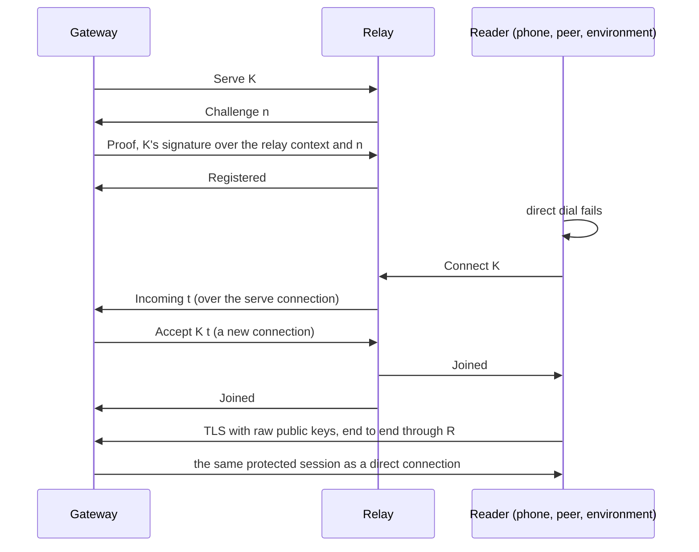

# Forwarding relay and the sleeping gateway — issue 266

Status: design accepted; slices R1 (the relay service) and R2a (the
gateway serving through a relay) merged, R2b-1 (the reader's race of
direct and relay) merged, R2b-2 (peer gateways using a relay) merged;
R2c (end to end over a real relay, gateway and reader), R3 (`away`), R4
(`nessa env dial --relay`) and R5 (measurements) in review together. Part of
[#263](https://github.com/nessalabs/nessa-agent/issues/263); it also carries
the relay half of slice I ([#706](https://github.com/nessalabs/nessa-agent/issues/706)),
so one relay serves phones, peer gateways and paired environments. The map's
rules are in [Reaching your gateway from outside](../runtime-architecture.md#reaching-your-gateway-from-outside)
and [The mesh](../runtime-architecture.md#the-mesh). This builds on
[device pairing](device-pairing.md) and [peer gateways](peer-gateways.md),
and changes neither protocol.

## The problem

Every paired connection today is a TCP connection the reader opens to the
gateway's native listener. That works on the same LAN, over an overlay, or
through a tunnel. It does not work when the gateway is a laptop behind a
home router and the phone is on a cellular network, which is the common
case. Nothing in Nessa today can reach a gateway like that.

It also cannot say why. A read that fails to connect is `unreachable`
whether the gateway is asleep, the network is down or the address is
wrong, so a phone cannot tell a person "your laptop is asleep, here is
what you had".

## What changes

A **relay** is a small server both sides connect out to. The gateway keeps
one connection to it open and says "I am gateway K". A reader that cannot
reach the gateway directly connects to the relay and says "put me through
to K". The relay joins the two byte streams and from then on copies bytes
both ways without reading them.

What runs over the joined stream is exactly what runs over a direct
connection today: TLS with raw public keys, the reader pinning the
gateway's key from pairing and the gateway admitting only keys it issued a
credential to. So the relay is a longer cable, nothing more:

- It **cannot read** what it forwards. The TLS session is end to end.
- It **cannot substitute** anything. A relay that changes, drops, reorders
  or replays a byte breaks the TLS record MAC and the connection fails; a
  relay that answers as the gateway cannot complete a handshake with the
  pinned key. Nothing reaches the reader's cache except what the gateway
  signed for that session.
- It **holds no authority**. It decides nothing about who may read what.
  The gateway still checks the credential, receiver binding, owner
  admission and Cedar on every request, as it does on a direct connection.
- It **stores nothing**. No catch-up feed, no records, no keys. A relay
  that held a feed would be a replica with an address, and that is a
  separate decision (runtime architecture, "Relay with storage").

### The sleeping gateway

The relay is also what lets a reader tell "away" from "unreachable". A
gateway that is running keeps its serve connection to the relay open. A
gateway that sleeps, quits or loses its network stops answering the
relay's keepalive, and the relay drops its registration. A reader that
then asks for K is told **`Offline`**: the relay is up and K is not
connected to it. A gateway that **is** connected but does not take the
reader in time (it is busy, or slow) is a different answer, **`NoAnswer`**,
so a running laptop is never reported asleep.

So a reader now has three answers where it had one:

| What the reader saw | What it reports | What it means |
| --- | --- | --- |
| Direct worked, or the relay joined it | the read's own outcome | The gateway answered |
| Direct failed, the relay said `Offline` | `away` | The relay says the gateway is not connected to it: asleep, quit, or offline |
| Direct failed, the relay said `NoAnswer`, failed, or none is set | `unreachable` | The reader cannot tell; the gateway may be busy or the reader's own network may be the problem |

`away` is the relay's answer at that moment, not a proven fact about the
gateway, and the word is chosen to say no more than that. Nothing
authenticates it: the relay, or anyone between the reader and the relay,
can answer `Offline` for a gateway that is up. That costs availability and
an honest-looking wrong word, never a record, and it is listed under "What
this does not do". In both cases the reader's private cache stays readable
and unchanged: what it already holds is still shown, and the surface says
fresh activity waits for the gateway. Nothing is ever served from the
relay.

## One owner for each fact

| Fact | Owner | Everyone else |
| --- | --- | --- |
| Who the gateway is | The gateway's native key (Ed25519). Its public half is K, the id a relay registers it under | The relay checks a signature against K; the reader pins K at pairing |
| Who may read what | The gateway, as today | The relay knows nothing of it |
| Which relay a gateway serves through | The gateway's `native.relay` setting | — |
| Which relay a reader tries | The reader's own record of the gateway, beside its native address | — |
| Whether K is connected to this relay now | The relay's live registration table | A reader asks; nobody caches it |
| Bytes in flight | TCP, end to end through the relay | The relay keeps nothing once a join ends |

## The relay protocol

The relay speaks a tiny framed preamble on each TCP connection, then
either keeps the connection as a serve connection or joins it to another
and stops framing. Frames are a version byte, a type byte, a length byte
and a body whose length each type fixes; no frame is larger than 67 bytes,
and a connection
that sends anything else, or nothing for the preamble deadline, is closed.

| First frame | Who sends it | What follows |
| --- | --- | --- |
| `Serve{K}` | A gateway | `Challenge{n}`, 32 fresh random bytes; the gateway answers `Proof{sig}`, an Ed25519 signature by K over the proof message below. A good proof gets `Registered` and the connection becomes K's serve connection: the relay sends `Incoming{t}` and `Ping`, the gateway answers `Pong`. A bad proof is closed |
| `Connect{K}` | A reader | `Offline` and close when K has no serve connection. Otherwise the relay picks t, 16 fresh random bytes, sends `Incoming{t}` to K and waits for K's `Accept`; when it comes both sides get `Joined` and the bytes after it are the reader's and the gateway's own. No `Accept` before the join deadline is `NoAnswer`, never `Offline` |
| `Accept{K, t}` | A gateway | Joined to the waiting reader whose t it names; an unknown t is closed. t is sent only on K's proved serve connection, and is single use |

**The proof message** is the bytes `nessa-relay-serve-v1`, a zero byte,
K (32 bytes) and n (32 bytes), in that order. K's key is also the key its
TLS handshakes sign with, and a TLS 1.3 handshake signature is over 64
spaces followed by its own context string; a message that starts with
`n` and a fixed non-space context can never be one, so no relay can use a
challenge to get a signature it could replay into a handshake. R1 adds
the one signing call that makes it to `NativeIdentity`, which keeps its
seed erased on drop as today, and a verify beside it. The proof binds K
and the fresh n; it does not name the relay, because a relay's name for
itself is whatever it says, and n alone already makes each proof
single use.

Why a signature at all, when TLS already stops a fake gateway from reading
anything: without it, anyone who knows K could register as K and take its
readers' connections. They could read nothing, but they could make the
gateway look asleep and learn who connects to it. The proof makes both
take K's private key.

A second proved `Serve{K}` replaces the first, whose connection is closed:
the newest connection is the live one, as with a paired environment that
dials again.

### Limits

The relay is meant to be cheap to run and hard to misuse:

- At most a fixed number of open connections (both legs of a joined pair
  count), of registrations, of readers waiting for one K, and of joined
  pairs. A connection past the first is closed unread. A new key past the
  registration limit is closed after its proof, and a key already
  registered may still replace itself. A reader past the waiting or joined
  limit is answered `NoAnswer`, so it is never told `Offline` for a
  gateway that is there.
- A preamble deadline and a join deadline on the injected clock, as
  `env_serve` waits on its `Timer`.
- A keepalive on each serve connection: a `Ping` every 15 seconds, and a
  registration that has left three in a row unanswered is dropped when the
  fourth falls due. That is what turns a sleeping laptop into `Offline`
  within a minute of its last `Pong`, instead of when TCP gives up hours
  later.
- A joined pair ends when either side closes; the relay closes the other.
  There is no half-close: TLS's own close needs none.
  No idle limit is put on a joined pair, because a retained read may sit
  quiet for a long time; TCP keepalive on both legs bounds a dead one.

Every byte of the preamble is in the clear, and every frame after `Joined`
is the reader's and the gateway's own. Each side reads the preamble with
exact-length reads on the raw socket, never through a buffered reader, so
the first TLS bytes after `Joined` are never swallowed.

Access control on the relay itself (who may register or connect) is out
of scope for the first relay. A person runs it for their own gateways; a
shared relay would need its own admission, recorded under "What this does
not do".

## Who uses it

Every paired reader gets the same order: **direct, then relay**.

| Side | Setting | Where the dial lives |
| --- | --- | --- |
| Gateway | `native.relay: "host:port"` in `config.json`. While set, the gateway keeps its serve connection, redialing with a bounded backoff | `device_pairing` listener: see below |
| Phone and peer-gateway reader | The record of the gateway carries an optional relay beside its address; `peer.enroll` takes it, and `peer.relay` sets or clears it on a peer already kept | `nessa-client-core`'s retained reader: its connector carries the optional relay |
| Paired environment | `nessa env dial ADDRESS --relay host:port`. Asking whether the owner approved it, and every dial after, go direct, then through the relay; enrolling needs ADDRESS itself, since the relay is asked for a key the machine learns only by enrolling | `env_serve`'s dial and its pairing's status request, through the client core's `dial_gateway` |

**On the gateway, the relay is a second source inside the one listening
socket**, not a second listener. `NativeEnrollmentListener::run` takes one
`EnrollmentAccept`, and its exit closes the shared connection owner, and a
listening-socket failure stops the gateway. So the gateway's
`EnrollmentAccept` selects over the TCP accept and a channel the relay
side fills with joined connections. A relay fault (a lost serve
connection, a failed redial, a refused `Accept`) is logged and redialed,
and is never an accept failure; it cannot stop the listener or the
gateway.

**A joined connection takes its own permits.** Each `Incoming{t}` makes
the gateway dial out and hold a connection permit through a TLS handshake
that may wait out its deadline. The relay is open and K travels in the
clear, so anyone who knows K can ask for it repeatedly; with the shared
pool, that would starve readers on the LAN too. So relay-joined
connections draw from a small pool of their own beside the existing
product and environment pools, and the gateway has at most a few
`Accept`s in flight; an `Incoming` past that is dropped, and the relay
answers that reader `NoAnswer`. An open relay lets anyone with K fill that
small pool; it never touches the direct one.

**The connection owner sees the relay's address.** It asks every accepted
socket for its peer address and reports it; through the relay that is the
relay's. Nothing grants or refuses on that address, so nothing changes but
what the wake report names.

**Direct, then relay, each in its own budget.** The retained reader's
connect runs inside a 5 s handshake budget, and on a cellular network a
direct dial to a home LAN address times out rather than being refused,
which would spend it all. So the relay leg starts as soon as the direct
dial has not connected within a short head start, and the first to
connect is used; the other is dropped. The same holds for a paired
environment's dial.

When a dial ends `away`, the peer poller backs off exactly as for
`unreachable`; only the word it reports differs.

Learning the relay automatically, by the gateway naming it in an
authenticated reply, is a later convenience: the address carries no trust,
so typing it once at pairing is enough for the first relay.

## Slices

| Slice | What lands | Done when |
| --- | --- | --- |
| R1 | The relay protocol in `nessa-protocol`, the relay service and `nessa relay serve --listen ADDRESS` (not to be confused with the existing `nessa mcp-relay`), the gateway's proof signature, and the timer port moved out of `env_serve` so the relay waits on it too. Inert: nothing uses it yet | Two test parties join through it and exchange bytes; `Offline` for an absent K and `NoAnswer` for one that does not accept; a wrong or replayed proof refused; the newest registration wins; every limit and deadline holds on the injected clock |
| R2a | The gateway's `native.relay`: its registration, kept with a bounded backoff and dropped after two silent ping intervals, and each announced reader accepted on a relay permit from a pool of four, as a second source in its one listening socket | A reader that reaches only the relay completes TLS pinned to the gateway's key and is answered; four relay permits held leave direct readers admitted; no relay fault ends the listener; stop drains every relay permit |
| R2b-1 | The relay leg in the client core's retained reader, raced with the direct dial: the relay starts once the direct dial has not connected within a 750 ms head start, or at once when it is refused, and the first to connect is used | A reader whose direct dial hangs or is refused is joined through the relay; one whose direct dial connects first never dials the relay; a relay that fails first leaves a slow direct dial to connect; a stop ends the wait |
| R2b-2 | The same for peer gateways: the peer record's relay, `peer.enroll` taking one, `peer.relay` setting or clearing it, and the peer poller's read and status dial both using it | A peer whose direct address is out of reach is read and asked its status through its relay |
| R2c | End to end over the real relay, gateway and reader | A reader reads through the relay to **the same checkpoint**, the same head and the same bytes, that a direct read reaches; a relay that flips, drops, or records and replays TLS records leaves the cache unchanged; revoking the reader still refuses it through the relay; repeated `Connect{K}` cannot starve a direct reader |
| R3 | The honest state: `away` in the reader's outcome and in a peer's `sync.state`, with the cache kept and readable | A gateway that stops serving is `away` to its reader within the keepalive bound, its cached conversations still read, and it reads fresh again once it is back; a busy gateway is `unreachable`, never `away` |
| R4 | `nessa env dial --relay` | A paired environment with no direct path dials through the relay and serves a lease; this is slice I's "Direct and relay converge" line |
| R5 | Measurements | What the relay and a network observer see, the bytes each joined pair costs over direct, and what the idle serve connection costs the gateway, measured and written down here (below) |

## State and order table

| Row | Situation | Outcome | Test |
| --- | --- | --- | --- |
| RL1 | A gateway sends `Serve{K}` and proves K | Registered; `Connect{K}` now reaches it | R1 |
| RL2 | A `Proof` that does not verify for K, or one made for another challenge | Closed, nothing registered; an existing registration of K untouched | R1 |
| RL3 | A second proved `Serve{K}` | It is K's live registration; the first serve connection is closed | R1 |
| RL4 | `Connect{K}` with no registration | `Offline`, closed | R1 |
| RL4b | `Connect{K}` while K is registered but sends no `Accept` before the join deadline | `NoAnswer`, closed; K's registration kept | R1 |
| RL5 | `Accept{K, t}` with a t the relay never sent K, or one already used | Closed; the waiting reader unaffected | R1 |
| RL6 | A joined pair; either side closes | The other side is closed; nothing kept | R1 |
| RL7 | A serve connection that misses three `Pong`s | Registration dropped; the next `Connect{K}` is `Offline` | R1 |
| RL8 | Any limit reached, or a preamble that is malformed, too large or too slow | A connection past the connection limit closed unread; a new key past the registration limit closed after its proof; a reader past the waiting or joined limit answered `NoAnswer`; a bad or slow preamble closed. Every other registration and pair untouched | R1 |
| RL9 | A reader whose direct dial fails and whose relay joins it | The same protected session as direct: same admission, same records, same checkpoint | R2c |
| RL10 | A relay that alters, drops, reorders or replays bytes after the join, or answers as the gateway | The TLS session fails; the read is `unreachable`; nothing reaches the cache | R2c |
| RL11 | A revoked reader through the relay | Refused by the gateway exactly as on a direct connection | R2c |
| RL11b | `Connect{K}` asked repeatedly, faster than the gateway takes them | Past the gateway's few in-flight `Accept`s and its relay pool, readers get `NoAnswer`; a reader dialing directly is admitted as before | R2a (the pool), R2c (end to end) |
| RL12 | Direct fails and the relay answers `Offline` | `away`; the cache unchanged and readable | R3 |
| RL13 | Direct fails and the relay answers `NoAnswer`, cannot be reached, or no relay is set | `unreachable`, as today | R3 |
| RL14 | A paired environment with only a relay path | Dials through it and serves leases as over a direct connection. A command run each way leaves the same command-ledger checkpoint: granted, started, ran exited, ended asked | R4 |
| RL15 | The gateway's registration ends, or hears nothing for two ping intervals | Dropped and made again after a wait that doubles from 1 s to 60 s, starting over after a registration that lasted a minute; direct readers are served throughout | R2a |
| RL16 | The relay announces a reader while the gateway's four relay permits are held | Nothing is dialed; the relay answers that reader `NoAnswer` at its join deadline; direct readers are admitted as before | R2a |
| RL17 | The gateway key cannot make its relay proof | The gateway stops registering and logs it; it serves directly as before | R2a |
| RL18 | A reader with a relay whose direct dial connects within the head start | The direct connection is used; the relay is never dialed | R2b-1 |
| RL19 | A reader whose direct dial is refused, or has not connected within the head start | The relay leg starts, and the first of the two to connect is used; both failing reports the relay's answer | R2b-1; for a peer's status dial, R2b-2 |
| RL20 | A peer gateway kept with a relay whose address stops answering | Its status and its grant are read through the relay; the record keeps the relay across enrollment and `peer.relay` changes or clears it, audited | R2b-2 |

## What the relay sees

Measured in R5 by `a_joined_pair_costs_its_preamble_frames_over_a_direct_read`,
which puts a counting tap in front of a real relay and another in front
of the gateway, then reads the same gateway once each way.

**What it sees.** Each gateway's public key K and the address it connects
from; each reader's address, the K it asks for and when; how long each
joined pair lasts and how many bytes go each way. It does not see who the
reader is (its key travels inside TLS), what it reads, or anything of the
records. Because the preamble is not encrypted, a network observer between
either side and the relay sees the same K; putting the preamble inside its
own TLS is an option if that matters later. The gateway's native
connection owner reports the relay's address for every joined connection.

**What a joined pair costs.** The relay adds only its preamble frames and
copies every other byte unchanged, each way; the test asserts both
exactly. In one measured run, the reader sent 8,559 bytes and received
229,326 directly, and through the relay 8,594 and 229,329: its 35-byte
`Connect` and 3-byte `Joined` more, and the TLS bytes of the two reads
the same size (observed, not asserted: two reads need not match).

| Who | Over a direct read |
| --- | --- |
| Reader | 38 bytes: `Connect` (35) out, `Joined` (3) in. One TCP connection, to the relay instead of the gateway |
| Gateway | 73 bytes: `Incoming` (19) on its serve connection, `Accept` (51) out and `Joined` (3) in on a new TCP connection it dials to the relay for the reader |
| Relay | Every byte of the session twice, in from one side and out to the other, plus the frames above |

**What staying registered costs.** Registering is 102 bytes out (`Serve`,
`Proof`) and 38 in (`Challenge`, `Registered`), again after each lost
serve connection. Then the relay sends a 3-byte `Ping` every 15 s and the
gateway answers a 3-byte `Pong`: 6 bytes of frames a ping interval. The
test checks that nothing else crosses the serve connection: registration,
one `Incoming` per join, and whole `Ping`s and `Pong`s. On the wire each is one small TCP segment, so with
headers and acknowledgements that is a few hundred bytes every 15 s,
under two megabytes a day, worked out from the frame sizes rather than measured
on a link. The gateway holds one TCP connection and one task for it, and
no relay permit: permits are taken only for announced readers.

## What this does not do

- Store anything for a sleeping gateway. Offline serving is a separate
  decision.
- Admit or refuse by who you are at the relay. The first relay is open to
  whoever can reach it; its limits bound the cost, and the gateway's own
  relay pool bounds what it costs the gateway.
- Authenticate `Offline`. The relay, or anyone between a reader and it,
  can make a gateway that is up look `away`. Putting the preamble inside
  TLS to a relay key the reader pins is the fix if that matters later.
- Enroll through the relay. A reader or environment learns the gateway's
  key by pairing, which needs the gateway's own address once; only then
  can it ask a relay for that key.
- Find a relay, or move a joined connection back to direct when direct
  starts working. The next read dials direct first again.
- Change the pairing or product protocol. What crosses the relay is
  byte for byte what crosses a direct connection.
