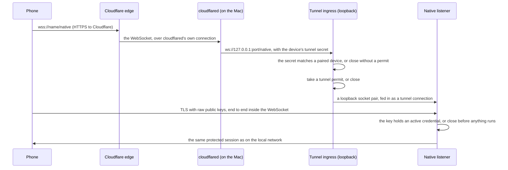

# Reaching the gateway through a tunnel

Status: in review. Builds on [device pairing](device-pairing.md) and the
[forwarding relay](relay.md), and changes neither protocol. It answers the
"Listener hardening for a tunnel" question in
[runtime architecture](../runtime-architecture.md#reaching-your-gateway-from-outside).

## The problem

A phone paired at home reaches the gateway on the local network. Away
from home it cannot: the Mac sits behind a router, and the relay (#266)
needs a server somebody runs on a public address. Cloudflare gives every
machine a free public address through `cloudflared`, with no account for a
quick tunnel and a free account for a named one. That is the easiest way
for a person to reach their Mac from anywhere.

A free tunnel only carries web traffic to a client that does not run
`cloudflared` itself, and a phone cannot run it. The native protocol is
raw TCP. So the bytes have to travel inside something Cloudflare carries.

## What changes

**The tunnel is a longer cable, like the relay.** The phone opens a
WebSocket to the tunnel's public address. Each binary WebSocket message
carries the next bytes of the same native connection a phone opens on the
local network: TLS with raw public keys, the phone pinning the gateway's
key from pairing, the gateway checking the phone's key. Cloudflare ends
its own HTTPS at its edge, so it sees the WebSocket, but inside it is our
TLS, which it cannot read or change without breaking the connection.

So nothing about who may do what moves. The gateway still checks the
credential, its key binding, owner admission and Cedar on every request,
exactly as it does for a phone on the local network.

## The edge, before anything runs

A direct connection on the local network serves pairing: a new phone has
no credential yet, so the gateway has to let an unknown key try a code.
A tunnel connection does not: **the first thing the gateway does with a
tunnel connection, right after the TLS handshake, is check that the key it
proved holds an active credential** (a device credential, or one to serve
as an environment). A key that holds none is closed before its first
request is read. A key that holds one may open only its session
(`openProduct` or `openEnvironment`) as its first request; pairing
(`hello`, `begin`), a status read and owner recovery close the connection
too. So pairing can only happen on the local network, where the code was
shown, and the internet sees a TLS handshake and nothing else from a key
the gateway did not issue.

This is authentication, the same kind of check as the existing rule that
only a paired key may take a product session permit, and it stays in Rust
for the same reason: it asks the registry "does this key hold a
credential", not "may this principal do this action". Cedar still decides
every method afterwards (gate 18, "Policy goes through Cedar").

**A tunnel connection takes its own permits.** Each one holds a permit
from a pool of four, beside the direct, relay, product and environment
pools, from the WebSocket upgrade until the connection ends. The pool
never touches the direct one, so tunnel traffic cannot crowd out the
local network.

**A paired device proves it before a permit is taken.** Pairing issues
each device a secret. The device sends it on every tunnel request, in the
`x-nessa-tunnel` header, or in the path `/native/<secret>` when its
WebSocket client cannot set a header. The ingress compares that value
with the active devices' secrets, in constant time, and rejects anything
else with no permit taken. Unpairing a device or revoking its credential
forgets the secret. Anonymous traffic, and a device that was revoked,
cannot fill the pool.

## The pieces

| Piece | What it does | Where |
| --- | --- | --- |
| Bridge | Joins a WebSocket to one end of a loopback TCP pair, both ways, until either side ends; pings every 20 s so Cloudflare's idle limit never closes a quiet session | `nessa-client-core` `tunnel`, used by both sides |
| Tunnel leg | Opens `wss://name/native` and returns the loopback end, so everything after it is the same TCP stream a direct dial returns; raced after direct like the relay leg | `nessa-client-core` `tunnel`, `retained::race` |
| Ingress | Listens on loopback only, checks the device secret before taking a tunnel permit, accepts the upgrade on `/native` only, and feeds the bridged socket to the native listener as `Accepted::Tunneled` | `nessa-server` `tunnel` |
| Supervisor | Keeps any helper program running: starts it, waits for it to be ready, starts it again with a backoff, and takes it back across a gateway restart. It knows nothing about Cloudflare | shepherd's service mode and kept processes (`shepherd::ServiceSupervisor`, `KeptProcesses`), composed in `composition::tunnel` |
| Cloudflare service | The one provider today: a pinned, digest-checked `cloudflared`, what it is run with, and how its metrics say it is ready and at which address. Another way to reach the gateway is another service behind the same supervisor | `nessa-server` `tunnel` |
| Switch | `pairing.setTunnel` (`credential.manage`), saved in `config.json` `native.tunnel`, audited with the setting before and after (hostname, token by fingerprint), applied by restarting the gateway like `pairing.setLinking`; `pairing.tunnel` reads its state | product, composition |
| Address | `server.reach` (`server.read`, the owner phone's purpose list in Cedar) gives a paired device the current public address. The gateway also publishes that address on the #266 relay under its key. A paired device reads it there when the address it saved no longer connects | product, relay |
| Phone dial | The phone keeps the origin `server.reach` last named beside its paired gateway and opens its native session with it (`NativeSession::open`'s `tunnel`). Its product dial goes direct first and through the tunnel after the head start (`dial_native`). Enrollment, status, owner recovery and retained reads dial directly, since the ingress answers only a product or environment opening; so a phone paired by code reaches its chats from anywhere, while one with a signed original, whose product opening recovers first, still needs the local network | `nessa-device-client`, nessa-ios |

Why a loopback pair, not a new stream type: every reader and the gateway
are built on a TCP stream, for their deadlines, their wake on shutdown and
their TLS. A bridged loopback socket keeps all of that unchanged on both
sides, for one extra copy on the same machine. The ingress checks that the
socket it accepted is the one it just connected, so another local process
cannot slip into the pair.

## Quick and named tunnels

| Mode | What the person does | Address |
| --- | --- | --- |
| Quick (default) | Nothing: turn it on | A random `*.trycloudflare.com` name. It changes each time `cloudflared` starts, so the gateway keeps `cloudflared` running across its own restarts and adopts it when it starts again |
| Named | Make a tunnel in Cloudflare's dashboard, route a hostname to `http://127.0.0.1:47651` (Settings shows the ingress), paste its token and hostname | The hostname, which never changes |

A quick tunnel is Cloudflare's "for testing" offer: no uptime promise and
a limit of 200 requests in flight, which one person's devices never reach.
Settings says plainly that a quick address changes and a named one does
not. A phone that is away asks the relay, where it already looks the
gateway up by its key, and uses the address the gateway has published.
Only a paired device's tunnel secret is told that address.

The named tunnel's token is written to a file only the gateway can read
and passed with `--token-file`, never on the command line, where other
users of the machine can see it (see below).

## Running cloudflared

- **Pinned.** `crates/nessa-server/data/tunnel-releases.json` names one
  version, and for each platform its URL, size and SHA-256. The gateway
  downloads it into `<namespace>/tunnel` on first use and refuses anything
  else. It never looks on `PATH` and runs with `--no-autoupdate`. Only a
  debug build honours `NESSA_TUNNEL_PROGRAM`, for the stress check's
  stand-in.
- **What it gets.** Its arguments, and `HOME` set to the tunnel directory:
  nothing else of the gateway's environment. A named tunnel's token is in
  `<namespace>/tunnel/token`, readable by the gateway's user only, written
  by `pairing.setTunnel` and read by nothing else in the gateway;
  `cloudflared` is pointed at it with `--token-file`, so the token is never
  on a command line, in `config.json` or in a log.
- **Its address.** cloudflared serves its metrics on a loopback port the
  gateway picks. `GET /ready` says it is connected, and for a quick tunnel
  `GET /quicktunnel` answers `{"hostname": …}`. Nothing is parsed from its
  log.
- **Across gateway restarts.** `cloudflared` is a shepherd kept process
  named `cloudflared`, recorded in `<namespace>/tunnel/kept`: it leads a
  process group and session of its own, with its output in
  `<namespace>/tunnel/cloudflared.log`, so the gateway's exit, a crash or
  Ctrl-C included, never stops it. Its record holds its pid, the OS start
  token and boot that tell that pid's process from a later one, and a
  fingerprint of everything it was started with (program, so its version,
  arguments, environment, directory) plus a revision naming a named
  tunnel's token by fingerprint, since the arguments only name its file.
  Until a start of this run has run, a start whose launch on the live kept
  program's metrics port is exactly the recorded one (same fingerprint)
  uses that port, so shepherd takes the program back; any other start
  takes a port free then, never one another program could claim while the
  old program is ended. Only the gateway that starts next decides what happens to
  it:

  | That gateway | Outcome |
  | --- | --- |
  | Has the same tunnel (same fingerprint), and the pid is still the recorded process | Takes it back: the same quick address, no new connection to Cloudflare |
  | Has a different tunnel | Ends the recorded process (SIGTERM to its group, then SIGKILL) and starts a new one |
  | Has the tunnel off | Ends the recorded process |
  | Finds the pid reused by another program | Drops the record without signalling it, and starts its own |

  A pid alone is never trusted: after a reboot or a long stop it can name
  any process. Under systemd's default `KillMode=control-group`, restarting
  the gateway's unit ends `cloudflared` with it; the next start runs a new
  one, at a new quick address. A gateway that starts itself again in
  place (`pairing.setLinking`, `pairing.setTunnel`) leaves it and takes it
  back. Kept processes run on Linux and macOS; on other Unix systems the
  tunnel reads `failed` (`unsupported`), and on Windows there is no
  tunnel (native linking is Unix only). Before shepherd kept it, the gateway wrote its
  own record, `<namespace>/tunnel/process.json`; that record is removed and
  not followed, so a `cloudflared` started by such a build is left for the
  person to end.
- **Its ingress.** `cloudflared` forwards to the gateway's loopback
  ingress, which the gateway binds only while the tunnel runs. A port
  another program holds fails the tunnel (`ingress`), never the gateway's
  start, and ends a `cloudflared` an earlier run kept, so it stops
  forwarding to that port; saving the tunnel again tries the port again.
  While the gateway is stopped and `cloudflared` is kept, another
  program of any user on the machine could take that port and answer at
  the tunnel's address; phones still refuse it, since they pin the
  gateway's key, but a browser would not. On a machine shared with people
  you do not trust, turn the tunnel off before stopping the gateway.
- **Failure.** A `cloudflared` that exits, or is not ready within 60 s, is
  started again after a wait that doubles from 1 s to 60 s. The tunnel
  reads `starting` until its first start is ready or fails, then `failed`
  with the last reason until a later start is ready; phones on the local
  network are unaffected.

## State and order table

| Row | Situation | Outcome | Test |
| --- | --- | --- | --- |
| T1 | A tunnel connection whose key holds an active device credential opens a product session | Served exactly as on the local network: same authentication, same Cedar | gateway |
| T2 | A tunnel connection whose key holds no credential, whatever its first request (`hello`, `begin`, `status`, `openProduct`) | Closed after the TLS handshake, before its first request is read | gateway |
| T2a | A tunnel connection whose key holds a credential asks for `hello`, `status` or owner recovery | Closed without an answer | gateway |
| T3 | A tunnel connection whose key holds a credential to serve opens `openEnvironment` | Served as on the local network | stress `tunnel` |
| T4 | A fifth WebSocket from a paired device arrives while four tunnel permits are held | Refused before a bridge; direct readers are admitted as before | gateway |
| T4a | A stranger holds connections open at the public address, with no secret or a revoked one | Refused with no permit taken. A paired device still connects | gateway |
| T4b | A device is unpaired or its credential is revoked | Its tunnel secret no longer matches. The issue and the revocation are audited | gateway |
| T5 | The upgrade asks for any path but `/native`, or is not a WebSocket | Refused with 404 before a permit is spent on a bridge | gateway |
| T6 | Either side of a bridge ends | The other side is closed; nothing kept | client core |
| T7 | A quiet session | The bridge pings every 20 s, so the tunnel's idle limit does not close it | client core |
| T8 | A reader with a tunnel whose direct dial connects within the head start | Direct is used; the tunnel is never dialed | client core |
| T9 | A reader whose direct dial is refused or slow | The tunnel leg starts, the first to connect is used | client core |
| T10 | The gateway starts again with the same tunnel setting and `cloudflared` still running | It takes it back: the same quick address | `cloudflare` (port of the kept program), shepherd, stress `tunnel` |
| T11 | The tunnel is turned off, or its mode changes | `cloudflared` is ended; a new mode starts a new one | `composition::tunnel`, shepherd, stress `tunnel` |
| T12 | The downloaded `cloudflared` does not match its pinned size or digest | Nothing is run; the tunnel reads `failed` | gateway |
| T13 | `pairing.setTunnel` from a credential without `credential.manage` | `forbidden` from Cedar | gateway |
| T14 | `server.reach` from a paired owner phone | The current public address, or none | gateway |
| T14a | The quick address changes while a paired phone is away | The phone asks the relay with its tunnel secret and is told the new address. A stranger is not | gateway, client core |
| T15 | The recorded pid now names another process (reboot, reuse) | Left alone; a new `cloudflared` is started | shepherd (kept attach checks the start token) |
| T16 | `pairing.tunnel` after a named tunnel is saved | Says a token is saved, never the token; Settings never fills the token field | gateway, desktop |
| T18 | The saved token cannot be read (loose permissions, not a token) | Read as no token: Settings says to save it again, and a new one is saved over it; the ingress is not held meanwhile | gateway |
| T19 | Whatever answers the metrics port names an address that is not a `trycloudflare.com` name | Not taken as the tunnel's address | gateway |
| T17 | `pairing.setTunnel` on while linking is off, or named with no hostname or token | `pairing_linking_off` or `pairing_tunnel_incomplete`; nothing saved | gateway |

## What this does not do

- Pair over the tunnel. Pairing needs the local network once.
- Tell `away` from `unreachable`. When the Mac sleeps, `cloudflared`
  sleeps with it and Cloudflare answers with its own error page, which the
  phone cannot authenticate; the relay's `Offline` stays the honest
  answer.
- Rate-limit by the phone's address. Every tunnel connection comes from
  `cloudflared` on loopback; the pool bounds what the internet can cost.
- Use OpenTunnel. Its raw TCP path runs on a Cloudflare beta and
  temporary relays, and its client ends TLS itself, which would take the
  place of ours. The supervisor is the only Cloudflare-specific part.
