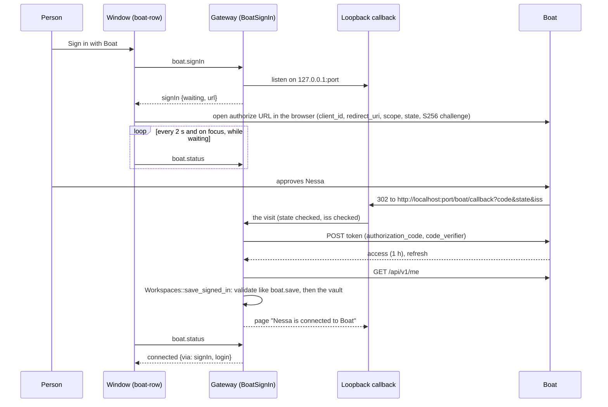
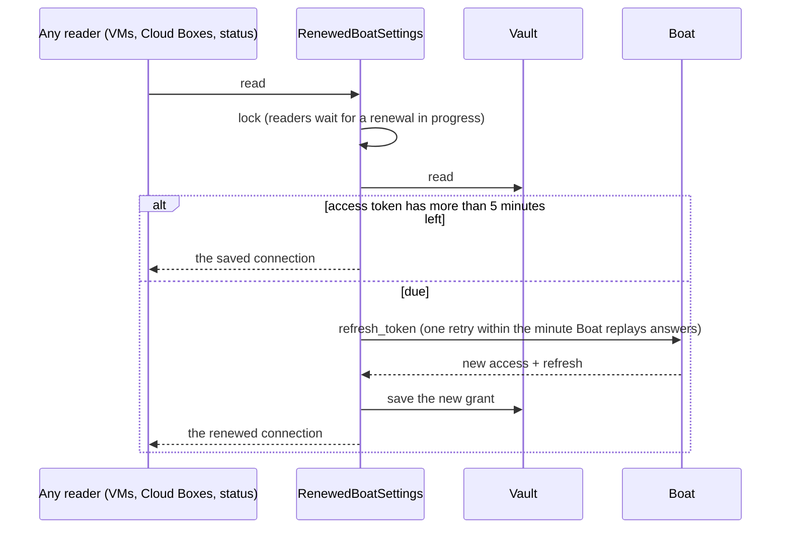

# Sign in with Boat

A person connects Boat to Nessa by signing in to Boat in their browser, from
Settings › Connections › Accounts › Boat, from a Boat page in Devices, or
from a message refused because Boat is not connected. There is no token to
paste: Sign in with Boat is the one way in the window. The gateway keeps the
sign-in in its encrypted vault and renews it itself.

It uses Boat's OAuth apps (<https://docs.boat.dev/oauth-apps>): an
authorization-code grant with PKCE (S256), for an app registered without a
secret (`boat app create --no-secret`), as Boat asks of desktop apps, with a
loopback redirect URI. Boat matches redirect URIs exactly except the port of
an `http://localhost` one, so the app is registered with
`http://localhost/boat/callback` and each sign-in names its own port.

## Who owns what

| Fact | Owner | Kept in |
| --- | --- | --- |
| Which Boat app, and where Boat is | `workspaces/infrastructure/boat_oauth.rs` (`BoatApp`) | `protocol/defaults/boat-app.json`, or the file `NESSA_BOAT_APP` names (the stress check's fake Boat). Released with Nessa's app, `boatapp_EykQMCwgQazcrGDdL3zh0YNC`; an empty `clientId` would mean a build offers no sign-in (`signInAvailable: false`) |
| The one sign-in in progress: its state, verifier and listener | `BoatSignIn` (`workspaces/application/boat_sign_in.rs`) | memory only; a gateway restart ends it |
| Where the browser comes back to | `LoopbackCallbacks` (`boat_callback.rs`) | a listener on 127.0.0.1 (and ::1 when present), one port per sign-in, answering only `GET /boat/callback` |
| The access token, the refresh token, when the access token ends, and whose account | `RenewedBoatSettings` over `VaultSettings` | the `boat.connection` vault entry, with a `grant` beside the token |
| Spending a refresh token | `RenewedBoatSettings`, alone | every reader of Boat's connection reads through it |
| What the person sees | `src/desktop/settings/ui/boat-row.tsx` | nothing: it reads `boat.status` |

## The flow

A visit with another sign-in's `state` is answered with the failure page and
the sign-in keeps waiting: it is a stale tab or someone else's page. A
redirect naming another issuer, Cancel on Boat (`access_denied`), a refused
code, ten minutes without an answer, or a connection that fails validation
each end the sign-in as `signIn {failed, cause}`; a grant that could not be
saved is revoked in Boat.

## Renewal

Boat's access token lasts an hour; each refresh returns a new refresh token,
ends the old access token at once, and disconnects the app if an old refresh
token is used again. So:

- A renewal the vault refuses is kept in memory with the refresh token it
  replaced, handed out, and saved on the next read; the spent refresh token is
  never sent again.
- `invalid_grant` on refresh means the sign-in was revoked or disconnected in
  Boat: the connection is removed and Settings offers Sign in with Boat again.
- Boat unreachable while the access token still works keeps using it; once it
  has ended, the read fails as Boat unreachable.
- Disconnect clears the vault entry, then revokes the refresh token in Boat.

## Scopes

`account.read environment.read environment.write snapshot.read sandbox.read
sandbox.create sandbox.resume sandbox.stop sandbox.delete-own exec ssh`:
reading the account, keeping the `nessa` environment in the posture Nessa
admits (created with it if absent), making, waking, stopping and rolling back
its own VMs, and reaching them. `sandbox.delete-own` is enough because Nessa
only ever removes a VM its own creation just made.

## What changed for a pasted token

The window no longer offers one. `boat.save` is still a gateway method, for
scripts against a real account (`scripts/workspaces/boat-e2e.mjs`), and a
connection saved from a token before keeps working: it has no grant, so it is
never renewed. Signing in replaces it.

## Limits

- The browser must run on the machine the gateway runs on: the redirect goes
  to `localhost`. That is the desktop app's own gateway. A gateway on another
  machine cannot be signed in from a browser elsewhere.
- One sign-in at a time per gateway; starting another ends the first.

## Checks

- `crates/nessa-conversation/tests/workspaces/boat_sign_in.rs`: the PKCE
  exchange, stale tabs, cancel, issuer, expiry, a locked vault, one renewal
  for many readers, an unsaved renewal, refused and unreachable renewals, and
  revoke on disconnect.
- `boat_oauth.rs` and `boat_callback.rs` unit tests: Boat's documented
  shapes, and a real loopback visit.
- Stress step `boatSignIn` (knob `boatSignIns`), against
  `verification/desktop/scripts/lib/fake-boat.mjs`: a Cancel on Boat, a
  sign-in through a real popup and the real loopback callback, renewals on
  later reads, no token in the page or log, and Disconnect revoking it.
