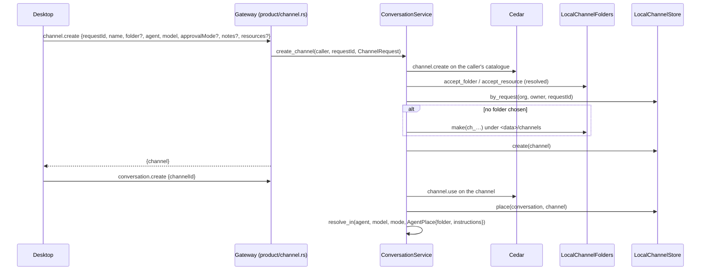

# Channels

A channel is a named place a person's conversations live in. It holds what a
new conversation in it starts with, and where its agents work:

- **Defaults**: the agent, the model and the approval preset a new
  conversation starts with. Each is only a start; the person can change any of
  them inside the conversation.
- **Folder**: where every agent in the channel works. The person picks an
  existing folder, or the gateway makes `<data>/channels/<id>`
  (`~/.nessa/channels/<id>` on a desktop). Two channels may share a folder.
- **Notes and resources**: text, and absolute paths to files and folders, that
  every agent in the channel is told in its system instructions.

Every conversation is in exactly one channel for its whole life. A
conversation with no stored channel is in the **default channel**, whose folder
is the gateway's configured workspace. The default channel is never stored.

## A request names a channel, never a folder

`channel.create` is the only method that takes a path, and Cedar admits it
only for the owner (`owner.channel_create`). The gateway resolves the folder,
follows links, and refuses the root, the home folder itself, system folders and
its own data other than its `channels/` folder. After that, `conversation.create`
names a `channelId`, and Cedar checks `channel.use` on that channel. What a
request can select is therefore always a place its owner already made.

## Ids and retries

A channel's id is `ch_` and ten base32 characters of
`sha256("nessa.channel.create\0", org, owner, requestId)`. A retried
`channel.create` names the same id, and so the same made folder. The kept
channel is answered when the retry asks for the same channel, and
`channel_request_conflict` otherwise.

## Where an agent works

The service looks up a conversation's channel each time it builds an agent
(creation, opening, model and mode changes, handoffs) and hands the source an
`AgentPlace`. `CurrentAgentResolver::resolve_in` builds the agent with its
workspace set to the channel folder and the channel's instructions appended to
Nessa's own. Nothing built for the configured workspace is reused, including
OpenCode's warm-up. A provider session's erasure is asked from the same place
(`ProviderSessionEraser::erase_in`), and the placement is let go only once the
erasure is settled.

A thread an agent starts with `create_thread` is in its starting conversation's
channel, unless it runs on another host. A channel conversation always runs on
this machine: a channel with an `environment` is refused.

## What comes later

Settings that bound a conversation instead of starting it (inbound and output
policies, cost thresholds) are kept beside the defaults, each checked through
the Cedar policy port. Adding one does not change how a conversation names its
channel. Renaming, moving and deleting channels are not built yet.

## Known gaps

- OpenCode has no system prompt, so it works in the channel folder but is not
  told the notes or resources.
- Fixed (non-managed) agent bindings erase sessions as from the configured
  workspace.
