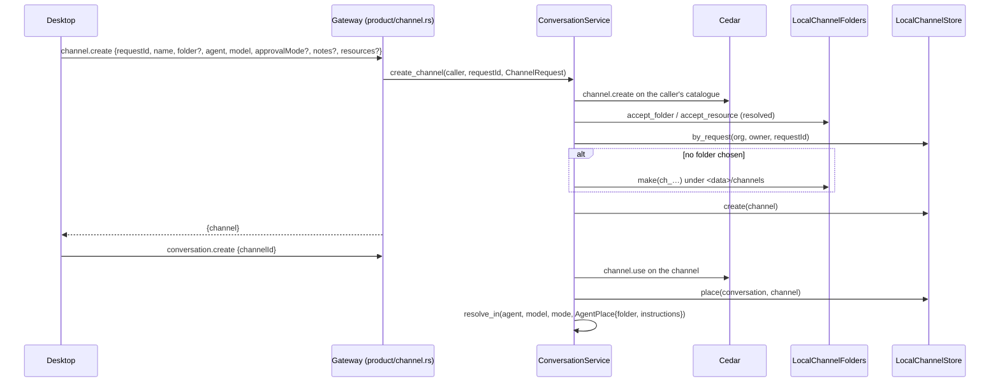
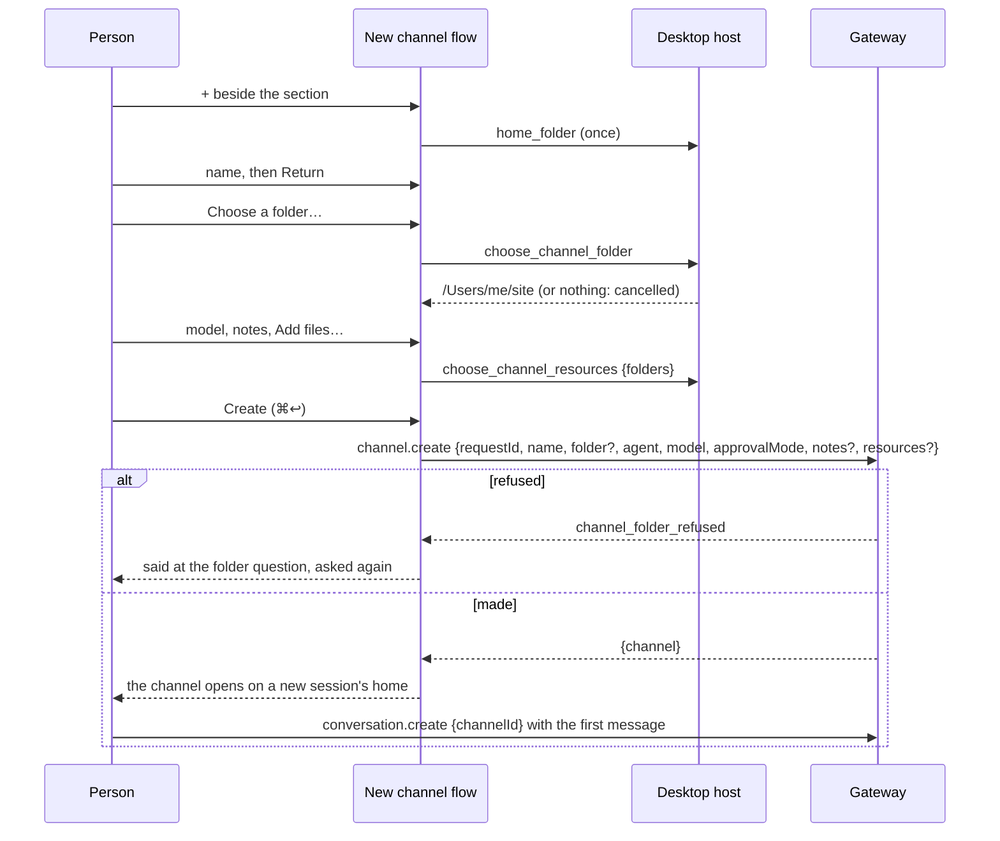

# Channels

A channel is a named place a person's conversations live in. It holds what a
new conversation in it starts with, and where its agents work:

- **Defaults**: the agent, the model and the approval preset a new
  conversation starts with. Each is only a start; the person can change any of
  them inside the conversation.
- **Folder**: where every agent in the channel works. The person picks an
  existing folder, or the gateway makes `<data>/channels/<id>`
  (`~/.nessa/channels/<id>` on a desktop). Two channels may share a folder.
- **Notes and resources**: text, and absolute paths to files and folders, that
  every agent in the channel is told in its system instructions.

Every conversation is in exactly one channel for its whole life. A
conversation with no stored channel is in the **default channel**, whose folder
is the gateway's configured workspace. The default channel is never stored.

## A request names a channel, never a folder

`channel.create` is the only method that takes a path, and Cedar admits it
only for the owner (`owner.channel_create`). The gateway resolves the folder,
follows links, and refuses the root of a drive, a system folder or one that
holds a system folder, the home folder or one that holds it, and its own data,
a folder that holds it, or anything in it other than a folder under its
`channels/` folder. After that, `conversation.create`
names a `channelId`, and Cedar checks `channel.use` on that channel. What a
request can select is therefore always a place its owner already made.



`channel.list` answers a page per frame: the default channel first, then the
made ones in the order they were made. A cut page names its last channel as
`cursor`, and `channel.list {after}` goes on from there. The client reads every
page. An owner phone's creation is checked against the preset the
conversation will start in, its channel's when it names none.

## Ids and retries

A channel's id is `ch_` and ten base32 characters of
`sha256("nessa.channel.create\0", org, owner, requestId)`. A retried
`channel.create` names the same id, and so the same made folder. The kept
channel is answered when the retry asks for the same channel, and
`channel_request_conflict` otherwise.

## Where an agent works

The service looks up a conversation's channel each time it builds an agent
(creation, opening, model and mode changes, handoffs) and hands the source an
`AgentPlace`. `CurrentAgentResolver::resolve_in` builds the agent with its
workspace set to the channel folder and the channel's instructions appended to
Nessa's own. Nothing built for the configured workspace is reused, including
OpenCode's warm-up. A provider session's erasure is asked from the same place
(`ProviderSessionEraser::erase_in`), and the placement is let go only once the
erasure is settled.

A thread an agent starts with `create_thread` is in its starting conversation's
channel, unless it runs on another host. A channel conversation always runs on
this machine: a channel with an `environment` is refused.

## Changing where a channel runs

A channel says where its main agent runs and where its threads run
(`ChannelExecution`: this machine or Boat). Both can change after it is made,
from the channel's settings dialog (`channel.setPlacement`, Cedar
`channel.settings` on the channel; the default channel has nothing to change
and is refused `forbidden`). A conversation's own placement is still written
once, before it exists, and never moves, so a change only says where new
conversations go:

- **New threads**: every thread made from then on runs in the new place.
  Threads already made keep running where they started.
- **Main agent**: its current main conversation stays where it runs and stays
  in the channel, as an ordinary thread with its history. The channel names a
  fresh main conversation (`channel_coordinator_replacements`, cause
  `coordinator_moved`, in the same write as the new placement), and the next
  main-agent chat starts in the new place.

```mermaid
sequenceDiagram
    participant Person
    participant Dialog as Channel settings
    participant Gateway as Gateway (product/channel.rs)
    participant Service as ConversationService
    participant Store as LocalChannelStore
    Person->>Dialog: Main agent runs on: Boat
    Dialog->>Gateway: channel.setPlacement {requestId, channelId, coordinatorPlacement, threadPlacement}
    Gateway->>Service: set_channel_execution(caller, channelId, execution)
    Service->>Service: channel.settings on the channel (Cedar)
    Service->>Store: set_execution(channelId, execution)
    alt the main agent moved
        Store->>Store: retire the main conversation (coordinator_moved), name a fresh one
    end
    Store->>Store: UPDATE coordinator_placement, thread_placement (one transaction)
    Gateway-->>Dialog: {channel} with its coordinatorConversationId
    Dialog-->>Person: the index takes the channel; its next main chat opens on Boat
```

## Making one in the desktop window

The sidebar's + opens the "New channel" flow over the session list and the
panes (`src/desktop/workspace/ui/channel-creation/`). It asks one question at
a time, the way an agent would, and folds each answer into a line that asks it
again when clicked: the name, where its agents work, the model new
conversations start on, notes, and files or folders to attach. Only the name
must be typed; every other question starts with an answer (a folder made for
the channel, the window's default model, no notes, nothing attached), so
Create is ready from the first answer.



The flow's state is the store's (`usecases/channel-creation.ts`), so an agent
drives it with the same commands a person's clicks dispatch. A Create keeps
its request id while the draft stays as sent, so asking again after no answer
makes one channel; any change to the draft takes a fresh id.

The paths come only from the system's pickers: the host's
`choose_channel_folder` and `choose_channel_resources` commands
(`src-tauri/src/channel_paths.rs`), composed in `main.tsx` on macOS and
Windows. Linux has no picker of its own yet, and a browser none at all, so
there the flow does not ask for a folder or files: the channel works in a
folder made for it.

### Dropping files and folders

While the flow asks for files, files and folders dragged from the Finder or
Explorer onto the window are attached as a pick's are. The webview never sees
the paths: Tauri gives them to the host (`WindowEvent::DragDrop`), and
`dropped_on_desktop` in `src-tauri/src/channel_paths.rs` tells the page.
Saying each path's kind takes the filesystem, which a stalled share can hold,
so a drop arrives in two parts: `nessa://paths-drop-began {drop}` the moment
the person lets go, then `nessa://paths-dropped {drop, paths, unread}` once
each path is a file or a folder (at most 2 s each, all at once; no answer is
a file). The host looks at no more paths than a channel holds
(`x-channelRules.maxResources`); the rest come back as `unread` and are said
as not fitting.

The page binds each drop to the flow that was asking when it landed
(`channelDropLanded`), and holds Create while any drop is `landing`. When its
paths come (`channelDropSettled`) the drop stops holding Create, and its paths
are added only if that same flow asks for files at that moment.

| Drop lands while | Before its paths come | When they come | Test (`channel-commands.test.ts`) |
| --- | --- | --- | --- |
| another question is asked | — | nothing added | "takes files and folders dropped…" (early) |
| files are asked | nothing | added; Create free | same test; "counts the paths the host did not look at…" |
| files are asked | question moves on | nothing added; Create free | same test (moved) |
| files are asked | question moves on and back | added; Create free | same test (back) |
| files are asked | flow closes, another opens | nothing added to either | same test (late) |
| files are asked | Create pressed | Create refused until they come, then sends them | "waits to create while a drop's paths are still coming…" |
| the window has no drop port (Linux, browser) | — | never watched | "watches nothing where the window is never told of a drop" |

The stress step `channel` drives the same order through the fake host.

## What comes later

Settings that bound a conversation instead of starting it (inbound and output
policies, cost thresholds) are kept beside the defaults, each checked through
the Cedar policy port. Adding one does not change how a conversation names its
channel. Renaming, moving and deleting channels are not built yet.

## Known gaps

- OpenCode has no system prompt, so it works in the channel folder but is not
  told the notes or resources.
- Fixed (non-managed) agent bindings erase sessions as from the configured
  workspace.
- A channel made by another client with an approval preset other than Ask
  starts its new sessions there, but the desktop composer shows Ask until the
  conversation says otherwise. The desktop flow does not ask for a preset.
- A conversation whose channel folder was removed cannot be opened, not even
  to read its transcript: its agent cannot be built there, and the read is
  refused `model_unavailable`, which names the wrong cause.
- A Windows folder named through a UNC path to a local drive
  (`\\localhost\C$\…`) is not recognised as that drive's system folder.
- Resources are only named to the agent, never checked against the folder
  rule: a file in the home folder's hidden folders can be attached.
- A retried `create_thread` whose source conversation changed its preset in
  between is refused `request_conflict`, as a retried fork is.
