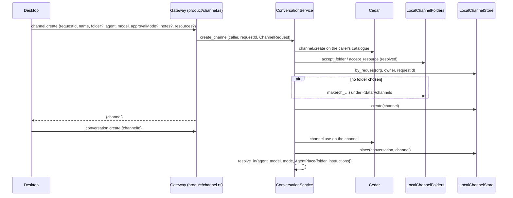
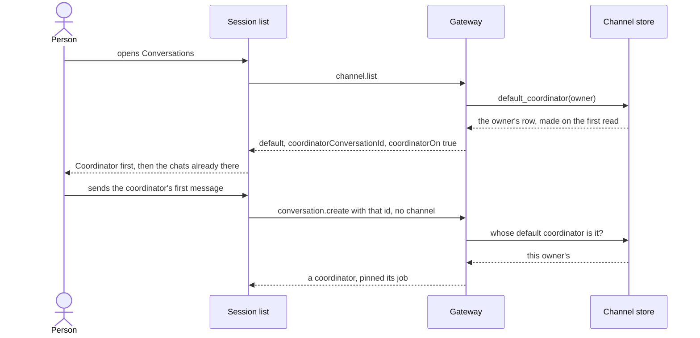
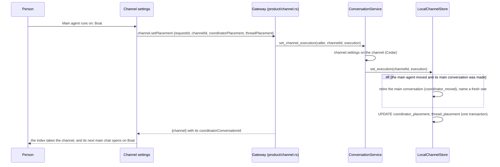
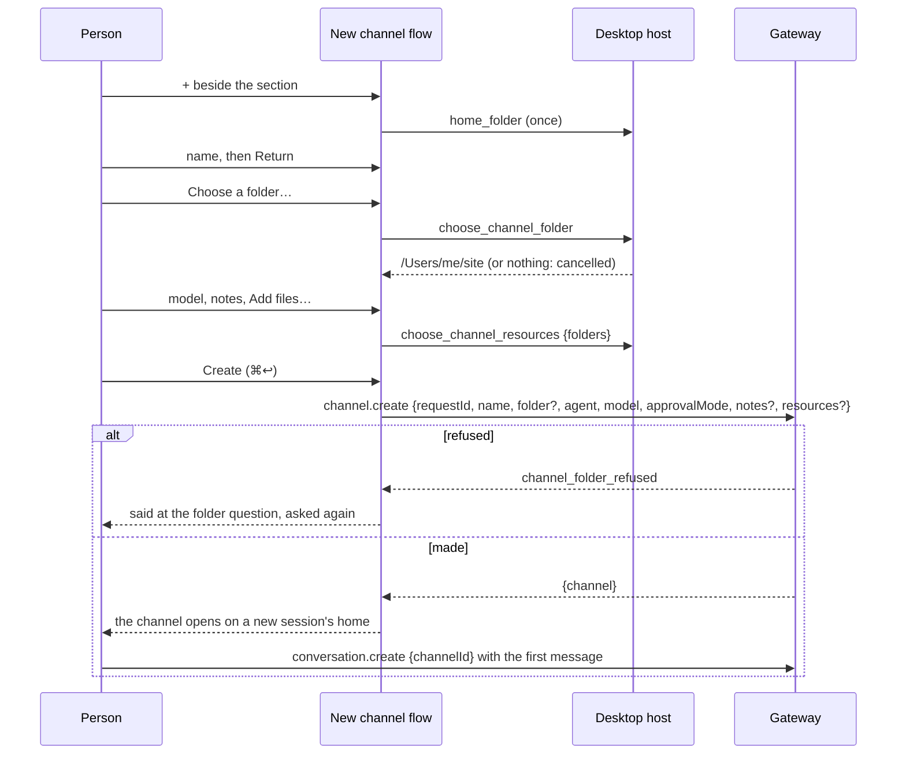

# Channels

A channel is a named place a person's conversations live in. It holds what a
new conversation in it starts with, and where its agents work:

- **Defaults**: the agent, the model and the approval preset a new
  conversation starts with. Each is only a start; the person can change any of
  them inside the conversation.
- **Folder**: where every agent in the channel that runs here works. The
  person picks an existing folder, or the gateway makes `<data>/channels/<id>`
  (`~/.nessa/channels/<id>` on a desktop). Two channels may share a folder. An
  agent that runs elsewhere (Boat, or another computer) works in the folder
  its own computer gives it.
- **Notes and resources**: text, and absolute paths to files and folders, that
  every agent in the channel is told in its system instructions. The folder
  and resource paths are this gateway's, so an agent that runs elsewhere is
  told the channel's name and notes only (`Channel::instructions`).

Every conversation is in exactly one channel for its whole life. A
conversation with no stored channel is in the **default channel**, whose folder
is the gateway's configured workspace. The default channel is never stored;
only its coordinator is, one for each owner (below).

## A request names a channel, never a folder

`channel.create` is the only method that takes a path, and Cedar admits it
only for the owner (`owner.channel_create`). The gateway resolves the folder,
follows links, and refuses the root of a drive, a system folder or one that
holds a system folder, the home folder or one that holds it, and its own data,
a folder that holds it, or anything in it other than a folder under its
`channels/` folder. After that, `conversation.create`
names a `channelId`, and Cedar checks `channel.use` on that channel. What a
request can select is therefore always a place its owner already made.

`channel.list` answers a page per frame: the default channel first, then the
made ones in the order they were made. A cut page names its last channel as
`cursor`, and `channel.list {after}` goes on from there. The client reads every
page. An owner phone's creation is checked against the preset the
conversation will start in, its channel's when it names none.

## Ids and retries

A channel's id is `ch_` and ten base32 characters of
`sha256("nessa.channel.create\0", org, owner, requestId)`. A retried
`channel.create` names the same id, and so the same made folder. The kept
channel is answered when the retry asks for the same channel, and
`channel_request_conflict` otherwise.

## Where an agent works

The service looks up a conversation's channel each time it builds an agent
(creation, opening, model and mode changes, handoffs) and hands the source an
`AgentPlace`. `CurrentAgentResolver::resolve_in` builds the agent with its
workspace set to the channel folder and the channel's instructions appended to
Nessa's own. Nothing built for the configured workspace is reused, including
OpenCode's warm-up. A provider session's erasure is asked from the same place
(`ProviderSessionEraser::erase_in`), and the placement is let go only once the
erasure is settled.

Where a new conversation runs is decided in one place, `decide_place`
(`conversation/application/place_decision.rs`). A person's creation in a
channel names no place: the channel says where, and one naming an
`environment` is refused. A thread an agent starts with `create_thread` from a
conversation in a stored channel is always in that channel and keeps its
starting conversation's approval mode; it runs where the agent named, else
where the channel runs its threads. A fork runs where its source runs and
stays in its source's channel, even after the channel moved.

## How agents talk

Each role (the coordinator, and every other thread) has one reply style:
Nessa's plain style, Off (no style text at all), or the person's own words
(trimmed, at most 4 KB). A choice is made at the Nessa level (the default
channel's settings) or for one channel; a channel with no choice follows the
Nessa level, and a level with no choice is plain. An override replaces the
value above it whole (`ReplyStyleSettings::effective`). Only the owner sets a
channel's choice: `replyStyle.set` with a `channelId` is checked by Cedar's
channel-settings action first; the Nessa level is admitted by the method's
grant. Each change is audited as `reply_style`.

The style is told in Nessa's own launch prompt (`nessa/reply-style`, after the
channel's notes), never in the person's Claude settings, Codex config or
`AGENTS.md`. The system prompt is part of the restoration fingerprint, so a
changed prompt would open a new native session and lose the chat's context.
To avoid that, a conversation's style is pinned when it is created
(`conversation_reply_styles` in channels.sqlite3) and never follows a later
change: new chats start with the new style, older chats keep theirs. A chat
made before this table existed has no pin and is told no style. OpenCode
takes no Nessa prompt, so it gets no style.

The stress step `style` sets Threads' own words in the default channel's
settings, checks a new chat is told them and the main chat keeps its plain
style, then clears the choice.

## Its coordinator

A made channel has a coordinator: the main agent that starts threads and keeps
the person up to date. It is on unless the person turns it off when making
the channel (`channel.create` with `coordinator: false`), and it can be
switched at any time in the channel's settings (`channel.setCoordinator`).
Only the owner switches it: the gateway checks Cedar's channel-settings
action and audits each switch as
`channel_coordinator`, from what it was to what it became. Switches are taken
one at a time, so each record names the state it replaced.

Off keeps the coordinator's chat and every thread. The channel still names
its main chat (`coordinatorConversationId`) and says `coordinatorOn: false`;
the desktop keeps that id (the chat still runs where the main agent runs) but
never opens the channel at it while off: opening the channel shows its newest
other chat, or a new one, which is an ordinary thread. On again, it is the
same chat: nothing is retired or remade.

While on, the channel's session list always holds a "Coordinator" group
first. The chat begins with its first message, so before that the group holds
a row that opens it (the list reads `start` on the group, the conversation the
channel keeps); after it, the chat's own row is in the same place. A search
lists only what it finds, so it leaves the row out.

The coordinator is told its job (`StyleRole::job`) in Nessa's own launch
prompt as `nessa/role`, after the channel's notes and before the style. The
job text is pinned with the role and style when the conversation is created
(`conversation_reply_styles.job`) and read back as kept, never re-derived:
switching the coordinator, rewording the job later, or upgrading a file whose
coordinators were pinned before jobs existed (they keep `job` NULL) never
changes a saved prompt or restarts a session.

The default channel, Conversations, has a coordinator too, one for each
owner. The channel itself is never stored, so its coordinator is kept by its
owner in `default_coordinators` (`channels.sqlite3` v9): a random id, chosen
the first time the owner's channels are read, with the coordinator on. A
store upgraded from v8 has no rows, so every existing owner gains one, on,
the first time they list their channels, and their chats already in
Conversations stay ordinary threads. `channel.setCoordinator` with
`channelId: default` switches it, under the same Cedar action on the
caller's own default channel and the same audit. Started by its owner
(`conversation.create` in the default channel, with that id) it is pinned the
coordinator's role and job; the same id created by anyone else is an
ordinary thread. It works in the gateway's workspace and is told it is the
channel's main agent. Erased, it is replaced by a new id, as a made
channel's is, and `default_coordinator_replacements` keeps the retired id,
the new one, the owner and the cause in the same write.

The stress step `coordinator` makes a channel with it on (its coordinator is
the list's first row before a word is said, and opens from there; its first
chat is the coordinator, told its job), switches it off in settings (a new chat there
is a thread, told no job), on again (the same chat still answers), and makes
a second channel with it off. It then checks Conversations: its coordinator is
listed first, told its job once started, and switched off and on in its
settings keeping the same chat.

## Changing where a channel runs

A channel says where its main agent runs and where its threads run
(`ChannelExecution`). Each is any place: this machine (`local`), a cloud VM
of each conversation's own on a named cloud (`boat`, `agent37`: the
channel keeps which), any paired computer (`pool`), or one
computer by its place name, an SSH destination this gateway serves or a
paired computer's `peer:<key>` (channels.sqlite3 v6). A computer is checked
when it is asked for: one this gateway does not serve, or a paired computer
not connected then, is refused `channel_place_unavailable` and nothing
changes. A computer the channel already names is not checked again, so the
person can still change the other setting after it went away; a new chat
there is refused as not configured until it is back. Both can change after it is made,
from the channel's settings dialog (`channel.setPlacement`, Cedar
`channel.settings` on the channel; the default channel has nothing to change
and is refused `forbidden`). A conversation's own placement is still written
once, before it exists, and never moves, so a change only says where new
conversations go:

- **New threads**: every thread made from then on that names no place runs
  in the new place. A thread an agent makes naming a place runs there, and a
  fork runs where its source runs. Threads already made keep running where
  they started.
- **Main agent**: its current main conversation stays where it runs and stays
  in the channel, as an ordinary thread with its history. The channel names a
  fresh main conversation (`channel_coordinator_replacements`, cause
  `coordinator_moved`, in the same write as the new placement), and the next
  main-agent chat starts in the new place. A main conversation whose creation
  never began (nothing opened it yet) is not retired: it keeps its id and
  simply starts in the new place.
- **Boat** is offered in the dialog only while Boat is connected, as when the
  channel is made; agents placed there before that could not start.
- **One computer**: the dialog lists the paired computers Devices lists, and
  offers each only while it is connected.
- Another window learns of a change when it reads the index again; channel
  changes are not streamed.
- Each move is recorded in `conversations/audit/settings` as the caller's,
  with both placements and the main conversation before and after: a
  `requested` record before anything changes (unrecorded, the move is
  refused) and an `outcome` record after (unrecorded, the move answers a
  failure even though it was applied).

## Making one in the desktop window

The sidebar's + opens the "New channel" flow over the session list and the
panes (`src/desktop/workspace/ui/channel-creation/`). It asks one question at
a time, the way an agent would, and folds each answer into a line that asks it
again when clicked: the name, where its agents work, the model new
conversations start on, notes, and files or folders to attach. Only the name
must be typed; every other question starts with an answer (a folder made for
the channel, the window's default model, no notes, nothing attached), so
Create is ready from the first answer.

The flow's state is the store's (`usecases/channel-creation.ts`), so an agent
drives it with the same commands a person's clicks dispatch. A Create keeps
its request id while the draft stays as sent, so asking again after no answer
makes one channel; any change to the draft takes a fresh id.

The paths come only from the system's pickers: the host's
`choose_channel_folder` and `choose_channel_resources` commands
(`src-tauri/src/channel_paths.rs`), composed in `main.tsx` on macOS and
Windows. Linux has no picker of its own yet, and a browser none at all, so
there the flow does not ask for a folder or files: the channel works in a
folder made for it.

### Dropping files and folders

While the flow asks for files, files and folders dragged from the Finder or
Explorer onto the window are attached as a pick's are. The webview never sees
the paths: Tauri gives them to the host (`WindowEvent::DragDrop`), and
`dropped_on_desktop` in `src-tauri/src/channel_paths.rs` tells the page.
Saying each path's kind takes the filesystem, which a stalled share can hold,
so a drop arrives in two parts: `nessa://paths-drop-began {drop}` the moment
the person lets go, then `nessa://paths-dropped {drop, paths, unread}` once
each path is a file or a folder (at most 2 s each, all at once; no answer is
a file). The host looks at no more paths than a channel holds
(`x-channelRules.maxResources`); the rest come back as `unread` and are said
as not fitting.

The page binds each drop to the flow that was asking when it landed
(`channelDropLanded`), and holds Create while any drop is `landing`. When its
paths come (`channelDropSettled`) the drop stops holding Create, and its paths
are added only if that same flow asks for files at that moment.

| Drop lands while | Before its paths come | When they come | Test (`channel-commands.test.ts`) |
| --- | --- | --- | --- |
| another question is asked | — | nothing added | "takes files and folders dropped…" (early) |
| files are asked | nothing | added; Create free | same test; "counts the paths the host did not look at…" |
| files are asked | question moves on | nothing added; Create free | same test (moved) |
| files are asked | question moves on and back | added; Create free | same test (back) |
| files are asked | flow closes, another opens | nothing added to either | same test (late) |
| files are asked | Create pressed | Create refused until they come, then sends them | "waits to create while a drop's paths are still coming…" |
| the window has no drop port (Linux, browser) | — | never watched | "watches nothing where the window is never told of a drop" |

The stress step `channel` drives the same order through the fake host.

## What comes later

Settings that bound a conversation instead of starting it (inbound and output
policies, cost thresholds) are kept beside the defaults, each checked through
the Cedar policy port. Adding one does not change how a conversation names its
channel. Renaming, moving and deleting channels are not built yet.

## Known gaps

- OpenCode has no system prompt, so it works in the channel folder but is not
  told the notes or resources.
- Fixed (non-managed) agent bindings erase sessions as from the configured
  workspace.
- A channel made by another client with an approval preset other than Ask
  starts its new sessions there, but the desktop composer shows Ask until the
  conversation says otherwise. The desktop flow does not ask for a preset.
- A conversation whose channel folder was removed cannot be opened, not even
  to read its transcript: its agent cannot be built there, and the read is
  refused `model_unavailable`, which names the wrong cause.
- A Windows folder named through a UNC path to a local drive
  (`\\localhost\C$\…`) is not recognised as that drive's system folder.
- Resources are only named to the agent, never checked against the folder
  rule: a file in the home folder's hidden folders can be attached.
- A retried `create_thread` whose source conversation changed its preset in
  between is refused `request_conflict`, as a retried fork is.
