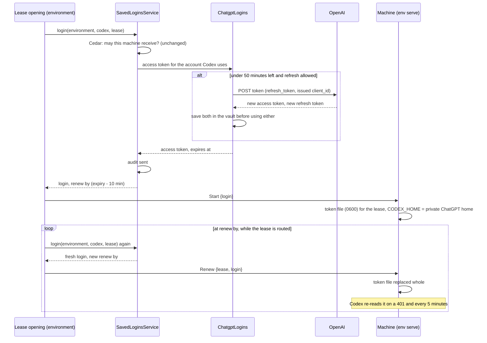

# ChatGPT sign-in for Codex on other machines

Issue #1403. Codex on a Boat VM, an SSH host or a paired machine can run on a
person's ChatGPT plan, not only on an OpenAI API key. The gateway signs in to
ChatGPT once per account, keeps the tokens in its vault, and hands each
machine a short-lived access token when Codex starts there. It follows
OpenAI's [token sharing for open-source apps](https://developers.openai.com/siwc/token-sharing-open-source).
Everything [Saved logins](saved-logins.md) says about who may be handed a
login (the host's grant, the Cedar policy, host wins, the audit) holds
unchanged: a ChatGPT access token is one more kind of Codex login.

## Who owns what

| Fact | Owner | Kept in |
| --- | --- | --- |
| OpenAI's addresses (authorize, token, revoke, JWKS, issuer) | `logins/chatgpt/infrastructure/authority.rs` | `protocol/defaults/chatgpt-sign-in.json`, or the file `NESSA_CHATGPT_SIGN_IN` names (checks point it at a fake OpenAI on this machine) |
| The accounts, each one's issued client ID, identity and tokens, which one Codex uses, and this gateway's host ID | `ChatgptLogins` | vault entry `login.codex.chatgpt`, one JSON document |
| A sign-in under way (state, nonce, PKCE verifier, callback address) | `ChatgptLogins` | memory only; a restart ends it |
| Whether a machine may be handed a login | Cedar, as for every saved login | `logins/infrastructure/cedar/policies.cedar` |
| Each sign-in, refresh, switch, removal and hand-off | `DurableLoginAudit` | `<namespace>/conversations/audit/logins`, never a token or a code |
| How Codex on the machine reads the token | `nessa env serve`'s launcher | a private `CODEX_HOME` (below) |

## Signing in

The browser comes back to `http://127.0.0.1:<port>/auth/callback`, which
reaches the computer the browser runs on. So the gateway listens there
itself, and a sign-in works from a window on the gateway's own computer.
It tries port 1455 first (OpenAI's example), then any free port.

```mermaid
sequenceDiagram
    participant S as Settings (desktop)
    participant G as Gateway (ChatgptLogins)
    participant B as Browser
    participant O as OpenAI (auth.openai.com)
    S->>G: logins.chatgptSignIn {accountId?}
    G->>G: audit chatgpt_sign_in requested
    G->>G: listen on 127.0.0.1; new state, nonce, PKCE
    G-->>S: status: signIn waiting {authorizeUrl}
    S->>B: open authorizeUrl
    B->>O: authorize (client_id=dynamic_agent_client or the account's, ext_agent_host_id, agent_name_hint=Nessa)
    O-->>B: ChatGPT login, consent
    B->>G: GET /auth/callback?code&state&client_id
    G->>O: POST token (authorization_code, PKCE)
    O-->>G: access, refresh, id token, scope, expires_in
    G->>O: GET JWKS
    G->>G: verify id token (RS256, iss, aud, exp, nonce); plan scope granted
    G->>G: save account in the vault; audit signed_in
    S->>G: logins.status (every 2 s while waiting)
    G-->>S: accounts, signIn idle {last: signed_in}
```

A new account registers with `client_id=dynamic_agent_client`, and the
callback names the client ID OpenAI issued; that one is kept and used for
the exchange and every refresh. Signing in again to a saved account uses its
issued client ID and `id_token_hint`, and is refused if the ID token names a
different subject. A sign-in whose scopes lack `chatgpt.tokens.use.direct`
ends `plan_not_enabled` and saves nothing: Codex could not use it. The first
account saved becomes the one Codex uses.

## Handing a token to a machine



Only the gateway refreshes, one refresh per account at a time, so the
rotating refresh token is never raced. A machine holds an access token only,
for the harness it starts with it. A refresh whose new tokens cannot be
saved hands nothing, since the old refresh token is spent. An account whose
refresh token OpenAI refuses (`invalid_grant`, `refresh_token_reused` and the
others the [errors page](https://developers.openai.com/siwc/token-sharing-open-source/errors-and-recovery#refresh-errors)
lists) is marked as needing a sign-in again, its tokens dropped, and nothing
is handed: the gateway never falls back to the API key on its own, because
OpenAI says a ChatGPT plan error stops inference rather than switching how
it is paid for. A network failure keeps the tokens and hands nothing this
time.

On the machine, `nessa env serve` tells the kinds apart by shape: an access
token is a JWT (three base64url parts), an API key never is. For an access
token it writes the token to a file of the lease's own under
`<codex home>-chatgpt/tokens/` (named by a digest of the lease id, readable
only by its account) and starts Codex with `CODEX_HOME` set to that home and
`NESSA_CHATGPT_TOKEN_FILE` naming the file. The token is never in a launch
variable. The home's `config.toml` makes OpenAI's documented Responses
provider the default (`model_provider = "nessa_chatgpt"`,
`requires_openai_auth = false`, `supports_websockets = false`), with an auth
command that prints the file (`[model_providers.nessa_chatgpt.auth]`,
`refresh_interval_ms = 300000`), and keeps its credential store ephemeral.
Codex 0.154 runs that command again on any 401 and every five minutes, so a
token replaced in the file is used by a harness already running. The file
is removed when the lease ends. Its `sessions/` is a link to the API-key home's,
so a thread started under one login resumes under the other. Codex sends the
token as `Authorization: Bearer` to `/v1/responses`, and the adapter sees no
sign-in to ask for.

## Expiry

An access token lasts an hour (OpenAI's limit), so an agent that works for
days needs a new one every hour. The gateway hands a token with at least 50
minutes left (it refreshes one with less, once OpenAI's
`earliest_refresh_at` has passed). The lease remembers when that token should
be replaced (`renew_by`, ten minutes before it expires). At `renew_by` the
lease asks for the login again and sends it to the machine as `Renew`; the
machine replaces the lease's token file and Codex picks it up on its next
read, mid-turn included. A renewal that fails is asked again every minute.

If renewals keep failing past `renew_by` (OpenAI unreachable, the account
needing a sign-in), the parking sweep parks the agent once it is idle,
watched or not, and the next message opens it again with whatever the
gateway can hand. A turn already running when the old token expires fails
as a model error.

The gateway has to be up to renew. That is no new dependency: when its
connection to a machine ends, `nessa env serve` ends every lease and stops
its harnesses anyway, and the conversation resumes when the gateway is back.

## Orderings

| # | State | Event | Result |
| --- | --- | --- | --- |
| S1 | no sign-in | `chatgptSignIn` | audit requested; listen; waiting with an authorize URL. Audit refused: nothing starts |
| S2 | waiting | `chatgptSignIn` again | the earlier attempt is cancelled (recorded `replaced`); a new one starts |
| S3 | waiting | callback with the wrong `state` | answered 400, ignored; still waiting |
| S4 | waiting | callback with `error` | ends `declined`; nothing saved |
| S5 | waiting | callback, new registration without `client_id` | ends `incomplete`; nothing saved |
| S6 | waiting | callback, sign-in again, `client_id` differs from the account's | ends `wrong_account`; nothing saved |
| S7 | waiting | code exchange refused or unreachable | ends `exchange_failed`; nothing saved |
| S8 | waiting | ID token fails verification | ends `invalid_identity`; nothing saved |
| S9 | waiting | sign-in again names another subject | ends `wrong_account`; nothing saved |
| S10 | waiting | scopes lack `chatgpt.tokens.use.direct` | ends `plan_not_enabled`; nothing saved |
| S11 | waiting | vault write fails | ends `not_saved`; nothing saved |
| S12 | waiting | all checks pass | saved, audit `signed_in`; idle with `last = signed_in`. The first account kept is put in use |
| S12a | waiting | a new sign-in names a subject already kept | that account is signed in again, not kept twice |
| S13 | waiting | 10 minutes pass | ends `timed_out` |
| S14 | waiting | `chatgptCancel` | ends `cancelled` |
| S15 | any | gateway restarts | an attempt under way is forgotten; saved accounts stay |
| R1 | token with 50 minutes or more left | lease asks | handed as it is |
| R2 | less left, before `earliest_refresh_at` | lease asks | handed as it is |
| R3 | less left, refresh allowed | lease asks | refreshed, saved, handed |
| R4 | two leases ask at once | both | one refresh; the second waits and reads the saved result |
| R5 | refresh refused as unusable | lease asks | account marked to sign in again, tokens dropped, nothing handed, audit `refresh_failed` |
| R6 | refresh unreachable | lease asks | tokens kept, nothing handed, audit `refresh_failed` |
| R7 | refreshed, vault write fails | lease asks | nothing handed, audit `refresh_failed` (`not_saved`); the old refresh token is spent, so the next refresh is refused and marks the account to sign in again |
| R8 | no account in use | lease asks | the saved API key, if any, as before |
| R9 | account in use needs a sign-in | lease asks | nothing handed, audit `sign_in_needed`; the key is not used in its place |
| L1 | lease handed a ChatGPT token | `renew_by` passes | login asked again; `Renew` sent; the lease's token and `renew_by` replaced |
| L2 | renewal | gateway hands nothing (refresh failed, sign-in needed, locked), or the same token again | asked again after a minute; token on the machine unchanged |
| L3 | renewal | account set aside, the key handed instead | renewals stop; running harnesses keep their token until it expires |
| L4 | renewal waiting | lease ends or its connection goes | renewal stops; the machine removes the token file |
| L5 | machine | `Renew` for a lease whose harness has no token file, or not granted `takesLogin` | ignored, logged |
| P1 | idle agent, past `renew_by` (renewals failing) | parking sweep | parked now, watched or not |
| P2 | busy agent, past `renew_by` | parking sweep | left running; the turn may fail when the token expires |
| A1 | account in use | `chatgptRemove` | revoked at OpenAI (best effort, recorded), removed; Codex falls back to the API key |
| A2 | any | `chatgptUse {accountId: null}` | Codex uses the saved API key |

## Wire

- `LoginsStatus.chatgpt`: the accounts (`id`, `email`, `inUse`,
  `needsSignIn`) and the sign-in (`idle` with how the last one ended, or
  `waiting` with its `authorizeUrl`). Never a token.
- `logins.chatgptSignIn {accountId?}`, `logins.chatgptCancel {}`,
  `logins.chatgptUse {accountId | null}`, `logins.chatgptRemove {accountId}`:
  grant `credential.manage`, each answering `LoginsStatus`.
- `lease::Login` holds up to 16 KiB, which an access token needs.
- Lease frame `Renew {lease, login}` (gateway to machine), unanswered.

## Not done here

- Moving a turn to another account when one hits its usage limit
  (`subscription_sharing_usage_limit_exceeded`).
- Signing in from a window on another computer than the gateway's: the
  callback reaches the browser's computer only.

## Checked by

Unit tests under `crates/nessa-gateway/tests/logins/chatgpt.rs` (the
sign-in, refresh, and account rows), `crates/nessa-env-serve/tests/launcher.rs`
(the token file, its home, and its renewal), the
`conversation/ssh_environment.rs` renewal tests (L1 to L3) and parking tests
(P1, P2) in `crates/nessa-conversation`, and the conversation stress step
`chatgpt` (`--chatgpts`): a fake OpenAI (`lib/fake-openai.mjs`) signs in two
accounts from Settings › Accounts, a paired worker's Codex launches record the
token file they were given and what it holds, the file is renewed in place
while a followed conversation's lease runs, choosing the other account
changes what the next launch gets and choosing the key hands no token, both
accounts are revoked on removal, no rotated refresh token is used twice, and
no log, record, Settings page or status answer holds a token.
