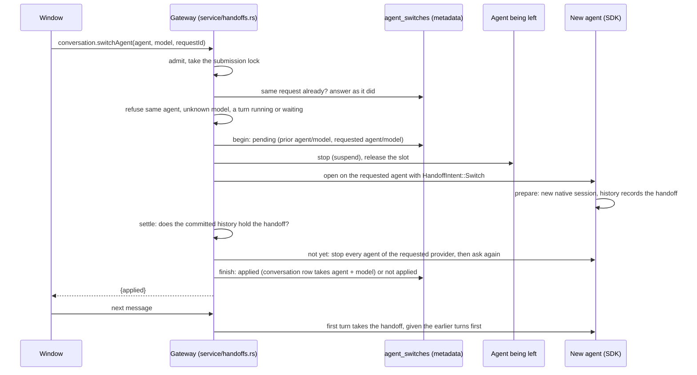
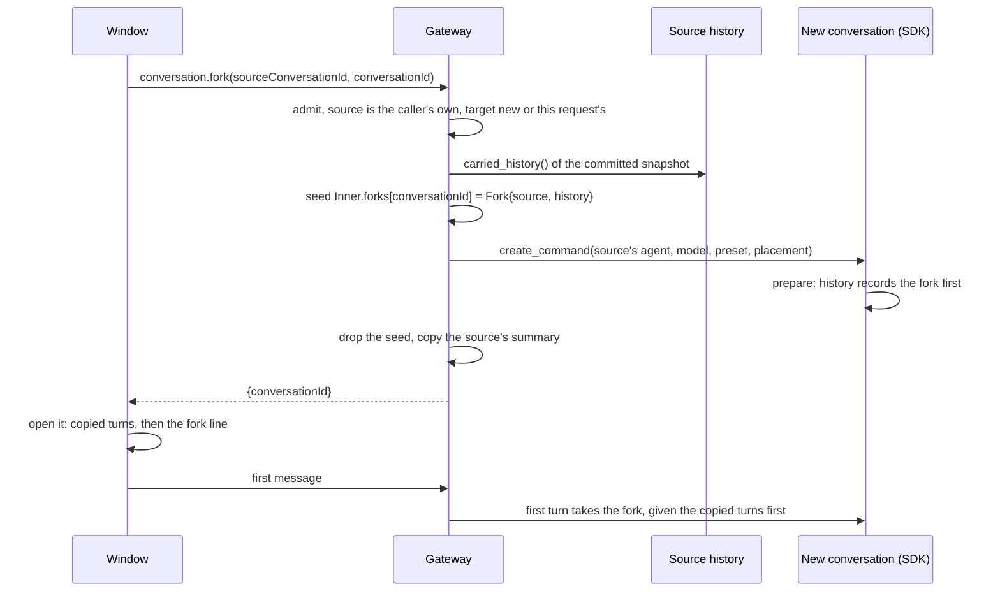

# Conversation handoffs: switching agents and forking

A person can carry a conversation on under another agent ("switch": Claude
to Codex, say, from the composer's model picker), or start a new
conversation from a copy of one's turns ("fork", from a session row's More
menu). Both are one idea: **the conversation's agent runs on in a new native
session that has not seen the turns before it**. So both are one record and
one mechanism:

- The SDK history records a *handoff* (`SessionChange::Handoff`,
  `sessions/handoffs.rs`): a switch names the provider identity before and
  after it; a fork names the conversation it was copied from and the copied
  turns (`CarriedHistory`: what was said and the agent's final reply, text
  only, newest first within its bounds).
- The first turn after the latest handoff *takes* it
  (`InvocationRecord.handoff`). At dispatch that turn is given the turns
  before it, the fork's copy and then the conversation's own, as one JSON
  text block placed first in the prompt (`history_before`,
  `prompt_content.rs`). A later turn is the new session's own, so it is
  given nothing.
- The view lists each handoff (`ConversationView.handoffs`,
  `ConversationHandoff::of`), and every transcript draws it as one line
  (`TranscriptDivider`): a switch after the turn it followed, a fork's copied
  turns first and its line after them.

The SDK history is the one authority for whether a handoff happened. The
gateway's own record of a switch, its journal, only says what was asked and
follows the history.

## Switch

`conversation.switchAgent {conversationId, requestId, agent, model}`. A
model of the same agent is `conversation.setModel`'s, so asking for the
agent the conversation already runs on is `invalid_request`. The desktop
window has one picker for both: a model of the session's own provider goes
to `setModel`, one of another provider to `switchAgent`
(`gateway-source.ts`).

The journal is written before the old agent is stopped, so a gateway that
stops anywhere in the middle finds a pending switch on its next start. The
next opening of the conversation (`opening_plan`) runs the requested agent
with the same switch intent, and the switch settles when that opening ends.
A history that does not hold the switch then is asked again only after every
agent of the requested provider has stopped: until then another attach could
still save it, and a switch settled not made but saved after would leave the
history on one agent and the conversation on another.
The handoff's id is made from the request (`HandoffId::of`), so the opening
that carries it on records the same handoff the first one would have, never
a second.

## Fork

`conversation.fork {conversationId, requestId, sourceConversationId}`. The
source must be the caller's own: a fork copies everything it said, so the
same admission as acting on it, not only reading it. The target must be a
conversation this request creates; any other is `request_conflict`, never
reopened as if it were the fork. The new conversation is created by
the ordinary creation command, on the source's agent, model, approval preset
and environment placement, so a retry of one request answers as the first
did. Its seed, the fork intent with the copied turns, waits in memory
(`Inner.forks`) for the opening that creation runs, which records it first in
the new history. The seed is not saved: creation answers only after that
opening saved the fork, so a gateway that stops before then has answered
nothing, and the caller's retry of the same request seeds it again. The summary is the source's, as of the fork
(`ConversationSummary::after_forking`), so the list shows it at once.

## States and orderings

Each row has at least one test (gate 15).

### Switch (W)

| Row | State or ordering | What happens | Test |
| --- | --- | --- | --- |
| W1 | Idle conversation, another agent asked | Journal pending, old agent stopped, new agent opened, history holds the handoff, journal applied, row takes the agent and model | `a_switch_carries_the_conversation_on_under_another_agent` |
| W2 | Same agent asked, or a turn running, waiting, or owed after a restart | `invalid_request`, or `turn_running`; nothing journaled, the agent stays | `a_switch_is_refused_to_the_same_agent_and_while_a_turn_runs`, `a_switch_is_refused_while_a_restart_left_a_turn_owed` |
| W3 | Gateway stopped with a switch pending | The next opening runs the requested agent with the same switch and settles it | `a_pending_switch_is_carried_on_by_the_next_opening` |
| W4 | The same request again, after it settled or while pending | Answers as it did; a pending one is carried on first. Another request while one is pending carries that one on, then `request_conflict` | `a_switch_carries_the_conversation_on_under_another_agent`, `another_switch_while_one_is_pending_carries_that_one_on_and_is_refused` |
| W5 | The new agent's history does not hold the handoff (it failed to open, or stopped before saving) | Journal not applied, the conversation stays on its agent, any agent of the requested provider is stopped, its next turn runs there given nothing; the window says the model did not change | `a_switch_whose_agent_cannot_open_is_not_made`, `refuses a switch the gateway did not make, and a provider no agent runs` (`gateway-source-model.test.ts`) |

A model change (`setModel`) or an approval-mode change begun while a switch
is pending is refused `request_conflict` (`store.rs`,
`store/model_changes.rs`).

### Fork (F)

| Row | State or ordering | What happens | Test |
| --- | --- | --- | --- |
| F1 | A source of the caller's own, with turns | A new conversation on the source's agent and model, its history first a fork of the copied turns, listed under the source's title | `a_fork_starts_a_new_conversation_from_the_sources_turns`, `a_fork_starts_a_conversation_from_the_turns_it_copied` |
| F2 | The same request again, or one after a stop before the fork was saved | The creation command answers as it did; an opening of an empty history still records the fork; a retry while the first runs is answered as a running request, and the fork is saved once | `a_fork_is_saved_by_a_later_opening_while_nothing_came_before_it`, `a_fork_retried_while_the_first_runs_is_saved_once` |
| F3 | Source is the target, or not the caller's own; target a conversation another request created | `invalid_request`, the source's refusal, or `request_conflict`; nothing is created or copied | `a_fork_starts_a_new_conversation_from_the_sources_turns`, `a_fork_of_a_source_not_its_own_or_into_a_conversation_with_turns_is_refused` |

### History (H)

| Row | Rule | Test |
| --- | --- | --- |
| H1 | A handoff id is the request's own and bounded | `a_handoff_id_is_the_requests_own_and_bounded` |
| H2 | Carried turns keep the newest that fit, and count the rest as omitted | `carried_history_keeps_the_newest_turns_that_fit` |
| H3 | The turns before a turn are the fork's copy, then the conversation's own | `the_history_before_a_turn_is_the_forks_copy_then_its_own_turns` |
| H4 | A fork is first in a history and never of itself; a switch follows the identity the history holds | `a_fork_comes_first_and_never_from_itself`, `a_switch_leaves_the_identity_the_history_holds_after_its_last_turn` |
| H5 | Only the first turn after the latest handoff takes it | `only_the_first_turn_after_the_latest_handoff_takes_it` |
| H6 | A saved handoff out of place, or taken twice, is corrupt | `a_saved_handoff_out_of_place_or_taken_twice_is_corrupt`, `a_stored_handoff_its_rules_refuse_is_corrupt` |
| H7 | The fold records a handoff and a failed unit takes it back; a checkpoint keeps it | `the_fold_records_a_switch_and_a_failed_unit_takes_it_back`, `a_checkpoint_keeps_its_handoffs_and_the_turns_that_took_them` |
| H8 | Cleanup-only preparation before provider preparation leaves its pending switch available; cleanup afterward preserves the selected fresh context and original switch actor/time without changing durable identity, context or handoffs | `lease_record_preparation_preserves_a_pending_and_selected_switch` |

## Bounds

A history holds at most `HandoffRecord::MAX_PER_CONVERSATION` handoffs, and
another is refused; carried turns are at most `CarriedHistory::MAX_TURNS`,
each text bounded as a view's. A view lists at
most 256 handoffs (`MAX_VIEW_HANDOFFS`); the carried text counts toward the
largest prompt frame (`LARGEST_MESSAGE_SYNTAX_BYTES`).

## Not done here

- The browser panel's transcript does not draw handoffs yet; the desktop
  window does.
- Paired phones are not granted the two methods (default deny in
  `owner_phone_policy`), as they are not granted `setModel`.

## Checked end to end

The stress check's `handoff` step (`pnpm test:e2e:stress`, knob `handoffs`)
switches a conversation to the other scripted agent from the picker, forks
it from the row's More menu, and talks to both: the first turn of each new
session is the one given the earlier turns.
