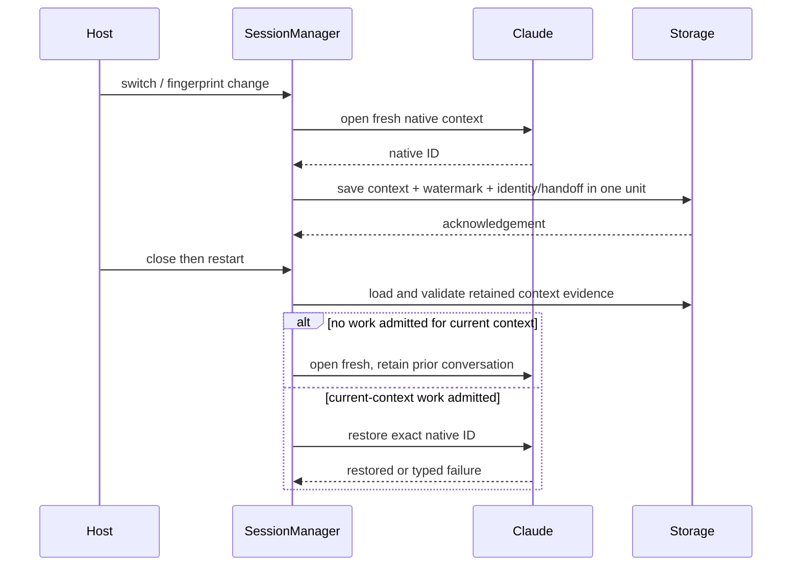

# Durable sessions and resume — implementation plan

Status: proposed; no implementation or verification is claimed by this document.
One branch (`codex/durable-sessions-resume`) and one draft PR cover #1164,
#1003, #762 and #934. The latter three wait for #981 to merge before dependent
source changes. #1164 is independent. Do not import #981's branch or alter its
worker, release pin or qualification.

## Owners and invariants

| Issue | Owner | Contract |
| --- | --- | --- |
| #1164 | SDK session context and its existing storage consistency boundary | Cold restoration uses authoritative admission evidence for the current native context. A context transition and its admission watermark commit in one save. Old terminal invocations do not prove use of a new context. Work already admitted but still pending cannot disappear from that evidence. |
| #1003 | Existing SDK scheduler/resumption decision | Resume and decline of one owed source have one decision covering successor admission. A successful decline excludes a later successor. Preserve exact identities, audit failures, caller loss and ordinary restoration. No new public SDK API or second ownership graph. |
| #762 | One shared monotonic timer port and helper implementation, in a lower shared crate | All three existing timer consumers use one Timer/Moment, Tokio adapter and test-support manual double. Preserve absolute instants, operation-first polling and unconstrained deadline polling from #983. Wall-clock credential expiry and elapsed-only clocks remain separate. |
| #934 | Review-notice publication/admission and authoritative metadata mutation boundary | Define exactly what source snapshot is admitted. Cedar owns policy. Metadata and authority facts must not be combined into an impossible live-resource/Admin candidate. No reread retry loop or duplicated policy check. |

SessionManager remains the context publication owner; provider adapters report
whether native restoration is appropriate from the admitted-work fact supplied
by that owner. Provider errors, missing observations and absent native files do
not establish that a context is unused. The storage writer lease and attachment
cleanup owner retain their existing responsibilities. New watermark state is
constant space per retained context, with no per-open registry or background task.

## #1164 ordering design

Representation to settle in the independent design review: retain the native ID
and an admission watermark in one context value. Publish it through the existing
ProviderContext semantic change and checkpoint mapping. Do not infer it from
handoff events, provider observations, audit availability or adapter-specific files.
Custom snapshot adapters must retain the same evidence and pass the same
restoration validation as the built-in record/checkpoint adapters.

A watermark cannot simply skip every invocation present when a context opens:
previously queued work can dispatch later without growing the invocation list.
Only a terminal prefix can be certified as preceding fresh-context admission;
any pending/admitted work must conservatively require restoration even after it
settles. Reattachment of the same context preserves its watermark. A fresh open
cannot erase evidence merely because a provider reuses a native ID.

| Row | Ordering | Expected behavior / regression |
| --- | --- | --- |
| C1 | Initial native context, close before admission, restart | A provider that does not persist unused contexts may open fresh; no prompt replay. |
| C2 | Old terminal history, switch to Claude, close before new admission, restart | New context is unused despite retained old invocations; replace atomically. |
| C3 | Same provider, changed workspace fingerprint, close before new admission, restart | Same behavior as C2 with fingerprint/context committed together. |
| C4 | C2/C3 then one admitted invocation | Restore exact used context; retain original history and handoff. |
| C5 | Used native context missing at restart | Typed provider failure; no replacement, replay or history reset. |
| C6 | Admission already pending when fresh context is published | That work counts conservatively for this context, including after terminal settlement. |
| C7 | Context publication/save fails or caller disappears | No admitted snapshot claims a successful replacement; existing attachment cleanup retains ownership. Retry follows existing save-generation contract. |
| C8 | Custom snapshot or checkpoint reopen | Watermark survives; malformed/out-of-range evidence fails before provider open. |
| C9 | Same-context reattach or reused native ID on fresh open | Reattach preserves prior boundary; fresh publication cannot turn already admitted work into unused work. |
| C10 | Additional old-context event or native resume failure | Neither event absence nor error shape changes admission evidence. |

Storage policy is [one current contract](../../CODING_STANDARDS.md#one-current-contract):
update codecs, consumers and fixtures together, without compatibility aliases,
legacy fallback readers, silent resets or version bumps. Do not retrofit actual
user data or credentials as part of tests. Any required local fixture conversion
must retain identities and history. Document the exact current wire shape when
the representation is settled.

## After #981: resumption linearization (#1003)

Inspect the merged scheduler and cancellation design again before edits. Keep
source settlement, owed-turn decision and successor admission under the existing
decision owner, rather than releasing the scheduler between decision and
accept_work. Avoid recursive acquisition when extracting the already-owned
admission path. Persisted evidence, not a caller's successful wait, decides the
winner. `resume_turn_at` currently calls private `accept_work` directly, whereas
public enqueue supervises owned admission. A scheduler-lock extraction alone
does not establish caller-loss safety: transfer one owned task over source
settlement, successor save and receipt publication, or preserve a resumable
source if cancellation precedes that transfer. Force caller drop at both source
and successor saves. Do not hold an application lock across unrelated provider work.

| Row | Ordering | Expected regression |
| --- | --- | --- |
| R1 | Resume reaches decision before decline | Exactly one successor; a losing decline preserves idempotent `Ok(())` without recording `NotResumed`. |
| R2 | Decline wins before successor admission | No successor, including after normal restore. Reproduce the paused source-save/pre-polled waiter trigger from #1003. |
| R3 | Both wait on decision / both ready | One persisted decision, preserving original source and successor identities. A losing resume returns `Resumed::NotOwed`; multiple successful API returns do not imply multiple decisions. |
| R4 | Audit or save fails on either path | Preserve typed failure and retry evidence; never acknowledge a decision whose required sink failed. |
| R5 | Caller drops before/after ownership transfer | Owned admission completes or stays explicitly unresolved; retry neither duplicates nor resurrects declined work. |
| R6 | Resume, decline or restore retries after decision | Same decision, bounded retained ownership, no second dispatch. |

## After #981: shared timer (#762)

Current dependency inspection rules out the issue's original protocol default:
`nessa-protocol/Cargo.toml` depends on `nessa-sdk`, while the SDK does not depend
on protocol. Putting the shared port there creates a cycle. Prefer a small
`nessa-timer` crate below both; do not refactor protocol's actual SDK consumers
merely to move a timer. Confirm this direction and feature unification again on
merged #981. Move the existing correct implementation once; update SDK ACP,
message-commit waits and server timer consumers. Delete duplicate helpers and
manual doubles. The existing SDK clocks also own wall-time responsibilities: ACP
`Clock::unix_ms_at` maps a captured monotonic instant to the process wall timeline,
while `MessageCommitClock::unix_milliseconds` dates notes. Consolidate only
monotonic deadlines in Timer. Keep wall-time reads/mapping behind explicit
injected responsibilities at their current owners; do not substitute an extra
wall-time read for conversion of an already captured instant. Add adapter tests
proving dueAtMs and the enforced deadline remain on the same timeline.

Runtime and test-support features must compile independently and
in the CI package selection. Public API moves update callers and Rustdoc together.

| Row | Ordering | Expected regression |
| --- | --- | --- |
| T1 | Operation and deadline ready in one poll | Operation result wins. |
| T2 | Operation consumes cooperative budget, remains pending | Unconstrained deadline poll completes; keep the real ACP #983 regression. |
| T3 | Sleep before/at/after absolute deadline | Same instant and no drift from repeated waits. |
| T4 | Dropped wait, cloned timer, independent timer | Wait resources release; cloned manual timer shares time; independent instances stay isolated. |
| T5 | Streaming commit cadence / server redial and approval deadlines | Existing behavior survives the shared implementation with deterministic time. |

## After #981: metadata admission (#934)

Proposed stronger contract: selected metadata must coexist with the final
authority snapshot. Admission is defined at that authority snapshot, conditional
on subsequent metadata-token validation and final board/visibility validation;
it does not promise currency at a later socket write or simultaneous final token
checks. A candidate retains metadata and an opaque token read atomically from
its owning store: catalogue incarnation, conversation identity and persistent
row change_revision. Final ordering is authority read, metadata-token validation,
then the existing synchronous board/visibility check, then admission. Moving
the board check before awaited metadata validation would open a new race. No
second Cedar evaluation or global lock is introduced.
Deletion publishes its tombstone/version before waiting on inventory; the
candidate loaded before deletion must therefore lose admission even if board
cleanup is still pending. A deletion after final admission may coexist with
delivery of the already admitted response, consistent with ADR0010.

Current source evidence: `review_notice_selection.rs::execute` loads metadata,
then authority, then calls Cedar and audit. `product/socket.rs::forward_review_notices`
finally reads authority and checks the board. `LocalConversationStore::record_deletion`
already advances conversations.change_revision atomically with the first tombstone.
Cedar receives organization/owner/deleted only: organization and owner are
immutable, deletion has no reversal, create retains tombstones, and revision
allocation fails instead of wrapping. Incarnation distinguishes database
replacement. Metadata reader must expose this token, which selection currently
discards. Custom adapters must supply equivalent atomic reads, monotonic tokens
and incarnation semantics. Deduplicate retained tokens per conversation within
the existing review-set bound; retain no locks across Cedar/audit/capacity waits.

This is a proposed decision, to be checked against merged source after #981. A second independent metadata reread alone is not
a coherent boundary. If the owning store cannot supply the proposed boundary,
write down the limitation and resolve the design before implementing a claim of
atomicity.

| Row | Deletion ordering | Expected regression through actual publisher |
| --- | --- | --- |
| M1 | Before metadata read | No live candidate. |
| M2 | Between metadata and authority read, inventory held, recipient promoted | Captured live metadata cannot combine with new Admin authority to publish. |
| M3 | After Cedar, before audit | Candidate loses final admission; audit outcome remains truthful. |
| M4 | During audit acknowledgement | Same exclusion after acknowledgement, without unbounded retry. |
| M5 | After final admission | Previously admitted response may finish; no claim of metadata currency at socket write. |
| M6 | Unchanged live metadata / authority / board | Eligible notice remains deliverable, with exact correlation and audit evidence. |
| M7 | Audit fails, caller disconnects, cleanup competes | Existing bounded publisher ownership and typed failure rules remain enforced. |
| M8 | Visibility changes while metadata-token validation awaits | Final board/visibility check rejects stale candidates. |
| M9 | Foreign conversation, stale revision, replaced store incarnation | Token validation refuses ABA/foreign evidence; unchanged valid source still publishes. |

## Verification and checkpoints

For each implemented row, record its actual test name and result before claiming
coverage. Use channels/barriers and the shared manual timer for deterministic
interleavings; use local ACP subprocess fixtures, isolated storage and gateway
instances. No real event recipients, production data or new credentials.

1. Regression first, then implementation, then fail-with-fix-reverted negative
   controls for each changed rule. Verify each revert actually applies, restore
   source with fresh modification times, and rerun the regression.
2. Relevant domain/application/adapter tests, custom storage and real record
   checkpoint reopen; full affected crate and CI package selection. Preserve
   existing ignores and report them separately. Format, strict Clippy, SDK
   Rustdoc/doctests and architecture checks apply to the final tree.
3. Extend conversation stress with fresh-context switch/fingerprint restart,
   or identify an existing step that actually drives that ordering. Run isolated
   scripted E2E in pinned Chromium/WebKit and affected stress; native/live stages
   remain separately unrun when their actual environments are unavailable.
4. Review affected lifecycle/state pages with the nessa-docs skill; checkpoint
   only pages actually reviewed to the exact source commit. Update module maps,
   public API documentation and the design index with the implemented contract.
5. Implementer performs the local review gate first. Fresh independent reviews
   inspect domain/API ownership, persistence/concurrency and adversarial
   interleavings against the exact base/head and dirty-tree disclosure. Follow
   the bounded repository review loop; no GitHub APPROVE or merge.

Durable handoffs distinguish **planned**, **implemented**, **tested**,
**published** and **waiting**. The draft PR references all four issues; only a
fully implemented and verified issue may be described as closed. Pending #981
sections must remain explicit. Board lookup was denied (`Resource not accessible
by integration`); do not retry without new authorization evidence. This does not
block source, issue or draft-PR work.
