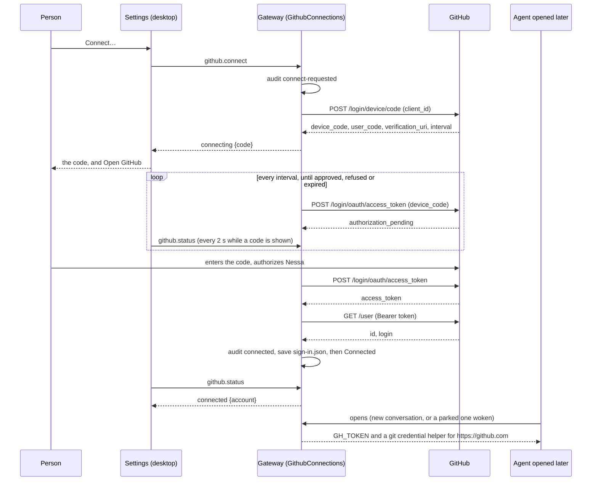

# GitHub connect

A person signs Nessa in to GitHub once, in Settings › Connections ›
Accounts, and every agent the gateway starts after that can clone, push, and
open pull requests as them. The sign-in goes through the **Nessa GitHub App**
(`protocol/defaults/github-app.json`: client id `Iv23linAB5VSgOF5PvKi`, slug
`nessa-agent`) and GitHub's device flow, so nothing needs a client secret and
no browser has to come back to the gateway.

## Who owns what

The gateway owns the sign-in, because agents run where the gateway runs: a
phone or a second window sees the same one. The owner is
`github::application::GithubConnections`; nothing else changes it.

| Fact | Owner | Kept in |
| --- | --- | --- |
| Which app, and GitHub's addresses | `github/infrastructure/app.rs` | `protocol/defaults/github-app.json`, or the file `NESSA_GITHUB_APP` names (checks point it at a fake GitHub on this machine) |
| Signed out, waiting for a code, or signed in | `GithubConnections` | memory, and the token file when signed in |
| The token and whose it is | `GithubTokenFile` | `<namespace>/github/sign-in.json`, a private file in a private directory, replaced whole and synced |
| Each step, for the owner to look back on | `DurableGithubAudit` | `<namespace>/conversations/audit/github`, one private file per record, never a token or a code; a `connect-ended` record names what decided it (`github_answered`, `deadline_passed`, `github_unreachable`, `store_failed`) |
| What an agent is started with | `GithubLaunchCredentials` (an SDK `OpenCredentialSource`) | read again at every agent open, never saved with the conversation |
| What the person sees | `src/desktop/settings/ui/github-row.tsx` | nothing: it reads `github.status` |

## The flow

The person then picks which repositories the app may reach from **Choose
repositories** (the app's `installations/new` page). A user-to-server token
can only reach repositories the app is installed on *and* the person can
reach, so that choice is GitHub's, not Nessa's.

## What an agent gets

Each provider open (Claude, Codex, OpenCode) asks `AcpConfig.open_credentials`
for variables and adds them to the agent's environment for that process only
(`AcpConfig::with_open_credentials`):

- `GH_TOKEN`: the token, for `gh`.
- `GIT_CONFIG_COUNT=2` with two `credential.https://github.com.helper`
  entries: the first, empty, clears any helper the machine has for GitHub;
  the second answers `username=x-access-token` and `password=$GH_TOKEN`. So
  `git clone https://github.com/...` and `git push` use the sign-in, and a
  person's own helper is not asked first. SSH remotes are left to the
  person's own keys.

Nessa's own shell tool (the managed `nessa` MCP server, `nessa-mcp`) is
where an agent's commands actually run, so each of its sessions opened for a
harness is given the same variables (`McpServers::give_open_credentials`),
read as that session opens, and it passes `GH_TOKEN` and `GIT_CONFIG_*` on
to the commands it runs, and no other credential. The shell's session is
read on its own: when a harness restarts its MCP servers, the new shell has
the sign-in as it stands then, which may differ from what the harness itself
was started with (a Disconnect reaches the restarted shell at once; the
harness keeps its token until it stops). A server
the person configured is never given them. A variable configured for the
agent or the server under one of these names wins, and the sign-in is left
out whole, logged. The helper answers nothing when `GH_TOKEN` has been
taken away, rather than an empty password.

They are read at each open and are not part of the restoration identity, so
signing in or out never makes an existing conversation "changed": the next
agent opened, including a parked one waking, gets what holds then. An agent
already running keeps what it was started with until it stops; its shell,
as above, until that restarts.

## Orderings

Every change takes `changes` first (a tokio mutex), so each sees the state
the last one left. A read (`status`, `token`) takes only the state and never
waits on GitHub. The poll is a task of its own holding the owner weakly; what
it finds applies only while its own attempt (`operation_id`) is still the one
waiting.

| # | State | Event | Result | Record |
| --- | --- | --- | --- | --- |
| G1 | signed out | connect | `connect-requested` recorded first; a record that cannot be kept refuses `github_audit_unavailable` and nothing changes | connect-requested |
| G2 | signed out | connect, GitHub unreachable, rate-limited or answer unreadable | signed out, `last: unreachable`, refused `github_unreachable`; an end that cannot be recorded adds `unrecorded` | connect-ended |
| G3 | signed out | connect, GitHub refuses the app | signed out, `last: rejected`, refused `github_rejected`; an end that cannot be recorded adds `unrecorded` | connect-ended |
| G4 | signed out | connect, code given | connecting; poll starts at GitHub's interval (never under 1 s) | — |
| G5 | connecting or connected | connect | answers the state as it is: asking again is safe | — |
| G6 | connecting | poll: pending, a lost answer, or a rate limit (403, 429) | keeps waiting | — |
| G7 | connecting | poll: slow_down | keeps waiting at the larger interval | — |
| G8 | connecting | poll: expired, or the code's time passes | signed out, `last: expired` | connect-ended |
| G9 | connecting | poll: denied | signed out, `last: denied` | connect-ended |
| G9a | connecting | any end (G8, G9, G11, G12, G14) whose record cannot be kept | ends all the same, the cause kept in `last`, with `unrecorded` | — |
| G10 | connecting | poll: token; account read | `connected` recorded, then the file saved, then connected | connected |
| G11 | connecting | token; account read refused | signed out, `last: rejected`; the token is dropped | connect-ended |
| G12 | connecting | token; account read never answers (or keeps failing) before the code would expire | signed out, `last: unreachable` | connect-ended |
| G13 | connecting | token; the record cannot be kept | signed out, `last: audit_unavailable`; never saved, never given out | — |
| G14 | connecting | token; the file cannot be saved | the file is deleted (a save can fail after writing it), then signed out, `last: store_unavailable`; never given out | connected, then connect-ended: the later record is what holds |
| G15 | connecting | cancel, or disconnect | signed out, `last: cancelled`, poll stopped; stands even when its record cannot be kept, which is refused `github_audit_unavailable` and adds `unrecorded` | connect-cancelled |
| G16 | signed out (after G15) | the cancelled attempt's late answer | dropped: not the attempt waiting (`a_cancelled_attempts_late_approval_is_dropped`) | — |
| G17 | connected | disconnect | `disconnect-requested` recorded first, then the file deleted, then signed out; if `disconnected` is refused, still signed out with `unrecorded`, refused `github_audit_unavailable` | disconnect-requested, disconnected |
| G18 | connected | disconnect, the file cannot be deleted | still connected, refused `github_storage_unavailable`; if `disconnect-failed` is refused too, connected with `unrecorded` | disconnect-failed |
| G19 | signed out | cancel, or disconnect | answers signed out; disconnect first deletes any token file left by G14 (refused `github_storage_unavailable` if it cannot) | — |
| G20 | (start) | the gateway starts | the saved sign-in, or signed out; a file that cannot be read is signed out with `last: store_unavailable` | — |
| G21 | connecting | the gateway stops | the attempt is gone; next start is signed out | — |

Disconnect forgets the token on this gateway. Revoking it at GitHub needs the
app's client secret, which a desktop app cannot keep, so the row says to use
GitHub's Settings › Applications for that.

## Methods

`github.status`, `github.connect`, `github.cancel`, `github.disconnect`
(`protocol/product/manifest.json`), each `credential.manage` in Cedar and
taking `{}`. Each answers a `GithubConnection` (`protocol/product/v1.json`).
`github_not_configured` when the gateway runs without agents or could not
read its app. See the [protocol table](../../protocol/README.md).

## Checks

- Owner orderings: `crates/nessa-server/tests/github/mod.rs`, with a scripted
  GitHub, a memory store and a recording audit on a manual clock.
- The HTTP answers, the app file, the token file, the audit and the git
  helper (a real `git credential fill`): unit tests beside each in
  `github/infrastructure`.
- Open credentials reach each agent at each open, and never print:
  `crates/nessa-sdk/tests/infrastructure/acp/contracts/stand_ins.rs`; they
  reach the shell tool's harness sessions and never a look
  (`crates/nessa-sdk/tests/infrastructure/mcp/sessions.rs`), and the shell
  tool passes on only these (`crates/nessa-mcp/src/main.rs`).
- The row: `src/desktop/settings/ui/github-row.test.tsx`.
- End to end: the stress check's `github` step (`pnpm test:e2e:stress`) runs
  a fake GitHub on this machine, connects in Settings, has a new agent report
  fingerprints of `GH_TOKEN` and of what `git credential fill` gives, both
  in its own environment and through Nessa's shell tool, then disconnects
  and checks a new agent has neither, the file is gone, the gateway log
  never held the token, and the audit holds each step.

## Optional live events

After signing in and choosing repositories on GitHub, Settings offers **Enable
live GitHub events**. It is off on a new gateway. The existing token owner is
injected into the relay; the window receives counts and opt-in state, never the
token. The opt-in applies to the App-selected repositories, at most 16. Refresh
repositories updates that selection without resetting matching cursors.

Payloads pass through Nessa's stage-specific Cloudflare relay, with bounded
retention for offline catch-up. Disabling clears this gateway's local inbox.
Sign-out first performs the same atomic audited cleanup; a failed cleanup leaves
the sign-in held and reports failure. Old generation responses cannot recreate
a removed binding. Cloud retention is shared by authorized devices and is not
deleted by a local disconnect. See [relay ADR 1117](../adr/todo/1117-github-relay.md)
for the L1–L10 ordering matrix and [the relay runbook](../../packages/github-webhooks/README.md)
for private App-token authorization, capacity and gap acknowledgement.

`github.liveEvents` takes `{ enabled, acceptGaps? }` and the same
`credential.manage` admission as the existing GitHub methods. `GithubConnection`
includes optional `liveEvents` counts where this build stage has a configured
relay. Alpha/CI/prod are unconfigured and cannot fall back to dev. A reported gap
requires an explicit **Continue with retained events** action. No event starts a
conversation or an agent turn in this feature.
