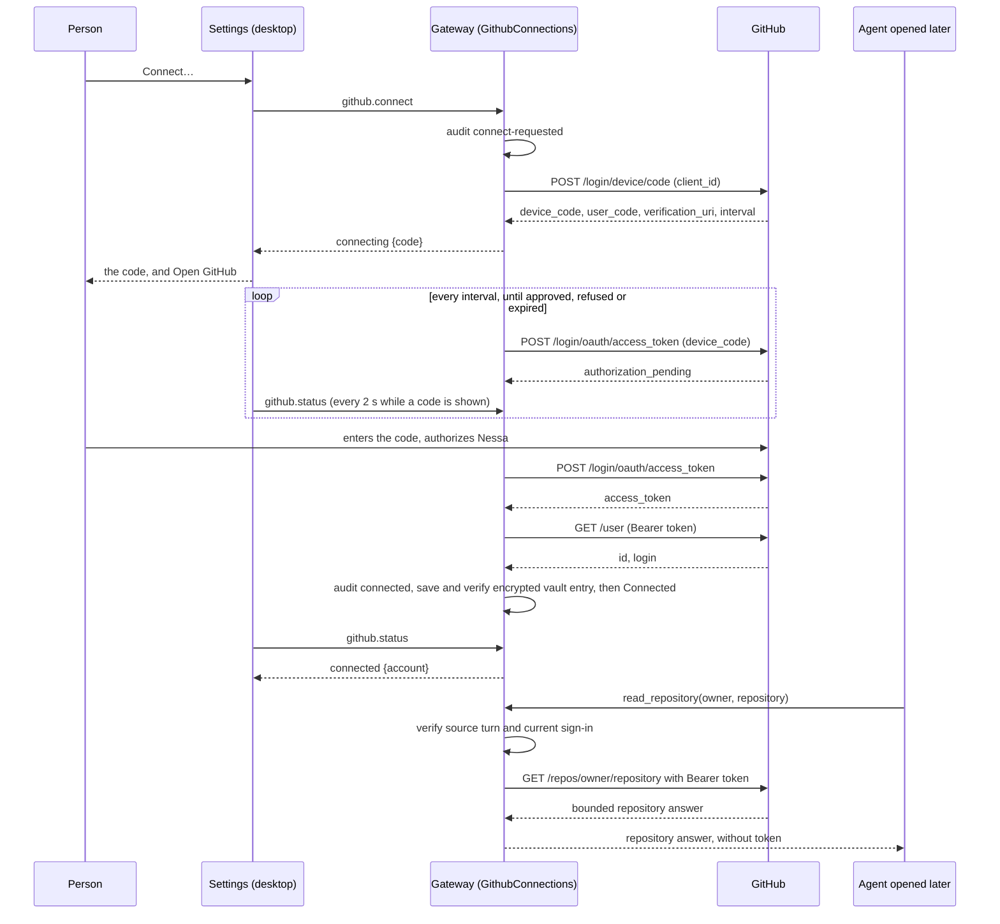

# GitHub connect

A person signs Nessa in to GitHub once, in Settings › Connections ›
Accounts, and agents can request bounded repository reads through the gateway.
The sign-in goes through the **Nessa GitHub App**
(`protocol/defaults/github-app.json`: client id `Iv23linAB5VSgOF5PvKi`, slug
`nessa-agent`) and GitHub's device flow, so nothing needs a client secret and
no browser has to come back to the gateway.

## Who owns what

The gateway owns the sign-in, because agents run where the gateway runs: a
phone or a second window sees the same one. The owner is
`github::application::GithubConnections`; nothing else changes it.

| Fact | Owner | Kept in |
| --- | --- | --- |
| Which app, and GitHub's addresses | `github/infrastructure/app.rs` | `protocol/defaults/github-app.json`, or the file `NESSA_GITHUB_APP` names (checks point it at a fake GitHub on this machine) |
| Signed out, waiting for a code, or signed in | `GithubConnections` | memory, and an encrypted vault entry when signed in |
| The token and whose it is | `GithubTokenVault` | injected entry in the session-unlocked local vault. The key stays in gateway memory. A plaintext `sign-in.json` is deleted and not read ([1195](../adr/done/1195-isolate-github-sign-in.md)) |
| Each step, for the owner to look back on | `DurableGithubAudit` | `<namespace>/conversations/audit/github`, one private file per record, never a token or a code; a `connect-ended` record names what decided it (`github_answered`, `deadline_passed`, `github_unreachable`, `store_failed`) |
| What an agent can read through Nessa's sign-in | `GithubConnections` and the built-in `nessa-github` tool | a gateway-side request using the current sign-in, never an agent environment variable |
| What the person sees | `src/desktop/settings/ui/github-row.tsx` | nothing: it reads `github.status` |

## The flow

The person then picks which repositories the app may reach from **Choose
repositories** (the app's `installations/new` page). A user-to-server token
can only reach repositories the app is installed on *and* the person can
reach, so that choice is GitHub's, not Nessa's.

## What an agent gets

The Nessa GitHub sign-in remains in the gateway. Neither provider opens nor
the managed shell receive its token or a git credential helper. The built-in
`nessa-github` tools admit a live source turn through Cedar, bind the operation
to GitHub's API host and a validated repository identity, and read the current
sign-in at the call. The first operations are `read_repository`, `read_issue`,
and `read_pull_request`; their arguments select only the owner, repository, and
an optional issue or pull request number. An API redirect is never followed,
and the returned body is bounded. The gateway returns the answer, never the
authorization header.

The Nessa sign-in no longer authenticates raw `gh`, `git clone`, or `git push`
commands. Those commands can still use a person's separately configured
machine credentials, which Nessa does not inspect or supply. Repository writes
need a broker with durable retry and effect audit semantics; the read tools do
not imply that a write was authorized or completed.

| Prior state and event | Effect | Later order or retry |
| --- | --- | --- |
| No connected sign-in; agent requests a read | Refuse before network access | A later sign-in may enable a new call |
| Agent source or operation arguments are invalid | Refuse before token access or network | Corrected arguments require a new call |
| Connected; Cedar refuses the source turn | No token access or network | A later owner-initiated turn is checked anew |
| Connected; Cedar allows a read | Gateway uses the current token for one fixed-host, repository-scoped GET and returns bounded data | Repeating the GET reads current GitHub state |
| Read in flight, then Disconnect | Disconnect waits for the bounded read to settle before deleting the token | No read that starts after Disconnect returns can use that sign-in |
| Disconnect completes, then read | Refuse before network access | A newly connected sign-in is a different authorization |
| GitHub refuses, redirects, times out, or returns an oversized answer | Return a typed failure without the token | No local GitHub state is inferred from the failure |
| Agent or shell process opens before or after Connect or Disconnect | No Nessa token or helper is placed in its environment | Process restart cannot resurrect an earlier Nessa sign-in |

The sign-in is persisted in the encrypted app-session vault. The key is
derived from the passphrase and held only in the gateway while the vault is
unlocked; it is not written beside the ciphertext. A plaintext
`<namespace>/github/sign-in.json` is removed without being read, including
while the vault is locked. Nessa is alpha, so that file is not imported.
An agent command that knows the path can open the ciphertext and does not
obtain the token bytes
([1195](../adr/done/1195-isolate-github-sign-in.md)).

## Read cancellation and vault ordering

The read owner captures the vault generation before waiting for that generation's
change gate. Cancellation wins when both the cancellation signal and queued work
are ready in the same poll. A cancelled wait returns without inspecting the token
or polling the GitHub adapter. After acquiring the gate the owner rechecks the
signal and generation before dispatch. Disconnect in that generation waits for an
uncancelled read; cancelling an in-flight read drops its HTTP future and releases
the gate. A GET already sent may have reached GitHub; cancellation does not undo it.
Lock/unlock creates a new gate, so an old queued read cannot borrow a new token or
block the new generation. An old request already sent can finish, but its result
is refused after a generation change.

| Ordering | Result and regression |
| --- | --- |
| Stop before first poll; stop channel closed | Cancelled; zero adapter reads (`cancelled_repository_reads_do_not_dispatch`) |
| Read queued behind a held GET, then stop | Cancelled before the held GET settles; no second dispatch (`cancelled_queued_read_does_not_delay_disconnect`) |
| Stop and gate ready together | Cancellation wins, no new GET (`cancelled_repository_reads_do_not_dispatch`) |
| GET in flight, then stop | Drop the adapter future, release the gate for Disconnect (`cancelled_in_flight_read_releases_disconnect`) |
| GET completes, no stop | Preserve the data; Disconnect waits until settlement (`disconnect_waits_for_a_read_and_later_reads_see_signed_out`) |
| Queued read, then lock/unlock | Refuse old generation, even if new sign-in restored (`queued_read_cannot_borrow_a_new_vault_generation`) |
| GET in flight, then lock/unlock | Refuse stale response; new generation proceeds independently (`old_read_does_not_block_a_new_generation`) |

## Orderings

At the product socket, each GitHub request records the live vault generation before
waiting on the GitHub command gate. After that wait, it refuses a different or
locked generation before changing live-event bindings or calling the sign-in owner.
A disconnect rechecks after an awaited live-event change, before it reaches the
sign-in owner. The owner independently captures its generation before its own
provider and storage work. A stale queued command therefore cannot borrow the
new unlock. `a_queued_disconnect_cannot_delete_a_sign_in_restored_by_a_new_unlock`
exercises G22 through the product dispatcher and encrypted token store.
For G23, the SQLite selection owner checks the admitted generation while it
commits, under the vault's unlock guard. If a lock or unlock intervened, the
transaction rolls back with `vault_locked`. Store and product tests pause an
old selection, restore a new binding, then resume both disable and disconnect.

Every change takes `changes` first (a tokio mutex), so each sees the state
the last one left. A read (`status`, `token`) takes only the state and never
waits on GitHub. The poll is a task of its own holding the owner weakly; what
it finds applies only while its own attempt (`operation_id`) is still the one
waiting.

| # | State | Event | Result | Record |
| --- | --- | --- | --- | --- |
| G1 | signed out | connect | `connect-requested` recorded first; a record that cannot be kept refuses `github_audit_unavailable` and nothing changes | connect-requested |
| G2 | signed out | connect, GitHub unreachable, rate-limited or answer unreadable | signed out, `last: unreachable`, refused `github_unreachable`; an end that cannot be recorded adds `unrecorded` | connect-ended |
| G3 | signed out | connect, GitHub refuses the app | signed out, `last: rejected`, refused `github_rejected`; an end that cannot be recorded adds `unrecorded` | connect-ended |
| G4 | signed out | connect, code given | connecting; poll starts at GitHub's interval (never under 1 s) | — |
| G5 | connecting or connected | connect | answers the state as it is: asking again is safe | — |
| G6 | connecting | poll: pending, a lost answer, or a rate limit (403, 429) | keeps waiting | — |
| G7 | connecting | poll: slow_down | keeps waiting at the larger interval | — |
| G8 | connecting | poll: expired, or the code's time passes | signed out, `last: expired` | connect-ended |
| G9 | connecting | poll: denied | signed out, `last: denied` | connect-ended |
| G9a | connecting | any end (G8, G9, G11, G12, G14) whose record cannot be kept | ends all the same, the cause kept in `last`, with `unrecorded` | — |
| G10 | connecting | poll: token; account read | `connected` approval recorded, then the encrypted entry saved and verified, then connected; reports connecting while either receipt waits | connected |
| G11 | connecting | token; account read refused | signed out, `last: rejected`; the token is dropped | connect-ended |
| G12 | connecting | token; account read never answers (or keeps failing) before the code would expire | signed out, `last: unreachable` | connect-ended |
| G13 | connecting | token; the record cannot be kept | signed out, `last: audit_unavailable`; never saved, never given out | — |
| G14 | connecting | token; the encrypted entry cannot be saved | rollback deletion is attempted (a save can fail after writing it), then signed out, `last: store_unavailable`; never given out | connected, then connect-ended: the later record is what holds |
| G15 | connecting, before approval completion owns the gate | cancel, or disconnect | signed out, `last: cancelled`, poll stopped; stands even when its record cannot be kept, which is refused `github_audit_unavailable` and adds `unrecorded` | connect-cancelled |
| G15a | approval receipts pending | cancel, or disconnect | waits for completion under the same generation gate; cancel leaves a completed sign-in held, while disconnect deletes it; a failed completion retains its actual result | existing completion/cancel/disconnect records |
| G16 | signed out (after G15) | the cancelled attempt's late answer | dropped: not the attempt waiting (`a_cancelled_attempts_late_approval_is_dropped`) | — |
| G17 | connected | disconnect | `disconnect-requested` recorded first, then the encrypted entry deleted, then signed out; if `disconnected` is refused, still signed out with `unrecorded`, refused `github_audit_unavailable` | disconnect-requested, disconnected |
| G18 | connected | disconnect, the encrypted entry cannot be deleted | still connected, refused `github_storage_unavailable`; if `disconnect-failed` is refused too, connected with `unrecorded` | disconnect-failed |
| G19 | signed out | cancel, or disconnect | answers signed out; disconnect first deletes any credential entry left by G14 (refused `github_storage_unavailable` if it cannot) | — |
| G20 | (start) | the gateway starts | a plaintext `sign-in.json` is removed before agents start, whether or not the vault is unlocked, and is not read; a failed removal stops startup and, on the connections owner, reports `last: store_unavailable`. No secret is loaded while the vault is locked; after unlock, restore the saved sign-in or signed out; unreadable saved data reports `last: store_unavailable` | `a_locked_startup_removes_a_plaintext_sign_in`, `a_plaintext_sign_in_that_cannot_be_removed_fails_startup` |
| G21 | connecting | the gateway stops | the code attempt is gone; an approved credential durably saved before the stop can be restored after unlocking the vault | — |
| G22 | a product GitHub command queued for an old vault unlock | the vault locks and unlocks before the command gate opens | refuse `vault_locked` before changing live bindings or the newer sign-in; the new generation owns any later command | — |
| G23 | live-event selection from an old unlock is waiting to commit | the vault locks and unlocks before the inbox transaction commits | the selection owner refuses the old generation at commit, rolls back the whole selection and audit, and preserves the new selection | — |

Disconnect forgets the token on this gateway. Revoking it at GitHub needs the
app's client secret, which a desktop app cannot keep, so the row says to use
GitHub's Settings › Applications for that.

## Methods

`github.status`, `github.connect`, `github.cancel`, `github.disconnect`
(`protocol/product/manifest.json`), each `credential.manage` in Cedar and
taking `{}`. Each answers a `GithubConnection` (`protocol/product/v1.json`).
`github_not_configured` when the gateway runs without agents or could not
read its app. See the [protocol table](../../protocol/README.md).

## Checks

- Owner sign-in orderings: `crates/nessa-server/tests/github/mod.rs`, with a scripted
  GitHub, a memory store and a recording audit on a manual clock.
- Read cancellation and vault generations: `tests/github/reads.rs`; real loopback
  HTTP cancellation and Disconnect: `tests/github/read_http.rs` (both under
  `crates/nessa-server`).
- The HTTP answers, fixed repository path, app file, encrypted vault entry and audit:
  tests beside each in `github/infrastructure` and `github/domain`.
- The broker's fixed tool schemas and argument rejection:
  `composition/github_tools.rs`; the shell command environment drops the
  Nessa sign-in (`crates/nessa-mcp/src/main.rs`).
- The row: `src/desktop/settings/ui/github-row.test.tsx`.
- End to end: the stress check's `github` step (`pnpm test:e2e:stress`) runs
  a fake GitHub on this machine, connects in Settings, has a new agent report
  that no Nessa GitHub token or helper reaches its own environment or Nessa's
  shell, and reads a repository through `nessa-github`. It then disconnects
  and checks a new agent still has neither, the file is gone, the gateway log
  never held the token, and the audit holds each sign-in step.

## Optional live events

After signing in and choosing repositories on GitHub, Settings offers **Enable
live GitHub events**. It is off on a new gateway. The existing token owner is
injected into the relay; the window receives counts and opt-in state, never the
token. The opt-in applies to the App-selected repositories, at most 16. Refresh
repositories updates that selection without resetting matching cursors.

Payloads pass through Nessa's stage-specific Cloudflare relay, with bounded
retention for offline catch-up. Disabling clears this gateway's local inbox.
Sign-out first performs the same atomic audited cleanup; a failed cleanup leaves
the sign-in held and reports failure. Old generation responses cannot recreate
a removed binding. Cloud retention is shared by authorized devices and is not
deleted by a local disconnect. See [relay ADR 1117](../adr/todo/1117-github-relay.md)
for the L1–L10 ordering matrix and [the relay runbook](../../packages/github-webhooks/README.md)
for private App-token authorization, capacity and gap acknowledgement.

`github.liveEvents` takes `{ enabled, acceptGaps? }` and the same
`credential.manage` admission as the existing GitHub methods. `GithubConnection`
includes optional `liveEvents` counts where this build stage has a configured
relay. Alpha/CI/prod are unconfigured and cannot fall back to dev. A reported gap
requires an explicit **Continue with retained events** action. No event starts a
conversation or an agent turn in this feature.

OS storage, migration and encrypted inbox orderings are recorded in [ADR 1132](../adr/todo/1132-github-relay-hardening.md).

## Approval while durable receipts are pending

After GitHub approves a code, the gateway keeps reporting Connecting until both
the audit and encrypted-storage receipts complete. The internal Saving projection
retains the code and original deadline without a second poll or terminal-audit
owner. This lets Settings keep polling instead of treating a temporary SignedOut
snapshot as the end of the attempt. Only the final verified publication makes
the sign-in available to gateway reads and the live-event relay. Refusal or storage/audit failure still ends the attempt with
its actual reason. Locking drops a stale projection; the original completion
continues to own its evidence and cannot publish into a newer unlock generation.
The ordering table is in [ADR 1152](../adr/todo/1152-local-vault.md).
