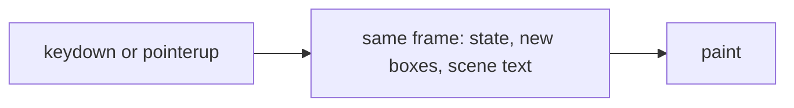
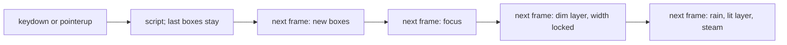

# Pane frame budget

A pane insert, a subagents open, and a pane drop each keep their longest
frame at or under 50 ms. The number is the unrounded maximum from the
production check, with calibration held, at 4× CPU throttle
(`verification/desktop/scripts/lib/perf.mjs`, `exceedsFrameBudget`).

Measured on `7b429791e` with
`node verification/desktop/scripts/perf-budget.mjs --only split-right,drag-drop --runs 3 --mode prod`.
Calibration ratio 4.08; the 120 ms frame was attributed. The side-rail
change that landed after that commit does not touch pane placement, the
night scene, or the drag.

| Check | Layout | Runs (ms) | Median | What the long frame was |
| --- | --- | --- | --- | --- |
| split-right | columns | 64, 60, 68 | 64 | One frame, `styleAndLayout` 42–44, `forcedLayout` 0, scripts are React's message port |
| split-right | sidebar | 67, 76, 58 | 67 | The same fill frame (`styleAndLayout` 44–51), and a keydown frame of 57–67 |
| drag-drop | columns | 62, 103, 61 | 62 | One frame holds `pointerup` and the commit's animation callback; `styleAndLayout` 27–47 |
| drag-drop | sidebar | 89, 79, 101 | 89 | The same pair; `styleAndLayout` 27–44 |

`--desktop-flight` is `0ms`. `FlipScope` returns no snapshot at that
duration and does not read `getBoundingClientRect` on the product path.
The drag already computes a landing box in `drawn` while carrying. A read
of a pane's landing rect is not the work these frames spend.

The work is two piles landing on one frame. The fill frame after a split
lays out the new home's night scene: long `white-space: pre` lines whose
shrink-to-fit width follows the pane, inside a size container. The drop
frame runs the pointerup handler and the commit callback before the same
paint, and every resized pane lays those lines out again. Chromium runs an
animation callback queued from an input handler before that frame paints,
so one `requestAnimationFrame` from `pointerup` is still that frame.

The subagents panel reads no geometry. Its open mounts a widget pane whose
body is already deferred one frame; the scene text above was on that frame
with it. The same split covers that open. A panel frame that still exceeds
50 ms after this is the panel's own first layout, and gets its own split.

## States

| State | Event | Result |
| --- | --- | --- |
| Resting | A shape change (split, open beside, open the subagents pane, resize, drop commit) | The layout is known. The grid keeps the boxes it last painted. An existing scene keeps the layout size of its lines and is only cropped. A new scene's lines are not laid out. |
| Shell | The scene's `ResizeObserver` reports a positive content height | The scale is written from that height. The lines stay unlaid. |
| Measured | The next frame | The new pane takes focus. The lines stay unlaid, so focus does not share their layout. |
| Focused | The frame after that | The dim layer's text mounts and lays out. The scene is `data-scene-ready`. The layers' width is fixed at that text's width. Rain, the lit layer, and steam are not mounted. |
| Lit | The frame after that | Those layers mount and lay out at the fixed width. The scene is `data-scene-complete`. |
| Carrying | `pointerup` on a shown zone | The copy flies to the box `paneBox` already computed. No pane layout is committed. |
| Painted | The next frame | The drop commits in state. The grid is still on its last boxes, because every column change waits a frame. The room is read before the unmark dirties the tree. |
| Drawn | The frame after that | The grid paints the new boxes, then the preview lets go, before that frame's paint. The glass blur stays off for one more frame, so that paint does not also rebuild it. |

A content height of 0 leaves the scene unready. The next positive height
starts the measured row.

## Invariants

1. A pane's landing box is `paneBox` (`model/pane-sizing.ts`). It uses the
   same gutter and the same four terms as the placement calcs in
   `ui/split-panes.css`. The drag asks `paneBox`. It does not read a pane's
   landing rect from the page.
2. `commitDrop` runs in neither the `pointerup` turn nor the animation
   callback that turn queues. It runs in the callback that one queues.
3. Scene lines are not laid out on the frame that first measures the box,
   nor on the frame after it. `content-visibility: hidden` until
   `data-scene-ready`. The children stay mounted, so the scale written onto
   the element survives.
4. The ready frame lays out only the dim layer (`[data-dim]`). Rain, the
   lit layer, and steam stay `content-visibility: hidden` until
   `data-scene-complete`, one frame later.
5. Once the dim layer has laid out, the layers' width is that text's width
   in pixels. A change of pane width crops them. `width: max-content` and
   `contain: layout paint style` on the layers are the same rule before that
   lock.
6. A column change paints on the frame after the commit that recorded it.
   The grid mounted with whatever layout it first read; that first paint
   does not wait.

Conversation bodies stay in layout through measuring, flying, and reflow.
The product flight stays zero-duration. A nonzero flight may still read
geometry; that read is not on the product path these issues measure.

## Frames

Before this change, the input that splits or drops and the layout of the
new boxes and the scene text share one frame:

After it, each of those is its own frame. A new scene lays out the dim
layer before the rest:

## Alternatives

- Reading the landing box with `getBoundingClientRect` after the commit.
  The product flight already skips that read, and the frames above have
  `forcedLayout` 0 on the split. The remaining cost is the layout itself.
  One read of a dirty tree forces the whole layout once, so swapping the
  read for `paneBox` while anything else forces layout removes nothing.
- Committing the drop from the single animation callback `pointerup`
  queues. That callback shares the pointerup frame. The measured frame is
  61–103 ms.
- Hiding conversation bodies for the frame. The visibility contract forbids
  it, and the samples show the scene text, not the conversation, as the
  layout.
- Leaving the scene layers shrink-to-fit. Their available width is the
  pane, so every pane-width change lays the lines out again.
- Revealing every scene layer on the ready frame. A sidebar sample of that
  frame, after focus, was about 70 ms of layout and paint with no script.
- A drag-only attribute that holds the previous boxes through `commitDrop`.
  The split's keydown frame still shared its script with the new boxes.
  The grid already waits one frame for every column change, so the
  attribute would be a second owner of the same wait.

## Review brief

- Branch `cursor/pane-frame-budget-9700`, base `main`. Review the tree at
  the head under review; a dirty tree is in the brief if one exists.
- Intended behavior: production Chromium, calibration held, 4× throttle,
  three runs, both layouts — `perf-budget.mjs --only split-right,drag-drop`
  and `subagents.mjs --only narrow,card-open` each keep the longest frame
  ≤ 50 ms unrounded. A shown night scene has laid out its text once the
  open has settled. A drop commits on the frame after pointerup paints.
- Owned scope: `paneBox`, the drop's two callbacks, the grid painting a
  column change one frame later, the scene-ready and scene-complete marks
  and the layer rules, the tests that lock those, the settled assertion in
  `columns.mjs` `content-visible`, and this note.
- Outside that scope: `FlipScope`'s read when the flight duration is
  nonzero, blanking a conversation, and issues 965, 981, 1038, 1039, 1030,
  1034, 345, 337, and 746.
- Check the agreement of `paneBox` with the four placement calcs, the
  order unmark then commit then preview release, and a scene whose first
  height is 0. The production numbers are unverified until the checks
  have been run on that head.
