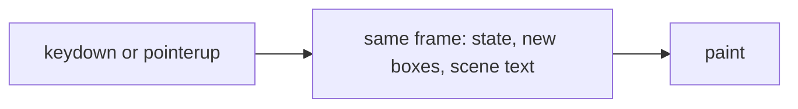

# Pane frame budget

A pane insert, a subagents open, and a pane drop each keep their longest
frame at or under 50 ms. The number is the unrounded maximum from the
production check, with calibration held, at 4× CPU throttle
(`verification/desktop/scripts/lib/perf.mjs`, `exceedsFrameBudget`).

Measured on `7b429791e` with
`node verification/desktop/scripts/perf-budget.mjs --only split-right,drag-drop --runs 3 --mode prod`.
Calibration ratio 4.08; the 120 ms frame was attributed. The side-rail
change that landed after that commit does not touch pane placement, the
night scene, or the drag.

| Check | Layout | Runs (ms) | Median | What the long frame was |
| --- | --- | --- | --- | --- |
| split-right | columns | 64, 60, 68 | 64 | One frame, `styleAndLayout` 42–44, `forcedLayout` 0, scripts are React's message port |
| split-right | sidebar | 67, 76, 58 | 67 | The same fill frame (`styleAndLayout` 44–51), and a keydown frame of 57–67 |
| drag-drop | columns | 62, 103, 61 | 62 | One frame holds `pointerup` and the commit's animation callback; `styleAndLayout` 27–47 |
| drag-drop | sidebar | 89, 79, 101 | 89 | The same pair; `styleAndLayout` 27–44 |

`--desktop-flight` is `0ms`. `FlipScope` returns no snapshot at that
duration and does not read `getBoundingClientRect` on the product path.
The drag already computes a landing box in `drawn` while carrying. A read
of a pane's landing rect is not the work these frames spend.

The work is two piles landing on one frame. The fill frame after a split
lays out the new home's night scene: long `white-space: pre` lines whose
shrink-to-fit width follows the pane, inside a size container. The drop
frame runs the pointerup handler and the commit callback before the same
paint, and every resized pane lays those lines out again. Chromium runs an
animation callback queued from an input handler before that frame paints,
so one `requestAnimationFrame` from `pointerup` is still that frame.

The subagents panel reads no geometry. Opening it is a pane insert at a
short, narrow window (1000×560). That count does not fit beside the sidebar,
so the window folds the sidebar. On the revision this note started from,
the fold ran in the click's commit: about 15 ms of script, 16 ms of style
on the workspace, and a full-document layout, and the column title then
read `offsetTop` and computed style on the next frame (a 13–24 ms layout
of a tree with about 20 dirty objects and the whole document walked).
Neither read is a pane's landing box. `paneBox` was already what a drag
asks. The spare fold is still recorded in that click's state (`arranged`);
deferring `fitToWindow` does not move it. The page paints the fold on the
next frame (`useDrawnAfterColumnChange`), and the new boxes wait until the
frame after the title's glide.

The click still re-rendered the sidebar. `useEdgePeek` returned a new
object on every shell render, the shell renders when the panes change, and
that object is the sidebar's context value, which bypasses the columns'
memo. The same click re-rendered the night scene and the overview layer,
whose inputs had not changed. The fold then took the sidebar out of the
flex row while the grid was still painting one pane, so that pane widened
and its text laid out, and laid out again when the new boxes arrived.
Holding the width with an empty item shown through `:has` left that layout
dirty, and the title's `getComputedStyle` on the next frame forced it.
The workspace is `data-spare-held` until the new boxes paint, and the
folded sidebar stays in the row for that wait. The mark clears in the
commit that paints the boxes, so the sidebar leaves the row and the new
geometry share one layout.

## States

| State | Event | Result |
| --- | --- | --- |
| Resting | A shape change (split, open beside, open the subagents pane, resize, drop commit) | The layout is known. The grid keeps the boxes it last painted. An existing scene keeps the layout size of its lines and is only cropped. A new scene's lines are not laid out. |
| Shell | The scene's `ResizeObserver` reports a positive content height | The scale is written from that height. The lines stay unlaid. |
| Measured | The next frame | The new pane takes focus. The lines stay unlaid, so focus does not share their layout. |
| Focused | The frame after that | The dim layer's text mounts and lays out. The scene is `data-scene-ready`. The layers' width is fixed at that text's width. Rain, the lit layer, and steam are not mounted. |
| Lit | The frame after that | Those layers mount and lay out at the fixed width. The scene is `data-scene-complete`. |
| Carrying | `pointerup` on a shown zone | The copy flies to the box `paneBox` already computed. No pane layout is committed. |
| Painted | The next frame | The drop commits in state. The grid is still on its last boxes. The room is read before the unmark dirties the tree. A side column folded for the new count is painted on this frame. The spare fold was recorded in the commit; the page did not restyle it there. |
| Gliding | The frame after that | The copy has let go. A column title that changed rows glides. The grid is still on its last boxes. |
| Drawn | The frame after that | The grid paints the new boxes. The grain comes back the frame after that paint, and the composer's blur the frame after the grain. |

A content height of 0 leaves the scene unready. The next positive height
starts the measured row.

## Invariants

1. A pane's landing box is `paneBox` (`model/pane-sizing.ts`). It uses the
   same gutter and the same four terms as the placement calcs in
   `ui/split-panes.css`. The drag asks `paneBox`. It does not read a pane's
   landing rect from the page.
2. `commitDrop` runs in neither the `pointerup` turn nor the animation
   callback that turn queues. It runs in the callback that one queues.
3. Scene lines are not laid out on the frame that first measures the box,
   nor on the frame after it. `content-visibility: hidden` until
   `data-scene-ready`. The scale is written on the element and kept in the
   render, so mounting the lines does not wipe it.
4. The ready frame mounts the top half of the dim layer. The bottom half,
   then each half of the lit layer, then rain and steam, each take the next
   frame. Rain and steam stay `content-visibility: hidden` until
   `data-scene-complete`. The layers' width is the text's column count.
   A later change of pane width crops them.
5. A column change paints three frames after the commit that recorded it.
   The next frame is when a drop's copy lets go. A spare fold is already
   in state (`arranged`); a resize still folds before paint
   (`useFitOnResize`). The window paints that fold with the new boxes
   (`usePaintedWithPanes`), not in the click and not on the frame after
   it. Until the new boxes paint, the workspace is `data-spare-held` and
   a folded sidebar stays in the row. The session list keeps the measure
   it had through that commit (`data-list-held`): the gutter and the tab
   stop paint on the frame after the boxes. The spare mark clears in the
   commit that paints the boxes, and the fold is in that same commit.
   The frame after the click is the column title's glide, while the grid
   is still on its last boxes. The grid mounted with whatever layout it
   first read; that first paint does not wait. The paint frame marks the
   grid `data-split-painting`, and scene text that has already laid out
   stays unpainted until the next frame. The grain comes back the frame
   after that paint, and the composer's blur the frame after the grain.
   A drag's copy does not paint the night scene. A pane change does not
   render the shell, and it does not render the fitted window. A person's
   toggle still paints in the turn. The click does not render the
   sidebar unless the reveal itself changed, it does not render the
   night scene or the overview unless their own inputs changed, and it
   does not render the pane that lost focus: the focused mark is set on
   the article before paint.

Conversation bodies stay in layout through measuring, flying, and reflow.
The product flight stays zero-duration. A nonzero flight may still read
geometry; that read is not on the product path these issues measure.

## Frames

Before this change, the input that splits or drops and the layout of the
new boxes and the scene text share one frame:

After it, each of those is its own frame. A new scene lays out the dim
layer before the rest:

```mermaid
flowchart LR
  input["keydown, click, or pointerup"] --> script["script; window stays as painted"]
  script --> glide["next frames: copy lets go, column title glides"]
  glide --> boxes["third frame: new boxes and the spare fold"]
  boxes --> list["next frame: session list measure and tab stop"]
  list --> focus["next frame: focus"]
  focus --> dim["next frame: dim layer, width locked"]
  dim --> rest["next frame: rain, lit layer, steam"]
```

## Alternatives

- Reading the landing box with `getBoundingClientRect` after the commit.
  The product flight already skips that read, and the frames above have
  `forcedLayout` 0 on the split. The remaining cost is the layout itself.
  One read of a dirty tree forces the whole layout once, so swapping the
  read for `paneBox` while anything else forces layout removes nothing.
- Committing the drop from the single animation callback `pointerup`
  queues. That callback shares the pointerup frame. The measured frame is
  61–103 ms.
- Hiding conversation bodies for the frame. The visibility contract forbids
  it, and the samples show the scene text, not the conversation, as the
  layout.
- Leaving the scene layers shrink-to-fit. Their available width is the
  pane, so every pane-width change lays the lines out again.
- Revealing every scene layer on the ready frame. A sidebar sample of that
  frame, after focus, was about 70 ms of layout and paint with no script.
- A drag-only attribute that holds the previous boxes through `commitDrop`.
  The split's keydown frame still shared its script with the new boxes.
  The grid already waits for every column change, so the attribute would
  be a second owner of the same wait.
- Folding the sidebar in the click's commit. At 1000×560 that commit's
  style and layout, and the title's measure on the next frame, are the
  open's long frames. The spare fold stays in `arranged`, because the
  domain tests and every non-React caller read it there. Deferring only
  `fitToWindow` leaves the click's restyle in place: that fold is not the
  resize. The page paints it one frame later, and a resize still folds
  before paint.
- Moving the spare fold out of `arranged` into the shell. The same fold
  would then have two owners, and a caller that is not the shell would
  open the pane beside a sidebar the room cannot hold.
- Painting the new boxes on the title's glide frame. The glide used to
  read `offsetTop` after moving the title, which walks the document the
  move just dirtied (one open measured that at 50 ms). It now reads
  `--desktop-column-title-block` before the move. The boxes still wait
  one more frame: the glide and the new boxes are each a layout of their
  own.
- Rendering the pane change as a transition. Selectors read an external
  store, and that store's updates stay on the click's turn, so the
  transition would not move the render.
- Letting the fold widen the conversation, since the new boxes follow.
  The widen is its own frame, and that frame lays the text out.
- Holding that width with an empty flex item the stylesheet shows through
  `:has([data-split-pending])`. The item's width change left the tree
  dirty, and the title frame's `getComputedStyle` forced the layout (style
  about 46 ms, frames about 79–85). The hold is the sidebar staying in the
  row, on `data-spare-held`, cleared with the boxes.
- Painting the spare fold on the frame after the click. The selector
  still rendered the fitted window in the click (about 9 ms of script,
  a frame of 56–64 ms at 4×), and the next frame restyled the session
  list (about 12 ms of script and 17 ms of style, a frame of 63–67 ms).
  The fold is painted with the boxes. The list keeps its measure through
  that commit and restyles on the frame after it.
- Painting the list's measure in the same commit as the fold. The fold's
  commit was then the list's restyle (about 13 ms of script and 17 ms of
  style, a frame of 62–73 ms), and the click still rendered the pane that
  lost focus (about 7 ms of script, a frame of 53–61 ms). The measure
  waits one frame, and focus is a mark on the article.

## Review brief

- Branch `cursor/pane-frame-budget-9700`, base `main`. Review the tree at
  the head under review; a dirty tree is in the brief if one exists.
- Intended behavior: production Chromium, calibration held, 4× throttle,
  three runs, both layouts — `perf-budget.mjs --only split-right,drag-drop`
  and `subagents.mjs --only narrow,card-open` each keep the longest frame
  ≤ 50 ms unrounded. A shown night scene has laid out its text once the
  open has settled. A drop commits on the frame after pointerup paints.
- Owned scope: `paneBox`, the drop's two callbacks, the grid painting a
  column change three frames later, the workspace marked `data-spare-held`
  for that wait so a folded sidebar stays in the row, the side-column fit
  waiting one frame when the pane count changes,   the window painting the
  fold with the new boxes (`usePaintedWithPanes`, passed into the source
  list as the open it draws), the session list keeping its measure until
  the frame after those boxes, the focused mark set on the article before
  paint, the edge peek's stable controls, the shell
  leaving a pane change to the fitted window, the night scene and the
  overview layer skipping a render whose inputs did not change, the
  scene-ready and scene-complete marks and the layer rules,
  the tests that lock those, the settled assertion in `columns.mjs`
  `content-visible`, and this note.
- Outside that scope: `FlipScope`'s read when the flight duration is
  nonzero, blanking a conversation, and issues 965, 981, 1038, 1039, 1030,
  1034, 345, 337, and 746.
- Check the agreement of `paneBox` with the four placement calcs, the
  order unmark then commit then preview release, and a scene whose first
  height is 0. The production numbers are unverified until the checks
  have been run on that head.
