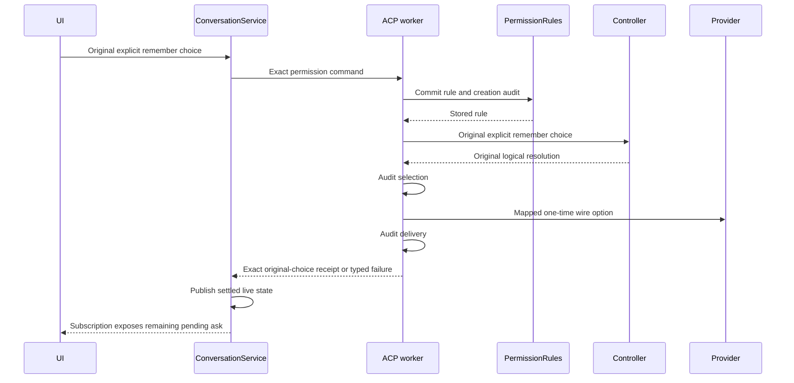

# Permission answer receipts (#944)

The person's offered choice and the provider's wire option are different facts.
A person choosing **Always allow in this project** explicitly selects Nessa's
remember option. The permission-rule port first commits the scoped rule and its
creation audit. ACP receives the provider's one-time option of the same effect.
The first permission resolution retains the original offered option and host
attribution (Explicit for this user action). A later automatic decision made by
the stored rule has Rule basis.

Previously the worker rewrote the command into the wire option and Rule basis.
The exact receipt validator then correctly rejected that different command, even
though the provider response had already been written. This conflict was introduced
by `79c2eca773` (Remember scoped permission rules, #846). Keep the validator and
remove the command rewrite: no additional receipt state or correlation exception.

| Event | Authority and order | Receipt and visible result |
| --- | --- | --- |
| Ordinary offered choice | Controller resolves the exact submitted command; worker audits selection, writes the same provider option, audits delivery | Exact session, execution, permission, option and attribution match |
| Remember allow or deny | Rule port authorizes and commits the rule with grant audit; controller resolves the original Explicit remember choice; worker audits that choice, writes the mapped provider once option, audits delivery | Original choice is confirmed; rule grant remains separate evidence |
| Later automatic rule match | Existing rule settlement selects the provider once option with Rule attribution | Effective rule and original grantor remain in audit |
| Rule refusal or storage failure | Rule port refuses before controller selection or provider response | Permission remains pending; no success or replay |
| Selection or delivery audit fails after rule commit | Existing worker cleanup retains selected target, actor and actual delivery stage | Grant is retained; typed consumed/uncertain failure stays explicit |
| Caller disappears | Existing worker and supervised service retain admitted work | Publication and audit finish without a second answer |
| SDK answer settles, successfully or with a typed failure | Service publishes live changes after awaiting the SDK result; app reviews retain their existing publisher | Subscription rereads authoritative pending permissions; next card is exposed without another tool event |
| Another permission waits | Answer names only the original execution and permission | Other ask stays pending; no automatic choice for it |

SDK ACP tests own logical receipt, rule storage, actual provider response and
failure evidence. Service/subscription tests own live publication and remaining
permission identities. Existing generic receipt-correlation tests remain in force.
This changes no authorization policy: the rule port continues to ask Cedar.
