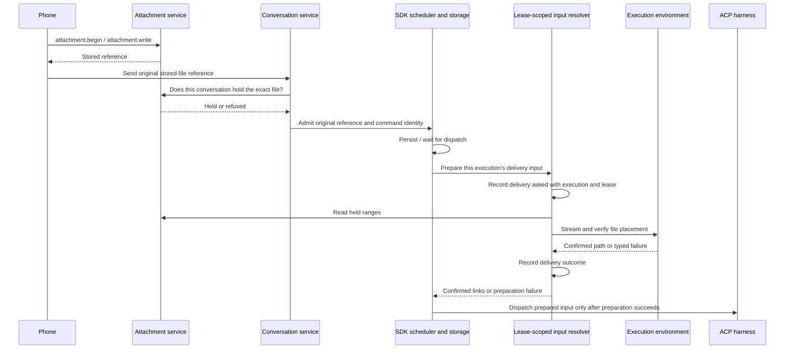

# Files uploaded from a phone

Implemented in source for [issue #1149](https://github.com/nessalabs/nessa-agent/issues/1149).
This document describes the implemented ownership and regression contracts; verification evidence is recorded on the pull request.

## Owners

`attachments` owns upload tickets, byte verification, conversation holds and
release. `attachment.begin` and `attachment.write` already carry arbitrary media
types, with a 64 MiB per-file limit. Images continue through the existing image
normalizer and image message parts.

`conversation` owns admission of a reference to a held upload. The SDK owns the
accepted user message, its identity, queue, steering, persistence and dispatch.
ACP adapters supply the message to Claude, Codex and OpenCode. `LeaseHold::fetch`
already transfers held bytes into an SSH workspace, beneath the agent-facing
`artifacts_fetch` use case.

The iOS composer's Add Files importer accepts files under `AttachmentPolicy.nessa`.
Both the prepared-command journal and phone outbox retain original file references
for send, receipt lookup and retry. Outbox transport bindings fence the captured
connection scope at the actual send/lookup boundary.

## Required behavior

A message names a stored file by digest, media type, size and display name.
The name is metadata, not authority to select a destination. The conversation
must hold the exact reference before it admits a fresh message. An accepted
message keeps that reference in its durable input, including when queued or
restored. A path produced by delivery cannot replace its input identity.

Delivery places the file where that execution's agent can read it, before the
prompt is sent. The prompt names the confirmed path. A gateway path cannot be
passed to an SSH agent as evidence that the file is present there. Placement
must not overwrite an unrelated file or follow an input name outside the
workspace. File bytes travel through a bounded stream rather than a base64
prompt block.

The existing `artifacts_fetch` application operation is not a message-delivery
operation: it requires a running turn's observed tool call and its Drive tool
authorization. Upload delivery may reuse its transport and placement mechanism,
but cannot invent a tool call to pass its admission checks.

## Delivery boundary

Keep uploaded references in `UserMessage`, separate from `ImageReference` and
`LinkedFile`. The stored representation, receipt fingerprint and transcript
projection preserve the digest, media type, size, display name and order. A
materialized path is not a replacement for any of those facts.

Bind an injected input-file resolver to the provider session when
`LeaseFence::open` receives it. This is a conversation-and-lease-scoped object,
constructed before the Agent dispatches input. Its dependencies are the held-file
range reader, the selected workspace, the environment's placement boundary, a
delivery audit sink and lease cancellation. It does not resolve a session ID
through a global registry or call back into the live Agent to find its context.

The `ProviderSession` execute and steer wrappers prepare delivery input before
calling their backend. That input replaces each upload with a confirmed file
link for that dispatch; the SDK's saved request remains the original references.
Preparation must participate in the owning execution/steering cancellation and
deadline, including local turn cancellation that leaves the lease live. Provider
admission must account for the maximum encoded path overhead before it saves
input, and repeat validation against the resolved input before dispatch.

The provider composition publishes the exact canonical local workspace it resolved.
That same value feeds the resolver and runtime view; configured aliases are not
resolved a second time for delivery. Remote environment workspaces take precedence.

The resolver belongs to one lease. Session clones share it, and model/effort
changes and native-process restoration retain it while that lease remains live.
A replacement lease gets a new resolver. Retrying a saved execution first goes
through the SDK's existing identity and delivery recovery; it must not re-place
files merely to answer an already-known delivery.

Ordering for a fresh send:

Automatic input delivery has its own evidence: original reference, destination,
conversation, execution, lease, known sender attribution and outcome. It must
distinguish bytes delivered, placement confirmed, prompt dispatched and placement
uncertain. Existing tool-call `FetchAsked`/`FetchEnded` evidence cannot describe
this operation by pretending an agent asked for it. A required audit failure
prevents successful dispatch while preserving placement and cleanup facts.

## Placement and lifecycle ownership

Local execution retains the existing POSIX absolute-path contract. Non-Unix
local placement returns `NotOffered` before filesystem or source reads; Windows
gateway hosting is not enabled by this change.

`PrivateDirectory::open_shared_root` retains the already selected workspace as
its caller-trusted root, including beneath a writable locator. It requires current
ownership and no group/other write bits without changing permissions.
`LocalInputFiles` owns retained workspace/file handles, bounded reads, digest
verification and publication without replacement. Existing destinations are opened
without blocking or following symlinks; only matching regular files can be reused.
SSH uses `LeaseHold::fetch` and the existing remote inbox/SFTP placement owner.
The paired environment link still lacks a file-write channel and refuses this
capability. The phone-to-gateway native link is separate and supports upload pieces.

`OpencodeAcpProvider::on_host` uses the host's process, credentials and persistent
session database. Host launch retains the same private home, fixed policy and
cleanup owner as local OpenCode. Model selection remains ACP configuration.

The SDK's `WorkPermit` owns cancellation, including preparation. Active execution
publishes its work identity under the lifecycle mutex. Targeted Stop and native
handoff arbitrate under that same lock: Stop before handoff records `TurnStopped`
and settles undispatched work as cancelled without a provider/cleanup report;
after handoff it delegates to native cancellation. Dropping preparation interest
signals the resolver's retained worker, which joins physical placement and required
evidence before releasing its slot. Range reads and audit waits have 10-second
limits; a resolution has a 120-second caller deadline. ACP also owns the operation deadline: after generation acquisition it arms execution or steering time before polling the prepared-input future, and carries that absolute deadline through image reads and native dispatch. A preparation deadline is an undispatched rejection, not a fabricated provider result. No second preparation
registry owns execution state.

Original references survive snapshot decoding, retained-allocation accounting,
resumption, pending/transcript views and both iOS journals. Absent `user_uploads`
in an old record means none; empty collections are omitted. Native clients need
the refreshed Apple package to decode records containing uploaded files.

## Orderings and regression cases

| Row | Initial facts / event order | Required result |
| --- | --- | --- |
| F0 | A selected workspace has shared read/search bits under a writable locator (for example Linux `/tmp`) | Retain that selected root with owner/no-follow checks; locator ancestry is caller trust, as for `open_root`. Permission drift or replacement still refuses. |
| F1 | A PDF, zip or text file is uploaded; its conversation sends its reference | Accept the reference; deliver the bytes; prompt names the confirmed agent-side path. |
| F2 | Another conversation names the same digest | Refuse before admission or placement; learning a digest grants no access. |
| F3 | Digest, media type or size differs from the hold | Refuse the reference without reading or placing bytes. |
| F4 | A file-only message, or text with both photos and files | Accept subject to the owning message bounds; keep image handling unchanged. |
| F5 | A message waits behind another turn | Retain the reference; materialize for the execution that eventually dispatches it. |
| F6 | A reference is restored after gateway restart or agent/environment reopening | Resolve against the current execution environment; do not replay an old machine's delivery path as the input. |
| F7 | Send succeeds but its answer is lost | Retry/receipt lookup carries the original reference and identity; no second logical message. |
| F8 | A retry changes file digest, media type, size, display name or order | Conflict; retain the first accepted input and its evidence. |
| F9 | Close, stop or deletion overtakes placement | Bound and stop the transfer; record confirmed versus uncertain effects honestly; do not dispatch an unconfirmed path. |
| F9a | Stop arrives before native handoff, including while ranges are pending | WorkPermit records undispatched cancellation; no provider report or prompt; later turns remain usable. |
| F9b | Native handoff wins before Stop | The native owner receives cancellation; preparation cannot retroactively claim an undispatched stop. |
| F9c | Execution or steering deadline expires while placement is pending, or placement becomes ready exactly at expiry | ACP rejects before handoff; no provider events/report or late dispatch. Preparation interest drops while its physical owner settles cleanup/evidence. |
| F9d | Placement succeeds before the deadline | Image reads, queueing and provider response spend the remaining time on the same absolute deadline. |
| F9e | Close or generation loss overtakes preparation | Reject before handoff; a close already observed before polling preparation starts no placement. |
| F10 | Bytes become unreadable or their hold is released while streaming | Typed delivery failure; no successful prompt with a missing file. |
| F11 | Destination exists with the same bytes | Reuse only after the placement owner verifies the file. |
| F12 | Destination is occupied by other bytes, a symlink, or a name escapes the workspace | Refuse placement without replacing the existing target. |
| F13 | Transfer, placement or its required audit fails | Preserve the primary failure and any uncertain cleanup; no reported delivery success. |
| F14 | The phone disconnects during upload | Keep its draft; sending again starts an upload with a new ticket. |
| F15 | The phone restarts after a send leaves the device | Both durable send paths retain file references for receipt lookup and explicit retry. |
| F16 | Local and SSH agents use Claude, Codex or OpenCode | Each receives a usable file path through its existing ACP prompt representation. |

## Verification owners

SDK message and snapshot tests cover reference equality, bounds and persistence.
The application test for targeted Stop covers immediate and queued preparation.
Server input-file tests cover local placement, hold mismatch, corrupt bytes, audit
failure/deadline, occupied FIFO and saved retry after hold release. The SSH artifact
suite drives the environment frame loop and SFTP writer in process; it is a
transport fixture, not evidence of a live network SSH daemon or model service.

`FileVerification --files` sends PDF, ZIP and text bytes from the production Swift
phone model through a live gateway to an ACP fixture that reads the file and
returns its SHA-256. Native exchange tests cover piece writes and exact references
in send/receipt. The desktop `inputFiles` stress step invokes the production Swift journal/outbox against its main conversation while background turns run,
checks placed bytes, original references, retry identity and visible filenames.
UI evidence uses Chromium and WebKit. PR verification records the exact revisions,
commands, results and any exclusions; source presence alone is not a test result.
