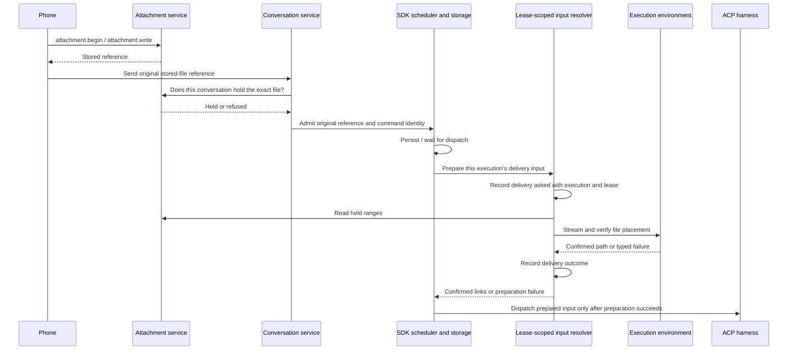

# Files uploaded from a phone

Proposed for [issue #1149](https://github.com/nessalabs/nessa-agent/issues/1149).
This document describes work to implement; it is not a shipped contract.

## Existing owners

`attachments` owns upload tickets, byte verification, conversation holds and
release. `attachment.begin` and `attachment.write` already carry arbitrary media
types, with a 64 MiB per-file limit. Images continue through the existing image
normalizer and image message parts.

`conversation` owns admission of a reference to a held upload. The SDK owns the
accepted user message, its identity, queue, steering, persistence and dispatch.
ACP adapters supply the message to Claude, Codex and OpenCode. `LeaseHold::fetch`
already transfers held bytes into an SSH workspace, beneath the agent-facing
`artifacts_fetch` use case.

The iOS composer already has an Add Files action and a file importer. Its
production `AttachmentPolicy.nessa` currently restricts that importer to images.
Both the prepared-command journal and the phone outbox retain image references;
both need to retain file references for retry and receipt lookup.

## Required behavior

A message names a stored file by digest, media type, size and display name.
The name is metadata, not authority to select a destination. The conversation
must hold the exact reference before it admits a fresh message. An accepted
message keeps that reference in its durable input, including when queued or
restored. A path produced by delivery cannot replace its input identity.

Delivery places the file where that execution's agent can read it, before the
prompt is sent. The prompt names the confirmed path. A gateway path cannot be
passed to an SSH agent as evidence that the file is present there. Placement
must not overwrite an unrelated file or follow an input name outside the
workspace. File bytes travel through a bounded stream rather than a base64
prompt block.

The existing `artifacts_fetch` application operation is not a message-delivery
operation: it requires a running turn's observed tool call and its Drive tool
authorization. Upload delivery may reuse its transport and placement mechanism,
but cannot invent a tool call to pass its admission checks.

## Proposed delivery boundary

Keep uploaded references in `UserMessage`, separate from `ImageReference` and
`LinkedFile`. The stored representation, receipt fingerprint and transcript
projection preserve the digest, media type, size, display name and order. A
materialized path is not a replacement for any of those facts.

Bind an injected input-file resolver to the provider session when
`LeaseFence::open` receives it. This is a conversation-and-lease-scoped object,
constructed before the Agent dispatches input. Its dependencies are the held-file
range reader, the selected workspace, the environment's placement boundary, a
delivery audit sink and lease cancellation. It does not resolve a session ID
through a global registry or call back into the live Agent to find its context.

The `ProviderSession` execute and steer wrappers prepare delivery input before
calling their backend. That input replaces each upload with a confirmed file
link for that dispatch; the SDK's saved request remains the original references.
Preparation must participate in the owning execution/steering cancellation and
deadline, including local turn cancellation that leaves the lease live. Provider
admission must account for the maximum encoded path overhead before it saves
input, and repeat validation against the resolved input before dispatch.

The resolver belongs to one lease. Session clones share it, and model/effort
changes and native-process restoration retain it while that lease remains live.
A replacement lease gets a new resolver. Retrying a saved execution first goes
through the SDK's existing identity and delivery recovery; it must not re-place
files merely to answer an already-known delivery.

Proposed ordering for a fresh send:

Automatic input delivery has its own evidence: original reference, destination,
conversation, execution, lease, known sender attribution and outcome. It must
distinguish bytes delivered, placement confirmed, prompt dispatched and placement
uncertain. Existing tool-call `FetchAsked`/`FetchEnded` evidence cannot describe
this operation by pretending an agent asked for it. A required audit failure
prevents successful dispatch while preserving placement and cleanup facts.

## Existing gaps the implementation must cover

- `InProcessEnvironment` has no fetch implementation. Local placement needs an
  injected filesystem adapter with the same verification and non-overwrite
  contract as remote placement.
- SSH transfer is available through `LeaseHold::fetch`; the paired environment
  link has no file-write channel and currently answers no fetch capability.
  A connected paired environment must report its missing capability honestly;
  enabling that transport is additional work if it is to receive these inputs.
  The phone-to-gateway native link is a different connection and already carries
  uploads through `attachment.write`.
- `OpencodeAcpProvider` currently declares local host identity and does not
  implement `AgentProvider::on_host`. The issue's requirement for all three
  profiles on SSH includes adding and verifying OpenCode host support.
- Record decoding, retained-allocation accounting, resumption input construction,
  transcript/pending views, and both iOS journals must carry the new reference.
  A field added only to `conversation.send` would leave retry and restoration
  incomplete. Existing records need an explicit additive-field interpretation
  through the owning record codec; no unrelated protocol version change is
  proposed.

## Orderings and regression cases

| Row | Initial facts / event order | Required result |
| --- | --- | --- |
| F1 | A PDF, zip or text file is uploaded; its conversation sends its reference | Accept the reference; deliver the bytes; prompt names the confirmed agent-side path. |
| F2 | Another conversation names the same digest | Refuse before admission or placement; learning a digest grants no access. |
| F3 | Digest, media type or size differs from the hold | Refuse the reference without reading or placing bytes. |
| F4 | A file-only message, or text with both photos and files | Accept subject to the owning message bounds; keep image handling unchanged. |
| F5 | A message waits behind another turn | Retain the reference; materialize for the execution that eventually dispatches it. |
| F6 | A reference is restored after gateway restart or agent/environment reopening | Resolve against the current execution environment; do not replay an old machine's delivery path as the input. |
| F7 | Send succeeds but its answer is lost | Retry/receipt lookup carries the original reference and identity; no second logical message. |
| F8 | A retry changes file digest, media type, size, display name or order | Conflict; retain the first accepted input and its evidence. |
| F9 | Close, stop or deletion overtakes placement | Bound and stop the transfer; record confirmed versus uncertain effects honestly; do not dispatch an unconfirmed path. |
| F10 | Bytes become unreadable or their hold is released while streaming | Typed delivery failure; no successful prompt with a missing file. |
| F11 | Destination exists with the same bytes | Reuse only after the placement owner verifies the file. |
| F12 | Destination is occupied by other bytes, a symlink, or a name escapes the workspace | Refuse placement without replacing the existing target. |
| F13 | Transfer, placement or its required audit fails | Preserve the primary failure and any uncertain cleanup; no reported delivery success. |
| F14 | The phone disconnects during upload | Keep its draft; sending again starts an upload with a new ticket. |
| F15 | The phone restarts after a send leaves the device | Both durable send paths retain file references for receipt lookup and explicit retry. |
| F16 | Local and SSH agents use Claude, Codex or OpenCode | Each receives a usable file path through its existing ACP prompt representation. |

## Implementation and verification order

1. Add the stored-file message value and its bounds, equality and persistence;
   extend the product schema and generate its Rust and TypeScript contracts.
2. Admit references through conversation holds and bind them to command receipts.
3. Resolve and place files at dispatch through injected boundaries, reusing the
   SSH fetch mechanism below its tool-specific application operation. Cover local
   placement, transfer interruption and durable delivery evidence.
4. Extend both iOS durable send paths and upload validation, then allow files in
   the existing picker. A failed send keeps the draft it captured.
5. Add the conversation verification scenario; exercise native phone selection
   and local/SSH provider delivery. Record the actual environment and exclusions
   beside each result before claiming a row is covered.

No rows are marked verified yet. The design review inspected the existing
owners and identified the gaps above. Each implementation slice must prove its
rows against the exact changed tree; this design review is not implementation
or end-to-end verification.
