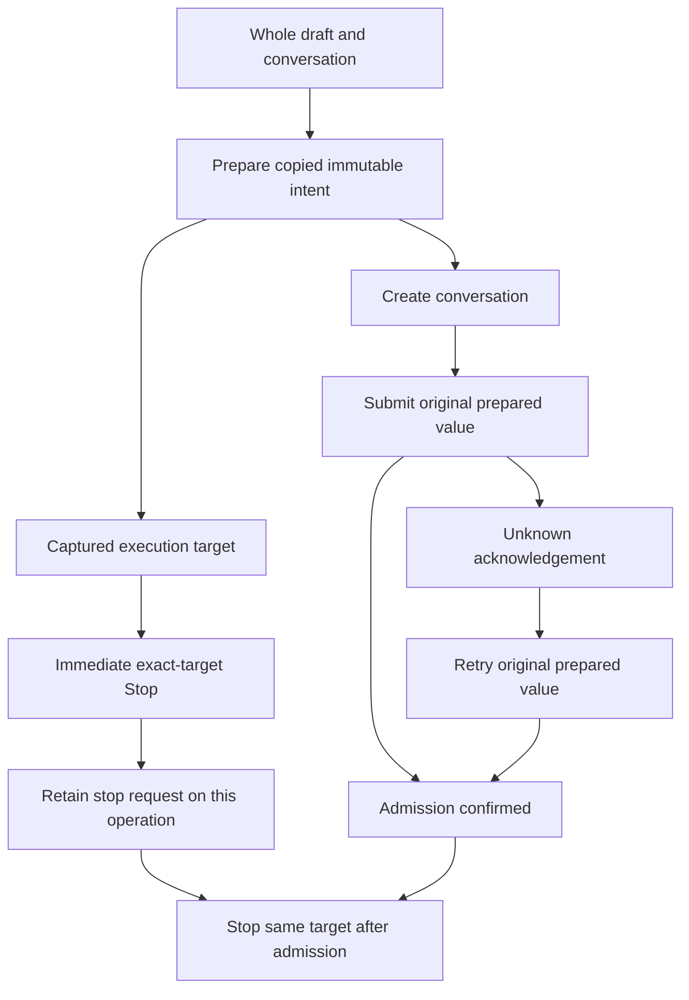

# Prepared submissions (#797)

One immutable prepared message owns its conversation, execution, request, delivery
mode and copied image/file references before creation or admission starts. It also
owns the read-only ExecutionTarget used by stop/remove. Targets captured from a
whole conversation view name admitted executions; neither receipts nor caller
pairs mint them. The gateway remains the authority for access, queue and lifecycle.

| Case | Expected effect | Evidence |
| --- | --- | --- |
| prepare then source content/list changes | submit original copied intent | `packages/nessa-client/src/presentation/prepared-submission.test.ts` |
| stop during create | immediate stop captured target; repeat after its admission | `src/conversation/adapters/store/prepared-operations.test.ts` |
| stop during admission | same immediate and post-admission stop | `src/conversation/adapters/store/prepared-operations.test.ts` |
| tab closes before admission | post-admission stop still uses captured target | `src/conversation/adapters/store/prepared-operations.test.ts` |
| same execution IDs in two conversations/stores | only requested operation retains stop | `src/conversation/adapters/store/prepared-operations.test.ts` |
| unknown acknowledgement then retry | original action/mode/message repeated | `src/conversation/adapters/store/prepared-operations.test.ts` |
| current tab/turn changes before retry | original prepared intent remains target | `src/conversation/adapters/store/prepared-operations.test.ts` |
| forged/spread prepared or target | reject before request | `packages/nessa-client/src/presentation/prepared-submission.test.ts` |
| mismatched admission receipt | reject; original retry intent retained | `packages/nessa-client/src/presentation/prepared-submission.test.ts` |
| remove offered queued execution | original conversation/execution serialized | `packages/nessa-client/src/presentation/prepared-submission.test.ts` |
| later active execution appears | prior captured stop cannot select it | `src/conversation/adapters/store/prepared-operations.test.ts` |

The retained panel operation belongs to one Redux store and one local tab lifetime.
It retains prepared intent only while the sent turn can be retried; a pending
promise retains its own operation across tab removal. A stop request lives on that
operation, replacing the global execution-ID set. Reorder is a separate queue
intent and remains outside this slice.

Retry-table retention depends on the turn receipt and whether its send/retry
promise is still in flight. The in-flight case keeps the exact target available
to Stop; retry itself still requires an `unknown` receipt.

| Turn receipt | Promise in flight | Table decision | Purpose |
| --- | --- | --- | --- |
| `unknown` | no | retain | Preserve the original explicit retry intent. |
| `unknown` | yes | retain | Keep the operation reachable while its retry is pending. |
| `accepted` | yes | retain | Stop can still find the original target until that promise settles. |
| `accepted` | no | prune | Admission is known and there is no pending operation to stop. |

The four combinations are exercised by the retention matrix in
`src/conversation/adapters/store/prepared-operations.test.ts`. PS12 also covers
Stop while a retry is in flight after its receipt has become accepted: it uses
the retained target immediately and again after admission.

## API and owners

`presentation/conversation-api.ts::prepareSubmission` owns validation and copied
immutable payloads. `ConversationApi.prepare` only fills omitted identities using
the client's injected ID source, then delegates to that owner. `submit` accepts
only an original prepared value; the weak registry rejects copied objects. It
selects queued/steering from the captured mode and checks the gateway execution
receipt before returning the original target. The pure factory runs without a
connection, so the panel captures intent before its first `create` await.

`application/execution-target.ts` captures control targets from an enclosing
view or the preparation owner. Its raw internal issuer is not re-exported from
the client package. The factory accepts a validated gateway view or trusted local
projection; it does not authenticate a fabricated view. The SDK and gateway still
own scheduling, authorization, current state, audit and physical cancellation.

`src/conversation/adapters/store/prepared-operation-table.ts` owns the
process-local prepared-operation table and its receipt/in-flight pruning rule.
`src/conversation/adapters/store/slice.ts` scopes one table to each actual Redux
`getState` lifetime. Tables distinguish local tab and execution identity; two
stores may share effects without sharing intent.
The send use-case registers its operation before a single reducer publication
binds the server identity and makes the turn visible. That publication derives
server/execution/action/mode from the issued prepared value; it replaces send's
separate bind and turn-start transitions. A synchronous subscriber can therefore
Stop the same retained operation on its first visible turn.
The send/retry promise retains its own operation across tab closure. Stopping
runs before ordinary control busy/create handling, so it can overtake a gated
retry without changing that retry's `controlPending`. A separately lost Stop
acknowledgement does not turn a confirmed message admission into unknown delivery.

## Additional orderings

| Row | Ordering | Expected result | Test |
| --- | --- | --- | --- |
| PS12 | Stop while retry owns ordinary busy state | Immediate exact-target Stop, then Stop after admission; original busy state remains until retry finishes | `prepared-operations.test.ts` |
| PS13 | Message admitted, separately requested Stop loses acknowledgement | Preserve known admission and show the control error | `prepared-operations.test.ts` |
| PS14 | Source accessor changes a file/image field while capturing | Capture fields once into owned arrays and validate that final payload | `prepared-submission.test.ts` |
| PS15 | Earlier operation admits after newer work appears | Repeated Stop names only the earlier operation | `prepared-operations.test.ts` |
| PS16 | Workspace caller changes conversation/text/model while create awaits | Prepared message and copied model still name the original conversation and intent | `gateway-source.test.ts` |
| PS17 | Immediate Stop is refused before admission exists | Keep operation intent and repeat the same target after later admission | `prepared-operations.test.ts` |
| PS18 | Reading a child ID changes its source view | Targets retain the enclosing conversation captured before traversal | `prepared-submission.test.ts` |
| PS19 | Caller overrides array methods/species/iterator | Retain owned plain arrays; check capacity before entry reads; validate the final payload | `prepared-submission.test.ts` |
| PS20 | Adapter receipt getters change after validation | Publish the captured validated receipt and original target, with no reread | `prepared-submission.test.ts` |
| PS21 | Caller replaces a control variant/target/values during create | Execute the captured command and copied values | `prepared-operations.test.ts` |
| PS22 | Retry awaits create; tab closes and operation table is pruned | Retain eligible operation before await; submit original intent and repeat its requested Stop | `prepared-operations.test.ts` |
| PS23 | Question records or arrays carry caller serialization hooks | Serialize copied DTO fields only; no caller hooks survive capture | `prepared-operations.test.ts` |
| PS24 | Caller provides object scalars with string/JSON coercion | Reject before issuing any prepared value or performing create/control/read effects; retain only primitive strings | `prepared-submission.test.ts` |
| PS25 | Synchronous subscriber Stops on first submission publication | Operation already registered; immediate Stop and same-target Stop after successful admission, including immediate refusal | `prepared-operations.test.ts` |
| PS26 | First-publication subscriber Stops then closes tab and triggers pruning | Promise retains same operation and stops it after successful admission; refused create/admission performs no admission-triggered Stop | `prepared-operations.test.ts` |
| PS27 | Requested local tab is absent before preparation | Reject without registration/publication/create/admission | `prepared-operations.test.ts` |

Existing scenarios and gateway fakes consume the same prepared contract. Their
fixture IDs are canonical UUIDs; display labels stay separate. A fake bypass of
the real client's identity validation would hide defects in call sites.

A restored unknown turn without its original process-local intent is not rebuilt
from mutable display content. It remains historical evidence; refreshing is safe,
and the original window's prepared value owns explicit same-command replay.
Reorder and durable retry-intent serialization remain distinct #797 work.

The desktop `gateway-source.ts::send` captures its identified message and model
before connection or creation awaits. Its fake consumes an original prepared
value, so normal fixture messages pass the real validator rather than a second
permissive send shape.

## Regression history

The process-global Stop set was introduced in `cb9121b06b`, "Durable command
receipts and turn-specific Stop (#537)". The workspace adapter retained caller
message/model references across creation in `d2dbcd60f2`, "Desktop: gateway
WorkspaceSource adapter (#248) (#400)". PS8 and PS16 hold those mechanisms in
place without changing backend command receipts or cancellation ownership.
