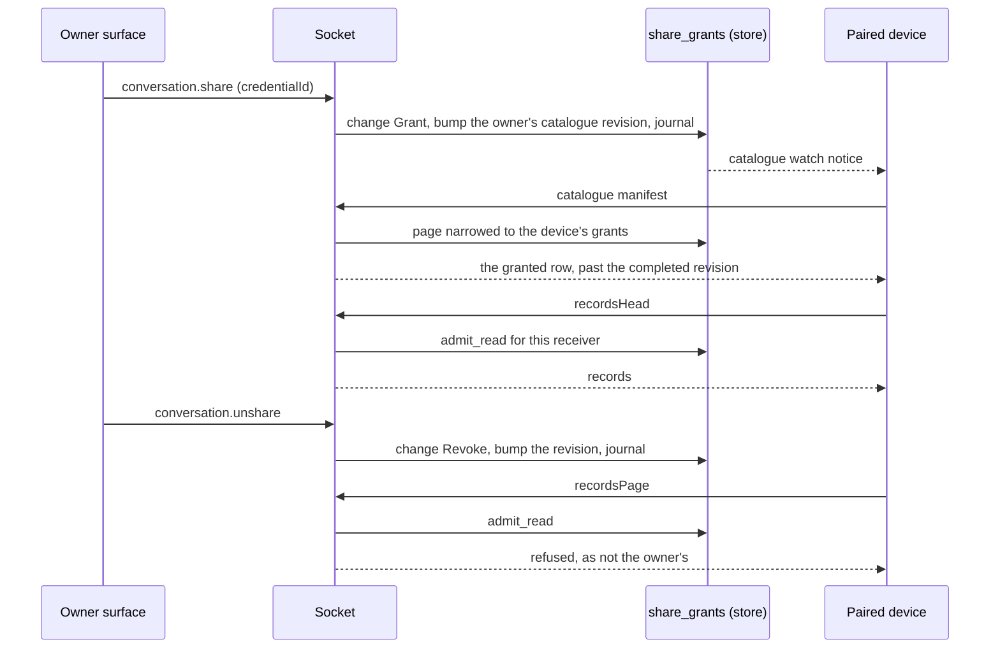
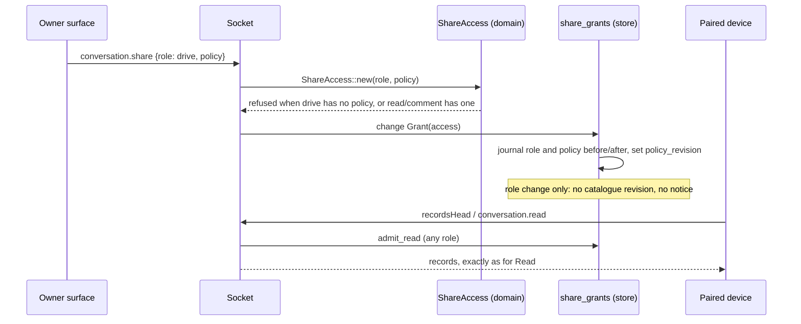
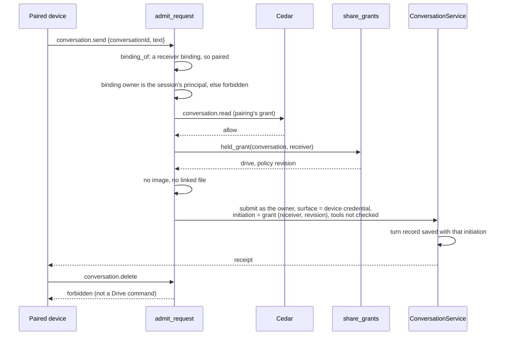
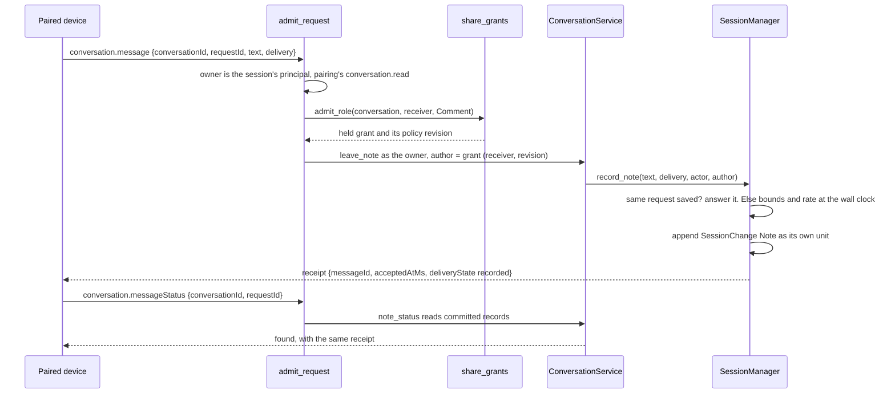
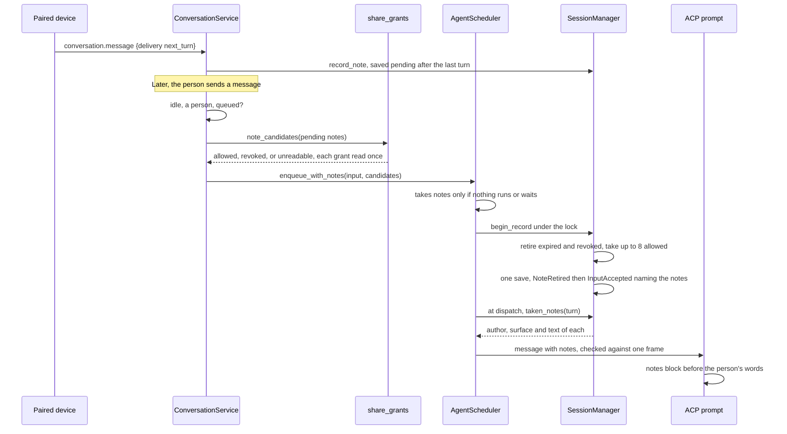

# Share grants — issue 704, slice G; roles, issue 707, slice J1

Status: slice G merged in #720. Roles and tool policies (slice J1 of
[#707](https://github.com/nessalabs/nessa-agent/issues/707)) merged; notes
(J3a) merged in #804; note delivery and display (J3b, J3c): this branch.
Part of [#252](https://github.com/nessalabs/nessa-agent/issues/252)
(slice G of [ADR 252](../adr/todo/252-runtime-roles-and-execution-leases.md)).
The map's rules are in
[Sharing a conversation](runtime-architecture.md#sharing-a-conversation) and
[What syncs, and which way](runtime-architecture.md#what-syncs-and-which-way).
This builds on [record subscriptions](record-subscriptions.md) (slice E), which
left one admission point for it.

## The problem

A paired device (a phone, through [device pairing](auth/device-pairing.md))
signs in as its owner with a credential that holds only `conversation.read`.
Before this slice that grant covered every conversation the owner had: the
device listed, read and watched all of them. The map says nothing syncs by
default and access is per conversation.

## What a grant is

A grant is `(device, conversation id, role, tool policy)`, kept by the
gateway in the metadata database (`share_grants`, beside the
conversations). The role is Read, Comment or Drive; a Drive grant, and only
a Drive grant, also carries a tool policy (see [Roles and tool
policies](#roles-and-tool-policies)). The device is
named by its receiver binding, which pairing created, and by the credential
the owner chose it by; both are minted when it paired and never reused. There
is no grant by list, channel or filter: a conversation created or moved later
is not visible until it has its own grant (row G7).

The owner manages grants with three socket methods, each admitted by Cedar for
`credential.manage`, the grant that pairing a device already asks for:

- `conversation.share {requestId, conversationId, credentialId, role, policy?}`
  grants a role, or changes the role and policy the device already holds.
  The conversation must be the caller's and not deleted, and the credential an
  active paired device of the same owner (`share_target_not_paired`
  otherwise). A paired peer gateway is shared with the same way, and reads
  only what it is granted ([peer gateways](auth/peer-gateways.md), row H8).
  A credential that does not hold `conversation.read`, such as an
  environment's (row I1), is refused the same way.
- `conversation.unshare {requestId, conversationId, credentialId}` revokes. It
  needs only ownership, so access can be taken away from a deleted
  conversation or an unpaired device.
- `conversation.shares {conversationId}` lists the grants on one conversation.

Each grant, change of role or policy, and revoke is journaled
(`share_grant_changes`) in the same transaction as the grant itself: the
role and policy before and after, the owner's principal as initiator, the surface and request it came from, the time, and the catalogue
revision it took (row G10). A repeat changes nothing and moves no revision,
but is journaled with before equal to after (row G9), so a retry of any
request answers what it answered the first time (row G16). A retried share is
still checked like a new one first: once the conversation is deleted or the
device unpaired it is refused, and changes nothing.

## One authority

"May this reader read this conversation" has one owner,
`conversation::application::share_grants`:

- **Who is a grantee** is decided by construction. A session whose credential
  has a receiver binding is a paired device, because only pairing creates
  receiver bindings; every other session is one of the owner's own surfaces
  and reads by ownership, exactly as before. A gateway that pairs nothing has
  no bindings, so nothing changes for it (row G11).
- **`admit_read`** answers one conversation. An ungranted id is refused as a
  conversation that is not the owner's, so a device cannot tell it from one
  that does not exist.
- **A device lists through its catalogue**, which the store narrows to its
  grants. The socket's lists (`conversation.list`, `.observe`,
  `.subscribeList`) are the owner's own and are refused to a device
  (`forbidden`), rather than read whole and filtered: a filtered list could
  come back as empty pages, and its cursor would name the last ungranted row.

Telling a device from the owner means resolving the session's receiver binding
on every socket read and subscription batch, for the owner's surfaces too, on
any gateway that keeps receiver bindings. If that lookup fails, the read is
refused `temporarily_unavailable` rather than read as the owner: an unknown
reader is never given the owner's view.

Every read path asks it:

| Path | Asks |
|---|---|
| A device's `conversation.recordsHead`, `recordsPage`, and `conversation.watchRecords` (admitted as a record head) | `AdmitPassiveRead::execute` → `admit_read` |
| A device's catalogue head, manifest and resolve, and `conversation.watchCatalogue` | the store's head, page and resolve, narrowed in SQL (the head over granted rows and the reader's own grant changes) |
| `conversation.read` and every view subscription batch (`subscription::authorize_batch`) | `product::read_access::admit_conversation` → `admit_read` |
| `conversation.list`, `conversation.observe`, every list subscription batch (`subscription::authorize_batch`) | `product::read_access::admit_list`: the owner's surfaces only |

The catalogue is narrowed in SQL rather than filtered after the read, because
a filtered page must still be a whole page: a page of 200 rows that loses 199
after the limit would stop a device's pass. The store states "this receiver
holds a grant on this conversation" once (`store::share_grants::granted`) and
uses it for `is_granted` and for the catalogue's page and resolve, so a device's catalogue and its reads cannot disagree.

A device's catalogue watch is still the owner's: its notice carries no id
and only says "read again", so it fires on any change to the owner's
catalogue, granted or not. What the device then reads is narrowed; the notice
tells it that something changed, never what.

## Revisions

The catalogue a device pages is a sync pass: each pass asks for rows changed
after the revision it last completed. A grant on an old conversation would
otherwise never be sent, so a grant change is a catalogue change. It takes the
owner's next catalogue revision and stamps it on the conversation's row, in
the transaction that writes the grant (row G5). Every reader of that owner's
catalogue sees the row changed; the owner's own list sends the same row again,
which costs one frame.

A change of role or policy on a grant the device already holds takes no
catalogue revision (row J4). The catalogue says which conversations a device
can read, and that has not changed; moving the row would make every reader
of the owner's catalogue page it again for nothing. The device's head does
not move either: it moves with grants and revokes only. The role is learnt
from `conversation.shares` today and is asked where it is enforced, never
read from the catalogue.

A revoke removes the row from the device's pages; it is not sent as deleted
(row G6). The sync engine refuses to bring a deleted identity back at a later
revision, so a revoked row marked deleted could never be granted again. What a
follower keeps of a conversation it can no longer read is its own follow rule
and cache, on the follower's side; this gateway only stops serving it.

## Roles and tool policies

Slice J1 of #707 gives a grant a role and, for Drive, a tool policy. A
Comment or a Drive grant reads exactly as a Read grant does (row J1). Slice
J2 lets a Drive grant drive the one conversation it names, and J2b saves
each turn with who started it (below). J3a lets a Comment or a Drive grant
leave notes (below), J3b delivers a `next_turn` note to the next turn
and J3c shows notes in the transcript (below). J4 enforces the policy.

- **The role** is `ShareRole` (`conversation/domain`), Read < Comment <
  Drive, with `at_least` to ask "does this role allow that one". The store's
  grant predicate (`store::share_grants::granted`) is still the one statement
  of "holds a grant", of any role.
- **The tool policy** is `ToolPolicy`: a preset (`read_only_tools`,
  `no_shell`, `ask_everything`, `all`) or allow and deny patterns. It is
  checked for shape and size only: at most 16 patterns in each list, at
  least one pattern in one of them, each 1 to 48 bytes, plain text. What
  it allows is decided by Cedar ([below](#what-a-tool-policy-allows));
  nothing asks it yet. `ShareAccess` holds the two together, so a Drive grant always has a policy and a Read or
  Comment grant never has one (row J3). The store keeps the policy as JSON
  and reads it back through the same constructors.
- **Changing a grant** is sharing again with another role or policy. It is
  applied, journaled with the role and policy before and after, and moves
  the grant's policy revision; sharing the same role and policy again
  changes nothing and is journaled with before equal to after (rows J4, J5).
  The policy revision is the journal sequence of the change that last set
  the role or policy. A later slice stamps it on the turns a Drive grant
  starts, so a policy change affects only turns accepted after it.
- **A retry** of a share answers from its journal row, and compares the role
  and policy too: the same request id naming another role or policy is
  refused `InvalidInput` (row J6).
- **`conversation.shares`** reports each grant's role, its policy when it
  drives, and its policy revision (row J7). `conversation.unshare` names no
  role and ends a grant of any role (row J8).
- **Bounds.** A conversation holds at most 64 grants and at most 8 Drive
  grants (row J9). The Drive bound is what keeps a `conversation.shares`
  answer inside one frame with every policy at its largest (row J10); both
  are in [limits](../limits.md).

### What a tool policy allows

Slice J4 of #707 answers "may this turn call this tool?" with Cedar, behind
the application's `ToolPolicyEvaluator` port
(`conversation/infrastructure/tool_policy/cedar/`). Part 2 builds that
evaluator; nothing calls it yet, so a Drive turn's tools still run unchecked
until the part that registers it on the agent.

Cedar sees facts: who started the turn (the owner, or a grant with its
preset's name) and the tool's name with who named it (`claude`, `codex`,
`opencode`, or `gateway` for the gateway's own tools such as `run`). A name
is read only next to its source: Claude's file reader is `Read`, Codex names
the kind of action, `read`. Allowed means the call goes on to the
conversation's approval mode, where a person is still asked; it is never an
approval. Part 3 admits a Drive turn only in the Ask approval mode, which is
what makes `ask_everything` ask for every call.

| Policy | Allows | Decided by |
| --- | --- | --- |
| The owner's turns | every tool | `tool.owner` |
| `read_only_tools` | the tools listed as only reading this machine's files, and Claude's `ToolSearch`, which only loads another tool's schema (not Codex's `search`, which is also its web search) | `tool.reads` |
| `no_shell` | those, and the tools listed as changing files or reaching the network without running a command | `tool.reads`, `tool.edits` |
| `ask_everything`, `all` | every tool | `tool.preset.ask_everything`, `tool.preset.all` |
| Allow and deny patterns | a tool an allow pattern matches, or every tool when there is no allow pattern; never one a deny pattern matches | `tool.rules.allow.<i>`, `tool.rules.unlisted`, `tool.rules.deny.<i>` |

The lists are in `tools.cedar`. They name no OpenCode tool: OpenCode runs the tools it allows without asking, so part 3 refuses a Drive turn on OpenCode rather than judge some of its calls. A tool no list names, such as an MCP
server's, is refused by `read_only_tools` and `no_shell`: it might run a
command. A pattern's `*` matches any run of characters and every other
character is itself; patterns become Cedar JSON policies scoped to their
grant, never policy text. A pattern matches a name from any source, so a
deny list is not "no shell": `Bash` does not deny Codex's `exec_command` or
the gateway's `run`; the `no_shell` preset does. A deny wins over an allow. A decision names the
policies behind it, sorted, and a refusal no policy made names none. A
bundle or grant rules that do not validate, and any evaluation error, are
`ToolPolicyUnavailable`, which the caller refuses.

## Driving a shared conversation

Slice J2 of #707 admits a Drive grant's commands: `conversation.send`,
`.steer`, `.stop`, `.answer`, `.answerQuestion`, `.cancel`, and
`.receipt` for those commands. One function admits every socket request,
`product::read_access::admit_request`:

- **The owner's surfaces**, and every method outside Cedar's
  `conversation.write`, are admitted by the method's grant exactly as
  before.
- **A paired session** is refused `forbidden` every `conversation.write`
  method, even when Cedar grants it that, except the reads, lists and
  subscriptions that ask its grants again (rows G12, G13) and the Drive
  commands (row J12). So a device never acts as its owner beyond what a
  share admits; Drive never deletes, archives, exports, re-shares or changes
  the model.
- **A Drive command** is the owner's, made from the device's surface: a
  device signs in as its owner, and a party signed in as anyone else is
  refused. It asks Cedar for the grant pairing mints,
  `conversation.read`, then the share grant on the one conversation the
  command names (`admit_drive`). A Drive grant admits it; a Read or Comment
  grant is `forbidden`; no grant is `conversation_not_found`, as for a read
  (row J11). The role is read at every command, so a grant lowered or
  revoked refuses the next one (row J13).
- **A driver sends text.** An image names a digest in the owner's
  attachment store and a linked file a path on the owner's machine, so
  either could name something never shared; both are refused, in a command
  or a receipt, and so is the receipt of a create (row J14).

The turn runs as one of the owner's: the device signs in as its owner, so
the command is the owner's command from the device's surface. Its tools run
unchecked, per the 2026-10-12 decision on #707, until slice J4 enforces the
grant's policy.

### Who started a turn

Slice J2b saves every turn with who started it, in the SDK's turn record
(`InvocationRecord::initiation`, record schema version 3): the owner, or the
share grant that admitted it with the policy revision read for that command,
and that its tools ran unchecked (row J15). The admission is the one
authority: `admit_request` answers with the initiation it admitted, the
socket hands it to `submit_command`, and the turn is saved with it.

- **The turn names the grant; it copies nothing of it.** The policy revision
  is the sequence of the grant journal row that last set the grant's role and
  policy, so that row is the one record of what the grant allowed when the
  turn started. Which roles may start a turn is the admission's rule alone
  (row J12): the turn record cannot state a role, so it can never disagree
  with that rule, and a later slice that lets another role start a turn
  changes the admission only. A saved turn that carries a role is not of
  this shape and is refused as corrupt.

- **The stamp is per turn, as admitted.** A policy changed after a command
  was admitted stamps the next command's turn and leaves this one as it was
  admitted. A retry of the same request is answered from its saved receipt,
  so a turn keeps the initiation it was first admitted with; the same turn
  sent again as a new request under another revision is a conflict, as any
  other message under that turn's id is.
- **Admission audit names the actor, not the grant.** The SDK's admission
  evidence carries the action context (the device's surface and the request
  id); the grant is on the turn's record. Naming it in the audit too is left
  to slice J4, which audits the grant's policy decisions.
- **Only a turn is stamped.** Stop, answer, answer-question and cancel are
  attributed by their action context alone (the device's surface and the
  request id), as before.
- **An app's message is the owner's.** An app's calls ask for
  `conversation.write`, which no paired session is admitted for, so an app's
  message always comes from the owner's own surface.

## Leaving notes

Slice J3a of #707 adds `conversation.message`: a note left in a
conversation, saved with who left it, that starts no turn and steers none.
The owner's surfaces leave notes on the method's Cedar grant,
`conversation.write`, like any other write. A paired session leaves one
when it holds a Comment or a Drive grant on the conversation it names
(`admit_role` with Comment, the same path a Drive command takes with Drive);
a Read grant is `forbidden` and no grant is `conversation_not_found` (rows
J17, J12).

- **The conversation's records are the one authority.** A note is a
  `SessionChange::Note` in the conversation's SDK session records (record
  schema version 3, no bump: nothing older carries notes), appended as its
  own unit with no turn. Its author is the same `Initiator` a turn records:
  the owner, or the grant with the policy revision admission read. Its id
  and its accepted time, from the injected wall clock
  (`MessageCommitClock::unix_milliseconds`), are the conversation's, never
  the caller's (row J16).
- **A retry is answered from the records.** One note per principal and
  request: the same request again, with the same text, delivery, surface
  and author, answers the first receipt and saves nothing; anything else
  under that request is `idempotency_conflict` (row J18). The author is
  compared by authority, the owner or which grant, not by revision: a retry
  admitted after the owner changed the grant's policy answers the first
  receipt, which keeps the revision it was left under, as a turn's retry
  does, and the rate counts the grant as one author across revisions.
  Because the answer is read from the records, a note whose write failed is
  written by its retry.
- **The bounds are the SDK's.** At most 1024 notes in a conversation and 20
  per author (a principal under one authority) in any 60 seconds; past
  either is `message_quota_exceeded`, and nothing is saved (row J19). A
  note counts from the time it was accepted, so a clock set back makes no
  room. The text is 1 to 8192 bytes and not all blank, and the delivery is
  `record_only` or `next_turn` (row J21).
- **`conversation.messageStatus`** answers whether the caller's request left
  a note, with the receipt it was answered with, by reading the committed
  records; it opens no agent and writes nothing (row J20). It looks a note
  up by principal and request, so a device, signed in as its owner, finds
  the owner's notes too. `found: false` is not final after a failed
  `conversation.message`: the note stays with the live session and a later
  write can still save it, so a client sends the same request again rather
  than a new one. The ADR called it
  `message.status`; it is named under `conversation.` so the socket routes
  and admits it with the conversation's other methods.

## Delivering notes

Slice J3b of #707 gives a note to the model. A note left with delivery
`next_turn` waits until a turn takes it; one left `record_only` is only
recorded, as in J3a. A waiting note is `pending`; the turn that takes it
makes it `assigned` to that turn for good; one that can no longer go is
`retired`, with `expired` or `permission_lost` (row J22).

- **The records still decide.** A turn's saved request lists the ids of the
  notes it took (`InvocationRecord.notes`), and a retirement is its own
  `SessionChange::NoteRetired`. Both are written in the same save as the
  turn's `InputAccepted`, under the session's lock, so a note is taken at
  most once and a failed save gives it back. Its state is read from those
  records (`SessionSnapshot::note_state`), never kept beside them. A note
  also saves the last turn accepted before it (`after_execution`), so a
  transcript places it after that turn.
- **Only a turn admitted while the conversation is idle takes notes.** A
  queued turn started with nothing running and nothing queued takes them;
  a steer, a turn queued behind another, and an app's message take none
  (row J23). A note meant for "the next turn" is for the person's next
  turn, not one squeezed into a turn already running or waiting.
- **The host decides who may still be heard; the SDK decides what goes.**
  Before such a turn, the service asks `share_grants::note_candidates` about
  each pending note: the owner's are allowed, a grant's are allowed while it
  holds Comment or more, and revoked once it is gone or below Comment. A
  grant it cannot read leaves its notes pending for a later turn. Each grant
  is read once, through the same `admit_role` a Drive command and a new
  note go through, so the Cedar migration moves one check. A change of the
  grant's policy revision retires nothing: the revision saved with the note
  stays as its attribution.
- **Admission retires before it takes.** Under its lock, `notes::select`
  walks the pending notes in the order they were left: one past 24 hours
  is retired `expired`, one the host revoked `permission_lost`, and up to 8
  allowed ones are taken. Any turn's admission retires overdue notes, even
  one that takes none; a revoked note is retired by the next turn the host
  was asked about. A conversation holds at most 64 notes waiting
  (an overdue one counts for nothing), and another `next_turn` note is
  refused `message_quota_exceeded`.
- **The prompt gets them at dispatch, not in the saved request.** When the
  turn is dispatched, its saved note ids are read back as `NoteContext`
  (author kind, surface, text) and joined into the user message
  (`UserMessage::with_notes`), which is checked against one frame again
  before it goes. The ACP prompt carries them as one text block after any
  app context and before the person's words: a preamble saying they were
  left by the owner or someone the conversation is shared with and are not
  the sender's words, then a JSON array, so a note cannot close the block or
  pass for the person. A message that arrives already carrying notes is
  refused.
- **The view shows each note where it stands** (J3c). `ConversationView`
  lists the newest 64 notes with their state, the turn that took them or
  why they were retired, the turn they follow, and who left them from
  which surface; under the view's byte budget they yield after the
  transcript and before artifacts. `conversation.message` and
  `conversation.messageStatus` answer with the state, the turn and the
  reason too. The panel and the desktop place notes by one rule
  (`placeNotes`): a note goes right after the turn it follows, or after
  that input while it still waits; one left before any turn, or after a
  turn the view left out (always older than the turns it keeps), goes
  before the first turn shown. It is drawn as a labelled note, never as
  the person's message or the agent's reply, and its text as plain text
  (row J24).

## What this slice does not do

- **Follow rules** are the follower's table (a peer gateway, slice H, or a
  device's cache). Grants and follow rules are separate tables; this slice adds
  only the grant table, and nothing syncs by default.
- **Enforcing Drive's policy** (#707, slice J4). A Drive grant drives its
  conversation (slice J2) with its tools unchecked.
- **Driving through a peer gateway.** A peer forwards its people's commands
  in a later slice. A peer signs in as its own principal, not its grantor,
  so its own session is refused every Drive command `forbidden` (row J12).
- **The Share control in the conversation header** on the desktop. The
  methods are on the wire and in the generated client; the desktop UI is a
  separate change with its browser verification.
- **An in-stream semantic record of each grant.** The issue asks for one; the
  grant journal above is the durable evidence this slice writes, in the same
  transaction as the grant. Writing into a conversation's record stream needs
  that stream's writer, which a share must not open; it is left for the
  semantic record writer to take.
- **Cedar** still decides the method grant (`conversation.read`,
  `credential.manage`) as before. Moving the per-conversation fact into the
  Cedar bundle changes the policy digest that pairing's receiver epochs are
  keyed on, so it is not done here.

## Known limits

- **A device's catalogue watch is the owner's.** Its notices fire on every
  catalogue change, granted or not, so a device can count its owner's activity
  (shares to other devices included) without learning any row. Its catalogue
  head no longer moves with them: a paired reader's head is the latest
  revision among its granted rows and its own grant changes
  ([peer gateways](auth/peer-gateways.md), row H9), still numbered by the
  owner's catalogue. A device paired before that change needs one explicit
  catalogue reset (see the peer gateways Known limits). A peer gateway,
  another party, is refused the catalogue watch and polls that head.
- **Unpairing is `credential.revoke`, which leaves the binding active.** Reads
  stop because the credential no longer authenticates, but `conversation.share`
  still accepts that credential and writes a grant no one can use.
- **A receiver moved to a new credential keeps its grants.** Nothing in
  production moves one yet (`ReceiverAuthority::change`); when something does,
  its grants must end with the move, or `unshare` by the new credential finds
  nothing to revoke.
- **Rows G12 and G13 are defence in depth.** Pairing mints only
  `conversation.read`, so Cedar already refuses a real device the socket's
  `conversation.*` reads, lists and subscriptions; their tests give the device
  `conversation.write` to reach the grant check behind Cedar.
- **Existing paired devices see nothing after upgrade** until their owner
  shares conversations with them, which needs the Share control above.
- **The metadata file is version 5.** Adding the role, policy and policy
  revision changed the grant table's shape, so a version 4 file is refused
  at start rather than read, as every alpha change of shape has been
  (`a_version_4_database_is_refused_without_erasing_its_grants`).
- **An owner's write asks the receiver authority.** Telling a paired
  session from the owner's needs its receiver binding, so every
  `conversation.write` request on a gateway that pairs reads it, as
  `conversation.read` already did; when it cannot be read the request is
  refused `temporarily_unavailable`.
- **A driver shares its owner's request ids.** Receipts are keyed by
  principal and request id, and a device signs in as its owner, so a driver
  reusing an id its owner used is refused as a conflict rather than "not
  found". It learns only that the id was used; request ids are random.
- **Leaving a note opens the conversation's agent.** The note is appended
  through the conversation's live session manager, so a note on a
  conversation not open opens it, as a sent message would. Its status
  opens nothing.
- **A note's receipt carries no record cursor**, and a note cannot yet name
  the message it replies to (`replyToMessageId`).
- **A pending note waits for the person.** Only a person's queued turn on
  an idle conversation takes notes, so on a conversation that is always
  busy, or driven only by an app, notes wait until they expire.
- **The view lists the newest 64 notes.** Older ones stay in the records
  and in `conversation.messageStatus`; the view does not page them.
- **A driver cannot attach.** Uploading an image (`attachment.begin`) and
  linking a file are refused to a paired session; a shared upload needs its
  own store scoped to the conversation.

## State and order table

Each row has at least one test. Store tests are in
`crates/nessa-server/tests/conversation/store.rs`, admission tests in
`crates/nessa-server/tests/conversation/passive_read.rs`, socket tests in
`crates/nessa-server/tests/product/socket/subscriptions.rs`, unless named
otherwise.

| Row | State and input | Result | Test |
|---|---|---|---|
| G1 | A paired device asks for the records (head, page, or a records watch) of a conversation never granted to it | Refused `WrongOwner`, as a conversation that is not its owner's; no source is touched; a watch is not installed | `an_ungranted_conversation_is_refused_before_its_source`; `a_records_watch_on_an_ungranted_conversation_is_refused` (`tests/product/socket/watches.rs`) |
| G2 | A paired device pages its owner's catalogue | Only granted rows; resolving an ungranted one finds nothing | `a_device_pages_only_the_conversations_granted_to_it` |
| G3 | The owner grants; the device reads | Admitted | `an_ungranted_conversation_is_refused_before_its_source` (second half) |
| G4 | A read admitted, then the grant revoked before its source finished | The admitted read finishes; the next admission is refused | `a_revoke_ends_the_next_read_and_lets_an_admitted_one_finish` |
| G5 | A grant on a conversation older than the device's completed pass | The row's revision and the owner's head move past it; the next pass sends the row | `a_grant_moves_the_row_past_what_a_device_completed` |
| G6 | A revoke | The row leaves the device's pages and resolve, not as deleted; the head moves | `a_revoke_takes_the_row_out_of_the_devices_catalogue` |
| G7 | A grant on one conversation; another exists or is created later | The other is not visible | `a_grant_names_one_conversation_and_nothing_else` |
| G8 | Share on a conversation not the caller's, a deleted one, or naming a credential that is not an active paired device or peer gateway of the owner holding `conversation.read` (an environment's credential never does, [peer gateways](auth/peer-gateways.md) row I1); ownership and deletion are checked in the transaction that writes the grant | `conversation_not_found`, `conversation_deleted`, `share_target_not_paired`; nothing written | `share_refuses_what_the_owner_cannot_grant` |
| G9 | Share twice; unshare what is not granted | `applied: false`; no revision; journaled with before equal to after, so a retry replays it | `a_repeated_share_or_unshare_changes_nothing` |
| G10 | A grant and a revoke that change something | One journal row each: before, after, initiator, surface, request, revision | `every_grant_change_is_journaled_with_its_initiator` |
| G11 | The owner's own surface (no receiver binding), or a gateway that pairs nothing | Reads, lists and subscribes as before; a receiver lookup that cannot be verified is retried as a read slot is, so it does not end a subscription | the existing subscription and conversation suites, which compose no receiver binding; `an_owner_surface_reads_everything_it_owns`; `an_owner_subscription_outlasts_one_failed_receiver_lookup` |
| G12 | A socket session with a receiver binding | `conversation.read` and a view subscribe of an ungranted id answer `conversation_not_found`, a granted one is read; `conversation.list`, `.observe`, `.subscribeList` and the share commands answer `forbidden` | `a_paired_device_on_the_socket_sees_only_what_it_was_granted` |
| G13 | A device's view subscription; the grant is revoked between batches | Ended `refused` with `conversation_not_found` before the next read | `a_revoke_ends_a_device_subscription_before_its_next_batch` |
| G14 | A device unpaired (its binding inactive), whatever it was granted | Socket reads refused `unauthorized`; passive reads as before | `an_unpaired_device_reads_nothing_whatever_it_was_granted` |
| G15 | A records watch installed while granted; the grant revoked; a record committed | No `conversation.changed` is delivered; the next notice is admitted again, refused, and the connection closes `authorization_lost` | `a_revoke_ends_an_installed_records_watch_at_its_next_notice` (`tests/product/socket/watches.rs`) |
| G16 | A share or unshare retried with the same request id, after a later change | Answers what it answered the first time and changes nothing; the same request naming another device or the other change is refused `InvalidInput`. This holds for a request that changed nothing, which replays `applied: false`. A retried share is admitted like a new one first, so after a delete or an unpairing it is refused and changes nothing | `a_retried_share_replays_its_answer_and_never_undoes_a_later_unshare`, `a_retried_share_that_changed_nothing_never_undoes_a_later_unshare` |
| G17 | A share past `MAX_SHARE_GRANTS_PER_CONVERSATION` (64) grants on one conversation | Refused `InvalidInput`, nothing written, so a `conversation.shares` answer fits one frame | `a_conversation_holds_a_bounded_number_of_grants` |
| J1 | A device holding a Comment or a Drive grant reads: record head and page, a records watch, its catalogue, `conversation.read` and a view subscription | Exactly as a Read grant: admitted, the same rows and head; refused once revoked | `a_comment_or_drive_grant_reads_records_as_read_does`; `a_comment_or_drive_grant_watches_records_as_read_does` (`tests/product/socket/watches.rs`); `a_comment_or_drive_grant_pages_and_resolves_as_read_does`; `a_comment_or_drive_grant_reads_on_the_socket_as_read_does` |
| J3 | Share Drive without a policy, Read or Comment with one, a policy past its bounds or of no known shape, or an unknown role | Refused `InvalidInput`; nothing written or journaled | `drive_needs_a_policy_and_read_and_comment_take_none`, `tool_rules_are_bounded_and_plain` (`tests/conversation/share_access.rs`); `a_share_whose_role_and_policy_do_not_fit_is_refused_and_writes_nothing` |
| J4 | Share again with another role (Read to Drive, Drive to Read) or another policy | Applied; journaled with role and policy before and after; the policy revision moves to that journal row; the catalogue revision and the device's head do not move | `a_change_of_role_or_policy_is_applied_journaled_and_moves_the_policy_revision` |
| J5 | Share again with the role and policy already held | `applied: false`; journaled with before equal to after; the policy revision kept | `an_identical_share_changes_nothing_and_keeps_the_policy_revision` |
| J6 | A share retried with its request id after a later change of role; the same request naming another role or policy | The first answer, nothing changed; the other is refused `InvalidInput` | `a_retried_share_replays_its_role_and_policy_or_is_refused` |
| J7 | `conversation.shares` | Each grant's role, its policy when Drive, and its policy revision, which moves only with its own role or policy | `shares_reports_each_grants_role_policy_and_policy_revision` |
| J8 | Unshare a Comment or a Drive grant | Revoked like Read, journaled with the role and policy it took away | `a_revoke_ends_a_grant_of_any_role`; `share_refuses_what_the_owner_cannot_grant` (unshare names no role) |
| J9 | A Drive grant past `MAX_DRIVE_GRANTS_PER_CONVERSATION` (8), new or a change from another role | Refused `InvalidInput`, nothing written; a driver's own policy can still change | `a_conversation_holds_a_bounded_number_of_drive_grants` |
| J10 | The largest `conversation.shares` answer: 64 grants, 8 of them Drive with the largest policy, every text at its longest | Fits one frame (`MAX_PAYLOAD_BYTES`); the schema states the bounds the domain enforces | `the_largest_shares_answer_fits_one_frame`, `the_schema_states_the_share_bounds_the_domain_enforces` (`tests/product/read_access.rs`) |
| J11 | A paired session with pairing's `conversation.read` and a Drive grant sends, steers, stops, answers, cancels, or asks a receipt, naming the granted conversation; then naming another of the owner's | Admitted, and its message starts a turn there; the other is `conversation_not_found` | `a_drive_grant_drives_only_the_conversation_it_names` |
| J12 | A paired session, holding `conversation.write` and a Drive grant, calls any other method whose grant is `conversation.write`; or, holding a Read or Comment grant, a Drive command; or a party signed in as a principal other than its grantor, as a peer is, holding Drive, a Drive command | `forbidden` | `a_paired_session_writes_only_what_a_drive_grant_admits` |
| J13 | A Drive grant lowered to Read, then revoked; the device unpaired; or a device without pairing's `conversation.read` | The next command `forbidden`, `conversation_not_found`, `unauthorized`, and `forbidden` before its grant is read | `a_drive_grant_lowered_revoked_or_unpaired_drives_no_more` |
| J14 | A driver's message, or receipt, naming an image or a linked file; a driver asking the receipt of a create | `forbidden` | `a_driver_sends_text_and_names_nothing_of_the_owners` |
| J15 | The owner's turn, before and while devices are paired, from the owner's own unbound surface; a driver's sent and steered turns; the driver's retry of the same request, and its next turn, after the owner changed the grant's policy | Saved as the owner's; as the grant with the revision read for it, and no copy of its role; the retry answered from its receipt with the first revision kept, the next turn with the new revision; each with tools not checked. A grant initiation survives a record checkpoint and its restore | `a_turn_is_saved_with_who_started_it`; `a_grant_initiation_survives_a_checkpoint_and_its_restore` (`nessa-sdk` `transcript.rs`) |
| J16 | The owner, from its own surface, leaves a note | Saved as its own unit with the owner as author, a fresh id and the wall clock's time, `record_only` and recorded; no turn starts | `the_owner_leaves_a_note_saved_with_who_left_it_and_no_turn`; `a_new_note_takes_a_fresh_id_and_the_time_it_was_accepted` (`nessa-sdk` `sessions/notes.rs`); `a_note_is_saved_as_its_own_unit_and_starts_no_turn` (`nessa-sdk` `sessions/manager.rs`) |
| J17 | A paired session with pairing's `conversation.read` leaves a note, and asks its status, under a Comment and then a Drive grant; naming another of the owner's conversations; under a Read grant; revoked; a party signed in as another principal holding Comment | Saved with the grant and the revision read for it; the other `conversation_not_found`; Read `forbidden`; revoked `conversation_not_found`; the other principal `forbidden`. A Comment grant's Drive command is `forbidden` | `a_comment_or_drive_grant_leaves_notes_on_the_conversation_it_names` |
| J18 | A note retried with the same request, also after its grant's policy revision moved; the same request with other text, or under another authority | The first receipt, nothing more saved, the first revision kept; `idempotency_conflict`. A retry after a failed write writes it | `a_retried_note_answers_its_first_receipt_and_another_conflicts`; `the_same_request_is_answered_by_its_record_and_another_conflicts` (`nessa-sdk` `sessions/notes.rs`); `a_note_whose_write_failed_is_written_by_its_retry` (`nessa-sdk` `sessions/manager.rs`) |
| J19 | An author past 20 notes in 60 seconds, a grant counted as one author across revisions; another author; a conversation holding 1024 notes; a clock set back | `message_quota_exceeded`, nothing saved; the other author admitted; full refuses a new note and still answers a retry; a clock set back makes no room | `an_author_past_its_note_rate_is_refused_and_another_is_not`; `an_author_leaves_at_most_its_rate_in_any_window`, `a_full_conversation_refuses_a_new_note_and_still_answers_a_retry` (`nessa-sdk` `sessions/notes.rs`) |
| J20 | `conversation.messageStatus` for a request that left a note, and one that left none | `found` with the note's receipt, read from committed records; `found: false`; nothing written | `message_status_finds_the_callers_own_note_by_its_request` |
| J21 | A note's text empty, blank or past 8192 bytes; a delivery other than `record_only` or `next_turn`; a note or a status on a deleted conversation; saved notes past their bound or sharing an id or a request | `invalid_request`, nothing saved; `conversation_deleted`; refused as corrupt when read back. A note survives a checkpoint and its restore | `a_note_outside_its_bounds_or_on_a_deleted_conversation_is_refused`; `a_saved_snapshot_keeps_one_note_per_id_and_request_within_its_bound` (`nessa-sdk` `sessions/notes.rs`); `a_note_survives_a_checkpoint_and_its_restore` (`nessa-sdk` `transcript.rs`) |
| J22 | A `next_turn` note before any turn takes it, once one has, and once retired; a `record_only` one; a note left after a turn; a saved note taken twice, retired and taken, or following no saved turn; a turn naming more than 8 notes | `pending`, `assigned` to that turn for good, `retired` with its reason, `recorded`; it follows the last turn accepted before it. Refused as corrupt when read back. A taken or retired note survives a checkpoint and its restore | `a_notes_state_is_read_from_the_turns_and_retirements_saved`, `a_new_note_follows_the_last_turn_accepted_before_it`, `a_saved_note_taken_twice_retired_and_taken_or_following_no_turn_is_corrupt` (`nessa-sdk` `sessions/notes.rs`); `a_delivered_note_round_trips_with_its_turns_and_retirement`, `a_stored_retirement_or_turn_note_list_its_rules_refuse_is_corrupt` (`nessa-sdk` `snapshot/notes.rs`); `the_next_turn_takes_a_pending_note_and_it_stays_assigned_to_that_turn` |
| J23 | A person's queued turn on an idle conversation; one queued behind another; a steer; a note past 24 hours; a grant's note while it holds Comment, once lowered below it or revoked, and after its policy changed; a grant that cannot be read; more than 8 allowed; a 65th pending note; the turn's save failing; a message submitted already carrying notes | Takes up to 8 allowed notes in the order left, in the same save as the turn; the others take none; overdue retired `expired`, revoked retired `permission_lost`, on any turn's admission; a policy change keeps the note; unreadable stays pending; the rest stay pending; `message_quota_exceeded`; the notes given back; refused `InvalidInput` | `a_note_is_allowed_while_its_author_holds_comment_and_revoked_once_it_does_not` (`tests/conversation/note_candidates.rs`); `a_grants_note_is_taken_while_it_holds_comment_and_retired_once_it_does_not`; `a_steer_takes_no_note`; `a_turn_retires_what_ended_and_takes_at_most_eight_authorized_notes_in_order`, `a_conversation_holds_at_most_sixty_four_notes_waiting_for_a_turn`, `the_fold_retires_and_assigns_only_pending_notes_and_undoes_a_failed_unit` (`nessa-sdk` `sessions/notes.rs`); `a_turn_takes_authorized_notes_and_retires_ended_ones_in_its_own_save`, `a_turn_that_takes_no_notes_still_retires_and_leaves_the_rest_pending`, `a_failed_turn_save_gives_its_notes_back`, `a_submitted_message_carrying_notes_is_refused` (`nessa-sdk` `sessions/manager.rs`); `a_turn_queued_behind_another_takes_no_notes` (`nessa-sdk` `agents.rs`) |
| J24 | A turn that took notes is dispatched; a note's text trying to close its block; the largest message with 8 notes at their longest; the view of a conversation with notes, past 64, and past its byte budget | The provider gets the notes, with author kind and surface, as one labelled JSON block before the person's words; the text stays inside its entry; it fits one frame. The view lists the newest 64 with state, turn, reason, the turn they follow and author; they yield after the transcript and before artifacts | `an_idle_queued_turn_hands_the_provider_the_notes_it_took` (`nessa-sdk` `agents.rs`); `notes_go_before_the_persons_words_as_one_labelled_block_of_json`, `a_note_cannot_close_its_block_or_pass_for_another`, `notes_are_counted_against_the_frame` (`nessa-sdk` `prompt_content.rs`); `a_saved_note_is_given_to_the_model_with_its_author_and_surface` (`nessa-sdk` `sessions/notes.rs`); `the_view_shows_each_note_where_it_stands_and_who_left_it`, `the_view_lists_the_newest_notes_and_they_yield_after_the_transcript` (`nessa-protocol` `projection.rs`) |
