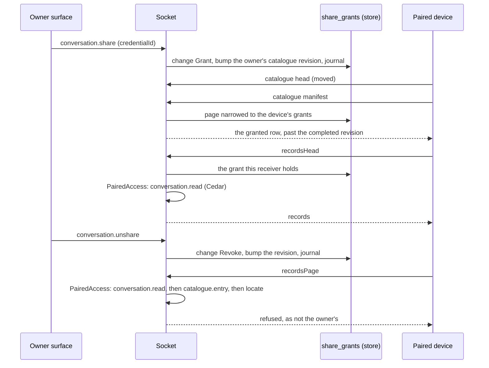
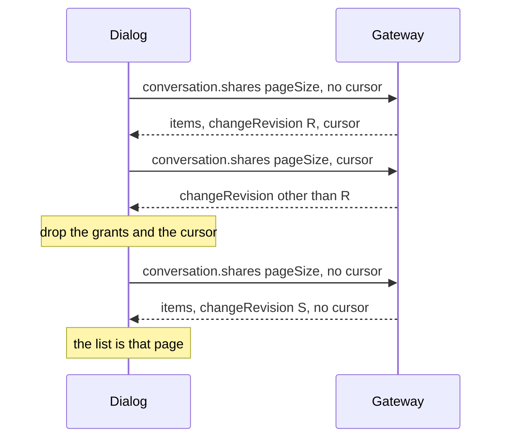
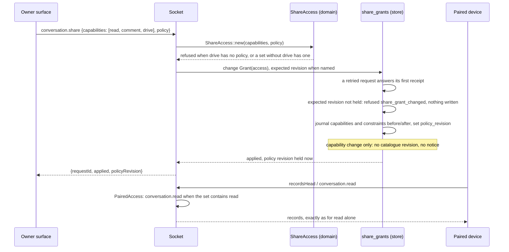
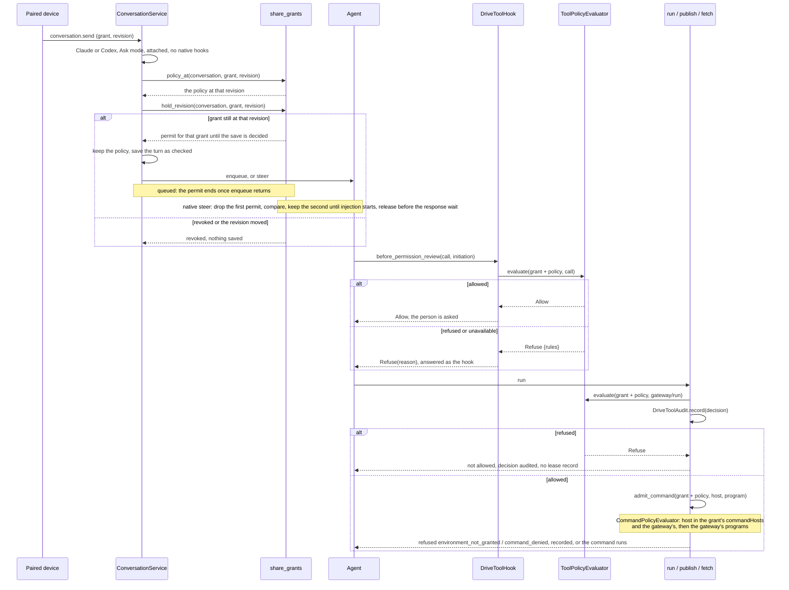
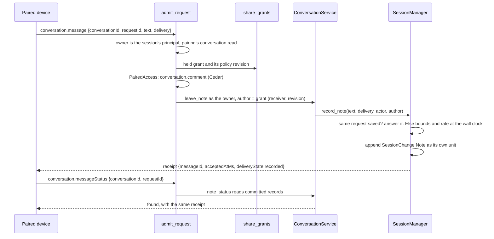
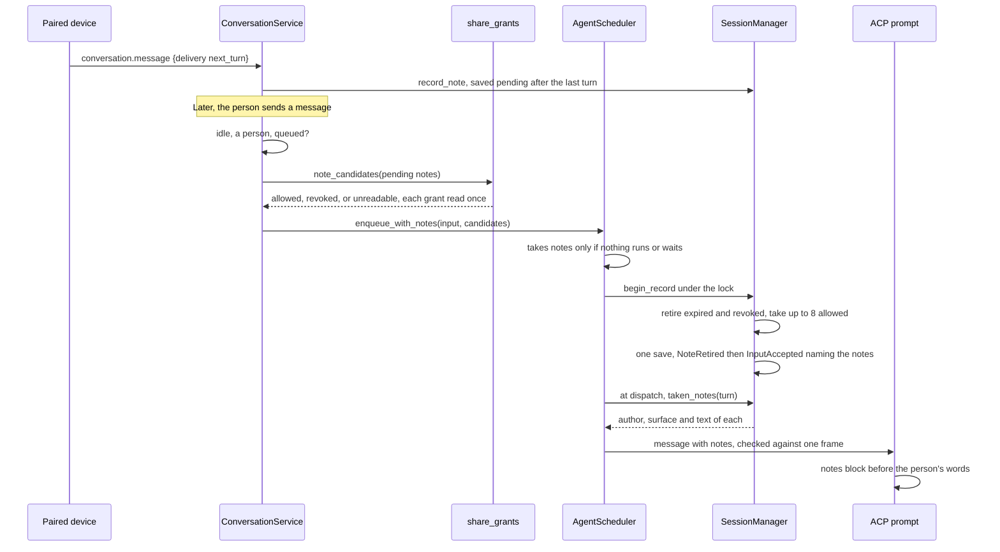

# Share grants — issue 704, slice G; one access grant, issue 889

Status: slice G merged in #720. Roles and tool policies (slice J1 of
[#707](https://github.com/nessalabs/nessa-agent/issues/707)) merged, then
folded into one access grant
([#889](https://github.com/nessalabs/nessa-agent/issues/889)); notes
(J3a) merged in #804; note delivery and display (J3b, J3c): this branch.
Part of [#252](https://github.com/nessalabs/nessa-agent/issues/252)
(slice G of [ADR 252](../adr/todo/252-runtime-roles-and-execution-leases.md)).
The map's rules are in
[Sharing a conversation](runtime-architecture.md#sharing-a-conversation) and
[What syncs, and which way](runtime-architecture.md#what-syncs-and-which-way).
This builds on [record subscriptions](record-subscriptions.md) (slice E), which
left one admission point for it. A proposal to reuse this grant for a directory, peer write, live
subscribe, and webhooks is [access grants](access-grants.md). This
document stays the built contract.

## The problem

A paired device (a phone, through [device pairing](auth/device-pairing.md))
signs in as its owner with a credential that holds only `conversation.read`.
Before this slice that grant covered every conversation the owner had: the
device listed, read and followed all of them. The map says nothing syncs by
default and access is per conversation.

## What a grant is

A grant is one row: the grantee's principal, one resource, a capability
set, the constraints a drive grant carries, and the grant epoch. The
metadata database keeps it in `share_grants`, keyed by principal, resource
kind, and resource id. This slice writes kind `conversation` and the
conversation id. A directory grant uses kind `directory` under the same key.
`receiver_id` is the receiver a paired device or gateway is bound to, because
admission still finds that grant by its receiver. An integration, and a later
agent, store the principal and no receiver. A grant with a principal and no
receiver can be stored, a paired grant is still found by its receiver, and two
rows for the same principal, resource kind, and resource id cannot both exist
(`a_grant_is_keyed_by_principal_and_may_name_no_receiver`).
The only sets are `read`, `read` and `comment`, and those plus `drive`.
What they used to be called — Read, Comment, Drive — is that set. A set
that includes `drive`, and only that set, also carries constraints: the
tool policy and the command hosts (see [Capabilities and
constraints](#capabilities-and-constraints)). The grant epoch is the
column and wire field `policyRevision`: the journal sequence of the change
that last set the capabilities or the constraints. The device is
named by its receiver binding, which pairing created, and by the credential
the owner chose it by; both are minted when it paired and never reused. There
is no grant by list, channel or filter: a conversation created or moved later
is not visible until it has its own grant (row G7).

The owner manages grants with three socket methods, each admitted by Cedar for
`credential.manage`, the grant that pairing a device already asks for:

- `conversation.share {requestId, conversationId, credentialId, capabilities, policy?}`
  grants a capability set, or changes the capabilities and constraints the
  device already holds. `capabilities` is the only wire field for what the
  grant allows; the names may arrive in any order. The conversation must be
  the caller's and not deleted, and the credential an active paired device
  of the same owner (`share_target_not_paired` otherwise). A paired peer
  gateway is shared `read` the same way, and reads only what it is granted
  ([peer gateways](auth/peer-gateways.md), row H8). Comment and drive are
  written only when Cedar permits `grant.comment` and `grant.drive` for the
  principal the credential names. A denial writes nothing — no row and no
  journal — and the answer is `capabilities_refused`, with `details.policies` the policy
  ids Cedar named, empty when no permit matched. The share does not match a
  gateway principal on its own. A credential that does not hold `conversation.read`,
  such as an environment's (row I1), is refused `share_target_not_paired`.
- `conversation.unshare {requestId, conversationId, credentialId}` revokes. It
  needs only ownership, so access can be taken away from a deleted
  conversation or an unpaired device.
- `conversation.shares {conversationId, pageSize, cursor?}` lists one page of
  the grants on one conversation. `pageSize` is required. The first page names
  no cursor; a later page echoes the cursor the previous page returned. The
  answer names the catalogue revision those grants were read at, and a cursor
  when further grants remain.

Each grant, change of capabilities or constraints, and revoke is journaled
(`share_grant_changes`) in the same transaction as the grant itself: the
capabilities and constraints before and after, the owner's principal as initiator, the surface and request it came from, the time, and the catalogue
revision it took (row G10). A repeat changes nothing and moves no revision,
but is journaled with before equal to after (row G9), so a retry of any
request answers what it answered the first time (row G16). A retried share is
still checked like a new one first: once the conversation is deleted or the
device unpaired it is refused, and changes nothing.

## One authority

"May this reader read this conversation" has one owner, the conversation
access policy (`ConversationAccessPolicyEvaluator`, answered by Cedar in
`conversation/infrastructure/access_policy/cedar/`), asked through
`PairedAccess` with the facts `share_grants` reads:

- **Who is a grantee** is decided by construction. A session whose credential
  has a receiver binding is a paired device, because only pairing creates
  receiver bindings; every other session is one of the owner's own surfaces
  and reads by ownership, exactly as before. A gateway that pairs nothing has
  no bindings, so nothing changes for it (row G11).
- **`conversation.read`** answers one conversation, for the party whose
  grant there includes `read`. Refused, the party is told what the
  policy lets it know: forbidden when it may read the conversation but not
  do what it asked, deleted when `catalogue.entry` shows it the tombstone and
  the person it signed in as may `conversation.locate` it, and otherwise not
  found. So a device cannot tell an ungranted id from one that does not
  exist.
- **A device lists through its catalogue**, which the store narrows to its
  grants. The socket's lists (`conversation.list`, `.observe`,
  `.subscribeList`) are the owner's own and are refused to a device
  (`forbidden`), rather than read whole and filtered: a filtered list could
  come back as empty pages, and its cursor would name the last ungranted row.

Telling a device from the owner means resolving the session's receiver binding
on every socket read and subscription batch, for the owner's surfaces too, on
any gateway that keeps receiver bindings. If that lookup fails, the read is
refused `temporarily_unavailable` rather than read as the owner: an unknown
reader is never given the owner's view.

Every read path asks it:

| Path | Asks |
|---|---|
| A device's `conversation.recordsHead` and `recordsPage` | `AdmitPassiveRead::execute` → `conversation.read` |
| A device's catalogue head, manifest and resolve | the store's head, page and resolve, narrowed in SQL (the head over granted rows and the reader's own grant changes); each entry admitted by `catalogue.entry` |
| `conversation.read` and every view subscription batch (`subscription::authorize_batch`) | `product::read_access::admit_conversation` → `PairedAccess::admit(conversation.read)` |
| `conversation.list`, `conversation.observe`, every list subscription batch (`subscription::authorize_batch`) | `product::read_access::admit_list`: the owner's surfaces only |

The catalogue is narrowed in SQL rather than filtered after the read, because
a filtered page must still be a whole page: a page of 200 rows that loses 199
after the limit would stop a device's pass. The store states "this receiver
holds a grant on this conversation" once (`store::share_grants::granted`) and
uses it for `is_granted` and for the catalogue's page and resolve, so a device's catalogue and its reads cannot disagree.

A device learns that its catalogue changed by reading its catalogue head,
which moves only with its granted rows and its own grant changes. A list
subscription for a device waits on #724; until then a device's subscriptions
follow one conversation each.

## Revisions

The catalogue a device pages is a sync pass: each pass asks for rows changed
after the revision it last completed. A grant on an old conversation would
otherwise never be sent, so a grant change is a catalogue change. It takes the
owner's next catalogue revision and stamps it on the conversation's row, in
the transaction that writes the grant (row G5). Every reader of that owner's
catalogue sees the row changed; the owner's own list sends the same row again,
which costs one frame.

A change of capabilities or constraints on a grant the same receiver and
credential already hold takes no catalogue revision (row J4). The catalogue
says which conversations a device can read, and that has not changed; moving
the row would make every reader of the owner's catalogue page it again for
nothing. The device's head does not move either: it moves with grants,
revokes, and a replacement of the receiver or credential. Replacing either
applies, keeps the grant epoch when the capabilities and constraints stay,
and moves the catalogue revision, so the receiver that gained the grant
pages it and the one that lost it drops it
(`a_receiver_switch_is_applied_and_moves_the_catalogue`). The receiver that
gained a drive grant reads that epoch's policy, and the one that lost the
grant is fenced with the revoke
(`a_replaced_receiver_keeps_the_drive_policy_and_is_fenced`). The capability set
is learnt from `conversation.shares` and is asked where it is enforced, never
read from the catalogue.

### Grant lifecycle

One owner of each transition: `ShareGrants::change` writes the row and the
journal, and `ShareConversation` asks Cedar before a comment or drive grant
is written and asks the deletion inventory after an applied share or any
unshare. A retry of the same owner, surface, and request id answers the first
receipt and writes nothing. Naming another principal or receiver on that
request is `InvalidInput`
(`a_retried_share_that_names_another_principal_is_refused`). Naming another
credential is the same refusal
(`a_retried_share_replays_its_answer_and_never_undoes_a_later_unshare`), as
is another capability set or its constraints
(`a_retried_share_replays_its_role_and_policy_or_is_refused`).

| Transition | Who causes it | Audit evidence | What subscribers see |
| --- | --- | --- | --- |
| Grant | The owner calls `conversation.share`. Cedar has allowed `owner.share`, and `grant.comment` and `grant.drive` when the set includes them. | One journal row: capabilities `none` then the set, the principal, receiver, and credential, and the initiator, surface, and request. The grant epoch is that row's sequence. The conversation's catalogue revision moves. | The owner's list subscriptions wake. The new receiver's head moves and its next pass includes the conversation. `conversation.shares` lists the grant. |
| Re-target | The owner calls `conversation.share` for another device of the same principal, with the same capability set and constraints. | One journal row: capabilities before equal after, the new receiver and credential, the same principal, and the initiator. The epoch stays. The catalogue revision moves. | The owner's list subscriptions wake. The new receiver's pass includes the conversation. The old receiver's head moves and the conversation leaves its pages. Only the immediately preceding journal row with a held grant identifies the receiver losing access: subsequent replacements and a new grant after a revoke do not move an earlier receiver's head (row J35). Export fences the old receiver. The deletion inventory is reconciled after the share commits. |
| Epoch bump | The owner calls `conversation.share` with a different capability set or constraints, for the same receiver and credential. | One journal row: capabilities and constraints before and after, the same receiver. The epoch becomes that row's sequence. The catalogue revision stays. | No list subscription wakes, and device heads stay. `conversation.shares` shows the new epoch. The next drive turn is admitted at that epoch. |
| Revoke | The owner calls `conversation.unshare`. The grant is found by credential. | One journal row: the capability set then `none`, the receiver the row held, and the initiator. The grant row is deleted. The catalogue revision moves. | The owner's list subscriptions wake. The receiver's head moves and the conversation leaves its pages. The deletion inventory is reconciled and fences that receiver. |
| Backup capture | After an applied share, or any unshare, `ShareConversation` asks the deletion inventory. Export reads the journal. | A revocation fact for each receiver whose latest row is a revoke, and for each receiver the grant moved off, naming the capabilities they held and that journal sequence. A capture that fails after a revoke is logged and the revoke stays (`a_failed_inventory_capture_leaves_the_revoke`). | The deletion log gains or drops those fences. A later capture that no longer names a receiver drops its fence. List subscriptions are not this path. |

A revoke removes the row from the device's pages; it is not sent as deleted
(row G6). The sync engine refuses to bring a deleted identity back at a later
revision, so a revoked row marked deleted could never be granted again. What a
follower keeps of a conversation it can no longer read is its own follow rule
and cache, on the follower's side; this gateway only stops serving it.

## Capabilities and constraints

Issue 889 makes the share row the access grant. A grant that includes
`comment` reads exactly as one that is `read` alone (row J1). A grant that
includes `drive` drives the one conversation it names, and each turn is
saved with who started it (below). A grant that includes `comment` leaves
notes (below); `note.deliver` delivers a `next_turn` note to the next turn
and the transcript shows notes (below). The constraints are enforced where
a drive turn's tools are checked ([Checking a Drive turn's
tools](#checking-a-drive-turns-tools)).

- **The capability set** is `Capabilities` (`conversation/domain`). It only
  names the set. What a capability allows is Cedar, and only Cedar:
  `grant.read` permits `conversation.read` and `catalogue.entry` when the
  set contains `read`; `grant.comment` permits `conversation.comment` when
  it contains `comment`; `grant.drive` permits `conversation.drive` when it
  contains `drive`; `grant.note_deliver` permits delivery when it contains
  `comment`. `grant.comment` and `grant.drive` also require the principal
  to be signed in as the binding owner, which is the device case. A gateway
  signs in as itself, so those permits do not match it. There is no forbid
  for that: a hand-built row that gives a gateway `comment` is
  `NotPermitted`. The store's grant predicate
  (`store::share_grants::granted`) is still the one statement of "holds a
  grant", whatever the set. The journal spells the set `read`,
  `read+comment`, or `read+comment+drive`, and `none` when the grant was
  absent.
- **The tool policy** is `ToolPolicy`: which tools, a preset
  (`read_only_tools`, `no_shell`, `ask_everything`, `all`) or allow and deny
  patterns, and the command hosts its turns may run commands on
  (`CommandHosts`). It is checked for shape and size only: at most 16
  patterns in each list, at least one pattern in one of them, each 1 to 48
  bytes, plain text; at most 16 hosts, each a name `run` could take, once,
  and at most 253 bytes, the longest SSH destination `config.json` accepts.
  Hosts are apart from the patterns: a policy may name 16 hosts however full
  its allow and deny lists are. Whether one page of `conversation.shares`
  still fits one frame is measured, not argued: row J10's test builds a full
  page at that largest policy, hosts and all, and checks it. What it allows
  is decided by Cedar
  ([below](#what-a-tool-policy-allows)).
  `ShareAccess` holds the capability set and the constraints together, so a
  set that includes `drive` always has a policy and one that does not never
  has one (row J3). The store
  keeps the policy as JSON and reads it back through the same constructors;
  `commandHosts` is written only when it names a host, so a policy stored
  before hosts were names none.
- **Changing a grant** is sharing again with another capability set or
  constraints. It is applied, journaled with the capabilities and
  constraints before and after, and moves the grant epoch; sharing the same
  set and constraints again changes nothing and is journaled with before
  equal to after (rows J4, J5). The grant epoch is the journal sequence of
  the change that last set the capabilities or the constraints. A turn a
  drive grant starts is stamped with it, so a change of constraints affects
  only turns accepted after it.
- **A retry** of a share answers from its journal row, and compares the
  capabilities and constraints too: the same request id naming another set
  or constraints is refused `InvalidInput` (row J6).
- **The receipt.** `conversation.share` answers the policy revision the
  grant holds once the change is made: the new one when applied, the one
  kept when not. A retry answers its first answer, read from the journal as
  the revision the grant held just after that row, never what it holds now
  (row J29). `conversation.unshare` answers `{requestId, applied}` only:
  after it the device holds no grant, so there is no revision to name, and a
  later grant takes a new one past every revision before it (the journal's
  sequence is never reused).
- **Compare and set.** Both take an optional `expectedPolicyRevision`: the
  revision the caller built its change on. The store compares it with the
  grant's revision inside the transaction that would write the change, after
  a retry is answered from its journal row, so a change whose answer was
  lost — a share's or a revoke's — is not refused by the revision it moved
  itself. A revision is a journal sequence, which starts at 1, so 0 names
  no grant held: a first grant built on a list without one names 0, and is
  refused once another grant has landed. A mismatch is refused
  `share_grant_changed` and writes nothing: not the grant, the journal or
  the catalogue (row J30). A revision past the schema's bound (a JSON safe
  integer, 2^53 − 1) is refused `invalid_request`. Leaving it out changes
  whatever is held, as before. The comparison is a store consistency check, not a decision about
  who may share, so it is not policy and does not go through Cedar; Cedar
  still decides the method.
- **`conversation.shares`** reports each grant's capabilities, its policy
  when the set includes `drive`, and its `policyRevision` (row J7), one page
  at a time. The request
  names a page size from 1 through the published page size. The first page
  names no cursor. A later page echoes the cursor the previous page returned,
  and is the grants strictly after that pair in oldest-first order
  (`grantedAtMs`, then credential). The answer's cursor is present when
  further grants remain, and names that page's last grant. A cursor that
  matches no grant is still a position. Each page also names the
  conversation's catalogue revision (`changeRevision`), read with that
  page's grants. A grant or a revoke moves it; a change of capabilities or
  constraints does not, and a later write still names the grant's own
  `policyRevision`.
  The dialog keeps a page only while the next page names the same revision.
  When it does not, the dialog drops what it has read and starts again from
  the first page. After two such starts, a further move is unanswered
  (row D12). `conversation.unshare` names no capability set and ends a grant
  of any set (row J8).
- **Bounds.** A conversation holds at most 64 grants and at most 8 Drive
  grants (row J9). One `conversation.shares` answer holds at most the page
  size, and a page of that many grants at the largest policy fits one frame
  (row J10). The caps and the page size are in [limits](../limits.md).

### What a tool policy allows

Slice J4 of #707 answers "may this turn call this tool?" with Cedar, behind
the application's `ToolPolicyEvaluator` port
(`conversation/infrastructure/tool_policy/cedar/`). [Checking a Drive turn's
tools](#checking-a-drive-turns-tools) says where it is asked.

Cedar sees facts: who started the turn (the owner, or a grant with its
preset's name) and the tool's name with who named it (`claude`, `codex`,
`opencode`, or `gateway` for the gateway's own tools such as `run`). A name
is read only next to its source: Claude's file reader is `Read`, Codex names
the kind of action, `read`. Allowed means the call goes on to the
conversation's approval mode, where a person is still asked; it is never an
approval. A Drive turn is admitted only in the Ask approval mode, which is
what makes `ask_everything` ask for every call the agent asks about.

| Policy | Allows | Decided by |
| --- | --- | --- |
| The owner's turns | every tool | `tool.owner` |
| `read_only_tools` | the tools listed as only reading this machine's files, and Claude's `ToolSearch`, which only loads another tool's schema (not Codex's `search`, which is also its web search) | `tool.reads` |
| `no_shell` | those, and the tools listed as changing files or reaching the network without running a command | `tool.reads`, `tool.edits` |
| `ask_everything`, `all` | every tool | `tool.preset.ask_everything`, `tool.preset.all` |
| Allow and deny patterns | a tool an allow pattern matches, or every tool when there is no allow pattern; never one a deny pattern matches | `tool.rules.allow.<i>`, `tool.rules.unlisted`, `tool.rules.deny.<i>` |

The lists are in `tools.cedar`. They name no OpenCode tool: OpenCode runs
the tools it allows without asking, so a Drive turn on OpenCode is refused
rather than some of its calls judged. A tool no list names, such as an MCP
server's, is refused by `read_only_tools` and `no_shell`: it might run a
command. A pattern's `*` matches any run of characters and every other
character is itself; patterns become Cedar JSON policies scoped to their
grant, never policy text. A pattern matches a name from any source, so a
deny list is not "no shell": `Bash` does not deny Codex's `exec_command` or
the gateway's `run`; the `no_shell` preset does. A deny wins over an allow. A decision names the
policies behind it, sorted, and a refusal no policy made names none. A
bundle or grant rules that do not validate, and any evaluation error, are
`ToolPolicyUnavailable`, which the caller refuses.

### Checking a Drive turn's tools

Part 3 of slice J4 checks every Drive turn's tools against its grant's
policy (`conversation/application/drive_tools.rs`).

- **Admission refuses what cannot be checked.** A Drive grant's
  `conversation.send` or `.steer` is refused `drive_policy_unenforceable`,
  nothing saved or sent, unless every call its agent asks about can be
  checked: the agent is Claude or Codex (OpenCode runs the tools it allows
  without asking), the conversation is in the Ask approval mode and its
  agent attached in it, the agent's own hooks are not allowed to answer
  first, and the grant journal says what the policy was at the admitted
  revision (`ShareGrants::policy_at`). Admitted, the turn is saved as
  checked (`ToolChecking::Checked`) and the policy is kept for the
  conversation, by grant and revision (row J26). A retry by the same
  driver is answered from what was saved and is not admitted again.
- **The turn proceeds only while that revision still stands.** After
  admission reads the policy, and before the agent is asked to take the
  turn, the service holds that grant's revision
  (`ShareGrants::hold_revision`). The permit is the one
  `(conversation, receiver)` pair, and the map drops it when the last
  permit drops, or when a wait cancelled before it acquired the lock was
  the last clone of that gate. A turn or a change of another grant does not take it.
  Note candidates are read before the permit, so a verdict does not hold
  it. The save proceeds only while the live grant is still at that
  revision. A revoke or a change of role or policy in between refuses the
  turn `revoked`, and a queued turn saves nothing. A change of the same
  grant takes the same permit, so it cannot land during that save. A
  queued turn keeps the permit until enqueue returns, which is after the
  save and after the runner is started, and drops it before the turn is
  watched. A native steer moves the permit into the save check: the check
  drops the first permit after the save, compares the live revision, and
  keeps the second until the provider operation starts. It releases that
  permit before waiting for the provider's response, before session
  cleanup when the provider panics before starting the operation, and when
  control stops before that operation is polled. When the revision
  moved, the saved steer is refused `revoked_after_save` and nothing is
  injected. That refusal settles the command receipt as refused after save,
  so the same request is answered `revoked_after_save` again. When the
  second hold cannot be read, the saved steer is `unavailable_after_save`
  and nothing is injected. That outcome settles the command receipt as
  unavailable after save, so the same request is answered
  `unavailable_after_save` again. A queued turn
  refused before the save is `revoked` and saves nothing. That refusal
  settles the command receipt as no effect, so the same request is answered
  `revoked` again. A change cancelled while its
  write is still running keeps that grant's permit until the write finishes,
  so a later hold cannot read the revision the write is about to replace.
  A retry of a turn already saved is
  answered from its receipt and is not checked again (row J31). The grant
  table and the turn's records are different databases, so this is one
  permit across both writes, not one SQL transaction. The owner's turns
  are not held.
- **Dispatch checks it again.** A checked turn can wait behind another, and a
  restarted agent process reads its approval mode and its own hooks switch
  afresh. So the SDK sends a turn saved as checked only to a process in Ask
  with its own hooks not allowed, read after the process is prepared for
  that turn; otherwise the turn is settled unsent, `AgentError::Unsupported`,
  and the agent never sees it (row J26). A grant's turn not saved as
  checked, as one saved by an older gateway and restored is, is settled
  unsent the same way: nothing would check its calls.
- **A revision's policy is its journal entry.** The turn names the grant and
  the revision; the journal entry of that revision is the one record of what
  the policy was, and an entry never changes, so the copy kept for the
  conversation cannot drift from it. A policy changed later checks the next
  turn, not this one.
- **Every call the agent asks about is checked first.** `DriveToolHook`, the
  agent's permission-review hook, asks the evaluator about each call the
  agent asks permission for, before a person is asked. Allowed, the review
  goes to the person as any other; refused, the hook answers it and the turn
  goes on. The refusal is saved with the review (`ApprovalBasis::Hook`), its
  reason naming the grant, the revision, the tool and the deciding policy
  ids (row J27). The owner's turns are not checked.
- **The gateway's own tools are checked where they run.** Nessa's `run`,
  `artifacts_publish` and `artifacts_fetch` reach the gateway without the
  agent asking, so the gateway asks the evaluator itself, with source
  `gateway`, for the running turn's grant. Each decision, allowed or
  refused, is committed to the Drive tool audit first
  (`DriveToolAudit`, kept under `audit/drive-tools/`): the conversation,
  turn, call, tool, grant, revision, the person who started the turn, and
  the deciding policy ids. A decision that could not be committed refuses
  the call. Refused, the call answers why (`not_allowed`, or the reason for
  `run`), writes no lease record, and the host is asked nothing (row J28).
- **The floor is what Ask mode lets the agent do without asking.** Claude
  reads files without asking, and Codex runs commands inside its read-only,
  offline sandbox without asking: no policy takes those away, so a deny
  pattern naming a read tool does not stop Claude reading, and `no_shell`
  does not stop Codex running a read-only command. Everything that writes,
  reaches the network or runs outside that sandbox is asked about, and so
  checked. The protocol's description of a tool policy says this too.
- **An allowed `run` reaches only the grant's own hosts.** Whether a turn may
  call `run` is its tool policy's; where the command goes and which program
  runs is the command policy's (`CommandPolicyEvaluator`, `commands.cedar`),
  asked by `admit_command` for the turn's initiator. The owner's turns use
  every host the gateway grants commands on. A Drive grant's turn uses a host
  only when the gateway grants commands on it and the grant's policy at the
  turn's revision names it in `commandHosts`; a grant that names none uses
  none. A host refused is `environment_not_granted`, recorded as a refused
  command, and a program the gateway denies or does not list is
  `command_denied`, for the owner and a grant alike. `environments_list`
  asks the same policy: a grant's turn is shown only the hosts it may use,
  and the one the conversation runs on.
- **Only its own initiator steers a turn.** A turn's calls are judged under
  the initiation its record saved, so the SDK never injects input from
  anyone else into a running turn: it waits for a turn of its own
  (`Agent::steer`).

## Driving a shared conversation

Slice J2 of #707 admits a Drive grant's commands: `conversation.send`,
`.steer`, `.stop`, `.answer`, `.answerQuestion`, `.cancel`, and
`.receipt` for those commands. One function admits every socket request,
`product::read_access::admit_request`:

- **The owner's surfaces**, and every method outside Cedar's
  `conversation.write`, are admitted by the method's grant exactly as
  before.
- **A paired session** is refused `forbidden` every `conversation.write`
  method, even when Cedar grants it that, except the reads, lists and
  subscriptions that ask its grants again (rows G12, G13) and the Drive
  commands (row J12). So a device never acts as its owner beyond what a
  share admits; Drive never deletes, archives, exports, re-shares or changes
  the model.
- **A Drive command** is the owner's, made from the device's surface: a
  device signs in as its owner, and a party signed in as anyone else is
  refused. It asks Cedar for the grant pairing mints,
  `conversation.read`, then the share grant on the one conversation the
  command names (`admit_drive`). A Drive grant admits it; a Read or Comment
  grant is `forbidden`; no grant is `conversation_not_found`, as for a read
  (row J11). The capability set is read at every command, so a grant lowered or
  revoked refuses the next one (row J13).
- **A driver sends text.** An image names a digest in the owner's
  attachment store and a linked file a path on the owner's machine, so
  either could name something never shared; both are refused, in a command
  or a receipt, and so is the receipt of a create (row J14).

The turn runs as one of the owner's: the device signs in as its owner, so
the command is the owner's command from the device's surface. Its tools are
checked against the grant's policy ([Checking a Drive turn's
tools](#checking-a-drive-turns-tools)).

### Who started a turn

Slice J2b saves every turn with who started it, in the SDK's turn record
(`InvocationRecord::initiation`, record schema version 3): the owner, or the
share grant that admitted it with the policy revision read for that command,
and whether its tools are checked: a grant's are, the owner's are not (rows
J15, J27). The admission is the one
authority: `admit_request` answers with the initiation it admitted, the
socket hands it to `submit_command`, and the turn is saved with it.

- **The turn names the grant; it copies nothing of it.** The policy revision
  is the sequence of the grant journal row that last set the grant's
  capabilities and constraints, so that row is the one record of what the grant allowed when the
  turn started. Which roles may start a turn is the admission's rule alone
  (row J12): the turn record cannot state a role, so it can never disagree
  with that rule, and a later slice that lets another role start a turn
  changes the admission only. A saved turn that carries a role is not of
  this shape and is refused as corrupt.

- **The stamp is per turn, as admitted.** A policy changed after a command
  was admitted stamps the next command's turn and leaves this one as it was
  admitted, when this one was saved. A Drive turn proceeds only while the
  grant is still at the revision admission read; a revoke or a policy
  change in between refuses it `revoked` and saves nothing (row J31). A
  retry of the same request is answered from its saved receipt, so a turn
  keeps the initiation it was first admitted with; the same turn sent again
  as a new request under another revision is a conflict, as any other
  message under that turn's id is.
- **Admission audit names the actor, not the grant.** The SDK's admission
  evidence carries the action context (the device's surface and the request
  id); the grant is on the turn's record. A tool call the grant's policy
  refuses names the grant, its revision and the rule (row J27).
- **Only a turn is stamped.** Stop, answer, answer-question and cancel are
  attributed by their action context alone (the device's surface and the
  request id), as before.
- **An app's message is the owner's.** An app's calls ask for
  `conversation.write`, which no paired session is admitted for, so an app's
  message always comes from the owner's own surface.

## Leaving notes

Slice J3a of #707 adds `conversation.message`: a note left in a
conversation, saved with who left it, that starts no turn and steers none.
The owner's surfaces leave notes on the method's Cedar grant,
`conversation.write`, like any other write. A paired session leaves one
when it holds a Comment or a Drive grant on the conversation it names
(`conversation.comment` through `PairedAccess`, the same path a Drive
command takes with `conversation.drive`);
a Read grant is `forbidden` and no grant is `conversation_not_found` (rows
J17, J12).

- **The conversation's records are the one authority.** A note is a
  `SessionChange::Note` in the conversation's SDK session records (record
  schema version 3, no bump: nothing older carries notes), appended as its
  own unit with no turn. Its author is the same `Initiator` a turn records:
  the owner, or the grant with the policy revision admission read. Its id
  and its accepted time, from the injected wall clock
  (`MessageCommitClock::unix_milliseconds`), are the conversation's, never
  the caller's (row J16).
- **A retry is answered from the records.** One note per principal and
  request: the same request again, with the same text, delivery, surface
  and author, answers the first receipt and saves nothing; anything else
  under that request is `idempotency_conflict` (row J18). The author is
  compared by authority, the owner or which grant, not by revision: a retry
  admitted after the owner changed the grant's policy answers the first
  receipt, which keeps the revision it was left under, as a turn's retry
  does, and the rate counts the grant as one author across revisions.
  Because the answer is read from the records, a note whose write failed is
  written by its retry.
- **The bounds are the SDK's.** At most 1024 notes in a conversation and 20
  per author (a principal under one authority) in any 60 seconds; past
  either is `message_quota_exceeded`, and nothing is saved (row J19). A
  note counts from the time it was accepted, so a clock set back makes no
  room. The text is 1 to 8192 bytes and not all blank, and the delivery is
  `record_only` or `next_turn` (row J21).
- **`conversation.messageStatus`** answers whether the caller's request left
  a note, with the receipt it was answered with, by reading the committed
  records; it opens no agent and writes nothing (row J20). It looks a note
  up by principal and request, so a device, signed in as its owner, finds
  the owner's notes too. `found: false` is not final after a failed
  `conversation.message`: the note stays with the live session and a later
  write can still save it, so a client sends the same request again rather
  than a new one. The ADR called it
  `message.status`; it is named under `conversation.` so the socket routes
  and admits it with the conversation's other methods.

## Delivering notes

Slice J3b of #707 gives a note to the model. A note left with delivery
`next_turn` waits until a turn takes it; one left `record_only` is only
recorded, as in J3a. A waiting note is `pending`; the turn that takes it
makes it `assigned` to that turn for good; one that can no longer go is
`retired`, with `expired` or `permission_lost` (row J22).

- **The records still decide.** A turn's saved request lists the ids of the
  notes it took (`InvocationRecord.notes`), and a retirement is its own
  `SessionChange::NoteRetired`. Both are written in the same save as the
  turn's `InputAccepted`, under the session's lock, so a note is taken at
  most once and a failed save gives it back. Its state is read from those
  records (`SessionSnapshot::note_state`), never kept beside them. A note
  also saves the last turn accepted before it (`after_execution`), so a
  transcript places it after that turn.
- **Only a turn admitted while the conversation is idle takes notes.** A
  queued turn started with nothing running and nothing queued takes them;
  a steer, a turn queued behind another, and an app's message take none
  (row J23). A note meant for "the next turn" is for the person's next
  turn, not one squeezed into a turn already running or waiting.
- **The host decides who may still be heard; the SDK decides what goes.**
  Before such a turn, the service asks `share_grants::note_candidates` about
  each pending note: the owner's are allowed, and a grant's are asked of the
  access policy as `note.deliver` with the capabilities it holds now, which
  allows a set that contains `comment`; refused, once the grant is gone or
  holds only `read`, they
  are revoked. A grant the policy cannot decide about, or whose capabilities cannot
  be read, leaves its notes pending for a later turn. Each grant is read and
  asked once per turn. A change of the
  grant's policy revision retires nothing: the revision saved with the note
  stays as its attribution.   The verdict is the grant as it stood when the turn was admitted. For a
  note taken by the owner's turn, a revoke that lands while that turn is
  being admitted stops the next turn, not that one (row J23). A Drive
  grant's own turn proceeds only while its grant is still at the admitted
  revision. A revoke that commits before the revision hold is acquired
  refuses the turn, and the note is not taken. A revoke requested during
  the save waits until enqueue returns, and the saved turn keeps the notes
  it took (row J31).
- **Admission retires before it takes.** Under its lock, `notes::select`
  walks the pending notes in the order they were left: one past 24 hours
  is retired `expired`, one the host revoked `permission_lost`, and up to 8
  allowed ones are taken. Any turn's admission retires overdue notes, even
  one that takes none; a revoked note is retired by the next turn the host
  was asked about. A conversation holds at most 64 notes waiting
  (an overdue one counts for nothing), and another `next_turn` note is
  refused `message_quota_exceeded`.
- **The prompt gets them at dispatch, not in the saved request.** When the
  turn is dispatched, its saved note ids are read back as `NoteContext`
  (author kind, surface, text) and joined into the user message
  (`UserMessage::with_notes`), which is checked against one frame again
  before it goes. The ACP prompt carries them as one text block after any
  app context and before the person's words: a preamble saying they were
  left by the owner or someone the conversation is shared with and are not
  the sender's words, then a JSON array, so a note cannot close the block or
  pass for the person. A message that arrives already carrying notes is
  refused.
- **The view shows each note where it stands** (J3c). `ConversationView`
  lists the newest 64 notes with their state, the turn that took them or
  why they were retired, the turn they follow, and who left them from
  which surface; under the view's byte budget they yield after the
  transcript and before artifacts. `conversation.message` and
  `conversation.messageStatus` answer with the state, the turn and the
  reason too. The panel and the desktop place notes by one rule
  (`placeNotes`): a note goes right after the turn it follows, or after
  that input while it still waits; one left before any turn, or after a
  turn the view left out (always older than the turns it keeps), goes
  before the first turn shown. It is drawn as a labelled note, never as
  the person's message or the agent's reply, and its text as plain text
  (row J24).

## The owner's share dialog

The desktop's Share… item, on a session's menu, opens one dialog for that
session (nessa_ui#128, #129). It lists the session's grants, each with a
one-line summary, a Change that starts the form from what the device holds,
and a Revoke that asks first, and a form that grants a linked device Read,
Comment or Drive; for Drive, a tool policy (a preset, or allow and deny
patterns) and the hosts the grant may run commands on.

Every rule stays with the gateway; the dialog only reads what it publishes:

- **Who may be granted.** The linked devices: a credential that is active,
  not the window's own, and whose only grant is pairing's `conversation.read`
  (`src/desktop/adapters/linked-device.ts`, the rule Settings › Linked
  devices reads too). `conversation.share` still decides, and refuses
  anything else `share_target_not_paired`.
- **Which hosts are offered.** `agents.list` answers `commandHosts`: the
  places among `environments` that take commands and that the gateway's
  command policy (Cedar) lets the owner run commands on, in their order. A
  Drive grant's `run` goes only to a host its policy names *and* the gateway
  allows, so a host outside that list could never be used. The list is read
  by the conversation service (`owner_command_hosts`), the same decision
  `environments.list` and the owner's own `run` use.
- **How many.** The bounds come from the schema (`toolPolicyBounds` in the
  client): at most 16 hosts of at most 253 bytes each, the longest
  destination `config.json` accepts, apart from the patterns. The host
  list's `max` is that host bound. A host whose name is too long is shown
  unavailable.   The dialog reads the grants a page at a time (`sharePage`)
  on one connection until a page names no cursor (row D12). Each page names
  the catalogue revision it was read at. A later page that names another
  revision is not kept: the walk starts again from the first page, and after
  two such starts the read is unanswered. A page that
  repeats a credential, or a walk past the conversation's grant cap, is
  unanswered.
- **What a policy cannot stop** is said beside the Drive controls: calls the
  agent does not ask about (Claude reads, Codex in its read-only sandbox);
  commands only on hosts named and allowed, none meaning nowhere; and Drive
  needing Ask mode, the agent's own hooks off and an agent other than
  OpenCode (row J26).

Each refusal is a sentence, never a wire code, by total tables: the
conversation codes and the session's (`forbidden`, `unauthorized`) map to
a kind (`sharing-gateway.ts`), and each kind to words for a change and for a
read (`share-copy.ts`). An answer that never came is said as unknown, and
the list read again says where things stand; an answer the client could not
validate is logged as well, so a schema drift is seen and not only said as
unknown.

The dialog reads its grants (`conversation.shares`) apart from what the form
offers (`auth.session`, for the window's own credential, `credential.list`
and `agents.list`), so a failure in the second still lists the grants and
lets one be revoked. Each change names the revision it was built on: a
Change the revision of the grant as listed, a share to a device holding no
grant 0, and a Revoke the revision listed when the person was asked to
confirm it. That ask is workspace state, ended by any change beginning and
by a read listing that device at another revision, so it never outlives the
grant it asked about (row D11). A refusal for a changed grant says the grant
changed since the list was read and names no cause: it may be this window's
own change whose answer, or the read after it, was lost. The draft's basis
is then the revision the gateway answered for this window's own change,
never a later read, which may hold another window's change the draft has not
seen (row D10).

One rule says whether the list and the form may be acted on (`formHeld`):
not while a change is on its way, not while a read is, and not while the
grants listed predate this window's last settled change, until a read of
them answers. Every edit, Change, Revoke and its confirm, Start Again,
Share, and the reason beside it derive from that rule alone.

### Dialog state and order

The transitions are `src/desktop/workspace/application/usecases/sharing.ts`;
the commands that drive them are `adapters/store/sharing-commands.ts`. Each
row's tests are named by the row: the transitions in
`usecases/sharing.test.ts`, the commands over a store in
`adapters/store/sharing-commands.test.ts`, the dialog as drawn in
`ui/share/share-dialog.test.tsx`, and the draft's rules in
`model/sharing.test.ts`.

| Row | State and input | Result | Test |
|---|---|---|---|
| D1 | Share… on a session, with a sharing source | One dialog for that session, named by a new opening, reading its grants and what the form offers; nothing shown as read yet. A window with no source offers no Share… and opens nothing | `sharing.test.ts` (*D1: opens for one session…*); `sharing-commands.test.ts` (*D1: a window without sharing…*, *D1, D5, D10: opens, reads, shares…*) |
| D2 | A read on its way; another read asked (Try Again, or after a change) | Only the newest read is applied; the older answer is let go whenever it lands | `sharing.test.ts` (*D2*); `sharing-commands.test.ts` (*D2*) |
| D3 | A read or a change answers for an opening that is no longer the dialog's | Let go | `sharing.test.ts` (*D3, D7*) |
| D4 | The newest read fails, in its grants or in what the form offers (the linked devices and hosts) | Why, in words, with Try Again, naming which part failed; each part that answered replaces what was read before, a part that failed keeps it. With the grants read and the offer not, the grants are listed and may be revoked, and the form is not shown | `sharing.test.ts` (*D4*, two); `sharing-commands.test.ts` (*D4*, two); `sharing-gateway.test.ts` (*is refused as a typed kind when a part is…*); `share-dialog.test.tsx` (*says a failed read with Try Again…*, *keeps the grants and Revoke when the linked devices cannot be read*) |
| D5 | A share or a revoke settles: made, refused (another window changed the grant since it was read among the refusals), or unanswered | It is no longer on its way, for the window. A dialog open on its session — the one that began it or one opened since — keeps one record of how it settled and says it in words, never a code, and its grants are read again whatever it was; only that read says what the session holds | `sharing.test.ts` (*D5*, *D6: a dialog opened while…*); `sharing-commands.test.ts` (*D1, D5, D10*, *D5: a refused change…*, *D5, D10: a change to a grant another window moved…*, *D6: a dialog opened again…*); `share-dialog.test.tsx` (*says a refusal in words…*) |
| D6 | A change asked while another is on its way — from this opening or any other, for any session — or before the grants were read | Not begun; nothing is sent. The change on its way is the window's, not the dialog's; the dialog says why it waits: on this conversation's own change, or on another conversation's | `sharing.test.ts` (*D6*, three); `sharing-commands.test.ts` (*D6*, three); `share-dialog.test.tsx` (*says why it waits while another conversation's change…*, *says why it waits while its own conversation's earlier change…*); `share-dialog.mjs` (`held`) |
| D7 | Closed, or opened for another session, while a read or a change is on its way | Closed at once; the change still settles at the gateway and is no longer on its way; nothing on screen changes and no read follows it | `sharing.test.ts` (*D3, D7*, *D7*); `sharing-commands.test.ts` (*D7*) |
| D8 | Opened again, for the same session or another, while an earlier opening's answers are on their way | A new opening; the earlier answers are let go, and the form starts empty | `sharing.test.ts` (*D8*); `sharing-commands.test.ts` (*D8*); `share-dialog.test.tsx` (*starts a new draft for a new opening*) |
| D9 | A Drive draft with both pattern lists full and hosts checked up to the hosts' own bound; a custom policy naming no pattern; more hosts than that bound; a change to a grant holding a host the gateway does not offer now, or a pattern holding a comma; another device chosen after Change | Share disabled with why when there is no pattern or more hosts than the host bound; a full pattern list still leaves every host that fits; a host whose name is too long is unavailable; the held host is shown, checked and sent unless unchecked; the grant's patterns are sent exactly while their field is unchanged; a device without a grant starts from an empty form | `model/sharing.test.ts` (*D9*, *carries a preset and every host checked…*, *a grant's patterns*); `share-dialog.test.tsx` (*keeps every fitting host…*, *keeps, and shows, a held host…*, *starts from nothing for a device without a grant…*) |
| D10 | The list and the form while a change is on its way, while any read is, or while the grants listed predate this window's last settled change (made, refused or unanswered) because no read of them has answered since — the read after it on its way or failed | Held, by one rule (`formHeld`): no edit is taken, the fieldset, Share, Change, Revoke and its confirm are disabled, Start Again does nothing, and no reason is said, since the draft is not compared with a list that predates it; a failed read offers only Try Again. A change made to the draft's own device builds the draft on the revision the gateway answered, keeping what the form showed; a revoke leaves no basis; a refused or unanswered change, or one to another device, leaves the draft as it was. Once the grants are read after the change, a draft whose basis the listed grant no longer holds is held as changed, with Start Again, which starts it from what that read holds. Share sends the draft as the store holds it then, built by `requestFrom`, so what is sent and the basis the answer moves the draft onto are one; a change names its basis, 0 for a first grant; one sent on a basis another window moved is refused by the gateway (`share_grant_changed`), said in words naming no cause, and changes nothing | `sharing.test.ts` (*D10*, eight, among them *after %s, the list and the form are held…* and *a read that fails after any settled change…*); `model/sharing.test.ts` (*D9: is held when the device's grant changed…*, *D10: builds on the revision the gateway answered…*, *starts again…*); `sharing-commands.test.ts` (*D5, D10: a change to a grant another window moved…*, *D10: a first grant names revision 0…*, *D10: Share sends the draft as the store holds it…*); `share-dialog.test.tsx` (*holds the form while a change is on its way…*, *says a change refused because another window changed the grant…*, *holds the list and the form during the read after %s…*); `share-dialog.mjs` (`held`, `changed`, `stale`) |
| D11 | Revoke asked to confirm; then the person confirms, cancels, begins any change (an Update to the same device among them), or a read answers | The ask is the dialog's state (`confirming`), holding the device and the revision listed when the person was asked, and begins only when a change could. Confirmed, the revoke names that revision, so a grant moved since is refused `changed`. Cancelled, or any change beginning, ends it; a read listing that device at another revision, or not at all, ends it, while one listing it as it was, or failing, keeps it | `sharing.test.ts` (*D11: a Revoke asked keeps the revision listed then…*); `sharing-commands.test.ts` (*D11: a Revoke names the revision listed when it was asked…*); `share-dialog.test.tsx` (*stops asking about a Revoke once a read lists the grant changed…*, *stops asking about a Revoke when this window's own change…*) |
| D12 | The grants read as pages: the first page, then each page after the cursor the previous page returned, until a page names no cursor. A later page that names another catalogue revision drops the pages already read and the walk starts again, at most twice | The dialog lists every grant, in order, from one connection, all from one catalogue revision. A page that repeats a credential, a walk that passes the conversation's grant cap, or a catalogue that keeps moving, is unanswered | `sharing-gateway.test.ts` (*D12: reads every page…*, *D12: is unanswered when a later page…*, *D12: starts again when a later page…*, *D12: is unanswered when the catalogue revision keeps moving*) |

## What this slice does not do

- **Follow rules** are the follower's table (a peer gateway, slice H, or a
  device's cache). Grants and follow rules are separate tables; this slice adds
  only the grant table, and nothing syncs by default.
- **Driving through a peer gateway.** A peer forwards its people's commands
  in a later slice. A peer signs in as its own principal, not its grantor,
  so its own session is refused every Drive command `forbidden` (row J12).
- **Sharing with a peer gateway from the desktop.** The dialog offers
  linked devices only (above); a peer gateway is shared with through the
  wire methods.
- **An in-stream semantic record of each grant.** The issue asks for one; the
  grant journal above is the durable evidence this slice writes, in the same
  transaction as the grant. Writing into a conversation's record stream needs
  that stream's writer, which a share must not open; it is left for the
  semantic record writer to take.
- **Cedar** still decides the method grant (`conversation.read`,
  `credential.manage`) as before. Moving the per-conversation fact into the
  Cedar bundle changes the policy digest that pairing's receiver epochs are
  keyed on, so it is not done here.

## Known limits

- **A device has no list subscription yet** (#724). It polls its catalogue
  head, which is the latest revision among its granted rows and its own grant
  changes ([peer gateways](auth/peer-gateways.md), row H9), still numbered by
  the owner's catalogue. A device paired before that change needs one explicit
  catalogue reset (see the peer gateways Known limits). A peer gateway polls
  the same head.
- **Unpairing is `credential.revoke`, which leaves the binding active.** Reads
  stop because the credential no longer authenticates, but `conversation.share`
  still accepts that credential and writes a grant no one can use.
- **A receiver moved to a new credential keeps its grants.** Nothing in
  production moves one yet (`ReceiverAuthority::change`); when something does,
  its grants must end with the move, or `unshare` by the new credential finds
  nothing to revoke.
- **Rows G12 and G13 are defence in depth.** Pairing mints only
  `conversation.read`, so Cedar already refuses a real device the socket's
  `conversation.*` reads, lists and subscriptions; their tests give the device
  `conversation.write` to reach the grant check behind Cedar.
- **Existing paired devices see nothing after upgrade** until their owner
  shares conversations with them, from the share dialog above.
- **The metadata file is version 6.** Replacing the role column with the
  capability set changed the grant table's shape, so a version 5 file is
  refused at start rather than read, and so is a version 4 file, as every
  alpha change of shape has been
  (`a_version_5_database_is_refused_without_erasing_its_grants`,
  `a_version_4_database_is_refused_without_erasing_its_grants`). There is
  no migration.
- **An owner's write asks the receiver authority.** Telling a paired
  session from the owner's needs its receiver binding, so every
  `conversation.write` request on a gateway that pairs reads it, as
  `conversation.read` already did; when it cannot be read the request is
  refused `temporarily_unavailable`.
- **A driver shares its owner's request ids.** Receipts are keyed by
  principal and request id, and a device signs in as its owner, so a driver
  reusing an id its owner used is refused as a conflict rather than "not
  found". It learns only that the id was used; request ids are random.
- **Leaving a note opens the conversation's agent.** The note is appended
  through the conversation's live session manager, so a note on a
  conversation not open opens it, as a sent message would. Its status
  opens nothing.
- **A note's receipt carries no record cursor**, and a note cannot yet name
  the message it replies to (`replyToMessageId`).
- **A pending note waits for the person.** Only a person's queued turn on
  an idle conversation takes notes, so on a conversation that is always
  busy, or driven only by an app, notes wait until they expire.
- **The view lists the newest 64 notes.** Older ones stay in the records
  and in `conversation.messageStatus`; the view does not page them.
- **A change that names no revision overwrites.** `expectedPolicyRevision`
  is optional on the wire, so a caller that leaves it out still replaces
  whatever the device holds, and the later of two such changes wins. The
  desktop dialog always names one: the listed revision, or 0 for a first
  grant (row J30).
- **A grant revoked while a turn is admitted can still start that turn**
  (#839). The turn is saved by the agent session's store and the grant by
  the gateway's metadata, so the policy revision cannot be compared in the
  transaction that saves the turn as it is for a grant change (row J30).
- **A driver cannot attach.** Uploading an image (`attachment.begin`) and
  linking a file are refused to a paired session; a shared upload needs its
  own store scoped to the conversation.

## State and order table

Each row has at least one test. Store tests are in
`crates/nessa-server/tests/conversation/store.rs`, admission tests in
`crates/nessa-server/tests/conversation/passive_read.rs`, socket tests in
`crates/nessa-server/tests/product/socket/subscriptions.rs`, unless named
otherwise.

| Row | State and input | Result | Test |
|---|---|---|---|
| G1 | A paired device asks for the records (head or page) of a conversation never granted to it | Refused `WrongOwner`, as a conversation that is not its owner's; no source is touched | `an_ungranted_conversation_is_refused_before_its_source` |
| G2 | A paired device pages its owner's catalogue | Only granted rows; resolving an ungranted one finds nothing | `a_device_pages_only_the_conversations_granted_to_it` |
| G3 | The owner grants; the device reads | Admitted | `an_ungranted_conversation_is_refused_before_its_source` (second half) |
| G4 | A read admitted, then the grant revoked before its source finished | The admitted read finishes; the next admission is refused | `a_revoke_ends_the_next_read_and_lets_an_admitted_one_finish` |
| G5 | A grant on a conversation older than the device's completed pass | The row's revision and the owner's head move past it; the next pass sends the row | `a_grant_moves_the_row_past_what_a_device_completed` |
| G6 | A revoke | The row leaves the device's pages and resolve, not as deleted; the head moves | `a_revoke_takes_the_row_out_of_the_devices_catalogue` |
| G7 | A grant on one conversation; another exists or is created later | The other is not visible | `a_grant_names_one_conversation_and_nothing_else` |
| G8 | Share on a conversation not the caller's, a deleted one, or naming a credential that is not an active paired device or peer gateway of the owner holding `conversation.read` (an environment's credential never does, [peer gateways](auth/peer-gateways.md) row I1); ownership and deletion are checked in the transaction that writes the grant | `conversation_not_found`, `conversation_deleted`, `share_target_not_paired`; nothing written | `share_refuses_what_the_owner_cannot_grant` |
| G9 | Share twice; unshare what is not granted | `applied: false`; no revision; journaled with before equal to after, so a retry replays it | `a_repeated_share_or_unshare_changes_nothing` |
| G10 | A grant and a revoke that change something | One journal row each: before, after, initiator, surface, request, revision | `every_grant_change_is_journaled_with_its_initiator` |
| G11 | The owner's own surface (no receiver binding), or a gateway that pairs nothing | Reads, lists and subscribes as before; a receiver lookup that cannot be verified is retried as a read slot is, so it does not end a subscription | the existing subscription and conversation suites, which compose no receiver binding; `an_owner_surface_reads_everything_it_owns`; `an_owner_subscription_outlasts_one_failed_receiver_lookup` |
| G12 | A socket session with a receiver binding | `conversation.read` and a view subscribe of an ungranted id answer `conversation_not_found`, a granted one is read; `conversation.list`, `.observe`, `.subscribeList` and the share commands answer `forbidden` | `a_paired_device_on_the_socket_sees_only_what_it_was_granted` |
| G13 | A device's view subscription; the grant is revoked between batches | Ended `refused` with `conversation_not_found` before the next read | `a_revoke_ends_a_device_subscription_before_its_next_batch` |
| G14 | A device unpaired (its binding inactive), whatever it was granted | Socket reads refused `unauthorized`; passive reads as before | `an_unpaired_device_reads_nothing_whatever_it_was_granted` |
| G15 | Removed with the records watch (#257); a device follows a conversation through a view subscription, which row G13 covers | | |
| G16 | A share or unshare retried with the same request id, after a later change | Answers what it answered the first time and changes nothing; the same request naming another device or the other change is refused `InvalidInput`. This holds for a request that changed nothing, which replays `applied: false`. A retried share is admitted like a new one first, so after a delete or an unpairing it is refused and changes nothing | `a_retried_share_replays_its_answer_and_never_undoes_a_later_unshare`, `a_retried_share_that_changed_nothing_never_undoes_a_later_unshare` |
| G17 | A share past `MAX_SHARE_GRANTS_PER_CONVERSATION` (64) grants on one conversation | Refused `InvalidInput`, nothing written. The conversation holds at most 64 grants; one page of `conversation.shares` is what fits one frame | `a_conversation_holds_a_bounded_number_of_grants` |
| J1 | A device holding a Comment or a Drive grant reads: record head and page, its catalogue, `conversation.read` and a view subscription | Exactly as a Read grant: admitted, the same rows and head; refused once revoked | `a_comment_or_drive_grant_reads_records_as_read_does`; `a_comment_or_drive_grant_pages_and_resolves_as_read_does`; `a_comment_or_drive_grant_reads_on_the_socket_as_read_does` |
| J3 | Share a set that includes drive without a policy, a set that does not with one, a policy past its bounds or of no known shape, or a capability set that is not one of the three | Refused `InvalidInput`; nothing written or journaled | `drive_needs_a_policy_and_read_and_comment_take_none`, `a_capability_set_is_read_or_read_and_comment_or_all_three`, `tool_rules_are_bounded_and_plain` (`tests/conversation/share_access.rs`); `a_share_whose_role_and_policy_do_not_fit_is_refused_and_writes_nothing` |
| J4 | Share again with another capability set (read to drive, drive to read) or other constraints | Applied; journaled with capabilities and constraints before and after; the grant epoch moves to that journal row; the catalogue revision and the device's head do not move | `a_change_of_role_or_policy_is_applied_journaled_and_moves_the_policy_revision` |
| J5 | Share again with the capabilities and constraints already held | `applied: false`; journaled with before equal to after; the grant epoch kept | `an_identical_share_changes_nothing_and_keeps_the_policy_revision` |
| J6 | A share retried with its request id after a later change of capabilities; the same request naming another set or constraints | The first answer, nothing changed; the other is refused `InvalidInput` | `a_retried_share_replays_its_role_and_policy_or_is_refused` |
| J7 | `conversation.shares` | Each grant's capabilities, its policy when the set includes drive, and its grant epoch, which moves only with its own capabilities or constraints | `shares_reports_each_grants_role_policy_and_policy_revision` |
| J8 | Unshare a comment or a drive grant | Revoked like read, journaled with the capabilities and constraints it took away | `a_revoke_ends_a_grant_of_any_role`; `share_refuses_what_the_owner_cannot_grant` (unshare names no capability set) |
| J9 | A drive grant past `MAX_DRIVE_GRANTS_PER_CONVERSATION` (8), new or a change from another set | Refused `InvalidInput`, nothing written; a driver's own constraints can still change | `a_conversation_holds_a_bounded_number_of_drive_grants` |
| J32 | Share comment or drive with a principal that is not signed in as the binding owner, a gateway or any other | Refused `capabilities_refused`; `details.policies` names the Cedar policy ids, empty when no permit matched; the row unchanged and nothing journaled. The share does not match a gateway prefix | `a_gateway_is_refused_comment_and_drive_and_the_grant_is_unchanged` |
| J33 | A device holding drive sends on that conversation, and the same command names another | Admitted on the granted conversation; `conversation_not_found` on the other | `a_drive_grant_drives_only_the_conversation_it_names` |
| J34 | A gateway holding read; the same gateway holding a hand-built comment set; a device holding only read, signed in as the binding owner | The gateway reads and is `NotPermitted` comment and drive; the device is `NotPermitted` comment and drive | `paired_peer_gateway_never_comments_or_drives`, `a_hand_built_comment_grant_for_a_gateway_is_denied_by_cedar`, `grant_comment_and_drive_need_their_capability` (`tests/conversation/access_policy.rs`, `tests/conversation/store.rs`) |
| J35 | One principal's grant moves R1→R2→R3, including a no-op between replacements; R1 is revoked and the principal is granted through R2; R1 is later granted again | R1's head moves on its own removal and stays there during later activity it no longer sees. R2 and R3 observe their own replacement. A revoke is no held grant for the next replacement to remove. A later grant back to R1 moves its head and returns the row again | `a_replaced_receivers_head_stops_at_its_own_replacement`, `a_revoked_receivers_head_does_not_follow_a_later_grant` (`tests/conversation/store.rs`) |
| J10 | One page of `conversation.shares`: the page size of grants, each a Drive grant with the largest policy (both pattern lists full, 16 hosts of 253 bytes), every text at its longest, a cursor, and the catalogue revision at the largest safe integer | Fits one frame (`MAX_PAYLOAD_BYTES`); the schema states the page size, the grant cap, the host bounds the domain enforces, and the revision bound. A later page resumes after the cursor and names the same revision | `a_full_page_of_largest_grants_fits_one_frame`, `a_shares_page_resumes_after_its_cursor`, `the_schema_states_the_share_bounds_the_domain_enforces` (`tests/product/read_access.rs`); `shares_returns_one_page_and_refuses_a_page_size_past_its_bound` |
| J11 | A paired session with pairing's `conversation.read` and a Drive grant sends, steers, stops, answers, cancels, or asks a receipt, naming the granted conversation; then naming another of the owner's | Admitted, and its message starts a turn there; the other is `conversation_not_found` | `a_drive_grant_drives_only_the_conversation_it_names` |
| J12 | A paired session, holding `conversation.write` and a Drive grant, calls any other method whose grant is `conversation.write`; or, holding a Read or Comment grant, a Drive command; or a party signed in as a principal other than its grantor, as a peer is, holding Drive, a Drive command | `forbidden` | `a_paired_session_writes_only_what_a_drive_grant_admits` |
| J13 | A Drive grant lowered to Read, then revoked; the device unpaired; or a device without pairing's `conversation.read` | The next command `forbidden`, `conversation_not_found`, `unauthorized`, and `forbidden` before its grant is read | `a_drive_grant_lowered_revoked_or_unpaired_drives_no_more` |
| J14 | A driver's message, or receipt, naming an image or a linked file; a driver asking the receipt of a create | `forbidden` | `a_driver_sends_text_and_names_nothing_of_the_owners` |
| J15 | The owner's turn, before and while devices are paired, from the owner's own unbound surface; a driver's sent and steered turns; the driver's retry of the same request, and its next turn, after the owner changed the grant's policy | Saved as the owner's; as the grant with the revision read for it, and no copy of its role; the retry answered from its receipt with the first revision kept, the next turn with the new revision; the owner's turns with tools not checked, the driver's checked. A grant initiation survives a record checkpoint and its restore | `a_turn_is_saved_with_who_started_it`; `a_grant_initiation_survives_a_checkpoint_and_its_restore` (`nessa-sdk` `transcript.rs`) |
| J16 | The owner, from its own surface, leaves a note | Saved as its own unit with the owner as author, a fresh id and the wall clock's time, `record_only` and recorded; no turn starts | `the_owner_leaves_a_note_saved_with_who_left_it_and_no_turn`; `a_new_note_takes_a_fresh_id_and_the_time_it_was_accepted` (`nessa-sdk` `sessions/notes.rs`); `a_note_is_saved_as_its_own_unit_and_starts_no_turn` (`nessa-sdk` `sessions/manager.rs`) |
| J17 | A paired session with pairing's `conversation.read` leaves a note, and asks its status, under a Comment and then a Drive grant; naming another of the owner's conversations; under a Read grant; revoked; a party signed in as another principal holding Comment | Saved with the grant and the revision read for it; the other `conversation_not_found`; Read `forbidden`; revoked `conversation_not_found`; the other principal `forbidden`. A Comment grant's Drive command is `forbidden` | `a_comment_or_drive_grant_leaves_notes_on_the_conversation_it_names` |
| J18 | A note retried with the same request, also after its grant's policy revision moved; the same request with other text, or under another authority | The first receipt, nothing more saved, the first revision kept; `idempotency_conflict`. A retry after a failed write writes it | `a_retried_note_answers_its_first_receipt_and_another_conflicts`; `the_same_request_is_answered_by_its_record_and_another_conflicts` (`nessa-sdk` `sessions/notes.rs`); `a_note_whose_write_failed_is_written_by_its_retry` (`nessa-sdk` `sessions/manager.rs`) |
| J19 | An author past 20 notes in 60 seconds, a grant counted as one author across revisions; another author; a conversation holding 1024 notes; a clock set back | `message_quota_exceeded`, nothing saved; the other author admitted; full refuses a new note and still answers a retry; a clock set back makes no room | `an_author_past_its_note_rate_is_refused_and_another_is_not`; `an_author_leaves_at_most_its_rate_in_any_window`, `a_full_conversation_refuses_a_new_note_and_still_answers_a_retry` (`nessa-sdk` `sessions/notes.rs`) |
| J20 | `conversation.messageStatus` for a request that left a note, and one that left none | `found` with the note's receipt, read from committed records; `found: false`; nothing written | `message_status_finds_the_callers_own_note_by_its_request` |
| J21 | A note's text empty, blank or past 8192 bytes; a delivery other than `record_only` or `next_turn`; a note or a status on a deleted conversation; saved notes past their bound or sharing an id or a request | `invalid_request`, nothing saved; `conversation_deleted`; refused as corrupt when read back. A note survives a checkpoint and its restore | `a_note_outside_its_bounds_or_on_a_deleted_conversation_is_refused`; `a_saved_snapshot_keeps_one_note_per_id_and_request_within_its_bound` (`nessa-sdk` `sessions/notes.rs`); `a_note_survives_a_checkpoint_and_its_restore` (`nessa-sdk` `transcript.rs`) |
| J22 | A `next_turn` note before any turn takes it, once one has, and once retired; a `record_only` one; a note left after a turn; a saved note taken twice, retired and taken, or following no saved turn; a turn naming more than 8 notes | `pending`, `assigned` to that turn for good, `retired` with its reason, `recorded`; it follows the last turn accepted before it. Refused as corrupt when read back. A taken or retired note survives a checkpoint and its restore | `a_notes_state_is_read_from_the_turns_and_retirements_saved`, `a_new_note_follows_the_last_turn_accepted_before_it`, `a_saved_note_taken_twice_retired_and_taken_or_following_no_turn_is_corrupt` (`nessa-sdk` `sessions/notes.rs`); `a_delivered_note_round_trips_with_its_turns_and_retirement`, `a_stored_retirement_or_turn_note_list_its_rules_refuse_is_corrupt` (`nessa-sdk` `snapshot/notes.rs`); `the_next_turn_takes_a_pending_note_and_it_stays_assigned_to_that_turn` |
| J23 | A person's queued turn on an idle conversation; one queued behind another; a steer; a note past 24 hours; a grant's note while it holds Comment, once lowered below it or revoked, and after its policy changed; a grant that cannot be read; more than 8 allowed; a 65th pending note; the turn's save failing; a message submitted already carrying notes | Takes up to 8 allowed notes in the order left, in the same save as the turn; the others take none; overdue retired `expired`, revoked retired `permission_lost`, on any turn's admission; a policy change keeps the note; unreadable stays pending; the rest stay pending; `message_quota_exceeded`; the notes given back; refused `InvalidInput` | `a_note_is_allowed_while_its_author_holds_comment_and_revoked_once_it_does_not` (`tests/conversation/note_candidates.rs`); `a_grants_note_is_taken_while_it_holds_comment_and_retired_once_it_does_not`; `a_steer_takes_no_note`; `a_turn_retires_what_ended_and_takes_at_most_eight_authorized_notes_in_order`, `a_conversation_holds_at_most_sixty_four_notes_waiting_for_a_turn`, `the_fold_retires_and_assigns_only_pending_notes_and_undoes_a_failed_unit` (`nessa-sdk` `sessions/notes.rs`); `a_turn_takes_authorized_notes_and_retires_ended_ones_in_its_own_save`, `a_turn_that_takes_no_notes_still_retires_and_leaves_the_rest_pending`, `a_failed_turn_save_gives_its_notes_back`, `a_submitted_message_carrying_notes_is_refused` (`nessa-sdk` `sessions/manager.rs`); `a_turn_queued_behind_another_takes_no_notes` (`nessa-sdk` `agents.rs`) |
| J24 | A turn that took notes is dispatched; a note's text trying to close its block; the largest message with 8 notes at their longest; the view of a conversation with notes, past 64, and past its byte budget | The provider gets the notes, with author kind and surface, as one labelled JSON block before the person's words; the text stays inside its entry; it fits one frame. The view lists the newest 64 with state, turn, reason, the turn they follow and author; they yield after the transcript and before artifacts | `an_idle_queued_turn_hands_the_provider_the_notes_it_took` (`nessa-sdk` `agents.rs`); `notes_go_before_the_persons_words_as_one_labelled_block_of_json`, `a_note_cannot_close_its_block_or_pass_for_another`, `notes_are_counted_against_the_frame` (`nessa-sdk` `prompt_content.rs`); `a_saved_note_is_given_to_the_model_with_its_author_and_surface` (`nessa-sdk` `sessions/notes.rs`); `the_view_shows_each_note_where_it_stands_and_who_left_it`, `the_view_lists_the_newest_notes_and_they_yield_after_the_transcript` (`nessa-protocol` `projection.rs`) |
| J26 | A driver's send or steer with the conversation in Auto; with its agent's own hooks allowed; with no Drive tools bound, on OpenCode, or with no journal entry for the revision; back in Ask; a retry of an admitted turn in Auto; a queued checked turn whose agent allows its own hooks by the time it is sent; a grant's turn saved unchecked by an older gateway; the owner's message meanwhile; a revision's policy read after later changes and a revoke | `drive_policy_unenforceable`, nothing saved; admitted in Ask; the retry answered from what was saved; the queued turn settled unsent, never reaching the agent; a grant's turn not saved as checked settled unsent; the owner's admitted; each revision's policy as its journal entry says, `None` for a revision that is no Drive grant of that party there | `a_drive_turn_is_refused_where_its_tools_cannot_be_checked`; `a_queued_drive_turn_is_not_sent_where_its_tools_can_no_longer_be_checked`; `j26_a_drive_turn_nothing_can_check_is_refused_and_reaches_no_agent` (`tests/conversation/leases.rs`); `a_grant_turn_not_saved_as_checked_is_not_sent` (`nessa-sdk` `hooks/observation_window.rs`); `only_agents_that_ask_have_a_checked_source` (`tests/conversation/drive_tools.rs`); `a_revisions_policy_is_read_from_its_journal_entry` (`tests/conversation/store.rs`) |
| J27 | A driver's turn asks permission for a tool its grant's policy refuses; one it allows (`all`); the owner's turn asks the same; a policy not kept, unbound, or that cannot be evaluated; another initiator steers a running turn | Refused as the hook, the turn goes on, the reason naming the grant, revision, tool and rules; left to the person; left to the person; refused; queued as a turn of its own, never injected | `a_drivers_tool_call_is_checked_against_the_grants_policy`; `a_grants_call_is_decided_by_its_policy_at_the_turns_revision`, `a_grants_call_nothing_can_check_is_refused`, `the_owners_turn_is_never_refused` (`tests/conversation/drive_tools.rs`); `native_steering_from_another_initiator_waits_for_its_own_turn` (`nessa-sdk` `contracts/agents.rs`) |
| J28 | A driver's turn calls the gateway's `run`, `artifacts_publish` or `artifacts_fetch` under `read_only_tools`; `run` under `all`; `run` under `all` with the Drive tool audit unavailable | Refused with why, each decision in the audit, no lease record, the host asked nothing; runs as the owner's would, after its decision and rule are in the audit, but only on a host both the gateway grants commands on and the grant's own `commandHosts` names (a grant naming none runs nowhere); refused, nothing run | `j28_the_gateways_own_tools_are_checked_against_a_drive_grants_policy`, `j28_a_drive_grant_allowed_run_runs_a_command_as_the_owner_would`, `a_drive_grants_run_goes_only_to_the_hosts_its_policy_names`, `j28_an_allowed_run_whose_decision_cannot_be_recorded_is_refused` (`tests/conversation/leases.rs`); `a_decision_is_written_once_and_acknowledged_again`, `a_contradicting_record_for_the_same_decision_is_refused` (`conversation/infrastructure/drive_tool_audit.rs`) |
| J29 | A share made, one changing nothing, its retries after later changes, a revoke, and a grant after that revoke | Answers the revision the grant holds once made: the new one, or the one kept; a retry answers its first answer, not what is held now; a revoke answers no revision; the grant after it takes a revision past every one before | `a_share_answers_the_policy_revision_it_left_and_a_retry_answers_the_same` (`tests/conversation/store.rs`); `share_answers_its_revision_and_refuses_a_stale_expected_one` (`tests/product/socket/subscriptions.rs`) |
| J30 | A share or unshare naming `expectedPolicyRevision`: the one held; another (the grant changed or revoked since); 0 with no grant held, and 0 once one is; a retry of the share or the revoke that moved it; past 2^53 − 1; none named | Made, and the share answers the new revision; refused `share_grant_changed` in the transaction, the grant, journal and catalogue unchanged; 0 is made as a first grant and refused once a grant is held; the retry answered from its journal row before the comparison; `invalid_request`; made whatever is held, as before | `a_change_naming_a_revision_the_grant_no_longer_holds_is_refused_and_writes_nothing`, `a_first_grant_naming_no_revision_is_refused_once_another_landed` (`tests/conversation/store.rs`); `share_answers_its_revision_and_refuses_a_stale_expected_one` (`tests/product/socket/subscriptions.rs`) |
| J31 | A Drive grant revoked, or its policy changed, after `policy_at` read the admitted revision and before the turn is saved; the same revoke held off until that save commits; a stalled save on one conversation while another is revoked and sends; a retry of the saved turn after the revoke; a revision that is not the live grant's, a missing grant, or a revision cell that cannot be read | A queued turn is refused `revoked` with nothing saved. A native steer that was saved and then refused before injection is `revoked_after_save`: the attempt is settled as refused and nothing reached the agent. The command receipt is settled as `refused_after_save`, and the same request is answered `revoked_after_save` again. A native steer that was saved and then could not be checked because the grant record could not be read is `unavailable_after_save`: nothing reached the agent. The command receipt is settled as `unavailable_after_save`, and the same request is answered `unavailable_after_save` again. A change that waited on the save applies once a queued turn's save has committed, and for a native steer once the provider operation has started, before the response wait. A native steer that panics before the provider starts that operation, or whose control stops before that operation is polled, releases the permit then, so an unshare of that grant is not blocked for the cleanup or the remaining settlement. The other conversation's revoke and Drive turn finish during the stall. A retry of the saved turn is answered from its receipt. A revision that is not the live grant's is refused `revoked`. That refusal settles the command as `no_effect`, and the same request is answered `revoked` again. A change cancelled while its write runs keeps the grant's permit until the write finishes, so a hold cannot read the revision that write is about to replace | `a_grant_revoked_during_admission_starts_no_turn`, `a_grant_change_waits_until_the_turn_is_saved`, `a_stalled_save_on_one_conversation_does_not_block_another`, `a_saved_drive_turn_is_retried_after_its_grant_is_revoked`, `a_revoked_admission_settles_the_command_and_the_same_request_is_revoked_again` (`tests/conversation/leases.rs`); `a_turn_is_saved_only_while_its_grant_stays_at_the_admitted_revision`, `a_cancelled_grant_change_keeps_its_permit_until_the_write_finishes` (`tests/conversation/store.rs`); `a_saved_steer_revoked_after_save_settles_the_command_and_the_same_request_is_refused_again`, `a_saved_steer_unavailable_after_save_settles_the_command_and_the_same_request_is_unavailable_again` (`tests/conversation/leases.rs`); `c13_a_saved_steer_unavailable_after_save_does_not_drop_the_contexts_it_carried` (`tests/conversation/app_messages.rs`); `scheduling_a_saved_check_releases_when_the_provider_takes_the_steer`, `scheduling_a_panicked_native_steer_does_not_block_unshare` (`nessa-sdk` `scheduling.rs`); `scheduling_a_close_before_native_steer_is_polled_releases_the_save_check` (`nessa-sdk` `coordination.rs`) |
