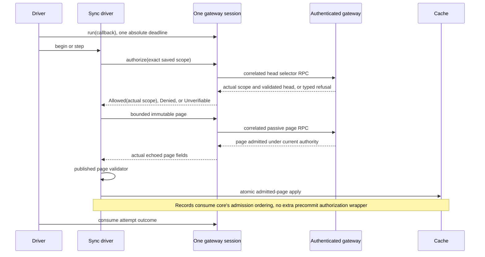

# Read-only sync example: gateway transport

Owner: #261. This transport section composes with the separately owned cache design.

## Ordering / required tests

| Row | Input/order | Owner / required outcome |
|---|---|---|
| T1 | Connect/pinned TLS/`openProduct`/challenge/auth/ready | Same absolute deadline; generated challenge/auth/ready and shared envelope decoder; no passive request before ready |
| T2 | Fragmented/trickled TLS bytes; partial send; event flood; an announced frame above the response bound | DeadlineStream recomputes at each syscall; TLS handshake byte budget, frame/event caps; the frame reader refuses an oversized announced length before reading it; typed bounded refusal |
| T3 | Duplicate keys at any depth, contradictory ok/payload/error, malformed frame kind, unknown envelope keys | protocol frame owner + existing unique_value; ResFrame schema publishes ok/payload/error presence, protocol generator derives the shared TS/Rust runtime table; present null success accepted before method-specific decoding |
| T4 | Mismatched RPC ID or unexpected response while one is pending | Typed correlation failure and discard connection; do not wait past it or attribute it to current RPC |
| T5 | Exact successful head | Existing selector/stream/schema owners + trusted ready origin/identity; actual scope/H, no raw physical-tail fallback |
| T6 | Saved full scope differs only incarnation/schema/epoch | Core exact-scope mismatch/source IdentityChanged; explicit reset path; cache unchanged |
| T7 | Record source Preparing, read timeout, temporary/server busy, offline close | Preserve generated typed code in one operation outcome; core Unverifiable/Unavailable mapping; no empty head, D/A or purge |
| T8 | Fresh head authorization followed by revocation before next read | Next authorize/source actual gateway call refuses; no Allowed from earlier admission |
| T9 | Record page admitted, revoke before local commit | Existing core ordering allows validated immutable page commit; later delivery/reads must reauthorize |
| T10 | Catalogue resolved payload followed by revocation before final authorize | Actual final head RPC refuses; no catalogue page/progress/delete commit |
| T11 | Page request/limit/target echoes contradict otherwise valid returned records | Shared wire conversion + published validate_page; no cache plan from contradictory fields |
| T12 | Manifest/pass/descriptor echo contradicts otherwise valid resolved payload | Shared catalogue conversion + core validate_manifest/validate_resolved; no accepted progress |
| T13 | Resolve core port supplies only ID, product requires descriptor | Retain bounded validated manifest descriptor evidence for that exact pass only; resolve selects from it, no invented descriptor |
| T14 | Auth denied, expired/revoked/read refused, transport absent | Typed cause retained; keep offline cache; generic failure alone does not authorize purge/fencing |
| T15 | Reply lost/client+server restart | Discard uncertain connection; explicit reconnect/discovery from persisted receiver/epoch; no issuance/pairing repeat; cache progress unchanged until commit |
| O2 | Driver begin sees cancellation or deadline arithmetic overflow | Retain typed Cancelled/TimedOut refusal, close existing socket, do not enter callback or send RPC. Busy for an already-active operation retains its existing owner |
| Q1 | Record send queue shares an ordinary-response variant | Inline queue metadata stays within String+Instant plus one word; ordinary body uses an owned box. Record deadline/payload/lease unchanged. Measured target layout 248→40 bytes; ordinary additionally owns its 248-byte body allocation |
| C1 | Application needs typed product outcome values | product_contract/generated publishes the existing product-schema enums/policies without routing or IO; generated DTOs, socket and application ports import this same owner. Generic frame protocol remains separate |
| V1 | Domain retains validated SocketAddr value | Architecture rule permits exact pure std address-value imports and continues refusing modules/globs and socket effect types |
| G2 | Response schema oneOf governs success/payload/error | Presence owner consumes the full schema with Ajv and publishes its truth table before compiling the representation-only ResFrame base; combined frame regression enforces both owners |
| G1 | Generator encounters any node outside the admitted grammar, including nested/reference targets, ambiguous common/frame definitions or malformed keyword combinations | Admit the entire reachable graph before emission and compute all outputs before writes. Rust emission consumes admitted forms only; response oneOf is consumed separately by the schema-derived presence owner before representation compilation (G2) |
| P1 | Test caller assertion unwinds before peer completion | Test peer guard joins owned thread; bounded accept and socket timeouts prevent idle detached peer on test failure |
| A1 | Borrowed credential/client ID exceeds its published character ceiling | Scan at most ceiling+1 characters before connect or owned DTO allocation; refuse InvalidCredential without effects. Supported scalar ceilings pass this acquisition guard; generated shape still owns remaining validity |
| H1 | Authentication reply carries temporary, permanent or unknown error code | Existing product/wire authentication_close_reason maps the same code for server close and client typed Authentication cause; unknown retains original AuthenticationFailed fallback. Deadline and offline cache authority unchanged |
| M1 | Current server advertises 29 ready methods but schema allowed only 16 | Manifest owns handshakeMethod and full inventory; generator publishes ready inventory excluding that own selector and derives schema maxItems. Both producer and decoders consume the publication; no authorization or item-semantic change |
| S1 | Catalogue identity validation from physical constructor or receiver head | Same published check_catalogue_scope_identity consumes org/principal domain IDs; caller attribution is not manufactured; wrong org/principal/schema/stream refused before source use |
| O1 | Driver callback returns or panics while an attempt owns the socket | GatewayConnection::run consumes one outcome; panic records DriverPanicked then physically drops socket before returning; no guessed core success |
| T16 | Cancellation during physical read/write | Synchronous owner stops by cancellation check/absolute syscall deadline and closes; no detached task, cache publication or success before completion |
| B1 | Default online CLI receives a valid passive response after five seconds but before the server read deadline, the server's own generated read timeout, or cumulative valid RPCs lasting sixteen seconds (three 3s head RPCs and a 7s page RPC, each within the 10s read phase) | Default composition derives one absolute whole-callback operation budget from shared server read (10s) plus queued delivery (30s) durations plus its existing 5s scheduling/cache allowance (45s). Handshake remains 5s; custom shorter GatewayPolicy stays valid. Finite page count bounds work count, while elapsed budget may stop a cumulative pass retaining confirmed progress: 45s does not promise completion of every allowed maximum-cardinality pass or arbitrary local work. Enforcers: `default_budget_consumes_valid_delayed_source`, `default_budget_preserves_real_server_read_timeout`, and `default_budget_consumes_cumulative_valid_rpcs` in the composition online tests enforce delayed success, genuine server timeout and cumulative success; existing custom deadline and confirmed-page tests retain refusal semantics. |
| B2 | Each public TypeScript record/catalogue call receives a valid correlated response after 30s but within the server read-plus-delivery allowance; a large record page still needs its pending method for the larger byte ceiling | Product schema owns the existing 10s read, 30s delivery and 5s client allowance, and generation publishes both phases plus the 45s client floor to Rust and TypeScript. All five passive APIs ask WireSession for that floor; configured longer deadlines remain longer and authentication caps/ordinary RPC defaults retain their owners. Actual API → WireSession → encoded message → decoder tests use valid inputs, late successful head/page/manifest/resolve responses and a page above the ordinary ceiling; original and separate record/catalogue floor bypasses must fail. The Rust default remains one 45s callback deadline, not one renewed budget per RPC. Evidence: `passive-read-deadlines.test.ts` covers late record/catalogue replies, larger-page correlation, longer configured budgets, exact floor expiry and typed server timeout; protocol-generation tests cover source mutation and invalid timing refusal. |

Use actual separate Rust client/gateway processes for normal challenge/read,
Preparing/retry progress, cached restart/reconnect, credential-only-read refusing
write/manage, wrong owner/receiver/epoch, loss and both restarts. Use controlled
peer-only fixtures (a native TLS peer) for malformed envelope/fragmentation/oversized-frame/event-flood
branches; these are supplemental, not production acceptance replacements.
Instrument actual gateway read admission to show fresh head calls before each
core authorization boundary, including catalogue pre-commit refusal and record
already-admitted immutable page semantics.


The adapter consumes core9d ordering: record authorization precedes page acquisition; admitted immutable pages may commit after subsequent revocation. Catalogue consumes its existing final authorization. No store authorization wrapper. Reuse nessa_protocol::clock::Clock; absolute elapsed deadlines are checked at every underlying socket syscall. One synchronous connection owner; no hidden retries or unsolicited event queue.


## Default elapsed budget

The online example derives its 45-second whole-callback budget from the existing
[passive source/read and queued delivery phases](../../crates/nessa-server/src/product/passive_read/deadlines.rs)
plus a five-second client scheduling/cache allowance. This allowance is not proof
that arbitrary local work completes in five seconds. Handshake keeps its separate
five-second budget. Discovery and the subsequent finite driver each begin their
own operation; individual RPCs do not renew that operation's deadline. Custom
shorter `GatewayPolicy` remains valid and can end as local `TimedOut`.

Page count bounds work count. Cumulative RPCs and cache work can exceed the default
elapsed budget even when each RPC stays inside the server phases. An incomplete
pass retains confirmed progress for the next explicit invocation; the default
does not promise completion of every allowed maximum-cardinality pass (B1).

## One explicit operation



Catalogue resolution retains descriptors from a validated manifest for that exact
pass. Core's catalogue driver performs its existing final authorization call
before local apply; the adapter answers it through another actual head RPC under
the same operation deadline. No ready-session or previously successful head is
substituted for that call.

The scalar compiler handles only the schema subset used by handshake and generic
envelopes and refuses unsupported keywords during generation. Wire cardinality
and scalar checks do not grant permission. JSON acquisition is separately bounded
by the protected frame ceiling (the generated response bound); JSON and DTO
conversion can retain temporary copies. The TLS handshake is bounded by Auth's
handshake byte budget. TLS buffer capacity, allocator overhead, OS scheduling
and disk work are not reported as exact owned-payload bytes.

## Admitted wire schema grammar

The compiler admits the current transitive frame/handshake roots before emission.
`wire-shape-schema.mjs` owns admission; the emitter consumes only its discriminated
forms. Node/keyword/value/combination errors refuse generation. All forms permit
string description/x-rust-type annotations; tsType:unknown is exclusive to Any.

| Form | Validation fields |
|---|---|
| Any | tsType:unknown only |
| String constant | const:string only |
| String | type:string; optional ordered nonnegative safe minLength/maxLength |
| Boolean | type:boolean only |
| Unsigned integer | type:integer, minimum:0, optional nonnegative safe maximum |
| Integer constant | type:integer, const:nonnegative safe integer; no bounds |
| Nullable unsigned integer | type exactly [integer,null], minimum:0, optional nonnegative safe maximum; no constant/enum |
| Bounded array | type:array, admitted nonboolean items, maxItems nonnegative safe integer; optional minItems<=maxItems |
| Closed object | type:object, plain own properties, unique required own names, additionalProperties:false |
| Reference | ref alone plus annotations; local or loader-owned registry, own target, safe names, no cycles |

Every other keyword/type/combination refuses, including boolean schemas, enum,
untyped constraints, open/schema-valued extras and reference validation siblings.
String constants/property names reject unpaired UTF16 surrogates and encode Rust
literal escapes. Existing unsigned serde value representation remains unchanged.
The frame loader rejects common/frame definition-name collisions before flattening.
Both generators compute and validate all outputs before any writes; input or
computation refusal leaves existing artifacts untouched. Physical write failures
are not claimed to publish atomically. Runtime compiler/Ajv comparisons and
combined response-presence tests provide enforcing evidence.

# Read-only sync example

Owner: [#261](https://github.com/nessalabs/nessa-agent/issues/261).
This document records the accepted simple Rust example client. Native mobile
applications are outside this implementation. The local demonstration uses real
gateway authentication and current Cedar policy; remote enrollment uses the
separately owned [device pairing work](https://github.com/nessalabs/nessa-agent/issues/264).

## Owners and composition

The device client lives in `crates/nessa-client-core/src/read_only_sync/`;
`crates/nessa-client-core/src/composition/` wires the standalone example.
The real paired gateway process tests stay in `crates/nessa-server/tests/composition/`.

The sync core owns finite record/catalogue passes and response validation. The
SDK owns physical fact validation, semantic reduction, checkpoints and read
completeness/freshness. The gateway owns current authentication, grants and
receiver epochs. The example owns one private SQLite cache, bounded transport,
offline presentation and explicit scheduling. It does not access gateway files.

```text
example composition -> driver -> core record/catalogue application
                           |             |                 |
                           |          gateway port      cache ports
                           |             |                 |
                           |       authenticated RPC   one SQLite transaction
                           |                               |
                           +-> offline projection     shared SDK TranscriptFold
```

Arrows are calls. The cache implements both core store ports on one connection,
so catalogue deletion and transcript fencing/purge have one transaction owner.
Composition injects private storage, endpoint/credentials, clock and immutable
resource policy. The application does not read environment, filesystem or clocks.

## State and ordering table

Each row names required regression evidence. Test names are planned until the
corresponding implementation is verified; the table does not claim those tests
already exist.

| Row | Input/order | Decision and durable meaning | Required evidence |
| --- | --- | --- | --- |
| C1 | Fresh cache, no contact | NotLoaded/Unknown; no fabricated empty snapshot | `fresh_offline_cache_is_not_empty` |
| C2 | Restore checkpoint plus contiguous A..D suffix | Validate exact scope, checkpoint A and facts; replay suffix once; show stale snapshot and pending D>A | `restart_restores_pending_suffix_once` |
| C3 | Validated record plan | Compare full scope/D/generation and deletion fence inside immediate transaction; hold an exclusive borrowed SDK transaction; save records/D/A/facts/checkpoint together; commit its active guard after SQL commit | `record_commit_and_checkpoint_are_atomic` |
| C3a | Loaded fold has semantic history and a pending physical prefix; next page or head stages successfully, then checkpoint quota or late SQLite write refuses | The borrowed guard restores exact semantic state, pending prefix, physical validator, head, loaded/freshness and positions on drop; SQL rollback preserves progress/checkpoint/raw bytes. Cache stale/uncertain invalidation stays with the cache owner. Active guard commit follows successful SQL commit and loaded progress changes afterward | `borrowed_fold_restores_late_sql_failure_and_quota`, `borrowed_head_restores_late_sql_failure_and_quota` |
| C3b | Hot mid-fact page against a loaded semantic history | Borrow the actual fold without cloning retained history or accumulated physical payload. The real cache adapter preserves owned semantic payload allocation addresses and measures thread-local Rust allocation bytes against the retained physical prefix; SQLite C allocations are outside that measurement | `hot_cache_page_does_not_clone_pending_prefix` |
| C4 | Unknown frame tag on an otherwise valid physical page | Store the page as one gap. Downloaded advances; applied, facts, and the snapshot stay. No session is published and the cache records no refusal | `invalid_semantic_page_is_a_gap_and_publishes_no_session` |
| C5 | Same plan retried after commit/reply loss | Verify exact saved record bytes/IDs and return existing progress; no second fact | `lost_commit_reply_reconciles_exact_slice` |
| C6 | Competing writer changes D or generation, or uncertain commit | Preserve the admitted in-memory generation through apply; compare inside the transaction, then discard loaded fold/pass and explicitly reload before retry | `competing_writer_requires_reload`, `same_position_generation_change_refuses_delayed_plan` |
| C7 | Same ID at another position or changed bytes | Typed immutable-record conflict before replacement | `record_identity_cannot_change_meaning` |
| C8 | Authenticated correlated zero/equal/newer head | SDK owns empty/current/stale observation; persist loaded checkpoint with existing D/A | `head_observation_uses_shared_freshness_owner` |
| C9 | Ordinary auth refusal, timeout or offline socket | Keep private offline cache; freshness unconfirmed; no purge | `ordinary_failure_preserves_offline_cache` |
| C10 | Catalogue start/resume/unchanged head | Core owns fixed boundary and durable cursor; unchanged head issues no payload resolve | `catalogue_pass_survives_restart` |
| C11 | Current resolve is equal/newer than manifest | Validate through published core owner; commit current entry and cursor together | `catalogue_current_revision_is_retained` |
| C11b | Saved catalogue payload or identity text exceeds its physical acquisition envelope | Read numeric catalogue metadata and ask the published payload ceiling before a second payload query constrained by the admitted length and descriptor; select NULL for oversized identity text. Return typed quota/corrupt refusal and preserve raw storage, with zero owned payload/text acquisition and an accepted bounded metadata counterpart | `catalogue_restoration_bounds_payload_and_identity_acquisition` |
| C11c | Restored individual catalogue descriptor has zero creation or revision before creation | Ask the published core individual descriptor validator on bounded numeric metadata before owned payload acquisition; retain only physical BLOB-width SQL checks and descriptor/length acquisition witnesses. Refuse typed core validation and preserve raw rows/progress; accept full-u64 live/deleted counterparts | `catalogue_descriptor_admission_precedes_payload_acquisition` |
| C11a | Live catalogue payload is malformed, belongs to another descriptor ID, or has invalid product metadata | One source/receiver codec owns JSON fields; use published conversation/agent/model/summary constructors and time ceiling. Refuse the entire page before cache/progress effects; deleted entries carry no metadata payload | `catalogue_metadata_codec_correlates_identity_and_uses_product_owners`, `invalid_catalogue_metadata_does_not_advance_progress` |
| C12 | Trusted catalogue deletion before/during delayed transcript plan | Commit retained tombstone and transcript fence/purge together; delayed plan refuses before effects | `deletion_fences_delayed_transcript_transaction` |
| C13 | Live resolve after retained deletion | Refuse resurrection; retain marker across reset/restart | `deletion_survives_reset_and_restart` |
| C14 | Scope/incarnation/schema/epoch differs | Return explicit ResetRequired; no automatic cache replacement or purge | `changed_scope_requires_explicit_reset` |
| C15 | Explicit local operator reset of an existing scope | Validate same receiver/origin/conversation target and positive expected generation; compare saved scope/generation in immediate transaction; replace with a fresh SDK NotLoaded fold at D/A/facts zero and next generation, remove raw/checkpoint data, retain deletion markers; commit immutable reset receipt with exact before/after scope/progress, LocalOperator cause/initiator and observation time in the same transaction | `reset_is_atomic_and_preserves_deletion` |
| C15a | Exact reset operation retried after lost response, including restart and later record progress | Return the original durable receipt without clearing newer data or changing timestamp/generation | `reset_retry_returns_original_receipt` |
| C15b | Reset operation identity reused with another scope/generation/actor, or an incorrect generation while the exact scope still matches | Refuse conflict or stale before any replacement; no invented reset of an absent stream; generation refusal preserves prior progress and zero reset receipts | `reset_rejects_conflicting_identity_and_stale_generation` |
| C15c | Reset audit insert/commit fails or a deletion fence already exists | Roll back reset with visible typed failure; retain old data and deletion evidence; fenced stream remains inaccessible | `reset_audit_failure_rolls_back_data`, `reset_is_atomic_and_preserves_deletion` |
| C15d | Another cache handle resets the same exact scope while a record pass is delayed | Preserve the old admitted generation; typed Stale before effects even if D is reset to zero; explicit reload starts a new pass | `reset_generation_refuses_delayed_page` |
| C15e | Replacement scope has unsupported SDK physical schema | SDK constructor refuses before purge or reset audit; preserve prior rows | `unsupported_reset_schema_has_no_effects` |
| C15i | Catalogue reset keeps the same six-part scope while an old page is delayed | Generation remains the admitted witness; stale old page refuses before effects even after a new pass starts on that same scope | `catalogue_reset_refuses_delayed_same_scope_page` |
| C15h | Attributed catalogue reset, retry after lost response/later progress, or audit failure | Consume existing immutable CacheReset target/actor/operation; core plans replacement; immediate generation/scope CAS removes live catalogue rows and commits original receipt, retaining deletion records. Exact retry returns original receipt; conflicting identity, stale generation or audit failure preserves prior progress/values | `catalogue_reset_returns_original_audited_receipt`, `catalogue_reset_audit_failure_is_atomic` |
| C15g | Generic core reset lacks local operation/caller evidence | Refuse ResetAttributionRequired before effects; explicit catalogue reset consumes the existing CacheReset admission and commits an original durable receipt | `catalogue_reset_requires_attribution` |
| C12c | Restored live catalogue value has a retained deletion receipt, restored tombstone has lost its receipt, or an incoming live value follows retained deletion with no cached entry | One cache fence owner rejects live/retained-deleted contradictions across reads and writes. A stored tombstone requires its original retained receipt; refuse before payload acquisition and preserve raw progress/entries/receipts, with valid retained counterparts | `retained_catalogue_live_value_cannot_bypass_deletion_fence`, `retained_catalogue_tombstone_requires_original_fence`, `incoming_catalogue_live_value_requires_retained_fence_check` |
| C12b | Deletion proof is consulted after restart/reset | The immutable deletion receipt itself owns the permanent fence by receiver/origin/conversation; no separate fence flag or second descriptor record | `deletion_fences_delayed_transcript_transaction`, `reset_is_atomic_and_preserves_deletion` |
| C12a | Catalogue deletion audit insert fails, or page has invalid live metadata | Roll back catalogue rows/cursor, fence, transcript purge and deletion evidence together; retain loaded transcript until a confirmed transaction | `catalogue_deletion_audit_failure_is_atomic`, `invalid_catalogue_metadata_does_not_advance_progress` |
| C15f | Restored reset receipt has contradictory numeric before/after evidence | Refuse Corrupt without changing transcript progress or replacing the retained receipt | `corrupt_reset_receipt_is_preserved` |
| C16 | Corrupt checkpoint/chunk gap/foreign or oversized stored identity | Read bounded metadata before BLOB/text acquisition; refuse without rewriting original evidence | `corrupt_checkpoint_is_preserved`, `oversized_saved_identity_is_refused_before_text_acquisition` |
| C16a | Removal of a catalogue scope/progress row while its entries remain | The schema foreign key owns the parent relationship and refuses removal atomically; preserve scope and payload across reopen. An actually empty cache still begins normally | `catalogue_scope_owner_is_retained_with_entries` |
| C17 | Database/checkpoint/hydration/display quota | Refuse next bounded operation honestly; no skipped frame or falsely complete target | `cache_quota_does_not_acknowledge_work` |
| C18 | Source reply lost before commit; fixed target under source writes | No cache effect before commit; core finite pass eventually reaches captured target | `source_reply_loss_preserves_progress` |
| C19 | Real client/gateway both restart | Reuse saved receiver binding/private evidence; no new issuance, pair or epoch | `separate_process_restart_reuses_binding` |
| C21 | Offline presentation of a shared validated SDK snapshot, including empty/not-loaded, pending or stale/unknown status | Consume the existing bounded conversation projection and SDK coarse status mapping. Composition supplies transient revision identity; retained display grants no queue, steering, resume, permission or image input controls, and does not dispatch or reduce semantic facts | `retained_projection_uses_shared_bounds_status_and_injected_revision` |
| C20 | Offline list/show subprocess | No network adapter invoked; only bounded projection of shared saved semantic snapshot | `offline_commands_do_not_connect` |
| C22 | Offline selection by stable receiver/origin/target, missing saved progress, paginated retained catalogue or corrupt selected entry | Read the actual saved scope without constructing an incarnation. One SQLite read transaction owns progress and page; select at most the published core entry ceiling plus one bounded identifier lookahead, admit the selected aggregate payload length against the published core payload ceiling before acquisition, and consume the existing descriptor/fence/metadata reader. Return immutable transient metadata and a last-returned-key continuation; raw payload remains the single stored representation. Missing progress returns no page; malformed selected values refuse the entire read without storage effects | `offline_catalogue_reads_saved_scope_and_bounded_pages`, `offline_catalogue_refuses_selected_corruption_without_payload_acquisition` |
| C23 | Initial record reset reads persisted progress with facts greater than applied, or exact reset retry restores that impossible historical before evidence | The existing SDK CommittedTranscript owner publishes its fact-count/applied relationship; SDK restore and cache progress/receipt readers consume that same decision. Refuse typed Corrupt before destructive reset, audit receipt publication or successful historical replay. Preserve the malformed row, raw/checkpoint/current progress and existing receipt bytes. Keep exact historical retry after later work accepted; facts less than applied remain valid for aborted physical positions. Regression cases reach real cache reset with valid original scope/generation/operation, alter only the valid-width stored counter, reopen and observe refusal/no effects; permitted completed/aborted counterparts use real shared fold state. Evidence: `reset_refuses_impossible_progress_fact_count`, `reset_refuses_impossible_receipt_fact_count`, `reset_accepts_aborted_physical_progress_and_retains_historical_retry` and the extended corrupt receipt/checkpoint matrices. |

### Explicit online commands

The same example also accepts `sync-records PROFILE CONVERSATION PAGES`,
`check-records PROFILE CONVERSATION` (zero pages), and
`sync-catalogue PROFILE PAGES`, with `pair PROFILE` (the code read as one line
from standard input) and `status PROFILE` for the device's enrollment. Online
commands take no cache argument: the profile names the device's one cache, so a
Terminal status can only purge the cache that holds that device's data. Online
arguments name the private profile and target, never a guessed source origin or
incarnation. Composition loads the device's issued credential, reads the
gateway's pinned enrollment status, and only for Active opens the protected
native session ([device pairing slice 3](auth/device-pairing.md#protected-reads-over-the-native-channel-slice-3))
with the receiver and epoch that status names; it then asks the authenticated
gateway for the actual scope before opening the cache. The finite driver owns
admitted source work; stdout delivery is separate from confirmed cache effects.

| Row | Online command ordering | Owner / required evidence |
| --- | --- | --- |
| O1 | Malformed command/profile, no issued credential, or a pinned status that cannot be read | Parse/load before connect or opening cache; no read or cache write. Valid private profile counterpart reaches actual authenticated gateway. Actual read-only issued credential can read; actual write and credential-management commands are refused without effects. `online_profile_refusal_precedes_network_and_cache`, `online_unusable_enrollment_does_not_open_cache` |
| O2 | Actual discovery scope differs from the saved six-part scope | Gateway facade supplies trusted exact scope; cache/core return explicit scope/reset refusal while saved bytes remain. The regrant fixture changes the receiver policy revision, which moves the receiver to a new epoch that the next pinned status reports; ordinary restart never issues or pairs again. No guessed origin or automatic reset. `online_scope_change_preserves_saved_cache` |
| O3 | Actual receiver epoch changes before page admission, or after an admitted immutable page is read | Existing ScopeAuthorizer before the source read is the admission observation. A valid already admitted page may finish and commit after revoke; every subsequent page/read/command freshly authorizes and refuses, preserving confirmed prior D/A/checkpoint and marking freshness Unknown. Revocation before page admission adds no page effects. This is no atomic revoke-versus-SQL guarantee and adds no final head RPC. Positive unchanged binding commits the same actual page. `online_revocation_before_page_admission_has_no_page_effects`, `online_revocation_after_admission_preserves_confirmed_page` |
| O4 | Zero head, zero-page check, pending physical fact or bounded catchup | Composition uses generated product `MAX_RECORD_PAGE_RECORDS` (16), `MAX_RECORD_PAGE_PAYLOAD_BYTES` (65546 from `RecordPageRequest.maxPayloadBytes.maximum`) and `MAX_PHYSICAL_RECORD_PAYLOAD_BYTES` (65546 per-record) ceilings when constructing core Limits. Real wire accepts the aggregate boundary and refuses its immediate successor; process fixture saves one actual fact spanning at least two physical pages. Real driver/SDK/cache return actual captured timestamped check, physical D and terminal A/facts/status separately; pending bytes seal only after later command. `online_process_restarts_reuse_actual_binding`, `online_product_aggregate_boundary_and_read_privilege_are_actual` |
| O5 | Connection disappears or final observation fails after confirmed pages | Preserve already committed progress/data; typed transport/core/cache/freshness evidence remains independent, freshness becomes Unknown. JSON includes the consumed connection operation number as transient attempt correlation; it resets with a new connection and is never a durable source position or access epoch. A successful begin_pass preserves its immutable captured head/time even on later refusal; absence means no successful captured check, not absence of an attempted connection. No rollback claim or hidden retry. `online_connection_loss_preserves_confirmed_pages` |
| O6 | Stdout fails after confirmed commit; command is repeated or offline state is reopened | Report output failure without repeating effects; reopening sees original confirmed D/A/data and exact-repeat semantics. `online_process_restarts_reuse_actual_binding` |
| O7 | Client and gateway restart | Reopen the same device credential, gateway key, receiver authority and source/cache stores; the native address is configured, so the profile is unchanged. No new issue/pair/epoch. `online_process_restarts_reuse_actual_binding` |
| O8 | Source appends after finite pass capture | Finish original target and report original head/time; no retarget or extra head observation. Existing D4a driver regression plus `online_source_append_does_not_retarget_captured_pass`. |
| O9 | Authenticated catalogue resolve refuses an entry exceeding the supplied remaining payload budget | Preserve core OversizedEntry separately from transient Unavailable and retain the exact gateway refusal cause; the connection closes without an implicit retry. `catalogue_resolve_preserves_oversized_entry_and_transport_cause` exercises the real session facade and correlated wire response. |

### Fetching a held file

`fetch PROFILE CONVERSATION DIGEST MIMETYPE SIZE OUT` reads one file the
conversation holds with `artifact.read`, named as `show` lists it under the
view's `artifacts`. Admission is the other online commands' (pinned Active
status, then the protected session); it opens no cache, and a Terminal purge
empties only the cache, never a file already fetched. Each 32 KiB range is its
own connection operation, and every fetch asks at least one, so a part on
disk never stands in for the gateway saying the conversation holds the file
now. The file is assembled in `OUT.<key>.part` beside `OUT`, the key being 32
hex digits of a SHA-256 over the conversation, digest, media type and size,
so a part is only ever resumed by a fetch of that same file in that same
conversation. It is hard-linked at `OUT` only after the part, read back from
disk, has SIZE bytes and the digest. An `OUT` whose file name is longer than
217 bytes has no room for its part's name and is refused `file` step `name` before
anything is dialled; a file system without hard links refuses at step `link`.
One JSON line reports it, with the same keys whether or not anything was
dialled; a failure on the local files exits as a local refusal, any other as
an online one.

| Row | Fetch ordering | Owner / required evidence |
| --- | --- | --- |
| F1 | `OUT` already exists | Before the profile is opened or anything dialled, looked at without following links: a regular file of SIZE bytes and the digest answers success with zero ranges; anything else (another size, a directory, a link even to nothing) is refused `outputExists` without being opened, and left alone. Either way a part of this file no fetch holds is removed; a held one stays. `an_output_already_there_answers_before_anything_is_dialled`, `an_output_that_is_not_a_regular_file_of_the_size_is_not_opened`, `a_link_at_the_output_is_refused_and_never_followed`, `a_part_no_fetch_holds_is_removed_and_a_held_one_stays` |
| F2 | A part another run left | Only a part keyed on this conversation, digest, media type and size is found; one another conversation's fetch left is never resumed. A complete part still asks its last range again, and keeps nothing unless that range is answered. Otherwise resumed from its length, held with an exclusive lock; a part another fetch holds, or creates first, stops this one `locked`. A part whose name moved to another file while it was held is held once more from the name, then refused `changed`. A part longer than SIZE is emptied. `two_fetches_never_hold_one_part`, `a_second_fetch_of_one_output_stops_on_the_lock_and_the_first_keeps_the_file`, `a_name_moved_to_another_file_no_longer_names_the_one_held`, `a_part_assembled_for_one_conversation_is_never_used_for_another`, `a_complete_part_still_asks_the_gateway_for_its_last_range`, `a_complete_part_the_gateway_refuses_or_misanswers_keeps_nothing` |
| F3 | A range answered `temporarily_unavailable` | The connection is kept and the same range asked again after 250, 500 and 1000 ms, then the fetch fails with that code; the part stays. No status recheck. `a_range_busy_past_the_bound_keeps_the_part_and_asks_nothing_more` |
| F4 | An answer that is not the range asked, or not canonical base64 | Fails before anything is appended. `an_answer_that_is_not_the_range_asked_is_kept_nowhere`, `only_canonical_padded_base64_is_decoded` |
| F5 | Any other refusal | Fails at once with its typed code, the part kept for a resume; `unknown_method` (an older gateway) is `unsupported`; an authority refusal asks the pinned status again. Nothing is created before the first range. `a_refused_fetch_leaves_no_output_and_no_empty_part`, `a_forbidden_range_asks_the_status_again`, `online_fetch_refusal_writes_nothing_beside_its_output` |
| F6 | The part on disk is not the file | Removed, or emptied when it cannot be removed; both reported, and `reached` is 0 since none of it counts. `OUT` is not written. `bytes_that_are_not_the_named_digest_discard_the_part_and_keep_nothing`, `bytes_another_writer_added_to_the_part_fail_the_check_and_nothing_is_kept`, `a_part_of_other_bytes_on_disk_is_discarded_and_no_output_appears` |
| F7 | Kept | Part synced, hard-linked at `OUT`, its own name removed, directory synced on Unix (on Windows the part is closed first). There is no separate check: the link refuses anything at `OUT` when it is made as `outputExists`, never replacing it. A part name that cannot be removed after the link is reported `remove`; the next run finds `OUT` is the file and removes it. `keeping_never_replaces_an_output_that_is_there`, `keeping_refuses_whatever_is_at_the_output_when_it_links`, `a_link_at_the_output_is_refused_and_never_followed` |

### Following a conversation

`follow PROFILE CONVERSATION PAGES MAX_PASSES` keeps the private record cache
fresh while a conversation changes, so a separate-process test can drive
"subscribe, then copy records from the durable checkpoint whenever they
change" with the real client, on two paired devices at once. It is
deliberately minimal: a phone keeps its own continuous lifecycle. No stop
seam, no reconnect, no timestamps on its lines, no catalogue follow in this CLI
(the gateway supports a device's grant-scoped `conversation.subscribeList`;
this CLI's catalogue freshness remains `sync-catalogue`).

The wake is the gateway's own `conversation.subscribe`, the one live read path
([record subscriptions](record-subscriptions.md)). A view frame names the
committed position its fold read (`cursor`). A view whose cursor moved means
records were committed, so the loop runs one checkpoint pass. A view at the
cursor already seen changed only live facts, such as the title or the agent's
state, and runs nothing. The view itself is not stored: the cache holds
records, and `show` folds them.

```mermaid
sequenceDiagram
    participant Client as follow (example client)
    participant Gateway as Gateway (one native connection)
    Client->>Gateway: pinned status, then connect and discovery (as sync-records)
    Client->>Gateway: conversation.subscribe {conversationId}
    Gateway-->>Client: {subscriptionId}, then the first conversation.view {cursor}
    Note over Client: line "subscribed"; the first cursor is the baseline
    Client->>Gateway: recheck pass from the durable checkpoint
    Gateway-->>Client: conversation.view (read inside the pass and kept)
    Note over Client: line "pass", then "view" duringPass if its cursor moved
    loop until MAX_PASSES, idle, or the subscription or connection ends
        Client->>Gateway: wait for a view (one operation, ordinary deadline)
        Gateway-->>Client: conversation.view {cursor}
        alt cursor moved
            Client->>Gateway: pass from the durable checkpoint
        else same cursor
            Client->>Client: wait again, no line
        end
    end
    Note over Client: line "ended" with its reason
```

Every step is one operation on the one connection the example already owns
(`Session`): the subscribe with its first view, each wait, and each pass.
Views and the subscription's end that arrive while another operation waits
for its response are kept in the session's subscription inbox and never count
toward the per-operation unexpected-event capacity. A wait takes the newest
kept view and drops the older ones, because each view replaces the one before
it. stdout carries one JSON object per line: `subscribed`, `pass` (its
`report` is the same object `sync-records` writes, `enrollment` and `recheck`
included), `view` and a final `ended`. A refusal before subscribing (rows W1,
W16) is instead the one object `sync-records` writes for it. Exit status is 0
only when the run ends `passesExhausted` or `idle` (owner's decision).

Placement: the loop is `read_only_sync/application/follow.rs` over two ports
(`FollowSession`, `FollowEvents`); `Session::{subscribe, wait_view}` and the
inbox are in `infrastructure/gateway/session.rs`; the lines are
`entrypoint/follow.rs`; `crates/nessa-client-core/src/composition/online.rs`
adapts the connection, driver and cache to the session port and runs the PC5
status recheck.

`app::` is `crates/nessa-client-core/tests/read_only_sync/application/follow.rs`,
`session::` is `…/tests/read_only_sync/gateway/session/subscribe.rs`, `args::`
is `…/tests/read_only_sync/entrypoint/arguments.rs`, `device::` is
`…/tests/read_only_sync/application/device.rs`, and `online::` is
`crates/nessa-server/tests/composition/read_only_online.rs`.

| # | State / event / ordering | Result | Tests |
|---|---|---|---|
| W1 | Start: profile, credential and pinned status (device-pairing PC1–PC4); status not Active, or unreadable because the gateway is gone | Refused before any connection or cache open, with the same output `sync-records` gives; exit 1 | `online::online_unusable_enrollment_does_not_open_cache`, `online::online_two_devices_follow_live_views_and_converge` (step 9) |
| W2 | Active; connect; discovery reads the actual scope; the cache opens; `conversation.subscribe` is admitted and its first view arrives, with the reply or after it | `subscribed {subscriptionId, connectionOperation, enrollment}`; the first view's cursor is the baseline the recheck pass covers | `session::a_view_before_the_subscribe_reply_is_delivered_first`, `online::…converge` (step 2) |
| W3 | Subscribe refused: `subscription_capacity`, `subscription_duplicate`, `conversation_not_found` (not granted to this device), or an authority code | `ended {subscribeRefused, cause}` before any pass. `forbidden` and `unauthorized` ask pinned status once (PC5) and report it as `recheck`; exit 1. The first frame being `conversation.subscriptionEnded` ends the run the same way, with `subscriptionEnded` | `session::typed_refusals_keep_the_connection`, `app::subscribe_refusal_ends_before_any_pass`, `app::an_end_as_the_first_frame_runs_no_pass`, `device::only_authority_refusals_ask_status_again` |
| W4 | Subscribed: the recheck pass runs first, unconditionally, from the durable checkpoint | `pass {trigger: recheck}` precedes any `view` line, even when a newer view is already kept; a commit between the first view and the recheck is caught by that pass and also arrives as a moved view | `app::first_pass_is_the_recheck_even_with_a_kept_view`, `online::…converge` (step 3) |
| W5 | Waiting; a view whose cursor moved arrives | `view {cursor, duringPass: false}`, then one `pass {trigger: view}` | `app::a_moved_view_while_waiting_starts_one_pass`, `online::…converge` (step 5) |
| W6 | One or many views during the subscribe or a pass, including in the same read as a response | The newest is kept; after the pass line, `view {duringPass: true}` once, then exactly one more pass. Views never count toward the event capacity | `session::views_during_a_read_come_out_newest_first_and_once` |
| W6b | A view at the cursor already seen (live facts changed, no record) | No line and no pass. A view from another incarnation is a moved cursor. The next wait starts its own deadline, so live-only changes keep a follow from ending `idle` | `app::a_view_at_the_same_cursor_runs_no_pass` |
| W7 | A pass ends incomplete (the `PAGES` budget) without failure | The next pass starts at once with `trigger: incomplete`; confirmed progress is kept | `app::incomplete_pass_continues_without_waiting` |
| W8 | A pass fails with an authority refusal | PC5 once; `ended {unauthorized, cause, recheck}`; exit 1 | `app::authority_failure_ends_unauthorized` |
| W9 | A pass or the subscribe fails on transport, timeout or protocol; a pass cannot begin; or a pass fails with no gateway cause (a cache or driver refusal) | `ended {unavailable, cause}`, or `ended {passFailed}` whose cause is in that pass's report; a pass that could not begin read nothing and writes no `pass` line; the saved view is unchanged; exit 1 | `app::transport_or_cache_failure_ends_the_follow`, `app::pass_that_cannot_begin_ends_without_a_pass_line` |
| W10 | `conversation.subscriptionEnded {lagging \| refused \| source_closed \| too_large}` while waiting or during a pass | The end comes before any kept view and is seen at the next wait, so a pass under way, and any incomplete passes after it, finish first; then `ended {subscriptionEnded, ended: {code: subscriptionEnded, productCode}, cause}`. A `refused` end carries its typed refusal as `cause`, and an authority refusal asks pinned status once; exit 1. If those passes spend `MAX_PASSES` first, the run ends `passesExhausted` (row W13) and the next command's pinned status is the check | `session::the_end_comes_first_and_a_refused_end_keeps_its_code`, `app::subscription_end_stops_after_the_running_pass`, `online::…converge` (step 8: a revoked receiver) |
| W11 | The gateway closes the connection while the client is waiting or mid-pass (revocation, shutdown, deadline, process gone), including a reset or abort that carries no frame | `ended {connectionClosed, cause}` and exit 1. `failed` matches every `Closed` before `asks_status`, so the end reason stays `connectionClosed`. A terminal revoke, classified by `connection_outcome` (ADR 811), asks pinned status once and the line carries that `recheck`; the refusal does not purge. Plain EOF, a retryable close, `server_shutdown`, and `protocol_incompatible` carry `recheck: null`. The next command's pinned status is that same check | `session::a_wait_fails_on_close_stray_response_or_no_subscription`, `deadline_stream::peer_reset_or_abort_is_an_untyped_close_and_other_errors_stay_transport`, `app::connection_close_stays_connection_closed`, `online::…converge` (step 9) |
| W12 | A wait reaches the ordinary operation deadline with nothing read | `ended {idle}`; exit 0 | `app::idle_wait_ends_cleanly` |
| W13 | `MAX_PASSES` reached (the recheck counts; `0` is an argument error) | `ended {passesExhausted}`; exit 0; the connection drops, which ends the subscription | `args::follow_requires_a_positive_pass_count`, `app::pass_budget_ends_cleanly`, `online::…converge` |
| W14 | A stdout write fails | The loop stops at that line; committed cache effects are not repeated; exit 1 | `app::output_failure_stops_the_follow` |
| W15 | A frame for another subscription or conversation, or a response while nothing is pending | `GatewayError::Protocol` / `Correlation`; `ended {unavailable}` | `session::a_foreign_subscription_id_is_a_protocol_failure`, `session::a_view_for_another_conversation_is_a_protocol_failure`, `session::a_wait_fails_on_close_stray_response_or_no_subscription` |
| W16 | Active and connected, but discovery is refused (after row W17's attempts, when it answers `source_preparing`) or the cache cannot be opened | Before `subscribed`: the one object `sync-records` writes for that refusal (`discoveryFailure`, with `recheck` after an authority refusal; or `cacheRefusal`), with no `kind` and no `ended` line; no cache is created by a discovery refusal; exit 1 | `online::online_follow_precondition_refusals_use_the_records_output` |
| W17 | A pass, or the discovery before subscribing, is answered `source_preparing` (the gateway's cold-read work budget ran out; its preparation progress is kept) | The attempt fails but the connection stays open (`source_preparing` is the one typed refusal that keeps the session); the attempt's `pass` line, then the same pass again at once on the same session with `trigger: preparing`, not counted toward `MAX_PASSES`, up to `PREPARING_ATTEMPTS` (4) attempts; an attempt that succeeds continues as any pass does. Still preparing after the last attempt: `ended {unavailable, cause: record/source_preparing}`; exit 1. Discovery before subscribing is retried the same way, with no line per attempt; still preparing after the last attempt is row W16's refusal | `app::preparing_pass_is_retried_until_it_succeeds`, `app::preparing_beyond_the_attempt_bound_ends_unavailable`, `app::preparing_discovery_is_retried_until_it_succeeds`, `app::discovery_retries_only_preparing_and_only_up_to_the_bound`, `online::online_follow_subscribes_after_a_preparing_discovery` |

`online::online_two_devices_follow_live_views_and_converge` is the client
acceptance: two paired devices follow one conversation on a gateway that is
never restarted, each commit is one moved view and one pass per device, and
both caches equal a fresh replay. The fixture gateway's `hold` and `release`
actions make the W4/W6 race deterministic: `hold` arms a `HeadHold` gate
(`tests/composition/read_only_online/fixtures/gateway.rs`) that parks the
second head read from then on (a `follow`'s discovery reads the first, its
recheck pass the second); the test commits while that read is parked, then
`release` lets it answer, so the recheck pass reads a head that already holds
the commit. `online::online_two_devices_catch_up_after_restart_and_revocation_purges_only_the_victim`
covers a gateway restart: a commit made before either device reconnects is
recovered by each `follow`'s recheck pass from the durable checkpoint. A
commit that lands while nothing follows is never announced; the recheck is
the recovery path, because the gateway's change notices are process-local
([committed change watches](committed-change-watches.md)).

## Transaction and resource policy

### Explicit command scheduling

The Cargo example is a thin executable over this feature's entrypoint. A command
owns its synchronous gateway connection and does not start a timer or worker.
The caller supplies a finite page count, including zero for a head-only check.
Each invocation begins from durable progress and discards its local pass when
it returns. A later invocation asks the core to begin or resume again.

| Row | Command ordering | Result | Required evidence |
| --- | --- | --- | --- |
| D1 | Record begin succeeds, zero pages admitted | After the finite page loop, explicitly observe the core's captured authenticated head through the cache's SDK owner; report that transient head and observation time separately from durable D/A | `driver_head_only_check_preserves_saved_positions` |
| D2 | Page budget ends before a captured record target | Return pending with actual pass position and captured target; final explicit observation marks Stale while D is below that snapshot; preserve committed D/A; next command starts from saved progress | `driver_page_budget_resumes_after_reopen` |
| D3 | Record begin/page or head observation fails | Discard pass; ask cache to mark freshness unknown, retain the original typed failure and any separate cache refusal; no hidden retry | `driver_failure_retains_data_and_reports_unknown` |
| D4 | Captured record pass completes | After all confirmed pages, explicitly observe the original authenticated captured head with the timestamp captured after begin_pass. SDK owns Current when D equals that snapshot; later source writes require another explicit command | `driver_page_budget_resumes_after_reopen` |
| D4a | Source appends after capture; final observation refuses after page commit | Finish the original finite target and report its original check/time without a new head read. Final observation failure preserves confirmed D/A/data, retains its typed cache cause and marks Unknown | `driver_keeps_captured_head_when_source_appends`, `driver_final_observation_failure_preserves_confirmed_data` |
| D5 | Catalogue budget ends, or source reply fails | Retain only confirmed core page progress; discard command-local pass; resume using core `begin_or_resume` on next invocation; report a pass boundary as work progress, never as a current head check | `driver_catalogue_budget_resumes_confirmed_pages` |
| D6 | Offline list/show | Read only actual saved stable target through the cache; do not acquire a credential or construct a gateway connection; report connection check as not performed | `offline_commands_do_not_connect` |
| D7 | Offline show discovers a saved scope, then another writer advances or replaces it before fold restoration | Refresh through the existing cache scope/generation owner; produce positions and view from the same loaded fold, or refuse changed scope. A retained deletion maps to deleted; missing progress maps to not-loaded | `offline_show_projects_saved_positions_and_status_together` |
| C17a | Cache composition supplies suffix limits above the SDK/core physical envelopes | The physical cache adapter asks published source ceilings before opening the database. The application policy owns only finite positive database/checkpoint allowances; decoder scope, position, and checkpoint failures map to typed cache outcomes, with SDK application decision causes preserved. An unreadable frame is a gap, not a cache refusal | `physical_cache_policy_refuses_before_database_open`, `sdk_decision_refusal_retains_application_cause`, `invalid_semantic_page_is_a_gap_and_publishes_no_session`, `unsupported_reset_schema_has_no_effects` |
| D8 | Explicit reset command supplies operation/caller, exact old/new six-part scopes and expected generation | Consume the existing attributed cache reset; output its original receipt with before/after meaning, cause, initiator and timestamp. Exact retries reuse caller-supplied operation identity; output failure does not retry or fabricate rollback | `reset_command_outputs_original_receipt_after_reopen` |

The online command profile names the device's private enrollment state (an
absolute root and a relative directory), its one cache (absolute), and the
gateway's numeric native address. It holds no secret, receiver, epoch or source scope: the device key,
gateway pin, credential id and receiver live in the private state, and the
epoch is read fresh from the pinned status each command. Composition reads a
private profile of at most 16 KiB and opens the private state through its
owner, which refuses unsafe storage and a second opener.

| Row | Profile ordering | Result | Required evidence |
| --- | --- | --- | --- |
| D9 | Private profile is absent, malformed, oversized, has duplicate/unknown fields, a hostname, a relative root or cache, or an absolute state directory | Refuse before opening private state or any connection; decode only a bounded private file | `private_profile_admission_is_bounded_and_explicit` |
| D10 | The private state is first used, or already held by another command | Created beneath the root on first use; a second opener is refused while the first holds it | `profile_opens_one_private_state_owner` |

Connection-check results belong to the current command. No durable last-contact
timestamp or inferred successful check is added to the cache. The existing D/A
positions continue to describe saved download and semantic apply. Offline reads
use SDK restored freshness and cannot infer current source emptiness from absence.

Record progress stores the exact six-part scope, physical D, terminal semantic A,
fact count and a monotonic cache generation. Checkpoint chunks describe A only;
raw immutable records retain the contiguous pending suffix through D. Opening a
transcript loads its checkpoint and suffix once. Applying a page holds the already
loaded fold’s exclusive borrowed transaction through the SQL transaction; it does not restore/replay all history per page. A stale writer or
uncertain transaction invalidates that in-memory state before further use.

An immediate SQLite transaction checks durable progress and fences before
inserting records. It persists a new full semantic checkpoint only when semantic
state/A changes or an authenticated zero-head observation establishes loaded
emptiness. A page ending mid-fact updates D and retains its raw suffix without
rewriting unchanged checkpoint chunks. Exact physical ID reuse remains the
store's responsibility; frame/semantic rules remain SDK-owned.

Immutable composition policy names a database page-byte ceiling, a total encoded
checkpoint-byte ceiling, bounded suffix reads and display/hydration limits. The
SQLite page ceiling covers the database file; a rollback journal may temporarily
require additional filesystem space. Encoded checkpoint bounds and network page
bounds are not a claim of a fixed aggregate semantic-memory limit. Report full
snapshot/checkpoint allocation and serialization costs in the experiment. Refuse
oversized histories before loading checkpoint BLOBs; never truncate a checkpoint.
Stored identifier acquisition uses a SQLite storage-byte envelope derived from
twice the core's published `MAX_ID_BYTES`, allowing SQLite's UTF-16 representation.
The core `Id::new` remains the sole semantic identity validator. Suffix metadata
reads numeric lengths before text/payload; progress selects NULL for oversized
stored fields before asking SQLite for their text. Refusal preserves the file.

Catalogue and transcript keys include receiver/origin identity; scope replacement
is explicit. A catalogue deletion fence is keyed by stable conversation identity
under that receiver/origin, independent of recycled incarnation or grant epoch.
Reset cannot remove that permanent deletion evidence. Current catalogue payloads
are opaque protocol bytes until decoded through the source-published metadata codec.
Its transient read model asks existing product constructors; the cache stores only encoded bytes.

## Transport and local setup

The standalone Cargo example's retained reads are:

```sh
cargo run -p nessa-client-core --example read_only_sync -- list CACHE RECEIVER ORIGIN CATALOGUE
cargo run -p nessa-client-core --example read_only_sync -- show CACHE RECEIVER ORIGIN CONVERSATION
```

Use the issued receiver and actual gateway/catalogue identities saved by setup.
`list` returns at most the published catalogue entry ceiling. If `next` is
present, repeat `list` with its decimal `creation` and `id` appended. A page with
no entries is not a claim that an uncached catalogue is empty. `show` emits the
shared bounded retained view with separate downloaded/applied positions. Both
commands report `connectionCheck: notPerformed`; their saved status is not a
successful contact. The private database's parent must already exist under the
shared local-storage permissions contract.

Local reset commands accept the complete admitted target and expected generation:

```sh
cargo run -p nessa-client-core --example read_only_sync -- reset-records CACHE RECEIVER ORIGIN STREAM OPERATION CALLER GENERATION OLD_INCARNATION OLD_SCHEMA OLD_EPOCH NEW_INCARNATION NEW_SCHEMA NEW_EPOCH
cargo run -p nessa-client-core --example read_only_sync -- reset-catalogue CACHE RECEIVER ORIGIN STREAM OPERATION CALLER GENERATION OLD_INCARNATION OLD_SCHEMA OLD_EPOCH NEW_INCARNATION NEW_SCHEMA NEW_EPOCH
```

Use the same operation and arguments for an exact retry after output loss. JSON
contains the original durable receipt, including prior/new progress and the local
operator attribution. A refusal emits no receipt. Deletion evidence remains
permanent under the cache reset owner. These commands do not contact the gateway.

The production adapter consumes generated Rust DTOs and shared product codecs.
Over the strictly pinned native TLS connection it selects the product session
with `openProduct`, performs the challenge/authenticate/ready exchange with the
device's credential id, correlates RPC IDs and every returned scope/limit/target
field, and refuses an announced frame above the published response bound before
reading it. It has one outstanding passive RPC, one total request deadline,
bounded unexpected-event handling and typed failures.
RecordsHead discovers actual scope from conversation/receiver/epoch; the client
does not guess an incarnation or inspect gateway storage. Catalogue methods are
provided by #297. Preparing is temporary unavailability, not an empty source.

Setup pairs the device: the owner creates a code on the product socket, the
device runs `pair` with the code on standard input, and the owner approves the
exact claimed key, which stages the receiver and issues a credential holding
only conversation.read for the owner's own principal. Restart reuses the
binding rather than issuing or pairing again. The code is read from protected
input, never command-line arguments or general logs.

The CLI has finite record and catalogue sync, an online record check, offline
`list`/`show`, explicit reset, and one bounded `follow PROFILE CONVERSATION
PAGES MAX_PASSES` that follows a conversation through `conversation.subscribe`
on one connection ([following a conversation](#following-a-conversation)).
Experiment controls and weak-link shaping remain future #262 work. Data goes to stdout as JSON and tracing to stderr.
Offline cache readability is intentional local policy. Only correlated trusted
grant/epoch/deletion contact evidence authorizes fencing/purge; generic auth
failure or network absence supplies no such evidence. The one purge is the
pinned enrollment status reading Terminal: the device's record store purges
the receiver's rows, with a receipt that fences it, before the enrollment
record may go (device pairing rows PC3–PC5).

## Acceptance and dependencies

Use actual gateway and independent Rust client processes with separate files.
Provider fixtures may produce source facts; auth contexts, source replies and
fold reducers may not be replaced by in-process acceptance doubles. Cover >600
catalogue identities, multi-frame pending facts, response/commit loss, both
restarts, wrong owner/receiver/epoch, current read versus refused write/manage,
deletion/reset races, two cache writers and corrupt private cache evidence.

#315 supplies bounded terminal discovery; #277 supplies the shared fold and
public freshness observation; #296 supplies authenticated actual record scope
discovery; #297 supplies catalogue reads. Their final reviewed heads are consumed
before assembled acceptance. #262 adds the explicit driver/weak-link measurements
after this cache/transport; #264/#265 own secure remote enrollment/contact. This
example does not supply an arbitrary recent-tail checkpoint or claim OS wake,
remote availability, memory, latency or background execution guarantees.

### Explicit reset receipts

The local operator supplies one bounded operation identity and caller identity for
an explicit reset; retry carries that same immutable request. The durable cache
is both the reset effect and audit persistence adapter: receipt insertion shares
the data transaction, so audit failure cannot acknowledge a reset. Receipts
retain the original prior positions and scopes, resulting zero positions and
advanced generation, cause, caller and observation time. A retained deletion
fence is preserved and refuses reset. A reset requires an existing admitted
scope/generation; deleting the progress row would allow an old D=0 pass to recreate
its old scope, so the replacement zero-progress row remains as the CAS witness.
The driver discards its active pass and loaded fold before admitting new source
work after reset. Receipt history intentionally consumes the private database
quota; it is never silently evicted to admit another reset.

Generator import decision: shared product outcome publications remain complete. Rust payload imports are selected only when an emitted Rust field references a shared enum, through the schema type emitter; external wire owners retain their own imports. The aggregate record page constant is published from its request property owner independently of the per-record allowance. Generator grammar, no-write and runtime parity checks verify these publications.

### Coherent retained output boundaries (issue 261 correction)

Saved transcript output is one observation of a refreshed loaded cache owner: positions, generation, facts and fold status come from that same owner. Source check/work evidence remains independent. A writer may change the database after this observation; output does not promise the database is unchanged when stdout is read. Offline catalogue inactive progress is `stale`, including completed revision zero. Zero can be either a reset CAS witness or a genuinely completed empty pass; retained entries and `connectionCheck:notPerformed` do not identify which. No offline current-source emptiness is inferred.

| Row | Ordering | Owned result and regression |
| --- | --- | --- |
| P1 | No competing writer between target selection and refresh | Same loaded owner supplies generation/D/A/facts/status. Selection's read transaction commits before refresh, so a competing writer in that gap does not share the observer's lock. The regression is in-process and does not shell out to `sync-records` (the Windows failure of that subprocess unwrap, #426). `online_saved_projection_handles_competing_owner` |
| P2 | Same-scope reset in that gap | Refreshed zero positions/new generation/NotLoaded together, never old progress/new fold; actual composition `online_saved_projection_handles_competing_owner` |
| P3 | Changed-scope reset in that gap | Existing typed scope refusal; preserved durable reset state; same composition regression |
| P4 | Deletion in that gap | Existing fence refusal, offline Deleted mapping; no live mixed projection; same composition regression |
| P5 | Valid suffix append in that gap | New positions and fold status together; original captured source target/time remains separate; same composition regression |
| P6 | Retained view has its final status/revision and encoded display payload | Existing `bound_view` measures the complete returned view, truncating display through the same owner as live reads while preserving identity, status and read-only authority; `retained_projection_uses_shared_bounds_status_and_injected_revision` |
| L1 | Complete live catalogue, explicit reset, reopen before read | Inactive stale progress0, live values absent; `offline_catalogue_reset_is_not_empty_source_evidence` |
| L2 | Explicit deletion, reset, reopen | Retained tombstone and stale state; same regression |
| L3 | Repeated reset after lost output | Original attributed receipt remains independent of current list; same regression |
| L4 | Actual begin/complete head0, offline list | Empty retained entries/progress0/stale, no source-contact claim; `offline_list_loaded_empty_is_distinct_from_absent` |
| L5 | Partial pass or no saved progress | Existing partial or notLoaded; same command regression |
