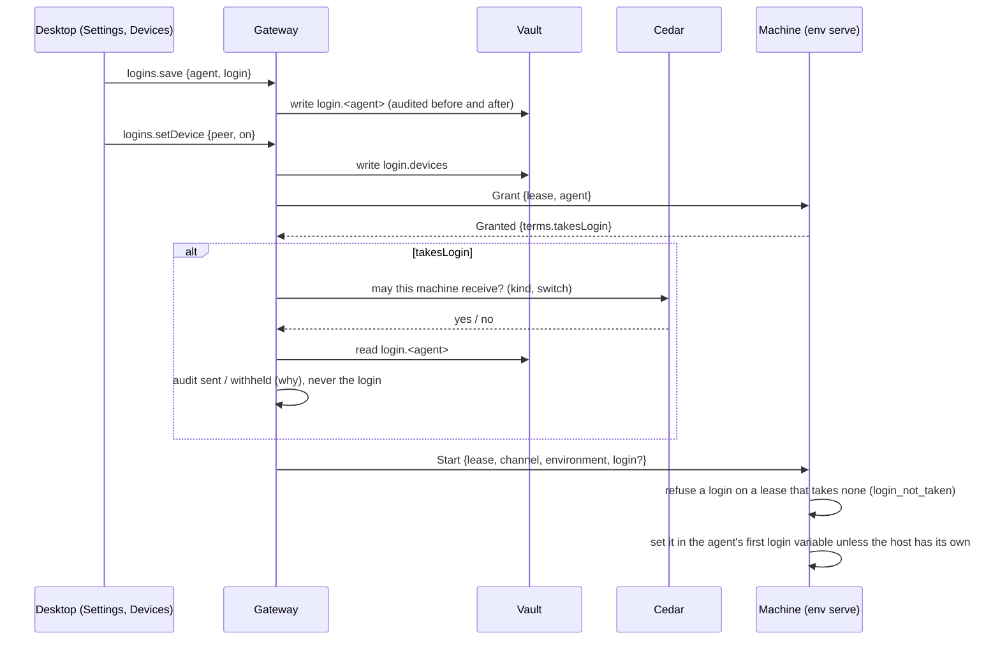

# Saved logins

Issue #1260. Sign in an agent once, on the gateway, and every machine in
Devices that runs agents for it can use that sign-in.

## The rule

The gateway's vault is the one place a login is kept. It is never copied
to another machine's disk: it travels with each agent start, by value, and
the machine holds it only for the harness it starts with it. Replacing or
removing a login, or turning a switch off, applies to agents opened after
it: the login is read once when an agent's lease opens, and an agent already
open keeps the one it opened with until it closes (an idle agent parks after
`agentIdleSeconds`, so it reopens with the new answer). The `sent` record is
written when the lease opens with the login, before the harness starts. Each `sent`
or `withheld` record names the lease that asked, whose own records name who
started it. A save, removal or switch whose outcome cannot be recorded
after it was made answers `logins_change_unrecorded`, not a refusal: the
change stands, and Settings reads the status again.

Three yeses are needed before a login reaches a machine, each owned by one
place:

| Question | Who answers | Where |
| --- | --- | --- |
| Does this machine take logins from this gateway? | The machine's owner | `grants.json` `acceptLogins` (`nessa env grant --logins`); SSH takes them without an entry |
| May the gateway hand this machine logins? | Cedar, over facts | `logins/infrastructure/cedar/policies.cedar` |
| Is a login saved for this agent? | The vault | entries `login.claude`, `login.codex`, `login.opencode` |

The Cedar policy permits SSH hosts and Boat workspaces (this gateway signs
in as their account and can already set anything a harness there runs
with), permits a paired machine only while its "Use my saved logins here"
switch is on (vault entry `login.devices`), and forbids this gateway's own
machine. A machine with its own sign-in for an agent keeps it: the host
wins. Its own sign-in is any of the agent's login variables in the
harness's environment, or a sign-in file that harness will read (Claude
Code's `.credentials.json` in `CLAUDE_CONFIG_DIR` or `~/.claude`, Codex's
`auth.json` in `CODEX_HOME` or `~/.codex`). OpenCode's `auth.json` is not
one of those files: a lease starts OpenCode in a private data directory
so the process cannot read the caller's file, and the only credential it
accepts is `OPENCODE_API_KEY` already in the harness environment. A
Claude Code sign-in kept only in a Mac's keychain is not seen, so such a
Mac is handed the saved login unless its owner runs
`nessa env ungrant --logins` (or `--peer ssh --logins`) there.

Boat's **Authenticate** (`boat.saveClaudeSignIn`) saves through Saved
logins, recorded like a save from Settings, so the Claude row in Saved
logins and Boat's sign-in are one fact in `login.claude`; a `boat.claude-sign-in` entry an earlier build kept is moved
there when first read. Boat VMs are served with it in their environment, so
there the host wins with the same login. A Claude login that is an
Anthropic API key (`sk-ant-api…`) is put in `ANTHROPIC_API_KEY` rather
than `CLAUDE_CODE_OAUTH_TOKEN`, and Boat does not serve it as its sign-in:
each lease hands it over instead. A Claude login saved or removed in
Settings lets go of idle Boat connections as Authenticate does, so the next
lease is served with it. Disconnecting Boat keeps the login.

An `ssh` entry written before this change has no `acceptLogins`, so a host
whose owner had narrowed SSH takes no login until they run
`nessa env grant --peer ssh --logins`. A host with no entry takes them.

## Flow

## Wire

- `GrantedTerms.takesLogin` (required) is the machine's answer.
- `ToEnvironment::Start.login` is the value only; its variable is fixed by
  `lease::login_variables(agent)`, so a gateway cannot name a variable.
- Product methods `logins.status`, `logins.save`, `logins.remove`,
  `logins.setDevice`, grant `credential.manage`. No answer ever holds a
  login; the client refuses one that does.

Codex and OpenCode take an API key. A ChatGPT-account sign-in file for
Codex is not carried.

## Checked by

Unit tests under `crates/nessa-server/tests/logins`, `env_serve`,
`conversation/ssh_environment.rs` and `product/socket/logins.rs`; the
conversation stress step `login` (a real `nessa env dial` worker started
signed out, off then on, its launches recorded).
