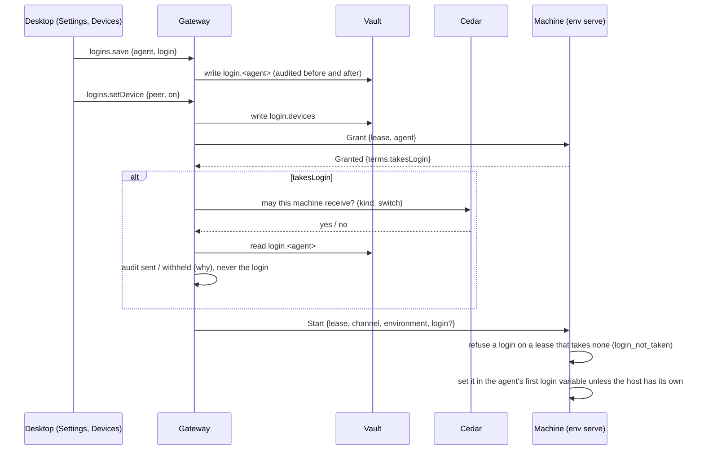

# Saved logins

Issue #1260. Sign in an agent once, on the gateway, and every machine in
Devices that runs agents for it can use that sign-in.

## The rule

The gateway's vault is the one place a login is kept. It is never copied
to another machine's disk: it travels with each agent start, by value, and
the machine holds it only for the harness it starts with it. Replacing or
removing a login applies from the next agent started.

Three yeses are needed before a login reaches a machine, each owned by one
place:

| Question | Who answers | Where |
| --- | --- | --- |
| Does this machine take logins from this gateway? | The machine's owner | `grants.json` `acceptLogins` (`nessa env grant --logins`); SSH takes them without an entry |
| May the gateway hand this machine logins? | Cedar, over facts | `logins/infrastructure/cedar/policies.cedar` |
| Is a login saved for this agent? | The vault | entries `login.claude`, `login.codex`, `login.opencode` |

The Cedar policy permits SSH hosts and Boat workspaces (this gateway signs
in as their account and can already set anything a harness there runs
with), permits a paired machine only while its "Use my saved logins here"
switch is on (vault entry `login.devices`), and forbids this gateway's own
machine. A machine whose own `config.json` or environment sets any of an
agent's login variables keeps its own: the host wins.

## Flow

## Wire

- `GrantedTerms.takesLogin` (required) is the machine's answer.
- `ToEnvironment::Start.login` is the value only; its variable is fixed by
  `lease::login_variables(agent)`, so a gateway cannot name a variable.
- Product methods `logins.status`, `logins.save`, `logins.remove`,
  `logins.setDevice`, grant `credential.manage`. No answer ever holds a
  login; the client refuses one that does.

Codex and OpenCode take an API key. A ChatGPT-account sign-in file for
Codex is not carried.

## Checked by

Unit tests under `crates/nessa-server/tests/logins`, `env_serve`,
`conversation/ssh_environment.rs` and `product/socket/logins.rs`; the
conversation stress step `login` (a real `nessa env dial` worker started
signed out, off then on, its launches recorded).
