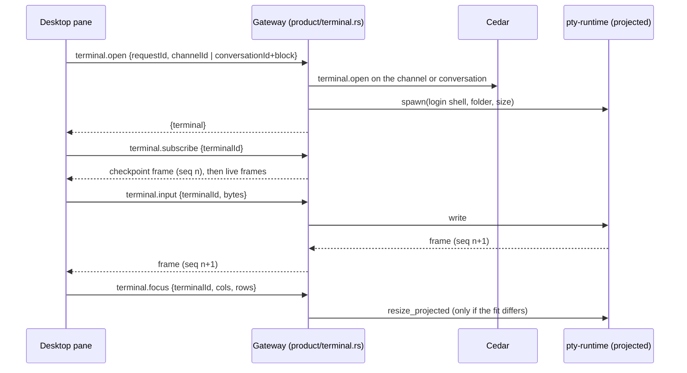

# Terminals

A terminal is a chat you type commands into. It sits in the channel's session
list like any conversation, opens in the same panes, splits and tabs, and runs
a real shell on the machine the channel works on. Tracked in
[#1398](https://github.com/nessalabs/nessa-agent/issues/1398).

What the person sees:

- **⌘J** (and **New terminal** in the "+" menu) starts a terminal in the
  channel that is open, in that channel's folder and place.
- The pane is one real terminal: a full grid with scrollback. Keys go straight
  to the program, so vim, htop and a REPL work as they do in any terminal.
  There are no command blocks.
- The pane header is the same slim titlebar a chat has: a terminal icon, the
  title (the running command, or the shell's name), and the split, details,
  more and close icons. No path or place in the header or the session row.
- The **details** icon beside split opens a popover with the listening ports
  (each with Open), where it runs, its folder, its shell and when it started.
  A listening port lights a dot on the icon. Ports come from `nessa-ports`
  (Codex's work); the popover only shows what it reports.
- Plain ⌘C copies the selection and plays a short shimmer over the copied
  rows, with a "Copied" tag. Reduced motion shows a still highlight instead.

## Run blocks

A fenced block in an agent reply whose language is `bash`, `sh`, `shell`,
`zsh` or `console` gets a **Run** button beside Copy.

- **Run** starts a terminal session in the working folder of the
  conversation's agent, on the machine that agent runs on, and types the block
  into it. The output shows inline under the block. The block header shows a
  terminal icon (open it as a full terminal) and, while it runs, a stop icon
  (sends Control-C).
- The session is a real interactive PTY. It keeps running when the reply
  scrolls away; opening it with the terminal icon shows the same session in a
  pane, where the person can type into it.
- When it ends, the header shows the exit status and duration and offers
  **Run again**, which starts a new session.
- A `console` block runs only the lines that start with `$ `, without the
  prompt; other lines are output from the agent's example and are not run.

Only the person's click runs a block. Agents never press Run, never start a
terminal, and never read one. An agent sees terminal output only when the
person pastes it into the chat.

## Where it runs

A terminal has one place for its whole life, fixed when it starts:

| Started by | Machine | Folder |
| --- | --- | --- |
| ⌘J or "+" in a channel | the channel's place (this Mac, an SSH host, a cloud VM) | the channel's folder on that machine ([channels](channels.md#where-an-agent-works)) |
| Run in a conversation | where that conversation's agent runs | that agent's working folder |
| Run again | same as the block's first run | same |

A request never names a folder or a host. `terminal.open` names a
`channelId` (⌘J) or a `conversationId` plus the block's message and index
(Run), and the gateway resolves the place exactly as it does for an agent in
that channel or conversation. The shell is the account's login shell on that
machine, started as a login shell, with `TERM=xterm-256color`.

## Backend

[pty-runtime](https://github.com/nessalabs/pty-runtime) owns the PTY and the
terminal model on the machine that runs the shell. Sessions are started in
**projected** mode: pty-runtime feeds the program's output through Ghostty's
terminal model and sends laid-out rows ([client/PROTOCOL.md]: `ready`,
`frame` with `seq`, cursor and styled rows, `styles`, `modes`, `history`,
`exit`). The desktop and the phone paint those rows. Neither runs a terminal
emulator of its own, so both always show the same screen.

- **This Mac and SSH hosts** run pty-runtime inside the gateway (the Runtime is
  built on the main thread before Tokio starts, as pty-runtime requires).
- **Cloud VMs** run it inside `env serve` through workspace-sdk's `Terminals`
  capability, which already depends on pty-runtime; frames travel on the
  existing workspace stream.
- No platform build of the Ghostty model is qualified yet. Slice T0 builds it
  in CI and the host builds; until it passes on a platform, that platform runs
  pty-runtime in raw mode and the pane paints with xterm.js. The pane and the
  protocol stay the same.

Scrolling back reads pty-runtime's history rows for that view. Selection
copies text from those rows, so a copy is exactly what is on screen.

## Several views of one terminal

One session can be drawn in several places at once: a pane, another pane split
beside it, the inline output under its Run block, and later the phone. The
program sees one terminal with one size, so:

- **One size owner.** The view the person last focused or typed into sets the
  size. If its fit differs from the terminal's size, the gateway resizes the
  terminal to that fit. Every other view scales the grid to its own box and
  never resizes. When the owner closes, the size is kept until another view
  takes focus.
- **The cursor is the server's.** Cursor, colours and grid come from the
  frames. A view paints frames in `seq` order and drops any frame older than
  the one it shows. A view that opens gets a checkpoint of the current screen,
  then live frames.
- **Scroll is per view.** Scrolling back is a history read for that view only.
  Another view's typing, scrolling or resizing never moves it. A view at the
  bottom follows new output; a scrolled view stays where it is.

| State | Event | Next state | Effect |
| --- | --- | --- | --- |
| Unowned | View opens | Unowned | checkpoint, then live frames to it |
| Unowned | View focused | Owned by it | resize to its fit if different |
| Owned by A | B focused or typed into | Owned by B | resize to B's fit if different; all views rescale |
| Owned by A | A's box changes | Owned by A | resize to A's new fit |
| Owned by A | B's box changes | Owned by A | B rescales only |
| Owned by A | Output | Owned by A | one frame to every open view |
| Owned by A | A closes | Unowned | size kept |
| any | Scroll in a view | same | history read for that view |
| any | Program exits | Exited | `exit` to every view; input refused |

The state page with the TLA+ model is
[Share a terminal between views](../state/services/desktop/workspace/share-a-terminal-between-views.md).

## Session lifecycle

| State | Means | Leaves by |
| --- | --- | --- |
| Starting | spawn requested | first frame (Running) or spawn error (Failed) |
| Running | shell alive, views may attach | program exits (Exited), person closes or stops it (Closing) |
| Closing | hang-up sent | process gone (Exited), or killed after 5 s |
| Exited | exit status kept for the row and the Run block | person removes the row |
| Failed | spawn refused (folder gone, host unreachable) | Run again or ⌘J starts a new one |

Closing a pane does not end the session; it only detaches that view, like
closing a chat pane. The session row's close action, the stop icon, or the
shell exiting ends it. A gateway restart ends every local session (a PTY
cannot outlive its process); their rows show Exited with "Ended when Nessa
restarted". Keeping processes alive across restarts through shepherd is a
follow-up.

## Policy and audit

- `terminal.open` is a Cedar action on the channel (⌘J) or the conversation
  (Run): only a person principal who may use that channel or conversation can
  open one. Agent principals are refused, so no agent tool can start a
  terminal.
- `terminal.input`, `terminal.focus`, `terminal.subscribe` and
  `terminal.close` are admitted only for the principal that opened the
  terminal (or the owner).
- Every open, close and exit is audited under `terminals/` with the place,
  folder, who started it and, for Run, the conversation and block. Input bytes
  and output are never written to the audit log or to conversation history.

## Slices

| Slice | What lands |
| --- | --- |
| T0 | Build pty-runtime's projected mode in CI and the host builds; fallback raw mode plus xterm.js |
| T1 | Gateway `terminal.*` methods for this Mac, Cedar action, audit, frame subscription |
| T2 | nessa_ui Terminal primitive that paints frames, selection and the copy shimmer |
| T3 | Desktop terminal pane kind, session rows, ⌘J, details popover; stress step `terminal` |
| T4 | Run blocks with inline output, terminal and stop icons; stress step `run` |
| T5 | Cloud VMs and SSH hosts through workspace-sdk `Terminals` |

[client/PROTOCOL.md]: https://github.com/nessalabs/pty-runtime/blob/main/client/PROTOCOL.md
