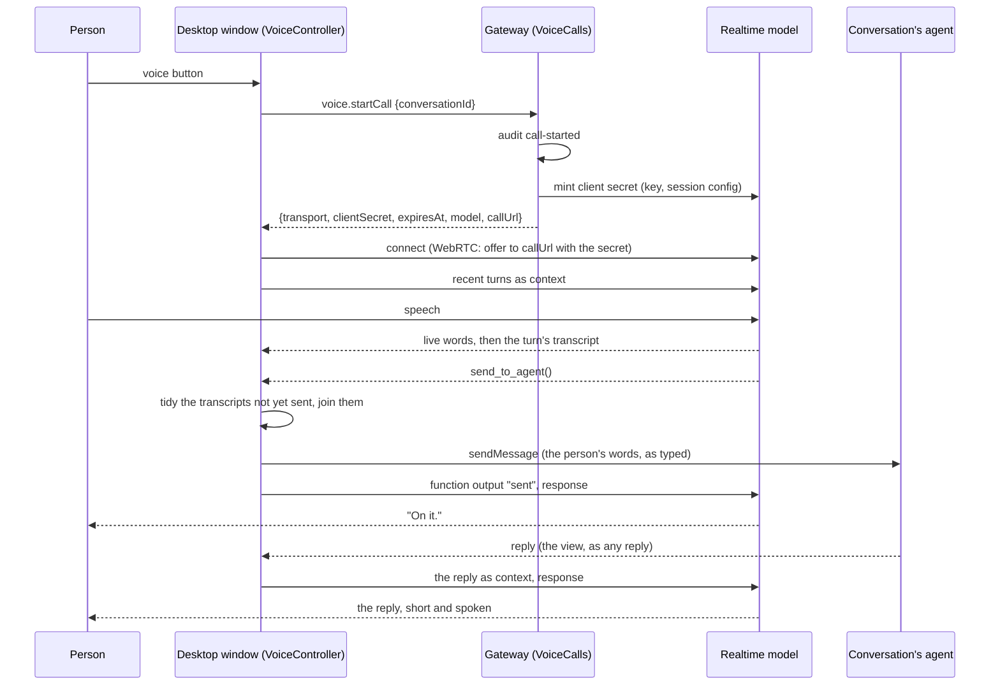

# Voice chat

Talk to a conversation's agent by voice from its composer
([#1228](https://github.com/nessalabs/nessa-agent/issues/1228)). A spike: the
desktop window on macOS first, the phone later.

A realtime voice model sits between the person and the conversation as a
**coordinator, never a worker**. It hears the person, decides when they asked
the agent for something, and hands that over; when the agent answers, it talks
about the answer. Everything the agent sees is an ordinary message in the
person's own words (transcribed, lightly tidied), so voice works the same with
every agent and the transcript stays what was said.

## Who owns what

| Fact | Owner | Kept in |
| --- | --- | --- |
| The OpenAI key | `voice::application::VoiceCalls` | the encrypted vault entry `voice-openai-key`; never sent to a window |
| What a call is told and may call (instructions, tools, transcription, voice) | `voice::domain::session` | code; minted into each call's client secret, so a window cannot widen it |
| The names of the voice tools | `VoiceToolName` (`protocol/product/v1.json`) | generated for both sides |
| Where realtime calls are minted and how the window connects | `voice::infrastructure::RealtimeProvider` | OpenAI by default; `NESSA_VOICE_REALTIME` names a file describing a scripted provider (the stress check's fake) |
| Each key change and each call started | `DurableVoiceAudit` | `<namespace>/conversations/audit/voice`, one private file per record, never the key or a client secret |
| The call, what was heard, what is waiting to be sent | `src/desktop/voice` (`VoiceController`) | memory, for the call's life |
| What is sent to the agent | the workspace's `sendMessage` and `stopTurn` | the conversation, as if typed |

## The flow

## The window's call

`VoiceController` (`src/desktop/voice/application/voice-controller.ts`) is the one
owner of a call. Its transport is injected (`RealtimeTransport`), chosen by
the `transport` the gateway answered from a total table built in composition:
`webrtc` (OpenAI; microphone, audio element, data channel) or `scripted` (a
WebSocket carrying the same realtime events and no audio; the stress check's
fake). Both carry OpenAI's realtime events, which only `VoiceController` reads.
The voice names each message it sends with its own id (`sendMessage`'s
`messageId`); the turn it starts is known by that id in the transcript, so a
turn's end is read for exactly that turn, never guessed from its words or
from when the chat went quiet.
A transport takes an abort signal: a call ended while it connects lets go
of the microphone at once.

Tidying (`model/tidy.ts`) is a pure function: fillers ("um", "uh", "erm"),
repeated words and a leading lowercase are fixed, nothing else. The
transcription model is also asked for clean punctuated text.

One call per window. Starting another, closing its pane, or leaving the
conversation ends the one running.

| # | State | Event | Result |
| --- | --- | --- | --- |
| V1 | idle | start | connecting; `voice.startCall` asked |
| V2 | connecting | refused (`voice_key_missing`, `voice_key_rejected`, `voice_unreachable`, `vault_locked`, …) | failed with that refusal's sentence; nothing to end |
| V3 | connecting | transport fails (no microphone, connection refused) | failed with its sentence; the transport is closed |
| V4 | connecting | transport open | listening; recent turns sent as context |
| V5 | connecting | end | idle; the connect is aborted (microphone released), and a late answer or transport is closed when it arrives |
| V6 | listening / working / speaking | words heard (partial) | the live line shows them |
| V7 | any open | a turn's transcript | kept, unsent, in order of the model's items |
| V8 | any open | `send_to_agent`, in a response that completed (a cancelled response's calls are not made), with unsent transcripts | they are tidied and joined into one message, sent as typed; the function answers `sent`; working. Sends go out in the order they were asked for: one waits for the one before it, transcript wait included |
| V9 | any open | `send_to_agent` while a transcript it covers has not arrived | waits up to 5 s for it (a failed transcript is nothing heard, at once); then sends what it has, or answers `nothing_heard` |
| V10 | any open | `send_to_agent`, send refused or unanswered | the function answers `not_sent`, or `unknown` when the gateway gave no answer (the voice says it may not have gone and does not resend); not waited on; the window shows the send failure as for typing |
| V11 | working | every turn the voice started has ended (the conversation says so per turn, named by the message that started it: its reply no longer being written, or its end marked) | what those turns said, in order, and how the last ended are handed to the model once, with a response asked; speaking until the response is done. Checked on every change of the conversation and once each send is answered, so a turn that ended before the window saw it at work is not missed. A turn typed in the composer is never one of them, and an earlier message with the same words is never mistaken for it |
| V12 | working | the person speaks and the model forwards again | a follow-up message, as a second typed message, queued behind the running turn; working until both have ended, then one handover covering both |
| V13 | any open | `stop_agent` | `stopTurn` as the Stop button; the function answers `stopped` or `nothing_running` |
| V14 | any open | response asked while one is in flight | queued; at most one response at a time; a `response.create` the provider refuses (error) frees the voice |
| V15 | any open | mute mic / speaker | the track or audio is off; the call stays |
| V16 | any open | end, pane closed, conversation left | idle; the transport closed |
| V17 | any open | transport closed or failed | ended, saying the call dropped |

A turn is open while its reply is being written, while the chat is at
work, or while its message is held waiting for an agent (`waiting` on the
message); an end, once seen, is kept by the call, and a turn the call saw
that has since left the bounded view counts as ended with nothing said.

Known limits, accepted for now:

- A turn that leaves the view before the window ever saw it keeps the call
  working until the next call.
- A message the agent took into its running turn (`injected`) reads as a
  turn that ended saying nothing; its words are in that running turn's reply.
- Stop while the voice's message is only held waiting answers
  `nothing_running`, as the composer's Stop would.
- Always-on calls cost while open; ending the call between turns is a later
  change, not this one.

## The gateway's key

`voice.status`, `voice.saveKey {key}`, `voice.forgetKey` are
`credential.manage`; `voice.startCall {conversationId}` is
`conversation.write`. Cedar admits each by its manifest grant; a call is
also admitted to its one conversation (read and act there, and it must
exist), so no call is minted about a chat the caller cannot use.

Every change is recorded before it is made and its outcome after, under
one operation id, so a request is never read as its effect. A mint runs on
its own task: a caller that goes away mid-mint still leaves its outcome on
record. A change or mint whose outcome cannot be recorded is answered
`voice_audit_unavailable`, never as a success (a saved key stays saved; a minted
secret is not handed out). A failure whose record cannot be kept is still
answered as that failure, and said in the log.

`NESSA_VOICE_REALTIME` (a provider file: `apiBase`, `transport`, `callUrl`)
may point only at this machine's loopback addresses, since the saved key goes
to `apiBase`. OpenAI is the default, never named by a file.

| # | State | Event | Result | Record |
| --- | --- | --- | --- | --- |
| K1 | vault locked | any | `vault_locked` | — |
| K2 | no key / key | `saveKey` with a key outside the shape (empty, over 256 bytes, not printable ASCII) | `invalid_request`, nothing changes | — |
| K3 | no key / key | `saveKey` | record first, then the vault entry written; `audit_unavailable` and nothing changes when the record cannot be kept; `voice_storage_unavailable` when the write fails | requested, then saved or failed |
| K4 | key | `forgetKey` | record first, then the entry deleted | requested, then forgotten or failed |
| K5 | no key | `forgetKey` | answers no key | — |
| K6 | no key | `startCall` | `voice_key_missing` | — |
| K7 | key | `startCall` | record first (`audit_unavailable` refuses), then mint; the answer carries no key | requested, then minted |
| K8 | key | `startCall`, provider refuses the key (401/403) | `voice_key_rejected` | requested, then refused |
| K9 | key | `startCall`, provider unreachable, times out, or answers malformed | `voice_unreachable` | requested, then refused |

The key is never logged, audited, or returned; `voice.status` says only
whether one is saved.

## Checks

- Gateway: `crates/nessa-server/tests/voice` — K1–K9 with a scripted provider,
  a memory secret and a recording audit, and a caller gone mid-mint; the
  OpenAI request and answer beside the adapter; the methods at the socket
  (grants, shapes, no key in any answer) in
  `crates/nessa-server/tests/product/socket/voice.rs`.
- Window: `src/desktop/voice/**/*.test.ts` — V1–V17 on a fake transport and a
  fake workspace; tidy's cases.
- End to end: the stress check's `voice` step (`pnpm test:e2e:stress`, knob
  `voices`) points the gateway at a fake realtime provider, saves a key in
  Settings, starts a call from the composer, speaks a request, and checks the
  message the agent got (tidied), the reply handed back, the microphone
  mute, a cancelled `stop_agent` stopping nothing, a real one stopping the
  turn, that the key is in no log or audit record, and that ending the call
  leaves a normal chat.
