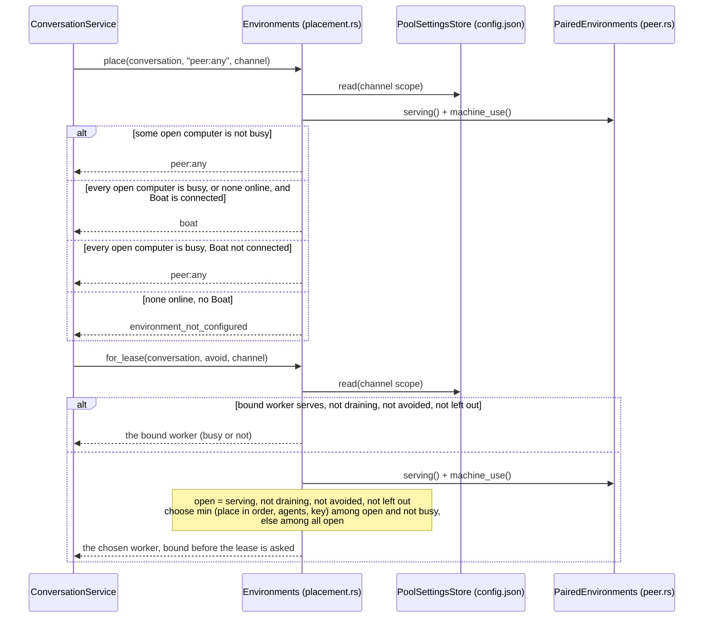

# Worker pool preferences

A conversation placed on `peer:any` (a channel's threads set to **Any
computer**, or `create_thread` with `environment: "peer:any"`) runs on one of
the gateway's paired computers. This document says which one, who decides it,
and the bound on how many threads one agent may have at work.

## What the person sets

- **Thread order** (Devices › Thread order): every paired computer, first
  choice first. Every connected computer is in the pool unless it is left out
  with its switch. A computer paired later joins after the ordered ones.
- **A channel's own order** (channel settings): "Same as Devices" follows the
  Nessa default; "Its own order" replaces it whole for that channel. The
  override is never merged with the default; removing it makes the channel
  follow the default again. This is the same inherit-or-override rule Boat's
  auto-stop uses (`crate::settings::resolve_inherited`).
- **When a computer is busy** (config.json only): `pool.busyCpuPercent` and
  `pool.busyMemoryPercent`, 90 each by default.
- **Live thread cap** (config.json only): `subagents.maxLiveThreads`, 0 (no
  bound) by default.

All of these live in config.json under one owner, `ConfigJson`, and are
validated whole by `RuntimeConfig` before any write:

```json
"pool": {
  "order": ["peer:…", "peer:…"],
  "excluded": ["peer:…"],
  "channels": {"ch_…": {"order": ["peer:…"], "excluded": []}},
  "busyCpuPercent": 90,
  "busyMemoryPercent": 90
},
"subagents": {"maxLiveThreads": 4}
```

## How a computer is chosen

The placement record (`placements/`) says `peer:any` and never changes. The
binding record (`bindings/`) says which worker holds the conversation now and
is what moves.



- A computer that never reported its machine is never busy.
- Busy is a reason to go elsewhere, never a reason not to run: with every
  open computer busy at lease time, the first in order still takes it.
- A conversation already bound stays on its worker while that worker may
  take it, however busy; it moves only when the worker drains, leaves, or is
  left out.
- Machine use comes from what each worker's lease link last reported
  (`environment.machine()`); no new wire message, and the lease protocol is
  unchanged.

## The live thread cap

`create_thread` counts, under the thread admission lock, the calling agent's
open children that are at work (their agent is running a turn) or were made
and not yet given work. At or past `subagents.maxLiveThreads` it refuses with
`thread_limit_reached`: the agent ends its turn and a thread's report wakes
it. A person's own creations are never counted. An unreadable family is
counted full, so a creation is refused rather than going past the bound.

## What an agent sees

`environments_list` gives each connected paired computer a `load`: processor
and memory use in percent, the agents it runs, its `poolPlace` (1 first,
absent when left out) and whether it is `busy`. Nothing is reached to
answer.

## Not yet

- This computer is not in the pool; only paired computers are.
- An older iPhone build that does not know `"pool"` as a thread placement
  needs the protocol vendored again to read such a channel.
