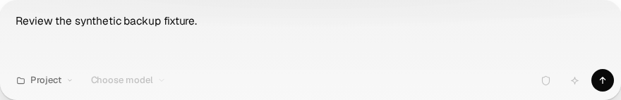
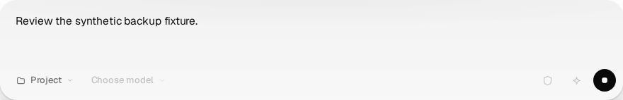

# Composer action identity (#1000)

These are direct locator captures of the actual fixed Composer with shared
desktop styling and its icon-family provider. The controlled parent changes
Send to Stop while keeping the same synthetic draft. This is component
evidence, not a running conversation or proof of #999's historical cause.





The two-key candidate and product component have SHA-256
`df02c6251485c8817fe0bf8478c52bbe11273d73c5279fdbaa734387204ee911`.
One capture-only Chromium session had no console, page or request errors,
and invoked neither callback. The images were not edited after capture.

Separate native-pointer evidence tested the original and fixed components
with the actual styles, icon provider and StrictMode: twelve vectors each.
The original padding gestures invoked the replacement action in both
directions. The fixed four cross-mode gestures invoked neither action and
kept the draft; eight unchanged-mode click and keyboard controls still
worked. Replacing the pressed control moves focus to the document body.
The correction cancels that gesture; it does not recover a lost click.

Evidence lives here because the shared `verification/` tree is held unchanged
for its separate owner. No shared harness, budgets or assertions changed.

## Replayable regression

Run from an installed checkout with Playwright Chromium and WebKit available:

```sh
node docs/reviews/evidence/composer-action-identity-1000/browser-regression.mjs > /tmp/composer-regression.json
```

The standalone runner imports the actual Composer, desktop styles and icon
provider into a synthetic StrictMode fixture. It starts only a loopback Vite
server on a free port, blocks browser requests to other origins, uses a private
cache and closes both browser engines and the server. It loads no environment
file and starts no gateway. JSON goes to stdout; a failed assertion exits nonzero.
Standard Playwright browser-path settings apply. This workspace uses its private
browser directory and a WebKit library adapter; skipping host validation does not
skip actual engine launch.

| Initial action | Event ordering | Required result |
| --- | --- | --- |
| Send or Stop | Pointer down/up in the same mode, padding and icon center | Current callback once; Send clears the synthetic draft, Stop retains it |
| Send or Stop | Pointer down, opposite mode, pointer up | Neither callback; draft retained; focus on BODY |
| Send or Stop | Pointer down, opposite mode, original mode, pointer up | Neither callback; draft retained; focus on BODY |
| Send or Stop | Space down, opposite mode, Space up | Neither callback; draft retained; focus on BODY |
| Send or Stop | Stable button Space/Enter or textarea Enter | Existing button operation or textarea submission |
| Stop | Disabled initially or disabled after pointer down | No Stop callback; draft retained |

The runner checks 23 cases per engine (46 total), including measured button/icon
geometry and zero console, page and failed-request errors. Private key-removal
mutation failed the same runner in both engines: the Send-to-Stop padding
gesture invoked Stop once instead of zero. The private copy initially lacked
the checked-in model catalog; that setup failure is retained separately. No
production source was mutated and no production test switch is used.
The earlier reviewer ran 17 cases per engine independently. A first implementer
runner attempt was invalidated by formatting during its execution and is retained
as failed setup evidence; the formatted frozen runner subsequently passed 46/46.

This committed replay lives beside its own evidence under the explicit hold on
all shared `verification/**` writes, including its checklist. That location is
an authorized deviation from the standards' normal placement; it does not waive
native browser assertions or the canonical suite.
