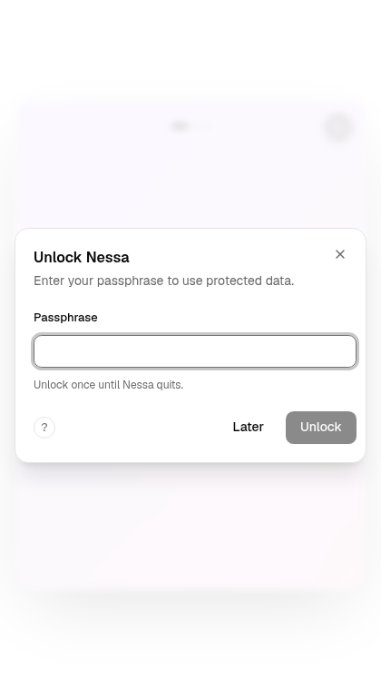

# Setup-window vault readiness correction

Source correction: `83f5e756cc82469d0156341d15774685241a437d`, parent
`96cde10882702df1259d9976f8ecc471cedd40fc`.

## Preserved failed-source evidence

[Run40669790086](https://github.com/nessalabs/nessa-agent/actions/runs/40669790086)
is terminal failure at published96, actual tested merge
`55c41f05777e9a939a2fba5c2f17a420c880e393`, with main
`b1da97d9ae6c5addf2da0bcf6cea940d6eeb7b5c`. All eleven non-stress jobs passed.
The default stress report held40/53: case037 onboarding timed out after15seconds
waiting for the exact Welcome heading, and twelve later cases did not run.
Focused webhook WebKit/count-three and dependent WebKit cohorts were skipped.
The default Chromium webhook case008 passed with fixed Head46,46queued and zero
attempts. Chaos2/2 passed. None of these exclusions is recorded as acceptance.

The real fixture reproduced the same failure mode: its setup shell rendered
before the app-owned vault status completed. The old visibility-only unlock
check returned before the unlock dialog appeared. That modal then hid Welcome
from the accessibility tree. The failed CI log captures the timeout; the
following image is the separately reproduced diagnostic, not a recovered CI
screenshot.

## Bounded fixture correction

The window initializer reuses the existing requested-unlock helper. After the
setup UI intent, it observes public vault status, waits for the actual requested
prompt when locked, uses the existing passphrase/unlock controls once, and checks
that authoritative status is unlocked afterward. Already-unlocked setup performs
no unlock action. Status errors, a missing prompt and an unsuccessful unlock do
not become readiness.

The prompt wait now explicitly uses15seconds instead of Playwright's implicit
30-second default. The existing Welcome assertion still uses15seconds. These
are individual wait bounds, not a fifteen-second total-case or hard OS/I/O
deadline. No production vault, permission, onboarding UI, graphic, workflow,
retention cap or security setting changed. Existing page/context and stack
cleanup owners are retained. Product state diagrams therefore need no transition
change for this verification-only correction.

## Author qualification

- Five focused tests execute the actual initializer and helpers with controlled
  late-prompt, unlocked, status-error, missing-prompt and failed-unlock outcomes.
  All five pass on restored source.
- Verified visibility-only reversion and a15-to30-second prompt-budget mutation
  each fail their intended controls. Both files were restored byte-for-byte
  with fresh modification times before final checks.
- The affected desktop helper selection passed542, failed zero, skipped one.
  Targeted ESLint, Prettier and diff checks passed.
- Actual gateway/vault-session and UI diagnostics passed both already-unlocked
  and naturally sealed states, including the same panel client/credential path
  used by default stress. The owned child closes and joins before the sealed
  case; no foreign session is forcibly locked. Context, browser, native child
  and disposable gateway cleanup were awaited in finally.

Those diagnostics used existing installed Chromium151.0.7922.173 with the exact
app source and disposable scripted runtime. They are not canonical bundled
Chromium/WebKit or full-cohort acceptance. No browser download, live account,
real credential or external recipient was used. Corrected-head automatic CI
remains required.

## Independent bounded review

Reviewer `/root/setup_vault_affected_review` reports **clean, no findings** at
exact83f5 source. It independently passed5/5 focused tests and checked the status,
prompt and unlock relationship, helper callers, unchanged Welcome assertion,
stricter prompt ceiling, failure propagation and cleanup ownership. It attributes
the real-browser diagnostics and542-test suite to author receipts rather than
claiming independent execution of them.

Original report SHA256:
`c9a73d1ed505875891fb16e489ed96533684967b4f3e739c195eebc218e4a6cf`.
This is a technical publication excerpt of a bounded fixture review, not a fourth
whole-feature round, review-counter reset, GitHub approval or merge permission.
The original report is retained unchanged. New exact-head CI remains pending.
