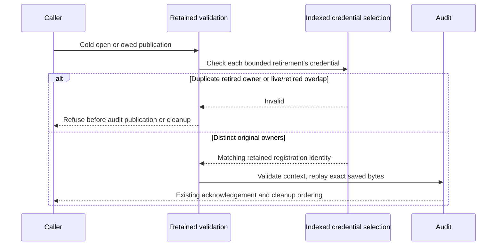

# Recovery and retained credential ownership (#896)

Source checkpoint: `97f3787ca88a7e06300726a635127897a218dea5`.
Review base: `c2f94625100f6ed018b156c06b08b67a3bd3994d`.
This is a narrow retained-data correction, not completion of #896 or final
assembled review of #1101.

## Recovered source and missing work

Actual shell execution, authenticated GitHub reads and ordinary Git fetch worked
in the fresh environment. Published #1101 was recovered at
`320e32614f98d3cf7c097ceb6da89ce26d0fe373`. Current main
`1f91c7a1e253b13d9ed6d12fd3ed9c2e19f984fc` merged cleanly in the review base;
the original checkout was preserved. Dependency heads #1091
`6c38915d5201de4cac54500ec4b5ad5e5f34229e` and #1096
`78258a8fdb1982393ba7d6fc3bf8b5e35f29a4d7` remain ancestors.

Unpublished cancellation source `bcb935b0cb93ca17e412a015b62bf10875079a00`
and docs `e53d00d03339224cf4715b07968651204d4297d7` each returned GitHub
`not our ref`. Historical local head prefix `94558156`, dirty M1 changes,
old test sessions and private harnesses were not recovered. None is claimed as
validated here. The recovered source contains no cancellation implementation to
qualify against those historical findings.

## Correction and concrete regression

Cold validation previously decoded retirement rows independently by registration
ID. Two complete retirement/audit histories could retain one credential under
different IDs. A different live registration with a matching intent could also
name that retained credential. Both histories were accepted, allowing owed audit
publication and cleanup. The [baseline control](baseline-control.txt) proves all
four required-refusal regressions fail against published production logic.

Every retirement validation now asks the existing indexed credential selector.
That selector also rejects live/retired overlap, including stopped live rows.
Its exact credential identity check does not infer authority from a principal,
endpoint, stop diagnostic or audit. Existing bounded row decoding, original
stop/audit identity and retained-progress owners remain in place.

The four new regressions independently cover live publication and cold open for
both contradictions. Each has a distinct-credential positive control. They retain
a real owed Drained acknowledgement with its original file already present,
assert unchanged SQL projections and audit file count on refusal, repair the
injected corruption, and recover exact original bytes. These are isolated
synthetic SQLite/filesystem fixtures; they create no Auth permission or recipient
transmission.

## Author execution

Linux x86_64, isolated rustc 1.99.1 stable, locked dependencies. The environment
initially had no Rust toolchain; it was installed under `/workspace/nessa-toolchain`
without changing repository sources or system configuration. An initial format
check lacked rustfmt, and the initial architecture invocation lacked Cargo on
PATH; after components/PATH setup the checks passed. Those setup failures are
not test failures or qualification.

- [Four initial regressions](initial-regressions.txt): 4 passed.
- [Canonical server webhook suite](webhooks-before-controls.txt): 174 passed.
- [Published-source control](baseline-control.txt): expected exit101, 0 passed,
  4 failed because actual refusal was absent in both live and cold paths.
- [Remove only live overlap refusal](overlap-control.txt): expected exit101,
  2 passed, 2 failed; both overlap regressions fail, duplicate controls pass.
- [Remove only shared restoration check](shared-owner-control.txt): expected
  exit101, 0 passed, 4 failed. Each mutation was asserted to land before execution.
- Fixed production bytes restored after every control, with refreshed mtime and
  SHA-256 `935632c2a66651d20f112823fd9a30477807c640df976385560b551f10b1bf11`.
- [Restored canonical suite](webhooks-restored.txt): 174 passed, zero failures
  or ignored, 19.69 seconds. Full boundary loops and assertions stay intact.
- [Required seven-package all-target Clippy](clippy.txt): exited0 with
  `-D warnings`. The pre-existing explicitly allowed lease fingerprint const
  evaluator progress warning remains; no lint, assertion, flush, timeout or
  capacity budget changed.
- [Architecture](architecture.txt), server formatting and diff checks passed.

Canonical command: `cargo test --locked -p nessa-server --lib webhooks::`.
The initial four-test command also used `--no-default-features`; this server
manifest declares no feature table. Both canonical full runs used defaults.
Clippy selection: nessa-local-storage, nessa-auth, nessa-server, nessa-protocol,
nessa-client-core, nessa-device-client and nessa-sdk, with `--all-targets`.

## Independent review

[Fresh round ONE](review-1/report.md) is clean at the source checkpoint, all
priority buckets empty. It independently ran [174 canonical tests](review-1/webhooks.txt)
and checked the actual cold/publication/trim order. Its [query probe](review-1/query-probe.py)
and [results](review-1/query-probe.txt) show covering credential-index selection
at 1 and 64 live rows, including stopped rows and distinct/case-sensitive controls.
Query-only minimal rows are not restorable/Auth fixtures. The independent test
run provides the complete semantic fixture evidence.

## CI and remaining qualification

Read-only inspection of run40037715660/job120701258988 at old published head
320e3261 confirms the Windows server step timed out after45minutes. The
[log excerpt](windows-320e-timeout-excerpt.txt) shows successful webhook progress
until the explicit timeout; the complete fetched log contains no recorded FAILED
test or panic. This establishes the observed failure mode, not its cause or a
Windows fix. Ten other owned jobs passed; the aggregate failed with Windows.
No workflow rerun/dispatch or timeout repair was attempted.

Runtime command/shutdown ownership, uninstalled-intent cleanup, registered share
target resolution, grant-aware canonical source replay, supervised sending and
capability/unshare/revoke/expiry/stale-epoch/retry/cancellation/cleanup/no-send
recipient E2E remain unfinished. Platform/MSRV, exact-head hosted CI, canonical
scripted Chromium/WebKit, default/raised stress/chaos and final assembled review
remain gates. The foundation retry, workflow-dispatch, browser-download403 and
project-board holds remain unchanged. Parent owns all merges and final metadata.

The design's retained-ownership table was updated. Existing statecharts already
route invalid retained relationships to Refused, and this correction adds no
state or transition. No state page checkpoint was advanced for this partial
recovery review or on behalf of the separate documentation owner. No renderer
or browser validation was performed here.
