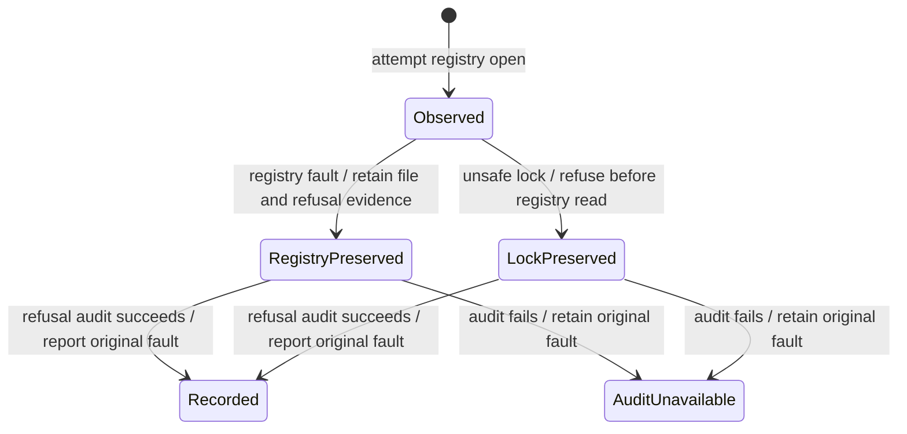

# Registry refusal evidence

Nessa refuses to use a credential file if it is damaged, too large, has an unsupported format, or is unsafe to open. It leaves the file unchanged so the problem can be investigated without destroying the original.

The refusal record describes the problem without exposing secrets. Failure to save that record does not make the file safe or replace the original error. This chart follows a refusal, not every attempt to open a credential file.

## Further reading

[Source](../../../../crates/nessa-auth/src/application/credential_registry.rs)

## Model coverage

Direct model. One rejected lock or registry observation; preserve original authority-bearing file and fault while reporting independent refusal-audit outcome.

OS safety checks and secret-free diagnostic construction are pure boundary contracts; no repair, credential revocation or eventual audit delivery is modeled. Safety only; terminal stuttering is allowed and there is no liveness or implementation-proof claim. This scoped source review adds the abstraction at `77a6b620af4d94b234294f6d273fd74b3dfb44c7`; older page checkpoints remain unchanged. Source tests were inspected, not executed.
