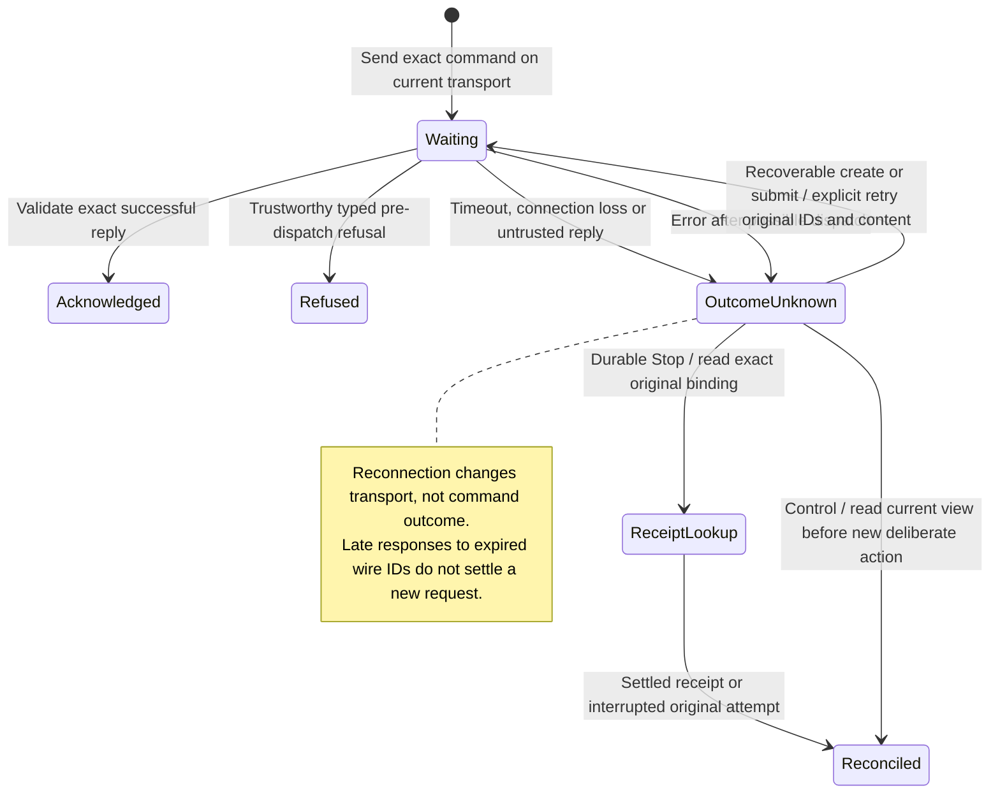

# Wire requests and command uncertainty

The client sends a request and waits for a reply. If the connection closes first, Nessa may already have accepted or acted on the request. The client reports that the outcome is unknown.

An explicit retry of conversation creation or a queued message keeps the original ID and content. It can recover the original answer instead of doing the work twice. The durable Stop command also has an exact request/turn binding and read-only receipt lookup. A settled retry returns its original outcome; an attempted Stop without a terminal receipt remains interrupted and is not cancelled again. Reorder, approval answers, app tool calls and one-use downloads need different recovery: read the current state before taking another action. Reconnecting does not replay these commands.

## Further reading

[Source](../../../../packages/nessa-client/src/transport/wire-session.ts) · [Related source](../../../../packages/nessa-client/src/application/conversation-mutation-error.ts) · [Related tests](../../../../packages/nessa-client/src/presentation/conversation-api.test.ts) · [Access-change sentences](../../../design/pre-save-revoked-refusal-860.md)

## Model coverage

Direct model: One command with stable application binding, two wire IDs, late reply rejection and uncertainty resolved by original receipt.

The finite model checks safety only. Command-kind-specific retry eligibility and complete ID/content equality are boundary assumptions; effect rollback, server receipt implementation and automatic retry are not claimed. Terminal states may stutter; no eventual completion or implementation proof is claimed.

This is a scoped source review at `77a6b620af4d94b234294f6d273fd74b3dfb44c7`. It adds the stated abstraction and does not refresh all earlier narrative claims. Existing page checkpoints are retained where present; reading regression sources is not a test run.
