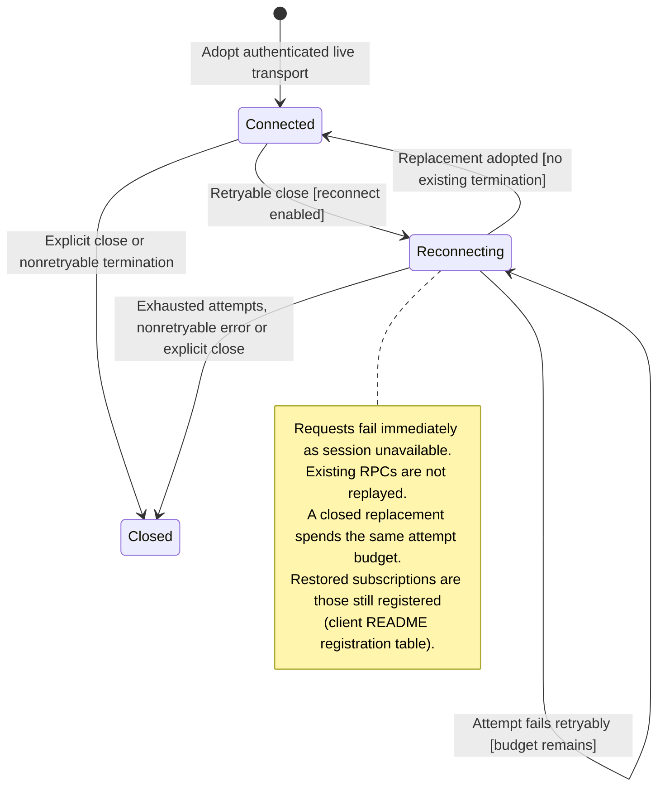

# Managed connection

The client opens a connection, checks that the gateway speaks the expected protocol, and authenticates before it becomes connected. A lost connection starts a limited retry process. Closing the client ends that process.

An old or already-closed connection cannot replace a working one. Reconnecting restores future subscriptions, but it does not recover every missed event or send earlier commands again. Work already accepted by the gateway may continue while the client is disconnected.

## Further reading

[Source](../../../../packages/nessa-client/src/application/managed-session.ts) · [Related source](../../../../packages/nessa-client/src/application/product-connect-flow.ts) · [Related tests](../../../../packages/nessa-client/src/application/managed-session.test.ts)

## Model coverage

Direct model: Two retry attempts, replacement termination before adoption, explicit close race and terminal no-resurrection.

The finite model checks safety only. Backoff timing, handshakes, registered subscription generations, retry error classification and browser transport effects; no RPC replay or missed-event recovery modeled. Terminal states may stutter; no eventual completion or implementation proof is claimed.

This is a scoped source review at `77a6b620af4d94b234294f6d273fd74b3dfb44c7`. It adds the stated abstraction and does not refresh all earlier narrative claims. Existing page checkpoints are retained where present; reading regression sources is not a test run.

[Subscription opening](subscriptions.md) and [event registration generations](event-registration.md) are separate modeled owners. Reconnecting does not infer that a previously delivered event was consumed.
